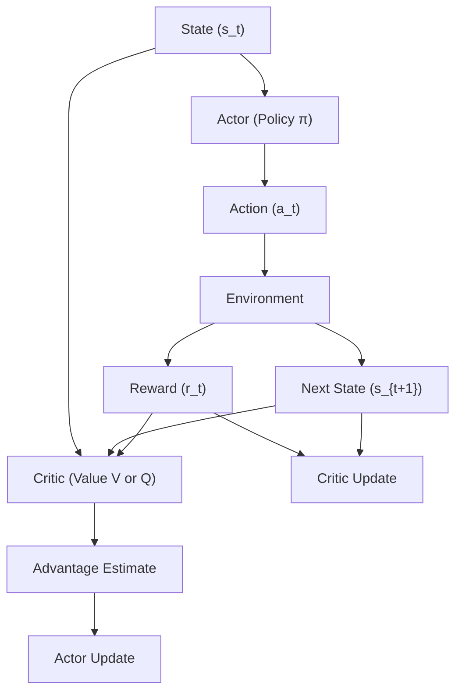
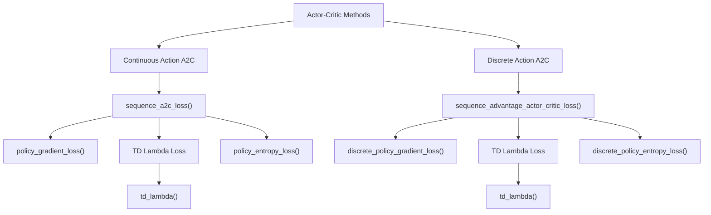
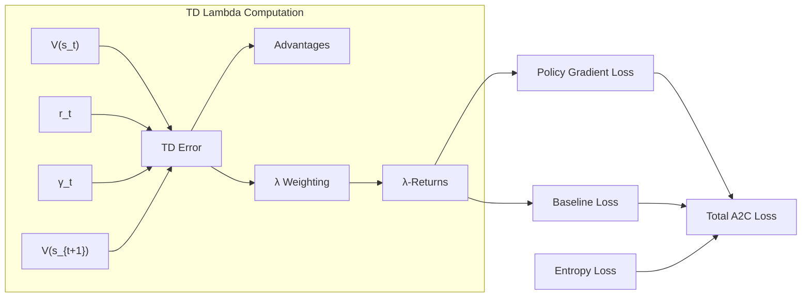
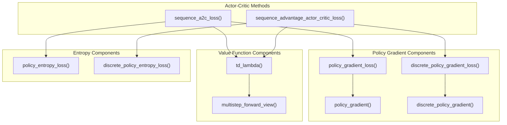

<!-- source: DeepWiki mcp.deepwiki.com · repo google-deepmind/trfl · page 3.2 Actor-Critic Methods · fetched 2026-10-26 -->

# Actor-Critic Methods

Relevant source files

The following files were used as context for generating this wiki page:

- [docs/multistep_forward_view.md](docs/multistep_forward_view.md)
- [docs/trfl.md](docs/trfl.md)
- [trfl/discrete_policy_gradient_ops.py](trfl/discrete_policy_gradient_ops.py)
- [trfl/policy_gradient_ops.py](trfl/policy_gradient_ops.py)

## Purpose and Scope

This document explains actor-critic methods as implemented in the TRFL library. Actor-critic algorithms combine policy-based and value-based approaches to reinforcement learning, using a value function (the critic) to guide updates to a policy function (the actor). This page covers both discrete and continuous action implementations of actor-critic methods in TRFL, including Advantage Actor-Critic (A2C) and Generalized Advantage Estimation (GAE). For related policy gradient methods not using the actor-critic architecture, see [Policy Gradients](#3.1). For deterministic policy methods, see [Deterministic Policy Gradient](#3.3).

## Actor-Critic Architecture

Actor-critic methods represent a hybrid approach to reinforcement learning that combines:

1. An **actor** that determines which actions to take (policy function)
2. A **critic** that evaluates those actions (value function)

Sources: [trfl/policy_gradient_ops.py:199-341](), [trfl/discrete_policy_gradient_ops.py:98-219]()

### Key Components

1. **Actor** - Learns a policy function π(a|s) that maps states to action probabilities
2. **Critic** - Estimates value functions (V(s) or Q(s,a)) to evaluate the actor's actions
3. **Advantage Estimation** - Measures how much better an action is compared to the average action

The critic provides feedback to the actor in the form of advantage estimates, which helps guide policy improvements while reducing variance.

Sources: [trfl/policy_gradient_ops.py:39-74](), [trfl/discrete_policy_gradient_ops.py:223-276]()

## Implementation in TRFL

TRFL provides implementations of actor-critic methods for both discrete and continuous action spaces:

Sources: [trfl/policy_gradient_ops.py:199-341](), [trfl/discrete_policy_gradient_ops.py:98-219]()

### Continuous Action Implementation

For continuous action spaces, TRFL provides the `sequence_a2c_loss` function that:

1. Computes TD-lambda returns and advantages
2. Calculates policy gradient loss using those advantages
3. Adds baseline (critic) loss
4. Optionally adds entropy regularization
5. Returns the combined loss for optimization

This function accepts policies represented as distributions (typically from TensorFlow Probability) that support `log_prob` and `entropy` methods.

Sources: [trfl/policy_gradient_ops.py:199-341]()

### Discrete Action Implementation

For discrete action spaces, the `sequence_advantage_actor_critic_loss` function works similarly but:

1. Takes policy logits rather than distribution objects
2. Uses sparse categorical cross-entropy for the policy loss
3. Supports nested policy/action structures for multi-discrete action spaces

Sources: [trfl/discrete_policy_gradient_ops.py:98-219]()

## Key Functions and Parameters

Here is a table of the main actor-critic functions in TRFL:

| Function | Action Space | Description |
|----------|-------------|-------------|
| `sequence_a2c_loss` | Continuous | A2C/GAE loss for continuous action policies represented as distributions |
| `sequence_advantage_actor_critic_loss` | Discrete | A2C/GAE loss for discrete action policies represented as logits |
| `policy_gradient` / `policy_gradient_loss` | Continuous | Policy gradient loss calculation for continuous actions |
| `discrete_policy_gradient` / `discrete_policy_gradient_loss` | Discrete | Policy gradient loss calculation for discrete actions |
| `policy_entropy_loss` | Continuous | Entropy regularization for continuous action policies |
| `discrete_policy_entropy_loss` | Discrete | Entropy regularization for discrete action policies |

Both A2C implementations support the following important parameters:

- `lambda_`: Controls the tradeoff between bias and variance in advantage estimation (GAE parameter)
- `entropy_cost`: Optional scalar regularization to encourage policy entropy
- `baseline_cost`: Scales the critic/baseline loss relative to the policy gradient loss

Sources: [trfl/policy_gradient_ops.py:199-341](), [trfl/discrete_policy_gradient_ops.py:98-219]()

## Advantage Estimation

Advantage estimation is a crucial component in actor-critic methods. The advantage function A(s,a) measures how much better an action is compared to the average action in a given state:

A(s,a) = Q(s,a) - V(s)

TRFL implements advantage estimation using TD-lambda returns through the `td_lambda` function. This supports Generalized Advantage Estimation (GAE) when λ < 1:

Sources: [trfl/policy_gradient_ops.py:199-341](), [docs/multistep_forward_view.md:1-63]()

The `td_lambda` function computes temporal difference errors and discounted returns using the multistep forward view algorithm, which efficiently computes the weighted average of n-step returns.

## Code Structure and Relationships

The actor-critic implementations in TRFL are built on top of more foundational policy gradient and value function components:

Sources: [trfl/policy_gradient_ops.py:77-105](), [trfl/policy_gradient_ops.py:39-74](), [trfl/discrete_policy_gradient_ops.py:223-276](), [trfl/discrete_policy_gradient_ops.py:279-327]()

## Return Structures

Both actor-critic implementations return a `LossOutput` namedtuple with:

1. `loss`: The total loss to be minimized
2. `extra`: A namedtuple containing additional information:
   - `entropy`: Policy entropy
   - `entropy_loss`: Scaled entropy loss
   - `baseline_loss`: Value function/critic loss
   - `policy_gradient_loss`: Actor/policy loss
   - `advantages`: Advantage estimates
   - `discounted_returns`: TD(λ) returns

This structure allows for easy access to individual loss components for monitoring or customized optimization.

Sources: [trfl/policy_gradient_ops.py:334-341](), [trfl/discrete_policy_gradient_ops.py:212-218]()

## Usage Example

Here's a conceptual example of how the actor-critic methods are typically used in TRFL:

1. Define a policy network (actor) and a value network (critic)
2. Pass states through both networks to get action distributions and state values
3. Sample actions from the policy
4. Collect trajectories of (state, action, reward, next state) transitions
5. Compute the actor-critic loss using `sequence_a2c_loss` or `sequence_advantage_actor_critic_loss`
6. Optimize both networks with respect to the loss

The key difference between the continuous and discrete implementations is how the policy is represented:

- For continuous actions: use probability distributions (e.g., `tfp.distributions.MultivariateNormalDiag`)
- For discrete actions: use logits that can be passed to `tf.nn.softmax` to get action probabilities

Sources: [trfl/policy_gradient_ops.py:199-341](), [trfl/discrete_policy_gradient_ops.py:98-219]()

## Relationship to Other TRFL Components

Actor-critic methods bridge the gap between policy-based and value-based learning in TRFL:

| Learning Category | Related TRFL Features | Relationship to Actor-Critic |
|-------------------|------------------------|------------------------------|
| Value-Based Learning | Q-Learning, TD Learning | Provides the critic component |
| Policy-Based Learning | Policy Gradients, DPG | Provides the actor component |
| Off-Policy Learning | V-trace, Retrace | Can be integrated with actor-critic for off-policy learning |
| Auxiliary Tasks | Pixel Control | Can be added alongside actor-critic losses |

The actor-critic framework is highly flexible and forms the foundation for many modern deep reinforcement learning algorithms.

Sources: [docs/trfl.md:1-1000]()

---

