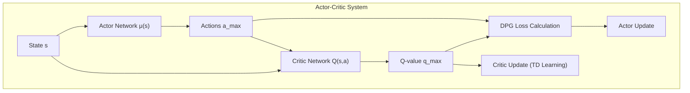
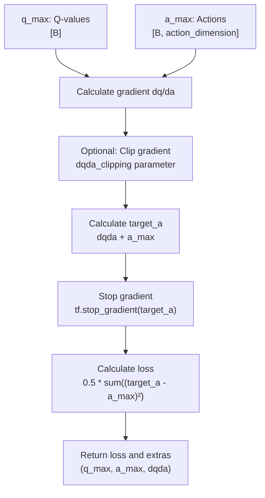
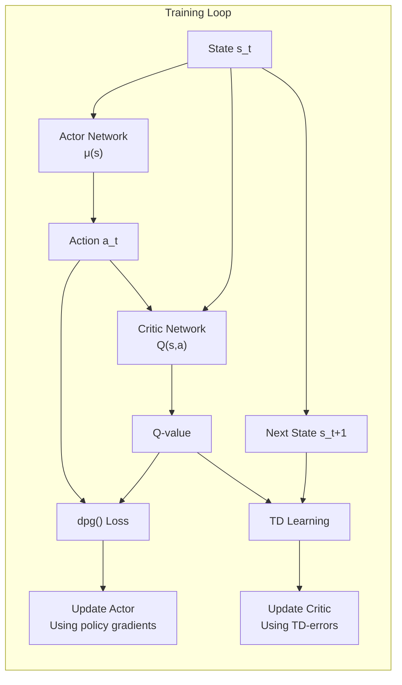

<!-- source: DeepWiki mcp.deepwiki.com · repo google-deepmind/trfl · page 3.3 Deterministic Policy Gradient · fetched 2026-10-26 -->

# Deterministic Policy Gradient

<details>
<summary>Relevant source files</summary>

The following files were used as context for generating this wiki page:

- [docs/multistep_forward_view.md](docs/multistep_forward_view.md)
- [docs/trfl.md](docs/trfl.md)
- [trfl/dpg_ops.py](trfl/dpg_ops.py)
- [trfl/dpg_ops_test.py](trfl/dpg_ops_test.py)

</details>


This document describes the Deterministic Policy Gradient (DPG) implementation in the TRFL library. DPG is a policy-based reinforcement learning algorithm designed for continuous action spaces. For information about discrete action spaces, see [Policy Gradients](#3.1) and [Actor-Critic Methods](#3.2).

## Overview

The Deterministic Policy Gradient algorithm learns a deterministic policy that directly maps states to specific actions, as opposed to stochastic policies that output probability distributions over actions. This approach is particularly effective for continuous control tasks where the action space is high-dimensional.

DPG is implemented in TRFL as a TensorFlow operation that calculates the loss for updating the actor in an actor-critic architecture. The critic is typically updated separately using TD-learning methods available elsewhere in the library.

Sources: [trfl/dpg_ops.py:15-21]()

## Theoretical Background

DPG was introduced in the paper "Deterministic Policy Gradient Algorithms" by Silver, et al. The key insight is to learn a deterministic policy μ(s) instead of a stochastic policy π(a|s). 

The deterministic policy gradient theorem states that the gradient of the performance objective with respect to policy parameters θ is:

```
∇θJ(μθ) = Es~ρμ[∇θμθ(s) ∇aQ(s,a)|a=μθ(s)]
```

In simpler terms, the policy gradient is computed by applying the chain rule to:
1. The gradient of the policy with respect to its parameters (∇θμθ(s))
2. The gradient of the Q-value with respect to actions (∇aQ(s,a))

This formulation allows for efficient policy updates in continuous action spaces without having to integrate over the action space.

Sources: [trfl/dpg_ops.py:36-44]()

## Implementation in TRFL

The core implementation of DPG in TRFL is found in the `dpg()` function in the `dpg_ops.py` file. This function calculates the loss for the actor network, which can then be used with an optimizer to update the policy.

### Architecture Diagram



### DPG Operation Flow



Sources: [trfl/dpg_ops.py:67-94]()

### Function Interface

The `dpg()` function takes the following parameters:

| Parameter | Type | Description |
|-----------|------|-------------|
| `q_max` | Tensor | Q-values generated by critic network for (state, a_max) pairs, shape `[B]` |
| `a_max` | Tensor | Optimal actions from actor network, shape `[B, action_dimension]` |
| `dqda_clipping` | int/float | Optional clipping value for the gradient dqda |
| `clip_norm` | bool | Whether to clip by vector norm (True) or element-wise (False) |
| `name` | string | Name prefix for operations |

The function returns a `LossOutput` namedtuple with:
- `loss`: Tensor containing the batch of losses, shape `[B]`
- `extra`: A `DPGExtra` namedtuple with fields:
  - `q_max`: Tensor of optimal Q-values, shape `[B]`
  - `a_max`: Tensor of optimal actions, shape `[B, action_dimension]`
  - `dqda`: Tensor of the derivative dq/da, shape `[B, action_dimension]`

Sources: [trfl/dpg_ops.py:35-65](), [trfl/dpg_ops.py:32-33]()

## Key Implementation Details

### Gradient Calculation

The core of the DPG algorithm is calculating the gradient of Q-values with respect to actions:

```python
dqda = tf.gradients([q_max], [a_max])[0]
```

This gradient indicates how small changes in actions affect the Q-values. The actor network is then updated to output actions that move in the direction that increases Q-values.

### Gradient Clipping

To maintain stability during training, TRFL's implementation supports optional gradient clipping:

```python
if dqda_clipping is not None:
    if clip_norm:
        dqda = tf.clip_by_norm(dqda, dqda_clipping, axes=-1)
    else:
        dqda = tf.clip_by_value(dqda, -1. * dqda_clipping, dqda_clipping)
```

This prevents extremely large gradient values that could cause unstable updates.

### Loss Calculation

The loss is calculated to update the actor network:

```python
target_a = dqda + a_max
target_a = tf.stop_gradient(target_a)
loss = 0.5 * tf.reduce_sum(tf.square(target_a - a_max), axis=-1)
```

The `tf.stop_gradient()` operation ensures that gradients only flow through the actor network and not back through the critic network.

Sources: [trfl/dpg_ops.py:70-93]()

## Usage in Actor-Critic Architecture

DPG is typically used within an actor-critic architecture:



1. The actor network produces actions based on states
2. The critic network evaluates these actions by estimating Q-values
3. The `dpg()` function calculates the loss for updating the actor
4. A separate TD-learning loss is used to update the critic

Sources: [trfl/dpg_ops.py:37-40]()

## Relationship to Other Algorithms

In the TRFL library, DPG is one of several policy-based learning methods. It's specifically designed for continuous action spaces, complementing other algorithms like:

- Stochastic policy gradients (for both continuous and discrete spaces)
- Actor-critic methods (which combine policy and value learning)
- TD learning (for updating the critic in actor-critic architectures)

DPG serves as a foundation for more advanced algorithms like DDPG (Deep Deterministic Policy Gradient), which extends DPG with deep neural networks and experience replay.

Sources: [docs/trfl.md:365-402]()

## Testing

The TRFL library includes comprehensive tests for the DPG implementation in `dpg_ops_test.py`. These tests verify:

1. Proper gradient computation
2. Correct gradient flow (only to actor network parameters)
3. Effective gradient clipping
4. Error handling for invalid inputs

Sources: [trfl/dpg_ops_test.py:27-131]()

## Common Issues and Solutions

| Issue | Cause | Solution |
|-------|-------|----------|
| `ValueError: q_max needs to be a function of a_max` | The Q-value tensor doesn't depend on the action tensor | Ensure proper connections between actor and critic networks |
| `ValueError: dqda_clipping should be bigger than 0` | Invalid clipping parameter | Use positive clipping values |
| Unstable training | Extreme gradient values | Enable gradient clipping with appropriate threshold |
| Poor performance | Incorrect actor-critic setup | Ensure proper setup and complementary critic updates with TD learning |

Sources: [trfl/dpg_ops.py:73-81]()

## Conclusion

The Deterministic Policy Gradient implementation in TRFL provides a powerful tool for reinforcement learning in continuous action spaces. It's designed to be used within an actor-critic architecture, where it provides the loss function for updating the actor network.

When combined with appropriate critic updates (typically using TD learning), DPG enables efficient learning of continuous control policies for a wide range of tasks.

---

