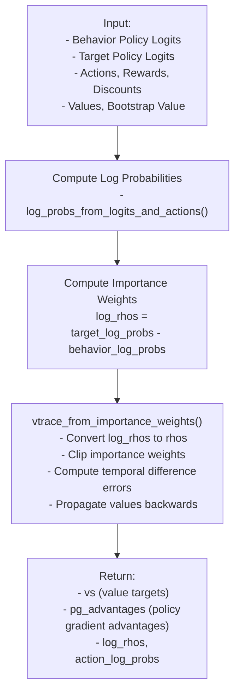
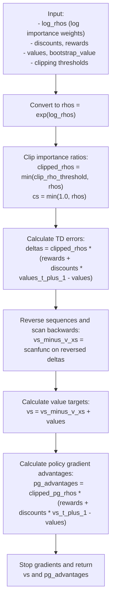
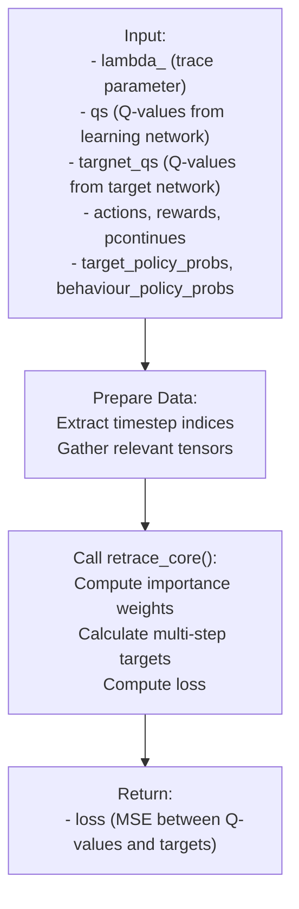
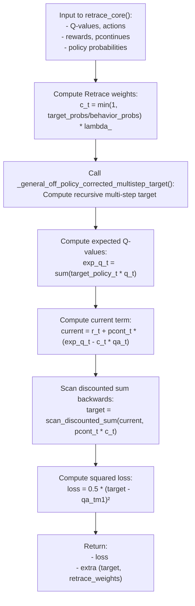
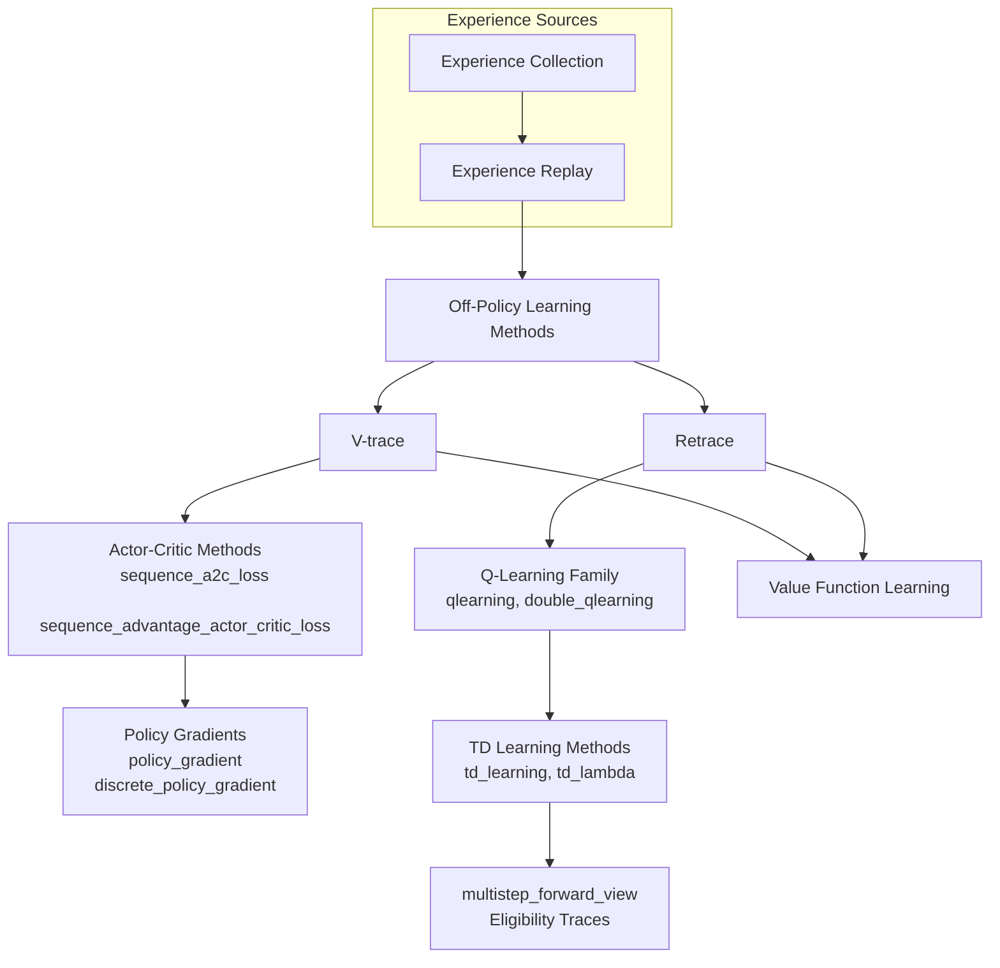

<!-- source: DeepWiki mcp.deepwiki.com · repo google-deepmind/trfl · page 4 Off-Policy Learning Methods · fetched 2026-10-26 -->

# Off-Policy Learning Methods

<details>
<summary>Relevant source files</summary>

The following files were used as context for generating this wiki page:

- [docs/multistep_forward_view.md](docs/multistep_forward_view.md)
- [docs/trfl.md](docs/trfl.md)
- [trfl/retrace_ops.py](trfl/retrace_ops.py)
- [trfl/vtrace_ops.py](trfl/vtrace_ops.py)

</details>


Off-policy learning methods allow reinforcement learning agents to learn from data generated by a policy different from the one being optimized. TRFL implements two state-of-the-art off-policy correction methods: V-trace and Retrace. These methods are essential for efficient learning with experience replay, exploration, and when learning from demonstrations or historical data.

For value-based learning approaches, see [Value-Based Learning](#2). For policy optimization approaches, see [Policy-Based Learning](#3).

## Key Concepts in Off-Policy Learning

Off-policy learning introduces specific challenges due to the distribution mismatch between the behavior policy (which generates data) and the target policy (which we're optimizing):

- **Importance Sampling**: Corrects for the probability ratio between target and behavior policies
- **Distribution Shift**: The gap between behavior and target policy distributions
- **Sample Efficiency**: Ability to learn effectively from previously collected data
- **Variance Control**: Methods to reduce the high variance often associated with importance sampling

## V-trace Algorithm

V-trace is an off-policy actor-critic algorithm introduced in the IMPALA paper (Espeholt et al., 2018) that uses clipped importance sampling to provide stable learning targets.

### V-trace Implementation in TRFL

TRFL provides two main functions for V-trace:
- `vtrace_from_logits`: Uses policy network logits to compute importance weights
- `vtrace_from_importance_weights`: Uses pre-computed importance weights



Sources: [trfl/vtrace_ops.py:60-150](), [trfl/vtrace_ops.py:153-275]()

### Core V-trace Calculation

The key computation in V-trace happens in `vtrace_from_importance_weights` function:



Sources: [trfl/vtrace_ops.py:153-275]()

## Retrace Algorithm

Retrace is an off-policy Q-learning algorithm that computes multi-step returns for action-values while maintaining low variance.

### Retrace Implementation in TRFL

TRFL implements Retrace with two main functions:
- `retrace`: High-level function for computing Retrace losses
- `retrace_core`: Lower-level implementation with more flexibility



Sources: [trfl/retrace_ops.py:44-175]()

### Core Retrace Calculation

The core computation happens in `retrace_core` and `_general_off_policy_corrected_multistep_target`:



Sources: [trfl/retrace_ops.py:291-415](), [trfl/retrace_ops.py:178-272]()

## Integration with Other TRFL Components

Off-policy methods connect with other TRFL components to build complete reinforcement learning algorithms:



Sources: [trfl/vtrace_ops.py](), [trfl/retrace_ops.py](), [docs/multistep_forward_view.md]()

## Usage Examples

### Using V-trace

```python
# Computing V-trace returns for off-policy actor-critic
vtrace_returns = trfl.vtrace_from_logits(
    behaviour_policy_logits=behaviour_policy_logits,  # [T, B, num_actions]
    target_policy_logits=target_policy_logits,        # [T, B, num_actions]
    actions=actions,                                  # [T, B]
    discounts=discounts,                              # [T, B]
    rewards=rewards,                                  # [T, B]
    values=values,                                    # [T, B]
    bootstrap_value=bootstrap_value,                  # [B]
    clip_rho_threshold=1.0,                          # Importance weight clipping
    clip_pg_rho_threshold=1.0                        # Policy gradient weight clipping
)

# Use V-trace returns for training
vs = vtrace_returns.vs                    # Value function targets
pg_advantages = vtrace_returns.pg_advantages  # Policy gradient advantages
```

### Using Retrace

```python
# Computing Retrace loss for off-policy Q-learning
retrace_output = trfl.retrace(
    lambda_=0.9,                            # Trade-off parameter
    qs=q_values,                            # [T+1, B, num_actions]
    targnet_qs=target_q_values,             # [T+1, B, num_actions]
    actions=actions,                        # [T+1, B]
    rewards=rewards,                        # [T+1, B]
    pcontinues=pcontinues,                  # [T+1, B]
    target_policy_probs=target_policy_probs,  # [T+1, B, num_actions]
    behaviour_policy_probs=behaviour_policy_probs,  # [T+1, B]
    stop_targnet_gradients=True             # Don't backprop through target network
)

# Use Retrace output for training
q_loss = tf.reduce_mean(retrace_output.loss)
```

Sources: [trfl/vtrace_ops.py:60-150](), [trfl/retrace_ops.py:44-174]()

## Comparison of V-trace and Retrace

| Feature | V-trace | Retrace |
|---------|---------|---------|
| **Target Function** | Value function (V) | Action-value function (Q) |
| **Algorithm Family** | Actor-critic | Q-learning |
| **Importance Weight Formula** | min(ρ̄, π/μ) | λ * min(1, π/μ) |
| **Primary Use Case** | Distributed RL (IMPALA) | Experience replay Q-learning |
| **Return Type** | Value targets + Policy advantages | Q-value targets |
| **Implementation** | vtrace_ops.py | retrace_ops.py |

Both methods use importance sampling with clipping to reduce variance while enabling off-policy learning.

Sources: [trfl/vtrace_ops.py](), [trfl/retrace_ops.py]()

## Implementation Details

### Mathematical Foundation

Both V-trace and Retrace build on the concept of eligibility traces, which provide a spectrum between one-step TD learning and Monte Carlo returns. They extend this framework to the off-policy setting using importance sampling.

The key mathematical operation in both algorithms is the recursive computation of multi-step returns, which is implemented efficiently in TRFL using TensorFlow's `scan` operation for processing sequences.

As shown in the `multistep_forward_view.md` document, both algorithms can be understood as computing a specific form of λ-return where λ is modulated by importance sampling ratios to account for off-policy learning.

Sources: [docs/multistep_forward_view.md](), [trfl/vtrace_ops.py:153-275](), [trfl/retrace_ops.py:178-272]()

## Conclusion

Off-policy learning methods in TRFL provide essential tools for efficient reinforcement learning. V-trace and Retrace enable stable learning from off-policy data, making them valuable components for experience replay, exploration, and real-world applications where collecting on-policy data is expensive or impractical.

These methods integrate seamlessly with other TRFL components to build complete reinforcement learning systems. Their theoretical guarantees and practical implementations make them suitable for both research and applications.

---

