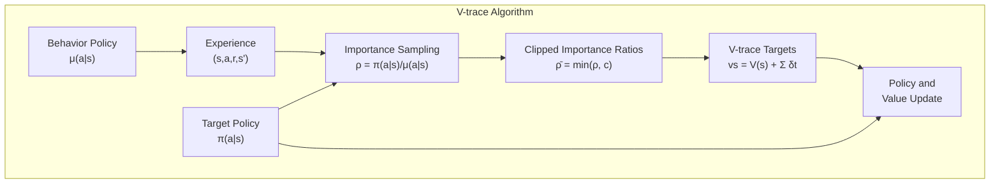
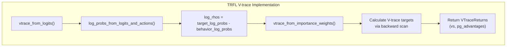
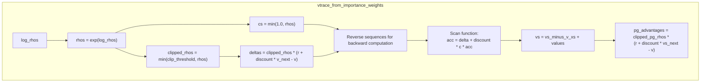

<!-- source: DeepWiki mcp.deepwiki.com · repo google-deepmind/trfl · page 4.1 V-trace · fetched 2026-10-26 -->

# V-trace

<details>
<summary>Relevant source files</summary>

The following files were used as context for generating this wiki page:

- [docs/multistep_forward_view.md](docs/multistep_forward_view.md)
- [docs/trfl.md](docs/trfl.md)
- [trfl/vtrace_ops.py](trfl/vtrace_ops.py)

</details>


V-trace is an off-policy algorithm for value-based reinforcement learning that enables stable and efficient learning from experience generated by a different policy. It serves as a method for off-policy correction when using data collected from a behavior policy to learn a target policy. V-trace is particularly useful in distributed reinforcement learning systems where actors and learners run asynchronously at different speeds.

For information about other off-policy learning methods like Retrace, see [Retrace](#4.2).

Sources: [trfl/vtrace_ops.py:15-16]()

## Algorithm Overview

V-trace was introduced in the IMPALA (Importance Weighted Actor-Learner Architecture) paper by Espeholt, Soyer, Munos et al. The algorithm addresses a key challenge in off-policy learning: correcting for the discrepancy between the behavior policy (which generates the data) and the target policy (which we want to learn).

The core idea of V-trace is to use importance sampling with truncated importance weights to estimate value targets for the target policy, while limiting the variance that can arise from large importance ratios.



Diagram: Overview of the V-trace algorithm

Sources: [trfl/vtrace_ops.py:159-164]()

### Mathematical Formulation

V-trace computes targets for a value function V(x) using traces of experience generated by a behavior policy μ. The target values are defined recursively:

For a trajectory (x_t, a_t, r_t)_t≥0:

1. Importance weights are computed as the ratio of target policy probability to behavior policy probability:
   - ρ_t = π(a_t|x_t) / μ(a_t|x_t)

2. For stability, these weights are clipped:
   - ρ̄_t = min(ρ_t, c) where c is a threshold (often 1.0)
   - c_t = min(1, ρ_t)

3. V-trace targets (v_s) are computed via a recursive formula:
   - v_s = V(x_s) + Σ_t≥s (γ^(t-s) * Π_i=s^(t-1) c_i) * ρ̄_t * δ_t
   - where δ_t = r_t + γ*V(x_t+1) - V(x_t) is the temporal difference error

4. Policy gradient advantages:
   - A_t = ρ̂_t * (r_t + γ*v_s_t+1 - V(x_t))
   - where ρ̂_t is potentially differently clipped than ρ̄_t

Sources: [trfl/vtrace_ops.py:222-275]()

## Implementation in TRFL

The TRFL library provides two main functions for V-trace:

1. `vtrace_from_logits`: A high-level function that handles softmax policies represented as logits
2. `vtrace_from_importance_weights`: The core implementation that works directly with importance weights



Diagram: Implementation flow in the TRFL library

Sources: [trfl/vtrace_ops.py:60-150](), [trfl/vtrace_ops.py:153-275]()

### Data Structures

The implementation uses two namedtuple structures to return the computed values:

1. `VTraceReturns`: A simplified return structure with fields:
   - `vs`: V-trace targets, used for training a value function
   - `pg_advantages`: Policy gradient advantages, used for policy optimization

2. `VTraceFromLogitsReturns`: An extended return structure with additional information:
   - `vs`: V-trace targets
   - `pg_advantages`: Policy gradient advantages
   - `log_rhos`: Log importance weights
   - `behaviour_action_log_probs`: Log probabilities of actions under the behavior policy
   - `target_action_log_probs`: Log probabilities of actions under the target policy

Sources: [trfl/vtrace_ops.py:27-31]()

## vtrace_from_logits

This is the high-level function for calculating V-trace targets from policy logits. It's designed to be used with softmax policies represented as unnormalized log probabilities.

### Parameters

| Parameter | Type | Description |
|-----------|------|-------------|
| `behaviour_policy_logits` | Tensor[T,B,NUM_ACTIONS] | Unnormalized log-probabilities of the behavior policy |
| `target_policy_logits` | Tensor[T,B,NUM_ACTIONS] | Unnormalized log-probabilities of the target policy |
| `actions` | Tensor[T,B] | Actions sampled from the behavior policy |
| `discounts` | Tensor[T,B] | Discount factors for each timestep |
| `rewards` | Tensor[T,B] | Rewards received at each timestep |
| `values` | Tensor[T,B] | Value function estimates for each state |
| `bootstrap_value` | Tensor[B] | Value estimate for the final state |
| `clip_rho_threshold` | float | Threshold for clipping importance weights in baseline targets |
| `clip_pg_rho_threshold` | float | Threshold for clipping importance weights in policy gradient |

### Returns

A `VTraceFromLogitsReturns` namedtuple with fields:
- `vs`: V-trace targets for value function training
- `pg_advantages`: Advantages for policy gradient updates
- `log_rhos`: Log importance sampling weights
- `behaviour_action_log_probs`: Behavior policy action log probabilities
- `target_action_log_probs`: Target policy action log probabilities

### Implementation Details

The function:
1. Computes action log probabilities for both policies
2. Calculates importance sampling weights as the difference between log probabilities
3. Calls `vtrace_from_importance_weights` to compute V-trace returns
4. Returns a comprehensive namedtuple with all relevant values

Sources: [trfl/vtrace_ops.py:60-150]()

## vtrace_from_importance_weights

This function is the core implementation of V-trace that works directly with importance weights. It can handle both softmax and general stochastic policies.

### Parameters

| Parameter | Type | Description |
|-----------|------|-------------|
| `log_rhos` | Tensor[T,B] | Log importance sampling weights |
| `discounts` | Tensor[T,B] | Discount factors for each timestep |
| `rewards` | Tensor[T,B] | Rewards received at each timestep |
| `values` | Tensor[T,B] | Value function estimates for each state |
| `bootstrap_value` | Tensor[B] | Value estimate for the final state |
| `clip_rho_threshold` | float | Threshold for clipping importance weights in baseline targets |
| `clip_pg_rho_threshold` | float | Threshold for clipping importance weights in policy gradient |

### Returns

A `VTraceReturns` namedtuple with fields:
- `vs`: V-trace targets for value function training
- `pg_advantages`: Advantages for policy gradient updates

### Implementation Details

The function:
1. Converts log importance weights to importance ratios: `rhos = exp(log_rhos)`
2. Clips the importance ratios for stability
3. Calculates temporal difference errors (deltas)
4. Uses a backwards scan to compute V-trace targets recursively
5. Calculates policy gradient advantages
6. Returns the results as a namedtuple with stop_gradient applied to prevent backpropagation



Diagram: V-trace target computation

Sources: [trfl/vtrace_ops.py:153-275]()

## Usage Example

To use V-trace in a reinforcement learning implementation, you would typically:

1. Collect experience using a behavior policy
2. Compute logits for both behavior and target policies
3. Call `vtrace_from_logits` to get targets and advantages
4. Use the targets to train your value function
5. Use the advantages to update your policy with policy gradients

```python
# Example pseudo-code (not runnable)
# Assuming you have collected trajectories using a behavior policy

# Compute policy logits
behavior_policy_logits = behavior_network(states)
target_policy_logits = target_network(states)

# Compute V-trace returns
vtrace_returns = vtrace_from_logits(
    behaviour_policy_logits=behavior_policy_logits,
    target_policy_logits=target_policy_logits,
    actions=actions,
    discounts=discounts,
    rewards=rewards,
    values=values,
    bootstrap_value=bootstrap_value
)

# Use returns to compute losses
value_loss = tf.reduce_mean(tf.square(values - vtrace_returns.vs))
policy_gradient_loss = -tf.reduce_mean(
    target_action_log_probs * vtrace_returns.pg_advantages)

# Combined loss
total_loss = value_loss + policy_gradient_loss
```

Sources: [trfl/vtrace_ops.py:60-150]()

## Relation to Other Methods

V-trace is one of several methods for off-policy correction in reinforcement learning:

| Algorithm | Key Characteristics | Use Case |
|-----------|---------------------|----------|
| V-trace | Uses clipped importance sampling for stable learning | Distributed RL systems like IMPALA |
| Retrace | Uses a product of truncated importance sampling ratios | Q-learning with experience replay |
| Q(λ) | Combines TD and Monte Carlo methods | Off-policy control with eligibility traces |
| Tree-backup | Does not use importance sampling | Off-policy learning without ratios |

V-trace can be seen as an extension of Retrace to the actor-critic setting, with specific modifications to ensure stability in a distributed learning environment.

Sources: [trfl/vtrace_ops.py:159-164]()

## Implementation Considerations

When using V-trace, consider these practical aspects:

1. **Clipping Thresholds**: The thresholds for clipping importance weights (`clip_rho_threshold` and `clip_pg_rho_threshold`) have significant impact on learning dynamics. Common values are in the range of 1.0 to 10.0.

2. **Numerical Stability**: The implementation works with log-space importance weights for numerical stability.

3. **Gradient Flow**: The implementation uses `tf.stop_gradient` to prevent gradients from flowing through the target calculations, which is a common practice in reinforcement learning to stabilize training.

4. **Backward Scan**: The V-trace targets are computed using a backward scan from the end of the trajectory, which is mathematically equivalent to the recursive formulation but more efficient to compute.

Sources: [trfl/vtrace_ops.py:236-257]()

---

