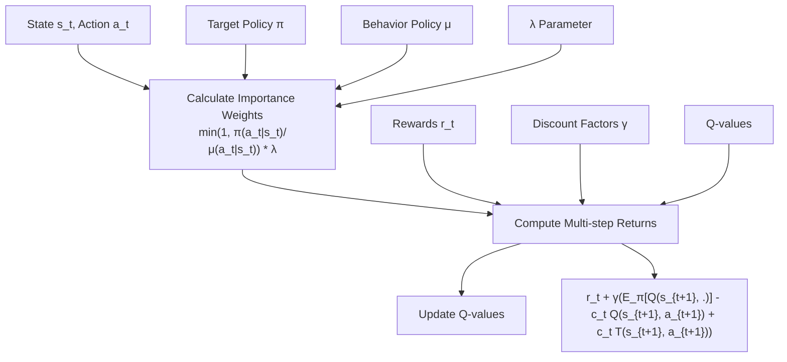
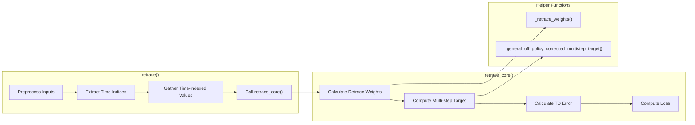
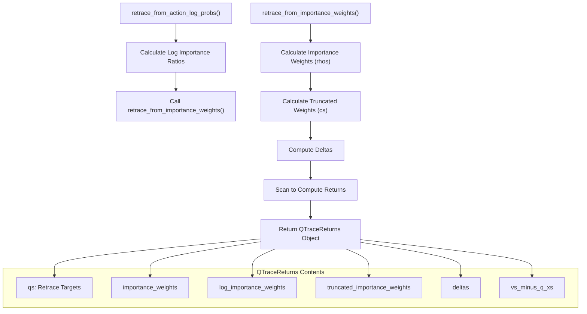
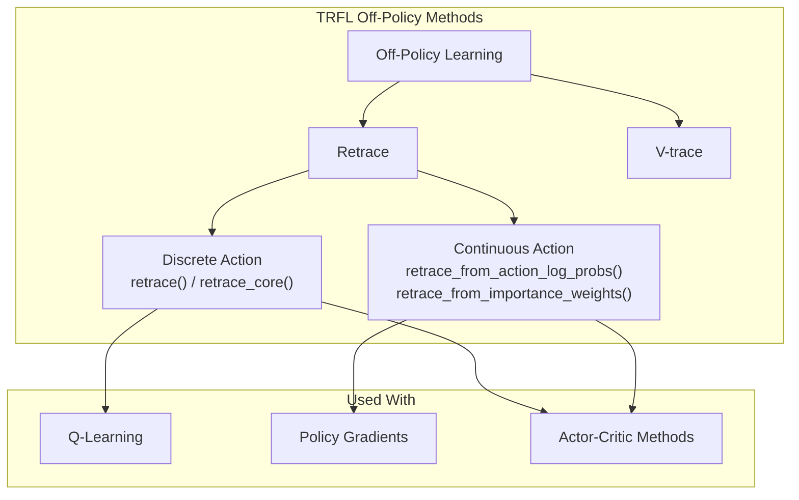

<!-- source: DeepWiki mcp.deepwiki.com · repo google-deepmind/trfl · page 4.2 Retrace · fetched 2026-10-26 -->

# Retrace

<details>
<summary>Relevant source files</summary>

The following files were used as context for generating this wiki page:

- [docs/multistep_forward_view.md](docs/multistep_forward_view.md)
- [docs/trfl.md](docs/trfl.md)
- [trfl/continuous_retrace_ops.py](trfl/continuous_retrace_ops.py)
- [trfl/continuous_retrace_ops_test.py](trfl/continuous_retrace_ops_test.py)
- [trfl/retrace_ops.py](trfl/retrace_ops.py)

</details>


Retrace is an off-policy learning algorithm implemented in TRFL for computing multi-step returns in reinforcement learning. It provides a way to efficiently leverage data collected from a behavior policy to learn an optimal target policy, with theoretical convergence guarantees. TRFL provides implementations for both discrete and continuous action spaces.

For information about other off-policy learning methods like V-trace, see [V-trace](#4.1).

## Overview of Retrace

Retrace(λ) is an off-policy multi-step return algorithm introduced by Munos et al. in ["Safe and Efficient Off-Policy Reinforcement Learning"](https://arxiv.org/abs/1606.02647). It addresses the issues of high variance in importance sampling and limited applicability of other off-policy methods by using a particular form of importance weight truncation.

The key advantages of Retrace are:

- Low variance compared to naive importance sampling
- Guaranteed convergence for any behavior policy
- Works well with experience replay
- Efficient use of multi-step returns even when behavior and target policies differ significantly

The algorithm calculates action-value targets by combining one-step TD targets with importance-weighted multi-step returns:



Sources: [trfl/retrace_ops.py:16-25](), [trfl/retrace_ops.py:54-72]()

## Implementation in TRFL

TRFL provides two separate implementations of Retrace:

1. For discrete action spaces: `retrace` and `retrace_core` in `retrace_ops.py`
2. For continuous action spaces: `continuous_retrace_ops.py` with functions `retrace_from_action_log_probs` and `retrace_from_importance_weights`

### Discrete Action Space Implementation



Sources: [trfl/retrace_ops.py:44-175](), [trfl/retrace_ops.py:291-415]()

The primary function `retrace()` serves as a user-friendly interface that handles the construction of time-indexed tensors before calling `retrace_core()`, which performs the actual Retrace computation. 

Key parameters for `retrace()`:

| Parameter | Description |
|-----------|-------------|
| `lambda_` | Controls the balance between multi-step returns and bootstrapping |
| `qs` | Q-values from learning network, shape `[T+1, B, num_actions]` |
| `targnet_qs` | Q-values from target network, shape `[T+1, B, num_actions]` |
| `actions` | Action indices, shape `[T+1, B]` |
| `rewards` | Rewards received, shape `[T+1, B]` |
| `pcontinues` | Discount factors, shape `[T+1, B]` |
| `target_policy_probs` | Target policy probabilities, shape `[T+1, B, num_actions]` |
| `behaviour_policy_probs` | Behavior policy probabilities, shape `[T+1, B]` |

Sources: [trfl/retrace_ops.py:44-123]()

The `retrace_core()` function performs:

1. Calculation of importance weights (using `_retrace_weights`)
2. Computation of multi-step targets (using `_general_off_policy_corrected_multistep_target`)
3. Regression of Q-values toward the targets

It returns:
- `loss`: Tensor of shape `[B]` containing squared TD errors
- `extra`: A namedtuple with `retrace_weights` and `target` fields

Sources: [trfl/retrace_ops.py:291-415]()

### Continuous Action Space Implementation

For continuous action spaces, TRFL provides the `continuous_retrace_ops.py` module:



Sources: [trfl/continuous_retrace_ops.py:50-230]()

The continuous version takes similar inputs but uses log probabilities for actions rather than direct policy probabilities:

| Parameter | Description |
|-----------|-------------|
| `behaviour_action_log_probs` | Log probabilities under behavior policy, shape `[T, B]` |
| `target_action_log_probs` | Log probabilities under target policy, shape `[T, B]` |
| `discounts` | Discount factors, shape `[T, B]` |
| `rewards` | Rewards received, shape `[T, B]` |
| `q_values` | Q-values, shape `[T, B]` |
| `values` | Value function estimates, shape `[T, B]` |
| `bootstrap_value` | Value estimate at final timestep, shape `[B]` |

Sources: [trfl/continuous_retrace_ops.py:50-90]()

## Mathematical Foundation

Retrace uses a specific form of importance sampling weight truncation and computes multi-step returns via a recursive formula.

The general recurrence relation for off-policy multi-step targets is:

```
T(x_{t-1}, a_{t-1}) = r_t + γ[ E_π[Q(x_t, .)] - c_t Q(x_t, a_t) + c_t T(x_t, a_t) ]
```

Where:
- `T(x, a)` is the target value for state-action pair (x, a)
- `r_t` is the reward
- `γ` is the discount factor
- `E_π[Q(x_t, .)]` is the expected Q-value under target policy π
- `c_t` is the importance weight
- `Q(x_t, a_t)` is the current Q-value estimate

For Retrace specifically, the importance weight is defined as:

```
c_t = λ * min(1, π(a_t|s_t)/μ(a_t|s_t))
```

Where:
- `λ` is the trace parameter controlling how far returns are propagated
- `π` is the target policy
- `μ` is the behavior policy

This formula generalizes several algorithms:
- When `c_t = λ`, it becomes Q(λ)
- When `c_t = π(a_t|s_t)`, it becomes Tree-Backup
- When `c_t = π(a_t|s_t)/μ(a_t|s_t)`, it becomes Importance Sampling

Sources: [trfl/retrace_ops.py:178-216](), [docs/multistep_forward_view.md:1-63]()

## Implementation Details

### Retrace Weights Calculation

The importance weights in Retrace are clipped to prevent high variance:

```python
def _retrace_weights(pi_probs, mu_probs):
  """Evaluates importance weights for the Retrace algorithm."""
  # tf.minimum handles potential NaNs when pi_probs[i]=mu_probs[i]=0
  return tf.minimum(1.0, pi_probs / mu_probs)
```

Sources: [trfl/retrace_ops.py:275-288]()

### Multi-step Target Calculation

The multi-step target is calculated using a backward recursive scan:

```python
def _general_off_policy_corrected_multistep_target(...):
  """Evaluates targets for various off-policy value correction based algorithms."""
  exp_q_t = tf.reduce_sum(target_policy_t * q_t, axis=2)
  qa_t = indexing_ops.batched_index(q_t, a_t)
  current = r_t + pcont_t * (exp_q_t - c_t * qa_t)
  initial_value = qa_t[-1]
  return sequence_ops.scan_discounted_sum(
      current,
      pcont_t * c_t,
      initial_value,
      reverse=True,
      back_prop=back_prop)
```

Sources: [trfl/retrace_ops.py:178-272]()

## Integration with TRFL

Retrace fits into TRFL's off-policy learning methods category alongside V-trace:



Sources: [trfl/retrace_ops.py:16-25](), [trfl/continuous_retrace_ops.py:15-33]()

## Usage Examples

A typical usage pattern for Retrace involves:

1. Collecting trajectories from a behavior policy
2. Computing Q-values using current and target networks
3. Calculating target and behavior policy probabilities
4. Calling the appropriate Retrace function to get targets
5. Using the resulting targets to update the Q-network

For discrete action spaces:

```python
loss = retrace(
    lambda_=0.95,
    qs=q_values,                      # From learning network
    targnet_qs=target_q_values,       # From target network
    actions=actions_taken,
    rewards=rewards,
    pcontinues=discounts,
    target_policy_probs=target_policy_probs,
    behaviour_policy_probs=behavior_policy_probs
)
```

For continuous action spaces:

```python
retrace_returns = retrace_from_action_log_probs(
    behaviour_action_log_probs=behavior_log_probs,
    target_action_log_probs=target_log_probs,
    discounts=discounts,
    rewards=rewards,
    q_values=q_values,
    values=values,
    bootstrap_value=bootstrap_value,
    lambda_=0.95
)

q_retrace = retrace_returns.qs  # Use as targets for Q-function update
```

Sources: [trfl/retrace_ops.py:54-123](), [trfl/continuous_retrace_ops.py:50-90]()

## Performance Considerations

- The discrete action implementation in `retrace_ops.py` explicitly checks tensor shapes and ranks to catch errors early
- The continuous implementation in `continuous_retrace_ops.py` includes optimizations like using `tf.scan` for computing returns
- Both implementations handle potentially problematic edge cases like division by zero in importance weight calculations
- The continuous version stops gradients on the returned values to prevent unintended backpropagation

Sources: [trfl/retrace_ops.py:134-149](), [trfl/continuous_retrace_ops.py:223-229]()

---

