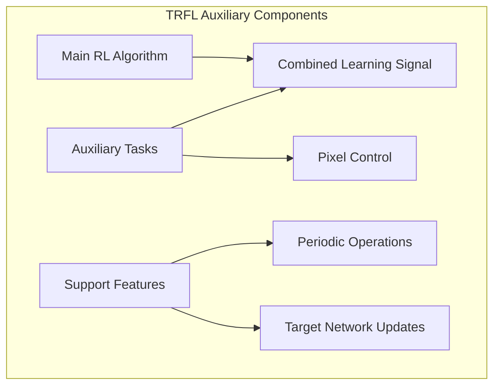
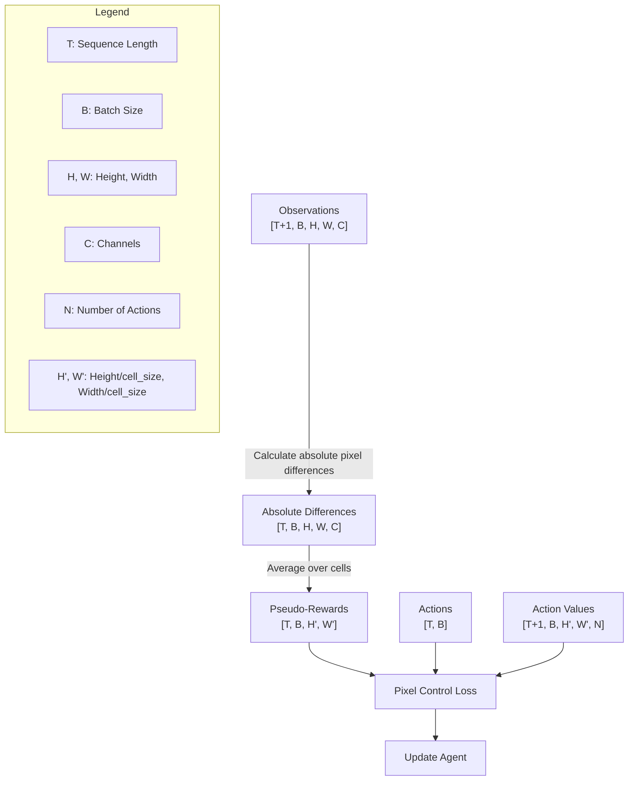
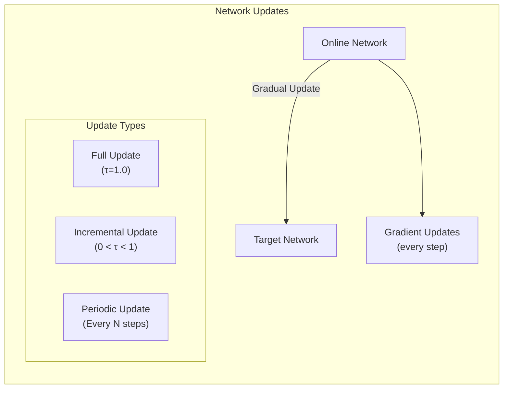
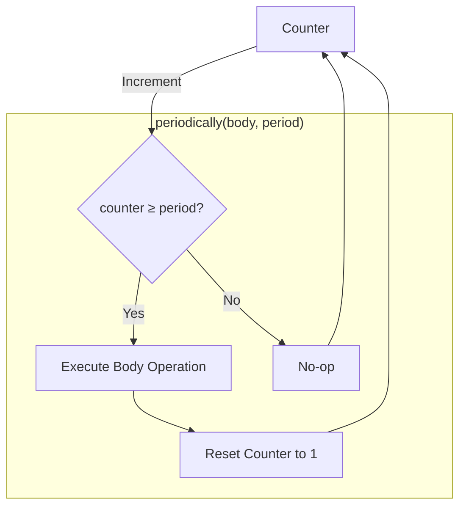
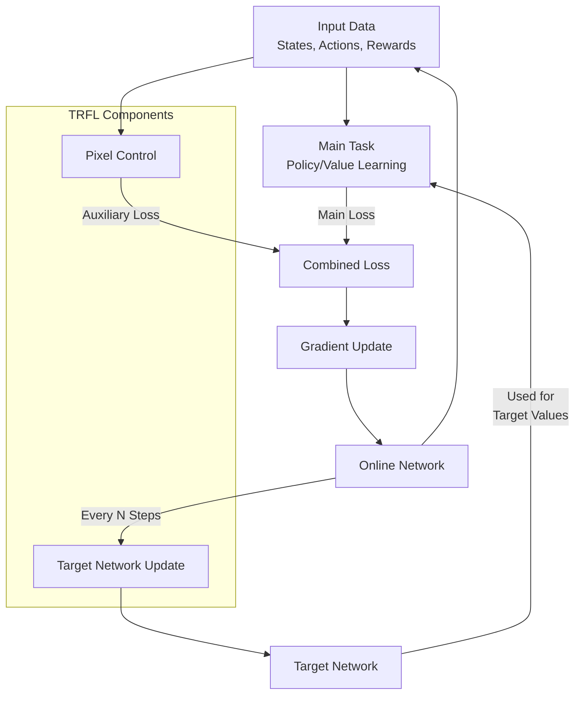

<!-- source: DeepWiki mcp.deepwiki.com · repo google-deepmind/trfl · page 5 Auxiliary Tasks and Features · fetched 2026-10-26 -->

# Auxiliary Tasks and Features

<details>
<summary>Relevant source files</summary>

The following files were used as context for generating this wiki page:

- [docs/multistep_forward_view.md](docs/multistep_forward_view.md)
- [docs/trfl.md](docs/trfl.md)
- [trfl/base_ops.py](trfl/base_ops.py)
- [trfl/periodic_ops.py](trfl/periodic_ops.py)
- [trfl/periodic_ops_test.py](trfl/periodic_ops_test.py)
- [trfl/pixel_control_ops.py](trfl/pixel_control_ops.py)
- [trfl/pixel_control_ops_test.py](trfl/pixel_control_ops_test.py)
- [trfl/target_update_ops.py](trfl/target_update_ops.py)
- [trfl/target_update_ops_test.py](trfl/target_update_ops_test.py)

</details>


The TRFL library provides implementations of several auxiliary tasks and supporting features commonly used in reinforcement learning algorithms. These components enhance learning stability, improve exploration, and can help accelerate training by providing additional learning signals. This page documents the key auxiliary tasks and utilities available in TRFL, including pixel control, target network updates, and periodic operation mechanisms.

## Overview of Auxiliary Tasks in RL

Auxiliary tasks are additional learning objectives used alongside the main reinforcement learning objective. They can help with:

- Improving state representations
- Increasing data efficiency
- Stabilizing learning
- Reducing variance in policy gradient methods



Sources: [docs/trfl.md:694-734](), [trfl/pixel_control_ops.py:15-22]()

## Pixel Control

Pixel Control is an auxiliary task introduced in the UNREAL agent. It trains an additional agent head off-policy to predict action-value functions for pixel-based pseudo-rewards derived from the observation stream. This leads to better state representations and improved performance in terms of both data efficiency and final results.

### How Pixel Control Works



Sources: [trfl/pixel_control_ops.py:40-91](), [trfl/pixel_control_ops.py:94-210]()

### Pixel Control Rewards

The `pixel_control_rewards` function calculates pseudo-rewards by:

1. Splitting observations into a grid of KxK cells
2. Computing the average absolute change in pixel intensity for each cell
3. Averaging changes across both pixels and channels

```python
# Example usage pattern:
pseudo_rewards = pixel_control_rewards(observations, cell_size=4)
```

The function returns a tensor of pseudo-rewards with shape `[T, B, H', W']`, where `H'` and `W'` are determined by the cell size.

Sources: [trfl/pixel_control_ops.py:40-91]()

### Pixel Control Loss

The `pixel_control_loss` function computes an n-step Q-learning loss for each pixel-based reward signal:

1. It calculates pseudo-rewards from observation sequences
2. It applies Q(λ) learning for each cell
3. It returns a loss that can be used to train a deconvolutional head that predicts action values for all cells

```python
# Example usage pattern:
loss, extra = pixel_control_loss(
    observations,      # Shape [T+1, B, H, W, C]
    actions,           # Shape [T, B]
    action_values,     # Shape [T+1, B, H', W', N]
    cell_size=4,
    discount_factor=0.9,
    scale=1.0
)
```

The loss output includes both the total loss (shape `[B]`) and additional information like spatial loss and pseudo-rewards.

Sources: [trfl/pixel_control_ops.py:94-210](), [docs/trfl.md:694-736]()

## Target Network Updates

Target networks are a critical feature in many deep reinforcement learning algorithms like DQN and DDPG. They help improve stability by providing slowly-changing target values for the learning updates. TRFL provides functions to implement both full and incremental target updates.



Sources: [trfl/target_update_ops.py:15-20](), [docs/trfl.md:590-618]()

### Update Target Variables

The `update_target_variables` function performs the target network update according to the rule:

```
target_variable = (1 - tau) * target_variable + tau * source_variable
```

Where:
- `tau` controls the update rate (between 0 and 1)
- When `tau = 1.0`, it's a straight copy (full update)
- When `tau` is small, it's a gradual update (incremental update)

```python
# Example usage pattern:
update_op = update_target_variables(
    target_variables,    # List of target network variables
    source_variables,    # List of online network variables
    tau=0.01,            # Update rate
    use_locking=False    # Whether to use locking for variable assignments
)
```

This function returns an operation that performs the variable updates when executed.

Sources: [trfl/target_update_ops.py:31-85](), [docs/trfl.md:30-58]()

### Periodic Target Update

The `periodic_target_update` function wraps `update_target_variables` to perform updates only every `update_period` steps:

```python
# Example usage pattern:
update_op = periodic_target_update(
    target_variables,    # List of target network variables
    source_variables,    # List of online network variables
    update_period=100,   # Update every 100 steps
    tau=1.0,             # Full update
    use_locking=False    # Whether to use locking for variable assignments
)
```

This is commonly used in algorithms like DQN where the target network is updated less frequently than the online network.

Sources: [trfl/target_update_ops.py:88-126](), [docs/trfl.md:590-618]()

## Periodic Operations

The periodic operations module provides utilities for executing operations at specific intervals, which is a common pattern in reinforcement learning algorithms.



Sources: [trfl/periodic_ops.py:15-22](), [trfl/periodic_ops.py:33-100]()

### The Periodically Function

The `periodically` function executes a given operation every `period` times it is called:

```python
# Example usage pattern:
def update_op():
    # Do some operation
    return some_operation
    
periodic_op = periodically(
    body=update_op,     # Operation to execute periodically
    period=100,         # Execute every 100 calls
    counter=None        # Optional external counter
)
```

This function is used internally by `periodic_target_update` and can be used for other periodic operations in reinforcement learning, such as:

- Logging statistics
- Updating exploration parameters
- Saving model checkpoints
- Evaluating agent performance

Sources: [trfl/periodic_ops.py:33-100](), [docs/trfl.md:621-657]()

## Integration with RL Algorithms

Auxiliary tasks and features are typically integrated with main reinforcement learning algorithms to enhance their performance. The following diagram illustrates how these components interact in a typical RL training loop:



Sources: [docs/trfl.md:694-736](), [trfl/target_update_ops.py:15-20](), [trfl/pixel_control_ops.py:15-22]()

## Usage Examples

Here is a simplified example of how these components might be used together in a reinforcement learning agent:

```python
# Define networks
online_network = create_network()
target_network = create_network()

# Extract variables
online_vars = online_network.trainable_variables
target_vars = target_network.trainable_variables

# Setup target network update
target_update_op = periodic_target_update(
    target_vars, online_vars, update_period=1000, tau=1.0
)

# Training loop
for step in range(num_training_steps):
    # Collect experience
    states, actions, rewards, next_states = collect_experience()
    
    # Compute main RL loss (e.g., Q-learning)
    main_loss = compute_rl_loss(states, actions, rewards, next_states)
    
    # Compute pixel control auxiliary loss
    pc_loss, _ = pixel_control_loss(
        observations=states_with_next,
        actions=actions,
        action_values=predicted_q_values,
        cell_size=4,
        discount_factor=0.9,
        scale=1.0
    )
    
    # Combine losses and update
    total_loss = main_loss + 0.1 * pc_loss
    optimizer.minimize(total_loss)
    
    # Periodically update target network
    session.run(target_update_op)
```

Sources: [trfl/pixel_control_ops.py:94-210](), [trfl/target_update_ops.py:88-126]()

## Related Pages

- For more information on value-based learning methods that can be enhanced with these auxiliary tasks, see [Value-Based Learning](#2).
- For details on policy-based methods that can benefit from target networks, see [Policy-Based Learning](#3).
- For information about the pixel control auxiliary task specifically, see [Pixel Control](#5.1).
- For more details on target network update mechanisms, see [Target Network Updates](#5.2).

---

