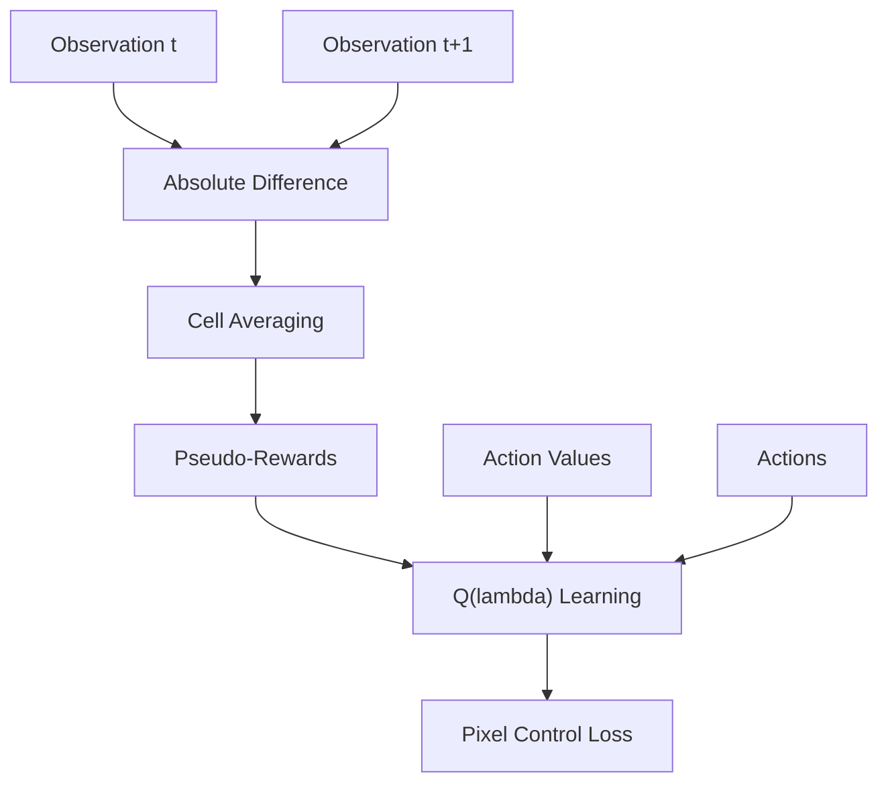
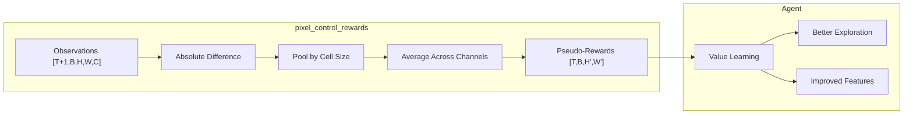
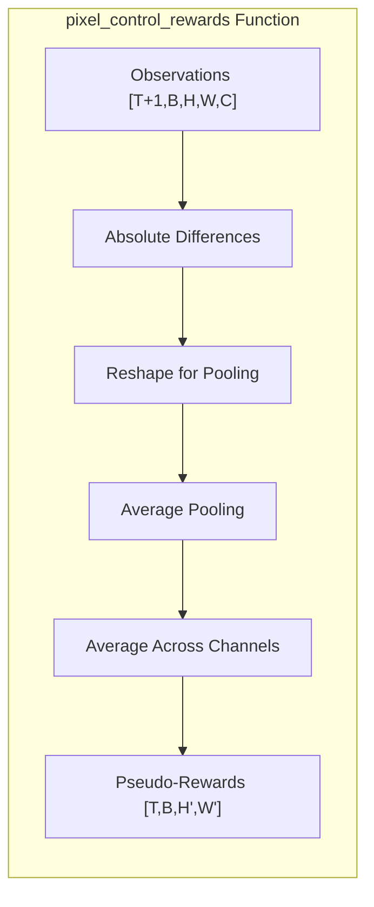
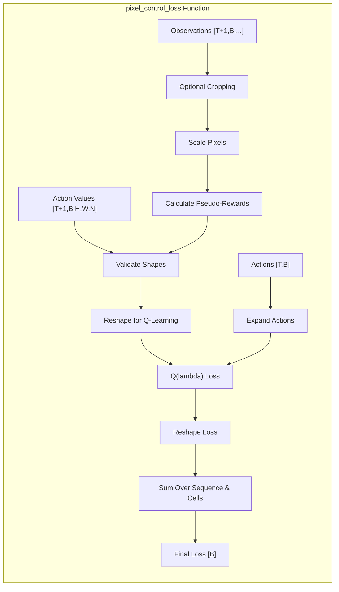
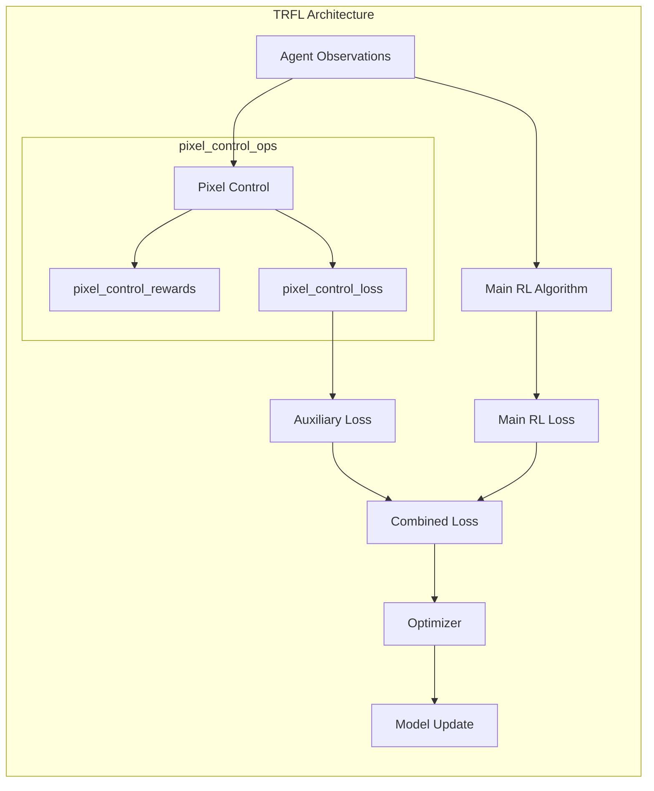

<!-- source: DeepWiki mcp.deepwiki.com · repo google-deepmind/trfl · page 5.1 Pixel Control · fetched 2026-10-26 -->

# Pixel Control

<details>
<summary>Relevant source files</summary>

The following files were used as context for generating this wiki page:

- [docs/multistep_forward_view.md](docs/multistep_forward_view.md)
- [docs/trfl.md](docs/trfl.md)
- [trfl/base_ops.py](trfl/base_ops.py)
- [trfl/pixel_control_ops.py](trfl/pixel_control_ops.py)
- [trfl/pixel_control_ops_test.py](trfl/pixel_control_ops_test.py)

</details>


Pixel Control is an auxiliary task for reinforcement learning agents that improves state representations and agent performance by training additional value functions based on pixel-level changes in observations. This document explains the implementation and usage of Pixel Control operations in the TRFL (TensorFlow Reinforcement Learning) library.

For information about other auxiliary tasks, see [Auxiliary Tasks and Features](#5).

## Purpose and Background

Pixel Control was introduced in the UNREAL (UNsupervised REinforcement and Auxiliary Learning) agent architecture. It defines pixel-based pseudo-rewards that encourage agents to maximize changes in the input observations, promoting exploration and acquisition of control-relevant features.

The key insight of Pixel Control is that learning to control changes in pixel intensities across the visual input space can help agents develop better representations. This auxiliary task is trained off-policy alongside the main reinforcement learning objective, providing additional rich learning signals.

Sources:
[trfl/pixel_control_ops.py:16-22]()

## Core Concepts

Pixel Control defines two main operations:

1. **Pseudo-reward calculation**: Computing rewards from pixel changes between consecutive observations
2. **Loss calculation**: Training action-value functions to predict these pseudo-rewards

The process works as follows:



Sources:
[trfl/pixel_control_ops.py:40-93]()
[trfl/pixel_control_ops.py:94-210]()

### Cell-based Pseudo-Rewards

Observations are divided into a grid of cells (typically small squares), and the agent learns to maximize changes in each cell independently. This creates a set of spatial control tasks where:

1. Each cell is a separate pseudo-reward signal
2. The agent predicts action-values for maximizing change in each cell
3. All cells share the same policy but have different value functions



Sources:
[trfl/pixel_control_ops.py:41-93]()

## Implementation Details

The TRFL library implements Pixel Control through two main functions:

### 1. Pixel Control Rewards

The `pixel_control_rewards` function calculates pseudo-rewards from observation sequences by:

1. Computing absolute differences between consecutive observations 
2. Dividing the observation space into a grid of cells
3. Averaging the pixel changes within each cell
4. Returning the resulting pseudo-rewards



The implementation performs these operations efficiently using TensorFlow's `tf.nn.avg_pool3d` operation to average pixel changes across cells.

Sources:
[trfl/pixel_control_ops.py:41-93]()

### 2. Pixel Control Loss

The `pixel_control_loss` function trains action-value functions for each cell's pseudo-reward by:

1. Calculating pseudo-rewards using `pixel_control_rewards`
2. Reshaping the tensors to be compatible with the Q-learning loss function
3. Computing a Q(λ) loss for each cell using the pseudo-rewards
4. Summing the losses across cells to produce a final loss



The function handles complex reshaping operations to treat each cell in the grid as a separate learning task while sharing the same action information across all cells.

Sources:
[trfl/pixel_control_ops.py:94-210]()

## Usage Example

Below is a conceptual example of how to use Pixel Control in a reinforcement learning agent:

```
# Observations shape [T+1, B, H, W, C]
# Actions shape [T, B]
# Action values shape [T+1, B, H', W', N]

# Calculate pixel control loss
pc_loss, pc_extra = pixel_control_loss(
    observations=observations,
    actions=actions,
    action_values=action_values,
    cell_size=4,                 # 4x4 pixel cells
    discount_factor=0.9,         # Discount for Q-learning
    scale=1.0,                   # Scale factor for pixels
    crop_height_dim=(None, None),# Optional cropping
    crop_width_dim=(None, None)  # Optional cropping
)

# pc_loss has shape [B]
# pc_extra contains:
#   - spatial_loss: per-cell losses
#   - pseudo_rewards: the calculated rewards
```

Sources:
[trfl/pixel_control_ops.py:95-138]()

## Integration in the TRFL Architecture

Pixel Control is designed to be used as an auxiliary task alongside main reinforcement learning algorithms:



The Pixel Control loss is typically combined with the main reinforcement learning objective with a weighting factor to balance its contribution to the overall learning signal.

Sources:
[trfl/pixel_control_ops.py:16-22]()

## Implementation Considerations

### Cell Size

The `cell_size` parameter determines the granularity of the pseudo-reward signals:
- Smaller cells (e.g., 2x2 pixels) provide more detailed control tasks but may be harder to learn
- Larger cells (e.g., 8x8 pixels) provide more general control signals

Common values for `cell_size` range from 4 to 16 pixels.

### Observation Preprocessing

For optimal results:
1. Observations should be cropped so their height and width are multiples of `cell_size`
2. Pixel values should be rescaled to the range [0, 1]
3. The UNREAL agent typically uses 80x80 observations with 4x4 cells

Sources:
[trfl/pixel_control_ops.py:41-56]()

### Off-Policy Learning

Pixel Control uses Q(λ) with λ=1 for off-policy learning of the pseudo-reward value functions. This means it:

1. Learns from the agent's experience regardless of how the data was collected
2. Uses full n-step returns for updating the value function
3. Can be trained in parallel with the main reinforcement learning task

Sources:
[trfl/pixel_control_ops.py:95-106]()

## Performance Impact

Adding Pixel Control as an auxiliary task can significantly improve:

1. **Data efficiency** - Agents learn more quickly from the same experience
2. **Final performance** - The improved state representations lead to better policies
3. **Exploration** - The intrinsic motivation to control pixel changes drives better exploration

The computational overhead is primarily from:
- The calculation of pseudo-rewards (involving average pooling operations)
- The additional Q-learning updates for each cell

Sources:
[trfl/pixel_control_ops.py:16-22]()

## Related Components

For integrating Pixel Control with other TRFL components, refer to:
- [Value-Based Learning](#2) for the underlying Q-learning algorithms
- [Target Network Updates](#5.2) for stabilizing learning of the Pixel Control value functions
- [Periodic Operations](#6.1) for scheduling Pixel Control updates

---

