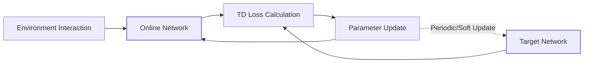
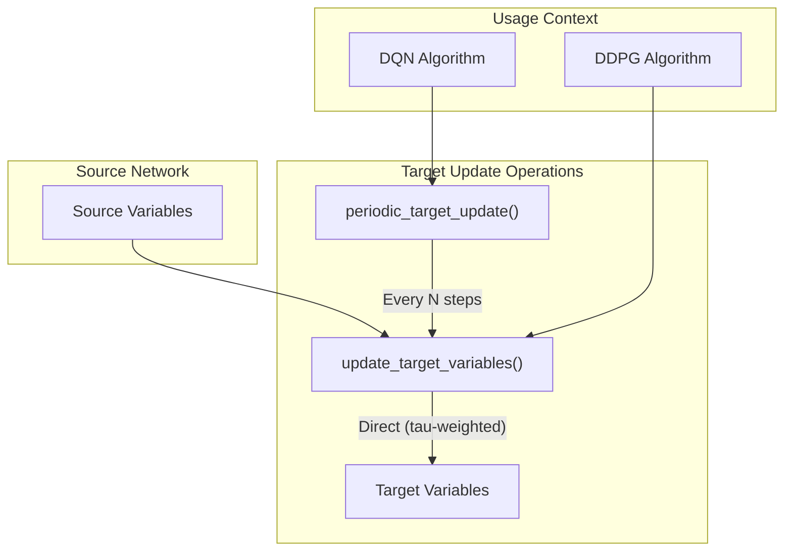
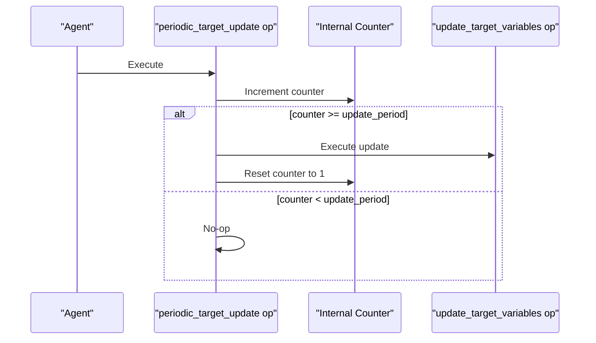
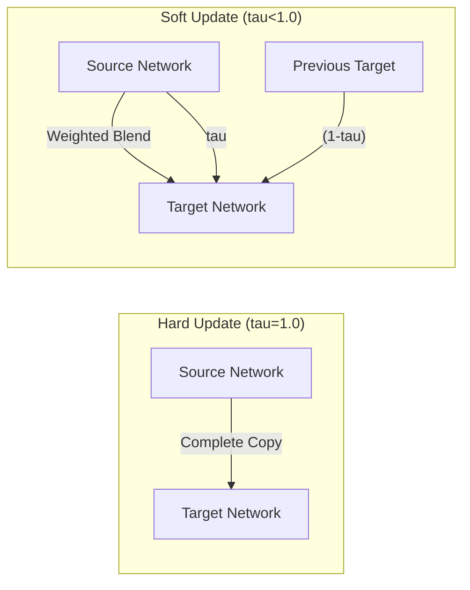
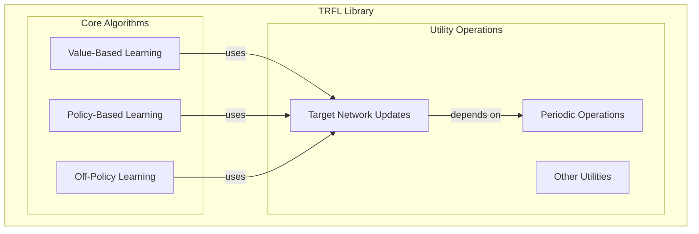

<!-- source: DeepWiki mcp.deepwiki.com · repo google-deepmind/trfl · page 5.2 Target Network Updates · fetched 2026-10-26 -->

# Target Network Updates

<details>
<summary>Relevant source files</summary>

The following files were used as context for generating this wiki page:

- [docs/multistep_forward_view.md](docs/multistep_forward_view.md)
- [docs/trfl.md](docs/trfl.md)
- [trfl/periodic_ops.py](trfl/periodic_ops.py)
- [trfl/periodic_ops_test.py](trfl/periodic_ops_test.py)
- [trfl/target_update_ops.py](trfl/target_update_ops.py)
- [trfl/target_update_ops_test.py](trfl/target_update_ops_test.py)

</details>


This page documents the target network update mechanisms provided by the TRFL library. Target networks are a key technique in deep reinforcement learning that improve stability by maintaining a slowly-changing copy of a neural network for use in training. This approach was popularized by the DQN algorithm and is now a standard component in many deep RL algorithms.

For related auxiliary techniques that work alongside target networks, see [Auxiliary Tasks and Features](#5).

## 1. Overview of Target Networks

Target networks are separate copies of function approximators (typically neural networks) used to provide stable learning targets in reinforcement learning. By updating the target network parameters less frequently or more smoothly than the online network, training becomes more stable, especially in off-policy algorithms.



Sources: [trfl/target_update_ops.py:15-20]()

## 2. Target Update Mechanisms

TRFL provides two primary mechanisms for updating target networks:

1. **Direct Updates**: Immediately update target variables from source variables
2. **Periodic Updates**: Update target variables only at specified intervals

Both mechanisms support **soft updates** (partial blending of source and target) and **hard updates** (complete replacement of target with source).



Sources: [trfl/target_update_ops.py:31-86](), [trfl/target_update_ops.py:88-126]()

### 2.1 Update Rule

The update rule implemented by TRFL's target network operations is:

```
target_variable = (1 - tau) * target_variable + tau * source_variable
```

Where:
- `tau` is a weight parameter in the range (0, 1]
- When `tau = 1.0`, target variables are fully replaced (hard update)
- When `tau < 1.0`, target variables are partially updated (soft update)

Sources: [trfl/target_update_ops.py:38-40]()

## 3. Core Operations

### 3.1 Direct Target Updates

The `update_target_variables` function provides immediate updates to target variables:

```python
update_target_variables(target_variables, source_variables, tau=1.0, use_locking=False, name="update_target_variables")
```

| Parameter | Type | Description |
|-----------|------|-------------|
| `target_variables` | list of variables | The variables to be updated |
| `source_variables` | list of variables | The variables used as the source |
| `tau` | float | Weight parameter in range (0,1] |
| `use_locking` | bool | Whether to use locking during variable assignment |
| `name` | string | Name for the operation |

**Returns:** An op that executes all variable updates.

Sources: [trfl/target_update_ops.py:31-85]()

### 3.2 Periodic Target Updates

The `periodic_target_update` function enables updates at regular intervals:

```python
periodic_target_update(target_variables, source_variables, update_period, tau=1.0, use_locking=False, counter=None, name="periodic_target_update")
```

| Parameter | Type | Description |
|-----------|------|-------------|
| `target_variables` | list of variables | The variables to be updated |
| `source_variables` | list of variables | The variables used as the source |
| `update_period` | int | Frequency of updates (execute every N calls) |
| `tau` | float | Weight parameter in range (0,1] |
| `use_locking` | bool | Whether to use locking during variable assignment |
| `counter` | Variable (optional) | Counter to track calls relative to update_period |
| `name` | string | Name for the operation |

**Returns:** An op that periodically updates target variables from source variables.

Sources: [trfl/target_update_ops.py:88-126](), [trfl/periodic_ops.py:33-100]()

## 4. Implementation Details

### 4.1 Periodic Execution Mechanism

The periodic update functionality is built on top of the `periodically` function from TRFL's periodic operations module. This function executes the given operation only when an internal counter is divisible by the specified period.



Sources: [trfl/periodic_ops.py:33-100]()

### 4.2 Soft vs Hard Updates

Target network updates can be configured as either soft updates or hard updates by adjusting the `tau` parameter:

- **Hard updates** (`tau=1.0`): Target variables are completely replaced with source variables. This is typically used with periodic updates for algorithms like DQN.
- **Soft updates** (`0 < tau < 1.0`): Target variables are partially updated, creating a weighted average between old and new values. This is often used in algorithms like DDPG.



Sources: [trfl/target_update_ops.py:74-79]()

## 5. Usage in Reinforcement Learning Algorithms

Target networks are widely used in several reinforcement learning algorithms:

| Algorithm | Update Type | Typical Configuration |
|-----------|-------------|------------------------|
| DQN | Hard, Periodic | `tau=1.0`, `update_period=10000` |
| Double DQN | Hard, Periodic | `tau=1.0`, `update_period=10000` |
| DDPG | Soft, Every Step | `tau=0.001` or `tau=0.005`, `update_period=1` |
| TD3 | Soft, Every Step | `tau=0.005`, `update_period=1` |
| SAC | Soft, Every Step | `tau=0.005`, `update_period=1` |

### 5.1 Example Implementation

Here's how target network updates typically fit into a reinforcement learning training loop:

```python
# Set up networks
online_network = create_q_network(...)
target_network = create_q_network(...)

# Create update op
update_targets = periodic_target_update(
    target_variables=target_network.trainable_variables,
    source_variables=online_network.trainable_variables,
    update_period=10000,
    tau=1.0)

# Training loop
for step in range(num_training_steps):
    # Training step using target network for stable targets
    loss = compute_td_loss(online_network, target_network, batch)
    
    # Update online network with gradient descent
    optimizer.minimize(loss, var_list=online_network.trainable_variables)
    
    # Periodically update target network
    session.run(update_targets)
```

Sources: [trfl/target_update_ops_test.py:113-154]()

## 6. Relationship to TRFL Architecture

Target network updates are an essential utility component in the TRFL library architecture, supporting the implementation of various reinforcement learning algorithms:



Sources: [docs/trfl.md:590-620]()

## 7. Best Practices

When using target network updates in your reinforcement learning implementations, consider the following best practices:

1. **Update Frequency**: For hard updates, use a period appropriate to your algorithm (e.g., 10000 steps for DQN-like algorithms).

2. **Tau Selection**: For soft updates:
   - Smaller values (e.g., 0.001) create more stable targets but slower adaptation
   - Larger values (e.g., 0.1) create less stable targets but faster adaptation

3. **Initialization**: Ensure target and online networks start with identical weights.

4. **Variable Matching**: Ensure source and target variable lists have the same length and compatible shapes.

Sources: [trfl/target_update_ops_test.py:31-111]()

---

