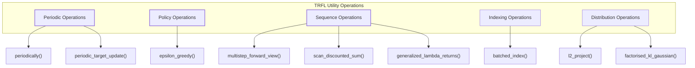
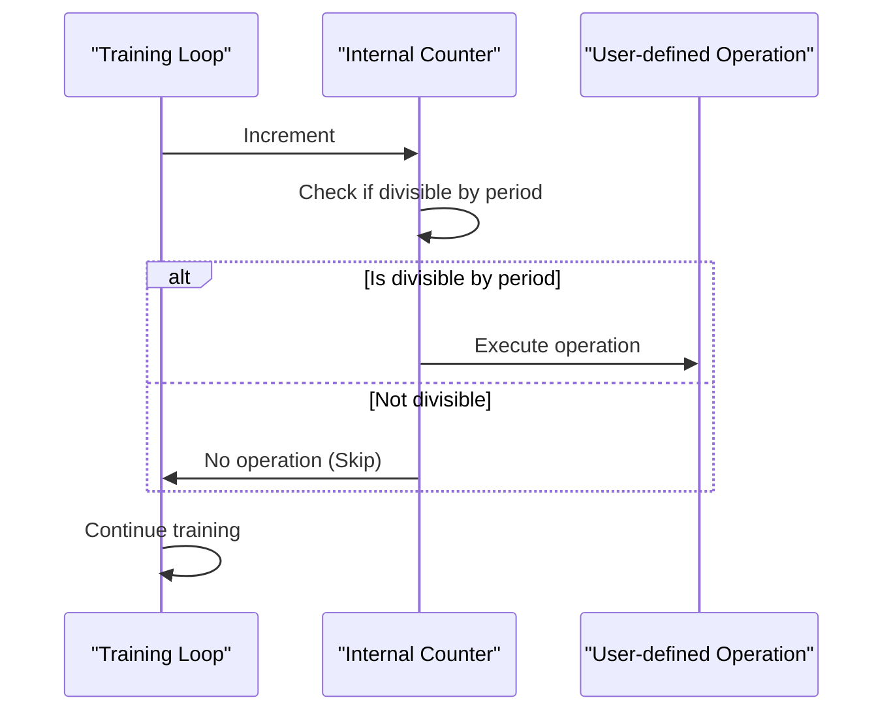
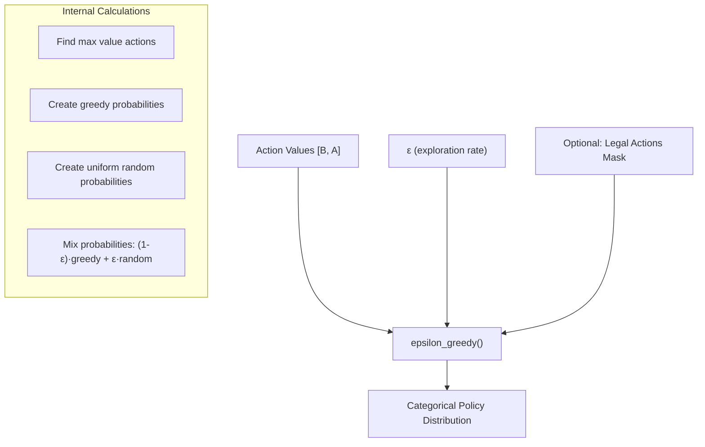
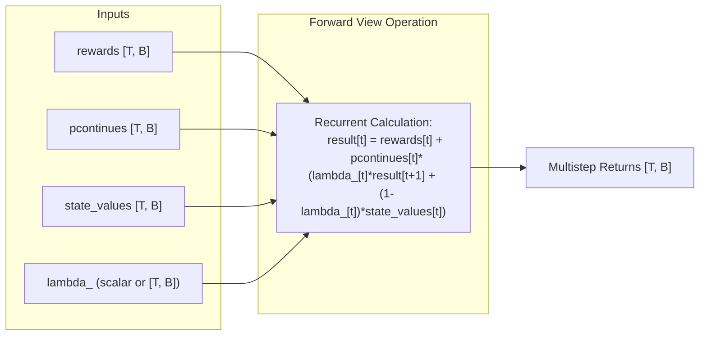
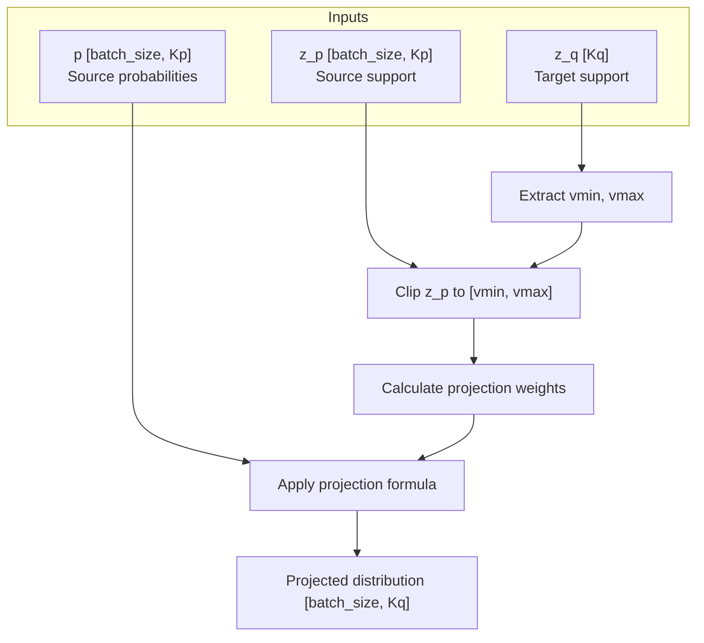
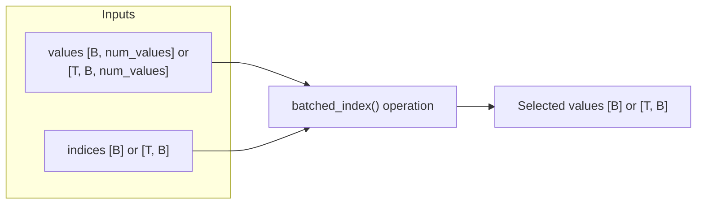

<!-- source: DeepWiki mcp.deepwiki.com · repo google-deepmind/trfl · page 6 Utility Operations · fetched 2026-10-26 -->

# Utility Operations

Relevant source files

The following files were used as context for generating this wiki page:

- [docs/multistep_forward_view.md](docs/multistep_forward_view.md)
- [docs/trfl.md](docs/trfl.md)
- [trfl/distribution_ops.py](trfl/distribution_ops.py)
- [trfl/policy_ops.py](trfl/policy_ops.py)
- [trfl/policy_ops_test.py](trfl/policy_ops_test.py)

This document covers the various utility operations provided by the TRFL (TensorFlow Reinforcement Learning) library. These operations serve as building blocks for implementing reinforcement learning algorithms by providing common functionality needed across different implementations. While core algorithms like Q-learning and policy gradients (covered in [Value-Based Learning](#2) and [Policy-Based Learning](#3)) focus on learning mechanisms, utility operations provide the supporting infrastructure.

## Overview of Utility Operations

TRFL's utility operations consist of several categories of helper functions that facilitate the implementation of reinforcement learning algorithms. These include operations for managing periodic tasks, handling policies, working with sequences, performing specialized indexing, and manipulating probability distributions.

Sources: [docs/trfl.md:591-658](), [docs/trfl.md:404-435](), [docs/trfl.md:525-588](), [docs/trfl.md:29-59](), [trfl/distribution_ops.py:32-157]()

## Periodic Operations

Periodic operations allow for the execution of specific TensorFlow operations at regular intervals during training. This is particularly useful for tasks such as updating target networks in DQN-style algorithms.

### periodically

The `periodically` function provides a mechanism to execute a TensorFlow operation at specified intervals. This is particularly useful for operations that don't need to happen every training step, such as logging, evaluation, or updating target networks.

The operation takes a body function that returns a TensorFlow op, executes it every `period` iterations, and uses an optional counter variable to track iterations.

Sources: [docs/trfl.md:621-658](), [trfl/periodic_ops.py:34-57]()

### periodic_target_update

This operation specializes in updating target networks, which is a common requirement in many reinforcement learning algorithms like DQN. It allows for periodic copying of weights from a source network to a target network, with optional smoothing via the `tau` parameter.

Sources: [docs/trfl.md:590-619]()

## Policy Operations

Policy operations provide utilities for creating and manipulating policies in reinforcement learning.

### epsilon_greedy

The `epsilon_greedy` function implements the epsilon-greedy exploration strategy, one of the most common exploration techniques in reinforcement learning. It balances exploration and exploitation by:

- Taking the greedy action (highest action value) with probability 1-ε
- Taking a random action with probability ε
- Handling ties in greedy actions by breaking them uniformly

The function returns a `tfp.distributions.Categorical` distribution representing the policy, which can be sampled to select actions.

Sources: [docs/trfl.md:404-435](), [trfl/policy_ops.py:27-82](), [trfl/policy_ops_test.py:26-106]()

## Sequence Operations

Sequence operations help with processing sequential data, which is common in reinforcement learning where agents interact with environments over time.

### multistep_forward_view

This operation computes complex backups using the forward view of eligibility traces. It's a key component for implementing algorithms like Q(λ), Sarsa(λ), and Retrace.

The algorithm works by evaluating mixed returns in reverse temporal order using a recurrent relationship, which creates a weighted sum of n-step returns. This is more computationally efficient than explicitly computing traces and summing them.

Sources: [docs/trfl.md:525-588](), [docs/multistep_forward_view.md:1-62]()

### generalized_lambda_returns

This function computes λ-returns along batches of trajectories, providing a flexible way to mix between one-step TD(0) targets and Monte Carlo returns based on the λ parameter.

Sources: [docs/trfl.md:437-488]()

## Distribution Operations

Distribution operations provide utilities for working with probability distributions, which are common in reinforcement learning for representing policies and value distributions.

### l2_project

This operation projects a distribution (z_p, p) onto a different support z_q under the L2-metric over cumulative distribution functions (CDFs). This is particularly useful in distributional reinforcement learning algorithms like C51 where value distributions need to be projected onto fixed supports.

The projection process ensures that the statistical properties of the original distribution are preserved as much as possible when moved to the new support.

Sources: [trfl/distribution_ops.py:32-80]()

### factorised_kl_gaussian

This operation computes the Kullback-Leibler (KL) divergence between two multivariate Gaussian distributions, factorized into components related to means and covariances. This is useful for algorithms that need to measure the difference between probability distributions, particularly in policy optimization methods.

The operation returns a tuple of `(kl_mean, kl_cov)` which correspond to the mean and covariance factorization of the KL divergence.

Sources: [trfl/distribution_ops.py:83-157]()

## Indexing Operations

Indexing operations provide utilities for manipulating tensors in reinforcement learning contexts.

### batched_index

The `batched_index` operation performs indexing on batches and sequence-batches of data, equivalent to `values[:, indices]` but in a more TPU-friendly way. This is particularly useful for selecting Q-values corresponding to actions taken.

The operation works with tensors whose shapes are unspecified or partially-specified, making it flexible for use in various reinforcement learning contexts.

Sources: [docs/trfl.md:29-59]()

## Use Cases and Integration

The utility operations in TRFL are designed to be composable building blocks for implementing reinforcement learning algorithms. Here are some common integration patterns:

1. **Target Network Updates**: Deep Q-Network (DQN) algorithms use `periodic_target_update` to copy weights from the online network to the target network at fixed intervals.

2. **Exploration Strategies**: `epsilon_greedy` is commonly used in value-based methods to balance exploration and exploitation.

3. **Multi-step Returns**: `multistep_forward_view` and `generalized_lambda_returns` enable implementing temporal difference learning with varying degrees of bootstrapping.

4. **Distributional RL**: `l2_project` is a core component of categorical distributional RL algorithms like C51, allowing value distributions to be projected onto fixed supports.

5. **Action Selection**: `batched_index` can be used to select values corresponding to specific actions from batches of Q-values.

These utilities abstract away common patterns in reinforcement learning implementations, making algorithms more concise and less error-prone.

Sources: [docs/trfl.md:1-825]()

---

