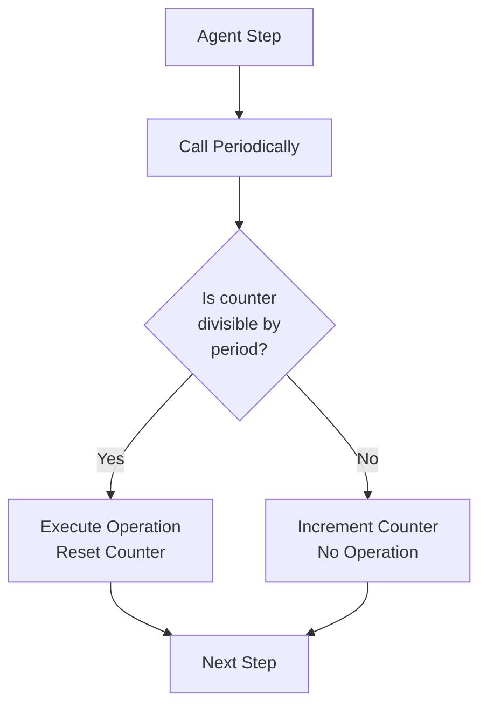
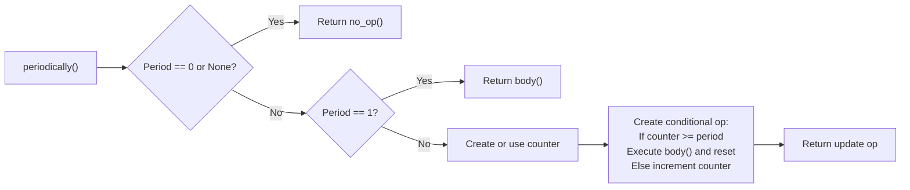
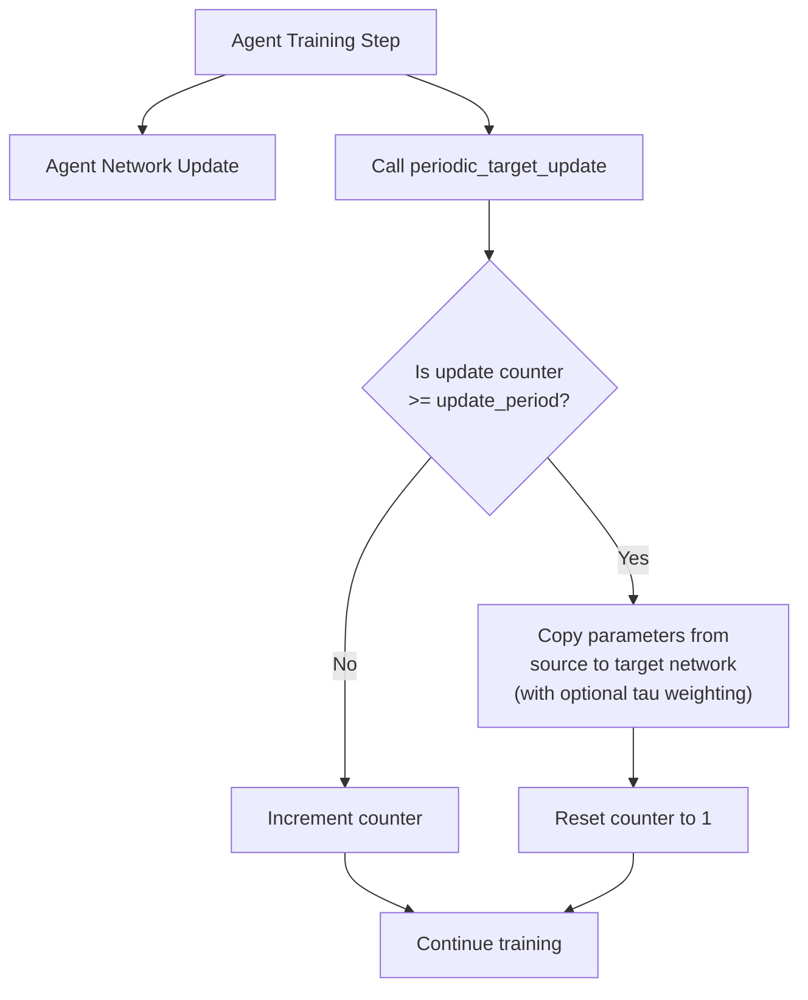
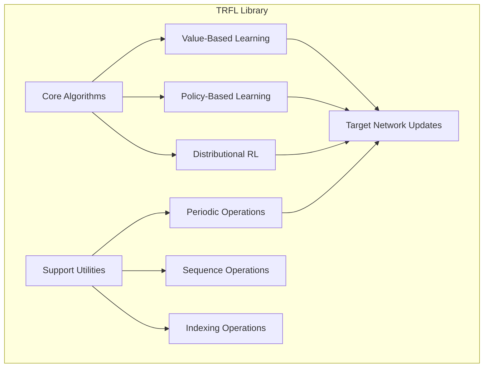
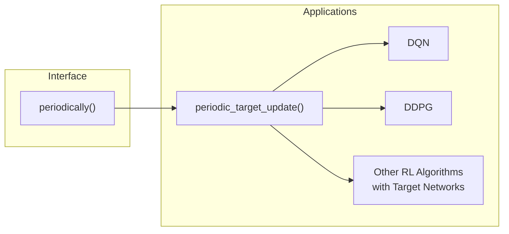

<!-- source: DeepWiki mcp.deepwiki.com · repo google-deepmind/trfl · page 6.1 Periodic Operations · fetched 2026-10-26 -->

# Periodic Operations

<details>
<summary>Relevant source files</summary>

The following files were used as context for generating this wiki page:

- [docs/multistep_forward_view.md](docs/multistep_forward_view.md)
- [docs/trfl.md](docs/trfl.md)
- [trfl/periodic_ops.py](trfl/periodic_ops.py)
- [trfl/periodic_ops_test.py](trfl/periodic_ops_test.py)
- [trfl/target_update_ops.py](trfl/target_update_ops.py)
- [trfl/target_update_ops_test.py](trfl/target_update_ops_test.py)

</details>


Periodic Operations in TRFL (TensorFlow Reinforcement Learning) provide utilities for executing operations at specified intervals rather than on every step. This is particularly useful in reinforcement learning algorithms where certain operations, such as target network updates, need to be performed only periodically to improve stability and performance.

For information about target network updates that use periodic operations, see [Target Network Updates](#5.2).

## Overview of Periodic Operations

In reinforcement learning, many algorithms require that certain operations be executed only intermittently - for example, updating a target network every N steps in algorithms like DQN, or logging statistics every K episodes. The `periodically` function in TRFL provides a clean, efficient way to implement this common pattern within the TensorFlow graph.



Sources: [trfl/periodic_ops.py:33-100]()

## Core API: The `periodically` Function

The main function provided by the Periodic Operations module is `periodically`, which wraps a TensorFlow operation to be executed only once every `period` times the wrapped operation is called.

### Function Signature and Parameters

```
periodically(body, period, counter=None, name="periodically")
```

Parameters:
- `body`: A callable that returns the TensorFlow operation to be executed periodically
- `period`: How often to execute the operation (inverse frequency)
- `counter`: Optional TensorFlow variable to use as a counter
- `name`: Optional name for the operation

Return value:
- A TensorFlow operation that, when executed, will conditionally execute the body operation

Sources: [trfl/periodic_ops.py:33-64]()

### Internal Implementation

The `periodically` function maintains a counter that increments on each call. When this counter reaches the specified period, the provided operation is executed and the counter is reset to 1.



The implementation handles several special cases efficiently:
- If `period` is 0 or None, it returns a no-op (no operation is ever executed)
- If `period` is 1, it directly returns the body operation (operation executes every time)
- For other periods, it uses TensorFlow's conditional operations to selectively execute

Sources: [trfl/periodic_ops.py:65-100]()

## Integration with Target Network Updates

One of the most common uses of periodic operations in reinforcement learning is updating target networks. TRFL provides a dedicated function `periodic_target_update` that builds on top of the `periodically` function to update target networks at specified intervals.

### Target Network Update Flow



The `periodic_target_update` function combines `periodically` with the `update_target_variables` function to provide a common pattern used in algorithms like DQN, where a target network is updated from a source network at regular intervals.

Sources: [trfl/target_update_ops.py:88-126]()

## Common Use Cases and Examples

### Basic Usage Example

To execute an operation every 100 steps:

```python
# Create an operation to be executed periodically
def update_op():
    return some_variable.assign(new_value)

# Create the periodic operation
periodic_update = periodically(body=update_op, period=100)

# In training loop
for step in range(training_steps):
    # Run normal training operations
    # ...
    
    # Execute the periodic update operation
    session.run(periodic_update)
```

### Target Network Updates

In DQN and similar algorithms, target networks need to be updated periodically:

```python
# Create online and target networks
online_variables = [...]
target_variables = [...]

# Create the periodic target update operation
update_targets = periodic_target_update(
    target_variables=target_variables,
    source_variables=online_variables,
    update_period=10000,
    tau=1.0  # Full update (direct copy)
)

# In training loop
for step in range(training_steps):
    # Run normal DQN training operations
    # ...
    
    # Execute the periodic target update
    session.run(update_targets)
```

## Position in TRFL Architecture

Periodic Operations is a utility module that supports other components in the TRFL library, particularly those that require intermittent updates.



Periodic Operations are particularly important for algorithms that use target networks, such as:
- DQN and its variants
- DDPG (Deep Deterministic Policy Gradient)
- TD3 (Twin Delayed DDPG)
- SAC (Soft Actor-Critic)

Sources: [trfl/target_update_ops.py:15-30]()

## Implementation Details

### Counter Management

The `periodically` function can use either:
1. An internally created counter variable (default)
2. An externally provided counter variable

Using an external counter allows for more control over the periodic execution, such as coordinating multiple periodic operations or resetting the counter in response to other events.

### Graph Integration

All operations are implemented as TensorFlow graph operations, making them compatible with TensorFlow's static graph mode. This ensures efficient execution and proper integration with other TensorFlow operations in the reinforcement learning pipeline.

## Comparison Table: Periodic Operation Behaviors

| Period Value | Behavior |
|--------------|----------|
| 0 or None    | Never executes the operation (returns no-op) |
| 1            | Always executes the operation on every call |
| N > 1        | Executes the operation every N calls |

Sources: [trfl/periodic_ops_test.py:29-71]()

## Technical Considerations

### Counter Initialization

When using periodic operations, be mindful of counter initialization:
- To ensure the operation runs on the first call, initialize the counter to a value larger than the period
- By default, the counter is initialized to a large value to ensure first-call execution

### Tensorflow 2.x Compatibility

The use of internal counter variables in `periodically` creates a stateful operation, which may not be fully compatible with TensorFlow 2.x eager execution mode. When using with TensorFlow 2.x, consider providing an explicit counter variable.

Sources: [trfl/periodic_ops.py:53-55]()

## Relation to Other TRFL Components

The Periodic Operations module primarily supports other components of TRFL rather than being used directly in reinforcement learning algorithms. Its main integration point is with the Target Network Updates module, which is widely used in value-based and actor-critic algorithms.



Sources: [trfl/target_update_ops.py:88-126](), [trfl/periodic_ops.py:33-64]()

---

