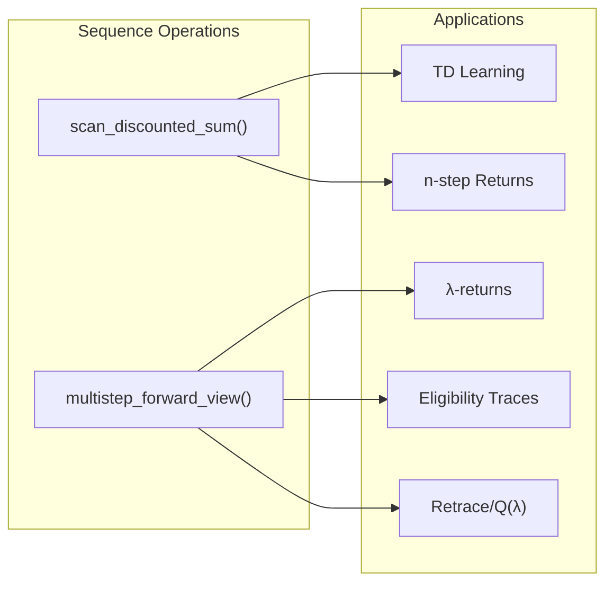
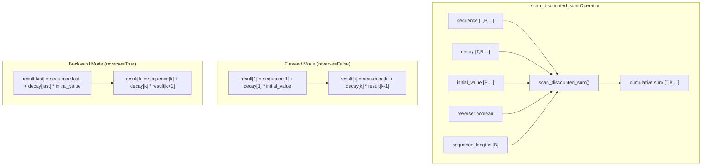
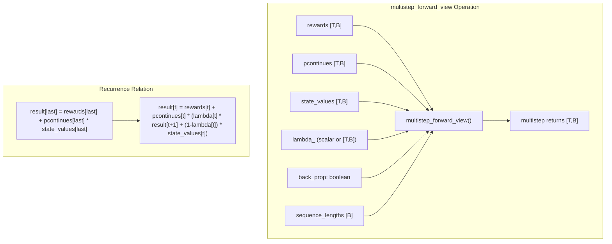
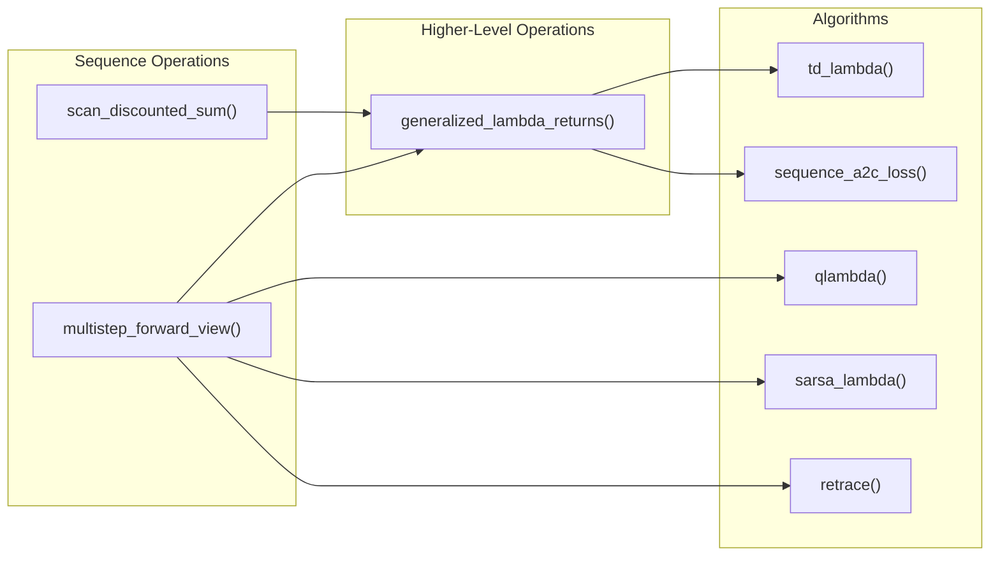
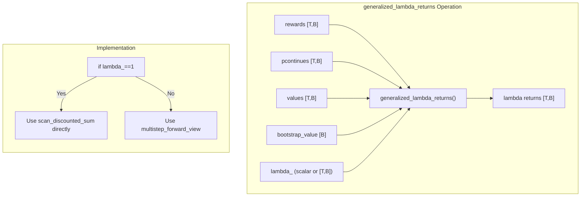
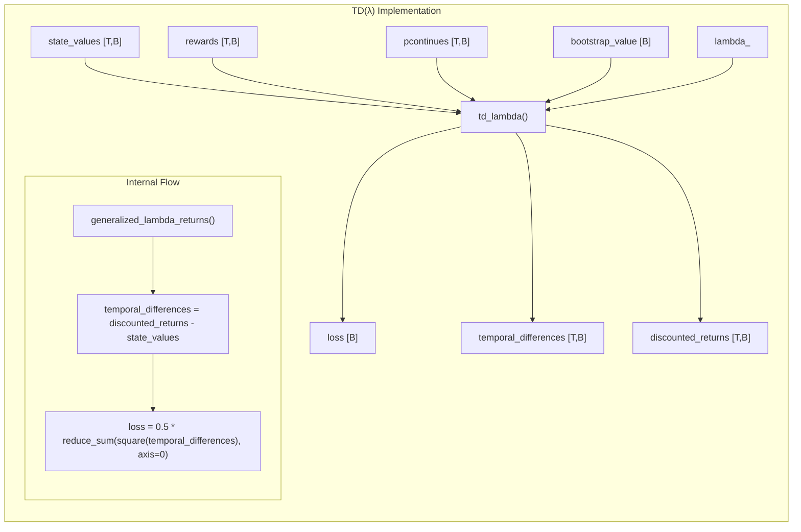

<!-- source: DeepWiki mcp.deepwiki.com · repo google-deepmind/trfl · page 6.2 Sequence Operations · fetched 2026-10-26 -->

# Sequence Operations

<details>
<summary>Relevant source files</summary>

The following files were used as context for generating this wiki page:

- [docs/multistep_forward_view.md](docs/multistep_forward_view.md)
- [docs/trfl.md](docs/trfl.md)
- [trfl/value_ops.py](trfl/value_ops.py)

</details>


## Purpose and Scope

Sequence Operations in TRFL provide fundamental utilities for processing sequences of values in reinforcement learning. These operations are particularly important for computing discounted returns, n-step returns, and eligibility traces from trajectories of states, actions, and rewards. This page documents the key sequence operations available in TRFL and their applications.

For operations related to policy implementation, see [Policy Operations](#6.4). For general value-based learning algorithms, see [Value-Based Learning](#2).

Sources: [trfl/sequence_ops.py:1-15](), [docs/trfl.md:1299-1339]()

## Overview of Sequence Operations

Sequence operations form a critical foundation for many reinforcement learning algorithms. They allow for efficient computation of various types of returns and bootstrapped estimates along trajectories.



Sources: [trfl/sequence_ops.py:1-15](), [docs/trfl.md:1299-1339](), [docs/multistep_forward_view.md:1-63]()

## Core Sequence Operations

### Scan Discounted Sum

The `scan_discounted_sum` operation evaluates a cumulative discounted sum along the temporal dimension of a sequence. This is a fundamental building block for computing returns in reinforcement learning.



When computing discounted returns in RL, the backward mode (reverse=True) is typically used to sum rewards from the end of an episode towards the beginning.

#### Example Usage:

For computing discounted returns from rewards with discount factor γ:
```
discounted_returns = scan_discounted_sum(
    rewards,               # [T,B] shaped rewards
    pcontinues,            # [T,B] discount factors (often constant γ)
    initial_value=bootstrap_value,  # Value estimate at sequence end
    reverse=True           # Sum from end of sequence
)
```

Sources: [trfl/sequence_ops.py:47-1339](), [docs/trfl.md:1299-1339]()

### Multistep Forward View

The `multistep_forward_view` operation evaluates complex backups that represent a forward view of eligibility traces. This is used to compute λ-returns that mix between one-step bootstrapping and multi-step returns.



The operation computes a mixed return for each timestep that combines immediate rewards with a mixture of bootstrapped value estimates and future returns. The mixing parameter λ controls how much weight is given to longer-term returns versus bootstrapped estimates.

#### Key Properties:

- When λ=0: Equivalent to one-step TD targets
- When λ=1: Equivalent to Monte Carlo returns (computed using `scan_discounted_sum`)
- For 0<λ<1: Creates a mixture of multi-step returns

Sources: [trfl/sequence_ops.py:127-588](), [docs/trfl.md:525-588](), [docs/multistep_forward_view.md:1-63]()

## Mathematical Foundation

The multistep forward view implements a recurrence relation that produces a weighted mixture of n-step returns. The mixed returns M_t are computed by:

M_t = r_t + γ_t(λ_t·M_{t+1} + (1-λ_t)·V_{t+1})
M_{T-1} = r_{T-1} + γ_{T-1}·V_T

This recurrence can be shown to be equivalent to computing a weighted mixture of n-step returns:

L(t,k) = Σ_{i=t}^k [(1-λ_i)·Π_{j=t}^{i-1} λ_j]·R(t,i) + [Π_{i=t}^k λ_i]·R(t,k)

Where R(t,i) is the i-t step return starting from time t.

Sources: [docs/multistep_forward_view.md:1-63]()

## Applications in TRFL

Several TRFL algorithms leverage these sequence operations to implement more complex learning mechanisms:

| Algorithm | Usage of Sequence Operations | Location |
|-----------|------------------------------|----------|
| TD(λ) | Uses `generalized_lambda_returns` to compute λ-returns | [trfl/value_ops.py:159-221]() |
| Q(λ) | Uses `multistep_forward_view` for traces | [trfl/action_value_ops.py:308-932]() |
| SARSA(λ) | Uses `multistep_forward_view` for traces | [trfl/action_value_ops.py:371-1260]() |
| Retrace | Uses sequence operations to compute importance-weighted returns | [trfl/retrace_ops.py:45-1105]() |
| A2C | Uses `generalized_lambda_returns` for advantage estimation | [trfl/policy_gradient_ops.py:200-1400]() |



Sources: [trfl/value_ops.py:74-156](), [docs/trfl.md:437-488]()

## Generalized Lambda Returns

The `generalized_lambda_returns` function is a higher-level operation built on the core sequence operations. It computes λ-returns along a batch of trajectories:



This function provides a convenient interface for computing λ-returns in different scenarios:

- For λ=1 (Monte Carlo): Uses `scan_discounted_sum` for efficiency
- For λ=0 (TD(0)): Produces one-step TD targets
- For 0<λ<1: Creates a mixture using `multistep_forward_view`
- For variable λ: Allows implementing algorithms like Retrace with dynamic trace cutting

Sources: [trfl/value_ops.py:74-156](), [docs/trfl.md:437-488]()

## Example Use in TD(λ)

The TD(λ) implementation in TRFL demonstrates how sequence operations are used to build reinforcement learning algorithms:



The TD(λ) implementation first computes λ-returns using `generalized_lambda_returns`, then calculates temporal differences by subtracting the state values from these returns, and finally computes the L2 loss.

Sources: [trfl/value_ops.py:159-221](), [docs/trfl.md:437-488]()

## Practical Considerations

### Performance Optimization

- For λ=1, the implementation bypasses `multistep_forward_view` and uses `scan_discounted_sum` directly for efficiency
- The `back_prop=False` parameter prevents gradients flowing into values and bootstrap values when using them as targets

### Sequence Handling

- Sequence operations support variable-length sequences using the `sequence_lengths` parameter
- Operations correctly handle trajectories by processing them in the appropriate temporal order

### Integration with TensorFlow

- All sequence operations are implemented as TensorFlow ops, enabling them to be part of a larger computational graph
- Operations support automatic differentiation through TensorFlow's gradient system

Sources: [trfl/sequence_ops.py:47-1339](), [trfl/value_ops.py:74-156]()

## Conclusion

Sequence Operations form a fundamental building block in TRFL for implementing reinforcement learning algorithms that process trajectories. The `scan_discounted_sum` and `multistep_forward_view` operations provide powerful utilities for computing various types of returns, while the higher-level `generalized_lambda_returns` function simplifies the implementation of algorithms like TD(λ), SARSA(λ), and A2C.

These operations are essential for implementing temporal difference learning with eligibility traces, and they enable efficient computation of targets for value function approximation.

Sources: [trfl/sequence_ops.py:1-15](), [docs/trfl.md:1299-1339](), [docs/multistep_forward_view.md:1-63]()

---

