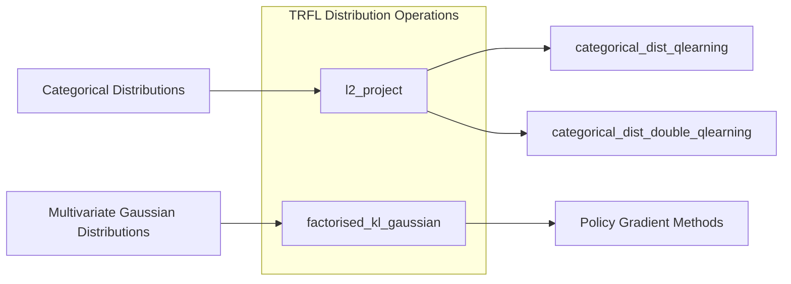
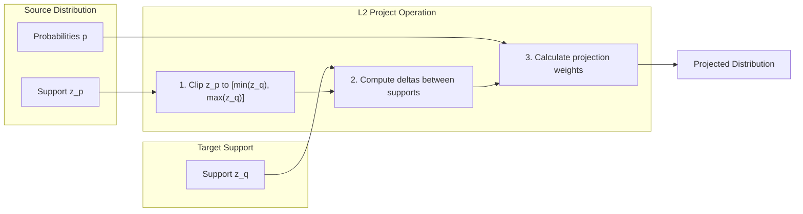
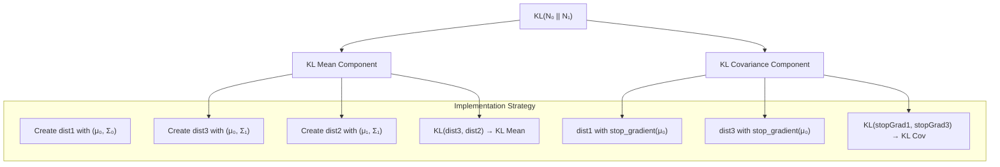
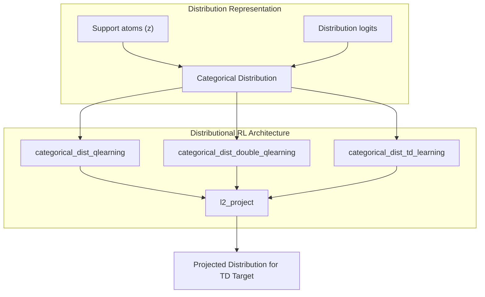

<!-- source: DeepWiki mcp.deepwiki.com · repo google-deepmind/trfl · page 6.3 Distribution Operations · fetched 2026-10-26 -->

# Distribution Operations

<details>
<summary>Relevant source files</summary>

The following files were used as context for generating this wiki page:

- [docs/multistep_forward_view.md](docs/multistep_forward_view.md)
- [docs/trfl.md](docs/trfl.md)
- [trfl/distribution_ops.py](trfl/distribution_ops.py)
- [trfl/distribution_ops_test.py](trfl/distribution_ops_test.py)

</details>


This page documents the operations for working with probability distributions in the TRFL library. These utilities support distributional reinforcement learning and other algorithms that manipulate probability distributions as part of their learning processes. For general sequence operations, see [Sequence Operations](#6.2), and for policy-specific operations, see [Policy Operations](#6.4).

## Overview

TRFL's distribution operations provide tools for projecting distributions onto different supports and calculating divergences between distributions. These operations are particularly useful in distributional reinforcement learning algorithms, where value functions are modeled as probability distributions rather than scalar estimates.



Sources: [trfl/distribution_ops.py](), [docs/trfl.md:88-157]()

## L2 Projection

The L2 projection operation projects a probability distribution onto a different support while minimizing the L2 distance between their cumulative distribution functions (CDFs).

### Mathematical Formulation

Given a source distribution with support points `z_p` and probabilities `p`, the operation projects this distribution onto a target support `z_q` by computing weights that minimize the Cramer distance (L2 norm of the difference between CDFs).



The operation performs the following steps:
1. Clips the source support to the range of the target support
2. Computes the distance between atom values in the target support
3. Calculates projection weights using the relationship between the supports

### API

```python
l2_project(z_p, p, z_q)
```

- `z_p`: Tensor holding support of distribution p, shape `[batch_size, Kp]`
- `p`: Tensor holding probability values p(z_p[i]), shape `[batch_size, Kp]`
- `z_q`: Tensor holding support to project onto, shape `[Kq]`

Returns a projection of (z_p, p) onto the support z_q under the Cramer distance.

Sources: [trfl/distribution_ops.py:32-80]()

## Factorized KL Gaussian

This operation computes the Kullback-Leibler (KL) divergence between two multivariate Gaussian distributions and factorizes it into two terms: one related to the mean difference and one related to the covariance difference.

### Mathematical Basis

The KL divergence between two multivariate Gaussians N₀(μ₀, Σ₀) and N₁(μ₁, Σ₁) can be written as:

```
KL(N₀ || N₁) = 0.5 * (tr(Σ₁⁻¹ * Σ₀) + ln(det(Σ₁)/det(Σ₀)) - k + (μ₁ - μ₀)ᵀ * Σ₁⁻¹ * (μ₁ - μ₀))
```

where k is the dimensionality.

The factorization splits this into:
- Mean component: `0.5 * (μ₁ - μ₀)ᵀ * Σ₁⁻¹ * (μ₁ - μ₀)`
- Covariance component: `0.5 * (tr(Σ₁⁻¹ * Σ₀) + ln(det(Σ₁)/det(Σ₀)) - k)`



### API

```python
factorised_kl_gaussian(dist1_mean,
                       dist1_covariance_or_scale,
                       dist2_mean,
                       dist2_covariance_or_scale,
                       both_diagonal=False)
```

- `dist1_mean`: The mean of the first Multivariate Gaussian distribution
- `dist1_covariance_or_scale`: The covariance or scale of the first distribution
- `dist2_mean`: The mean of the second Multivariate Gaussian distribution
- `dist2_covariance_or_scale`: The covariance or scale of the second distribution
- `both_diagonal`: Boolean indicating if both distributions have diagonal covariance matrices

Returns a tuple of `(kl_mean, kl_cov)` corresponding to the mean and covariance components of the KL divergence.

Sources: [trfl/distribution_ops.py:83-157](), [trfl/distribution_ops_test.py:37-155]()

## Integration with Distributional RL

The distribution operations in TRFL support the implementation of distributional reinforcement learning algorithms, where value functions are represented as probability distributions rather than scalar values.



### L2 Projection in Distributional RL

In distributional RL algorithms like categorical DQN (C51), the L2 projection is used to project the target distribution (computed from rewards and the next state's value distribution) onto the fixed support of the current state's value distribution. This is necessary because:

1. The reward shifts the distribution
2. The discount factor scales the distribution
3. These operations can move the distribution outside the fixed support range

The L2 projection ensures that the target distribution is properly represented on the fixed support while minimizing distributional distortion.

Sources: [docs/trfl.md:88-157](), [docs/trfl.md:172-210]()

## Practical Applications

### When to Use L2 Projection

- When implementing distributional reinforcement learning algorithms (C51, QR-DQN, IQN)
- When you need to transfer a distribution from one discrete support to another
- When combining or transforming categorical distributions with different supports

### When to Use Factorized KL Gaussian

- When implementing policy gradient methods with Gaussian policies
- When you need to separately control the influence of mean vs. covariance differences
- When working with multivariate Gaussian distributions in RL algorithms

The factorized KL computation allows for independent regularization of the mean and covariance components, which can be useful in policy optimization algorithms where you may want to penalize changes to the mean and covariance differently.

Sources: [trfl/distribution_ops.py](), [trfl/distribution_ops_test.py]()

---

