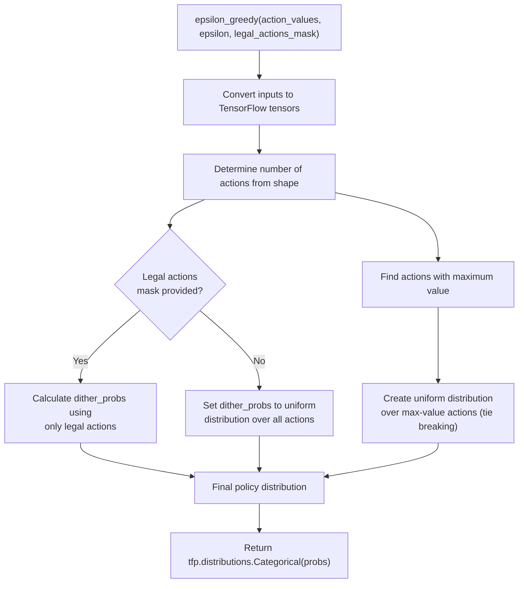
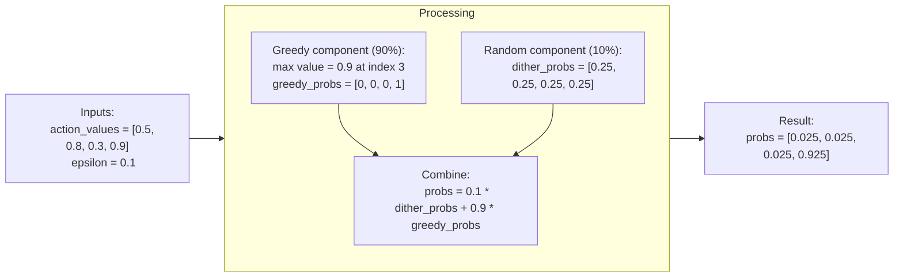
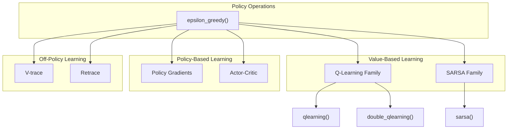

<!-- source: DeepWiki mcp.deepwiki.com · repo google-deepmind/trfl · page 6.4 Policy Operations · fetched 2026-10-26 -->

# Policy Operations

<details>
<summary>Relevant source files</summary>

The following files were used as context for generating this wiki page:

- [docs/multistep_forward_view.md](docs/multistep_forward_view.md)
- [docs/trfl.md](docs/trfl.md)
- [trfl/policy_ops.py](trfl/policy_ops.py)
- [trfl/policy_ops_test.py](trfl/policy_ops_test.py)

</details>


Policy operations in TRFL provide utilities for creating and manipulating reinforcement learning policies. These operations serve as building blocks for defining agent behavior in reinforcement learning algorithms. Currently, TRFL implements the epsilon-greedy policy, a fundamental approach for balancing exploration and exploitation in RL algorithms.

For information about policy gradient methods which use more complex policy representations, see [Policy Gradients](#3.1). For actor-critic approaches that combine policy and value learning, see [Actor-Critic Methods](#3.2).

Sources: [trfl/policy_ops.py:1-16]()

## Available Policy Operations

### Epsilon-Greedy Policy

The epsilon-greedy policy is implemented through the `epsilon_greedy` function, which creates a categorical distribution over a discrete action space:

```python
def epsilon_greedy(action_values, epsilon, legal_actions_mask=None)
```

This policy provides a principled way to balance exploration and exploitation by:
- With probability (1-ε), selecting the action with the highest value (exploitation)
- With probability ε, selecting a random action uniformly (exploration)

The function returns a `tfp.distributions.Categorical` distribution that represents the policy.

Sources: [trfl/policy_ops.py:27-53]()

## Epsilon-Greedy Implementation

Diagram: Epsilon-Greedy Algorithm Flow



The implementation handles several important cases:
1. **Tie-breaking**: When multiple actions have the same highest value, one is selected uniformly at random
2. **Legal action masking**: Can restrict exploration to only consider legal actions
3. **Batch processing**: Efficiently processes batches of states and action values

Sources: [trfl/policy_ops.py:54-82](), [trfl/policy_ops_test.py:26-107]()

## Example Usage

Diagram: Concrete Example of Epsilon-Greedy Calculation



Basic usage:

```python
import tensorflow as tf
import trfl

# Single example with 4 actions
action_values = tf.constant([0.5, 0.8, 0.3, 0.9])
epsilon = 0.1

# Create policy distribution
policy = trfl.epsilon_greedy(action_values, epsilon)

# Sample an action from the policy
action = policy.sample()

# Get probability distribution
probs = policy.probs  # [0.025, 0.025, 0.025, 0.925]
```

With legal action masking:

```python
# Same action values, but only actions 0 and 2 are legal
action_values = tf.constant([0.5, 0.8, 0.3, 0.9])
legal_actions_mask = tf.constant([1.0, 0.0, 1.0, 0.0])

# Create policy with legal action constraints
policy = trfl.epsilon_greedy(action_values, epsilon, legal_actions_mask)
```

Batch processing:

```python
# Batch of states (3 states with 4 actions each)
batch_action_values = tf.constant([
    [0.5, 0.8, 0.3, 0.9],  # State 1
    [0.2, 0.2, 0.2, 0.2],  # State 2 (equal values)
    [1.0, 0.5, 2.0, 0.1]   # State 3
])

# Create policies for all states at once
batch_policy = trfl.epsilon_greedy(batch_action_values, epsilon)
```

Sources: [trfl/policy_ops.py:27-82](), [trfl/policy_ops_test.py:26-107]()

## Integration with TRFL Components

Diagram: Policy Operations in TRFL Architecture



The epsilon-greedy policy operation is a fundamental building block in TRFL that integrates with several other components:

1. **Value-Based Learning**: Used to select actions during training and evaluation in Q-learning and SARSA algorithms
2. **Policy-Based Learning**: Can provide exploration during policy gradient training
3. **Off-Policy Methods**: Generates behavior policy for collecting experience in off-policy algorithms

Sources: [trfl/policy_ops.py:1-83]()

## Technical Parameters

| Parameter | Type | Description |
|-----------|------|-------------|
| `action_values` | Tensor | Values for each action with shape ending in `[num_actions]`. Can be `[A]`, `[B, A]`, `[T, B, A]`, etc. |
| `epsilon` | Scalar Tensor or float | Value between 0 and 1 controlling the exploration rate |
| `legal_actions_mask` | Tensor (optional) | One-hot tensor with same shape as `action_values`. 1 for legal actions, 0 for illegal. |

Returns a `tfp.distributions.Categorical` distribution representing the policy.

Sources: [trfl/policy_ops.py:27-53]()

## Common Usage Patterns

1. **Annealing Epsilon**: Gradually decreasing epsilon over time to transition from exploration to exploitation:
   ```python
   initial_epsilon = 1.0
   final_epsilon = 0.01
   decay_steps = 10000
   step = tf.Variable(0, trainable=False)
   epsilon = tf.maximum(
       final_epsilon,
       initial_epsilon * (1 - tf.cast(step, tf.float32) / decay_steps)
   )
   ```

2. **State-Dependent Legal Actions**: Using masking for environments where available actions depend on the state:
   ```python
   # Generate legal action masks based on state
   legal_actions = env.get_legal_actions(state)
   legal_action_mask = tf.one_hot(legal_actions, depth=num_actions)
   
   policy = trfl.epsilon_greedy(q_values, epsilon, legal_action_mask)
   ```

Sources: [trfl/policy_ops.py:27-82](), [trfl/policy_ops_test.py:26-107]()

## Related Pages

- For policy gradient methods, see [Policy Gradients](#3.1)
- For discrete policy operations, see [Discrete Policy Gradient](#3.1)
- For actor-critic methods, see [Actor-Critic Methods](#3.2)
- For indexing operations often used with policies, see [Indexing Operations](#6.5)

---

