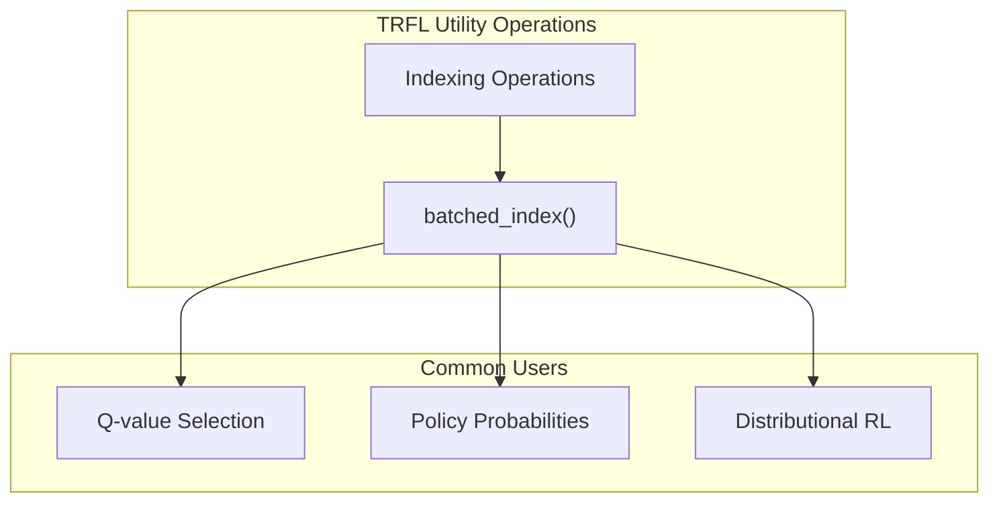
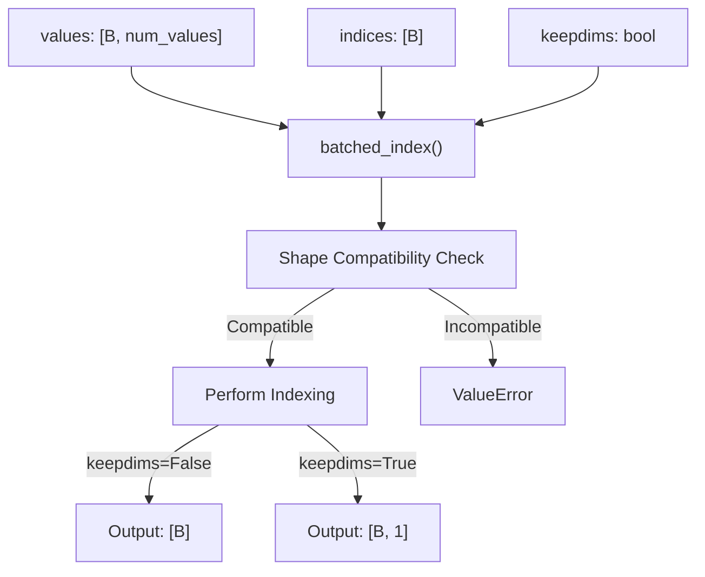
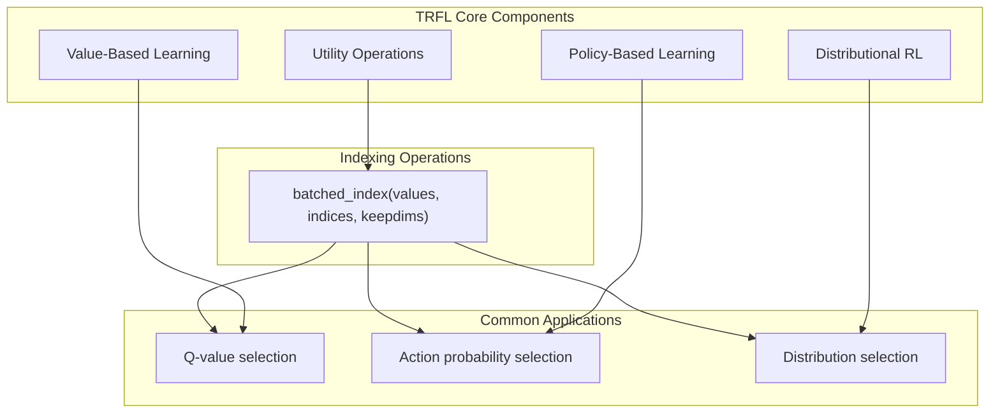

<!-- source: DeepWiki mcp.deepwiki.com · repo google-deepmind/trfl · page 6.5 Indexing Operations · fetched 2026-10-26 -->

# Indexing Operations

<details>
<summary>Relevant source files</summary>

The following files were used as context for generating this wiki page:

- [docs/multistep_forward_view.md](docs/multistep_forward_view.md)
- [docs/trfl.md](docs/trfl.md)
- [trfl/dist_value_ops_test.py](trfl/dist_value_ops_test.py)
- [trfl/indexing_ops_test.py](trfl/indexing_ops_test.py)
- [trfl/vtrace_ops_test.py](trfl/vtrace_ops_test.py)

</details>


## Purpose and Scope

Indexing operations in TRFL provide efficient and TPU-friendly ways to select specific values from tensors based on indices in reinforcement learning contexts. This is particularly useful when accessing values for specific actions taken in reinforcement learning algorithms.

The primary function provided is `batched_index`, which performs operations similar to `values[:, indices]` but with additional flexibility and better compatibility with TPU accelerators.

Sources: [docs/trfl.md:29-59]()

## Core Functionality



Sources: [docs/trfl.md:29-59]()

### batched_index Function

The `batched_index` function allows selecting values from tensors using indices in a batched manner:

```
batched_index(values, indices, keepdims=None)
```

**Parameters:**
- `values`: Tensor of shape `[B, num_values]` or `[T, B, num_values]`
- `indices`: Tensor of shape `[B]` or `[T, B]` containing indices
- `keepdims`: If `True`, the returned tensor will have an added dimension at the end (e.g., `[B, 1]` or `[T, B, 1]`)

**Returns:**
- Tensor of shape `[B]` or `[T, B]` containing the indexed values

**Raises:**
- `ValueError`: If shapes are known statically and are incompatible

Sources: [docs/trfl.md:29-59](), [trfl/indexing_ops_test.py:30-50]()

## Implementation Details



Sources: [trfl/indexing_ops_test.py:42-49](), [trfl/indexing_ops_test.py:70-126]()

### Key Implementation Characteristics

1. **TPU Friendly**: Uses reduction over masked values instead of `tf.gather`, making it more suitable for TPU acceleration

2. **Shape Checking**: Performs static shape checking when possible, but has limitations:
   - Checks both rank and compatibility when shapes are known statically
   - Limited ability to detect incompatibilities when shapes are unknown

3. **Flexibility**: Works with both batch (`[B, num_values]`) and sequence-batch (`[T, B, num_values]`) tensors

Sources: [docs/trfl.md:29-59](), [trfl/indexing_ops_test.py:70-126]()

## Common Use Cases

### Value Function Indexing

In value-based reinforcement learning algorithms (like Q-learning), this operation is used to select Q-values corresponding to actions that were actually taken:

```
q_selected = batched_index(q_values, actions)
```

Where:
- `q_values` has shape `[batch_size, num_actions]`
- `actions` has shape `[batch_size]`
- `q_selected` will have shape `[batch_size]`

Sources: [trfl/dist_value_ops_test.py:34-50](), [trfl/vtrace_ops_test.py:34-40]()

### Sequence-Based Selection

For sequence data (common in reinforcement learning trajectories):

```
q_selected = batched_index(q_values, actions)
```

Where:
- `q_values` has shape `[time_steps, batch_size, num_actions]`
- `actions` has shape `[time_steps, batch_size]`
- `q_selected` will have shape `[time_steps, batch_size]`

Sources: [trfl/indexing_ops_test.py:51-68]()

## Example Usage

### Basic Batch Example

```python
# Values representing Q-values for 8 examples with 3 possible actions each
values = [
    [1.1, 1.2, 1.3],
    [1.4, 1.5, 1.6],
    [2.1, 2.2, 2.3],
    [2.4, 2.5, 2.6],
    [3.1, 3.2, 3.3],
    [3.4, 3.5, 3.6],
    [4.1, 4.2, 4.3],
    [4.4, 4.5, 4.6]
]

# Actions taken for each example
action_indices = [0, 2, 1, 0, 2, 1, 0, 2]

# Select Q-values for the actions that were taken
result = batched_index(values, action_indices)

# Result: [1.1, 1.6, 2.2, 2.4, 3.3, 3.5, 4.1, 4.6]
```

Sources: [trfl/indexing_ops_test.py:30-50]()

### Sequence Batch Example

```python
# Values representing Q-values for 4 examples, each with 2 timesteps and 3 possible actions
values = [
    [[1.1, 1.2, 1.3], [1.4, 1.5, 1.6]],
    [[2.1, 2.2, 2.3], [2.4, 2.5, 2.6]],
    [[3.1, 3.2, 3.3], [3.4, 3.5, 3.6]],
    [[4.1, 4.2, 4.3], [4.4, 4.5, 4.6]]
]

# Actions taken for each example at each timestep
action_indices = [
    [0, 2],
    [1, 0],
    [2, 1],
    [0, 2]
]

# Select Q-values for the actions that were taken
result = batched_index(values, action_indices)

# Result: 
# [
#   [1.1, 1.6],
#   [2.2, 2.4],
#   [3.3, 3.5],
#   [4.1, 4.6]
# ]
```

Sources: [trfl/indexing_ops_test.py:51-68]()

## Potential Gotchas

### Shape Validation Limitations

While `batched_index` performs shape validation when possible, it has limitations when working with tensors whose shapes are not fully specified at graph construction time:

1. **Incomplete shape information**: When tensor shapes are partially or completely unknown, some shape incompatibilities may not be detected until runtime

2. **Silent success with incompatible shapes**: In some cases, the operation might succeed with shapes that appear incompatible, which can lead to subtle bugs

Sources: [trfl/indexing_ops_test.py:127-276]()

### Common Shape Errors

Shape validation will raise errors in these situations (when shapes are known):

- Incompatible batch dimensions between `values` and `indices`
- Incorrect rank relationship (e.g., if `values` has rank N, `indices` should have rank N-1)

Sources: [trfl/indexing_ops_test.py:70-126]()

## Integration with TRFL Architecture



Sources: [docs/trfl.md:29-59](), [trfl/dist_value_ops_test.py:42-50](), [trfl/vtrace_ops_test.py:97-108]()

## Summary

The indexing operations in TRFL provide an efficient, TPU-friendly way to select values from tensors based on indices. The primary function, `batched_index`, is a fundamental building block used throughout various reinforcement learning algorithms implemented in TRFL.

This operation is particularly important for:
- Selecting Q-values for specific actions in value-based methods
- Selecting action probabilities in policy gradient methods
- Extracting specific distribution parameters in distributional RL

While simple in concept, `batched_index` addresses important performance and compatibility considerations for reinforcement learning implementations, especially when targeting TPU accelerators.

Sources: [docs/trfl.md:29-59](), [trfl/indexing_ops_test.py:30-50]()