# Page: Overview

# Overview

<details>
<summary>Relevant source files</summary>

The following files were used as context for generating this wiki page:

- [CONTRIBUTING.md](CONTRIBUTING.md)
- [README.md](README.md)
- [docs/index.md](docs/index.md)
- [docs/multistep_forward_view.md](docs/multistep_forward_view.md)
- [docs/trfl.md](docs/trfl.md)
- [setup.py](setup.py)
- [trfl/__init__.py](trfl/__init__.py)

</details>


TRFL (pronounced "truffle") is a library built on top of TensorFlow that provides essential building blocks for implementing Reinforcement Learning (RL) algorithms. Rather than implementing complete RL algorithms, TRFL focuses on supplying the fundamental mathematical operations needed to construct custom RL agents.

This page introduces the TRFL library, explains its purpose, and outlines its organization. For installation instructions, see [Installation and Getting Started](#1.1). For more details about reinforcement learning terminology and concepts used throughout the library, see [Core Concepts](#1.2).

## Purpose and Scope

TRFL formulates common RL update rules as differentiable loss functions that can be composed with neural networks within TensorFlow. The library provides implementations for:

- Value-based learning methods (Q-learning, TD learning, SARSA)
- Policy-based learning methods (Policy gradients, Actor-Critic)
- Distributional RL algorithms
- Off-policy correction methods (V-trace, Retrace)
- Auxiliary RL tasks (like pixel control)
- Utility operations for RL (target network updates, batched indexing, etc.)

These components are designed to be:
- **Modular** - Each operation focuses on one specific RL computation
- **Composable** - Components can be combined to implement complex algorithms
- **Differentiable** - All operations work within TensorFlow's automatic differentiation

TRFL is not a full RL framework - it doesn't handle environment interactions, replay buffers, or neural network architecture design. Instead, it provides the mathematical core of RL algorithms as pure TensorFlow operations.

Sources: [setup.py:35-38](), [docs/index.md:3-26](), [README.md:3-5]()

## Library Architecture

```mermaid
graph TD
    subgraph "TRFL Library"
        ValueLearning["Value-Based Learning"]
        PolicyLearning["Policy-Based Learning"]
        OffPolicy["Off-Policy Algorithms"]
        DistRL["Distributional RL"]
        Auxiliary["Auxiliary Tasks"]
        Utilities["Utility Operations"]
    end

    ValueLearning --> QL["Q-Learning Family"]
    ValueLearning --> TDL["TD Learning"]
    ValueLearning --> SARSA["SARSA Family"]

    PolicyLearning --> PG["Policy Gradients"]
    PolicyLearning --> A2C["Advantage Actor-Critic"]
    PolicyLearning --> DPG["Deterministic Policy Gradient"]

    OffPolicy --> VTrace["V-trace"]
    OffPolicy --> Retrace["Retrace"]

    DistRL --> CategoricalDist["Categorical Distributions"]
    
    Auxiliary --> PixelControl["Pixel Control"]
    Auxiliary --> TargetNets["Target Network Updates"]

    Utilities --> Periodic["Periodic Operations"]
    Utilities --> Sequence["Sequence Operations"]
    Utilities --> Policy["Policy Operations"]
    Utilities --> Indexing["Indexing Operations"]
```

Sources: [docs/index.md:126-182](), [trfl/__init__.py:17-58]()

## Core Components

TRFL organizes its functionality into several key modules, each focusing on a specific aspect of reinforcement learning:

### Value-Based Learning

Value-based methods estimate the value of states or state-action pairs. TRFL provides implementations for:

- **Q-Learning Family**: Standard Q-learning (`qlearning`), Double Q-learning (`double_qlearning`), and Persistent Q-learning (`persistent_qlearning`)
- **TD Learning**: Temporal difference learning (`td_learning`), TD(λ) (`td_lambda`)
- **SARSA Family**: SARSA (`sarsa`), SARSA(λ) (`sarsa_lambda`), Expected SARSA (`sarse`)
- **Value Function Combinations**: QV-learning (`qv_learning`), QV-max (`qv_max`)

Sources: [trfl/__init__.py:17-24](), [docs/index.md:127-143]()

### Policy-Based Learning

Policy-based methods directly optimize policies rather than learning value functions. TRFL provides:

- **Policy Gradients**: For continuous (`policy_gradient`, `policy_gradient_loss`) and discrete action spaces (`discrete_policy_gradient`, `discrete_policy_gradient_loss`)
- **Actor-Critic Methods**: Advantage Actor-Critic implementation (`sequence_advantage_actor_critic_loss`, `sequence_a2c_loss`)
- **Deterministic Policy Gradient**: DPG implementation (`dpg`)
- **Entropy Regularization**: Policy entropy losses for exploration (`policy_entropy_loss`, `discrete_policy_entropy_loss`)

Sources: [trfl/__init__.py:30-33](), [trfl/__init__.py:37](), [trfl/__init__.py:42-45](), [docs/index.md:150-167]()

### Off-Policy Learning

Off-policy methods allow learning from data generated by a different policy than the one being optimized. TRFL includes:

- **V-trace**: Implementation of V-trace algorithm (`vtrace_from_logits`, `vtrace_from_importance_weights`)
- **Retrace**: Implementation of Retrace algorithm (`retrace`, `retrace_core`)

Sources: [trfl/__init__.py:47-48](), [trfl/__init__.py:57-58](), [docs/index.md:174-187]()

### Distributional RL

Distributional RL methods learn distributions over returns rather than expected values. TRFL provides:

- **Categorical Distributions**: Categorical distributional Q-learning (`categorical_dist_qlearning`), Categorical distributional double Q-learning (`categorical_dist_double_qlearning`), and Categorical distributional TD learning (`categorical_dist_td_learning`)

Sources: [trfl/__init__.py:34-36](), [docs/index.md:144-148]()

### Auxiliary Tasks

Auxiliary tasks can help with representation learning and policy improvement. TRFL includes:

- **Pixel Control**: Functions for computing pixel control rewards (`pixel_control_rewards`) and losses (`pixel_control_loss`)
- **Target Network Updates**: Utilities for updating target networks (`update_target_variables`, `periodic_target_update`)

Sources: [trfl/__init__.py:40-41](), [trfl/__init__.py:51-52](), [docs/index.md:169-182]()

### Utility Operations

TRFL provides various utility operations to support RL algorithm implementation:

- **Periodic Operations**: Functions for periodic execution of operations (`periodically`)
- **Sequence Operations**: Functions for working with sequences like trajectories (`multistep_forward_view`, `scan_discounted_sum`)
- **Policy Operations**: Functions for policy operations like epsilon-greedy exploration (`epsilon_greedy`)
- **Indexing Operations**: Functions for indexing tensors (`batched_index`)
- **Clipping Operations**: Functions like Huber loss (`huber_loss`)

Sources: [trfl/__init__.py:27](), [trfl/__init__.py:38-39](), [trfl/__init__.py:46](), [trfl/__init__.py:49-50](), [docs/index.md:189-215]()

## Data Flow in Reinforcement Learning Pipeline

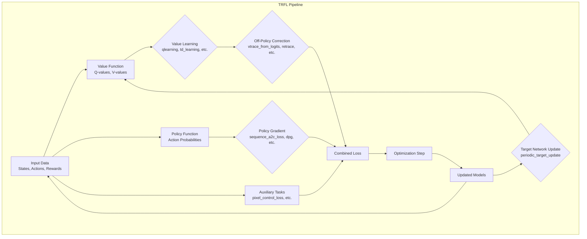

Sources: [docs/index.md:3-26](), [docs/index.md:126-167]()

## Naming Conventions

TRFL follows specific naming conventions that make it easier to understand the relationship between different components:

- **Time indices and variable names**:
  - `q_tm1`: Action values at time t-1 (source state)
  - `a_tm1`: Action taken at time t-1
  - `r_t`: Rewards received at time t
  - `pcont_t`: Continuation probability/discount at time t
  - `q_t`: Action values at time t (destination state)

- **Tensor shapes**:
  - `B`: Batch dimension
  - `T`: Time/sequence dimension (for sequential data)
  - All losses have shape `[B]` (not reduced over the batch dimension)
  - Sequential data has shape `[T, B, ...]` (time-major)

Sources: [docs/index.md:102-124]()

## Basic Usage Pattern

All TRFL functions follow a consistent pattern where they return both a loss tensor and a namedtuple with additional information:

```python
# Compute loss for RL update
loss, extra_info = trfl.qlearning(q_tm1, a_tm1, r_t, pcont_t, q_t)

# Use loss in optimization
reduced_loss = tf.reduce_mean(loss)
optimizer = tf.train.AdamOptimizer(learning_rate=0.1)
train_op = optimizer.minimize(reduced_loss)

# Access additional information if needed
td_error = extra_info.td_error
target = extra_info.target
```

This consistent interface makes it easy to swap different RL algorithms while keeping the surrounding code unchanged.

Sources: [docs/index.md:37-98](), [README.md:18-48]()

## Implementation Details

TRFL functions typically implement the mathematical core of RL algorithms without making assumptions about the surrounding infrastructure. The library follows these key design principles:

1. **Pure TensorFlow Operations**: All components are implemented as TensorFlow operations, enabling them to be part of a larger computational graph.

2. **Building Block Approach**: Rather than implementing complete algorithms, TRFL provides the core mathematical operations that can be composed to create custom algorithms.

3. **Support for Multiple RL Paradigms**: The library supports value-based methods, policy gradient methods, distributional learning, and off-policy learning.

4. **Modularity**: Each component is specialized and can be combined with others to implement various RL algorithms.

Sources: [docs/index.md:7-26](), [setup.py:35-38]()

---

# Page: Installation and Getting Started

# Installation and Getting Started

<details>
<summary>Relevant source files</summary>

The following files were used as context for generating this wiki page:

- [CONTRIBUTING.md](CONTRIBUTING.md)
- [README.md](README.md)
- [setup.py](setup.py)
- [trfl/__init__.py](trfl/__init__.py)

</details>


This page guides you through installing the TRFL (TensorFlow Reinforcement Learning) library and demonstrates its basic usage. For an introduction to the core reinforcement learning concepts used in TRFL, see [Core Concepts](#1.2). For detailed information about specific algorithms, refer to the respective algorithm pages under [Value-Based Learning](#2) and [Policy-Based Learning](#3).

## Installation

TRFL can be installed using pip, the Python package manager. The library is designed to work with both CPU and GPU versions of TensorFlow.

### Basic Installation

To install TRFL, run the following command:

```bash
pip install trfl
```

### Dependencies

TRFL has the following dependencies, as specified in the setup file:

- six
- absl-py
- numpy
- wrapt
- dm-tree

**Important**: TRFL does not list TensorFlow as a direct requirement to allow flexibility between CPU and GPU versions. You need to install TensorFlow and TensorFlow Probability separately:

```bash
# For CPU version
pip install tensorflow>=1.15 tensorflow-probability>=0.8

# For GPU version
pip install tensorflow-gpu>=1.15 tensorflow-probability>=0.8
```

Sources: [setup.py:24-32](), [README.md:9-14]()

## TRFL Architecture Overview

The diagram below illustrates how TRFL fits into a typical reinforcement learning workflow:

```mermaid
flowchart TD
    subgraph "TRFL Library"
        ValueOps["Value-Based Operators
        (qlearning, td_learning, etc.)"]
        PolicyOps["Policy-Based Operators
        (policy_gradient, dpg, etc.)"]
        UtilityOps["Utility Operators
        (update_target_variables, etc.)"]
    end

    TF["TensorFlow"]
    Agent["RL Agent Implementation"]
    Training["Training Loop"]

    Agent --> TRFL Library
    TRFL Library --> TF
    Training --> Agent
```

Sources: [trfl/__init__.py:17-58]()

## Basic Usage Example

The following example demonstrates how to use TRFL to implement a Q-learning update:

```python
import tensorflow as tf
import trfl

# Q-values for the previous and next timesteps, shape [batch_size, num_actions]
q_tm1 = tf.get_variable(
    "q_tm1", initializer=[[1., 1., 0.], [1., 2., 0.]], dtype=tf.float32)
q_t = tf.get_variable(
    "q_t", initializer=[[0., 1., 0.], [1., 2., 0.]], dtype=tf.float32)

# Action indices, discounts and rewards, shape [batch_size]
a_tm1 = tf.constant([0, 1], dtype=tf.int32)
r_t = tf.constant([1, 1], dtype=tf.float32)
pcont_t = tf.constant([0, 1], dtype=tf.float32)  # the discount factor

# Q-learning loss, and auxiliary data
loss, q_learning = trfl.qlearning(q_tm1, a_tm1, r_t, pcont_t, q_t)

# Use the loss in an optimization step
reduced_loss = tf.reduce_mean(loss)
optimizer = tf.train.AdamOptimizer(learning_rate=0.1)
train_op = optimizer.minimize(reduced_loss)
```

In this example:
1. We define Q-values for the previous timestep (`q_tm1`) and current timestep (`q_t`)
2. We specify the actions taken (`a_tm1`), rewards received (`r_t`), and discount factors (`pcont_t`)
3. We compute the Q-learning loss using `trfl.qlearning`
4. We create an optimization operation to minimize the loss

Sources: [README.md:16-48]()

## Key Components of TRFL

TRFL exposes several building blocks for reinforcement learning, organized into functional categories:

```mermaid
graph TD
    TRFL["TRFL Library"] --> ValueLearning["Value-Based Learning"]
    TRFL --> PolicyLearning["Policy-Based Learning"]
    TRFL --> OffPolicy["Off-Policy Learning"]
    TRFL --> Auxiliary["Auxiliary Tasks"]
    TRFL --> Utility["Utility Operations"]

    ValueLearning --> QL["Q-Learning
    (qlearning, double_qlearning)"]
    ValueLearning --> TD["TD Learning
    (td_learning, td_lambda)"]
    ValueLearning --> SARSA["SARSA
    (sarsa, sarsa_lambda)"]
    ValueLearning --> Dist["Distributional RL
    (categorical_dist_qlearning)"]

    PolicyLearning --> PG["Policy Gradients
    (policy_gradient, discrete_policy_gradient)"]
    PolicyLearning --> AC["Actor-Critic
    (sequence_a2c_loss)"]
    PolicyLearning --> DPG["Deterministic Policy Gradient
    (dpg)"]

    OffPolicy --> VTrace["V-trace
    (vtrace_from_logits)"]
    OffPolicy --> Retrace["Retrace
    (retrace, retrace_core)"]

    Auxiliary --> PixelControl["Pixel Control
    (pixel_control_loss)"]

    Utility --> TargetUpdate["Target Network Updates
    (update_target_variables)"]
    Utility --> Indexing["Indexing Operations
    (batched_index)"]
    Utility --> Sequence["Sequence Operations
    (multistep_forward_view)"]
```

Sources: [trfl/__init__.py:17-58]()

## Function Return Format

All loss functions in TRFL follow a consistent return pattern:

1. A loss tensor (typically of shape `[batch_size]`)
2. A namedtuple with additional information specific to the algorithm

For example, the `qlearning` function returns:
- A loss tensor: half the squared difference between predicted Q-values and TD targets
- A namedtuple containing fields like `td_error` and `target`

This format makes it easy to either use just the loss for optimization or access additional information for debugging or further processing.

Sources: [README.md:37-53]()

## Next Steps

After getting familiar with the basic usage of TRFL, you can explore:

1. [Value-Based Learning](#2) for detailed information about Q-learning, TD learning, and SARSA implementations
2. [Policy-Based Learning](#3) to learn about policy gradients and actor-critic methods
3. [Off-Policy Learning Methods](#4) for advanced techniques like V-trace and Retrace
4. [Auxiliary Tasks and Features](#5) for additional functionality like pixel control
5. [Utility Operations](#6) for supporting functions like target network updates

## Compatibility

TRFL is compatible with:
- Python 3.4, 3.5, 3.6, and 3.7
- TensorFlow 1.15 and later versions
- TensorFlow Probability 0.8 and later versions

Sources: [setup.py:51-66](), [setup.py:25-32]()

---

# Page: Core Concepts

# Core Concepts

<details>
<summary>Relevant source files</summary>

The following files were used as context for generating this wiki page:

- [docs/index.md](docs/index.md)
- [docs/multistep_forward_view.md](docs/multistep_forward_view.md)
- [docs/trfl.md](docs/trfl.md)

</details>


This document explains the foundational reinforcement learning concepts and terminology used throughout the TRFL library. It covers the basic building blocks, abstractions, and conventions that underpin the library's implementation of reinforcement learning algorithms. For information about installation and getting started, see [Installation and Getting Started](#1.1).

## Reinforcement Learning Fundamentals

Reinforcement Learning (RL) is a paradigm where an agent learns to make decisions by interacting with an environment. The agent takes actions in an environment, which transitions to new states and provides rewards. The agent's goal is to learn a policy that maximizes cumulative rewards over time.

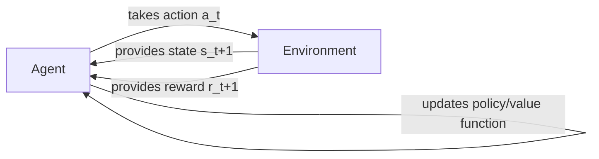

Sources: [docs/index.md:7-16]()

## TRFL's Approach to RL

TRFL implements reinforcement learning algorithms as differentiable loss functions in TensorFlow, rather than as explicit update rules. This approach provides several advantages:

1. **Modularity**: Loss functions can be easily combined with other losses (e.g., supervised or unsupervised).
2. **Automatic Differentiation**: Under TensorFlow's automatic differentiation, the original update rule is recovered.
3. **Composability**: Different components can be mixed and matched to create custom agents.

TRFL provides implementations of mathematical operations needed for RL, but does not enforce sampling constraints (e.g., whether data is on-policy or off-policy).

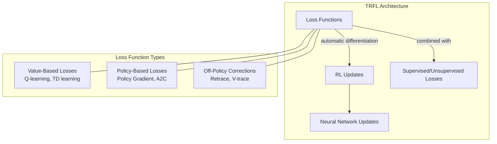

Sources: [docs/index.md:7-25]()

## Key Abstractions in TRFL

### Value Functions

TRFL supports two main types of value functions:

1. **State-Value Function (V-function)**: Estimates the expected return from a state, denoted as V(s).
2. **Action-Value Function (Q-function)**: Estimates the expected return from taking an action in a state, denoted as Q(s,a).

### Policies

Policies define the agent's behavior:

1. **Deterministic Policies**: Directly map states to actions.
2. **Stochastic Policies**: Output probability distributions over actions.

### Transitions

A transition represents a single interaction with the environment, containing:
- State at time t-1: s_tm1
- Action at time t-1: a_tm1
- Reward at time t: r_t
- Discount factor (or continuation probability) at time t: pcont_t
- Next state at time t: s_t

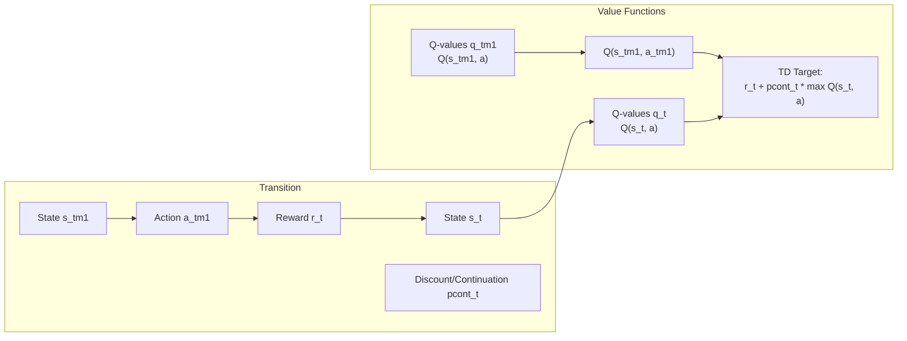

Sources: [docs/index.md:36-53](), [docs/index.md:102-110]()

## Naming Conventions and Tensor Shapes

### Time Indices and Variable Names

TRFL uses consistent naming conventions for variables at different time steps:

| Variable | Meaning |
|----------|---------|
| `q_tm1` | Action values in the source state |
| `a_tm1` | Action selected in the source state |
| `r_t` | Reward received in the destination state |
| `pcont_t` | Continuation probability/discount for the transition |
| `q_t` | Action values in the destination state |

### Tensor Shapes

TRFL operations support minibatches, with consistent tensor shape conventions:

| Tensor Type | Shape | Description |
|-------------|-------|-------------|
| Rewards, discounts | `[B]` | Batch of scalar values |
| State-values | `[B]` | Batch of scalar state values |
| Action-values | `[B, num_actions]` | Batch of vectors with values for each action |
| Losses | `[B]` | Per-example losses (not reduced) |
| Sequence data | `[T, B, ...]` | Time-major tensors (T=sequence length, B=batch size) |

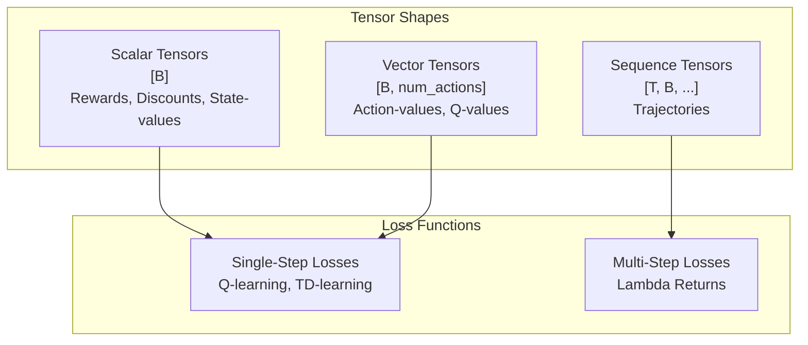

Sources: [docs/index.md:102-124]()

## Core Algorithm Families

TRFL organizes reinforcement learning algorithms into several families:

### Value-Based Learning

Algorithms that learn value functions:

1. **TD Learning**: Learns state values V(s) using temporal difference updates.
2. **Q-Learning Family**: Learns action values Q(s,a) using various Q-learning variants.
3. **SARSA Family**: On-policy methods that use the actual next action for bootstrapping.
4. **Distributional RL**: Learns distributions over returns rather than expected values.

### Policy-Based Learning

Algorithms that directly optimize policies:

1. **Policy Gradients**: Updates policy parameters to maximize expected returns.
2. **Actor-Critic Methods**: Combines policy optimization with value function learning.
3. **Deterministic Policy Gradient**: Specialized for continuous action spaces.

### Off-Policy Learning

Methods that correct for differences between behavior and target policies:

1. **V-trace**: Off-policy correction for value learning.
2. **Retrace**: Q-value off-policy correction method.

```mermaid
flowchart TD
    TRFL["TRFL Library"] --> ValueLearning["Value-Based Learning"]
    TRFL --> PolicyLearning["Policy-Based Learning"]
    TRFL --> OffPolicy["Off-Policy Algorithms"]
    TRFL --> Utilities["Utility Operations"]
    
    ValueLearning --> TD["TD Learning\ntd_learning()"]
    ValueLearning --> QL["Q-Learning\nqlearning(), double_qlearning()"]
    ValueLearning --> SARSA["SARSA\nsarsa(), sarsa_lambda()"]
    ValueLearning --> DistRL["Distributional RL\ncategorical_dist_qlearning()"]
    
    PolicyLearning --> PG["Policy Gradients\npolicy_gradient(), discrete_policy_gradient()"]
    PolicyLearning --> AC["Actor-Critic\nsequence_a2c_loss()"]
    PolicyLearning --> DPG["Deterministic Policy Gradient\ndpg()"]
    
    OffPolicy --> VTrace["V-trace\nvtrace_from_logits()"]
    OffPolicy --> Retrace["Retrace\nretrace(), retrace_core()"]
    
    Utilities --> Target["Target Network Updates\nupdate_target_variables()"]
    Utilities --> Sequence["Sequence Operations\nmultistep_forward_view()"]
    Utilities --> Policy["Policy Operations\nepsilon_greedy()"]
```

Sources: [docs/trfl.md:4-1372](), [docs/index.md:125-187]()

## Data Flow in TRFL Loss Functions

Most TRFL loss functions follow a common pattern:

1. Input tensors represent transitions or sequences of transitions.
2. Loss functions compute target values based on current estimates.
3. The difference between current estimates and targets forms the loss.
4. Loss values are returned along with extra information in a namedtuple.

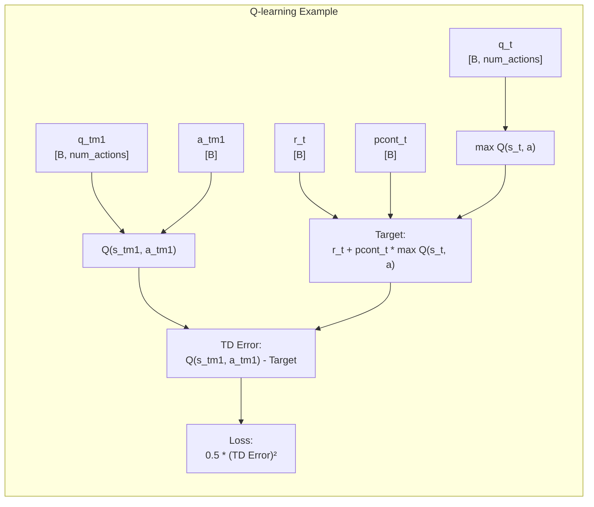

Sources: [docs/index.md:54-88](), [docs/trfl.md:937-963]()

## Loss Function Return Structure

All TRFL loss functions return a tuple with two elements:
1. A tensor of losses with shape `[B]` (one loss per batch element)
2. A namedtuple with extra information specific to each algorithm

For example, the Q-learning loss function returns:
```
loss, q_learning = trfl.qlearning(q_tm1, a_tm1, r_t, pcont_t, q_t)
```

Where `q_learning` is a namedtuple with fields:
- `target`: The TD target values
- `td_error`: The temporal difference errors

This consistent return structure makes it easy to use different loss functions interchangeably.

Sources: [docs/index.md:71-88](), [docs/trfl.md:957-963]()

## Distribution Types in TRFL

TRFL supports both discrete and continuous action spaces through different distribution types:

### Discrete Actions
- Represented by logits or probabilities over a finite set of actions
- Examples: `discrete_policy_gradient()`, `categorical_dist_qlearning()`

### Continuous Actions
- Represented by probability distributions (often Gaussian)
- Examples: `policy_gradient()`, `dpg()`

### Distributional RL
- Represents value functions as distributions over returns
- Uses categorical distributions with fixed support
- Examples: `categorical_dist_qlearning()`, `categorical_dist_td_learning()`

Sources: [docs/trfl.md:134-205](), [docs/trfl.md:827-859]()

## Combining Loss Functions

A key advantage of TRFL's approach is the ability to combine multiple loss functions. For example:

1. **Actor-Critic Methods**: Combine policy gradient loss with value function loss
2. **Auxiliary Tasks**: Add pixel control or other auxiliary losses
3. **Regularization**: Add entropy regularization to policy losses

The losses can be combined by simple addition, possibly with scaling coefficients:

```python
total_loss = (policy_loss + baseline_cost * value_loss - 
             entropy_cost * entropy_loss)
```

This modular design allows researchers to easily experiment with different combinations of learning objectives.

Sources: [docs/index.md:7-25](), [docs/trfl.md:1341-1362]()

---

# Page: Value-Based Learning

# Value-Based Learning

<details>
<summary>Relevant source files</summary>

The following files were used as context for generating this wiki page:

- [docs/multistep_forward_view.md](docs/multistep_forward_view.md)
- [docs/trfl.md](docs/trfl.md)
- [trfl/action_value_ops.py](trfl/action_value_ops.py)
- [trfl/value_ops.py](trfl/value_ops.py)

</details>


This document covers value-based reinforcement learning methods implemented in the TRFL library. Value-based methods learn to estimate the expected future return (value) of states or state-action pairs, and use these estimates to derive optimal policies. For policy-based learning approaches, see [Policy-Based Learning](#3), and for off-policy correction techniques, see [Off-Policy Learning Methods](#4).

## Core Concepts

Value-based reinforcement learning centers around estimating the value of states or state-action pairs. Two key value function types are supported in TRFL:

1. **State-value functions (V-values)**: Estimate the expected return from being in a particular state
2. **Action-value functions (Q-values)**: Estimate the expected return from taking a specific action in a specific state

TRFL provides implementations of various algorithms that learn these value functions through temporal difference (TD) learning, bootstrapping, and function approximation.

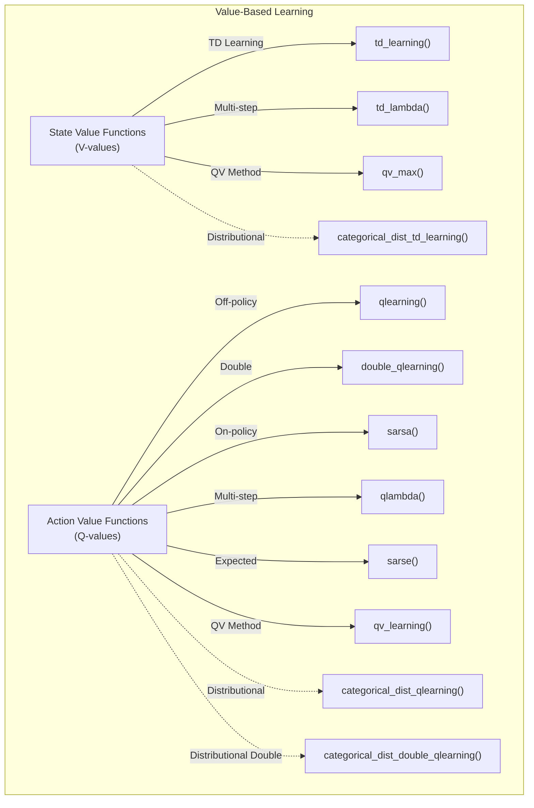

Sources: [trfl/action_value_ops.py:41-472](), [trfl/value_ops.py:34-264](), [docs/trfl.md:73-171]()

## Value Function Learning Types

TRFL supports three primary categories of value-based learning methods:

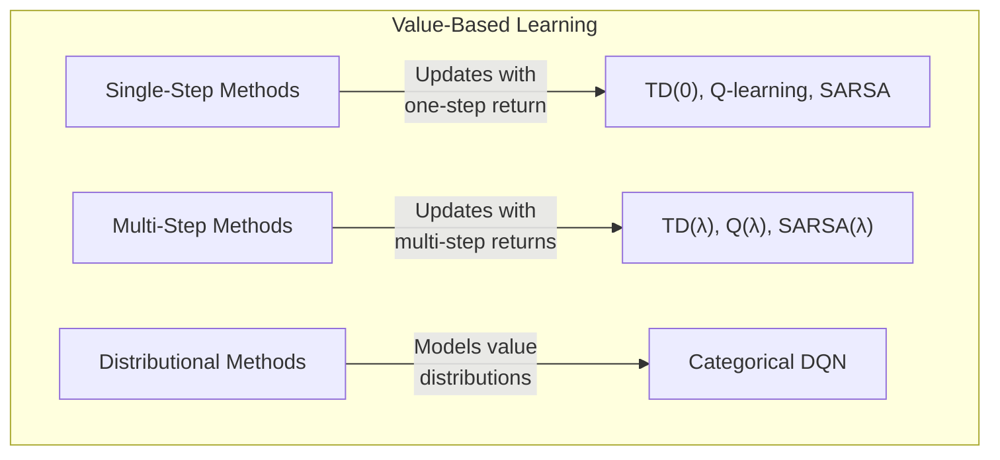

Sources: [docs/trfl.md:73-205]()

## Single-Step Methods

Single-step methods update value estimates using only immediate rewards and bootstrapped values from the next state.

### Q-Learning

Q-learning is an off-policy algorithm that learns the optimal action-value function regardless of the policy being followed. It updates Q-values using the maximum Q-value in the next state:

```
target = r_t + pcont_t * max(q_t)
loss = 0.5 * (target - q_tm1[a_tm1])²
```

Implementation: [trfl/action_value_ops.py:40-84]()

### Double Q-Learning

Double Q-learning reduces overestimation bias by using two separate value functions: one to select the best action and another to evaluate it:

```
best_action = argmax(q_t_selector)
target = r_t + pcont_t * q_t_value[best_action]
loss = 0.5 * (target - q_tm1[a_tm1])²
```

Implementation: [trfl/action_value_ops.py:87-138]()

### Persistent Q-Learning

Persistent Q-learning modifies the target calculation to increase the action gap (the value difference between optimal and suboptimal actions):

```
target = r_t + pcont_t * ((1-action_gap_scale) * max(q_t) + action_gap_scale * q_t[a_tm1])
loss = 0.5 * (target - q_tm1[a_tm1])²
```

Implementation: [trfl/action_value_ops.py:141-193]()

### SARSA

SARSA is an on-policy algorithm that uses the actual next action taken (rather than the greedy action) when computing the target:

```
target = r_t + pcont_t * q_t[a_t]
loss = 0.5 * (target - q_tm1[a_tm1])²
```

Implementation: [trfl/action_value_ops.py:196-240]()

### Expected SARSA (SARSE)

Expected SARSA computes the expected value over all possible next actions, weighted by their probability:

```
target = r_t + pcont_t * sum(probs_a_t[a] * q_t[a])
loss = 0.5 * (target - q_tm1[a_tm1])²
```

Implementation: [trfl/action_value_ops.py:243-304]()

### TD Learning

TD learning updates state-value estimates based on the observed reward and the next state's value:

```
target = r_t + pcont_t * v_t
loss = 0.5 * (target - v_tm1)²
```

Implementation: [trfl/value_ops.py:34-71]()

### QV Learning

QV learning combines state-value and action-value functions, where the Q-function is updated using V-values:

```
target = r_t + pcont_t * v_t
loss = 0.5 * (target - q_tm1[a_tm1])²
```

Implementation: [trfl/action_value_ops.py:426-471]()

### QV-Max

QV-Max is the complementary algorithm to QV Learning, where the V-function is updated using max Q-values:

```
target = r_t + pcont_t * max(q_t)
loss = 0.5 * (target - v_tm1)²
```

Implementation: [trfl/value_ops.py:224-263]()

Sources: [trfl/action_value_ops.py:40-304](), [trfl/value_ops.py:34-71](), [trfl/action_value_ops.py:426-471](), [trfl/value_ops.py:224-263]()

## Multi-Step Methods

Multi-step methods use information from multiple future time steps to improve learning efficiency and stability.

### Q(λ) and SARSA(λ)

Q(λ) and SARSA(λ) combine immediate rewards with future rewards through eligibility traces:

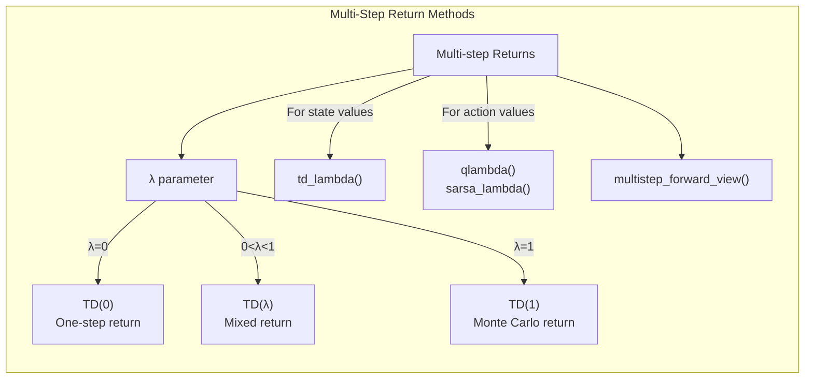

Implementation for Q(λ): [trfl/action_value_ops.py:307-367]()
Implementation for SARSA(λ): [trfl/action_value_ops.py:370-423]()

### TD(λ)

TD(λ) applies the multi-step learning concept to state-value functions, blending between one-step TD and Monte Carlo returns:

```
discounted_returns = generalized_lambda_returns(rewards, pcontinues, state_values, bootstrap_value, lambda_)
loss = 0.5 * sum((discounted_returns - state_values)²)
```

Implementation: [trfl/value_ops.py:159-221]()

### Generalized Lambda Returns

The generalized lambda returns mechanism is a core component for implementing multi-step methods:

```
For λ=1: scan_discounted_sum(rewards, pcontinues, bootstrap_value)
For λ<1: multistep_forward_view(rewards, pcontinues, next_values, lambda_)
```

Implementation: [trfl/value_ops.py:74-156](), [docs/multistep_forward_view.md:1-63]()

Sources: [trfl/action_value_ops.py:307-423](), [trfl/value_ops.py:74-221](), [docs/multistep_forward_view.md:1-63]()

## Distributional Methods

Distributional reinforcement learning methods model the distribution of returns rather than just their expected value.

### Categorical Distributional Q-Learning

Categorical DQN represents the value distribution with a discrete set of atoms (categories):

```
target_distribution = project_distribution(r_t + pcont_t * argmax_action(mean(q_t)) distribution)
loss = cross_entropy(target_distribution, q_tm1[a_tm1])
```

Implementation reference: [docs/trfl.md:73-171]()

### Categorical Distributional Double Q-Learning

Similar to standard Double Q-learning, this uses separate networks for action selection and evaluation, but with distributional representations:

```
best_action = argmax(q_t_selector)
target_distribution = project_distribution(r_t + pcont_t * q_t_value[best_action] distribution)
loss = cross_entropy(target_distribution, q_tm1[a_tm1])
```

Implementation reference: [docs/trfl.md:87-131]()

Sources: [docs/trfl.md:73-171](), [docs/trfl.md:87-131](), [docs/trfl.md:173-209]()

## Data Flow in Value-Based Learning

The following diagram illustrates the typical data flow when using TRFL's value-based learning operations:

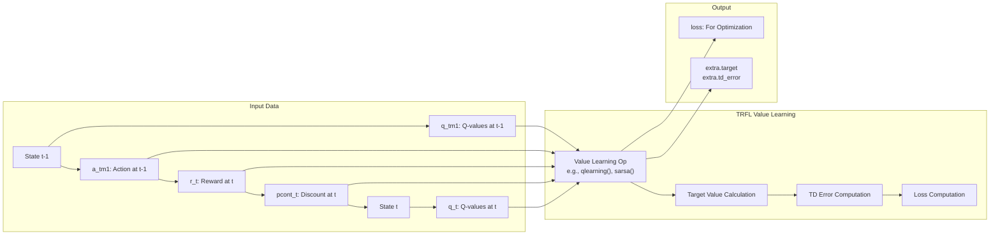

Sources: [trfl/action_value_ops.py:41-84](), [trfl/value_ops.py:34-71]()

## Implementation Architecture

TRFL's value-based learning operations follow a consistent structure and return format:

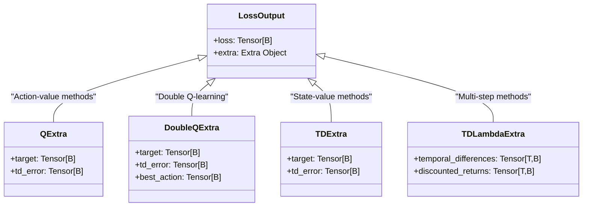

All value-based learning functions return a `LossOutput` namedtuple containing:
- `loss`: A tensor of loss values (typically shape `[B]` for batch size B)
- `extra`: A namedtuple containing algorithm-specific information (targets, TD errors, etc.)

Sources: [trfl/action_value_ops.py:34-38](), [trfl/value_ops.py:29-31]()

## Usage Example

Here's a conceptual example of how to use TRFL's value-based learning operations in a reinforcement learning agent:

1. Define your Q-network and target network
2. Get Q-values from your networks for states/actions in a batch of transitions
3. Use TRFL's operations to compute the loss
4. Optimize your Q-network using the loss
5. Periodically update your target network

```python
# Compute Q-values for current and next states
q_tm1 = q_network(states)
q_t = target_network(next_states)

# Compute loss using TRFL's qlearning operation
loss_output = trfl.qlearning(q_tm1, actions, rewards, discounts, q_t)

# Use the loss for optimization
optimizer.minimize(loss_output.loss)

# Periodically update target network
target_update_op = trfl.periodic_target_update(
    target_variables=target_network.variables,
    source_variables=q_network.variables,
    update_period=1000)
```

Sources: [docs/trfl.md:40-66](), [docs/trfl.md:590-618]()

## Relationship to Other Components

Value-based learning methods in TRFL are often used in conjunction with other components:

- **Target Network Updates**: [Target Network Updates](#5.2) are commonly used with value-based methods to improve stability
- **Exploration Strategies**: [Policy Operations](#6.4) like `epsilon_greedy` are used for exploration in value-based methods
- **Off-Policy Corrections**: [Off-Policy Learning Methods](#4) can be combined with value-based methods for learning from offline data
- **Auxiliary Tasks**: [Auxiliary Tasks](#5) like Pixel Control can provide additional learning signals

Sources: [docs/trfl.md:590-618](), [docs/trfl.md:404-435]()

---

# Page: Q-Learning Family

# Q-Learning Family

<details>
<summary>Relevant source files</summary>

The following files were used as context for generating this wiki page:

- [docs/multistep_forward_view.md](docs/multistep_forward_view.md)
- [docs/trfl.md](docs/trfl.md)
- [trfl/action_value_ops.py](trfl/action_value_ops.py)

</details>


## Purpose and Scope

This document describes the Q-Learning family of reinforcement learning algorithms implemented in TRFL. These algorithms are value-based methods that learn to approximate the optimal action-value function (Q-function) through temporal difference learning. The scope includes standard Q-Learning, Double Q-Learning, Persistent Q-Learning, and Q(λ) variants. For information about distributional variants of Q-Learning, see [Distributional RL](#2.4). For other value-based methods like TD-Learning and SARSA, see [TD Learning](#2.2) and [SARSA Family](#2.3) respectively.

Sources: [docs/trfl.md:934-963](), [trfl/action_value_ops.py:15-21]()

## Core Principles of the Q-Learning Family

Q-Learning algorithms aim to learn an action-value function Q(s,a) that estimates the expected return when taking action 'a' in state 's' and following the optimal policy thereafter. The key characteristic of Q-Learning is that it's an off-policy algorithm, learning about the optimal policy regardless of the actions actually taken.

All Q-Learning variants in TRFL use a similar interface pattern:
- Inputs include current Q-values, actions, rewards, and continuation values
- Each function returns a loss and additional information for debugging
- Loss is scaled by 0.5 so that the gradient equals the TD error

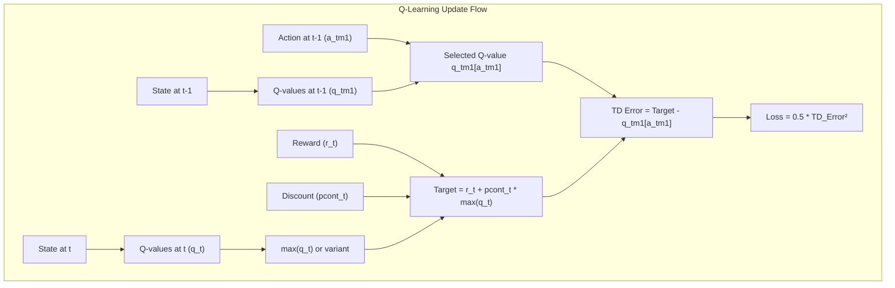

Sources: [trfl/action_value_ops.py:41-84]()

## Standard Q-Learning

The standard Q-Learning algorithm updates the action-value function using the Bellman optimality equation. The TRFL implementation is provided through the `qlearning` function.

### Algorithm

For a transition (state, action, reward, next_state):
1. Compute the target value: `r_t + pcont_t * max(q_t)`
2. Compute the TD error: `target - q_tm1[a_tm1]`
3. Compute the loss: `0.5 * td_error²`

### Implementation

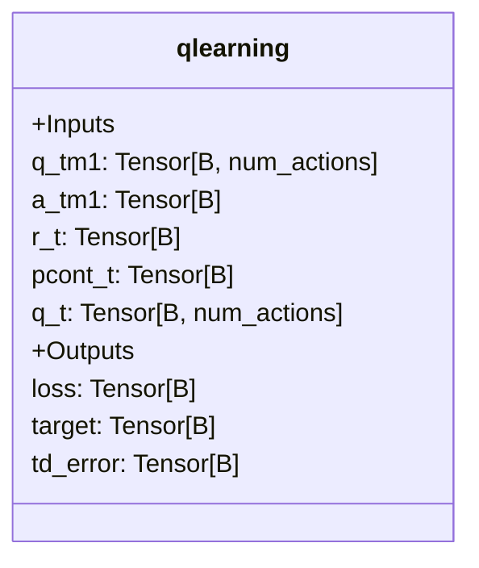

The implementation computes the target values by taking the maximum Q-value for the next state across all possible actions. This means standard Q-learning can directly approximate the optimal policy without needing to follow it during training.

Key implementation details:
- Input tensors use batch dimension `B` for efficiency
- Gradient of the loss equals the TD error
- Return value is a namedtuple with `loss` and `extra` fields

Sources: [trfl/action_value_ops.py:41-84]()

## Double Q-Learning

Double Q-Learning addresses the overestimation bias problem in standard Q-Learning. The bias occurs because taking the maximum of estimated values tends to overestimate the true maximum, especially when estimates have noise.

### Algorithm

The key modification in Double Q-Learning is separating action selection from action evaluation:
1. Use one set of Q-values (`q_t_selector`) to select the best action
2. Use another set of Q-values (`q_t_value`) to evaluate that action
3. Compute target: `r_t + pcont_t * q_t_value[argmax(q_t_selector)]`

### Implementation

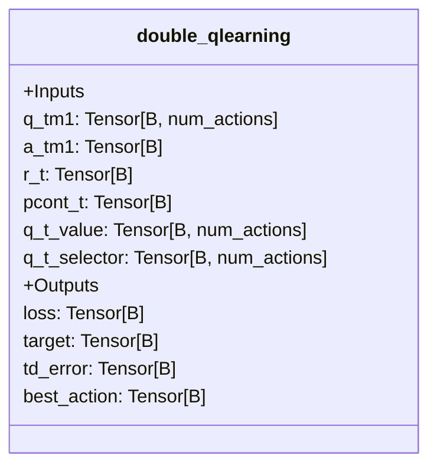

In practice, `q_t_selector` often comes from the online network, while `q_t_value` comes from a target network, creating a decoupling that helps reduce overestimation.

Sources: [trfl/action_value_ops.py:88-138](), [docs/trfl.md:331-365]()

## Persistent Q-Learning

Persistent Q-Learning aims to increase the "action gap" (the difference between the value of the optimal action and the values of suboptimal actions) to make value functions more robust.

### Algorithm

The persistent Q-learning target modifies the bootstrapping term:
1. Compute a weighted average between the max Q-value and the Q-value of the selected action
2. Target: `r_t + pcont_t * [(1-action_gap_scale) * max(q_t) + action_gap_scale * q_t[a_tm1]]`
3. The `action_gap_scale` parameter controls the trade-off (typically set to 0.5)

### Implementation

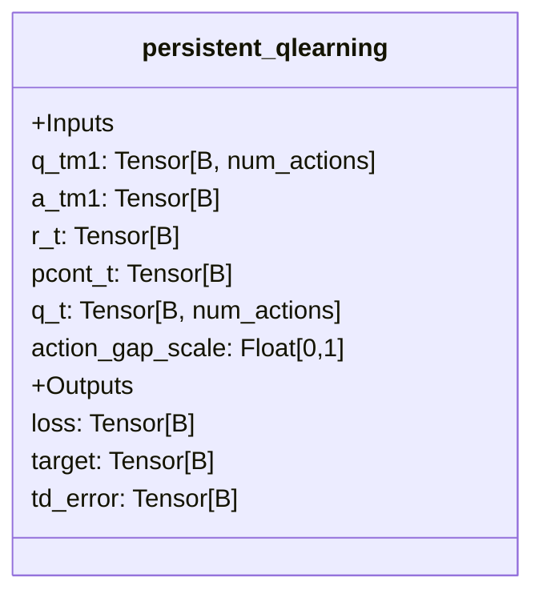

By incorporating the Q-value of the selected action in the target, persistent Q-learning increases the gap between good and bad actions, potentially leading to more robust policies.

Sources: [trfl/action_value_ops.py:142-193](), [docs/trfl.md:660-693]()

## Q(λ) Methods

Q(λ) algorithms combine one-step temporal difference learning with multi-step returns, providing a middle ground between TD learning and Monte Carlo methods. The TRFL implementation supports both Peng's and Watkins' Q(λ) variants.

### Algorithm

Q(λ) computes a mixture of n-step returns using the λ parameter:
1. Apply the `multistep_forward_view` operation to compute mixed returns
2. Target is computed using rewards and state values over multiple time steps
3. The λ parameter controls the balance between TD learning and Monte Carlo returns

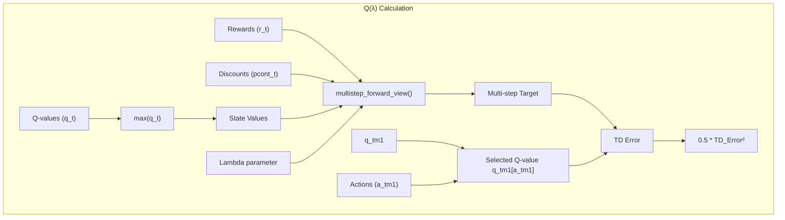

### Implementation

```mermaid
classDiagram
    class qlambda {
        +Inputs
        q_tm1: Tensor[T, B, num_actions]
        a_tm1: Tensor[T, B]
        r_t: Tensor[T, B]
        pcont_t: Tensor[T, B]
        q_t: Tensor[T, B, num_actions]
        lambda_: Scalar or Tensor[T, B]
        +Outputs
        loss: Tensor[T, B]
        target: Tensor[T, B]
        td_error: Tensor[T, B]
    }
```

The implementation provides flexibility in setting λ:
- For Peng's Q(λ): use a constant λ for all time steps
- For Watkins' Q(λ): set λ=0 for suboptimal actions and a constant for optimal actions
- General case: provide a tensor of λ values, potentially different for each state

Sources: [trfl/action_value_ops.py:308-367](), [docs/trfl.md:894-932](), [docs/multistep_forward_view.md:1-63]()

## Usage Patterns

All Q-Learning functions in TRFL follow a consistent pattern:

```python
# Create Q-learning loss
loss_output = trfl.qlearning(q_tm1, a_tm1, r_t, pcont_t, q_t)

# Extract actual loss for optimization
q_learning_loss = loss_output.loss

# Optionally, extract additional values for logging or analysis
target = loss_output.extra.target
td_error = loss_output.extra.td_error

# Use with optimizer
optimizer = tf.train.AdamOptimizer(learning_rate=0.001)
train_op = optimizer.minimize(tf.reduce_mean(q_learning_loss))
```

Key considerations when using these functions:
- Q-Learning methods are off-policy and work with any data collection strategy
- Double Q-Learning requires two networks (online and target)
- Q(λ) requires sequence data rather than single transitions
- All methods benefit from experience replay

Sources: [trfl/action_value_ops.py:34-38](), [docs/trfl.md:934-963]()

## Comparing Q-Learning Variants

| Variant | Key Feature | Best Used When | Implementation |
|---------|-------------|----------------|---------------|
| Standard Q-Learning | Simple, proven approach | Learning from scratch in stable environments | `qlearning` |
| Double Q-Learning | Reduces overestimation bias | Unstable environments or high-variance rewards | `double_qlearning` |
| Persistent Q-Learning | Increases action gap | Fine-tuning policies or when requiring robust decisions | `persistent_qlearning` |
| Q(λ) | Balances TD and MC learning | Learning from sequences of data or when requiring credit assignment over time | `qlambda` |

All Q-Learning variants can be combined with experience replay, target networks, and various exploration strategies to improve performance.

Sources: [trfl/action_value_ops.py:41-472](), [docs/trfl.md:331-470]()

---

# Page: TD Learning

# TD Learning

<details>
<summary>Relevant source files</summary>

The following files were used as context for generating this wiki page:

- [docs/multistep_forward_view.md](docs/multistep_forward_view.md)
- [docs/trfl.md](docs/trfl.md)
- [trfl/value_ops.py](trfl/value_ops.py)

</details>


This document details the Temporal Difference (TD) learning components in the TRFL library. TD learning is a foundational technique in reinforcement learning where value functions are updated based on the difference between temporally successive predictions. TRFL provides implementations of both basic TD(0) and more advanced TD(λ) learning, along with distributional variants. For related Q-learning techniques, see [Q-Learning Family](#2.1).

## Overview of TD Learning

Temporal Difference learning is a method for estimating value functions in reinforcement learning. TD learning combines elements of Monte Carlo and dynamic programming methods by using bootstrapped estimates of future returns to update value functions. The key concept is the TD error - the difference between the estimated value of a state and the "target" value determined by the reward and the estimated value of the next state.

```mermaid
graph LR
    S1["State s<sub>t</sub>"] --> V1["Value V(s<sub>t</sub>)"]
    S1 --> A["Action a<sub>t</sub>"]
    A --> R["Reward r<sub>t</sub>"]
    A --> S2["State s<sub>t+1</sub>"]
    S2 --> V2["Value V(s<sub>t+1</sub>)"]
    R --> TD["TD Target:<br>r<sub>t</sub> + γV(s<sub>t+1</sub>)"]
    V2 --> TD
    TD --> Error["TD Error:<br>r<sub>t</sub> + γV(s<sub>t+1</sub>) - V(s<sub>t</sub>)"]
    V1 --> Error
    Error --> Update["Update V(s<sub>t</sub>)"]
```

Sources: [trfl/value_ops.py:34-71]()

## Basic TD(0) Implementation

TRFL implements the classic TD(0) learning algorithm through the `td_learning` function. This function computes the loss as half the squared difference between the previous state's value estimate and the TD target.

```mermaid
flowchart TB
    subgraph "td_learning Function"
        direction LR
        input["Inputs:<br>v_tm1, r_t, pcont_t, v_t"]
        target["target = r_t + pcont_t * v_t"]
        error["td_error = target - v_tm1"]
        loss["loss = 0.5 * square(td_error)"]
        
        input --> target
        target --> error
        error --> loss
        
        output["Return: loss, extra(target, td_error)"]
        loss --> output
    end
```

The function takes the following parameters:
- `v_tm1`: Value estimates at previous timestep, shape `[B]`
- `r_t`: Rewards, shape `[B]`
- `pcont_t`: Continuation probabilities (discount factors), shape `[B]`
- `v_t`: Value estimates at current timestep, shape `[B]`

And returns a namedtuple with:
- `loss`: The batch of losses, shape `[B]`
- `extra`: Additional information including target values and TD errors

Sources: [trfl/value_ops.py:34-71]()

## TD(λ) and Generalized Lambda Returns

TRFL provides the `td_lambda` function for implementing TD(λ) learning, which utilizes the `generalized_lambda_returns` function for computing multi-step returns. TD(λ) generalizes TD learning by blending between one-step TD updates and full Monte Carlo returns using the λ parameter.

```mermaid
flowchart TB
    subgraph "TD(λ) Learning Process"
        direction LR
        input["Inputs: state_values, rewards,<br>pcontinues, bootstrap_value, lambda_"]
        returns["discounted_returns =<br>generalized_lambda_returns(...)"]
        differences["temporal_differences =<br>discounted_returns - state_values"]
        loss["loss = 0.5 * sum(square(temporal_differences))"]
        
        input --> returns
        returns --> differences
        differences --> loss
        
        output["Return: loss, extra(temporal_differences, discounted_returns)"]
        loss --> output
    end
```

### Generalized Lambda Returns

The `generalized_lambda_returns` function computes a mixture of returns with different lookahead horizons, weighted by the lambda parameter:

- For λ=0: Returns one-step TD(0) targets
- For λ=1: Returns full Monte Carlo returns (or bootstrapped returns if using incomplete episodes)
- For values between 0 and 1: Returns a weighted mixture of different n-step returns

The implementation uses a recursive backward view computation to efficiently calculate these returns.

| Lambda Value | Type of Return | Characteristic |
|--------------|----------------|----------------|
| 0 | TD(0) | Uses only immediate reward and next state value |
| 0.5 | Intermediate | Balanced between TD(0) and Monte Carlo |
| 1 | Monte Carlo | Uses full episode rewards with no bootstrapping |

Sources: [trfl/value_ops.py:74-156](), [trfl/value_ops.py:159-221](), [docs/multistep_forward_view.md:1-63]()

## Distributional TD Learning

TRFL also supports distributional TD learning through the `categorical_dist_td_learning` function. Instead of learning a single expected value for each state, distributional TD learning estimates a probability distribution over possible returns.

```mermaid
graph TD
    subgraph "Standard TD Learning"
        S1["State"] --> V1["Value V(s)<br>Single Scalar"]
    end
    
    subgraph "Distributional TD Learning"
        S2["State"] --> D2["Value Distribution<br>Z(s)<br>Distribution over Values"]
        D2 --> Atoms["Atoms: Fixed Value Support Points"]
        D2 --> Probs["Probabilities: Parameterized by Logits"]
    end
    
    S1 -.Similar Purpose.-> S2
```

The `categorical_dist_td_learning` function:
- Takes discrete support points (atoms) and logits that parameterize categorical distributions
- Projects the expected next-state distribution through the Bellman operator
- Computes a loss that minimizes the distance between distributions

Sources: [docs/trfl.md:173-210]()

## Relationship with Other Value Learning Functions

TD learning methods in TRFL integrate with other value-based methods. For example, the `qv_max` function implements a value learning update using the maximum Q-value from a separately learned Q-function.

```mermaid
graph TD
    subgraph "TRFL Value Learning Hierarchy"
        direction TB
        VL["Value-Based Learning"] --> TD["TD Learning<br>td_learning<br>td_lambda"]
        VL --> Q["Q-Learning<br>qlearning"]
        VL --> SARSA["SARSA<br>sarsa<br>sarsa_lambda"]
        VL --> QV["QV Methods<br>qv_learning<br>qv_max"]
        
        TD --> Dist["Distributional Methods<br>categorical_dist_td_learning"]
        Q --> DoubleQ["Double Q-Learning<br>double_qlearning"]
        Q --> DistQ["Distributional Q-Learning<br>categorical_dist_qlearning"]
    end
```

The TD learning components form a foundational part of TRFL's reinforcement learning tools, which can be used in various architectures including:

- Value function approximation in actor-critic methods
- Baseline value prediction in advantage-based policy gradient methods
- State value prediction in model-based reinforcement learning

Sources: [docs/trfl.md:173-210](), [trfl/value_ops.py:224-263]()

## Usage Example

TD learning is typically used to update a value function approximator (like a neural network) by minimizing the TD loss. The basic pattern involves:

1. Computing state values for states at times t-1 and t
2. Observing rewards and continuation probabilities
3. Computing the TD loss using `td_learning`
4. Optimizing the value function parameters by minimizing this loss

This works within the broader reinforcement learning loop where new experiences are continuously collected and used for updates.

Sources: [trfl/value_ops.py:34-71]()

---

# Page: SARSA Family

# SARSA Family

<details>
<summary>Relevant source files</summary>

The following files were used as context for generating this wiki page:

- [docs/multistep_forward_view.md](docs/multistep_forward_view.md)
- [docs/trfl.md](docs/trfl.md)
- [trfl/action_value_ops.py](trfl/action_value_ops.py)

</details>


This document covers the SARSA (State-Action-Reward-State-Action) family of reinforcement learning algorithms implemented in the TRFL library. SARSA algorithms are on-policy temporal difference learning methods for estimating action-value functions. For related value-based learning approaches, see [Q-Learning Family](#2.1) and [TD Learning](#2.2).

The SARSA family in TRFL includes:
- Standard SARSA
- SARSA(λ) (SARSA Lambda)
- Expected SARSA (SARSE)

Sources: [trfl/action_value_ops.py:196-240](), [trfl/action_value_ops.py:370-423](), [trfl/action_value_ops.py:243-304]()

## SARSA Algorithm Overview

SARSA is an on-policy temporal difference control algorithm that learns action-value functions directly from experience. Unlike Q-learning, which is off-policy and uses the maximum action value for the next state, SARSA uses the action value for the actual action taken in the next state.

The name "SARSA" comes from the tuple of events (state, action, reward, next state, next action) used in the algorithm's update rule.

```mermaid
flowchart LR
    S1["State s_t"] --> A1["Action a_t"]
    A1 --> R["Reward r_t"]
    R --> S2["State s_t+1"]
    S2 --> A2["Action a_t+1"]
    
    subgraph "SARSA Update"
        U["Q(s_t, a_t) ← Q(s_t, a_t) + α[r_t + γQ(s_t+1, a_t+1) - Q(s_t, a_t)]"]
    end
    
    A2 -.-> U
```

### SARSA vs Q-Learning

```mermaid
flowchart TB
    subgraph "SARSA (On-Policy)"
        S1["Update Target:<br>r_t + γQ(s_t+1, a_t+1)"]
        S2["Uses actual next action a_t+1"]
    end
    
    subgraph "Q-Learning (Off-Policy)"
        Q1["Update Target:<br>r_t + γmax_a Q(s_t+1, a)"]
        Q2["Uses best possible next action"]
    end
    
    COMPARE["Key Difference"]
    COMPARE --> S2
    COMPARE --> Q2
```

Sources: [trfl/action_value_ops.py:196-240](), [trfl/action_value_ops.py:41-84]()

## Implementation in TRFL

The TRFL library provides implementations of the SARSA family algorithms as TensorFlow operations, making them easy to integrate into deep learning pipelines.

### Standard SARSA

The standard SARSA algorithm in TRFL is implemented by the `sarsa` function, which computes the loss as 0.5 times the squared difference between the Q-value of the current state-action pair and the target value:

```mermaid
graph TD
    subgraph "TRFL sarsa Function"
        I1["Inputs"]
        I1 --> Q1["q_tm1: Q-values at time t-1<br>[B, num_actions]"]
        I1 --> A1["a_tm1: Action indices at t-1<br>[B]"]
        I1 --> R["r_t: Rewards<br>[B]"]
        I1 --> P["pcont_t: Continuation values<br>[B]"]
        I1 --> Q2["q_t: Q-values at time t<br>[B, num_actions]"]
        I1 --> A2["a_t: Action indices at t<br>[B]"]
        
        COMP["Computation"]
        COMP --> SEL1["Select Q(s_t-1, a_t-1)"]
        COMP --> SEL2["Select Q(s_t, a_t)"]
        COMP --> TARG["Target = r_t + pcont_t * Q(s_t, a_t)"]
        COMP --> ERR["TD Error = Target - Q(s_t-1, a_t-1)"]
        COMP --> LOSS["Loss = 0.5 * (TD Error)²"]
        
        O["Output: LossOutput(loss, extra)"]
    end
```

The `sarsa` function takes the following inputs:
- `q_tm1`: Q-values for first timestep in a batch of transitions `[B x num_actions]`
- `a_tm1`: Action indices `[B]`
- `r_t`: Rewards `[B]`
- `pcont_t`: Continuation probabilities (discount factors) `[B]`
- `q_t`: Q-values for second timestep `[B x num_actions]`
- `a_t`: Action indices for second timestep `[B]`

It returns a `LossOutput` named tuple with:
- `loss`: batch of losses `[B]`
- `extra`: named tuple with `target` and `td_error` fields

Example usage:

```python
# Assuming these tensors are available
q_tm1 = ... # Shape [batch_size, num_actions]
a_tm1 = ... # Shape [batch_size]
r_t = ...   # Shape [batch_size]
pcont_t = ... # Shape [batch_size]
q_t = ...   # Shape [batch_size, num_actions]
a_t = ...   # Shape [batch_size]

# Compute SARSA loss
sarsa_loss = trfl.sarsa(q_tm1, a_tm1, r_t, pcont_t, q_t, a_t)

# Use the loss for optimization
optimizer.minimize(tf.reduce_mean(sarsa_loss.loss))
```

Sources: [trfl/action_value_ops.py:196-240]()

### SARSA(λ) - SARSA Lambda

SARSA(λ) extends standard SARSA by incorporating eligibility traces, which allow for a mix of temporal difference learning and Monte Carlo methods. This often leads to faster learning because it propagates rewards more efficiently through the state-action space.

```mermaid
flowchart LR
    subgraph "SARSA(λ) Update Process"
        MR["Multi-step Returns"]
        SEQ["Sequence of State-Actions<br>(s_0,a_0), (s_1,a_1), ..., (s_T,a_T)"]
        LAMBDA["λ Parameter<br>Controls mixing between<br>TD(0) and Monte Carlo"]
        TRACE["Eligibility Traces<br>Decay: λγ"]
        
        SEQ --> MR
        LAMBDA --> MR
        MR --> UPDATES["Q-Value Updates"]
        TRACE --> UPDATES
    end
```

In TRFL, SARSA(λ) is implemented by the `sarsa_lambda` function. This function works with sequences of transitions and uses the `multistep_forward_view` operation to compute the mixture of n-step returns.

The `sarsa_lambda` function takes:
- `q_tm1`: Sequence of Q-values `[T, B, num_actions]`
- `a_tm1`: Sequence of action indices `[T, B]`
- `r_t`: Sequence of rewards `[T, B]`
- `pcont_t`: Sequence of continuation values `[T, B]`
- `q_t`: Sequence of Q-values for next timestep `[T, B, num_actions]`
- `a_t`: Sequence of action indices for next timestep `[T, B]`
- `lambda_`: Scalar mixing parameter between bootstrapped and Monte Carlo returns

It returns a `LossOutput` with loss of shape `[T, B]`.

Implementation details:
- Uses `batched_index` to select appropriate Q-values for actions
- Computes targets using `multistep_forward_view` with the λ parameter
- Returns squared TD errors as loss

Sources: [trfl/action_value_ops.py:370-423](), [docs/multistep_forward_view.md:1-62]()

### Expected SARSA (SARSE)

Expected SARSA is a variant of SARSA that, instead of using the value of the actual next action, uses the expected value of the next state under the current policy. This can reduce variance in updates compared to standard SARSA.

```mermaid
graph TD
    subgraph "Algorithm Comparison"
        SARSA["SARSA Target:<br>r_t + γQ(s_t+1, a_t+1)"]
        ESARSA["Expected SARSA Target:<br>r_t + γ∑_a π(a|s_t+1)Q(s_t+1, a)"]
        QL["Q-Learning Target:<br>r_t + γmax_a Q(s_t+1, a)"]
        
        NOTE["Expected SARSA generalizes both<br>SARSA and Q-Learning"]
        NOTE --> SARSA
        NOTE --> ESARSA
        NOTE --> QL
    end
```

In TRFL, Expected SARSA is implemented by the `sarse` function, which takes:
- `q_tm1`: Q-values for first timestep `[B x num_actions]`
- `a_tm1`: Action indices `[B]`
- `r_t`: Rewards `[B]`
- `pcont_t`: Continuation values `[B]`
- `q_t`: Q-values for second timestep `[B x num_actions]`
- `probs_a_t`: Action probabilities for second timestep `[B x num_actions]`
- `debug`: Boolean flag to add validity checks for probability distributions

The key difference from standard SARSA is that `sarse` takes action probabilities instead of specific next actions, and computes the expected Q-value by multiplying action probabilities with their respective Q-values.

Sources: [trfl/action_value_ops.py:243-304]()

## Usage Patterns and Integration

The SARSA family algorithms in TRFL are designed to be used as part of a larger reinforcement learning pipeline. Here's a typical usage pattern:

```mermaid
flowchart TB
    ENV["Environment"]
    AGENT["Agent"]
    SARSA["SARSA Loss<br>trfl.sarsa() / trfl.sarsa_lambda() / trfl.sarse()"]
    OPT["Optimizer"]
    
    ENV -->|"State s_t"| AGENT
    AGENT -->|"Action a_t"| ENV
    ENV -->|"Reward r_t<br>Next State s_t+1"| AGENT
    AGENT -->|"Next Action a_t+1"| ENV
    
    AGENT -->|"s_t, a_t, r_t, s_t+1, a_t+1"| SARSA
    SARSA -->|"Loss"| OPT
    OPT -->|"Parameter Updates"| AGENT
```

### Integration with Deep Networks

When using SARSA with deep networks:

1. Use a neural network to approximate the Q-function
2. For each batch of transitions, compute Q-values with the network
3. Apply the appropriate SARSA loss function
4. Optimize the network using the loss

Example pattern with deep networks:

```python
# Neural network for Q-function approximation
q_network = build_q_network(...)

# Process batch of transitions
q_tm1 = q_network(states_tm1)
q_t = q_network(states_t)

# For SARSA
sarsa_loss = trfl.sarsa(q_tm1, actions_tm1, rewards, pcontinues, q_t, actions_t)

# For Expected SARSA
action_probs = policy(states_t)
sarse_loss = trfl.sarse(q_tm1, actions_tm1, rewards, pcontinues, q_t, action_probs)

# For SARSA(λ)
sarsa_lambda_loss = trfl.sarsa_lambda(
    q_sequence, action_sequence, reward_sequence, 
    pcontinue_sequence, next_q_sequence, next_action_sequence, lambda_
)

# Optimize
optimizer.minimize(tf.reduce_mean(loss.loss))
```

Sources: [trfl/action_value_ops.py:196-240](), [trfl/action_value_ops.py:370-423](), [trfl/action_value_ops.py:243-304]()

## Choosing the Right SARSA Variant

| Algorithm | Characteristics | Best Used When |
|-----------|-----------------|----------------|
| SARSA | On-policy, uses actual next action | Need strictly on-policy learning, simpler implementation |
| SARSA(λ) | On-policy with eligibility traces | Faster credit assignment over long sequences, balancing TD and Monte Carlo |
| Expected SARSA | Reduces variance by using expected next value | Stochastic policies, needs improved stability vs. standard SARSA |

The choice between these variants depends on:
- The nature of the problem (episodic vs. continuing)
- The desired trade-off between variance and bias
- Computational constraints
- The specific policy being learned (deterministic vs. stochastic)

Sources: [trfl/action_value_ops.py:196-240](), [trfl/action_value_ops.py:370-423](), [trfl/action_value_ops.py:243-304]()

## Relationship to Other TRFL Components

The SARSA family functions in TRFL are closely related to other value-based learning methods in the library:

```mermaid
graph TD
    subgraph "TRFL Value-Based Learning"
        VBASED["Value-Based Learning"]
        
        VBASED --> QL["Q-Learning Family<br>trfl.qlearning()<br>trfl.double_qlearning()<br>trfl.persistent_qlearning()"]
        VBASED --> SARSA["SARSA Family<br>trfl.sarsa()<br>trfl.sarsa_lambda()<br>trfl.sarse()"]
        VBASED --> TD["TD Learning<br>trfl.td_learning()<br>trfl.td_lambda()"]
        VBASED --> QV["QV Learning<br>trfl.qv_learning()<br>trfl.qv_max()"]
        
        TU["Target Updates<br>trfl.update_target_variables()<br>trfl.periodic_target_update()"] --- VBASED
        
        QL -.-> LAMBDA["Eligibility Traces<br>trfl.qlambda()"]
        SARSA -.-> LAMBDA
        TD -.-> LAMBDA
    end
```

The SARSA family functions use several common utility operations from TRFL:
- `batched_index`: For selecting values at specific action indices
- `multistep_forward_view`: For computing λ-returns in SARSA(λ)
- `scan_discounted_sum`: For computing discounted sums along sequences

Sources: [trfl/action_value_ops.py:196-240](), [trfl/action_value_ops.py:370-423](), [trfl/action_value_ops.py:243-304](), [docs/trfl.md:196-240](), [docs/trfl.md:370-423](), [docs/trfl.md:243-304]()

---

# Page: Distributional RL

# Distributional RL

<details>
<summary>Relevant source files</summary>

The following files were used as context for generating this wiki page:

- [docs/multistep_forward_view.md](docs/multistep_forward_view.md)
- [docs/trfl.md](docs/trfl.md)
- [trfl/dist_value_ops.py](trfl/dist_value_ops.py)

</details>


## Purpose and Scope

This page documents the Distributional Reinforcement Learning (Distributional RL) implementation in the TRFL library. Distributional RL extends traditional value-based reinforcement learning methods by modeling the entire distribution of possible returns rather than just their expected values. This approach offers improved learning dynamics, more stable training, and richer representations of uncertainty. For standard value-based methods like Q-learning, see [Q-Learning Family](#2.1) and [TD Learning](#2.2).

## Theoretical Background

Distributional RL replaces the traditional scalar value function with a distribution over possible returns. In TRFL, this distribution is represented as a categorical distribution over a discrete set of value atoms.

```mermaid
flowchart LR
    subgraph "Traditional RL"
        QScalar["Q(s,a) = scalar"]
    end
    
    subgraph "Distributional RL"
        QDist["Q(s,a) = distribution"]
        Atoms["Fixed set of atoms (values)"]
        Probs["Learned probabilities"]
        QDist --- Atoms
        QDist --- Probs
    end
    
    QScalar -."Extension".-> QDist
```

Sources: [trfl/dist_value_ops.py:15-23]()

### Key Concepts

1. **Return Distribution**: Instead of learning expected returns, distributional RL algorithms learn to approximate the actual distribution of returns.

2. **Categorical Representation**: The return distribution is represented as a categorical distribution over a fixed set of atoms (values).

3. **Distributional Bellman Update**: Standard Bellman updates are extended to handle distributions using a distributional version of the Bellman equation.

4. **Projection Step**: Since the target distribution may not align with the fixed atoms, a projection step is required. TRFL uses the L2 projection (minimizing Cramer distance).

```mermaid
flowchart TD
    subgraph "Value Learning Process"
        Current["Current distribution Q(s,a)"]
        Target["Target distribution"]
        Projected["Projected target"]
        Loss["Cross-entropy loss"]
        
        Current --> Loss
        Target --> Project["Project to support"]
        Project --> Projected
        Projected --> Loss
    end
    
    subgraph "Target Construction"
        RewardShift["r + γ·z"]
        NextDist["Next state distribution"]
        GreedyAction["Select greedy action"]
        
        RewardShift --> Target
        NextDist --> GreedyAction
        GreedyAction --> Target
    end
```

Sources: [trfl/dist_value_ops.py:72-143](), [trfl/dist_value_ops.py:147-227](), [trfl/dist_value_ops.py:229-288]()

## Implemented Algorithms

TRFL provides three main distributional RL operations:

| Algorithm | Function | Description |
|-----------|----------|-------------|
| Categorical DQN | `categorical_dist_qlearning` | Basic distributional Q-learning with categorical representation |
| Categorical Double DQN | `categorical_dist_double_qlearning` | Distributional Q-learning with Double DQN action selection |
| Categorical TD | `categorical_dist_td_learning` | Distributional temporal difference learning for state values |

Sources: [trfl/dist_value_ops.py:72-143](), [trfl/dist_value_ops.py:147-227](), [trfl/dist_value_ops.py:229-288]()

### Common Input Patterns

All distributional RL operations in TRFL follow a similar pattern:

```mermaid
flowchart LR
    subgraph "Common Inputs"
        Atoms["atoms: Support of distribution"]
        Logits["logits: Unnormalized distribution"]
        Rewards["r_t: Rewards"]
        Pcont["pcont_t: Discount factors"]
    end
    
    subgraph "Operation-Specific"
        Actions["a_tm1: Actions (for Q-learning)"]
        QSelector["q_t_selector: Action selector (for Double Q)"]
    end
    
    subgraph "Output"
        Loss["loss: Per-sample loss"]
        Target["target: Target distribution"]
    end
    
    Atoms --> Algorithm
    Logits --> Algorithm
    Rewards --> Algorithm
    Pcont --> Algorithm
    Actions --> Algorithm
    QSelector --> Algorithm
    
    Algorithm["Distributional RL Algorithm"] --> Loss
    Algorithm --> Target
```

Sources: [trfl/dist_value_ops.py:72-143](), [trfl/dist_value_ops.py:147-227](), [trfl/dist_value_ops.py:229-288]()

## Implementation Details

### Categorical Distributional Q-Learning

The core algorithm for distributional Q-learning involves:

1. Calculating the target distribution by:
   - Shifting and scaling the support (atoms) by rewards and discounts
   - Finding the greedy action based on the expected value of next state distributions
   - Extracting the next state distribution for the greedy action

2. Projecting the target distribution onto the fixed support using L2 projection

3. Computing the loss using cross-entropy between the current and target distributions

```mermaid
sequenceDiagram
    participant Current as "Current Distribution (s,a)"
    participant Next as "Next State Distributions"
    participant Target as "Target Distribution"
    
    Note over Current: logits_q_tm1[a_tm1]
    Note over Next: logits_q_t
    
    Next->>Next: Compute expected values
    Next->>Next: Find greedy action π_t
    Next->>Target: Extract distribution for π_t
    
    Target->>Target: Shift atoms: r_t + pcont_t * atoms_t
    Target->>Target: Project to original support (atoms_tm1)
    
    Target->>Current: Compute cross-entropy loss
```

Sources: [trfl/dist_value_ops.py:72-143]()

### Categorical Double Q-Learning

Extends the categorical Q-learning algorithm by using a separate set of Q-values (`q_t_selector`) to select the best action, reducing overestimation bias:

```mermaid
flowchart TD
    Input["Inputs:
    - atoms_tm1, atoms_t
    - logits_q_tm1, logits_q_t
    - q_t_selector (for action selection)
    - a_tm1, r_t, pcont_t"]
    
    SelectAction["Select action using q_t_selector:
    π_t = argmax(q_t_selector)"]
    
    GetProbs["Get probabilities from logits_q_t"]
    
    TargetDist["Extract target distribution for π_t"]
    
    ShiftAtoms["Compute target atoms:
    target_z = r_t + pcont_t * atoms_t"]
    
    Project["L2 project target distribution 
    onto atoms_tm1"]
    
    ExtractCurrent["Extract current distribution 
    for a_tm1"]
    
    ComputeLoss["Compute cross-entropy loss"]
    
    Input --> GetProbs
    Input --> SelectAction
    GetProbs --> TargetDist
    SelectAction --> TargetDist
    Input --> ShiftAtoms
    ShiftAtoms --> Project
    TargetDist --> Project
    Input --> ExtractCurrent
    Project --> ComputeLoss
    ExtractCurrent --> ComputeLoss
```

Sources: [trfl/dist_value_ops.py:147-227]()

### Categorical TD-Learning

Similar to categorical Q-learning but for state values rather than action values:

```mermaid
flowchart TD
    Input["Inputs:
    - atoms_tm1, atoms_t
    - logits_v_tm1, logits_v_t
    - r_t, pcont_t"]
    
    GetProbs["Get probabilities from logits_v_t"]
    
    ShiftAtoms["Compute target atoms:
    target_z = r_t + pcont_t * atoms_t"]
    
    Project["L2 project target distribution 
    onto atoms_tm1"]
    
    ComputeLoss["Compute cross-entropy loss 
    between target and logits_v_tm1"]
    
    Input --> GetProbs
    Input --> ShiftAtoms
    ShiftAtoms --> Project
    GetProbs --> Project
    Project --> ComputeLoss
```

Sources: [trfl/dist_value_ops.py:229-288]()

## Helper Functions

### L2 Projection

The `_l2_project` function projects a target distribution onto a fixed set of support atoms, minimizing the Cramer distance (L2 norm of cumulative distribution functions). This is imported from `distribution_ops.l2_project`.

### Slicing with Actions

The `_slice_with_actions` function extracts distributions corresponding to specific actions from a batch of distributions:

```mermaid
flowchart LR
    Input["embeddings: [B, num_actions, num_atoms]
    actions: [B]"]
    
    CreateMask["Create Boolean mask from actions"]
    
    ApplyMask["Apply mask to extract
    embeddings[:, actions, :]"]
    
    Output["Result: [B, num_atoms]"]
    
    Input --> CreateMask --> ApplyMask --> Output
```

Sources: [trfl/dist_value_ops.py:40-70]()

## Integration with Other TRFL Components

Distributional RL operations can be used as drop-in replacements for their scalar counterparts when working with distributional value functions. They integrate with other TRFL components like target networks, sequence operations, and policy gradient methods.

```mermaid
flowchart TD
    Input["Agent State"]
    
    subgraph "Neural Network"
        Representation["State Representation"]
        DistValue["Distributional Value Function
        (logits over atoms)"]
    end
    
    DistValue --> QValues["Expected Q-values
    (for action selection)"]
    
    DistValue --> TRFL["TRFL Distributional RL Operators:
    - categorical_dist_qlearning
    - categorical_dist_double_qlearning
    - categorical_dist_td_learning"]
    
    TRFL --> Loss["Loss"]
    
    Loss --> Update["Parameter Update"]
    Update --> Representation
    
    Input --> Representation --> DistValue
```

Sources: [docs/trfl.md:87-143](), [docs/trfl.md:172-205]()

## Conclusion

Distributional RL in TRFL provides a powerful framework for modeling value distributions rather than just expected values. By representing uncertainty in returns, these methods can lead to more stable learning and improved exploration. The implementation follows the algorithms described in the original distributional RL papers, using categorical distributions with fixed supports and L2 projection for distribution updates.

---

# Page: Policy-Based Learning

# Policy-Based Learning

<details>
<summary>Relevant source files</summary>

The following files were used as context for generating this wiki page:

- [docs/multistep_forward_view.md](docs/multistep_forward_view.md)
- [docs/trfl.md](docs/trfl.md)
- [trfl/discrete_policy_gradient_ops.py](trfl/discrete_policy_gradient_ops.py)
- [trfl/policy_gradient_ops.py](trfl/policy_gradient_ops.py)

</details>


## Purpose and Scope

This page provides an overview of policy-based reinforcement learning methods implemented in the TRFL library. Policy-based methods directly learn a policy function that maps states to actions (or action probabilities), in contrast to [Value-Based Learning](#2) which learns value functions and derives policies from them. This document covers the core policy gradient algorithms for both discrete and continuous action spaces, actor-critic methods, and deterministic policy gradient implementations.

For off-policy correction methods like V-trace that can be used with policy-based algorithms, see [Off-Policy Learning Methods](#4).

## Overview of Policy-Based Learning in TRFL

Policy-based learning in TRFL provides operations to optimize policies directly using gradient ascent on the expected return. The library supports:

1. **Stochastic Policy Gradients** - For both continuous and discrete action spaces
2. **Actor-Critic Methods** - Combining policy gradients with value function learning
3. **Deterministic Policy Gradient** - Direct optimization of deterministic policies

The implementations follow a modular approach where lower-level operations can be combined to create complete algorithms.

```mermaid
flowchart TD
    PBL["Policy-Based Learning"]
    DPG["Deterministic Policy Gradient"]
    SPG["Stochastic Policy Gradients"]
    AC["Actor-Critic Methods"]
    
    PBL --> SPG
    PBL --> AC
    PBL --> DPG
    
    SPG --> CAPG["Continuous Action\npolicy_gradient()"]
    SPG --> DAPG["Discrete Action\ndiscrete_policy_gradient()"]
    
    AC --> A2C["Advantage Actor-Critic\nsequence_a2c_loss()"]
    AC --> DAAC["Discrete A2C\nsequence_advantage_actor_critic_loss()"]
    
    CAPG -.-> EP["Entropy Penalties\npolicy_entropy_loss()"]
    DAPG -.-> DEP["Discrete Entropy Penalties\ndiscrete_policy_entropy_loss()"]
```

Sources: [trfl/policy_gradient_ops.py](), [trfl/discrete_policy_gradient_ops.py](), [docs/trfl.md:365-371]()

## Policy Gradient Methods

Policy gradient methods optimize a parameterized policy by directly adjusting the policy parameters in the direction of the gradient of expected return. TRFL implements policy gradients for both continuous and discrete action spaces.

### Continuous Action Spaces

For continuous action spaces, TRFL provides implementations that work with probability distributions over actions.

```mermaid
flowchart LR
    PG["policy_gradient()"]
    PGL["policy_gradient_loss()"]
    DIST["Distribution\nSupporting log_prob()"]
    
    PG --> PGL
    PGL --> ACT["Actions\nShape: [T,B,...]"]
    PGL --> POL["Policies (Distributions)\nShape: [T,B]"]
    PGL --> AV["Action Values\nShape: [T,B]"]
    
    POL --> DIST
    DIST --> LP["log_prob() method"]
```

Key operations:

- `policy_gradient`: Computes basic policy gradient losses for a batch of trajectories
- `policy_gradient_loss`: Handles nested action spaces and sums losses across time dimensions

These operations implement the policy gradient theorem, calculating gradients of the form:
- log_prob(action) * advantage_value

Sources: [trfl/policy_gradient_ops.py:39-74](), [trfl/policy_gradient_ops.py:77-105](), [docs/trfl.md:827-892]()

### Discrete Action Spaces

For discrete action spaces, TRFL provides implementations that work with categorical distributions represented by logits.

```mermaid
flowchart LR
    DPG["discrete_policy_gradient()"]
    DPGL["discrete_policy_gradient_loss()"]
    
    DPG --> DPGL
    DPGL --> ACT["Actions (Indices)\nShape: [T,B]"]
    DPGL --> POL["Policy Logits\nShape: [T,B,num_actions]"]
    DPGL --> AV["Action Values\nShape: [T,B]"]
```

Key operations:

- `discrete_policy_gradient`: Computes policy gradient losses for discrete action spaces
- `discrete_policy_gradient_loss`: Handles nested action spaces and sums losses across time dimensions

These implementations use `tf.nn.sparse_softmax_cross_entropy_with_logits` to efficiently compute the negative log probabilities of chosen actions.

Sources: [trfl/discrete_policy_gradient_ops.py:223-276](), [trfl/discrete_policy_gradient_ops.py:279-327](), [docs/trfl.md:212-329]()

## Entropy Regularization

Both continuous and discrete policy gradient implementations support entropy regularization, which encourages exploration by penalizing low-entropy policies.

For continuous action spaces:
- `policy_entropy_loss`: Calculates entropy 'loss' for policies represented by distributions
  
For discrete action spaces:
- `discrete_policy_entropy_loss`: Computes entropy 'loss' for a batch of policy logits

The entropy loss is scaled by a negative constant to make it a minimization objective when combined with the policy gradient loss. Both implementations support optional normalization to make the entropy loss invariant to the action space size.

Sources: [trfl/policy_gradient_ops.py:137-196](), [trfl/discrete_policy_gradient_ops.py:42-95](), [docs/trfl.md:212-248](), [docs/trfl.md:779-825]()

## Actor-Critic Methods

Actor-critic methods combine policy-based learning (the actor) with value function estimation (the critic) to reduce variance in policy updates. TRFL implements advantage actor-critic methods:

```mermaid
flowchart TD
    AC["Actor-Critic Methods"]
    
    AC --> CA2C["Continuous A2C\nsequence_a2c_loss()"]
    AC --> DA2C["Discrete A2C\nsequence_advantage_actor_critic_loss()"]
    
    CA2C --> PG["Policy Gradient\npolicy_gradient_loss()"]
    CA2C --> TD["TD Lambda\ntd_lambda()"]
    CA2C --> ENT["Entropy\npolicy_entropy_loss()"]
    
    DA2C --> DPG["Discrete Policy Gradient\ndiscrete_policy_gradient_loss()"]
    DA2C --> TD
    DA2C --> DENT["Discrete Entropy\ndiscrete_policy_entropy_loss()"]
    
    TD --> ADV["advantages\n= temporal_differences"]
    TD --> RET["discounted_returns"]
```

Key operations:

- `sequence_a2c_loss`: Implements advantage actor-critic for continuous action spaces
- `sequence_advantage_actor_critic_loss`: Implements advantage actor-critic for discrete action spaces

Both implementations:
1. Calculate advantages using TD(λ) error
2. Use these advantages for policy gradient updates
3. Train the value function toward n-step returns
4. Optionally add entropy regularization

The advantage actor-critic implementations support Generalized Advantage Estimation (GAE) through the lambda parameter.

Sources: [trfl/policy_gradient_ops.py:199-341](), [trfl/discrete_policy_gradient_ops.py:98-219](), [docs/trfl.md:199-211](), [docs/multistep_forward_view.md]()

## Deterministic Policy Gradient

While stochastic policy gradients learn a probability distribution over actions, the Deterministic Policy Gradient (DPG) algorithm directly learns a deterministic policy that outputs the optimal action.

```mermaid
flowchart LR
    DPG["dpg()"]
    
    DPG --> QMAX["q_max: Q-values\nShape: [B]"]
    DPG --> AMAX["a_max: Optimal actions\nShape: [B, action_dimension]"]
    DPG --> CLIP["dqda_clipping: Optional\ngradient clipping"]
    
    DPG --> LOSS["loss = -dq/da * a_max"]
```

The DPG implementation in TRFL:
1. Receives Q-values and optimal actions
2. Computes the gradients of Q-values with respect to actions (dq/da)
3. Optionally applies clipping to these gradients
4. Returns the loss which can be minimized to update the policy

This algorithm is the foundation for DDPG (Deep Deterministic Policy Gradient) and other actor-critic algorithms for continuous action spaces.

Sources: [docs/trfl.md:366-402]()

## Implementation Considerations

### Input/Output Tensor Shapes

Most policy-based learning operations in TRFL follow a consistent convention for tensor shapes:
- Time dimension first: `[T, ...]`
- Batch dimension second: `[T, B, ...]`
- Additional dimensions specific to the operation type

For example, policy logits for discrete action spaces typically have shape `[T, B, num_actions]`, while actions have shape `[T, B]`.

### Nested Structures Support

TRFL policy operations support nested structures of inputs to handle:
1. Multiple action dimensions
2. Multiple distribution types 
3. Independent multivariate distributions

This allows for complex policies that might produce actions across different spaces or dimensions.

### Integration with TensorFlow

All policy-based learning operations are implemented as differentiable TensorFlow operations, enabling them to be incorporated into larger computation graphs and trained using standard optimizers.

## Usage Pattern

A typical usage pattern for policy-based learning in TRFL follows these steps:

1. Define policy network(s) that output policy parameters (logits, means, etc.)
2. Define value network(s) that estimate state or action values
3. Use TRFL operations to compute losses from trajectories of experience
4. Update networks using TensorFlow optimizers

For example, to implement Advantage Actor-Critic with a discrete action space:

```
# Compute A2C loss
loss_output = trfl.sequence_advantage_actor_critic_loss(
    policy_logits=policy_logits,
    baseline_values=baseline_values,
    actions=actions,
    rewards=rewards,
    pcontinues=discounts,
    bootstrap_value=bootstrap_value,
    lambda_=lambda_param,
    entropy_cost=entropy_cost)

# Extract total loss
total_loss = loss_output.loss

# Use optimizer to update network parameters
optimizer.minimize(total_loss)
```

Sources: [trfl/policy_gradient_ops.py](), [trfl/discrete_policy_gradient_ops.py]()

---

# Page: Policy Gradients

# Policy Gradients

<details>
<summary>Relevant source files</summary>

The following files were used as context for generating this wiki page:

- [docs/multistep_forward_view.md](docs/multistep_forward_view.md)
- [docs/trfl.md](docs/trfl.md)
- [trfl/discrete_policy_gradient_ops.py](trfl/discrete_policy_gradient_ops.py)
- [trfl/policy_gradient_ops.py](trfl/policy_gradient_ops.py)

</details>


This page documents the policy gradient algorithms implemented in the TRFL library, covering both continuous and discrete action spaces. Policy gradients are a family of reinforcement learning methods that directly optimize a parameterized policy by computing gradients with respect to the policy parameters. For Actor-Critic methods that combine policy gradients with value functions, see [Actor-Critic Methods](#3.2). For the deterministic variant of policy gradients, see [Deterministic Policy Gradient](#3.3).

## Overview of Policy Gradients

Policy gradient methods work by directly optimizing the parameters θ of a policy π(a|s; θ) to maximize expected return. Unlike value-based methods that learn a value function and derive a policy from it, policy gradient methods learn the policy directly. The core formula that enables policy gradients is:

∇θJ(θ) = E[∇θ log π(a|s; θ) · Q^π(s,a)]

Where J(θ) is the expected return, π(a|s; θ) is the policy, and Q^π(s,a) is the action-value function under policy π.

```mermaid
flowchart TD
    subgraph "Policy Gradient Framework"
        State["State Observation"] --> Policy["Policy Network π(a|s; θ)"]
        Policy --> Action["Action Selection"]
        Action --> Environment["Environment Interaction"]
        Environment --> Reward["Reward Signal"]
        Reward --> ActionValue["Action Value Estimation"]
        ActionValue --> GradientUpdate["Policy Gradient Update"]
        GradientUpdate --> Policy
    end
```

Sources: [trfl/policy_gradient_ops.py:38-74](), [trfl/discrete_policy_gradient_ops.py:222-276]()

## Continuous Action Space Policy Gradients

TRFL provides implementations for policy gradients in continuous action spaces through the `policy_gradient` and `policy_gradient_loss` functions. These functions work with probability distributions from TensorFlow Probability (tfp).

```mermaid
flowchart LR
    subgraph "Continuous Policy Gradient Components"
        PG["policy_gradient()"] --> PGL["policy_gradient_loss()"]
        Policies["Distribution (e.g. MultivariateNormalDiag)"] --> PG
        Actions["Sampled Actions"] --> PG
        ActionValues["Action Value Estimates"] --> PG
        PEL["policy_entropy_loss()"] --> EntropyReg["Entropy Regularization"]
    end
```

Sources: [trfl/policy_gradient_ops.py:38-74](), [trfl/policy_gradient_ops.py:76-105](), [trfl/policy_gradient_ops.py:136-196]()

### Core Functions

`policy_gradient` takes a distribution over actions, sampled actions, and estimates of the action values to compute the policy gradient loss:

```
loss = -log_prob_actions * action_values
```

This is the basic REINFORCE algorithm, where the gradient with respect to the policy parameters is computed to maximize expected return.

`policy_gradient_loss` extends this to support nested structures of policies and actions, which is useful for multi-dimensional action spaces or when using multiple independent distributions.

Sources: [trfl/policy_gradient_ops.py:38-74](), [trfl/policy_gradient_ops.py:76-105]()

### Usage Pattern

The typical usage pattern for continuous policy gradients is:

1. Define a policy network that outputs distribution parameters (e.g., mean and standard deviation)
2. Create a probability distribution using these parameters
3. Sample actions from this distribution
4. Compute action values (returns, advantages, etc.)
5. Calculate policy gradient loss using `policy_gradient_loss`
6. Optionally add entropy regularization with `policy_entropy_loss`
7. Update the policy network parameters using the calculated loss

Sources: [trfl/policy_gradient_ops.py:76-105]()

## Discrete Action Space Policy Gradients

For discrete action spaces, TRFL provides the `discrete_policy_gradient` and `discrete_policy_gradient_loss` functions, which work with logits-based policies.

```mermaid
flowchart LR
    subgraph "Discrete Policy Gradient Components"
        DPG["discrete_policy_gradient()"] --> DPGL["discrete_policy_gradient_loss()"]
        PolicyLogits["Policy Logits"] --> DPG
        ActionIndices["Action Indices"] --> DPG
        ActionValues["Action Value Estimates"] --> DPG
        DPEL["discrete_policy_entropy_loss()"] --> EntropyReg["Entropy Regularization"]
    end
```

Sources: [trfl/discrete_policy_gradient_ops.py:222-276](), [trfl/discrete_policy_gradient_ops.py:278-327](), [trfl/discrete_policy_gradient_ops.py:41-95]()

### Core Functions

`discrete_policy_gradient` computes the policy gradient loss for discrete action spaces:

```
loss = cross_entropy * action_values
```

Where `cross_entropy` is computed using `tf.nn.sparse_softmax_cross_entropy_with_logits` from the policy logits and action indices.

`discrete_policy_gradient_loss` extends this to support nested structures of policy logits and actions, suitable for multi-dimensional discrete action spaces.

Sources: [trfl/discrete_policy_gradient_ops.py:222-276](), [trfl/discrete_policy_gradient_ops.py:278-327]()

### Input and Output Shapes

The functions expect specific tensor shapes to work correctly:

| Input | Shape for `discrete_policy_gradient` | Shape for `discrete_policy_gradient_loss` |
|-------|--------------------------------------|-------------------------------------------|
| `policy_logits` | `[B1, B2, ..., num_actions]` | `[T, B, num_actions]` |
| `actions` | `[B1, B2, ...]` | `[T, B]` |
| `action_values` | `[B1, B2, ...]` | `[T, B]` |

Where:
- `T` is the sequence length (time dimension)
- `B` is the batch size
- `num_actions` is the number of possible actions
- `B1, B2, ...` are arbitrary batch dimensions

Sources: [trfl/discrete_policy_gradient_ops.py:222-276](), [trfl/discrete_policy_gradient_ops.py:278-327]()

## Entropy Regularization

Entropy regularization is a technique used to encourage exploration by adding an entropy term to the policy gradient loss. TRFL provides `policy_entropy_loss` for continuous action spaces and `discrete_policy_entropy_loss` for discrete action spaces.

### Continuous Action Spaces

For continuous action spaces, `policy_entropy_loss` calculates the negative entropy of the policy distribution:

```
loss = -scale * entropy
```

Where the entropy is calculated using the distribution's `entropy()` method.

Sources: [trfl/policy_gradient_ops.py:136-196]()

### Discrete Action Spaces

For discrete action spaces, `discrete_policy_entropy_loss` calculates the negative entropy of the softmax distribution:

```
entropy = -sum(softmax(logits) * log_softmax(logits))
loss = -scale * entropy
```

The entropy can be normalized by dividing by the log of the number of actions, making it invariant to the action space size.

Sources: [trfl/discrete_policy_gradient_ops.py:41-95]()

## Data Flow in Policy Gradient Computation

The following diagram illustrates the data flow in policy gradient computation, highlighting the relationship between different components:

```mermaid
flowchart TD
    State["State s_t"] --> PolicyNet["Policy Network"]
    PolicyNet --> Distribution["Policy Distribution π(·|s_t)"]
    Distribution --> Action["Action a_t"]
    Action --> Environment["Environment"]
    Environment --> NextState["Next State s_t+1"]
    Environment --> Reward["Reward r_t"]
    
    NextState --> ValueEstimation["Value Estimation"]
    Reward --> ValueEstimation
    ValueEstimation --> ActionValue["Action Value Q(s_t, a_t)"]
    
    Distribution --> LogProb["Log Probability log π(a_t|s_t)"]
    LogProb --> PGLoss["Policy Gradient Loss"]
    ActionValue --> PGLoss
    
    Distribution --> EntropyCalc["Entropy Calculation"]
    EntropyCalc --> EntropyLoss["Entropy Loss"]
    
    PGLoss --> TotalLoss["Total Loss"]
    EntropyLoss --> TotalLoss
    
    TotalLoss --> Optimizer["Optimizer"]
    Optimizer --> PolicyNet
```

Sources: [trfl/policy_gradient_ops.py:38-74](), [trfl/discrete_policy_gradient_ops.py:222-276]()

## Code Structure and Relationships

This diagram illustrates how the policy gradient components in TRFL relate to each other and to the broader reinforcement learning framework:

```mermaid
graph TD
    subgraph "TRFL Policy Gradient Components"
        PGOps["policy_gradient_ops.py"]
        DPGOps["discrete_policy_gradient_ops.py"]
        
        PGOps --> PolicyGradient["policy_gradient()"]
        PGOps --> PolicyGradientLoss["policy_gradient_loss()"]
        PGOps --> PolicyEntropyLoss["policy_entropy_loss()"]
        PGOps --> SequenceA2CLoss["sequence_a2c_loss()"]
        
        DPGOps --> DiscretePolGrad["discrete_policy_gradient()"]
        DPGOps --> DiscretePolGradLoss["discrete_policy_gradient_loss()"]
        DPGOps --> DiscreteEntLoss["discrete_policy_entropy_loss()"]
        DPGOps --> SequenceAdvActCriticLoss["sequence_advantage_actor_critic_loss()"]
    end
    
    subgraph "Dependencies"
        TF["TensorFlow"]
        TFP["TensorFlow Probability"]
        TreeLib["tree library"]
        BaseOps["base_ops.py"]
        ValueOps["value_ops.py"]
    end
    
    PGOps --> TF
    PGOps --> TFP
    PGOps --> TreeLib
    PGOps --> BaseOps
    PGOps --> ValueOps
    
    DPGOps --> TF
    DPGOps --> TreeLib
    DPGOps --> BaseOps
    DPGOps --> ValueOps
    
    subgraph "Related Components"
        A2C["Actor-Critic Methods (#3.2)"]
        DPG["Deterministic Policy Gradient (#3.3)"]
        ValueLearning["Value-Based Learning (#2)"]
    end
    
    SequenceA2CLoss --> A2C
    SequenceAdvActCriticLoss --> A2C
    PolicyGradient --> DPG
    ValueOps --> ValueLearning
```

Sources: [trfl/policy_gradient_ops.py](), [trfl/discrete_policy_gradient_ops.py](), [docs/trfl.md]()

## Working with Nested Structures

Both continuous and discrete policy gradient implementations in TRFL support nested structures of policies and actions. This is useful for:

1. Multi-dimensional action spaces where different dimensions have different distributions
2. Independent action components with no corresponding multivariate distribution
3. Hybrid action spaces combining discrete and continuous actions

The library uses the `tree` module (also known as `nest`) to flatten and unflatten these nested structures, maintaining the correspondence between policies and actions.

Sources: [trfl/policy_gradient_ops.py:76-105](), [trfl/discrete_policy_gradient_ops.py:278-327]()

## Integration with Actor-Critic Methods

While this page focuses on pure policy gradient methods, TRFL also provides functions that integrate policy gradients with value function learning:

- `sequence_a2c_loss`: For continuous action spaces
- `sequence_advantage_actor_critic_loss`: For discrete action spaces

These functions combine policy gradient loss with a baseline value function loss and optional entropy regularization, implementing the Advantage Actor-Critic (A2C) algorithm. For more details, see [Actor-Critic Methods](#3.2).

Sources: [trfl/policy_gradient_ops.py:199-341](), [trfl/discrete_policy_gradient_ops.py:98-218]()

---

# Page: Actor-Critic Methods

# Actor-Critic Methods

<details>
<summary>Relevant source files</summary>

The following files were used as context for generating this wiki page:

- [docs/multistep_forward_view.md](docs/multistep_forward_view.md)
- [docs/trfl.md](docs/trfl.md)
- [trfl/discrete_policy_gradient_ops.py](trfl/discrete_policy_gradient_ops.py)
- [trfl/policy_gradient_ops.py](trfl/policy_gradient_ops.py)

</details>


## Purpose and Scope

This document explains actor-critic methods as implemented in the TRFL library. Actor-critic algorithms combine policy-based and value-based approaches to reinforcement learning, using a value function (the critic) to guide updates to a policy function (the actor). This page covers both discrete and continuous action implementations of actor-critic methods in TRFL, including Advantage Actor-Critic (A2C) and Generalized Advantage Estimation (GAE). For related policy gradient methods not using the actor-critic architecture, see [Policy Gradients](#3.1). For deterministic policy methods, see [Deterministic Policy Gradient](#3.3).

## Actor-Critic Architecture

Actor-critic methods represent a hybrid approach to reinforcement learning that combines:

1. An **actor** that determines which actions to take (policy function)
2. A **critic** that evaluates those actions (value function)

```mermaid
flowchart TD
    State["State (s_t)"] --> Actor["Actor (Policy π)"]
    State --> Critic["Critic (Value V or Q)"]
    
    Actor --> Action["Action (a_t)"]
    Action --> Environment["Environment"]
    Environment --> Reward["Reward (r_t)"]
    Environment --> NextState["Next State (s_{t+1})"]
    
    NextState --> Critic
    Reward --> Critic
    
    Critic --> Advantage["Advantage Estimate"]
    Advantage --> ActorUpdate["Actor Update"]
    
    Reward --> CriticUpdate["Critic Update"]
    NextState --> CriticUpdate
    
    class Actor,ActorUpdate highlight
    class Critic,CriticUpdate highlight
```

Sources: [trfl/policy_gradient_ops.py:199-341](), [trfl/discrete_policy_gradient_ops.py:98-219]()

### Key Components

1. **Actor** - Learns a policy function π(a|s) that maps states to action probabilities
2. **Critic** - Estimates value functions (V(s) or Q(s,a)) to evaluate the actor's actions
3. **Advantage Estimation** - Measures how much better an action is compared to the average action

The critic provides feedback to the actor in the form of advantage estimates, which helps guide policy improvements while reducing variance.

Sources: [trfl/policy_gradient_ops.py:39-74](), [trfl/discrete_policy_gradient_ops.py:223-276]()

## Implementation in TRFL

TRFL provides implementations of actor-critic methods for both discrete and continuous action spaces:

```mermaid
graph TD
    A2C["Actor-Critic Methods"]
    ContAC["Continuous Action A2C"]
    DiscAC["Discrete Action A2C"]
    
    A2C --> ContAC
    A2C --> DiscAC
    
    ContAC --> SequenceA2C["sequence_a2c_loss()"]
    DiscAC --> SequenceAAC["sequence_advantage_actor_critic_loss()"]
    
    SequenceA2C --> ContPG["policy_gradient_loss()"]
    SequenceA2C --> BaselineLoss1["TD Lambda Loss"]
    SequenceA2C --> EntropyLoss1["policy_entropy_loss()"]
    
    SequenceAAC --> DiscPG["discrete_policy_gradient_loss()"]
    SequenceAAC --> BaselineLoss2["TD Lambda Loss"]
    SequenceAAC --> EntropyLoss2["discrete_policy_entropy_loss()"]
    
    BaselineLoss1 --> TDLambda1["td_lambda()"]
    BaselineLoss2 --> TDLambda2["td_lambda()"]
```

Sources: [trfl/policy_gradient_ops.py:199-341](), [trfl/discrete_policy_gradient_ops.py:98-219]()

### Continuous Action Implementation

For continuous action spaces, TRFL provides the `sequence_a2c_loss` function that:

1. Computes TD-lambda returns and advantages
2. Calculates policy gradient loss using those advantages
3. Adds baseline (critic) loss
4. Optionally adds entropy regularization
5. Returns the combined loss for optimization

This function accepts policies represented as distributions (typically from TensorFlow Probability) that support `log_prob` and `entropy` methods.

Sources: [trfl/policy_gradient_ops.py:199-341]()

### Discrete Action Implementation

For discrete action spaces, the `sequence_advantage_actor_critic_loss` function works similarly but:

1. Takes policy logits rather than distribution objects
2. Uses sparse categorical cross-entropy for the policy loss
3. Supports nested policy/action structures for multi-discrete action spaces

Sources: [trfl/discrete_policy_gradient_ops.py:98-219]()

## Key Functions and Parameters

Here is a table of the main actor-critic functions in TRFL:

| Function | Action Space | Description |
|----------|-------------|-------------|
| `sequence_a2c_loss` | Continuous | A2C/GAE loss for continuous action policies represented as distributions |
| `sequence_advantage_actor_critic_loss` | Discrete | A2C/GAE loss for discrete action policies represented as logits |
| `policy_gradient` / `policy_gradient_loss` | Continuous | Policy gradient loss calculation for continuous actions |
| `discrete_policy_gradient` / `discrete_policy_gradient_loss` | Discrete | Policy gradient loss calculation for discrete actions |
| `policy_entropy_loss` | Continuous | Entropy regularization for continuous action policies |
| `discrete_policy_entropy_loss` | Discrete | Entropy regularization for discrete action policies |

Both A2C implementations support the following important parameters:

- `lambda_`: Controls the tradeoff between bias and variance in advantage estimation (GAE parameter)
- `entropy_cost`: Optional scalar regularization to encourage policy entropy
- `baseline_cost`: Scales the critic/baseline loss relative to the policy gradient loss

Sources: [trfl/policy_gradient_ops.py:199-341](), [trfl/discrete_policy_gradient_ops.py:98-219]()

## Advantage Estimation

Advantage estimation is a crucial component in actor-critic methods. The advantage function A(s,a) measures how much better an action is compared to the average action in a given state:

A(s,a) = Q(s,a) - V(s)

TRFL implements advantage estimation using TD-lambda returns through the `td_lambda` function. This supports Generalized Advantage Estimation (GAE) when λ < 1:

```mermaid
flowchart LR
    subgraph "TD Lambda Computation"
        VTM1["V(s_t)"] --> TDError["TD Error"]
        Rewards["r_t"] --> TDError
        PContinues["γ_t"] --> TDError
        VT["V(s_{t+1})"] --> TDError
        TDError --> Advantages["Advantages"]
        
        TDError --> Lambda["λ Weighting"]
        Lambda --> Returns["λ-Returns"]
    end
    
    Returns --> PGLoss["Policy Gradient Loss"]
    Returns --> BaselineLoss["Baseline Loss"]
    
    PGLoss --> TotalLoss["Total A2C Loss"]
    BaselineLoss --> TotalLoss
    Entropy["Entropy Loss"] --> TotalLoss
```

Sources: [trfl/policy_gradient_ops.py:199-341](), [docs/multistep_forward_view.md:1-63]()

The `td_lambda` function computes temporal difference errors and discounted returns using the multistep forward view algorithm, which efficiently computes the weighted average of n-step returns.

## Code Structure and Relationships

The actor-critic implementations in TRFL are built on top of more foundational policy gradient and value function components:

```mermaid
graph TD
    subgraph "Actor-Critic Methods"
        SequenceA2C["sequence_a2c_loss()"]
        SequenceAAC["sequence_advantage_actor_critic_loss()"]
    end
    
    subgraph "Policy Gradient Components"
        PG["policy_gradient()"]
        PGL["policy_gradient_loss()"]
        DPG["discrete_policy_gradient()"]
        DPGL["discrete_policy_gradient_loss()"]
    end
    
    subgraph "Value Function Components"
        TDLambda["td_lambda()"]
        MultistepView["multistep_forward_view()"]
    end
    
    subgraph "Entropy Components"
        PE["policy_entropy_loss()"]
        DPE["discrete_policy_entropy_loss()"]
    end
    
    SequenceA2C --> PGL
    SequenceA2C --> TDLambda
    SequenceA2C --> PE
    
    SequenceAAC --> DPGL
    SequenceAAC --> TDLambda
    SequenceAAC --> DPE
    
    PGL --> PG
    DPGL --> DPG
    
    TDLambda --> MultistepView
```

Sources: [trfl/policy_gradient_ops.py:77-105](), [trfl/policy_gradient_ops.py:39-74](), [trfl/discrete_policy_gradient_ops.py:223-276](), [trfl/discrete_policy_gradient_ops.py:279-327]()

## Return Structures

Both actor-critic implementations return a `LossOutput` namedtuple with:

1. `loss`: The total loss to be minimized
2. `extra`: A namedtuple containing additional information:
   - `entropy`: Policy entropy
   - `entropy_loss`: Scaled entropy loss
   - `baseline_loss`: Value function/critic loss
   - `policy_gradient_loss`: Actor/policy loss
   - `advantages`: Advantage estimates
   - `discounted_returns`: TD(λ) returns

This structure allows for easy access to individual loss components for monitoring or customized optimization.

Sources: [trfl/policy_gradient_ops.py:334-341](), [trfl/discrete_policy_gradient_ops.py:212-218]()

## Usage Example

Here's a conceptual example of how the actor-critic methods are typically used in TRFL:

1. Define a policy network (actor) and a value network (critic)
2. Pass states through both networks to get action distributions and state values
3. Sample actions from the policy
4. Collect trajectories of (state, action, reward, next state) transitions
5. Compute the actor-critic loss using `sequence_a2c_loss` or `sequence_advantage_actor_critic_loss`
6. Optimize both networks with respect to the loss

The key difference between the continuous and discrete implementations is how the policy is represented:

- For continuous actions: use probability distributions (e.g., `tfp.distributions.MultivariateNormalDiag`)
- For discrete actions: use logits that can be passed to `tf.nn.softmax` to get action probabilities

Sources: [trfl/policy_gradient_ops.py:199-341](), [trfl/discrete_policy_gradient_ops.py:98-219]()

## Relationship to Other TRFL Components

Actor-critic methods bridge the gap between policy-based and value-based learning in TRFL:

| Learning Category | Related TRFL Features | Relationship to Actor-Critic |
|-------------------|------------------------|------------------------------|
| Value-Based Learning | Q-Learning, TD Learning | Provides the critic component |
| Policy-Based Learning | Policy Gradients, DPG | Provides the actor component |
| Off-Policy Learning | V-trace, Retrace | Can be integrated with actor-critic for off-policy learning |
| Auxiliary Tasks | Pixel Control | Can be added alongside actor-critic losses |

The actor-critic framework is highly flexible and forms the foundation for many modern deep reinforcement learning algorithms.

Sources: [docs/trfl.md:1-1000]()

---

# Page: Deterministic Policy Gradient

# Deterministic Policy Gradient

<details>
<summary>Relevant source files</summary>

The following files were used as context for generating this wiki page:

- [docs/multistep_forward_view.md](docs/multistep_forward_view.md)
- [docs/trfl.md](docs/trfl.md)
- [trfl/dpg_ops.py](trfl/dpg_ops.py)
- [trfl/dpg_ops_test.py](trfl/dpg_ops_test.py)

</details>


This document describes the Deterministic Policy Gradient (DPG) implementation in the TRFL library. DPG is a policy-based reinforcement learning algorithm designed for continuous action spaces. For information about discrete action spaces, see [Policy Gradients](#3.1) and [Actor-Critic Methods](#3.2).

## Overview

The Deterministic Policy Gradient algorithm learns a deterministic policy that directly maps states to specific actions, as opposed to stochastic policies that output probability distributions over actions. This approach is particularly effective for continuous control tasks where the action space is high-dimensional.

DPG is implemented in TRFL as a TensorFlow operation that calculates the loss for updating the actor in an actor-critic architecture. The critic is typically updated separately using TD-learning methods available elsewhere in the library.

Sources: [trfl/dpg_ops.py:15-21]()

## Theoretical Background

DPG was introduced in the paper "Deterministic Policy Gradient Algorithms" by Silver, et al. The key insight is to learn a deterministic policy μ(s) instead of a stochastic policy π(a|s). 

The deterministic policy gradient theorem states that the gradient of the performance objective with respect to policy parameters θ is:

```
∇θJ(μθ) = Es~ρμ[∇θμθ(s) ∇aQ(s,a)|a=μθ(s)]
```

In simpler terms, the policy gradient is computed by applying the chain rule to:
1. The gradient of the policy with respect to its parameters (∇θμθ(s))
2. The gradient of the Q-value with respect to actions (∇aQ(s,a))

This formulation allows for efficient policy updates in continuous action spaces without having to integrate over the action space.

Sources: [trfl/dpg_ops.py:36-44]()

## Implementation in TRFL

The core implementation of DPG in TRFL is found in the `dpg()` function in the `dpg_ops.py` file. This function calculates the loss for the actor network, which can then be used with an optimizer to update the policy.

### Architecture Diagram

```mermaid
graph TD
    subgraph "Actor-Critic System"
        Actor["Actor Network μ(s)"] --> Action["Actions a_max"]
        State["State s"] --> Actor
        State --> Critic["Critic Network Q(s,a)"]
        Action --> Critic
        Critic --> QValue["Q-value q_max"]
        QValue --> DPGLoss["DPG Loss Calculation"]
        Action --> DPGLoss
        DPGLoss --> ActorUpdate["Actor Update"]
        QValue --> CriticUpdate["Critic Update (TD Learning)"]
    end
    
    class Action,QValue,DPGLoss highImportance;
```

### DPG Operation Flow

```mermaid
flowchart TD
    Q["q_max: Q-values\n[B]"] --> DQdA["Calculate gradient dq/da"]
    A["a_max: Actions\n[B, action_dimension]"] --> DQdA
    DQdA --> Clip["Optional: Clip gradient\ndqda_clipping parameter"]
    Clip --> TargetA["Calculate target_a\ndqda + a_max"]
    TargetA --> StopGrad["Stop gradient\ntf.stop_gradient(target_a)"]
    StopGrad --> Loss["Calculate loss\n0.5 * sum((target_a - a_max)²)"]
    Loss --> Output["Return loss and extras\n(q_max, a_max, dqda)"]
```

Sources: [trfl/dpg_ops.py:67-94]()

### Function Interface

The `dpg()` function takes the following parameters:

| Parameter | Type | Description |
|-----------|------|-------------|
| `q_max` | Tensor | Q-values generated by critic network for (state, a_max) pairs, shape `[B]` |
| `a_max` | Tensor | Optimal actions from actor network, shape `[B, action_dimension]` |
| `dqda_clipping` | int/float | Optional clipping value for the gradient dqda |
| `clip_norm` | bool | Whether to clip by vector norm (True) or element-wise (False) |
| `name` | string | Name prefix for operations |

The function returns a `LossOutput` namedtuple with:
- `loss`: Tensor containing the batch of losses, shape `[B]`
- `extra`: A `DPGExtra` namedtuple with fields:
  - `q_max`: Tensor of optimal Q-values, shape `[B]`
  - `a_max`: Tensor of optimal actions, shape `[B, action_dimension]`
  - `dqda`: Tensor of the derivative dq/da, shape `[B, action_dimension]`

Sources: [trfl/dpg_ops.py:35-65](), [trfl/dpg_ops.py:32-33]()

## Key Implementation Details

### Gradient Calculation

The core of the DPG algorithm is calculating the gradient of Q-values with respect to actions:

```python
dqda = tf.gradients([q_max], [a_max])[0]
```

This gradient indicates how small changes in actions affect the Q-values. The actor network is then updated to output actions that move in the direction that increases Q-values.

### Gradient Clipping

To maintain stability during training, TRFL's implementation supports optional gradient clipping:

```python
if dqda_clipping is not None:
    if clip_norm:
        dqda = tf.clip_by_norm(dqda, dqda_clipping, axes=-1)
    else:
        dqda = tf.clip_by_value(dqda, -1. * dqda_clipping, dqda_clipping)
```

This prevents extremely large gradient values that could cause unstable updates.

### Loss Calculation

The loss is calculated to update the actor network:

```python
target_a = dqda + a_max
target_a = tf.stop_gradient(target_a)
loss = 0.5 * tf.reduce_sum(tf.square(target_a - a_max), axis=-1)
```

The `tf.stop_gradient()` operation ensures that gradients only flow through the actor network and not back through the critic network.

Sources: [trfl/dpg_ops.py:70-93]()

## Usage in Actor-Critic Architecture

DPG is typically used within an actor-critic architecture:

```mermaid
graph LR
    subgraph "Training Loop"
        State["State s_t"] --> ActorNetwork["Actor Network\nμ(s)"]
        ActorNetwork --> Action["Action a_t"]
        State --> CriticNetwork["Critic Network\nQ(s,a)"]
        Action --> CriticNetwork
        CriticNetwork --> QValue["Q-value"]
        QValue --> DPG["dpg() Loss"]
        Action --> DPG
        DPG --> UpdateActor["Update Actor\nUsing policy gradients"]
        State --> NextState["Next State s_t+1"]
        NextState --> TD["TD Learning"]
        QValue --> TD
        TD --> UpdateCritic["Update Critic\nUsing TD-errors"]
    end
```

1. The actor network produces actions based on states
2. The critic network evaluates these actions by estimating Q-values
3. The `dpg()` function calculates the loss for updating the actor
4. A separate TD-learning loss is used to update the critic

Sources: [trfl/dpg_ops.py:37-40]()

## Relationship to Other Algorithms

In the TRFL library, DPG is one of several policy-based learning methods. It's specifically designed for continuous action spaces, complementing other algorithms like:

- Stochastic policy gradients (for both continuous and discrete spaces)
- Actor-critic methods (which combine policy and value learning)
- TD learning (for updating the critic in actor-critic architectures)

DPG serves as a foundation for more advanced algorithms like DDPG (Deep Deterministic Policy Gradient), which extends DPG with deep neural networks and experience replay.

Sources: [docs/trfl.md:365-402]()

## Testing

The TRFL library includes comprehensive tests for the DPG implementation in `dpg_ops_test.py`. These tests verify:

1. Proper gradient computation
2. Correct gradient flow (only to actor network parameters)
3. Effective gradient clipping
4. Error handling for invalid inputs

Sources: [trfl/dpg_ops_test.py:27-131]()

## Common Issues and Solutions

| Issue | Cause | Solution |
|-------|-------|----------|
| `ValueError: q_max needs to be a function of a_max` | The Q-value tensor doesn't depend on the action tensor | Ensure proper connections between actor and critic networks |
| `ValueError: dqda_clipping should be bigger than 0` | Invalid clipping parameter | Use positive clipping values |
| Unstable training | Extreme gradient values | Enable gradient clipping with appropriate threshold |
| Poor performance | Incorrect actor-critic setup | Ensure proper setup and complementary critic updates with TD learning |

Sources: [trfl/dpg_ops.py:73-81]()

## Conclusion

The Deterministic Policy Gradient implementation in TRFL provides a powerful tool for reinforcement learning in continuous action spaces. It's designed to be used within an actor-critic architecture, where it provides the loss function for updating the actor network.

When combined with appropriate critic updates (typically using TD learning), DPG enables efficient learning of continuous control policies for a wide range of tasks.

---

# Page: Off-Policy Learning Methods

# Off-Policy Learning Methods

<details>
<summary>Relevant source files</summary>

The following files were used as context for generating this wiki page:

- [docs/multistep_forward_view.md](docs/multistep_forward_view.md)
- [docs/trfl.md](docs/trfl.md)
- [trfl/retrace_ops.py](trfl/retrace_ops.py)
- [trfl/vtrace_ops.py](trfl/vtrace_ops.py)

</details>


Off-policy learning methods allow reinforcement learning agents to learn from data generated by a policy different from the one being optimized. TRFL implements two state-of-the-art off-policy correction methods: V-trace and Retrace. These methods are essential for efficient learning with experience replay, exploration, and when learning from demonstrations or historical data.

For value-based learning approaches, see [Value-Based Learning](#2). For policy optimization approaches, see [Policy-Based Learning](#3).

## Key Concepts in Off-Policy Learning

Off-policy learning introduces specific challenges due to the distribution mismatch between the behavior policy (which generates data) and the target policy (which we're optimizing):

- **Importance Sampling**: Corrects for the probability ratio between target and behavior policies
- **Distribution Shift**: The gap between behavior and target policy distributions
- **Sample Efficiency**: Ability to learn effectively from previously collected data
- **Variance Control**: Methods to reduce the high variance often associated with importance sampling

## V-trace Algorithm

V-trace is an off-policy actor-critic algorithm introduced in the IMPALA paper (Espeholt et al., 2018) that uses clipped importance sampling to provide stable learning targets.

### V-trace Implementation in TRFL

TRFL provides two main functions for V-trace:
- `vtrace_from_logits`: Uses policy network logits to compute importance weights
- `vtrace_from_importance_weights`: Uses pre-computed importance weights

```mermaid
flowchart TD
    Input["Input:
    - Behavior Policy Logits
    - Target Policy Logits
    - Actions, Rewards, Discounts
    - Values, Bootstrap Value"] --> LogProbs["Compute Log Probabilities
    - log_probs_from_logits_and_actions()"]
    
    LogProbs --> ImpWeights["Compute Importance Weights
    log_rhos = target_log_probs - behavior_log_probs"]
    
    ImpWeights --> VTraceImp["vtrace_from_importance_weights()
    - Convert log_rhos to rhos
    - Clip importance weights
    - Compute temporal difference errors
    - Propagate values backwards"]
    
    VTraceImp --> Outputs["Return:
    - vs (value targets)
    - pg_advantages (policy gradient advantages)
    - log_rhos, action_log_probs"]
```

Sources: [trfl/vtrace_ops.py:60-150](), [trfl/vtrace_ops.py:153-275]()

### Core V-trace Calculation

The key computation in V-trace happens in `vtrace_from_importance_weights` function:

```mermaid
flowchart TD
    InputIW["Input:
    - log_rhos (log importance weights)
    - discounts, rewards
    - values, bootstrap_value
    - clipping thresholds"] --> ConvertRhos["Convert to rhos = exp(log_rhos)"]
    
    ConvertRhos --> ClipRhos["Clip importance ratios:
    clipped_rhos = min(clip_rho_threshold, rhos)
    cs = min(1.0, rhos)"]
    
    ClipRhos --> CalcDeltas["Calculate TD errors:
    deltas = clipped_rhos * (rewards + 
             discounts * values_t_plus_1 - values)"]
    
    CalcDeltas --> ReverseScan["Reverse sequences and scan backwards:
    vs_minus_v_xs = scanfunc on reversed deltas"]
    
    ReverseScan --> CalcVS["Calculate value targets:
    vs = vs_minus_v_xs + values"]
    
    CalcVS --> CalcAdvantages["Calculate policy gradient advantages:
    pg_advantages = clipped_pg_rhos * 
                    (rewards + discounts * vs_t_plus_1 - values)"]
    
    CalcAdvantages --> StopGrad["Stop gradients and return
    vs and pg_advantages"]
```

Sources: [trfl/vtrace_ops.py:153-275]()

## Retrace Algorithm

Retrace is an off-policy Q-learning algorithm that computes multi-step returns for action-values while maintaining low variance.

### Retrace Implementation in TRFL

TRFL implements Retrace with two main functions:
- `retrace`: High-level function for computing Retrace losses
- `retrace_core`: Lower-level implementation with more flexibility

```mermaid
flowchart TD
    Input["Input:
    - lambda_ (trace parameter)
    - qs (Q-values from learning network)
    - targnet_qs (Q-values from target network)
    - actions, rewards, pcontinues
    - target_policy_probs, behaviour_policy_probs"] --> GatherData["Prepare Data:
    Extract timestep indices
    Gather relevant tensors"]
    
    GatherData --> CallCore["Call retrace_core():
    Compute importance weights
    Calculate multi-step targets
    Compute loss"]
    
    CallCore --> Return["Return:
    - loss (MSE between Q-values and targets)"]
```

Sources: [trfl/retrace_ops.py:44-175]()

### Core Retrace Calculation

The core computation happens in `retrace_core` and `_general_off_policy_corrected_multistep_target`:

```mermaid
flowchart TD
    Input["Input to retrace_core():
    - Q-values, actions
    - rewards, pcontinues
    - policy probabilities"] --> RetraceWeights["Compute Retrace weights:
    c_t = min(1, target_probs/behavior_probs) * lambda_"]
    
    RetraceWeights --> MultiStep["Call _general_off_policy_corrected_multistep_target():
    Compute recursive multi-step target"]
    
    MultiStep --> ExpQ["Compute expected Q-values:
    exp_q_t = sum(target_policy_t * q_t)"]
    
    ExpQ --> CurrentTerm["Compute current term:
    current = r_t + pcont_t * (exp_q_t - c_t * qa_t)"]
    
    CurrentTerm --> ScanDiscounted["Scan discounted sum backwards:
    target = scan_discounted_sum(current, pcont_t * c_t)"]
    
    ScanDiscounted --> ComputeLoss["Compute squared loss:
    loss = 0.5 * (target - qa_tm1)²"]
    
    ComputeLoss --> Return["Return:
    - loss
    - extra (target, retrace_weights)"]
```

Sources: [trfl/retrace_ops.py:291-415](), [trfl/retrace_ops.py:178-272]()

## Integration with Other TRFL Components

Off-policy methods connect with other TRFL components to build complete reinforcement learning algorithms:

```mermaid
graph TD
    OffPolicy["Off-Policy Learning Methods"] --> VTrace["V-trace"]
    OffPolicy --> Retrace["Retrace"]
    
    VTrace --> ActorCritic["Actor-Critic Methods
    sequence_a2c_loss
    sequence_advantage_actor_critic_loss"]
    
    Retrace --> QFamily["Q-Learning Family
    qlearning, double_qlearning"]
    
    ActorCritic --> PolicyGrads["Policy Gradients
    policy_gradient
    discrete_policy_gradient"]
    
    QFamily --> TDLearning["TD Learning Methods
    td_learning, td_lambda"]
    
    TDLearning --> MultistepView["multistep_forward_view
    Eligibility Traces"]
    
    VTrace --> ValueLearning["Value Function Learning"]
    Retrace --> ValueLearning
    
    subgraph "Experience Sources"
        ExpReplay["Experience Replay"]
        ExpCollection["Experience Collection"]
    end
    
    ExpReplay --> OffPolicy
    ExpCollection --> ExpReplay
```

Sources: [trfl/vtrace_ops.py](), [trfl/retrace_ops.py](), [docs/multistep_forward_view.md]()

## Usage Examples

### Using V-trace

```python
# Computing V-trace returns for off-policy actor-critic
vtrace_returns = trfl.vtrace_from_logits(
    behaviour_policy_logits=behaviour_policy_logits,  # [T, B, num_actions]
    target_policy_logits=target_policy_logits,        # [T, B, num_actions]
    actions=actions,                                  # [T, B]
    discounts=discounts,                              # [T, B]
    rewards=rewards,                                  # [T, B]
    values=values,                                    # [T, B]
    bootstrap_value=bootstrap_value,                  # [B]
    clip_rho_threshold=1.0,                          # Importance weight clipping
    clip_pg_rho_threshold=1.0                        # Policy gradient weight clipping
)

# Use V-trace returns for training
vs = vtrace_returns.vs                    # Value function targets
pg_advantages = vtrace_returns.pg_advantages  # Policy gradient advantages
```

### Using Retrace

```python
# Computing Retrace loss for off-policy Q-learning
retrace_output = trfl.retrace(
    lambda_=0.9,                            # Trade-off parameter
    qs=q_values,                            # [T+1, B, num_actions]
    targnet_qs=target_q_values,             # [T+1, B, num_actions]
    actions=actions,                        # [T+1, B]
    rewards=rewards,                        # [T+1, B]
    pcontinues=pcontinues,                  # [T+1, B]
    target_policy_probs=target_policy_probs,  # [T+1, B, num_actions]
    behaviour_policy_probs=behaviour_policy_probs,  # [T+1, B]
    stop_targnet_gradients=True             # Don't backprop through target network
)

# Use Retrace output for training
q_loss = tf.reduce_mean(retrace_output.loss)
```

Sources: [trfl/vtrace_ops.py:60-150](), [trfl/retrace_ops.py:44-174]()

## Comparison of V-trace and Retrace

| Feature | V-trace | Retrace |
|---------|---------|---------|
| **Target Function** | Value function (V) | Action-value function (Q) |
| **Algorithm Family** | Actor-critic | Q-learning |
| **Importance Weight Formula** | min(ρ̄, π/μ) | λ * min(1, π/μ) |
| **Primary Use Case** | Distributed RL (IMPALA) | Experience replay Q-learning |
| **Return Type** | Value targets + Policy advantages | Q-value targets |
| **Implementation** | vtrace_ops.py | retrace_ops.py |

Both methods use importance sampling with clipping to reduce variance while enabling off-policy learning.

Sources: [trfl/vtrace_ops.py](), [trfl/retrace_ops.py]()

## Implementation Details

### Mathematical Foundation

Both V-trace and Retrace build on the concept of eligibility traces, which provide a spectrum between one-step TD learning and Monte Carlo returns. They extend this framework to the off-policy setting using importance sampling.

The key mathematical operation in both algorithms is the recursive computation of multi-step returns, which is implemented efficiently in TRFL using TensorFlow's `scan` operation for processing sequences.

As shown in the `multistep_forward_view.md` document, both algorithms can be understood as computing a specific form of λ-return where λ is modulated by importance sampling ratios to account for off-policy learning.

Sources: [docs/multistep_forward_view.md](), [trfl/vtrace_ops.py:153-275](), [trfl/retrace_ops.py:178-272]()

## Conclusion

Off-policy learning methods in TRFL provide essential tools for efficient reinforcement learning. V-trace and Retrace enable stable learning from off-policy data, making them valuable components for experience replay, exploration, and real-world applications where collecting on-policy data is expensive or impractical.

These methods integrate seamlessly with other TRFL components to build complete reinforcement learning systems. Their theoretical guarantees and practical implementations make them suitable for both research and applications.

---

# Page: V-trace

# V-trace

<details>
<summary>Relevant source files</summary>

The following files were used as context for generating this wiki page:

- [docs/multistep_forward_view.md](docs/multistep_forward_view.md)
- [docs/trfl.md](docs/trfl.md)
- [trfl/vtrace_ops.py](trfl/vtrace_ops.py)

</details>


V-trace is an off-policy algorithm for value-based reinforcement learning that enables stable and efficient learning from experience generated by a different policy. It serves as a method for off-policy correction when using data collected from a behavior policy to learn a target policy. V-trace is particularly useful in distributed reinforcement learning systems where actors and learners run asynchronously at different speeds.

For information about other off-policy learning methods like Retrace, see [Retrace](#4.2).

Sources: [trfl/vtrace_ops.py:15-16]()

## Algorithm Overview

V-trace was introduced in the IMPALA (Importance Weighted Actor-Learner Architecture) paper by Espeholt, Soyer, Munos et al. The algorithm addresses a key challenge in off-policy learning: correcting for the discrepancy between the behavior policy (which generates the data) and the target policy (which we want to learn).

The core idea of V-trace is to use importance sampling with truncated importance weights to estimate value targets for the target policy, while limiting the variance that can arise from large importance ratios.

```mermaid
flowchart TD
    subgraph "V-trace Algorithm"
        BP["Behavior Policy
        μ(a|s)"] --> Exp["Experience
        (s,a,r,s')"]
        Exp --> IS["Importance Sampling
        ρ = π(a|s)/μ(a|s)"]
        IS --> CLIP["Clipped Importance Ratios
        ρ̄ = min(ρ, c)"]
        CLIP --> VT["V-trace Targets
        vs = V(s) + Σ δt"]
        TP["Target Policy
        π(a|s)"] --> IS
        VT --> Update["Policy and
        Value Update"]
        TP --> Update
    end
```

Diagram: Overview of the V-trace algorithm

Sources: [trfl/vtrace_ops.py:159-164]()

### Mathematical Formulation

V-trace computes targets for a value function V(x) using traces of experience generated by a behavior policy μ. The target values are defined recursively:

For a trajectory (x_t, a_t, r_t)_t≥0:

1. Importance weights are computed as the ratio of target policy probability to behavior policy probability:
   - ρ_t = π(a_t|x_t) / μ(a_t|x_t)

2. For stability, these weights are clipped:
   - ρ̄_t = min(ρ_t, c) where c is a threshold (often 1.0)
   - c_t = min(1, ρ_t)

3. V-trace targets (v_s) are computed via a recursive formula:
   - v_s = V(x_s) + Σ_t≥s (γ^(t-s) * Π_i=s^(t-1) c_i) * ρ̄_t * δ_t
   - where δ_t = r_t + γ*V(x_t+1) - V(x_t) is the temporal difference error

4. Policy gradient advantages:
   - A_t = ρ̂_t * (r_t + γ*v_s_t+1 - V(x_t))
   - where ρ̂_t is potentially differently clipped than ρ̄_t

Sources: [trfl/vtrace_ops.py:222-275]()

## Implementation in TRFL

The TRFL library provides two main functions for V-trace:

1. `vtrace_from_logits`: A high-level function that handles softmax policies represented as logits
2. `vtrace_from_importance_weights`: The core implementation that works directly with importance weights

```mermaid
flowchart TD
    subgraph "TRFL V-trace Implementation"
        VL["vtrace_from_logits()"] --> LP["log_probs_from_logits_and_actions()"]
        LP --> LR["log_rhos = target_log_probs - behavior_log_probs"]
        LR --> VIW["vtrace_from_importance_weights()"]
        VIW --> CALC["Calculate V-trace targets
        via backward scan"]
        CALC --> RET["Return VTraceReturns
        (vs, pg_advantages)"]
    end
```

Diagram: Implementation flow in the TRFL library

Sources: [trfl/vtrace_ops.py:60-150](), [trfl/vtrace_ops.py:153-275]()

### Data Structures

The implementation uses two namedtuple structures to return the computed values:

1. `VTraceReturns`: A simplified return structure with fields:
   - `vs`: V-trace targets, used for training a value function
   - `pg_advantages`: Policy gradient advantages, used for policy optimization

2. `VTraceFromLogitsReturns`: An extended return structure with additional information:
   - `vs`: V-trace targets
   - `pg_advantages`: Policy gradient advantages
   - `log_rhos`: Log importance weights
   - `behaviour_action_log_probs`: Log probabilities of actions under the behavior policy
   - `target_action_log_probs`: Log probabilities of actions under the target policy

Sources: [trfl/vtrace_ops.py:27-31]()

## vtrace_from_logits

This is the high-level function for calculating V-trace targets from policy logits. It's designed to be used with softmax policies represented as unnormalized log probabilities.

### Parameters

| Parameter | Type | Description |
|-----------|------|-------------|
| `behaviour_policy_logits` | Tensor[T,B,NUM_ACTIONS] | Unnormalized log-probabilities of the behavior policy |
| `target_policy_logits` | Tensor[T,B,NUM_ACTIONS] | Unnormalized log-probabilities of the target policy |
| `actions` | Tensor[T,B] | Actions sampled from the behavior policy |
| `discounts` | Tensor[T,B] | Discount factors for each timestep |
| `rewards` | Tensor[T,B] | Rewards received at each timestep |
| `values` | Tensor[T,B] | Value function estimates for each state |
| `bootstrap_value` | Tensor[B] | Value estimate for the final state |
| `clip_rho_threshold` | float | Threshold for clipping importance weights in baseline targets |
| `clip_pg_rho_threshold` | float | Threshold for clipping importance weights in policy gradient |

### Returns

A `VTraceFromLogitsReturns` namedtuple with fields:
- `vs`: V-trace targets for value function training
- `pg_advantages`: Advantages for policy gradient updates
- `log_rhos`: Log importance sampling weights
- `behaviour_action_log_probs`: Behavior policy action log probabilities
- `target_action_log_probs`: Target policy action log probabilities

### Implementation Details

The function:
1. Computes action log probabilities for both policies
2. Calculates importance sampling weights as the difference between log probabilities
3. Calls `vtrace_from_importance_weights` to compute V-trace returns
4. Returns a comprehensive namedtuple with all relevant values

Sources: [trfl/vtrace_ops.py:60-150]()

## vtrace_from_importance_weights

This function is the core implementation of V-trace that works directly with importance weights. It can handle both softmax and general stochastic policies.

### Parameters

| Parameter | Type | Description |
|-----------|------|-------------|
| `log_rhos` | Tensor[T,B] | Log importance sampling weights |
| `discounts` | Tensor[T,B] | Discount factors for each timestep |
| `rewards` | Tensor[T,B] | Rewards received at each timestep |
| `values` | Tensor[T,B] | Value function estimates for each state |
| `bootstrap_value` | Tensor[B] | Value estimate for the final state |
| `clip_rho_threshold` | float | Threshold for clipping importance weights in baseline targets |
| `clip_pg_rho_threshold` | float | Threshold for clipping importance weights in policy gradient |

### Returns

A `VTraceReturns` namedtuple with fields:
- `vs`: V-trace targets for value function training
- `pg_advantages`: Advantages for policy gradient updates

### Implementation Details

The function:
1. Converts log importance weights to importance ratios: `rhos = exp(log_rhos)`
2. Clips the importance ratios for stability
3. Calculates temporal difference errors (deltas)
4. Uses a backwards scan to compute V-trace targets recursively
5. Calculates policy gradient advantages
6. Returns the results as a namedtuple with stop_gradient applied to prevent backpropagation

```mermaid
flowchart TD
    subgraph "vtrace_from_importance_weights"
        LR["log_rhos"] --> EXP["rhos = exp(log_rhos)"]
        EXP --> CLIP1["clipped_rhos = min(clip_threshold, rhos)"]
        EXP --> CS["cs = min(1.0, rhos)"]
        CLIP1 --> DELTA["deltas = clipped_rhos * (r + discount * v_next - v)"]
        CS --> REV["Reverse sequences for backward computation"]
        DELTA --> REV
        REV --> SCAN["Scan function:
        acc = delta + discount * c * acc"]
        SCAN --> VS["vs = vs_minus_v_xs + values"]
        VS --> ADV["pg_advantages = clipped_pg_rhos * 
        (r + discount * vs_next - v)"]
    end
```

Diagram: V-trace target computation

Sources: [trfl/vtrace_ops.py:153-275]()

## Usage Example

To use V-trace in a reinforcement learning implementation, you would typically:

1. Collect experience using a behavior policy
2. Compute logits for both behavior and target policies
3. Call `vtrace_from_logits` to get targets and advantages
4. Use the targets to train your value function
5. Use the advantages to update your policy with policy gradients

```python
# Example pseudo-code (not runnable)
# Assuming you have collected trajectories using a behavior policy

# Compute policy logits
behavior_policy_logits = behavior_network(states)
target_policy_logits = target_network(states)

# Compute V-trace returns
vtrace_returns = vtrace_from_logits(
    behaviour_policy_logits=behavior_policy_logits,
    target_policy_logits=target_policy_logits,
    actions=actions,
    discounts=discounts,
    rewards=rewards,
    values=values,
    bootstrap_value=bootstrap_value
)

# Use returns to compute losses
value_loss = tf.reduce_mean(tf.square(values - vtrace_returns.vs))
policy_gradient_loss = -tf.reduce_mean(
    target_action_log_probs * vtrace_returns.pg_advantages)

# Combined loss
total_loss = value_loss + policy_gradient_loss
```

Sources: [trfl/vtrace_ops.py:60-150]()

## Relation to Other Methods

V-trace is one of several methods for off-policy correction in reinforcement learning:

| Algorithm | Key Characteristics | Use Case |
|-----------|---------------------|----------|
| V-trace | Uses clipped importance sampling for stable learning | Distributed RL systems like IMPALA |
| Retrace | Uses a product of truncated importance sampling ratios | Q-learning with experience replay |
| Q(λ) | Combines TD and Monte Carlo methods | Off-policy control with eligibility traces |
| Tree-backup | Does not use importance sampling | Off-policy learning without ratios |

V-trace can be seen as an extension of Retrace to the actor-critic setting, with specific modifications to ensure stability in a distributed learning environment.

Sources: [trfl/vtrace_ops.py:159-164]()

## Implementation Considerations

When using V-trace, consider these practical aspects:

1. **Clipping Thresholds**: The thresholds for clipping importance weights (`clip_rho_threshold` and `clip_pg_rho_threshold`) have significant impact on learning dynamics. Common values are in the range of 1.0 to 10.0.

2. **Numerical Stability**: The implementation works with log-space importance weights for numerical stability.

3. **Gradient Flow**: The implementation uses `tf.stop_gradient` to prevent gradients from flowing through the target calculations, which is a common practice in reinforcement learning to stabilize training.

4. **Backward Scan**: The V-trace targets are computed using a backward scan from the end of the trajectory, which is mathematically equivalent to the recursive formulation but more efficient to compute.

Sources: [trfl/vtrace_ops.py:236-257]()

---

# Page: Retrace

# Retrace

<details>
<summary>Relevant source files</summary>

The following files were used as context for generating this wiki page:

- [docs/multistep_forward_view.md](docs/multistep_forward_view.md)
- [docs/trfl.md](docs/trfl.md)
- [trfl/continuous_retrace_ops.py](trfl/continuous_retrace_ops.py)
- [trfl/continuous_retrace_ops_test.py](trfl/continuous_retrace_ops_test.py)
- [trfl/retrace_ops.py](trfl/retrace_ops.py)

</details>


Retrace is an off-policy learning algorithm implemented in TRFL for computing multi-step returns in reinforcement learning. It provides a way to efficiently leverage data collected from a behavior policy to learn an optimal target policy, with theoretical convergence guarantees. TRFL provides implementations for both discrete and continuous action spaces.

For information about other off-policy learning methods like V-trace, see [V-trace](#4.1).

## Overview of Retrace

Retrace(λ) is an off-policy multi-step return algorithm introduced by Munos et al. in ["Safe and Efficient Off-Policy Reinforcement Learning"](https://arxiv.org/abs/1606.02647). It addresses the issues of high variance in importance sampling and limited applicability of other off-policy methods by using a particular form of importance weight truncation.

The key advantages of Retrace are:

- Low variance compared to naive importance sampling
- Guaranteed convergence for any behavior policy
- Works well with experience replay
- Efficient use of multi-step returns even when behavior and target policies differ significantly

The algorithm calculates action-value targets by combining one-step TD targets with importance-weighted multi-step returns:

```mermaid
flowchart TD
    A["State s_t, Action a_t"] --> B["Calculate Importance Weights\nmin(1, π(a_t|s_t)/μ(a_t|s_t)) * λ"]
    B --> C["Compute Multi-step Returns"]
    C --> D["Update Q-values"]
    
    C --> E["r_t + γ(E_π[Q(s_{t+1}, .)] - c_t Q(s_{t+1}, a_{t+1}) + c_t T(s_{t+1}, a_{t+1}))"]
    
    F["Target Policy π"] --> B
    G["Behavior Policy μ"] --> B
    
    H["Rewards r_t"] --> C
    I["Discount Factors γ"] --> C
    J["Q-values"] --> C
    K["λ Parameter"] --> B
```

Sources: [trfl/retrace_ops.py:16-25](), [trfl/retrace_ops.py:54-72]()

## Implementation in TRFL

TRFL provides two separate implementations of Retrace:

1. For discrete action spaces: `retrace` and `retrace_core` in `retrace_ops.py`
2. For continuous action spaces: `continuous_retrace_ops.py` with functions `retrace_from_action_log_probs` and `retrace_from_importance_weights`

### Discrete Action Space Implementation

```mermaid
flowchart LR
    subgraph "retrace()"
        A1["Preprocess Inputs"] --> A2["Extract Time Indices"] 
        A2 --> A3["Gather Time-indexed Values"] 
        A3 --> A4["Call retrace_core()"]
    end
    
    subgraph "retrace_core()"
        B1["Calculate Retrace Weights"] --> B2["Compute Multi-step Target"]
        B2 --> B3["Calculate TD Error"] 
        B3 --> B4["Compute Loss"]
    end
    
    A4 --> B1
    
    subgraph "Helper Functions"
        C1["_retrace_weights()"]
        C2["_general_off_policy_corrected_multistep_target()"]
    end
    
    B1 --> C1
    B2 --> C2
```

Sources: [trfl/retrace_ops.py:44-175](), [trfl/retrace_ops.py:291-415]()

The primary function `retrace()` serves as a user-friendly interface that handles the construction of time-indexed tensors before calling `retrace_core()`, which performs the actual Retrace computation. 

Key parameters for `retrace()`:

| Parameter | Description |
|-----------|-------------|
| `lambda_` | Controls the balance between multi-step returns and bootstrapping |
| `qs` | Q-values from learning network, shape `[T+1, B, num_actions]` |
| `targnet_qs` | Q-values from target network, shape `[T+1, B, num_actions]` |
| `actions` | Action indices, shape `[T+1, B]` |
| `rewards` | Rewards received, shape `[T+1, B]` |
| `pcontinues` | Discount factors, shape `[T+1, B]` |
| `target_policy_probs` | Target policy probabilities, shape `[T+1, B, num_actions]` |
| `behaviour_policy_probs` | Behavior policy probabilities, shape `[T+1, B]` |

Sources: [trfl/retrace_ops.py:44-123]()

The `retrace_core()` function performs:

1. Calculation of importance weights (using `_retrace_weights`)
2. Computation of multi-step targets (using `_general_off_policy_corrected_multistep_target`)
3. Regression of Q-values toward the targets

It returns:
- `loss`: Tensor of shape `[B]` containing squared TD errors
- `extra`: A namedtuple with `retrace_weights` and `target` fields

Sources: [trfl/retrace_ops.py:291-415]()

### Continuous Action Space Implementation

For continuous action spaces, TRFL provides the `continuous_retrace_ops.py` module:

```mermaid
flowchart TD
    A["retrace_from_action_log_probs()"] --> B["Calculate Log Importance Ratios"]
    B --> C["Call retrace_from_importance_weights()"]
    
    D["retrace_from_importance_weights()"] --> E["Calculate Importance Weights (rhos)"]
    E --> F["Calculate Truncated Weights (cs)"]
    F --> G["Compute Deltas"]
    G --> H["Scan to Compute Returns"]
    H --> I["Return QTraceReturns Object"]
    
    subgraph "QTraceReturns Contents"
        J["qs: Retrace Targets"]
        K["importance_weights"]
        L["log_importance_weights"]
        M["truncated_importance_weights"]
        N["deltas"]
        O["vs_minus_q_xs"]
    end
    
    I --> J
    I --> K
    I --> L
    I --> M
    I --> N
    I --> O
```

Sources: [trfl/continuous_retrace_ops.py:50-230]()

The continuous version takes similar inputs but uses log probabilities for actions rather than direct policy probabilities:

| Parameter | Description |
|-----------|-------------|
| `behaviour_action_log_probs` | Log probabilities under behavior policy, shape `[T, B]` |
| `target_action_log_probs` | Log probabilities under target policy, shape `[T, B]` |
| `discounts` | Discount factors, shape `[T, B]` |
| `rewards` | Rewards received, shape `[T, B]` |
| `q_values` | Q-values, shape `[T, B]` |
| `values` | Value function estimates, shape `[T, B]` |
| `bootstrap_value` | Value estimate at final timestep, shape `[B]` |

Sources: [trfl/continuous_retrace_ops.py:50-90]()

## Mathematical Foundation

Retrace uses a specific form of importance sampling weight truncation and computes multi-step returns via a recursive formula.

The general recurrence relation for off-policy multi-step targets is:

```
T(x_{t-1}, a_{t-1}) = r_t + γ[ E_π[Q(x_t, .)] - c_t Q(x_t, a_t) + c_t T(x_t, a_t) ]
```

Where:
- `T(x, a)` is the target value for state-action pair (x, a)
- `r_t` is the reward
- `γ` is the discount factor
- `E_π[Q(x_t, .)]` is the expected Q-value under target policy π
- `c_t` is the importance weight
- `Q(x_t, a_t)` is the current Q-value estimate

For Retrace specifically, the importance weight is defined as:

```
c_t = λ * min(1, π(a_t|s_t)/μ(a_t|s_t))
```

Where:
- `λ` is the trace parameter controlling how far returns are propagated
- `π` is the target policy
- `μ` is the behavior policy

This formula generalizes several algorithms:
- When `c_t = λ`, it becomes Q(λ)
- When `c_t = π(a_t|s_t)`, it becomes Tree-Backup
- When `c_t = π(a_t|s_t)/μ(a_t|s_t)`, it becomes Importance Sampling

Sources: [trfl/retrace_ops.py:178-216](), [docs/multistep_forward_view.md:1-63]()

## Implementation Details

### Retrace Weights Calculation

The importance weights in Retrace are clipped to prevent high variance:

```python
def _retrace_weights(pi_probs, mu_probs):
  """Evaluates importance weights for the Retrace algorithm."""
  # tf.minimum handles potential NaNs when pi_probs[i]=mu_probs[i]=0
  return tf.minimum(1.0, pi_probs / mu_probs)
```

Sources: [trfl/retrace_ops.py:275-288]()

### Multi-step Target Calculation

The multi-step target is calculated using a backward recursive scan:

```python
def _general_off_policy_corrected_multistep_target(...):
  """Evaluates targets for various off-policy value correction based algorithms."""
  exp_q_t = tf.reduce_sum(target_policy_t * q_t, axis=2)
  qa_t = indexing_ops.batched_index(q_t, a_t)
  current = r_t + pcont_t * (exp_q_t - c_t * qa_t)
  initial_value = qa_t[-1]
  return sequence_ops.scan_discounted_sum(
      current,
      pcont_t * c_t,
      initial_value,
      reverse=True,
      back_prop=back_prop)
```

Sources: [trfl/retrace_ops.py:178-272]()

## Integration with TRFL

Retrace fits into TRFL's off-policy learning methods category alongside V-trace:

```mermaid
flowchart TD
    subgraph "TRFL Off-Policy Methods"
        A["Off-Policy Learning"] --> B["Retrace"]
        A --> C["V-trace"]
        
        B --> D["Discrete Action\nretrace() / retrace_core()"]
        B --> E["Continuous Action\nretrace_from_action_log_probs()\nretrace_from_importance_weights()"]
    end
    
    subgraph "Used With"
        F["Q-Learning"]
        G["Policy Gradients"]
        H["Actor-Critic Methods"]
    end
    
    D --> F
    D --> H
    E --> G
    E --> H
```

Sources: [trfl/retrace_ops.py:16-25](), [trfl/continuous_retrace_ops.py:15-33]()

## Usage Examples

A typical usage pattern for Retrace involves:

1. Collecting trajectories from a behavior policy
2. Computing Q-values using current and target networks
3. Calculating target and behavior policy probabilities
4. Calling the appropriate Retrace function to get targets
5. Using the resulting targets to update the Q-network

For discrete action spaces:

```python
loss = retrace(
    lambda_=0.95,
    qs=q_values,                      # From learning network
    targnet_qs=target_q_values,       # From target network
    actions=actions_taken,
    rewards=rewards,
    pcontinues=discounts,
    target_policy_probs=target_policy_probs,
    behaviour_policy_probs=behavior_policy_probs
)
```

For continuous action spaces:

```python
retrace_returns = retrace_from_action_log_probs(
    behaviour_action_log_probs=behavior_log_probs,
    target_action_log_probs=target_log_probs,
    discounts=discounts,
    rewards=rewards,
    q_values=q_values,
    values=values,
    bootstrap_value=bootstrap_value,
    lambda_=0.95
)

q_retrace = retrace_returns.qs  # Use as targets for Q-function update
```

Sources: [trfl/retrace_ops.py:54-123](), [trfl/continuous_retrace_ops.py:50-90]()

## Performance Considerations

- The discrete action implementation in `retrace_ops.py` explicitly checks tensor shapes and ranks to catch errors early
- The continuous implementation in `continuous_retrace_ops.py` includes optimizations like using `tf.scan` for computing returns
- Both implementations handle potentially problematic edge cases like division by zero in importance weight calculations
- The continuous version stops gradients on the returned values to prevent unintended backpropagation

Sources: [trfl/retrace_ops.py:134-149](), [trfl/continuous_retrace_ops.py:223-229]()

---

# Page: Auxiliary Tasks and Features

# Auxiliary Tasks and Features

<details>
<summary>Relevant source files</summary>

The following files were used as context for generating this wiki page:

- [docs/multistep_forward_view.md](docs/multistep_forward_view.md)
- [docs/trfl.md](docs/trfl.md)
- [trfl/base_ops.py](trfl/base_ops.py)
- [trfl/periodic_ops.py](trfl/periodic_ops.py)
- [trfl/periodic_ops_test.py](trfl/periodic_ops_test.py)
- [trfl/pixel_control_ops.py](trfl/pixel_control_ops.py)
- [trfl/pixel_control_ops_test.py](trfl/pixel_control_ops_test.py)
- [trfl/target_update_ops.py](trfl/target_update_ops.py)
- [trfl/target_update_ops_test.py](trfl/target_update_ops_test.py)

</details>


The TRFL library provides implementations of several auxiliary tasks and supporting features commonly used in reinforcement learning algorithms. These components enhance learning stability, improve exploration, and can help accelerate training by providing additional learning signals. This page documents the key auxiliary tasks and utilities available in TRFL, including pixel control, target network updates, and periodic operation mechanisms.

## Overview of Auxiliary Tasks in RL

Auxiliary tasks are additional learning objectives used alongside the main reinforcement learning objective. They can help with:

- Improving state representations
- Increasing data efficiency
- Stabilizing learning
- Reducing variance in policy gradient methods

```mermaid
flowchart TD
    subgraph "TRFL Auxiliary Components"
        A["Main RL Algorithm"]
        B["Auxiliary Tasks"]
        C["Support Features"]
        
        B1["Pixel Control"]
        
        C1["Target Network Updates"]
        C2["Periodic Operations"]
        
        B --> B1
        C --> C1
        C --> C2
        
        A --> D["Combined Learning Signal"]
        B --> D
    end
```

Sources: [docs/trfl.md:694-734](), [trfl/pixel_control_ops.py:15-22]()

## Pixel Control

Pixel Control is an auxiliary task introduced in the UNREAL agent. It trains an additional agent head off-policy to predict action-value functions for pixel-based pseudo-rewards derived from the observation stream. This leads to better state representations and improved performance in terms of both data efficiency and final results.

### How Pixel Control Works

```mermaid
flowchart TD
    O["Observations\n[T+1, B, H, W, C]"] -->|"Calculate absolute pixel differences"| D["Absolute Differences\n[T, B, H, W, C]"]
    D -->|"Average over cells"| R["Pseudo-Rewards\n[T, B, H', W']"]
    R --> L["Pixel Control Loss"]
    A["Actions\n[T, B]"] --> L
    Q["Action Values\n[T+1, B, H', W', N]"] --> L
    L --> U["Update Agent"]
    
    subgraph "Legend"
        L1["T: Sequence Length"]
        L2["B: Batch Size"]
        L3["H, W: Height, Width"]
        L4["C: Channels"]
        L5["N: Number of Actions"]
        L6["H', W': Height/cell_size, Width/cell_size"]
    end
```

Sources: [trfl/pixel_control_ops.py:40-91](), [trfl/pixel_control_ops.py:94-210]()

### Pixel Control Rewards

The `pixel_control_rewards` function calculates pseudo-rewards by:

1. Splitting observations into a grid of KxK cells
2. Computing the average absolute change in pixel intensity for each cell
3. Averaging changes across both pixels and channels

```python
# Example usage pattern:
pseudo_rewards = pixel_control_rewards(observations, cell_size=4)
```

The function returns a tensor of pseudo-rewards with shape `[T, B, H', W']`, where `H'` and `W'` are determined by the cell size.

Sources: [trfl/pixel_control_ops.py:40-91]()

### Pixel Control Loss

The `pixel_control_loss` function computes an n-step Q-learning loss for each pixel-based reward signal:

1. It calculates pseudo-rewards from observation sequences
2. It applies Q(λ) learning for each cell
3. It returns a loss that can be used to train a deconvolutional head that predicts action values for all cells

```python
# Example usage pattern:
loss, extra = pixel_control_loss(
    observations,      # Shape [T+1, B, H, W, C]
    actions,           # Shape [T, B]
    action_values,     # Shape [T+1, B, H', W', N]
    cell_size=4,
    discount_factor=0.9,
    scale=1.0
)
```

The loss output includes both the total loss (shape `[B]`) and additional information like spatial loss and pseudo-rewards.

Sources: [trfl/pixel_control_ops.py:94-210](), [docs/trfl.md:694-736]()

## Target Network Updates

Target networks are a critical feature in many deep reinforcement learning algorithms like DQN and DDPG. They help improve stability by providing slowly-changing target values for the learning updates. TRFL provides functions to implement both full and incremental target updates.

```mermaid
flowchart LR
    subgraph "Network Updates"
        O["Online Network"] -->|"Gradual Update"| T["Target Network"]
        
        subgraph "Update Types"
            F["Full Update\n(τ=1.0)"]
            I["Incremental Update\n(0 < τ < 1)"]
            P["Periodic Update\n(Every N steps)"]
        end
        
        O --> G["Gradient Updates\n(every step)"]
    end
```

Sources: [trfl/target_update_ops.py:15-20](), [docs/trfl.md:590-618]()

### Update Target Variables

The `update_target_variables` function performs the target network update according to the rule:

```
target_variable = (1 - tau) * target_variable + tau * source_variable
```

Where:
- `tau` controls the update rate (between 0 and 1)
- When `tau = 1.0`, it's a straight copy (full update)
- When `tau` is small, it's a gradual update (incremental update)

```python
# Example usage pattern:
update_op = update_target_variables(
    target_variables,    # List of target network variables
    source_variables,    # List of online network variables
    tau=0.01,            # Update rate
    use_locking=False    # Whether to use locking for variable assignments
)
```

This function returns an operation that performs the variable updates when executed.

Sources: [trfl/target_update_ops.py:31-85](), [docs/trfl.md:30-58]()

### Periodic Target Update

The `periodic_target_update` function wraps `update_target_variables` to perform updates only every `update_period` steps:

```python
# Example usage pattern:
update_op = periodic_target_update(
    target_variables,    # List of target network variables
    source_variables,    # List of online network variables
    update_period=100,   # Update every 100 steps
    tau=1.0,             # Full update
    use_locking=False    # Whether to use locking for variable assignments
)
```

This is commonly used in algorithms like DQN where the target network is updated less frequently than the online network.

Sources: [trfl/target_update_ops.py:88-126](), [docs/trfl.md:590-618]()

## Periodic Operations

The periodic operations module provides utilities for executing operations at specific intervals, which is a common pattern in reinforcement learning algorithms.

```mermaid
flowchart TD
    C["Counter"] -->|"Increment"| D{"counter ≥ period?"}
    D -->|"Yes"| B["Execute Body Operation"]
    D -->|"No"| E["No-op"]
    B --> R["Reset Counter to 1"]
    E --> C
    R --> C
    
    subgraph "periodically(body, period)"
        D
        B
        E
        R
    end
```

Sources: [trfl/periodic_ops.py:15-22](), [trfl/periodic_ops.py:33-100]()

### The Periodically Function

The `periodically` function executes a given operation every `period` times it is called:

```python
# Example usage pattern:
def update_op():
    # Do some operation
    return some_operation
    
periodic_op = periodically(
    body=update_op,     # Operation to execute periodically
    period=100,         # Execute every 100 calls
    counter=None        # Optional external counter
)
```

This function is used internally by `periodic_target_update` and can be used for other periodic operations in reinforcement learning, such as:

- Logging statistics
- Updating exploration parameters
- Saving model checkpoints
- Evaluating agent performance

Sources: [trfl/periodic_ops.py:33-100](), [docs/trfl.md:621-657]()

## Integration with RL Algorithms

Auxiliary tasks and features are typically integrated with main reinforcement learning algorithms to enhance their performance. The following diagram illustrates how these components interact in a typical RL training loop:

```mermaid
flowchart TD
    I["Input Data\nStates, Actions, Rewards"] --> M["Main Task\nPolicy/Value Learning"]
    I --> P["Pixel Control"]
    
    M -->|"Main Loss"| L["Combined Loss"]
    P -->|"Auxiliary Loss"| L
    
    L --> G["Gradient Update"]
    G --> O["Online Network"]
    
    O -->|"Every N Steps"| T["Target Network Update"]
    T --> TN["Target Network"]
    
    TN -->|"Used for\nTarget Values"| M
    O --> I
    
    subgraph "TRFL Components"
        P
        T
    end
```

Sources: [docs/trfl.md:694-736](), [trfl/target_update_ops.py:15-20](), [trfl/pixel_control_ops.py:15-22]()

## Usage Examples

Here is a simplified example of how these components might be used together in a reinforcement learning agent:

```python
# Define networks
online_network = create_network()
target_network = create_network()

# Extract variables
online_vars = online_network.trainable_variables
target_vars = target_network.trainable_variables

# Setup target network update
target_update_op = periodic_target_update(
    target_vars, online_vars, update_period=1000, tau=1.0
)

# Training loop
for step in range(num_training_steps):
    # Collect experience
    states, actions, rewards, next_states = collect_experience()
    
    # Compute main RL loss (e.g., Q-learning)
    main_loss = compute_rl_loss(states, actions, rewards, next_states)
    
    # Compute pixel control auxiliary loss
    pc_loss, _ = pixel_control_loss(
        observations=states_with_next,
        actions=actions,
        action_values=predicted_q_values,
        cell_size=4,
        discount_factor=0.9,
        scale=1.0
    )
    
    # Combine losses and update
    total_loss = main_loss + 0.1 * pc_loss
    optimizer.minimize(total_loss)
    
    # Periodically update target network
    session.run(target_update_op)
```

Sources: [trfl/pixel_control_ops.py:94-210](), [trfl/target_update_ops.py:88-126]()

## Related Pages

- For more information on value-based learning methods that can be enhanced with these auxiliary tasks, see [Value-Based Learning](#2).
- For details on policy-based methods that can benefit from target networks, see [Policy-Based Learning](#3).
- For information about the pixel control auxiliary task specifically, see [Pixel Control](#5.1).
- For more details on target network update mechanisms, see [Target Network Updates](#5.2).

---

# Page: Pixel Control

# Pixel Control

<details>
<summary>Relevant source files</summary>

The following files were used as context for generating this wiki page:

- [docs/multistep_forward_view.md](docs/multistep_forward_view.md)
- [docs/trfl.md](docs/trfl.md)
- [trfl/base_ops.py](trfl/base_ops.py)
- [trfl/pixel_control_ops.py](trfl/pixel_control_ops.py)
- [trfl/pixel_control_ops_test.py](trfl/pixel_control_ops_test.py)

</details>


Pixel Control is an auxiliary task for reinforcement learning agents that improves state representations and agent performance by training additional value functions based on pixel-level changes in observations. This document explains the implementation and usage of Pixel Control operations in the TRFL (TensorFlow Reinforcement Learning) library.

For information about other auxiliary tasks, see [Auxiliary Tasks and Features](#5).

## Purpose and Background

Pixel Control was introduced in the UNREAL (UNsupervised REinforcement and Auxiliary Learning) agent architecture. It defines pixel-based pseudo-rewards that encourage agents to maximize changes in the input observations, promoting exploration and acquisition of control-relevant features.

The key insight of Pixel Control is that learning to control changes in pixel intensities across the visual input space can help agents develop better representations. This auxiliary task is trained off-policy alongside the main reinforcement learning objective, providing additional rich learning signals.

Sources:
[trfl/pixel_control_ops.py:16-22]()

## Core Concepts

Pixel Control defines two main operations:

1. **Pseudo-reward calculation**: Computing rewards from pixel changes between consecutive observations
2. **Loss calculation**: Training action-value functions to predict these pseudo-rewards

The process works as follows:

```mermaid
flowchart TD
    Obs1["Observation t"] --> AbsDiff["Absolute Difference"]
    Obs2["Observation t+1"] --> AbsDiff
    AbsDiff --> CellAveraging["Cell Averaging"]
    CellAveraging --> PseudoRewards["Pseudo-Rewards"]
    PseudoRewards --> QLambdaLoss["Q(lambda) Learning"]
    ActionValues["Action Values"] --> QLambdaLoss
    Actions["Actions"] --> QLambdaLoss
    QLambdaLoss --> PCLoss["Pixel Control Loss"]
```

Sources:
[trfl/pixel_control_ops.py:40-93]()
[trfl/pixel_control_ops.py:94-210]()

### Cell-based Pseudo-Rewards

Observations are divided into a grid of cells (typically small squares), and the agent learns to maximize changes in each cell independently. This creates a set of spatial control tasks where:

1. Each cell is a separate pseudo-reward signal
2. The agent predicts action-values for maximizing change in each cell
3. All cells share the same policy but have different value functions

```mermaid
flowchart LR
    subgraph "pixel_control_rewards"
        direction TB
        ObsSeq["Observations [T+1,B,H,W,C]"] --> AbsDiff["Absolute Difference"]
        AbsDiff --> PoolByCell["Pool by Cell Size"]
        PoolByCell --> AvgChannels["Average Across Channels"]
        AvgChannels --> PseudoRew["Pseudo-Rewards [T,B,H',W']"]
    end

    subgraph "Agent"
        PseudoRew --> ValueLearning["Value Learning"]
        ValueLearning --> Exploration["Better Exploration"]
        ValueLearning --> Features["Improved Features"]
    end
```

Sources:
[trfl/pixel_control_ops.py:41-93]()

## Implementation Details

The TRFL library implements Pixel Control through two main functions:

### 1. Pixel Control Rewards

The `pixel_control_rewards` function calculates pseudo-rewards from observation sequences by:

1. Computing absolute differences between consecutive observations 
2. Dividing the observation space into a grid of cells
3. Averaging the pixel changes within each cell
4. Returning the resulting pseudo-rewards

```mermaid
graph TD
    subgraph "pixel_control_rewards Function"
        direction TB
        Observations["Observations [T+1,B,H,W,C]"] --> AbsDiff["Absolute Differences"]
        AbsDiff --> Reshape["Reshape for Pooling"]
        Reshape --> AvgPool["Average Pooling"]
        AvgPool --> ReduceMean["Average Across Channels"]
        ReduceMean --> PseudoRewards["Pseudo-Rewards [T,B,H',W']"]
    end
```

The implementation performs these operations efficiently using TensorFlow's `tf.nn.avg_pool3d` operation to average pixel changes across cells.

Sources:
[trfl/pixel_control_ops.py:41-93]()

### 2. Pixel Control Loss

The `pixel_control_loss` function trains action-value functions for each cell's pseudo-reward by:

1. Calculating pseudo-rewards using `pixel_control_rewards`
2. Reshaping the tensors to be compatible with the Q-learning loss function
3. Computing a Q(λ) loss for each cell using the pseudo-rewards
4. Summing the losses across cells to produce a final loss

```mermaid
flowchart TD
    subgraph "pixel_control_loss Function"
        direction TB
        Observations["Observations [T+1,B,...]"] --> Crop["Optional Cropping"]
        Crop --> Scale["Scale Pixels"]
        Scale --> PCRewards["Calculate Pseudo-Rewards"]
        ActionValues["Action Values [T+1,B,H,W,N]"] --> ValidateShape["Validate Shapes"]
        PCRewards --> ValidateShape
        ValidateShape --> Reshape["Reshape for Q-Learning"]
        Actions["Actions [T,B]"] --> ExpandActions["Expand Actions"]
        Reshape --> QLambda["Q(lambda) Loss"]
        ExpandActions --> QLambda
        QLambda --> ReshapeLoss["Reshape Loss"]
        ReshapeLoss --> ReduceSum["Sum Over Sequence & Cells"]
        ReduceSum --> FinalLoss["Final Loss [B]"]
    end
```

The function handles complex reshaping operations to treat each cell in the grid as a separate learning task while sharing the same action information across all cells.

Sources:
[trfl/pixel_control_ops.py:94-210]()

## Usage Example

Below is a conceptual example of how to use Pixel Control in a reinforcement learning agent:

```
# Observations shape [T+1, B, H, W, C]
# Actions shape [T, B]
# Action values shape [T+1, B, H', W', N]

# Calculate pixel control loss
pc_loss, pc_extra = pixel_control_loss(
    observations=observations,
    actions=actions,
    action_values=action_values,
    cell_size=4,                 # 4x4 pixel cells
    discount_factor=0.9,         # Discount for Q-learning
    scale=1.0,                   # Scale factor for pixels
    crop_height_dim=(None, None),# Optional cropping
    crop_width_dim=(None, None)  # Optional cropping
)

# pc_loss has shape [B]
# pc_extra contains:
#   - spatial_loss: per-cell losses
#   - pseudo_rewards: the calculated rewards
```

Sources:
[trfl/pixel_control_ops.py:95-138]()

## Integration in the TRFL Architecture

Pixel Control is designed to be used as an auxiliary task alongside main reinforcement learning algorithms:

```mermaid
flowchart TD
    subgraph "TRFL Architecture"
        direction TB
        
        Input["Agent Observations"] --> MainRL["Main RL Algorithm"]
        Input --> PixelControl["Pixel Control"]
        
        subgraph "pixel_control_ops"
            PixelControl --> PCRewards["pixel_control_rewards"]
            PixelControl --> PCLoss["pixel_control_loss"]
        end
        
        PCLoss --> AuxLoss["Auxiliary Loss"]
        MainRL --> MainLoss["Main RL Loss"]
        
        AuxLoss --> CombinedLoss["Combined Loss"]
        MainLoss --> CombinedLoss
        
        CombinedLoss --> Optimizer["Optimizer"]
        Optimizer --> UpdateModel["Model Update"]
    end
```

The Pixel Control loss is typically combined with the main reinforcement learning objective with a weighting factor to balance its contribution to the overall learning signal.

Sources:
[trfl/pixel_control_ops.py:16-22]()

## Implementation Considerations

### Cell Size

The `cell_size` parameter determines the granularity of the pseudo-reward signals:
- Smaller cells (e.g., 2x2 pixels) provide more detailed control tasks but may be harder to learn
- Larger cells (e.g., 8x8 pixels) provide more general control signals

Common values for `cell_size` range from 4 to 16 pixels.

### Observation Preprocessing

For optimal results:
1. Observations should be cropped so their height and width are multiples of `cell_size`
2. Pixel values should be rescaled to the range [0, 1]
3. The UNREAL agent typically uses 80x80 observations with 4x4 cells

Sources:
[trfl/pixel_control_ops.py:41-56]()

### Off-Policy Learning

Pixel Control uses Q(λ) with λ=1 for off-policy learning of the pseudo-reward value functions. This means it:

1. Learns from the agent's experience regardless of how the data was collected
2. Uses full n-step returns for updating the value function
3. Can be trained in parallel with the main reinforcement learning task

Sources:
[trfl/pixel_control_ops.py:95-106]()

## Performance Impact

Adding Pixel Control as an auxiliary task can significantly improve:

1. **Data efficiency** - Agents learn more quickly from the same experience
2. **Final performance** - The improved state representations lead to better policies
3. **Exploration** - The intrinsic motivation to control pixel changes drives better exploration

The computational overhead is primarily from:
- The calculation of pseudo-rewards (involving average pooling operations)
- The additional Q-learning updates for each cell

Sources:
[trfl/pixel_control_ops.py:16-22]()

## Related Components

For integrating Pixel Control with other TRFL components, refer to:
- [Value-Based Learning](#2) for the underlying Q-learning algorithms
- [Target Network Updates](#5.2) for stabilizing learning of the Pixel Control value functions
- [Periodic Operations](#6.1) for scheduling Pixel Control updates

---

# Page: Target Network Updates

# Target Network Updates

<details>
<summary>Relevant source files</summary>

The following files were used as context for generating this wiki page:

- [docs/multistep_forward_view.md](docs/multistep_forward_view.md)
- [docs/trfl.md](docs/trfl.md)
- [trfl/periodic_ops.py](trfl/periodic_ops.py)
- [trfl/periodic_ops_test.py](trfl/periodic_ops_test.py)
- [trfl/target_update_ops.py](trfl/target_update_ops.py)
- [trfl/target_update_ops_test.py](trfl/target_update_ops_test.py)

</details>


This page documents the target network update mechanisms provided by the TRFL library. Target networks are a key technique in deep reinforcement learning that improve stability by maintaining a slowly-changing copy of a neural network for use in training. This approach was popularized by the DQN algorithm and is now a standard component in many deep RL algorithms.

For related auxiliary techniques that work alongside target networks, see [Auxiliary Tasks and Features](#5).

## 1. Overview of Target Networks

Target networks are separate copies of function approximators (typically neural networks) used to provide stable learning targets in reinforcement learning. By updating the target network parameters less frequently or more smoothly than the online network, training becomes more stable, especially in off-policy algorithms.

```mermaid
flowchart LR
    Input["Environment Interaction"] --> Online["Online Network"]
    Online --> Loss["TD Loss Calculation"]
    Target["Target Network"] --> Loss
    Loss --> Optimizer["Parameter Update"]
    Optimizer --> Online
    Optimizer -.-> |"Periodic/Soft Update"| Target
    
    style Online stroke-width:2px
    style Target stroke-width:2px
```

Sources: [trfl/target_update_ops.py:15-20]()

## 2. Target Update Mechanisms

TRFL provides two primary mechanisms for updating target networks:

1. **Direct Updates**: Immediately update target variables from source variables
2. **Periodic Updates**: Update target variables only at specified intervals

Both mechanisms support **soft updates** (partial blending of source and target) and **hard updates** (complete replacement of target with source).

```mermaid
flowchart TD
    subgraph "Target Update Operations"
        Update["update_target_variables()"] --> |"Direct (tau-weighted)"| Target["Target Variables"]
        Periodic["periodic_target_update()"] --> |"Every N steps"| Update
    end
    
    subgraph "Source Network"
        Source["Source Variables"]
    end
    
    Source --> Update
    
    subgraph "Usage Context"
        DQN["DQN Algorithm"] --> Periodic
        DDPG["DDPG Algorithm"] --> Update
    end
```

Sources: [trfl/target_update_ops.py:31-86](), [trfl/target_update_ops.py:88-126]()

### 2.1 Update Rule

The update rule implemented by TRFL's target network operations is:

```
target_variable = (1 - tau) * target_variable + tau * source_variable
```

Where:
- `tau` is a weight parameter in the range (0, 1]
- When `tau = 1.0`, target variables are fully replaced (hard update)
- When `tau < 1.0`, target variables are partially updated (soft update)

Sources: [trfl/target_update_ops.py:38-40]()

## 3. Core Operations

### 3.1 Direct Target Updates

The `update_target_variables` function provides immediate updates to target variables:

```python
update_target_variables(target_variables, source_variables, tau=1.0, use_locking=False, name="update_target_variables")
```

| Parameter | Type | Description |
|-----------|------|-------------|
| `target_variables` | list of variables | The variables to be updated |
| `source_variables` | list of variables | The variables used as the source |
| `tau` | float | Weight parameter in range (0,1] |
| `use_locking` | bool | Whether to use locking during variable assignment |
| `name` | string | Name for the operation |

**Returns:** An op that executes all variable updates.

Sources: [trfl/target_update_ops.py:31-85]()

### 3.2 Periodic Target Updates

The `periodic_target_update` function enables updates at regular intervals:

```python
periodic_target_update(target_variables, source_variables, update_period, tau=1.0, use_locking=False, counter=None, name="periodic_target_update")
```

| Parameter | Type | Description |
|-----------|------|-------------|
| `target_variables` | list of variables | The variables to be updated |
| `source_variables` | list of variables | The variables used as the source |
| `update_period` | int | Frequency of updates (execute every N calls) |
| `tau` | float | Weight parameter in range (0,1] |
| `use_locking` | bool | Whether to use locking during variable assignment |
| `counter` | Variable (optional) | Counter to track calls relative to update_period |
| `name` | string | Name for the operation |

**Returns:** An op that periodically updates target variables from source variables.

Sources: [trfl/target_update_ops.py:88-126](), [trfl/periodic_ops.py:33-100]()

## 4. Implementation Details

### 4.1 Periodic Execution Mechanism

The periodic update functionality is built on top of the `periodically` function from TRFL's periodic operations module. This function executes the given operation only when an internal counter is divisible by the specified period.

```mermaid
sequenceDiagram
    participant A as "Agent"
    participant P as "periodic_target_update op"
    participant C as "Internal Counter"
    participant U as "update_target_variables op"
    
    A->>P: Execute
    P->>C: Increment counter
    
    alt counter >= update_period
        P->>U: Execute update
        P->>C: Reset counter to 1
    else counter < update_period
        P->>P: No-op
    end
```

Sources: [trfl/periodic_ops.py:33-100]()

### 4.2 Soft vs Hard Updates

Target network updates can be configured as either soft updates or hard updates by adjusting the `tau` parameter:

- **Hard updates** (`tau=1.0`): Target variables are completely replaced with source variables. This is typically used with periodic updates for algorithms like DQN.
- **Soft updates** (`0 < tau < 1.0`): Target variables are partially updated, creating a weighted average between old and new values. This is often used in algorithms like DDPG.

```mermaid
flowchart LR
    subgraph "Hard Update (tau=1.0)"
        HSource["Source Network"] --> |"Complete Copy"| HTarget["Target Network"]
    end
    
    subgraph "Soft Update (tau<1.0)"
        SSource["Source Network"] --> |"Weighted Blend"| STarget["Target Network"]
        SOld["Previous Target"] --> |"(1-tau)"| STarget
        SSource --> |"tau"| STarget
    end
```

Sources: [trfl/target_update_ops.py:74-79]()

## 5. Usage in Reinforcement Learning Algorithms

Target networks are widely used in several reinforcement learning algorithms:

| Algorithm | Update Type | Typical Configuration |
|-----------|-------------|------------------------|
| DQN | Hard, Periodic | `tau=1.0`, `update_period=10000` |
| Double DQN | Hard, Periodic | `tau=1.0`, `update_period=10000` |
| DDPG | Soft, Every Step | `tau=0.001` or `tau=0.005`, `update_period=1` |
| TD3 | Soft, Every Step | `tau=0.005`, `update_period=1` |
| SAC | Soft, Every Step | `tau=0.005`, `update_period=1` |

### 5.1 Example Implementation

Here's how target network updates typically fit into a reinforcement learning training loop:

```python
# Set up networks
online_network = create_q_network(...)
target_network = create_q_network(...)

# Create update op
update_targets = periodic_target_update(
    target_variables=target_network.trainable_variables,
    source_variables=online_network.trainable_variables,
    update_period=10000,
    tau=1.0)

# Training loop
for step in range(num_training_steps):
    # Training step using target network for stable targets
    loss = compute_td_loss(online_network, target_network, batch)
    
    # Update online network with gradient descent
    optimizer.minimize(loss, var_list=online_network.trainable_variables)
    
    # Periodically update target network
    session.run(update_targets)
```

Sources: [trfl/target_update_ops_test.py:113-154]()

## 6. Relationship to TRFL Architecture

Target network updates are an essential utility component in the TRFL library architecture, supporting the implementation of various reinforcement learning algorithms:

```mermaid
flowchart TD
    subgraph "TRFL Library"
        subgraph "Core Algorithms"
            ValueLearning["Value-Based Learning"]
            PolicyLearning["Policy-Based Learning"]
            OffPolicy["Off-Policy Learning"]
        end
        
        subgraph "Utility Operations"
            direction LR
            TargetUpdate["Target Network Updates"]
            PeriodicOps["Periodic Operations"]
            Other["Other Utilities"]
        end
    end
    
    ValueLearning --> |"uses"| TargetUpdate
    PolicyLearning --> |"uses"| TargetUpdate
    OffPolicy --> |"uses"| TargetUpdate
    TargetUpdate --> |"depends on"| PeriodicOps
```

Sources: [docs/trfl.md:590-620]()

## 7. Best Practices

When using target network updates in your reinforcement learning implementations, consider the following best practices:

1. **Update Frequency**: For hard updates, use a period appropriate to your algorithm (e.g., 10000 steps for DQN-like algorithms).

2. **Tau Selection**: For soft updates:
   - Smaller values (e.g., 0.001) create more stable targets but slower adaptation
   - Larger values (e.g., 0.1) create less stable targets but faster adaptation

3. **Initialization**: Ensure target and online networks start with identical weights.

4. **Variable Matching**: Ensure source and target variable lists have the same length and compatible shapes.

Sources: [trfl/target_update_ops_test.py:31-111]()

---

# Page: Utility Operations

# Utility Operations

<details>
<summary>Relevant source files</summary>

The following files were used as context for generating this wiki page:

- [docs/multistep_forward_view.md](docs/multistep_forward_view.md)
- [docs/trfl.md](docs/trfl.md)
- [trfl/distribution_ops.py](trfl/distribution_ops.py)
- [trfl/policy_ops.py](trfl/policy_ops.py)
- [trfl/policy_ops_test.py](trfl/policy_ops_test.py)

</details>


This document covers the various utility operations provided by the TRFL (TensorFlow Reinforcement Learning) library. These operations serve as building blocks for implementing reinforcement learning algorithms by providing common functionality needed across different implementations. While core algorithms like Q-learning and policy gradients (covered in [Value-Based Learning](#2) and [Policy-Based Learning](#3)) focus on learning mechanisms, utility operations provide the supporting infrastructure.

## Overview of Utility Operations

TRFL's utility operations consist of several categories of helper functions that facilitate the implementation of reinforcement learning algorithms. These include operations for managing periodic tasks, handling policies, working with sequences, performing specialized indexing, and manipulating probability distributions.

```mermaid
flowchart TD
    subgraph "TRFL Utility Operations"
        PeriodicOps["Periodic Operations"]
        PolicyOps["Policy Operations"]
        SequenceOps["Sequence Operations"]
        IndexingOps["Indexing Operations"] 
        DistributionOps["Distribution Operations"]
    end
    
    PeriodicOps --> Periodically["periodically()"]
    PeriodicOps --> TargetUpdate["periodic_target_update()"]
    
    PolicyOps --> EpsilonGreedy["epsilon_greedy()"]
    
    SequenceOps --> MultistepView["multistep_forward_view()"]
    SequenceOps --> ScanDiscount["scan_discounted_sum()"]
    SequenceOps --> LambdaReturns["generalized_lambda_returns()"]
    
    IndexingOps --> BatchedIndex["batched_index()"]
    
    DistributionOps --> L2Project["l2_project()"]
    DistributionOps --> KLGaussian["factorised_kl_gaussian()"]
    
    style PeriodicOps stroke-width:2px
    style PolicyOps stroke-width:2px
    style SequenceOps stroke-width:2px
```

Sources: [docs/trfl.md:591-658](), [docs/trfl.md:404-435](), [docs/trfl.md:525-588](), [docs/trfl.md:29-59](), [trfl/distribution_ops.py:32-157]()

## Periodic Operations

Periodic operations allow for the execution of specific TensorFlow operations at regular intervals during training. This is particularly useful for tasks such as updating target networks in DQN-style algorithms.

### periodically

The `periodically` function provides a mechanism to execute a TensorFlow operation at specified intervals. This is particularly useful for operations that don't need to happen every training step, such as logging, evaluation, or updating target networks.

```mermaid
sequenceDiagram
    participant Train as "Training Loop"
    participant Counter as "Internal Counter"
    participant Op as "User-defined Operation"
    
    Train->>Counter: Increment
    Counter->>Counter: Check if divisible by period
    alt Is divisible by period
        Counter->>Op: Execute operation
    else Not divisible
        Counter->>Train: No operation (Skip)
    end
    Train->>Train: Continue training
```

The operation takes a body function that returns a TensorFlow op, executes it every `period` iterations, and uses an optional counter variable to track iterations.

Sources: [docs/trfl.md:621-658](), [trfl/periodic_ops.py:34-57]()

### periodic_target_update

This operation specializes in updating target networks, which is a common requirement in many reinforcement learning algorithms like DQN. It allows for periodic copying of weights from a source network to a target network, with optional smoothing via the `tau` parameter.

Sources: [docs/trfl.md:590-619]()

## Policy Operations

Policy operations provide utilities for creating and manipulating policies in reinforcement learning.

### epsilon_greedy

The `epsilon_greedy` function implements the epsilon-greedy exploration strategy, one of the most common exploration techniques in reinforcement learning. It balances exploration and exploitation by:

- Taking the greedy action (highest action value) with probability 1-ε
- Taking a random action with probability ε
- Handling ties in greedy actions by breaking them uniformly

```mermaid
flowchart TD
    ActionValues["Action Values [B, A]"] --> EpsilonGreedy["epsilon_greedy()"]
    Epsilon["ε (exploration rate)"] --> EpsilonGreedy
    LegalMask["Optional: Legal Actions Mask"] --> EpsilonGreedy
    
    EpsilonGreedy --> Policy["Categorical Policy Distribution"]
    
    subgraph "Internal Calculations"
        MaxValue["Find max value actions"]
        GreedyProbs["Create greedy probabilities"]
        DitheringProbs["Create uniform random probabilities"]
        MixProbs["Mix probabilities: (1-ε)·greedy + ε·random"]
    end
```

The function returns a `tfp.distributions.Categorical` distribution representing the policy, which can be sampled to select actions.

Sources: [docs/trfl.md:404-435](), [trfl/policy_ops.py:27-82](), [trfl/policy_ops_test.py:26-106]()

## Sequence Operations

Sequence operations help with processing sequential data, which is common in reinforcement learning where agents interact with environments over time.

### multistep_forward_view

This operation computes complex backups using the forward view of eligibility traces. It's a key component for implementing algorithms like Q(λ), Sarsa(λ), and Retrace.

```mermaid
flowchart LR
    subgraph "Inputs"
        Rewards["rewards [T, B]"]
        PContinues["pcontinues [T, B]"] 
        StateValues["state_values [T, B]"]
        Lambda["lambda_ (scalar or [T, B])"]
    end
    
    subgraph "Forward View Operation"
        RecurrentCalc["Recurrent Calculation:
        result[t] = rewards[t] + 
        pcontinues[t]*(lambda_[t]*result[t+1] + 
        (1-lambda_[t])*state_values[t])"]
    end
    
    Rewards --> RecurrentCalc
    PContinues --> RecurrentCalc
    StateValues --> RecurrentCalc
    Lambda --> RecurrentCalc
    
    RecurrentCalc --> Returns["Multistep Returns [T, B]"]
```

The algorithm works by evaluating mixed returns in reverse temporal order using a recurrent relationship, which creates a weighted sum of n-step returns. This is more computationally efficient than explicitly computing traces and summing them.

Sources: [docs/trfl.md:525-588](), [docs/multistep_forward_view.md:1-62]()

### generalized_lambda_returns

This function computes λ-returns along batches of trajectories, providing a flexible way to mix between one-step TD(0) targets and Monte Carlo returns based on the λ parameter.

Sources: [docs/trfl.md:437-488]()

## Distribution Operations

Distribution operations provide utilities for working with probability distributions, which are common in reinforcement learning for representing policies and value distributions.

### l2_project

This operation projects a distribution (z_p, p) onto a different support z_q under the L2-metric over cumulative distribution functions (CDFs). This is particularly useful in distributional reinforcement learning algorithms like C51 where value distributions need to be projected onto fixed supports.

```mermaid
flowchart TD
    subgraph "Inputs"
        ZP["z_p [batch_size, Kp]
        Source support"]
        P["p [batch_size, Kp]
        Source probabilities"]
        ZQ["z_q [Kq]
        Target support"]
    end
    
    ZP --> ClipValues["Clip z_p to [vmin, vmax]"]
    ZQ --> ExtractMinMax["Extract vmin, vmax"]
    ExtractMinMax --> ClipValues
    
    ClipValues --> CalculateDistances["Calculate projection weights"]
    P --> FinalProjection["Apply projection formula"]
    CalculateDistances --> FinalProjection
    
    FinalProjection --> Result["Projected distribution [batch_size, Kq]"]
```

The projection process ensures that the statistical properties of the original distribution are preserved as much as possible when moved to the new support.

Sources: [trfl/distribution_ops.py:32-80]()

### factorised_kl_gaussian

This operation computes the Kullback-Leibler (KL) divergence between two multivariate Gaussian distributions, factorized into components related to means and covariances. This is useful for algorithms that need to measure the difference between probability distributions, particularly in policy optimization methods.

The operation returns a tuple of `(kl_mean, kl_cov)` which correspond to the mean and covariance factorization of the KL divergence.

Sources: [trfl/distribution_ops.py:83-157]()

## Indexing Operations

Indexing operations provide utilities for manipulating tensors in reinforcement learning contexts.

### batched_index

The `batched_index` operation performs indexing on batches and sequence-batches of data, equivalent to `values[:, indices]` but in a more TPU-friendly way. This is particularly useful for selecting Q-values corresponding to actions taken.

```mermaid
flowchart LR
    subgraph "Inputs" 
        Values["values [B, num_values] or
        [T, B, num_values]"]
        Indices["indices [B] or [T, B]"]
    end
    
    Values --> Indexing["batched_index() operation"]
    Indices --> Indexing
    
    Indexing --> Result["Selected values [B] or [T, B]"]
```

The operation works with tensors whose shapes are unspecified or partially-specified, making it flexible for use in various reinforcement learning contexts.

Sources: [docs/trfl.md:29-59]()

## Use Cases and Integration

The utility operations in TRFL are designed to be composable building blocks for implementing reinforcement learning algorithms. Here are some common integration patterns:

1. **Target Network Updates**: Deep Q-Network (DQN) algorithms use `periodic_target_update` to copy weights from the online network to the target network at fixed intervals.

2. **Exploration Strategies**: `epsilon_greedy` is commonly used in value-based methods to balance exploration and exploitation.

3. **Multi-step Returns**: `multistep_forward_view` and `generalized_lambda_returns` enable implementing temporal difference learning with varying degrees of bootstrapping.

4. **Distributional RL**: `l2_project` is a core component of categorical distributional RL algorithms like C51, allowing value distributions to be projected onto fixed supports.

5. **Action Selection**: `batched_index` can be used to select values corresponding to specific actions from batches of Q-values.

These utilities abstract away common patterns in reinforcement learning implementations, making algorithms more concise and less error-prone.

Sources: [docs/trfl.md:1-825]()

---

# Page: Periodic Operations

# Periodic Operations

<details>
<summary>Relevant source files</summary>

The following files were used as context for generating this wiki page:

- [docs/multistep_forward_view.md](docs/multistep_forward_view.md)
- [docs/trfl.md](docs/trfl.md)
- [trfl/periodic_ops.py](trfl/periodic_ops.py)
- [trfl/periodic_ops_test.py](trfl/periodic_ops_test.py)
- [trfl/target_update_ops.py](trfl/target_update_ops.py)
- [trfl/target_update_ops_test.py](trfl/target_update_ops_test.py)

</details>


Periodic Operations in TRFL (TensorFlow Reinforcement Learning) provide utilities for executing operations at specified intervals rather than on every step. This is particularly useful in reinforcement learning algorithms where certain operations, such as target network updates, need to be performed only periodically to improve stability and performance.

For information about target network updates that use periodic operations, see [Target Network Updates](#5.2).

## Overview of Periodic Operations

In reinforcement learning, many algorithms require that certain operations be executed only intermittently - for example, updating a target network every N steps in algorithms like DQN, or logging statistics every K episodes. The `periodically` function in TRFL provides a clean, efficient way to implement this common pattern within the TensorFlow graph.

```mermaid
flowchart TD
    A["Agent Step"] --> B["Call Periodically"]
    B --> C{"Is counter\n divisible by\nperiod?"}
    C -->|"Yes"| D["Execute Operation\nReset Counter"]
    C -->|"No"| E["Increment Counter\nNo Operation"]
    D --> F["Next Step"]
    E --> F
```

Sources: [trfl/periodic_ops.py:33-100]()

## Core API: The `periodically` Function

The main function provided by the Periodic Operations module is `periodically`, which wraps a TensorFlow operation to be executed only once every `period` times the wrapped operation is called.

### Function Signature and Parameters

```
periodically(body, period, counter=None, name="periodically")
```

Parameters:
- `body`: A callable that returns the TensorFlow operation to be executed periodically
- `period`: How often to execute the operation (inverse frequency)
- `counter`: Optional TensorFlow variable to use as a counter
- `name`: Optional name for the operation

Return value:
- A TensorFlow operation that, when executed, will conditionally execute the body operation

Sources: [trfl/periodic_ops.py:33-64]()

### Internal Implementation

The `periodically` function maintains a counter that increments on each call. When this counter reaches the specified period, the provided operation is executed and the counter is reset to 1.

```mermaid
flowchart LR
    A["periodically()"] --> B{"Period == 0 or None?"}
    B -->|"Yes"| C["Return no_op()"]
    B -->|"No"| D{"Period == 1?"}
    D -->|"Yes"| E["Return body()"]
    D -->|"No"| F["Create or use counter"]
    F --> G["Create conditional op:\nIf counter >= period\nExecute body() and reset\nElse increment counter"]
    G --> H["Return update op"]
```

The implementation handles several special cases efficiently:
- If `period` is 0 or None, it returns a no-op (no operation is ever executed)
- If `period` is 1, it directly returns the body operation (operation executes every time)
- For other periods, it uses TensorFlow's conditional operations to selectively execute

Sources: [trfl/periodic_ops.py:65-100]()

## Integration with Target Network Updates

One of the most common uses of periodic operations in reinforcement learning is updating target networks. TRFL provides a dedicated function `periodic_target_update` that builds on top of the `periodically` function to update target networks at specified intervals.

### Target Network Update Flow

```mermaid
flowchart TD
    A["Agent Training Step"] --> B["Agent Network Update"]
    A --> C["Call periodic_target_update"]
    C --> D{"Is update counter\n>= update_period?"}
    D -->|"Yes"| E["Copy parameters from\nsource to target network\n(with optional tau weighting)"]
    D -->|"No"| F["Increment counter"]
    E --> G["Reset counter to 1"]
    F --> H["Continue training"]
    G --> H
```

The `periodic_target_update` function combines `periodically` with the `update_target_variables` function to provide a common pattern used in algorithms like DQN, where a target network is updated from a source network at regular intervals.

Sources: [trfl/target_update_ops.py:88-126]()

## Common Use Cases and Examples

### Basic Usage Example

To execute an operation every 100 steps:

```python
# Create an operation to be executed periodically
def update_op():
    return some_variable.assign(new_value)

# Create the periodic operation
periodic_update = periodically(body=update_op, period=100)

# In training loop
for step in range(training_steps):
    # Run normal training operations
    # ...
    
    # Execute the periodic update operation
    session.run(periodic_update)
```

### Target Network Updates

In DQN and similar algorithms, target networks need to be updated periodically:

```python
# Create online and target networks
online_variables = [...]
target_variables = [...]

# Create the periodic target update operation
update_targets = periodic_target_update(
    target_variables=target_variables,
    source_variables=online_variables,
    update_period=10000,
    tau=1.0  # Full update (direct copy)
)

# In training loop
for step in range(training_steps):
    # Run normal DQN training operations
    # ...
    
    # Execute the periodic target update
    session.run(update_targets)
```

## Position in TRFL Architecture

Periodic Operations is a utility module that supports other components in the TRFL library, particularly those that require intermittent updates.

```mermaid
flowchart TD
    subgraph "TRFL Library"
        A["Core Algorithms"] --> B["Value-Based Learning"]
        A --> C["Policy-Based Learning"]
        A --> D["Distributional RL"]
        
        E["Support Utilities"] --> F["Periodic Operations"]
        E --> G["Sequence Operations"]
        E --> H["Indexing Operations"]
        
        F --> I["Target Network Updates"]
        B --> I
        C --> I
        D --> I
    end
```

Periodic Operations are particularly important for algorithms that use target networks, such as:
- DQN and its variants
- DDPG (Deep Deterministic Policy Gradient)
- TD3 (Twin Delayed DDPG)
- SAC (Soft Actor-Critic)

Sources: [trfl/target_update_ops.py:15-30]()

## Implementation Details

### Counter Management

The `periodically` function can use either:
1. An internally created counter variable (default)
2. An externally provided counter variable

Using an external counter allows for more control over the periodic execution, such as coordinating multiple periodic operations or resetting the counter in response to other events.

### Graph Integration

All operations are implemented as TensorFlow graph operations, making them compatible with TensorFlow's static graph mode. This ensures efficient execution and proper integration with other TensorFlow operations in the reinforcement learning pipeline.

## Comparison Table: Periodic Operation Behaviors

| Period Value | Behavior |
|--------------|----------|
| 0 or None    | Never executes the operation (returns no-op) |
| 1            | Always executes the operation on every call |
| N > 1        | Executes the operation every N calls |

Sources: [trfl/periodic_ops_test.py:29-71]()

## Technical Considerations

### Counter Initialization

When using periodic operations, be mindful of counter initialization:
- To ensure the operation runs on the first call, initialize the counter to a value larger than the period
- By default, the counter is initialized to a large value to ensure first-call execution

### Tensorflow 2.x Compatibility

The use of internal counter variables in `periodically` creates a stateful operation, which may not be fully compatible with TensorFlow 2.x eager execution mode. When using with TensorFlow 2.x, consider providing an explicit counter variable.

Sources: [trfl/periodic_ops.py:53-55]()

## Relation to Other TRFL Components

The Periodic Operations module primarily supports other components of TRFL rather than being used directly in reinforcement learning algorithms. Its main integration point is with the Target Network Updates module, which is widely used in value-based and actor-critic algorithms.

```mermaid
flowchart LR
    A["periodically()"] --> B["periodic_target_update()"]
    B --> C["DQN"]
    B --> D["DDPG"]
    B --> E["Other RL Algorithms\nwith Target Networks"]
    
    subgraph "Interface"
        A
    end
    
    subgraph "Applications"
        B
        C
        D
        E
    end
```

Sources: [trfl/target_update_ops.py:88-126](), [trfl/periodic_ops.py:33-64]()

---

# Page: Sequence Operations

# Sequence Operations

<details>
<summary>Relevant source files</summary>

The following files were used as context for generating this wiki page:

- [docs/multistep_forward_view.md](docs/multistep_forward_view.md)
- [docs/trfl.md](docs/trfl.md)
- [trfl/value_ops.py](trfl/value_ops.py)

</details>


## Purpose and Scope

Sequence Operations in TRFL provide fundamental utilities for processing sequences of values in reinforcement learning. These operations are particularly important for computing discounted returns, n-step returns, and eligibility traces from trajectories of states, actions, and rewards. This page documents the key sequence operations available in TRFL and their applications.

For operations related to policy implementation, see [Policy Operations](#6.4). For general value-based learning algorithms, see [Value-Based Learning](#2).

Sources: [trfl/sequence_ops.py:1-15](), [docs/trfl.md:1299-1339]()

## Overview of Sequence Operations

Sequence operations form a critical foundation for many reinforcement learning algorithms. They allow for efficient computation of various types of returns and bootstrapped estimates along trajectories.

```mermaid
flowchart LR
    subgraph "Sequence Operations"
        scan_discounted_sum["scan_discounted_sum()"]
        multistep_forward_view["multistep_forward_view()"]
    end
    
    subgraph "Applications"
        TD["TD Learning"]
        nstep["n-step Returns"]
        lambda_returns["λ-returns"]
        eligibility["Eligibility Traces"]
        retrace["Retrace/Q(λ)"]
    end
    
    scan_discounted_sum --> TD
    scan_discounted_sum --> nstep
    multistep_forward_view --> lambda_returns
    multistep_forward_view --> eligibility
    multistep_forward_view --> retrace
```

Sources: [trfl/sequence_ops.py:1-15](), [docs/trfl.md:1299-1339](), [docs/multistep_forward_view.md:1-63]()

## Core Sequence Operations

### Scan Discounted Sum

The `scan_discounted_sum` operation evaluates a cumulative discounted sum along the temporal dimension of a sequence. This is a fundamental building block for computing returns in reinforcement learning.

```mermaid
flowchart TD
    subgraph "scan_discounted_sum Operation"
        direction LR
        input1["sequence [T,B,...]"] --> op
        input2["decay [T,B,...]"] --> op
        input3["initial_value [B,...]"] --> op
        param1["reverse: boolean"] --> op
        param2["sequence_lengths [B]"] --> op
        op["scan_discounted_sum()"] --> output["cumulative sum [T,B,...]"]
    end
    
    subgraph "Forward Mode (reverse=False)"
        direction LR
        init1["result[1] = sequence[1] + decay[1] * initial_value"]
        step1["result[k] = sequence[k] + decay[k] * result[k-1]"]
        init1 --> step1
    end
    
    subgraph "Backward Mode (reverse=True)"
        direction LR
        init2["result[last] = sequence[last] + decay[last] * initial_value"]
        step2["result[k] = sequence[k] + decay[k] * result[k+1]"]
        init2 --> step2
    end
```

When computing discounted returns in RL, the backward mode (reverse=True) is typically used to sum rewards from the end of an episode towards the beginning.

#### Example Usage:

For computing discounted returns from rewards with discount factor γ:
```
discounted_returns = scan_discounted_sum(
    rewards,               # [T,B] shaped rewards
    pcontinues,            # [T,B] discount factors (often constant γ)
    initial_value=bootstrap_value,  # Value estimate at sequence end
    reverse=True           # Sum from end of sequence
)
```

Sources: [trfl/sequence_ops.py:47-1339](), [docs/trfl.md:1299-1339]()

### Multistep Forward View

The `multistep_forward_view` operation evaluates complex backups that represent a forward view of eligibility traces. This is used to compute λ-returns that mix between one-step bootstrapping and multi-step returns.

```mermaid
flowchart TD
    subgraph "multistep_forward_view Operation"
        direction LR
        input1["rewards [T,B]"] --> op
        input2["pcontinues [T,B]"] --> op
        input3["state_values [T,B]"] --> op
        input4["lambda_ (scalar or [T,B])"] --> op
        param1["back_prop: boolean"] --> op
        param2["sequence_lengths [B]"] --> op
        op["multistep_forward_view()"] --> output["multistep returns [T,B]"]
    end
    
    subgraph "Recurrence Relation"
        direction LR
        init["result[last] = rewards[last] + pcontinues[last] * state_values[last]"]
        step["result[t] = rewards[t] + pcontinues[t] * (lambda[t] * result[t+1] + (1-lambda[t]) * state_values[t])"]
        init --> step
    end
```

The operation computes a mixed return for each timestep that combines immediate rewards with a mixture of bootstrapped value estimates and future returns. The mixing parameter λ controls how much weight is given to longer-term returns versus bootstrapped estimates.

#### Key Properties:

- When λ=0: Equivalent to one-step TD targets
- When λ=1: Equivalent to Monte Carlo returns (computed using `scan_discounted_sum`)
- For 0<λ<1: Creates a mixture of multi-step returns

Sources: [trfl/sequence_ops.py:127-588](), [docs/trfl.md:525-588](), [docs/multistep_forward_view.md:1-63]()

## Mathematical Foundation

The multistep forward view implements a recurrence relation that produces a weighted mixture of n-step returns. The mixed returns M_t are computed by:

M_t = r_t + γ_t(λ_t·M_{t+1} + (1-λ_t)·V_{t+1})
M_{T-1} = r_{T-1} + γ_{T-1}·V_T

This recurrence can be shown to be equivalent to computing a weighted mixture of n-step returns:

L(t,k) = Σ_{i=t}^k [(1-λ_i)·Π_{j=t}^{i-1} λ_j]·R(t,i) + [Π_{i=t}^k λ_i]·R(t,k)

Where R(t,i) is the i-t step return starting from time t.

Sources: [docs/multistep_forward_view.md:1-63]()

## Applications in TRFL

Several TRFL algorithms leverage these sequence operations to implement more complex learning mechanisms:

| Algorithm | Usage of Sequence Operations | Location |
|-----------|------------------------------|----------|
| TD(λ) | Uses `generalized_lambda_returns` to compute λ-returns | [trfl/value_ops.py:159-221]() |
| Q(λ) | Uses `multistep_forward_view` for traces | [trfl/action_value_ops.py:308-932]() |
| SARSA(λ) | Uses `multistep_forward_view` for traces | [trfl/action_value_ops.py:371-1260]() |
| Retrace | Uses sequence operations to compute importance-weighted returns | [trfl/retrace_ops.py:45-1105]() |
| A2C | Uses `generalized_lambda_returns` for advantage estimation | [trfl/policy_gradient_ops.py:200-1400]() |

```mermaid
flowchart LR
    subgraph "Sequence Operations"
        scan_discounted_sum["scan_discounted_sum()"]
        multistep_forward_view["multistep_forward_view()"]
    end
    
    subgraph "Higher-Level Operations"
        gen_lambda["generalized_lambda_returns()"]
    end
    
    subgraph "Algorithms"
        td_lambda["td_lambda()"]
        q_lambda["qlambda()"]
        sarsa_lambda["sarsa_lambda()"]
        retrace["retrace()"]
        a2c["sequence_a2c_loss()"]
    end
    
    scan_discounted_sum --> gen_lambda
    multistep_forward_view --> gen_lambda
    
    gen_lambda --> td_lambda
    gen_lambda --> a2c
    multistep_forward_view --> q_lambda
    multistep_forward_view --> sarsa_lambda
    multistep_forward_view --> retrace
```

Sources: [trfl/value_ops.py:74-156](), [docs/trfl.md:437-488]()

## Generalized Lambda Returns

The `generalized_lambda_returns` function is a higher-level operation built on the core sequence operations. It computes λ-returns along a batch of trajectories:

```mermaid
flowchart TD
    subgraph "generalized_lambda_returns Operation"
        direction LR
        input1["rewards [T,B]"] --> op
        input2["pcontinues [T,B]"] --> op
        input3["values [T,B]"] --> op
        input4["bootstrap_value [B]"] --> op
        input5["lambda_ (scalar or [T,B])"] --> op
        op["generalized_lambda_returns()"] --> output["lambda returns [T,B]"]
    end
    
    subgraph "Implementation"
        direction TB
        check["if lambda_==1"]
        check -->|"Yes"| mc["Use scan_discounted_sum directly"]
        check -->|"No"| td["Use multistep_forward_view"]
    end
```

This function provides a convenient interface for computing λ-returns in different scenarios:

- For λ=1 (Monte Carlo): Uses `scan_discounted_sum` for efficiency
- For λ=0 (TD(0)): Produces one-step TD targets
- For 0<λ<1: Creates a mixture using `multistep_forward_view`
- For variable λ: Allows implementing algorithms like Retrace with dynamic trace cutting

Sources: [trfl/value_ops.py:74-156](), [docs/trfl.md:437-488]()

## Example Use in TD(λ)

The TD(λ) implementation in TRFL demonstrates how sequence operations are used to build reinforcement learning algorithms:

```mermaid
flowchart TD
    subgraph "TD(λ) Implementation"
        direction TB
        input1["state_values [T,B]"] --> td
        input2["rewards [T,B]"] --> td
        input3["pcontinues [T,B]"] --> td
        input4["bootstrap_value [B]"] --> td
        input5["lambda_"] --> td
        
        td["td_lambda()"] --> output1["loss [B]"]
        td --> output2["temporal_differences [T,B]"]
        td --> output3["discounted_returns [T,B]"]
        
        subgraph "Internal Flow"
            direction TB
            gen["generalized_lambda_returns()"] --> diff["temporal_differences = discounted_returns - state_values"]
            diff --> l2["loss = 0.5 * reduce_sum(square(temporal_differences), axis=0)"]
        end
    end
```

The TD(λ) implementation first computes λ-returns using `generalized_lambda_returns`, then calculates temporal differences by subtracting the state values from these returns, and finally computes the L2 loss.

Sources: [trfl/value_ops.py:159-221](), [docs/trfl.md:437-488]()

## Practical Considerations

### Performance Optimization

- For λ=1, the implementation bypasses `multistep_forward_view` and uses `scan_discounted_sum` directly for efficiency
- The `back_prop=False` parameter prevents gradients flowing into values and bootstrap values when using them as targets

### Sequence Handling

- Sequence operations support variable-length sequences using the `sequence_lengths` parameter
- Operations correctly handle trajectories by processing them in the appropriate temporal order

### Integration with TensorFlow

- All sequence operations are implemented as TensorFlow ops, enabling them to be part of a larger computational graph
- Operations support automatic differentiation through TensorFlow's gradient system

Sources: [trfl/sequence_ops.py:47-1339](), [trfl/value_ops.py:74-156]()

## Conclusion

Sequence Operations form a fundamental building block in TRFL for implementing reinforcement learning algorithms that process trajectories. The `scan_discounted_sum` and `multistep_forward_view` operations provide powerful utilities for computing various types of returns, while the higher-level `generalized_lambda_returns` function simplifies the implementation of algorithms like TD(λ), SARSA(λ), and A2C.

These operations are essential for implementing temporal difference learning with eligibility traces, and they enable efficient computation of targets for value function approximation.

Sources: [trfl/sequence_ops.py:1-15](), [docs/trfl.md:1299-1339](), [docs/multistep_forward_view.md:1-63]()

---

# Page: Distribution Operations

# Distribution Operations

<details>
<summary>Relevant source files</summary>

The following files were used as context for generating this wiki page:

- [docs/multistep_forward_view.md](docs/multistep_forward_view.md)
- [docs/trfl.md](docs/trfl.md)
- [trfl/distribution_ops.py](trfl/distribution_ops.py)
- [trfl/distribution_ops_test.py](trfl/distribution_ops_test.py)

</details>


This page documents the operations for working with probability distributions in the TRFL library. These utilities support distributional reinforcement learning and other algorithms that manipulate probability distributions as part of their learning processes. For general sequence operations, see [Sequence Operations](#6.2), and for policy-specific operations, see [Policy Operations](#6.4).

## Overview

TRFL's distribution operations provide tools for projecting distributions onto different supports and calculating divergences between distributions. These operations are particularly useful in distributional reinforcement learning algorithms, where value functions are modeled as probability distributions rather than scalar estimates.

```mermaid
flowchart LR
    subgraph "TRFL Distribution Operations"
        direction TB
        L2Project["l2_project"]
        KLGaussian["factorised_kl_gaussian"]
    end

    CategoricalDist["Categorical Distributions"] --> L2Project
    L2Project --> CDistQLearning["categorical_dist_qlearning"]
    L2Project --> CDistDoubleQL["categorical_dist_double_qlearning"]
    
    MultivariateGaussian["Multivariate Gaussian Distributions"] --> KLGaussian
    KLGaussian --> PolicyGradient["Policy Gradient Methods"]
```

Sources: [trfl/distribution_ops.py](), [docs/trfl.md:88-157]()

## L2 Projection

The L2 projection operation projects a probability distribution onto a different support while minimizing the L2 distance between their cumulative distribution functions (CDFs).

### Mathematical Formulation

Given a source distribution with support points `z_p` and probabilities `p`, the operation projects this distribution onto a target support `z_q` by computing weights that minimize the Cramer distance (L2 norm of the difference between CDFs).

```mermaid
flowchart LR
    subgraph "Source Distribution"
        zp["Support z_p"]
        p["Probabilities p"]
    end
    
    subgraph "Target Support"
        zq["Support z_q"]
    end
    
    subgraph "L2 Project Operation"
        clip["1. Clip z_p to [min(z_q), max(z_q)]"]
        delta["2. Compute deltas between supports"]
        project["3. Calculate projection weights"]
    end
    
    zp --> clip
    p --> project
    zq --> delta
    clip --> delta
    delta --> project
    
    project --> output["Projected Distribution"]
```

The operation performs the following steps:
1. Clips the source support to the range of the target support
2. Computes the distance between atom values in the target support
3. Calculates projection weights using the relationship between the supports

### API

```python
l2_project(z_p, p, z_q)
```

- `z_p`: Tensor holding support of distribution p, shape `[batch_size, Kp]`
- `p`: Tensor holding probability values p(z_p[i]), shape `[batch_size, Kp]`
- `z_q`: Tensor holding support to project onto, shape `[Kq]`

Returns a projection of (z_p, p) onto the support z_q under the Cramer distance.

Sources: [trfl/distribution_ops.py:32-80]()

## Factorized KL Gaussian

This operation computes the Kullback-Leibler (KL) divergence between two multivariate Gaussian distributions and factorizes it into two terms: one related to the mean difference and one related to the covariance difference.

### Mathematical Basis

The KL divergence between two multivariate Gaussians N₀(μ₀, Σ₀) and N₁(μ₁, Σ₁) can be written as:

```
KL(N₀ || N₁) = 0.5 * (tr(Σ₁⁻¹ * Σ₀) + ln(det(Σ₁)/det(Σ₀)) - k + (μ₁ - μ₀)ᵀ * Σ₁⁻¹ * (μ₁ - μ₀))
```

where k is the dimensionality.

The factorization splits this into:
- Mean component: `0.5 * (μ₁ - μ₀)ᵀ * Σ₁⁻¹ * (μ₁ - μ₀)`
- Covariance component: `0.5 * (tr(Σ₁⁻¹ * Σ₀) + ln(det(Σ₁)/det(Σ₀)) - k)`

```mermaid
flowchart TD
    KL["KL(N₀ || N₁)"]
    KL --> KLMean["KL Mean Component"]
    KL --> KLCov["KL Covariance Component"]
    
    subgraph "Implementation Strategy"
        dist1["Create dist1 with (μ₀, Σ₀)"]
        dist2["Create dist2 with (μ₁, Σ₁)"]
        dist3["Create dist3 with (μ₀, Σ₁)"]
        
        stopGrad1["dist1 with stop_gradient(μ₀)"]
        stopGrad3["dist3 with stop_gradient(μ₀)"]
        
        KLComp1["KL(dist3, dist2) → KL Mean"]
        KLComp2["KL(stopGrad1, stopGrad3) → KL Cov"]
    end
    
    KLMean --> dist3
    KLMean --> dist2
    KLMean --> KLComp1
    
    KLCov --> stopGrad1
    KLCov --> stopGrad3
    KLCov --> KLComp2
```

### API

```python
factorised_kl_gaussian(dist1_mean,
                       dist1_covariance_or_scale,
                       dist2_mean,
                       dist2_covariance_or_scale,
                       both_diagonal=False)
```

- `dist1_mean`: The mean of the first Multivariate Gaussian distribution
- `dist1_covariance_or_scale`: The covariance or scale of the first distribution
- `dist2_mean`: The mean of the second Multivariate Gaussian distribution
- `dist2_covariance_or_scale`: The covariance or scale of the second distribution
- `both_diagonal`: Boolean indicating if both distributions have diagonal covariance matrices

Returns a tuple of `(kl_mean, kl_cov)` corresponding to the mean and covariance components of the KL divergence.

Sources: [trfl/distribution_ops.py:83-157](), [trfl/distribution_ops_test.py:37-155]()

## Integration with Distributional RL

The distribution operations in TRFL support the implementation of distributional reinforcement learning algorithms, where value functions are represented as probability distributions rather than scalar values.

```mermaid
flowchart TD
    subgraph "Distributional RL Architecture"
        CatQLearning["categorical_dist_qlearning"]
        CatDoubleQLearning["categorical_dist_double_qlearning"]
        CatTDLearning["categorical_dist_td_learning"]
        
        CatQLearning --> L2Project["l2_project"]
        CatDoubleQLearning --> L2Project
        CatTDLearning --> L2Project
    end
    
    subgraph "Distribution Representation"
        Atoms["Support atoms (z)"]
        Logits["Distribution logits"]
        
        Atoms --> Distribution["Categorical Distribution"]
        Logits --> Distribution
    end
    
    Distribution --> CatQLearning
    Distribution --> CatDoubleQLearning
    Distribution --> CatTDLearning
    
    L2Project --> ProjectedDistribution["Projected Distribution for TD Target"]
```

### L2 Projection in Distributional RL

In distributional RL algorithms like categorical DQN (C51), the L2 projection is used to project the target distribution (computed from rewards and the next state's value distribution) onto the fixed support of the current state's value distribution. This is necessary because:

1. The reward shifts the distribution
2. The discount factor scales the distribution
3. These operations can move the distribution outside the fixed support range

The L2 projection ensures that the target distribution is properly represented on the fixed support while minimizing distributional distortion.

Sources: [docs/trfl.md:88-157](), [docs/trfl.md:172-210]()

## Practical Applications

### When to Use L2 Projection

- When implementing distributional reinforcement learning algorithms (C51, QR-DQN, IQN)
- When you need to transfer a distribution from one discrete support to another
- When combining or transforming categorical distributions with different supports

### When to Use Factorized KL Gaussian

- When implementing policy gradient methods with Gaussian policies
- When you need to separately control the influence of mean vs. covariance differences
- When working with multivariate Gaussian distributions in RL algorithms

The factorized KL computation allows for independent regularization of the mean and covariance components, which can be useful in policy optimization algorithms where you may want to penalize changes to the mean and covariance differently.

Sources: [trfl/distribution_ops.py](), [trfl/distribution_ops_test.py]()

---

# Page: Policy Operations

# Policy Operations

<details>
<summary>Relevant source files</summary>

The following files were used as context for generating this wiki page:

- [docs/multistep_forward_view.md](docs/multistep_forward_view.md)
- [docs/trfl.md](docs/trfl.md)
- [trfl/policy_ops.py](trfl/policy_ops.py)
- [trfl/policy_ops_test.py](trfl/policy_ops_test.py)

</details>


Policy operations in TRFL provide utilities for creating and manipulating reinforcement learning policies. These operations serve as building blocks for defining agent behavior in reinforcement learning algorithms. Currently, TRFL implements the epsilon-greedy policy, a fundamental approach for balancing exploration and exploitation in RL algorithms.

For information about policy gradient methods which use more complex policy representations, see [Policy Gradients](#3.1). For actor-critic approaches that combine policy and value learning, see [Actor-Critic Methods](#3.2).

Sources: [trfl/policy_ops.py:1-16]()

## Available Policy Operations

### Epsilon-Greedy Policy

The epsilon-greedy policy is implemented through the `epsilon_greedy` function, which creates a categorical distribution over a discrete action space:

```python
def epsilon_greedy(action_values, epsilon, legal_actions_mask=None)
```

This policy provides a principled way to balance exploration and exploitation by:
- With probability (1-ε), selecting the action with the highest value (exploitation)
- With probability ε, selecting a random action uniformly (exploration)

The function returns a `tfp.distributions.Categorical` distribution that represents the policy.

Sources: [trfl/policy_ops.py:27-53]()

## Epsilon-Greedy Implementation

Diagram: Epsilon-Greedy Algorithm Flow

```mermaid
flowchart TD
    A["epsilon_greedy(action_values, epsilon, legal_actions_mask)"] --> B["Convert inputs to TensorFlow tensors"]
    B --> C["Determine number of actions from shape"]
    
    C --> D{"Legal actions\nmask provided?"}
    D -- "Yes" --> E["Calculate dither_probs using\nonly legal actions"]
    D -- "No" --> F["Set dither_probs to uniform\ndistribution over all actions"]
    
    C --> G["Find actions with maximum value"]
    G --> H["Create uniform distribution\nover max-value actions (tie breaking)"]
    
    E --> I["Combine distributions:\nprobs = epsilon * dither_probs + (1-epsilon) * greedy_probs"]
    F --> I
    H --> I["Final policy distribution"]
    
    I --> J["Return tfp.distributions.Categorical(probs)"]
```

The implementation handles several important cases:
1. **Tie-breaking**: When multiple actions have the same highest value, one is selected uniformly at random
2. **Legal action masking**: Can restrict exploration to only consider legal actions
3. **Batch processing**: Efficiently processes batches of states and action values

Sources: [trfl/policy_ops.py:54-82](), [trfl/policy_ops_test.py:26-107]()

## Example Usage

Diagram: Concrete Example of Epsilon-Greedy Calculation

```mermaid
graph LR
    A["Inputs:
    action_values = [0.5, 0.8, 0.3, 0.9]
    epsilon = 0.1"] --> B["Processing"]
    
    subgraph B["Processing"]
        C["Greedy component (90%):
        max value = 0.9 at index 3
        greedy_probs = [0, 0, 0, 1]"]
        
        D["Random component (10%):
        dither_probs = [0.25, 0.25, 0.25, 0.25]"]
        
        C --> E["Combine:
        probs = 0.1 * dither_probs + 0.9 * greedy_probs"]
        D --> E
    end
    
    B --> F["Result:
    probs = [0.025, 0.025, 0.025, 0.925]"]
```

Basic usage:

```python
import tensorflow as tf
import trfl

# Single example with 4 actions
action_values = tf.constant([0.5, 0.8, 0.3, 0.9])
epsilon = 0.1

# Create policy distribution
policy = trfl.epsilon_greedy(action_values, epsilon)

# Sample an action from the policy
action = policy.sample()

# Get probability distribution
probs = policy.probs  # [0.025, 0.025, 0.025, 0.925]
```

With legal action masking:

```python
# Same action values, but only actions 0 and 2 are legal
action_values = tf.constant([0.5, 0.8, 0.3, 0.9])
legal_actions_mask = tf.constant([1.0, 0.0, 1.0, 0.0])

# Create policy with legal action constraints
policy = trfl.epsilon_greedy(action_values, epsilon, legal_actions_mask)
```

Batch processing:

```python
# Batch of states (3 states with 4 actions each)
batch_action_values = tf.constant([
    [0.5, 0.8, 0.3, 0.9],  # State 1
    [0.2, 0.2, 0.2, 0.2],  # State 2 (equal values)
    [1.0, 0.5, 2.0, 0.1]   # State 3
])

# Create policies for all states at once
batch_policy = trfl.epsilon_greedy(batch_action_values, epsilon)
```

Sources: [trfl/policy_ops.py:27-82](), [trfl/policy_ops_test.py:26-107]()

## Integration with TRFL Components

Diagram: Policy Operations in TRFL Architecture

```mermaid
graph TD
    subgraph "Policy Operations"
        EG["epsilon_greedy()"]
    end
    
    subgraph "Value-Based Learning"
        VB1["Q-Learning Family"]
        VB2["SARSA Family"]
    end
    
    subgraph "Policy-Based Learning"
        PB1["Policy Gradients"]
        PB2["Actor-Critic"]
    end
    
    subgraph "Off-Policy Learning"
        OP1["V-trace"]
        OP2["Retrace"]
    end
    
    EG --> VB1
    EG --> VB2
    EG --> PB1
    EG --> PB2
    EG --> OP1
    EG --> OP2
    
    VB1 --> QL["qlearning()"]
    VB1 --> DQL["double_qlearning()"]
    VB2 --> SR["sarsa()"]
```

The epsilon-greedy policy operation is a fundamental building block in TRFL that integrates with several other components:

1. **Value-Based Learning**: Used to select actions during training and evaluation in Q-learning and SARSA algorithms
2. **Policy-Based Learning**: Can provide exploration during policy gradient training
3. **Off-Policy Methods**: Generates behavior policy for collecting experience in off-policy algorithms

Sources: [trfl/policy_ops.py:1-83]()

## Technical Parameters

| Parameter | Type | Description |
|-----------|------|-------------|
| `action_values` | Tensor | Values for each action with shape ending in `[num_actions]`. Can be `[A]`, `[B, A]`, `[T, B, A]`, etc. |
| `epsilon` | Scalar Tensor or float | Value between 0 and 1 controlling the exploration rate |
| `legal_actions_mask` | Tensor (optional) | One-hot tensor with same shape as `action_values`. 1 for legal actions, 0 for illegal. |

Returns a `tfp.distributions.Categorical` distribution representing the policy.

Sources: [trfl/policy_ops.py:27-53]()

## Common Usage Patterns

1. **Annealing Epsilon**: Gradually decreasing epsilon over time to transition from exploration to exploitation:
   ```python
   initial_epsilon = 1.0
   final_epsilon = 0.01
   decay_steps = 10000
   step = tf.Variable(0, trainable=False)
   epsilon = tf.maximum(
       final_epsilon,
       initial_epsilon * (1 - tf.cast(step, tf.float32) / decay_steps)
   )
   ```

2. **State-Dependent Legal Actions**: Using masking for environments where available actions depend on the state:
   ```python
   # Generate legal action masks based on state
   legal_actions = env.get_legal_actions(state)
   legal_action_mask = tf.one_hot(legal_actions, depth=num_actions)
   
   policy = trfl.epsilon_greedy(q_values, epsilon, legal_action_mask)
   ```

Sources: [trfl/policy_ops.py:27-82](), [trfl/policy_ops_test.py:26-107]()

## Related Pages

- For policy gradient methods, see [Policy Gradients](#3.1)
- For discrete policy operations, see [Discrete Policy Gradient](#3.1)
- For actor-critic methods, see [Actor-Critic Methods](#3.2)
- For indexing operations often used with policies, see [Indexing Operations](#6.5)

---

# Page: Indexing Operations

# Indexing Operations

<details>
<summary>Relevant source files</summary>

The following files were used as context for generating this wiki page:

- [docs/multistep_forward_view.md](docs/multistep_forward_view.md)
- [docs/trfl.md](docs/trfl.md)
- [trfl/dist_value_ops_test.py](trfl/dist_value_ops_test.py)
- [trfl/indexing_ops_test.py](trfl/indexing_ops_test.py)
- [trfl/vtrace_ops_test.py](trfl/vtrace_ops_test.py)

</details>


## Purpose and Scope

Indexing operations in TRFL provide efficient and TPU-friendly ways to select specific values from tensors based on indices in reinforcement learning contexts. This is particularly useful when accessing values for specific actions taken in reinforcement learning algorithms.

The primary function provided is `batched_index`, which performs operations similar to `values[:, indices]` but with additional flexibility and better compatibility with TPU accelerators.

Sources: [docs/trfl.md:29-59]()

## Core Functionality

```mermaid
graph TD
    subgraph "TRFL Utility Operations"
        IndexingOps["Indexing Operations"]
        BatchedIndex["batched_index()"]

        IndexingOps --> BatchedIndex
    end

    subgraph "Common Users"
        QValue["Q-value Selection"]
        PolicyProbs["Policy Probabilities"]
        DistRL["Distributional RL"]
    end

    BatchedIndex --> QValue
    BatchedIndex --> PolicyProbs
    BatchedIndex --> DistRL
```

Sources: [docs/trfl.md:29-59]()

### batched_index Function

The `batched_index` function allows selecting values from tensors using indices in a batched manner:

```
batched_index(values, indices, keepdims=None)
```

**Parameters:**
- `values`: Tensor of shape `[B, num_values]` or `[T, B, num_values]`
- `indices`: Tensor of shape `[B]` or `[T, B]` containing indices
- `keepdims`: If `True`, the returned tensor will have an added dimension at the end (e.g., `[B, 1]` or `[T, B, 1]`)

**Returns:**
- Tensor of shape `[B]` or `[T, B]` containing the indexed values

**Raises:**
- `ValueError`: If shapes are known statically and are incompatible

Sources: [docs/trfl.md:29-59](), [trfl/indexing_ops_test.py:30-50]()

## Implementation Details

```mermaid
flowchart TD
    Input1["values: [B, num_values]"] --> BatchedIndex["batched_index()"]
    Input2["indices: [B]"] --> BatchedIndex
    Input3["keepdims: bool"] --> BatchedIndex
    
    BatchedIndex --> ShapeCheck["Shape Compatibility Check"]
    ShapeCheck --> |"Compatible"| Indexing["Perform Indexing"]
    ShapeCheck --> |"Incompatible"| Error["ValueError"]
    
    Indexing --> |"keepdims=False"| Result1["Output: [B]"]
    Indexing --> |"keepdims=True"| Result2["Output: [B, 1]"]
```

Sources: [trfl/indexing_ops_test.py:42-49](), [trfl/indexing_ops_test.py:70-126]()

### Key Implementation Characteristics

1. **TPU Friendly**: Uses reduction over masked values instead of `tf.gather`, making it more suitable for TPU acceleration

2. **Shape Checking**: Performs static shape checking when possible, but has limitations:
   - Checks both rank and compatibility when shapes are known statically
   - Limited ability to detect incompatibilities when shapes are unknown

3. **Flexibility**: Works with both batch (`[B, num_values]`) and sequence-batch (`[T, B, num_values]`) tensors

Sources: [docs/trfl.md:29-59](), [trfl/indexing_ops_test.py:70-126]()

## Common Use Cases

### Value Function Indexing

In value-based reinforcement learning algorithms (like Q-learning), this operation is used to select Q-values corresponding to actions that were actually taken:

```
q_selected = batched_index(q_values, actions)
```

Where:
- `q_values` has shape `[batch_size, num_actions]`
- `actions` has shape `[batch_size]`
- `q_selected` will have shape `[batch_size]`

Sources: [trfl/dist_value_ops_test.py:34-50](), [trfl/vtrace_ops_test.py:34-40]()

### Sequence-Based Selection

For sequence data (common in reinforcement learning trajectories):

```
q_selected = batched_index(q_values, actions)
```

Where:
- `q_values` has shape `[time_steps, batch_size, num_actions]`
- `actions` has shape `[time_steps, batch_size]`
- `q_selected` will have shape `[time_steps, batch_size]`

Sources: [trfl/indexing_ops_test.py:51-68]()

## Example Usage

### Basic Batch Example

```python
# Values representing Q-values for 8 examples with 3 possible actions each
values = [
    [1.1, 1.2, 1.3],
    [1.4, 1.5, 1.6],
    [2.1, 2.2, 2.3],
    [2.4, 2.5, 2.6],
    [3.1, 3.2, 3.3],
    [3.4, 3.5, 3.6],
    [4.1, 4.2, 4.3],
    [4.4, 4.5, 4.6]
]

# Actions taken for each example
action_indices = [0, 2, 1, 0, 2, 1, 0, 2]

# Select Q-values for the actions that were taken
result = batched_index(values, action_indices)

# Result: [1.1, 1.6, 2.2, 2.4, 3.3, 3.5, 4.1, 4.6]
```

Sources: [trfl/indexing_ops_test.py:30-50]()

### Sequence Batch Example

```python
# Values representing Q-values for 4 examples, each with 2 timesteps and 3 possible actions
values = [
    [[1.1, 1.2, 1.3], [1.4, 1.5, 1.6]],
    [[2.1, 2.2, 2.3], [2.4, 2.5, 2.6]],
    [[3.1, 3.2, 3.3], [3.4, 3.5, 3.6]],
    [[4.1, 4.2, 4.3], [4.4, 4.5, 4.6]]
]

# Actions taken for each example at each timestep
action_indices = [
    [0, 2],
    [1, 0],
    [2, 1],
    [0, 2]
]

# Select Q-values for the actions that were taken
result = batched_index(values, action_indices)

# Result: 
# [
#   [1.1, 1.6],
#   [2.2, 2.4],
#   [3.3, 3.5],
#   [4.1, 4.6]
# ]
```

Sources: [trfl/indexing_ops_test.py:51-68]()

## Potential Gotchas

### Shape Validation Limitations

While `batched_index` performs shape validation when possible, it has limitations when working with tensors whose shapes are not fully specified at graph construction time:

1. **Incomplete shape information**: When tensor shapes are partially or completely unknown, some shape incompatibilities may not be detected until runtime

2. **Silent success with incompatible shapes**: In some cases, the operation might succeed with shapes that appear incompatible, which can lead to subtle bugs

Sources: [trfl/indexing_ops_test.py:127-276]()

### Common Shape Errors

Shape validation will raise errors in these situations (when shapes are known):

- Incompatible batch dimensions between `values` and `indices`
- Incorrect rank relationship (e.g., if `values` has rank N, `indices` should have rank N-1)

Sources: [trfl/indexing_ops_test.py:70-126]()

## Integration with TRFL Architecture

```mermaid
graph TD
    subgraph "TRFL Core Components"
        VL["Value-Based Learning"]
        PL["Policy-Based Learning"]
        DistRL["Distributional RL"]
        Utils["Utility Operations"]
    end
    
    subgraph "Indexing Operations"
        BI["batched_index(values, indices, keepdims)"]
    end

    Utils --> BI

    subgraph "Common Applications"
        QSelect["Q-value selection"]
        ProbSelect["Action probability selection"]
        DistSelect["Distribution selection"]
    end

    BI --> QSelect
    BI --> ProbSelect
    BI --> DistSelect

    VL --> QSelect
    PL --> ProbSelect
    DistRL --> DistSelect
```

Sources: [docs/trfl.md:29-59](), [trfl/dist_value_ops_test.py:42-50](), [trfl/vtrace_ops_test.py:97-108]()

## Summary

The indexing operations in TRFL provide an efficient, TPU-friendly way to select values from tensors based on indices. The primary function, `batched_index`, is a fundamental building block used throughout various reinforcement learning algorithms implemented in TRFL.

This operation is particularly important for:
- Selecting Q-values for specific actions in value-based methods
- Selecting action probabilities in policy gradient methods
- Extracting specific distribution parameters in distributional RL

While simple in concept, `batched_index` addresses important performance and compatibility considerations for reinforcement learning implementations, especially when targeting TPU accelerators.

Sources: [docs/trfl.md:29-59](), [trfl/indexing_ops_test.py:30-50]()