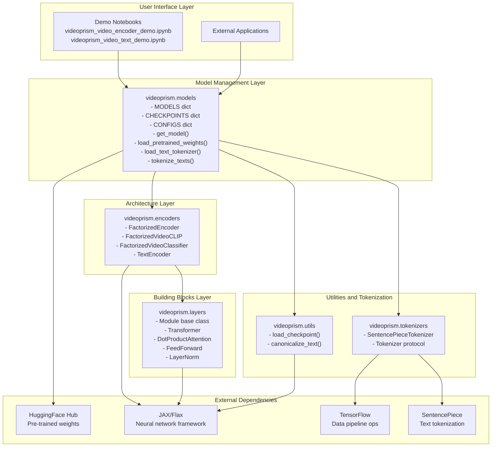
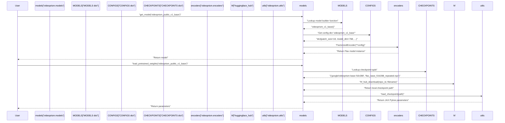
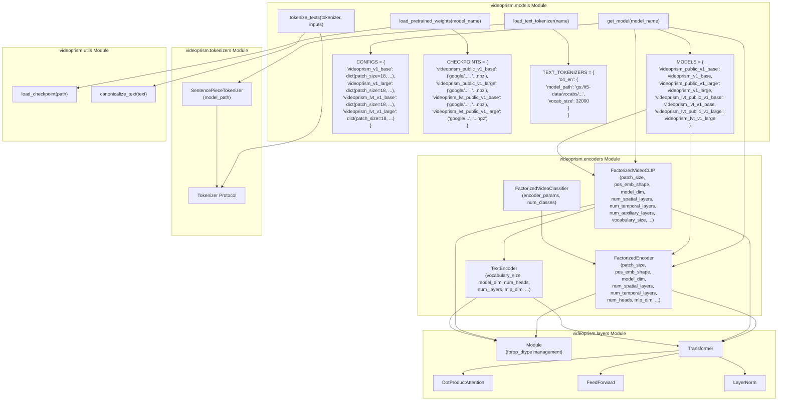
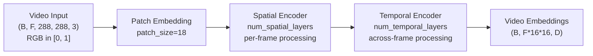

<!-- source: DeepWiki mcp.deepwiki.com · repo google-deepmind/videoprism · page 1 Overview · fetched 2026-10-26 -->

# Overview

<details>
<summary>Relevant source files</summary>

The following files were used as context for generating this wiki page:

- [README.md](README.md)
- [videoprism/models.py](videoprism/models.py)

</details>


## Purpose and Scope

This document provides a high-level introduction to the VideoPrism codebase, explaining its purpose, architecture, and core components. VideoPrism is a foundational visual encoder system for video understanding tasks. This page covers the overall system structure, model variants, and how major components interact. For detailed information about specific subsystems, see:
- Installation and setup instructions: [Getting Started](#2)
- Individual model architectures: [Core Architecture](#4)
- Practical usage patterns: [Usage Guide](#5)
- Complete API documentation: [API Reference](#6)

Sources: [README.md:1-193](), [videoprism/models.py:15-37]()

## What is VideoPrism

VideoPrism is a general-purpose video encoder designed to handle diverse video understanding tasks including classification, retrieval, localization, captioning, and question answering. The system is built on JAX/Flax and provides pre-trained models that achieve state-of-the-art performance on 31 out of 33 public video understanding benchmarks using frozen model backbones.

The system was pre-trained on a massive multi-modal dataset:
- 1 billion image-text pairs from WebLI
- 36 million high-quality video-text pairs  
- 582 million video clips with noisy or machine-generated parallel text

The codebase provides model weight checkpoints hosted on HuggingFace Hub and utility functions for checkpoint loading and model inference.

Sources: [README.md:10-23]()

## System Architecture

VideoPrism follows a layered architecture where higher-level modules depend on lower-level building blocks. The system is organized into five primary layers:



**Model Management Layer**: The `videoprism.models` module serves as the primary API and central orchestration point. It maintains three key registries (`MODELS`, `CHECKPOINTS`, `CONFIGS`) and provides functions to instantiate models and load pre-trained weights from HuggingFace Hub.

**Architecture Layer**: The `videoprism.encoders` module implements the neural network architectures, including `FactorizedEncoder` for video-only tasks and `FactorizedVideoCLIP` for cross-modal video-text tasks.

**Building Blocks Layer**: The `videoprism.layers` module provides reusable Transformer components that the encoder architectures compose together.

**Utilities and Tokenization**: Support modules handle checkpoint deserialization and text preprocessing.

Sources: [videoprism/models.py:1-408](), [README.md:22-23]()

## Model Variants

VideoPrism provides two model families with multiple size variants. All models expect video inputs with shape `(batch_size, num_frames, 288, 288, 3)` where RGB values are normalized to [0.0, 1.0].

| Model Name | Configuration Name | Model Type | Architecture Class | Backbone | Parameters | File Size |
|------------|-------------------|------------|-------------------|----------|------------|-----------|
| VideoPrism-B | `videoprism_public_v1_base` | Video encoder | `FactorizedEncoder` | ViT-B | 114M | 458MB |
| VideoPrism-L | `videoprism_public_v1_large` | Video encoder | `FactorizedEncoder` | ViT-L | 354M | 1.42GB |
| VideoPrism-LvT-B | `videoprism_lvt_public_v1_base` | Video-text encoders | `FactorizedVideoCLIP` | ViT-B | 248M | 991MB |
| VideoPrism-LvT-L | `videoprism_lvt_public_v1_large` | Video-text encoders | `FactorizedVideoCLIP` | ViT-L | 580M | 2.30GB |

### Video-Only Models

Video-only models (`FactorizedEncoder`) output spatiotemporal embeddings with shape `(batch_size, num_frames * 16 * 16, feature_channels)`. These can be reshaped to `(batch_size, num_frames, 16, 16, feature_channels)` for spatial-temporal feature access. The models support variable frame counts through positional embedding interpolation.

### Video-Text Models

Video-text models (`FactorizedVideoCLIP`) produce global embeddings with shape `(batch_size, feature_channels)` for both video and text inputs. Similarities are measured using cosine distance. Text inputs are tokenized using the `c4_en` SentencePiece model with vocabulary size 32,000.

Sources: [README.md:88-112](), [videoprism/models.py:62-80](), [videoprism/models.py:82-161](), [videoprism/models.py:224-233]()

## Model Instantiation Flow

The following diagram illustrates how models are instantiated and weights are loaded using the `videoprism.models` API:



The two-phase initialization separates model architecture instantiation from weight loading:

1. **Model Instantiation**: `get_model()` looks up the configuration name in `MODELS` dict [videoprism/models.py:224-233](), retrieves the corresponding config from `CONFIGS` dict [videoprism/models.py:82-161](), and instantiates the appropriate encoder class from `videoprism.encoders`.

2. **Weight Loading**: `load_pretrained_weights()` queries the `CHECKPOINTS` dict [videoprism/models.py:62-80]() for the HuggingFace repository and filename, downloads the checkpoint using `huggingface_hub.hf_hub_download()` [videoprism/models.py:331-333](), and deserializes it using `utils.load_checkpoint()` [videoprism/models.py:335-336]().

This separation allows users to create models with custom initializations or load different checkpoint versions independently.

Sources: [videoprism/models.py:268-304](), [videoprism/models.py:306-337]()

## Core Component Relationships

The following diagram maps the primary code entities and their dependencies:



**Key Code Entities**:

- **`videoprism.models.get_model()`**: Primary function for instantiating models [videoprism/models.py:268-304]()
- **`videoprism.models.load_pretrained_weights()`**: Downloads and loads checkpoints from HuggingFace Hub [videoprism/models.py:306-337]()
- **`videoprism.models.MODELS`**: Registry mapping model names to builder functions [videoprism/models.py:224-233]()
- **`videoprism.models.CONFIGS`**: Dictionary of model hyperparameters [videoprism/models.py:82-161]()
- **`videoprism.models.CHECKPOINTS`**: Registry of HuggingFace checkpoint locations [videoprism/models.py:62-80]()
- **`videoprism.encoders.FactorizedEncoder`**: Video-only encoder architecture with factorized spatial-temporal processing
- **`videoprism.encoders.FactorizedVideoCLIP`**: Video-text encoder for cross-modal retrieval
- **`videoprism.layers.Transformer`**: Core transformer block used throughout encoder architectures
- **`videoprism.tokenizers.SentencePieceTokenizer`**: Text tokenization implementation [videoprism/models.py:339-353]()

Sources: [videoprism/models.py:224-408](), [videoprism/models.py:82-161](), [videoprism/models.py:62-80]()

## Data Processing Pipeline

VideoPrism processes two data modalities: video and text. The following table summarizes the preprocessing requirements and output formats:

| Modality | Input Format | Preprocessing | Output Format | Key Functions |
|----------|--------------|---------------|---------------|---------------|
| Video | Raw video frames | - Resize to 288×288<br/>- Normalize RGB to [0.0, 1.0]<br/>- Sample frames | `(batch_size, num_frames, 288, 288, 3)` → `(batch_size, num_tokens, feature_dim)` | `FactorizedEncoder.apply()` |
| Text | String list | - Canonicalize (lowercase, remove punctuation)<br/>- Tokenize with SentencePiece<br/>- Pad to max length | `(batch_size, max_length)` token IDs<br/>`(batch_size, max_length)` padding masks | `tokenize_texts()` [videoprism/models.py:355-408]()<br/>`canonicalize_text()` |

### Video Processing Flow



### Text Processing Flow


For video-text models, both embedding streams are L2-normalized and their similarity is computed using cosine distance.

Sources: [README.md:99-112](), [videoprism/models.py:355-408](), [videoprism/models.py:15-36]()

## Usage Pattern

The typical workflow for using VideoPrism follows this pattern:

```python
from videoprism import models as vp
import jax

# 1. Get model instance
model_name = 'videoprism_public_v1_base'
flax_model = vp.get_model(model_name)

# 2. Load pre-trained weights
loaded_state = vp.load_pretrained_weights(model_name)

# 3. Define forward pass
@jax.jit
def forward_fn(inputs):
    return flax_model.apply(loaded_state, inputs, train=False)

# 4. Process video
video_inputs = ...  # Shape: (batch_size, num_frames, 288, 288, 3)
outputs, _ = forward_fn(video_inputs)
```

For video-text models, additional text tokenization is required:

```python
# Video-text model
model_name = 'videoprism_lvt_public_v1_base'
flax_model = vp.get_model(model_name)
loaded_state = vp.load_pretrained_weights(model_name)
text_tokenizer = vp.load_text_tokenizer('c4_en')

# Tokenize text queries
text_queries = ['a person walking', 'a cat playing']
text_ids, text_paddings = vp.tokenize_texts(text_tokenizer, text_queries)

# Forward pass with both modalities
@jax.jit
def forward_fn(video, text_ids, text_paddings):
    return flax_model.apply(
        loaded_state, video, text_ids, text_paddings, train=False
    )

video_embeddings, text_embeddings, _ = forward_fn(
    video_inputs, text_ids, text_paddings
)
```

Sources: [README.md:49-86](), [videoprism/models.py:22-36]()

## Key Design Principles

**Factorized Architecture**: VideoPrism uses a factorized approach that separates spatial and temporal processing. Spatial encoders process each video frame independently, while temporal encoders model relationships across frames. This design improves efficiency and enables variable frame count support.

**Two-Phase Initialization**: Model architecture and pre-trained weights are loaded separately, allowing flexibility in combining different architectures with different checkpoints.

**Registry-Based Configuration**: The system uses three dictionaries (`MODELS`, `CONFIGS`, `CHECKPOINTS`) to manage model variants, reducing code duplication and enabling easy extension.

**HuggingFace Integration**: Pre-trained weights are hosted on HuggingFace Hub and automatically downloaded on first use, simplifying distribution and versioning.

**Position Embedding Interpolation**: Models support variable frame counts by interpolating temporal positional embeddings, enabling inference on videos with different lengths than training [README.md:99-106]().

**JAX/Flax Implementation**: The entire system is built on JAX for efficient automatic differentiation and Flax for neural network modules, enabling JIT compilation and efficient GPU/TPU execution.

Sources: [videoprism/models.py:1-408](), [README.md:1-193]()

---

