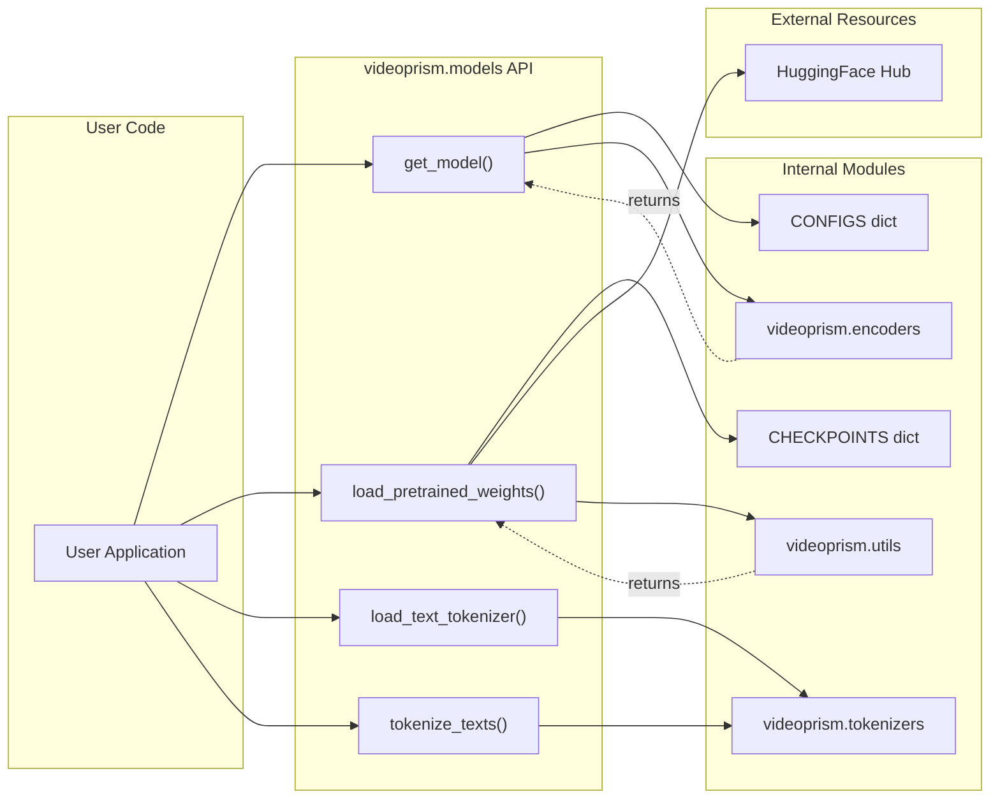
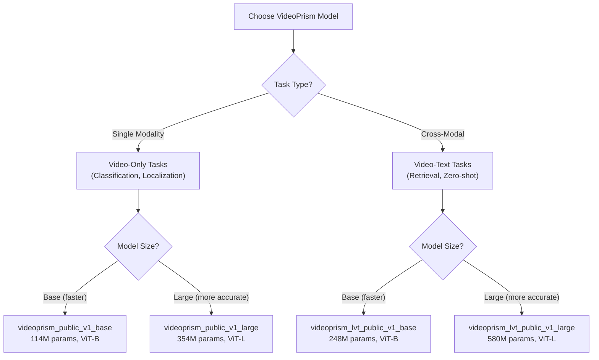
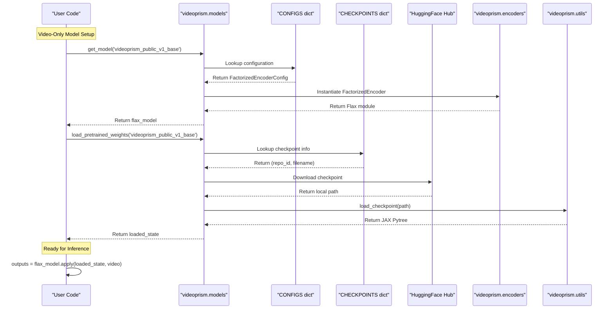

<!-- source: DeepWiki mcp.deepwiki.com · repo google-deepmind/videoprism · page 2 Getting Started · fetched 2026-10-26 -->

# Getting Started

<details>
<summary>Relevant source files</summary>

The following files were used as context for generating this wiki page:

- [README.md](README.md)
- [requirements.txt](requirements.txt)
- [setup.py](setup.py)

</details>


This page provides an overview of the steps required to install and begin using VideoPrism models. It covers the basic installation process, introduces the core API functions, and guides you through your first video encoding or video-text retrieval task.

For detailed installation instructions including dependency management and troubleshooting, see [Installation](#2.1). For hands-on examples using the provided demo notebooks, see [Quick Start with Demo Notebooks](#2.2).

## Prerequisites

VideoPrism requires:

| Requirement | Minimum Version | Purpose |
|-------------|----------------|---------|
| Python | 3.9 | Runtime environment |
| JAX/Flax | (via requirements) | Neural network computation framework |
| TensorFlow | (via requirements) | Text tokenization operations |
| HuggingFace Hub | (via requirements) | Model checkpoint downloading |
| SentencePiece | (via requirements) | Text tokenization for video-text models |

**Sources:** [README.md:38-39](), [requirements.txt:1-8]()

## Installation Overview

The installation process involves cloning the repository and installing the package with pip:

```bash
git clone https://github.com/google-deepmind/videoprism.git
cd videoprism
pip install .
```

For development installations or testing setup, refer to [Installation](#2.1).

**Sources:** [README.md:36-44](), [setup.py:1-62]()

## Core API Overview

VideoPrism provides a centralized API through the `videoprism.models` module. The primary functions are:

| Function | Purpose | Returns |
|----------|---------|---------|
| `get_model(model_name)` | Instantiate a Flax model from configuration | Flax module instance |
| `load_pretrained_weights(model_name)` | Download and load checkpoint parameters | JAX Pytree of parameters |
| `load_text_tokenizer(tokenizer_name)` | Load SentencePiece tokenizer for text | Tokenizer instance |
| `tokenize_texts(tokenizer, texts)` | Convert text strings to token IDs | Tuple of (token_ids, paddings) |

**Diagram: Core API Functions and Data Flow**



**Sources:** [README.md:49-86]()

## Basic Usage Patterns

### Video-Only Encoding

For video feature extraction tasks (action recognition, video classification, temporal localization):

```python
import jax
from videoprism import models as vp

# Step 1: Get model architecture
model_name = 'videoprism_public_v1_base'
flax_model = vp.get_model(model_name)

# Step 2: Load pretrained weights
loaded_state = vp.load_pretrained_weights(model_name)

# Step 3: Define forward pass
@jax.jit
def forward_fn(inputs):
    return flax_model.apply(loaded_state, inputs, train=False)

# Step 4: Process video
video_inputs = ...  # Shape: [batch_size, num_frames, 288, 288, 3]
outputs, _ = forward_fn(video_inputs)  # Shape: [batch_size, num_tokens, channels]
```

Expected input shape: `(batch_size, num_frames, 288, 288, 3)` with RGB values normalized to [0.0, 1.0].

Expected output shape: `(batch_size, num_frames * 16 * 16, feature_channels)` which can be reshaped to `(batch_size, num_frames, 16, 16, feature_channels)` for spatiotemporal representations.

**Sources:** [README.md:49-63]()

### Video-Text Encoding

For cross-modal tasks (video-text retrieval, zero-shot classification, video question answering):

```python
import jax
from videoprism import models as vp

# Step 1: Get model architecture
model_name = 'videoprism_lvt_public_v1_base'
flax_model = vp.get_model(model_name)

# Step 2: Load pretrained weights and tokenizer
loaded_state = vp.load_pretrained_weights(model_name)
text_tokenizer = vp.load_text_tokenizer('c4_en')

# Step 3: Define forward pass
@jax.jit
def forward_fn(inputs, text_token_ids, text_token_paddings, train=False):
    return flax_model.apply(
        loaded_state,
        inputs,
        text_token_ids,
        text_token_paddings,
        train=train,
    )

# Step 4: Process video and text
video_inputs = ...  # Shape: [batch_size, num_frames, 288, 288, 3]
text_queries = ...  # List of strings
text_ids, text_paddings = vp.tokenize_texts(text_tokenizer, text_queries)

video_embeddings, text_embeddings, _ = forward_fn(
    video_inputs, text_ids, text_paddings)  # Both: [batch_size, feature_channels]
```

Expected outputs: Global embeddings with shape `(batch_size, feature_channels)` for both modalities. Similarities are computed using cosine distances.

**Sources:** [README.md:65-86]()

## Model Selection Guide

**Diagram: Model Variant Decision Tree**



**Sources:** [README.md:88-112]()

## Available Model Configurations

| Model Name | Configuration Name | Type | Backbone | Parameters | File Size | Frames |
|------------|-------------------|------|----------|------------|-----------|---------|
| VideoPrism-B | `videoprism_public_v1_base` | Video encoder | ViT-B | 114M | 458MB | 16 |
| VideoPrism-L | `videoprism_public_v1_large` | Video encoder | ViT-L | 354M | 1.42GB | 8 |
| VideoPrism-LvT-B | `videoprism_lvt_public_v1_base` | Video-text | ViT-B | 248M | 991MB | 16 |
| VideoPrism-LvT-L | `videoprism_lvt_public_v1_large` | Video-text | ViT-L | 580M | 2.30GB | 8 |

All models support arbitrary frame counts through positional embedding interpolation. The "Frames" column indicates the frame count used during training.

For detailed model architecture information, see [Model Variants](#3).

**Sources:** [README.md:88-112]()

## Typical Initialization Sequence

**Diagram: Model Loading Workflow**



**Sources:** [README.md:49-86]()

## Demo Notebooks

VideoPrism provides two Colab notebooks demonstrating end-to-end usage:

| Notebook | Purpose | Models Demonstrated |
|----------|---------|---------------------|
| `videoprism_video_encoder_demo.ipynb` | Video feature extraction | VideoPrism-B, VideoPrism-L |
| `videoprism_video_text_demo.ipynb` | Video-text retrieval and zero-shot classification | VideoPrism-LvT-B, VideoPrism-LvT-L |

These notebooks include:
- Complete preprocessing pipelines for video data
- Model instantiation and checkpoint loading
- Inference examples with sample videos
- Visualization of results

To explore these notebooks in detail, see [Quick Start with Demo Notebooks](#2.2).

**Sources:** [README.md:5-6](), [README.md:27-30](), [README.md:46-47]()

## Next Steps

After completing the basic setup:

1. **For detailed installation:** See [Installation](#2.1) for dependency management, environment setup, and troubleshooting
2. **For interactive examples:** See [Quick Start with Demo Notebooks](#2.2) to run the provided Colab notebooks
3. **For model architecture details:** See [Model Variants](#3) for in-depth information about each model type
4. **For advanced usage:** See [Usage Guide](#5) for video preprocessing, custom checkpoint loading, and production deployment patterns
5. **For API reference:** See [API Reference](#6) for complete documentation of all public functions and classes

**Sources:** [README.md:1-192]()

---

