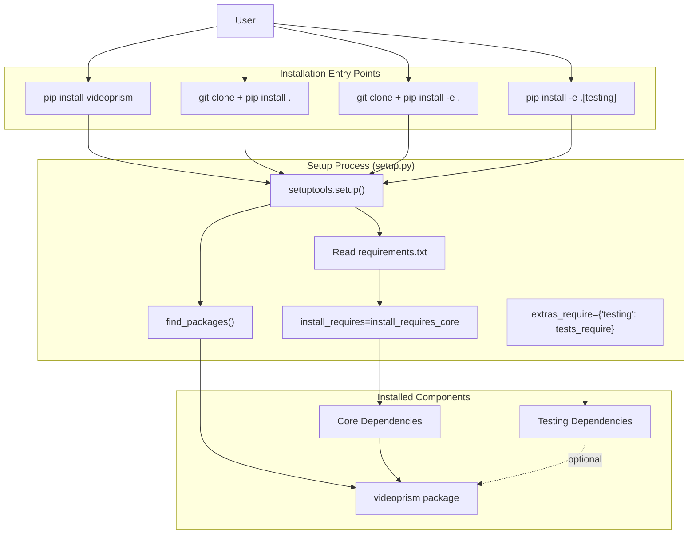
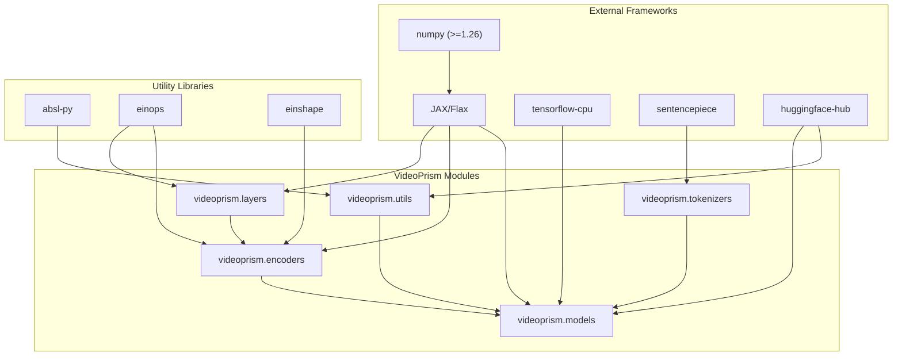
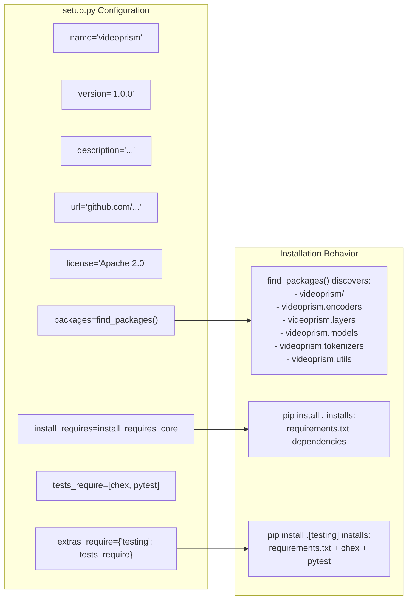

<!-- source: DeepWiki mcp.deepwiki.com · repo google-deepmind/videoprism · page 2.1 Installation · fetched 2026-10-26 -->

# Installation

<details>
<summary>Relevant source files</summary>

The following files were used as context for generating this wiki page:

- [requirements.txt](requirements.txt)
- [setup.py](setup.py)

</details>


## Purpose and Scope

This document provides detailed instructions for installing VideoPrism and its dependencies on your system. It covers prerequisite requirements, multiple installation methods (basic and development), and dependency management. For guidance on using VideoPrism after installation, see [Quick Start with Demo Notebooks](#2.2). For detailed dependency information relevant to developers, see [Dependencies and Environment](#7.1).

---

## Prerequisites

VideoPrism requires Python 3.9 or later. The package is tested primarily on Linux and macOS systems. Windows users may need to use WSL (Windows Subsystem for Linux) for optimal compatibility with JAX/Flax.

### System Requirements

- **Python**: >= 3.9
- **pip**: Latest version recommended (upgrade with `pip install --upgrade pip`)
- **Git**: Required for cloning the repository (optional for pip-based installation)

---

## Installation Methods

### Basic Installation from PyPI

Once VideoPrism is published to PyPI, you can install it directly:

```bash
pip install videoprism
```

**Note**: As of version 1.0.0, the package may not yet be published to PyPI. Use repository-based installation methods below.

### Installation from Source Repository

Clone the repository and install:

```bash
git clone https://github.com/google-deepmind/videoprism.git
cd videoprism
pip install .
```

This installs VideoPrism and all core dependencies listed in [requirements.txt:1-8]().

**Sources**: [setup.py:43](), [setup.py:25-26]()

### Development Installation

For contributors or users who want to modify the code:

```bash
git clone https://github.com/google-deepmind/videoprism.git
cd videoprism
pip install -e .
```

The `-e` flag (editable mode) creates a symlink, allowing code changes to take effect immediately without reinstallation.

**Sources**: [setup.py:18-19]()

### Installation with Testing Dependencies

To run tests or develop new features:

```bash
pip install -e ".[testing]"
```

This installs additional testing packages defined in [setup.py:28-31]():
- `chex`: JAX testing utilities
- `pytest`: Test framework

**Sources**: [setup.py:28-31](), [setup.py:49-51]()

---

## Installation Flow Diagram



**Diagram: Installation Process Flow**

This diagram shows how different installation commands (`pip install`, `pip install -e .`, etc.) flow through the `setuptools.setup()` function in [setup.py:33-61](). The setup process reads [requirements.txt:1-8]() to populate `install_requires_core` via [setup.py:25-26](), uses `find_packages()` at [setup.py:45]() to discover the `videoprism` package, and conditionally installs testing dependencies from `tests_require` ([setup.py:28-31]()) when the `[testing]` extra is specified.

**Sources**: [setup.py:1-62](), [requirements.txt:1-8]()

---

## Core Dependencies

VideoPrism depends on the following packages, each serving a specific role in the system:

| Package | Version Constraint | Primary Purpose | Used By |
|---------|-------------------|-----------------|---------|
| `numpy` | >= 1.26 | Array operations and numerical computing | All modules |
| `absl-py` | (latest) | Command-line flag parsing and logging | Utilities |
| `einops` | (latest) | Tensor shape manipulation (rearrange, reduce) | Encoder layers |
| `einshape` | (latest) | Shape validation and type checking | Encoder layers |
| `flax` | (latest) | Neural network framework (JAX-based) | All model architectures |
| `huggingface-hub` | (latest) | Checkpoint download from HuggingFace Hub | Model loading |
| `sentencepiece` | (latest) | Text tokenization | Text encoder |
| `tensorflow-cpu` | (latest) | Data pipeline and preprocessing utilities | Demo notebooks |

**Sources**: [requirements.txt:1-8]()

### Dependency Architecture



**Diagram: Dependency Hierarchy from requirements.txt**

This diagram maps how each dependency from [requirements.txt:1-8]() is consumed by VideoPrism modules. The core computational stack starts with `numpy` and flows through JAX/Flax to implement neural network layers. Shape manipulation libraries (`einops`, `einshape`) are used primarily in [videoprism/layers.py]() and [videoprism/encoders.py](). The `huggingface-hub` package is used by [videoprism/models.py]() for checkpoint downloading, while `sentencepiece` powers [videoprism/tokenizers.py]() for text processing. `tensorflow-cpu` is included primarily for data preprocessing in demo notebooks rather than core model functionality.

**Sources**: [requirements.txt:1-8](), [setup.py:25-26]()

---

## Package Configuration Details

The `setup.py` file at [setup.py:33-61]() defines the package metadata and installation behavior:



**Diagram: setup.py Configuration Structure**

This diagram shows how `setuptools.setup()` parameters control installation. The `name` parameter ([setup.py:34]()) defines the package name as `videoprism`. The `version` ([setup.py:35]()) is set to `1.0.0`. The `packages` parameter uses `find_packages()` ([setup.py:45]()) to automatically discover all Python packages in the repository. The `install_requires` parameter ([setup.py:47]()) is populated from `install_requires_core`, which reads [requirements.txt:1-8]() at [setup.py:25-26](). The `extras_require` parameter ([setup.py:49-51]()) defines the optional `testing` extra that includes `chex` and `pytest`.

**Sources**: [setup.py:33-61](), [setup.py:28-31]()

---

## Verification

After installation, verify that VideoPrism is correctly installed:

### Check Package Installation

```bash
python -c "import videoprism; print(videoprism.__file__)"
```

This should print the installation path of the VideoPrism package without errors.

### Check Core Modules

```bash
python -c "from videoprism import models, encoders, layers, tokenizers, utils"
```

All five core modules should import without errors.

### Check Model Registry

```bash
python -c "from videoprism.models import MODELS; print(list(MODELS.keys()))"
```

This should print the list of available model identifiers (e.g., `videoprism_public_v1_base`, `videoprism_lvt_public_v1_base`).

### Check JAX/Flax Backend

```bash
python -c "import jax; print(f'JAX version: {jax.__version__}'); print(f'Devices: {jax.devices()}')"
```

This verifies that JAX is installed and can detect available compute devices (CPU, GPU, or TPU).

**Sources**: [setup.py:45]()

---

## Troubleshooting Common Issues

### Issue: JAX Installation Fails or is Missing GPU Support

**Problem**: JAX requires platform-specific installation for GPU/TPU support.

**Solution**: Install JAX with appropriate backend support:

```bash
# For CPU only (default)
pip install jax[cpu]

# For CUDA 12 (NVIDIA GPUs)
pip install jax[cuda12]

# For CUDA 11 (older NVIDIA GPUs)
pip install jax[cuda11]

# For TPU (Google Cloud)
pip install jax[tpu]
```

See the [JAX installation guide](https://github.com/google/jax#installation) for detailed instructions.

### Issue: TensorFlow Conflicts with GPU Drivers

**Problem**: `tensorflow-cpu` may conflict if you have `tensorflow-gpu` installed.

**Solution**: The package explicitly requires `tensorflow-cpu` ([requirements.txt:8]()) to avoid GPU conflicts. If you have `tensorflow-gpu` installed, uninstall it first:

```bash
pip uninstall tensorflow-gpu
pip install tensorflow-cpu
```

### Issue: SentencePiece Compilation Errors

**Problem**: `sentencepiece` may fail to compile on some systems without C++ build tools.

**Solution**: Install build dependencies:

```bash
# Ubuntu/Debian
sudo apt-get install build-essential

# macOS
xcode-select --install

# Or install pre-built wheel
pip install sentencepiece --only-binary :all:
```

### Issue: Import Errors After Installation

**Problem**: Python cannot find the `videoprism` module after installation.

**Solution**: 
1. Verify installation: `pip list | grep videoprism`
2. Check Python path: `python -c "import sys; print(sys.path)"`
3. For development install, ensure you're in the correct directory
4. Try reinstalling: `pip install --force-reinstall -e .`

**Sources**: [requirements.txt:7-8]()

---

## Next Steps

After successful installation, proceed to:
- [Quick Start with Demo Notebooks](#2.2) for hands-on tutorials
- [Model Variants](#3) to understand available models
- [Usage Guide](#5) for detailed usage instructions

**Sources**: [setup.py:1-62](), [requirements.txt:1-8]()

---

