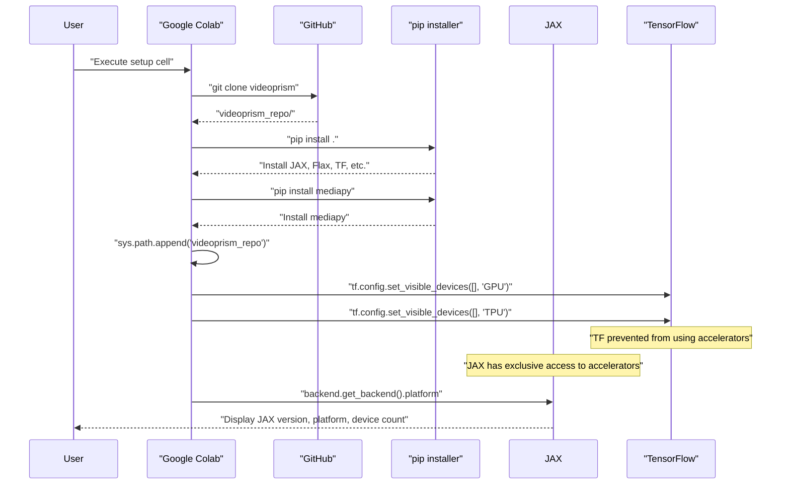
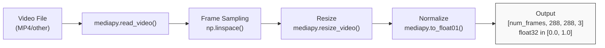
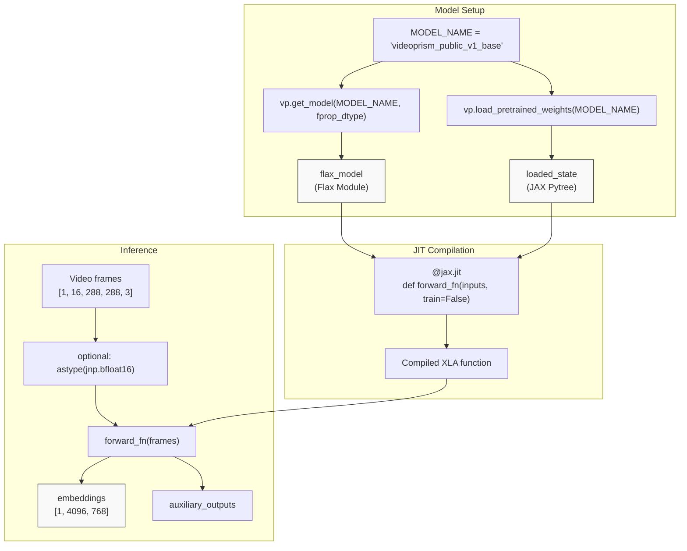
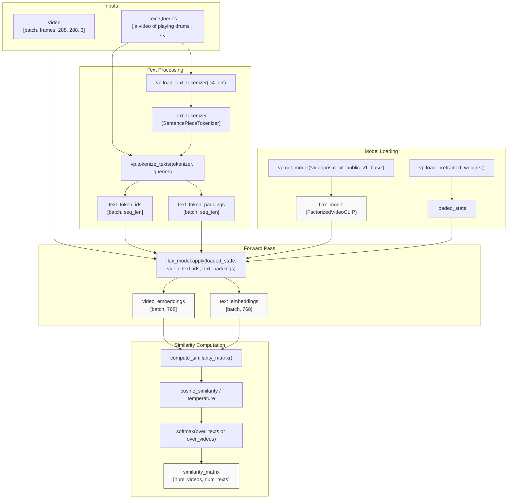
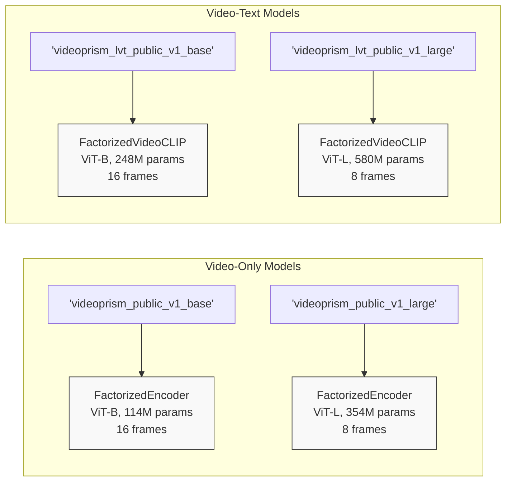

<!-- source: DeepWiki mcp.deepwiki.com · repo google-deepmind/videoprism · page 2.2 Quick Start with Demo Notebooks · fetched 2026-10-26 -->

# Quick Start with Demo Notebooks

<details>
<summary>Relevant source files</summary>

The following files were used as context for generating this wiki page:

- [README.md](README.md)
- [videoprism/colabs/videoprism_video_encoder_demo.ipynb](videoprism/colabs/videoprism_video_encoder_demo.ipynb)
- [videoprism/colabs/videoprism_video_text_demo.ipynb](videoprism/colabs/videoprism_video_text_demo.ipynb)

</details>


This document provides a walkthrough of the two interactive demo notebooks included with VideoPrism, demonstrating basic usage patterns for video feature extraction and video-text retrieval. For detailed API documentation, see [API Reference](#6). For comprehensive usage patterns, see [Usage Guide](#5).

## Overview

VideoPrism provides two Jupyter notebooks that demonstrate core functionality:

| Notebook | Purpose | Model Type | Key Functions |
|----------|---------|------------|---------------|
| `videoprism_video_encoder_demo.ipynb` | Video feature extraction | Video-only encoder | `get_model()`, `load_pretrained_weights()` |
| `videoprism_video_text_demo.ipynb` | Video-text retrieval and zero-shot classification | Video-text encoder (VideoCLIP) | `get_model()`, `load_pretrained_weights()`, `load_text_tokenizer()`, `tokenize_texts()` |

Both notebooks are designed to run in Google Colab with or without TPU acceleration and can be executed locally with appropriate hardware.

**Sources:** [README.md:5-6](), [videoprism/colabs/videoprism_video_encoder_demo.ipynb:1-18](), [videoprism/colabs/videoprism_video_text_demo.ipynb:1-33]()

## Environment Setup Workflow

Both demo notebooks follow an identical environment setup pattern that clones the repository, installs dependencies, and configures JAX/TensorFlow device visibility.



**Key Setup Steps:**

1. **Repository cloning**: [videoprism/colabs/videoprism_video_encoder_demo.ipynb:43-44]()
   ```python
   !git clone --quiet --branch=main --depth=1 \
      https://github.com/google-deepmind/videoprism.git videoprism_repo
   ```

2. **Package installation**: [videoprism/colabs/videoprism_video_encoder_demo.ipynb:45-46]()
   ```python
   os.chdir('./videoprism_repo')
   !pip install .
   ```

3. **Device configuration**: [videoprism/colabs/videoprism_video_encoder_demo.ipynb:60-62]()
   ```python
   tf.config.set_visible_devices([], "GPU")
   tf.config.set_visible_devices([], "TPU")
   ```
   This prevents TensorFlow from consuming GPU/TPU resources, leaving them available for JAX.

**Sources:** [videoprism/colabs/videoprism_video_encoder_demo.ipynb:30-69](), [videoprism/colabs/videoprism_video_text_demo.ipynb:44-83]()

## Video Preprocessing Utilities

Both notebooks define a `read_and_preprocess_video()` function that standardizes video inputs to the format expected by VideoPrism models.

### Video Preprocessing Pipeline



**Function Signature and Implementation:**

[videoprism/colabs/videoprism_video_encoder_demo.ipynb:84-108]()

```python
def read_and_preprocess_video(
    filename: str, target_num_frames: int, target_frame_size: tuple[int, int]
)
```

**Processing Steps:**

| Step | Function | Purpose |
|------|----------|---------|
| Read | `mediapy.read_video(filename)` | Load video frames as numpy array |
| Sample | `np.linspace()` with `frame_indices` | Select `target_num_frames` evenly spaced frames |
| Resize | `mediapy.resize_video(frames, shape=target_frame_size)` | Resize to 288×288 (assumes aspect ratio matches) |
| Normalize | `mediapy.to_float01(frames)` | Convert pixel values from [0, 255] to [0.0, 1.0] |

**Aspect Ratio Constraint:**

[videoprism/colabs/videoprism_video_encoder_demo.ipynb:100-102]()
```python
assert (
    original_height * target_width == original_width * target_height
), 'Currently does not support aspect ratio mismatch.'
```

The preprocessing requires input videos to have a square aspect ratio (or one that exactly matches the target).

**Sources:** [videoprism/colabs/videoprism_video_encoder_demo.ipynb:76-108](), [videoprism/colabs/videoprism_video_text_demo.ipynb:92-157]()

## Video Encoder Demo Walkthrough

The video encoder demo (`videoprism_video_encoder_demo.ipynb`) demonstrates spatiotemporal feature extraction using VideoPrism-B or VideoPrism-L models.

### Model Loading and Inference Flow



### Step-by-Step Implementation

**1. Model Selection and Configuration** [videoprism/colabs/videoprism_video_encoder_demo.ipynb:125-131]()

```python
MODEL_NAME = 'videoprism_public_v1_base'  # or 'videoprism_public_v1_large'
USE_BFLOAT16 = False
NUM_FRAMES = 16
FRAME_SIZE = 288

fprop_dtype = jnp.bfloat16 if USE_BFLOAT16 else None
```

| Parameter | VideoPrism-B | VideoPrism-L | Purpose |
|-----------|--------------|--------------|---------|
| `NUM_FRAMES` | 16 | 8 | Number of frames per video clip |
| `FRAME_SIZE` | 288 | 288 | Height and width in pixels |
| `fprop_dtype` | None or bfloat16 | None or bfloat16 | Computation precision |

**2. Model Instantiation** [videoprism/colabs/videoprism_video_encoder_demo.ipynb:131-132]()

```python
flax_model = vp.get_model(MODEL_NAME, fprop_dtype=fprop_dtype)
loaded_state = vp.load_pretrained_weights(MODEL_NAME)
```

- `get_model()` returns a Flax module with the model architecture
- `load_pretrained_weights()` downloads and loads pre-trained parameters from HuggingFace Hub

**3. Forward Function Definition** [videoprism/colabs/videoprism_video_encoder_demo.ipynb:135-137]()

```python
@jax.jit
def forward_fn(inputs, train=False):
  return flax_model.apply(loaded_state, inputs, train=train)
```

The `@jax.jit` decorator triggers XLA compilation for optimized execution.

**4. Video Processing and Inference** [videoprism/colabs/videoprism_video_encoder_demo.ipynb:161-174]()

```python
frames = read_and_preprocess_video(
    VIDEO_FILE_PATH,
    target_num_frames=NUM_FRAMES,
    target_frame_size=[FRAME_SIZE, FRAME_SIZE],
)
frames = jnp.asarray(frames[None, ...])  # Add batch dimension
if USE_BFLOAT16:
  frames = frames.astype(jnp.bfloat16)

embeddings, _ = forward_fn(frames)
```

**Output Shape Explanation:**

For VideoPrism-B with 16 frames:
- Input: `[1, 16, 288, 288, 3]` (batch, frames, height, width, channels)
- Output: `[1, 4096, 768]` (batch, tokens, features)
  - 4096 tokens = 16 frames × 16×16 spatial patches per frame
  - 768 feature channels (ViT-B embedding dimension)

The output can be reshaped to `[1, 16, 16, 16, 768]` for spatiotemporal interpretation.

**Sources:** [videoprism/colabs/videoprism_video_encoder_demo.ipynb:114-177](), [README.md:99-106]()

## Video-Text Encoder Demo Walkthrough

The video-text demo (`videoprism_video_text_demo.ipynb`) demonstrates cross-modal retrieval and zero-shot classification using VideoPrism-LvT models.

### Video-Text Model Architecture and Data Flow



### Step-by-Step Implementation

**1. Model and Tokenizer Loading** [videoprism/colabs/videoprism_video_text_demo.ipynb:168-176]()

```python
MODEL_NAME = 'videoprism_lvt_public_v1_base'  # or '_large'
fprop_dtype = jnp.bfloat16 if USE_BFLOAT16 else None
flax_model = vp.get_model(MODEL_NAME, fprop_dtype=fprop_dtype)
loaded_state = vp.load_pretrained_weights(MODEL_NAME)
text_tokenizer = vp.load_text_tokenizer('c4_en')
```

The `'c4_en'` tokenizer is a SentencePiece model trained on C4 English corpus.

**2. Forward Function for Video-Text Models** [videoprism/colabs/videoprism_video_text_demo.ipynb:179-187]()

```python
@jax.jit
def forward_fn(inputs, text_token_ids, text_paddings, train=False):
  return flax_model.apply(
      loaded_state,
      inputs,
      text_token_ids,
      text_paddings,
      train=train,
  )
```

The forward function requires three inputs: video frames, text token IDs, and text padding masks.

**3. Text Query Preparation** [videoprism/colabs/videoprism_video_text_demo.ipynb:231-242]()

```python
TEXT_QUERY_CSV = 'playing drums,sitting,playing flute,playing at playground,concert'
PROMPT_TEMPLATE = 'a video of {}.'

text_queries = TEXT_QUERY_CSV.split(',')
text_queries = [PROMPT_TEMPLATE.format(t) for t in text_queries]
text_ids, text_paddings = vp.tokenize_texts(text_tokenizer, text_queries)
if USE_BFLOAT16:
  text_paddings = text_paddings.astype(jnp.bfloat16)
```

**Text Tokenization Details:**

| Function | Inputs | Outputs | Purpose |
|----------|--------|---------|---------|
| `vp.tokenize_texts()` | `tokenizer`, `List[str]` | `text_ids: [N, L]`, `text_paddings: [N, L]` | Convert text to token IDs and create padding masks |

Where `N` = number of text queries, `L` = maximum sequence length.

**4. Joint Video-Text Embedding Computation** [videoprism/colabs/videoprism_video_text_demo.ipynb:254-255]()

```python
video_embeddings, text_embeddings, _ = forward_fn(
    frames, text_ids, text_paddings)
```

Both embeddings have shape `[batch_size, 768]` for VideoPrism-LvT-B. They are L2-normalized internally and lie in a shared embedding space.

**5. Similarity Matrix Computation** [videoprism/colabs/videoprism_video_text_demo.ipynb:127-156]()

```python
def compute_similarity_matrix(
    video_embeddings,
    text_embeddings,
    temperature: float,
    apply_softmax: str | None = None,
) -> np.ndarray:
  """Computes cosine similarity matrix."""
  similarity_matrix = np.dot(video_embeddings, text_embeddings.T)
  
  if temperature is not None:
    similarity_matrix /= temperature
  
  if apply_softmax == 'over_videos':
    # For text-to-video retrieval
    similarity_matrix = softmax(similarity_matrix, axis=0)
  elif apply_softmax == 'over_texts':
    # For video-to-text retrieval / zero-shot classification
    similarity_matrix = softmax(similarity_matrix, axis=1)
```

**Similarity Matrix Usage:**

[videoprism/colabs/videoprism_video_text_demo.ipynb:257-263]()
```python
TEMPERATURE = 0.01
similarity_matrix = compute_similarity_matrix(
    video_embeddings,
    text_embeddings,
    temperature=TEMPERATURE,
    apply_softmax='over_texts',
)
```

- `temperature`: Scales logits before softmax (0.01 = sharper distribution)
- `apply_softmax='over_texts'`: Normalizes across text dimension for zero-shot classification
- `apply_softmax='over_videos'`: Normalizes across video dimension for text-to-video retrieval

**6. Retrieval Results** [videoprism/colabs/videoprism_video_text_demo.ipynb:274-285]()

```python
v2t_similarity_vector = similarity_matrix[0]
top_indices = np.argsort(v2t_similarity_vector)[::-1]

for k, j in enumerate(top_indices):
  print(
      'Top-%d retrieved text: %s [Similarity = %0.4f]'
      % (k + 1, text_queries[j], v2t_similarity_vector[j])
  )
```

This produces a ranked list of text queries by their similarity to the video.

**Sources:** [videoprism/colabs/videoprism_video_text_demo.ipynb:160-292](), [README.md:65-86](), [README.md:108-111]()

## Common Patterns and Best Practices

### Model Name Mapping



**Sources:** [README.md:90-98]()

### Input/Output Shape Reference

| Model Variant | Input Shape | Output Shape (Video) | Output Shape (Text) | Feature Dim |
|---------------|-------------|----------------------|---------------------|-------------|
| VideoPrism-B | `[B, 16, 288, 288, 3]` | `[B, 4096, 768]` | N/A | 768 |
| VideoPrism-L | `[B, 8, 288, 288, 3]` | `[B, 1024, 1024]` | N/A | 1024 |
| VideoPrism-LvT-B | `[B, 16, 288, 288, 3]` | `[B, 768]` (global) | `[B, 768]` (global) | 768 |
| VideoPrism-LvT-L | `[B, 8, 288, 288, 3]` | `[B, 1024]` (global) | `[B, 1024]` (global) | 1024 |

Where `B` = batch size. Video-only models output spatiotemporal tokens, while video-text models output global embeddings.

**Sources:** [README.md:99-111]()

### Optional bfloat16 Precision

Both notebooks support optional bfloat16 computation for faster inference and lower memory usage:

```python
USE_BFLOAT16 = False  # Set to True for bfloat16

fprop_dtype = jnp.bfloat16 if USE_BFLOAT16 else None
flax_model = vp.get_model(MODEL_NAME, fprop_dtype=fprop_dtype)

# Convert inputs to bfloat16
if USE_BFLOAT16:
  frames = frames.astype(jnp.bfloat16)
  text_paddings = text_paddings.astype(jnp.bfloat16)
```

[videoprism/colabs/videoprism_video_encoder_demo.ipynb:126-131](), [videoprism/colabs/videoprism_video_text_demo.ipynb:169-174]()

### JAX JIT Compilation

Both notebooks wrap the forward pass in `@jax.jit` for XLA compilation:

```python
@jax.jit
def forward_fn(inputs, ...):
  return flax_model.apply(loaded_state, inputs, ...)
```

- First call triggers compilation (slower)
- Subsequent calls use compiled function (faster)
- Compiled functions are cached based on input shapes and dtypes

**Sources:** [videoprism/colabs/videoprism_video_encoder_demo.ipynb:135-137](), [videoprism/colabs/videoprism_video_text_demo.ipynb:179-187]()

## Running the Notebooks

### Google Colab (Recommended)

Both notebooks are designed for Google Colab and can be opened directly:

- Video Encoder Demo: [Colab Link](https://colab.research.google.com/github/google-deepmind/videoprism/blob/main/videoprism/colabs/videoprism_video_encoder_demo.ipynb)
- Video-Text Demo: [Colab Link](https://colab.research.google.com/github/google-deepmind/videoprism/blob/main/videoprism/colabs/videoprism_video_text_demo.ipynb)

**Hardware Options:**
- CPU: Works but slow
- GPU: Recommended for faster inference
- TPU: Best performance (requires TPU runtime)

To enable TPU in Colab: Runtime → Change runtime type → Hardware accelerator → TPU

### Local Execution

To run locally:

1. Install VideoPrism: [Installation](#2.1)
2. Install additional dependencies:
   ```bash
   pip install mediapy jupyter
   ```
3. Launch Jupyter:
   ```bash
   jupyter notebook videoprism/colabs/
   ```

**Sources:** [README.md:5-6](), [README.md:36-48]()

## Next Steps

After completing the demo notebooks:

- For detailed model information, see [Model Variants](#3)
- For API documentation, see [API Reference](#6)
- For advanced usage patterns (custom checkpoints, variable frame counts), see [Usage Guide](#5)
- For understanding the internal architecture, see [Core Architecture](#4)

**Sources:** [README.md:1-190]()

---

