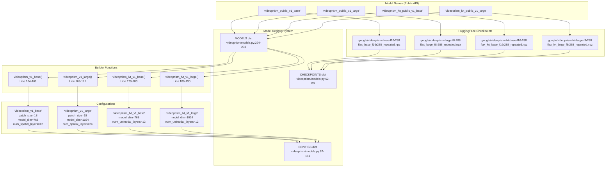
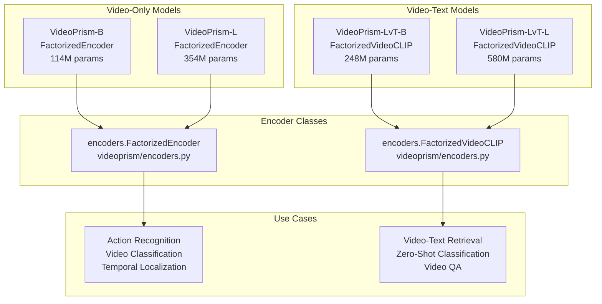
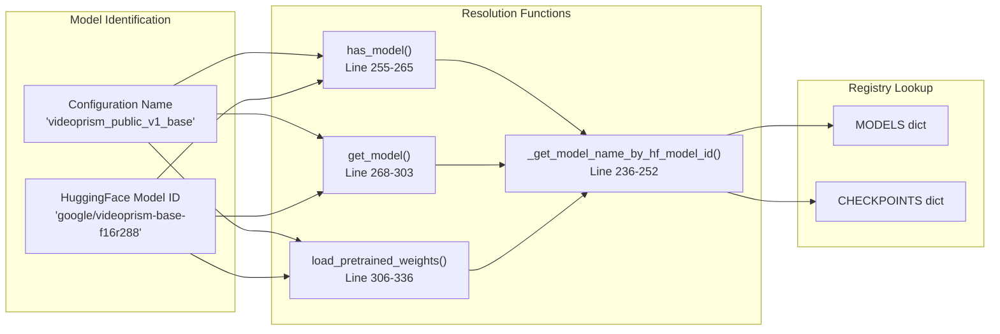
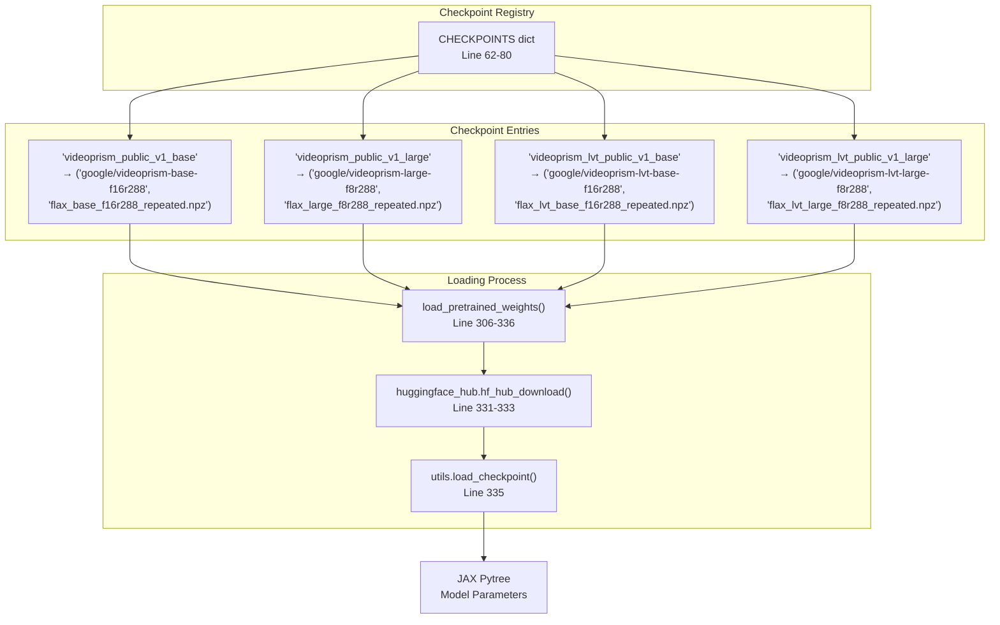

<!-- source: DeepWiki mcp.deepwiki.com · repo google-deepmind/videoprism · page 3 Model Variants · fetched 2026-10-26 -->

# Model Variants

<details>
<summary>Relevant source files</summary>

The following files were used as context for generating this wiki page:

- [README.md](README.md)
- [videoprism/models.py](videoprism/models.py)

</details>


This page provides an overview of the VideoPrism model family, including the different variants available, their configurations, and how they are organized in the codebase. For detailed usage instructions of each variant type, see [Video-Only Models](#3.1) and [Video-Text Models (VideoCLIP)](#3.2).

VideoPrism offers four publicly released model variants with different architectures and capabilities. All variants are built on the factorized spatial-temporal architecture and share a common configuration system managed through the `videoprism.models` module.

## Model Registry Structure

The VideoPrism model system organizes variants through three core dictionaries defined in [videoprism/models.py:224-233]():



**Sources:** [videoprism/models.py:62-233]()

## Available Model Variants

VideoPrism provides four publicly released models across two architecture families:

| Model Name | Configuration Name | Architecture | Backbone | Parameters | File Size | Frame Count | Resolution |
|------------|-------------------|--------------|----------|------------|-----------|-------------|-----------|
| VideoPrism-B | `videoprism_public_v1_base` | FactorizedEncoder | ViT-B | 114M | 458MB | 16 | 288×288 |
| VideoPrism-L | `videoprism_public_v1_large` | FactorizedEncoder | ViT-L | 354M | 1.42GB | 8 | 288×288 |
| VideoPrism-LvT-B | `videoprism_lvt_public_v1_base` | FactorizedVideoCLIP | ViT-B | 248M | 991MB | 16 | 288×288 |
| VideoPrism-LvT-L | `videoprism_lvt_public_v1_large` | FactorizedVideoCLIP | ViT-L | 580M | 2.30GB | 8 | 288×288 |

**Sources:** [README.md:88-98](), [videoprism/models.py:62-80]()

### Model Family Hierarchy



**Sources:** [videoprism/models.py:164-197](), [README.md:88-112]()

## Configuration Details

Each model variant has a corresponding configuration in the `CONFIGS` dictionary that specifies its architecture parameters:

### Video-Only Model Configurations

**Base Configuration** (`videoprism_v1_base`):
- `patch_size`: 18
- `pos_emb_shape`: (16, 16, 16) - temporal × height × width tokens
- `model_dim`: 768
- `num_spatial_layers`: 12
- `num_temporal_layers`: 4
- `num_heads`: 12
- `mlp_dim`: 3072
- `atten_logit_cap`: 50.0
- `scan`: True

**Large Configuration** (`videoprism_v1_large`):
- `patch_size`: 18
- `pos_emb_shape`: (8, 16, 16) - fewer temporal tokens
- `model_dim`: 1024
- `num_spatial_layers`: 24 - doubled depth
- `num_temporal_layers`: 4
- `num_heads`: 16
- `mlp_dim`: 4096
- `atten_logit_cap`: 50.0
- `scan`: True

**Sources:** [videoprism/models.py:83-104]()

### Video-Text Model Configurations

**LvT Base Configuration** (`videoprism_lvt_v1_base`):
- All base model parameters, plus:
- `num_auxiliary_layers`: 2
- `enable_causal_atten`: True
- `num_unimodal_layers`: 12
- `norm_policy`: 'pre'
- `vocabulary_size`: 32,000 (from TEXT_TOKENIZERS)

**LvT Large Configuration** (`videoprism_lvt_v1_large`):
- All large model parameters, plus:
- `num_auxiliary_layers`: 2
- `enable_causal_atten`: True
- `num_unimodal_layers`: 12
- `norm_policy`: 'pre'
- `vocabulary_size`: 32,000

**Sources:** [videoprism/models.py:116-145](), [videoprism/models.py:55-60]()

## Model Name Resolution

The system supports multiple ways to identify models:



**Sources:** [videoprism/models.py:236-303]()

### Model Name Patterns

Model names follow these conventions:

| Pattern | Example | Description |
|---------|---------|-------------|
| Configuration name | `videoprism_public_v1_base` | Used in `get_model()` and `load_pretrained_weights()` |
| HuggingFace repo ID | `google/videoprism-base-f16r288` | Alternative identifier, auto-resolved to configuration name |
| Internal config key | `videoprism_v1_base` | Used in CONFIGS dict, not public-facing |

The system automatically converts HuggingFace model IDs to configuration names via [videoprism/models.py:236-252]().

**Sources:** [videoprism/models.py:236-303](), [README.md:88-98]()

## Checkpoint Loading

Checkpoints are stored on HuggingFace Hub and downloaded automatically:



**Sources:** [videoprism/models.py:62-80](), [videoprism/models.py:306-336]()

## Additional Model Variants (Not Publicly Released)

The codebase also defines configurations for additional variants that are not publicly released:

### Giant Models

- `videoprism_v1_giant` [videoprism/models.py:105-115]()
  - 1408 model_dim
  - 40 spatial layers
  - 6144 MLP dim
  
- `videoprism_lvt_v1_giant` [videoprism/models.py:146-160]()
  - 1408 model_dim
  - 40 spatial layers
  - 16 unimodal layers
  - Uses 'primer_hybrid' norm policy

### Video Classifier Models

The `FactorizedVideoClassifier` variants add a classification head to the base encoders:

- `videoprism_vc_v1_base(num_classes)` [videoprism/models.py:200-205]()
- `videoprism_vc_v1_large(num_classes)` [videoprism/models.py:208-213]()
- `videoprism_vc_v1_giant(num_classes)` [videoprism/models.py:216-221]()

These are used for supervised fine-tuning on classification tasks but do not have public checkpoints.

**Sources:** [videoprism/models.py:105-221]()

## Common Features Across All Variants

All VideoPrism model variants share these characteristics:

| Feature | Description |
|---------|-------------|
| Input format | Videos with shape `(batch_size, num_frames, 288, 288, 3)` |
| Normalization | RGB values in [0.0, 1.0] |
| Patch size | 18×18 pixels |
| Position embedding interpolation | Supports variable frame counts |
| Framework | JAX/Flax |
| Attention logit capping | 50.0 to stabilize training |
| Scan optimization | Enabled for memory efficiency |

**Sources:** [videoprism/models.py:15-36](), [README.md:99-107]()

## Model Instantiation Pattern

The standard pattern for using any model variant:

```python
from videoprism import models as vp

# Step 1: Get model architecture
model = vp.get_model('videoprism_public_v1_base')

# Step 2: Load pretrained weights
params = vp.load_pretrained_weights('videoprism_public_v1_base')

# Step 3: Apply model with weights
outputs = model.apply(params, inputs, train=False)
```

The separation of architecture instantiation (`get_model`) and weight loading (`load_pretrained_weights`) allows flexibility in using custom initializations or different checkpoint versions.

**Sources:** [videoprism/models.py:22-36](), [README.md:49-64]()

---

