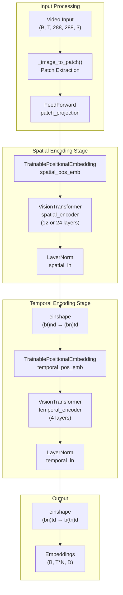
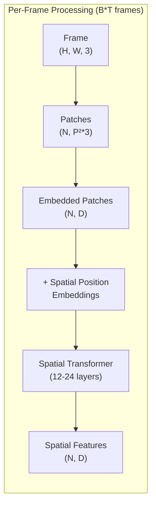
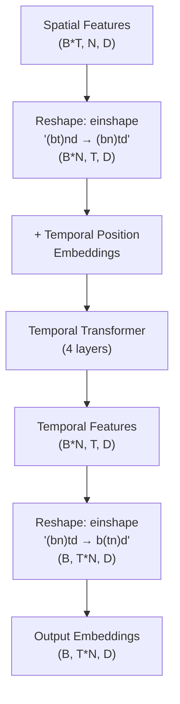
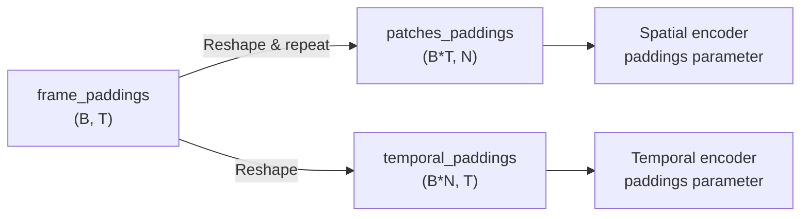
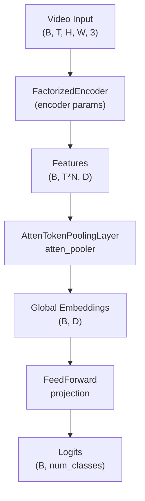

<!-- source: DeepWiki mcp.deepwiki.com · repo google-deepmind/videoprism · page 3.1 Video-Only Models · fetched 2026-10-26 -->

# Video-Only Models

<details>
<summary>Relevant source files</summary>

The following files were used as context for generating this wiki page:

- [README.md](README.md)
- [videoprism/encoders.py](videoprism/encoders.py)
- [videoprism/models.py](videoprism/models.py)

</details>


## Purpose and Scope

This page documents the video-only encoder models in VideoPrism: **VideoPrism-B** (Base) and **VideoPrism-L** (Large). These models use the `FactorizedEncoder` architecture to extract spatiotemporal features from video clips without requiring text input. They are designed for video understanding tasks such as action recognition, video classification, and temporal localization.

For video-text models that support cross-modal retrieval and zero-shot classification, see [Video-Text Models (VideoCLIP)](#3.2). For practical usage examples, see [Video Feature Extraction](#5.1).

**Sources:** [README.md:88-111](), [videoprism/models.py:15-36]()

## Model Variants

VideoPrism provides two video-only encoder variants with different parameter counts and temporal resolutions:

| Model Name | Configuration Name | Backbone | Parameters | Default Frames | Spatial Resolution | Output Tokens | Checkpoint |
|------------|-------------------|----------|------------|----------------|-------------------|---------------|------------|
| **VideoPrism-B** | `videoprism_public_v1_base` | ViT-B | 114M | 16 | 288×288 | 4,096 (16×16×16) | [HuggingFace](https://huggingface.co/google/videoprism-base-f16r288) |
| **VideoPrism-L** | `videoprism_public_v1_large` | ViT-L | 354M | 8 | 288×288 | 2,048 (8×16×16) | [HuggingFace](https://huggingface.co/google/videoprism-large-f8r288) |

Both models support variable frame counts through position embedding interpolation. The output shape is `(batch_size, num_frames * 16 * 16, feature_channels)`, which can be reshaped to `(batch_size, num_frames, 16, 16, feature_channels)` for spatiotemporal representations.

**Sources:** [README.md:88-111](), [videoprism/models.py:62-80](), [videoprism/models.py:82-115]()

## Architecture Overview

Video-only models use the `FactorizedEncoder` architecture, which implements a factorized space-time encoding approach from the ViViT paper. This architecture separates spatial and temporal processing into two stages:



The factorized approach processes each frame independently in the spatial stage, then aggregates temporal information across frames. This design is more efficient than joint space-time attention and allows the model to handle variable frame counts.

**Sources:** [videoprism/encoders.py:391-581]()

## Model Instantiation and Loading

### Instantiation Flow

The following diagram shows how video-only models are instantiated and loaded:

```mermaid
sequenceDiagram
    participant User
    participant models["videoprism.models"]
    participant MODELS["MODELS dict"]
    participant builders["videoprism_v1_base()<br/>videoprism_v1_large()"]
    participant CONFIGS["CONFIGS dict"]
    participant FactorizedEncoder["encoders.FactorizedEncoder"]
    participant HF["HuggingFace Hub"]
    
    User->>models: get_model('videoprism_public_v1_base')
    models->>MODELS: Lookup model builder
    MODELS->>builders: Call videoprism_v1_base()
    builders->>CONFIGS: Retrieve 'videoprism_v1_base' config
    CONFIGS-->>builders: Config dict
    builders->>FactorizedEncoder: Create instance with config
    FactorizedEncoder-->>User: Flax model
    
    User->>models: load_pretrained_weights('videoprism_public_v1_base')
    models->>models: CHECKPOINTS dict lookup
    models->>HF: hf_hub_download(repo_id, filename)
    HF-->>models: Checkpoint path
    models->>models: utils.load_checkpoint(path)
    models-->>User: Loaded parameters (JAX pytree)
```

**Sources:** [videoprism/models.py:164-177](), [videoprism/models.py:224-234](), [videoprism/models.py:268-304](), [videoprism/models.py:306-337]()

### Code Example

```python
from videoprism import models as vp
import jax

# Get model architecture
model_name = 'videoprism_public_v1_base'
flax_model = vp.get_model(model_name)

# Load pretrained weights
loaded_state = vp.load_pretrained_weights(model_name)

# Define forward pass
@jax.jit
def forward_fn(inputs):
  return flax_model.apply(loaded_state, inputs, train=False)

# Process video
video_inputs = ...  # Shape: (batch_size, num_frames, 288, 288, 3)
embeddings, outputs = forward_fn(video_inputs)
# embeddings shape: (batch_size, num_frames * 256, feature_dim)
```

**Sources:** [README.md:49-64](), [videoprism/models.py:22-36]()

## Configuration Details

### VideoPrism-B Configuration

The Base model configuration (`videoprism_v1_base`) is defined in the `CONFIGS` dictionary:

| Parameter | Value | Description |
|-----------|-------|-------------|
| `patch_size` | 18 | Size of square patches extracted from frames |
| `pos_emb_shape` | (16, 16, 16) | Shape of positional embeddings (T, H, W) |
| `model_dim` | 768 | Feature dimension throughout the model |
| `num_spatial_layers` | 12 | Number of transformer layers in spatial encoder |
| `num_temporal_layers` | 4 | Number of transformer layers in temporal encoder |
| `num_heads` | 12 | Number of attention heads |
| `mlp_dim` | 3072 | Hidden dimension in feedforward networks |
| `atten_logit_cap` | 50.0 | Cap for attention logit values |
| `scan` | True | Enable `nn.scan` for memory efficiency |

**Sources:** [videoprism/models.py:82-93]()

### VideoPrism-L Configuration

The Large model configuration (`videoprism_v1_large`) differs in the following parameters:

| Parameter | Base Value | Large Value |
|-----------|------------|-------------|
| `pos_emb_shape` | (16, 16, 16) | **(8, 16, 16)** |
| `model_dim` | 768 | **1024** |
| `num_spatial_layers` | 12 | **24** |
| `num_heads` | 12 | **16** |
| `mlp_dim` | 3072 | **4096** |

The Large model uses 8 frames by default (vs. 16 for Base) but has deeper spatial encoding with 24 layers.

**Sources:** [videoprism/models.py:94-104]()

## FactorizedEncoder Architecture Details

### Spatial Encoding Process

The spatial encoder processes each frame independently:



Key implementation details:
- Patch size of 18×18 pixels converts 288×288 frames into 16×16 patches (256 patches per frame)
- `patch_projection` is a `FeedForward` layer that projects flattened patches to `model_dim`
- `spatial_pos_emb` is a `TrainablePositionalEmbedding` with learned 2D positional encodings
- Position embeddings are interpolated using `_interpolate_emb_2d()` if input resolution differs from training
- The spatial encoder is a `VisionTransformer` with 12 (Base) or 24 (Large) transformer layers

**Sources:** [videoprism/encoders.py:437-531]()

### Temporal Encoding Process

After spatial encoding, features are reorganized to process temporal information:



Key implementation details:
- Features are reshaped so each spatial token position becomes a sequence of T temporal tokens
- `temporal_pos_emb` is a `TrainablePositionalEmbedding` with learned 1D temporal encodings
- Position embeddings are interpolated using `_interpolate_emb_1d()` if frame count differs from training
- The temporal encoder is a `VisionTransformer` with 4 transformer layers
- Final output is reshaped to `(batch_size, num_frames * num_patches, model_dim)`

**Sources:** [videoprism/encoders.py:533-580]()

## Input and Output Specifications

### Input Format

Video-only models expect input videos with the following specifications:

| Property | Specification |
|----------|--------------|
| **Shape** | `(batch_size, num_frames, height, width, 3)` |
| **Height/Width** | 288 pixels (must be equal) |
| **Channels** | 3 (RGB) |
| **Value Range** | [0.0, 1.0] (normalized) |
| **Data Type** | `float32` |

The `num_frames` dimension is flexible and supports variable-length videos through position embedding interpolation. However, models were trained with specific frame counts:
- VideoPrism-B: 16 frames
- VideoPrism-L: 8 frames

**Sources:** [README.md:99-106](), [videoprism/models.py:17-20]()

### Optional Frame Paddings

The encoder supports a `frame_paddings` parameter of shape `(batch_size, num_frames)` where `1` indicates a padding frame. This is propagated through both spatial and temporal encoders:



**Sources:** [videoprism/encoders.py:416-427](), [videoprism/encoders.py:441-447](), [videoprism/encoders.py:536-540]()

### Output Format

The `__call__` method returns a tuple `(embeddings, outputs)`:

**Primary Output - `embeddings`:**
- Shape: `(batch_size, num_frames * num_patches_per_frame, model_dim)`
- Type: `jax.Array`
- Can be reshaped to: `(batch_size, num_frames, 16, 16, model_dim)` for spatiotemporal structure
- For Base model: `model_dim = 768`
- For Large model: `model_dim = 1024`

**Auxiliary Output - `outputs` dictionary:**

The `return_intermediate` parameter controls which intermediate features are returned:

| Key | Shape | Condition | Description |
|-----|-------|-----------|-------------|
| `spatial_features` | `(B, T*N, D)` | `'spatial_features' in return_intermediate` | Features after spatial encoder, before temporal encoding |

Example usage:
```python
embeddings, outputs = flax_model.apply(
    loaded_state, 
    video_inputs, 
    train=False,
    return_intermediate=['spatial_features']
)
spatial_features = outputs['spatial_features']
```

**Sources:** [videoprism/encoders.py:417-433](), [videoprism/encoders.py:574-579]()

## Position Embedding Interpolation

Both models support processing videos with different numbers of frames than used during training through position embedding interpolation. This is handled automatically by the `FactorizedEncoder`:

### Spatial Position Interpolation

When input frame resolution differs from `pos_emb_shape[-2:]`:

```python
# videoprism/encoders.py:506-513
spatial_pos_emb_shape = self.pos_emb_shape[-2:]  # e.g., (16, 16)
num_row_patches = h // self.patch_size
num_col_patches = w // self.patch_size
if spatial_pos_emb_shape != (num_row_patches, num_col_patches):
  spatial_pos_emb = _interpolate_emb_2d(
      spatial_pos_emb,
      spatial_pos_emb_shape,
      (num_row_patches, num_col_patches),
  )
```

The `_interpolate_emb_2d()` function uses bilinear interpolation via `jax.image.resize()`.

**Sources:** [videoprism/encoders.py:506-514](), [videoprism/encoders.py:131-166]()

### Temporal Position Interpolation

When input frame count differs from `pos_emb_shape[0]`:

```python
# videoprism/encoders.py:543-552
temporal_seq_length = self.pos_emb_shape[0]  # e.g., 16 for Base, 8 for Large
temporal_pos_emb = TrainablePositionalEmbedding(...)(seq_length=temporal_seq_length)
if temporal_seq_length != t:
  temporal_pos_emb = _interpolate_emb_1d(temporal_pos_emb, t)
```

The `_interpolate_emb_1d()` function uses bilinear interpolation for 1D temporal positions.

**Sources:** [videoprism/encoders.py:543-553](), [videoprism/encoders.py:107-129]()

## Video Classifier Variant

The codebase also provides `FactorizedVideoClassifier`, which wraps `FactorizedEncoder` with a classification head:



The classifier uses attention-based pooling (`AttenTokenPoolingLayer`) to aggregate spatiotemporal features into a global video embedding before classification.

**Sources:** [videoprism/encoders.py:583-654](), [videoprism/models.py:200-222]()

## Model Registry

All video-only models are registered in the `MODELS` dictionary for easy access:

| Registry Key | Builder Function | Architecture |
|--------------|-----------------|--------------|
| `'videoprism_public_v1_base'` | `videoprism_v1_base()` | `FactorizedEncoder` |
| `'videoprism_public_v1_large'` | `videoprism_v1_large()` | `FactorizedEncoder` |

The builder functions instantiate `FactorizedEncoder` with the appropriate configuration from the `CONFIGS` dictionary.

**Sources:** [videoprism/models.py:224-234](), [videoprism/models.py:164-177]()

## Checkpoints

Pretrained weights are hosted on HuggingFace Hub and registered in the `CHECKPOINTS` dictionary:

| Model Name | Repository | Filename | File Size |
|------------|-----------|----------|-----------|
| `videoprism_public_v1_base` | `google/videoprism-base-f16r288` | `flax_base_f16r288_repeated.npz` | 458MB |
| `videoprism_public_v1_large` | `google/videoprism-large-f8r288` | `flax_large_f8r288_repeated.npz` | 1.42GB |

The `load_pretrained_weights()` function automatically downloads checkpoints from HuggingFace Hub using `huggingface_hub.hf_hub_download()` and loads them using `utils.load_checkpoint()`.

**Sources:** [videoprism/models.py:62-80](), [videoprism/models.py:306-337]()

## Performance Benchmarks

Video-only models achieve state-of-the-art results on VideoGLUE benchmarks with frozen backbones:

| Model | K400 | MiT | SSv2 | D48 | Charades | ActivityNet | AVA | AVA-K |
|-------|------|-----|------|-----|----------|-------------|-----|-------|
| **VideoPrism-B** | 82.9 | 39.7 | 62.2 | 64.3 | 43.5 | 36.5 | 28.3 | 30.8 |
| **VideoPrism-L** | 85.0 | 43.3 | 64.6 | 67.6 | 53.2 | 37.0 | 32.4 | 34.5 |

These results demonstrate the effectiveness of the factorized encoding approach for video understanding tasks including action recognition (K400), moment retrieval (MiT), temporal modeling (SSv2), and action localization (AVA).

**Sources:** [README.md:121-131]()

---

