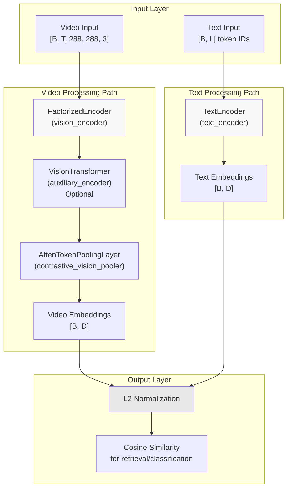
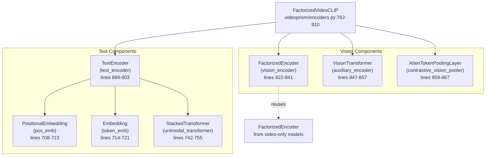
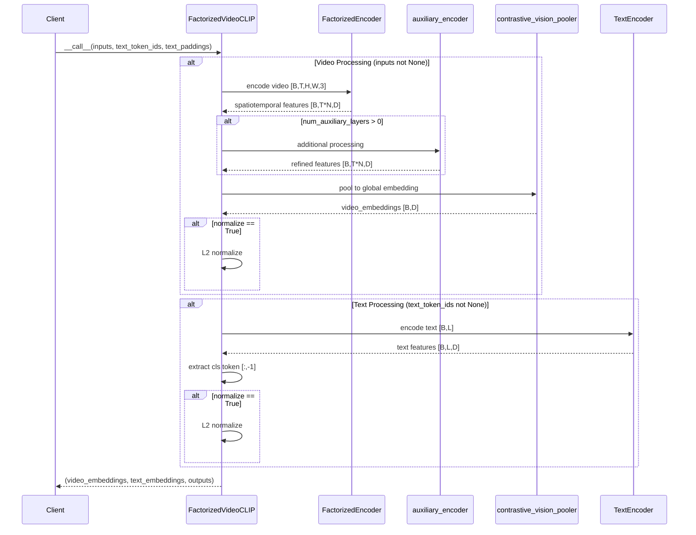
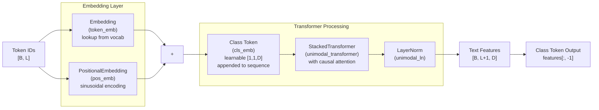
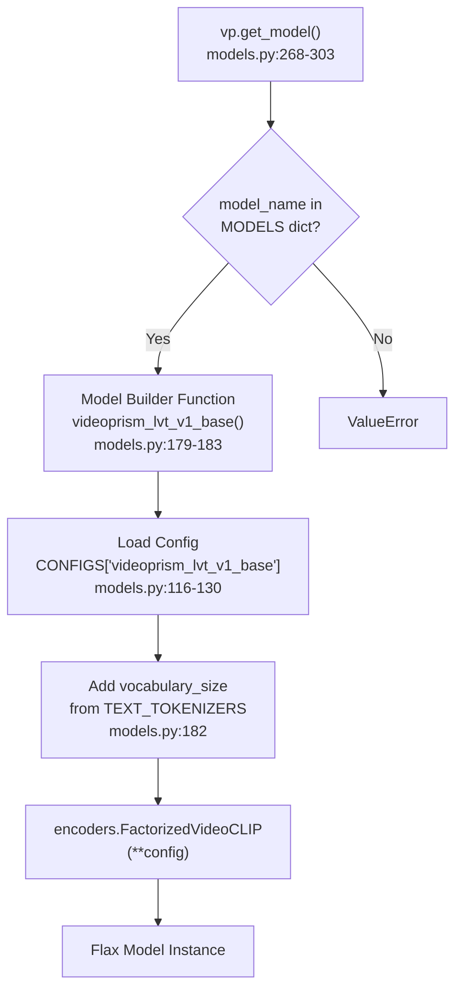
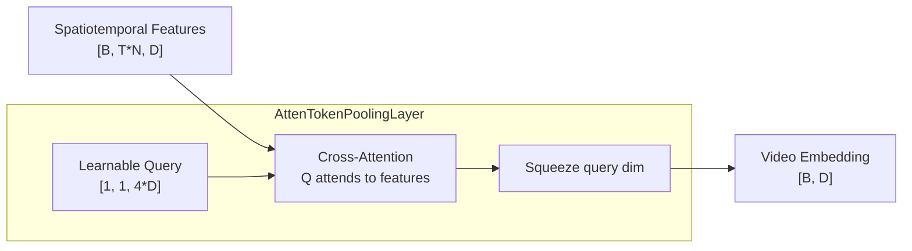

<!-- source: DeepWiki mcp.deepwiki.com · repo google-deepmind/videoprism · page 3.2 Video-Text Models (VideoCLIP) · fetched 2026-10-26 -->

# Video-Text Models (VideoCLIP)

<details>
<summary>Relevant source files</summary>

The following files were used as context for generating this wiki page:

- [README.md](README.md)
- [videoprism/encoders.py](videoprism/encoders.py)
- [videoprism/models.py](videoprism/models.py)

</details>


This page documents the VideoPrism video-text models (VideoPrism-LvT variants) that support cross-modal tasks involving both video and text inputs. These models use a dual-encoder architecture with separate encoders for each modality, enabling tasks such as video-text retrieval, zero-shot classification, and video question answering.

**Scope**: This page covers the `FactorizedVideoCLIP` architecture, text encoding with `TextEncoder`, model configurations, and usage patterns for cross-modal tasks. For video-only feature extraction, see [Video-Only Models](#3.1). For general model loading and management, see [Model Management System](#4.1).

---

## Model Variants

VideoPrism offers two video-text model variants, both available through the model registry:

| Model Name | Configuration Key | Backbone | Parameters | Features | HuggingFace Repo |
|------------|------------------|----------|------------|----------|------------------|
| VideoPrism-LvT-B | `videoprism_lvt_public_v1_base` | ViT-B | 248M | 768-dim embeddings | `google/videoprism-lvt-base-f16r288` |
| VideoPrism-LvT-L | `videoprism_lvt_public_v1_large` | ViT-L | 580M | 1024-dim embeddings | `google/videoprism-lvt-large-f8r288` |

Both models produce L2-normalized embeddings in a shared embedding space, enabling cosine similarity computation for cross-modal retrieval and classification tasks.

**Sources**: [README.md:92-97](), [videoprism/models.py:72-79](), [videoprism/models.py:116-145]()

---

## Architecture Overview

### Dual-Encoder Design

The `FactorizedVideoCLIP` architecture implements a dual-encoder approach where video and text are processed independently before projection into a shared embedding space.



**Sources**: [videoprism/encoders.py:762-910]()

### Component Hierarchy



**Sources**: [videoprism/encoders.py:762-910](), [videoprism/encoders.py:656-759]()

---

## FactorizedVideoCLIP Class

The `FactorizedVideoCLIP` class [videoprism/encoders.py:762-910]() is the main entry point for video-text models. It coordinates both modalities and handles optional processing.

### Key Attributes

| Parameter | Description | Base Value | Large Value |
|-----------|-------------|------------|-------------|
| `patch_size` | Spatial patch dimension | 18 | 18 |
| `pos_emb_shape` | Positional embedding shape (T, H, W) | (16, 16, 16) | (8, 16, 16) |
| `num_spatial_layers` | Spatial encoder transformer layers | 12 | 24 |
| `num_temporal_layers` | Temporal encoder transformer layers | 4 | 4 |
| `num_auxiliary_layers` | Additional video processing layers | 2 | 2 |
| `vocabulary_size` | Text vocabulary size | 32,000 | 32,000 |
| `num_unimodal_layers` | Text encoder transformer layers | 12 | 12 |
| `model_dim` | Embedding dimension | 768 | 1024 |
| `num_heads` | Attention heads | 12 | 16 |
| `mlp_dim` | FFN hidden dimension | 3072 | 4096 |

**Sources**: [videoprism/models.py:116-145]()

### Method: `__call__`

The forward pass supports flexible modality processing:

```python
def __call__(
    self,
    inputs: Array | None = None,              # Video: [B, T, H, W, 3]
    text_token_ids: Array | None = None,      # Text IDs: [B, L]
    text_paddings: Array | None = None,       # Text padding: [B, L]
    train: bool = False,
    normalize: bool = True,                    # L2 normalization
    return_intermediate: bool | Collection[str] = False,
    frame_paddings: Array | None = None,      # Video padding: [B, T]
) -> tuple[Array | None, Array | None, dict[str, Array]]
```

**Returns**:
- `video_embeddings`: Shape `[B, D]` or `None` if `inputs` is `None`
- `text_embeddings`: Shape `[B, D]` or `None` if `text_token_ids` is `None`
- `outputs`: Dictionary with optional intermediate features

**Sources**: [videoprism/encoders.py:783-810]()

### Processing Flow



**Sources**: [videoprism/encoders.py:783-910]()

---

## TextEncoder Component

The `TextEncoder` class [videoprism/encoders.py:656-759]() implements a CoCa-style text encoder with causal attention and learnable class tokens.

### Architecture Details



**Key Features**:
1. **Token Embedding**: Vocabulary lookup with `scale_sqrt_depth=True` multiplies by `sqrt(model_dim)` [videoprism/encoders.py:714-721]()
2. **Positional Encoding**: Sinusoidal embeddings added to token embeddings [videoprism/encoders.py:708-713]()
3. **Class Tokens**: Learnable tokens appended after the text sequence [videoprism/encoders.py:724-735]()
4. **Causal Attention**: Prevents tokens from attending to future positions when `enable_causal_atten=True` [videoprism/encoders.py:682]()
5. **Output Selection**: Final class token `[:, -1]` used as text embedding [videoprism/encoders.py:906]()

**Sources**: [videoprism/encoders.py:656-759]()

---

## Model Loading and Usage

### Loading VideoCLIP Models

```python
from videoprism import models as vp

# Load model architecture
model_name = 'videoprism_lvt_public_v1_base'
flax_model = vp.get_model(model_name)

# Load pre-trained weights from HuggingFace
loaded_state = vp.load_pretrained_weights(model_name)

# Load text tokenizer
text_tokenizer = vp.load_text_tokenizer('c4_en')
```

**Sources**: [videoprism/models.py:179-197](), [videoprism/models.py:224-233](), [videoprism/models.py:339-352]()

### Model Instantiation Flow



**Sources**: [videoprism/models.py:179-183](), [videoprism/models.py:268-303]()

### Text Tokenization

The `tokenize_texts` function [videoprism/models.py:355-407]() prepares text for model input:

```python
text_queries = ["a person playing basketball", "a cat sleeping"]
text_ids, text_paddings = vp.tokenize_texts(
    text_tokenizer, 
    text_queries,
    max_length=64,
    canonicalize=True  # Lowercase, remove punctuation
)
# text_ids: [B, 64] int32 array
# text_paddings: [B, 64] float32 array (1.0 = padding)
```

**Processing Steps**:
1. **Canonicalization**: `utils.canonicalize_text()` lowercases and removes punctuation [videoprism/models.py:379]()
2. **Tokenization**: SentencePiece tokenizer converts to token IDs [videoprism/models.py:385]()
3. **BOS Token**: Beginning-of-sentence token added if `tokenizer.bos_token >= 0` [videoprism/models.py:382-383]()
4. **Padding**: Sequences padded or truncated to `max_length` [videoprism/models.py:387-402]()

**Sources**: [videoprism/models.py:355-407]()

---

## Complete Usage Example

### Video-Text Retrieval

```python
import jax
import jax.numpy as jnp
from videoprism import models as vp

# Setup
model_name = 'videoprism_lvt_public_v1_base'
flax_model = vp.get_model(model_name)
loaded_state = vp.load_pretrained_weights(model_name)
text_tokenizer = vp.load_text_tokenizer('c4_en')

@jax.jit
def forward_fn(inputs, text_token_ids, text_token_paddings, train=False):
    return flax_model.apply(
        loaded_state,
        inputs,
        text_token_ids,
        text_token_paddings,
        train=train,
        normalize=True  # L2 normalize for cosine similarity
    )

# Prepare inputs
video_inputs = ...  # Shape: [batch_size, num_frames, 288, 288, 3]
text_queries = ["playing basketball", "cooking dinner", "walking a dog"]
text_ids, text_paddings = vp.tokenize_texts(text_tokenizer, text_queries)

# Forward pass
video_embeddings, text_embeddings, _ = forward_fn(
    video_inputs, text_ids, text_paddings
)

# Compute similarity scores
similarity = jnp.matmul(video_embeddings, text_embeddings.T)
# Shape: [num_videos, num_texts]
```

**Sources**: [README.md:65-86]()

### Single-Modality Encoding

Either modality can be processed independently by passing `None`:

```python
# Video-only encoding
video_embeddings, _, _ = forward_fn(video_inputs, None, None)

# Text-only encoding (requires placeholder video input)
_, text_embeddings, _ = forward_fn(None, text_ids, text_paddings)
```

**Note**: Text encoding requires `text_paddings` to be non-None. The model checks this with an assertion [videoprism/encoders.py:888]().

**Sources**: [videoprism/encoders.py:820-909]()

---

## Configuration Details

### Base Model Configuration

The `videoprism_lvt_v1_base` configuration [videoprism/models.py:116-130]():

```python
{
    'patch_size': 18,
    'pos_emb_shape': (16, 16, 16),        # 16 frames, 16x16 spatial
    'num_spatial_layers': 12,              # ViT-B spatial encoder
    'num_temporal_layers': 4,              # Temporal processing
    'mlp_dim': 3072,                       # 4x model_dim
    'num_auxiliary_layers': 2,             # Additional video layers
    'enable_causal_atten': True,           # For text encoder
    'num_unimodal_layers': 12,             # Text encoder layers
    'norm_policy': 'pre',                  # Pre-normalization
    'model_dim': 768,                      # ViT-B dimension
    'num_heads': 12,                       # Multi-head attention
    'atten_logit_cap': 50.0,              # Attention logit capping
    'scan': True,                          # Memory optimization
    'vocabulary_size': 32000               # Added from TEXT_TOKENIZERS
}
```

**Sources**: [videoprism/models.py:116-130]()

### Large Model Configuration

The `videoprism_lvt_v1_large` configuration [videoprism/models.py:131-145]():

Key differences from base:
- `pos_emb_shape`: (8, 16, 16) - 8 frames instead of 16
- `num_spatial_layers`: 24 - Deeper spatial encoder (ViT-L)
- `model_dim`: 1024 - Larger dimension
- `num_heads`: 16 - More attention heads
- `mlp_dim`: 4096 - Larger FFN

**Sources**: [videoprism/models.py:131-145]()

### Checkpoint Registry

VideoCLIP checkpoints are stored on HuggingFace Hub [videoprism/models.py:72-79]():

```python
CHECKPOINTS = {
    'videoprism_lvt_public_v1_base': (
        'google/videoprism-lvt-base-f16r288',
        'flax_lvt_base_f16r288_repeated.npz',
    ),
    'videoprism_lvt_public_v1_large': (
        'google/videoprism-lvt-large-f8r288',
        'flax_lvt_large_f8r288_repeated.npz',
    ),
}
```

The `load_pretrained_weights` function automatically downloads from HuggingFace using `hf_hub_download` [videoprism/models.py:306-336]().

**Sources**: [videoprism/models.py:72-79](), [videoprism/models.py:306-336]()

---

## Intermediate Features

Setting `return_intermediate=True` or passing a collection of feature names returns additional outputs:

| Feature Key | Shape | Description | Source |
|------------|-------|-------------|---------|
| `spatial_features` | `[B, T*N, D]` | After spatial encoder, before temporal | From FactorizedEncoder |
| `spatiotemporal_features` | `[B, T*N, D]` | After temporal encoder | From FactorizedEncoder |
| `frame_embeddings` | `[B, T, D]` | Per-frame contrastive embeddings | Pooled from spatiotemporal |

**Example**:

```python
video_emb, text_emb, outputs = forward_fn(
    video_inputs, 
    text_ids, 
    text_paddings,
    return_intermediate=['frame_embeddings', 'spatial_features']
)
# outputs['frame_embeddings']: [B, T, D]
# outputs['spatial_features']: [B, T*N, D]
```

**Sources**: [videoprism/encoders.py:813-816](), [videoprism/encoders.py:842-885]()

---

## Attention Pooling

The `AttenTokenPoolingLayer` [videoprism/encoders.py:859-867]() aggregates spatiotemporal features into global embeddings:



**Configuration**:
- `hidden_dim`: 4 × `model_dim` (e.g., 3072 for base)
- `num_queries`: 1 (single global embedding)
- `num_heads`: Matches model (12 for base, 16 for large)

The pooler is reused for frame embeddings when `return_intermediate` includes `'frame_embeddings'` [videoprism/encoders.py:874-885]().

**Sources**: [videoprism/encoders.py:859-867]()

---

## Text Tokenizer

### SentencePiece Tokenizer

The C4 English tokenizer is used for all VideoCLIP models [videoprism/models.py:55-60]():

```python
TEXT_TOKENIZERS = {
    'c4_en': {
        'model_path': 'gs://t5-data/vocabs/cc_en.32000/sentencepiece.model',
        'vocab_size': 32_000,
    },
}
```

The `SentencePieceTokenizer` class [videoprism/tokenizers.py]() wraps the SentencePiece library and implements the `Tokenizer` protocol.

**Loading**:

```python
tokenizer = vp.load_text_tokenizer('c4_en')
# Downloads from GCS and creates SentencePieceTokenizer instance
```

**Sources**: [videoprism/models.py:55-60](), [videoprism/models.py:339-352]()

### Text Canonicalization

The `utils.canonicalize_text()` function normalizes text before tokenization [videoprism/models.py:379]():

1. Convert to lowercase
2. Remove punctuation
3. Strip whitespace

This ensures consistent encoding across different text formats. Canonicalization can be disabled by setting `canonicalize=False` in `tokenize_texts()`.

**Sources**: [videoprism/models.py:378-379](), [videoprism/utils.py]()

---

## Key Differences from Video-Only Models

| Aspect | Video-Only (FactorizedEncoder) | Video-Text (FactorizedVideoCLIP) |
|--------|--------------------------------|----------------------------------|
| Architecture | Single encoder | Dual encoder (video + text) |
| Output | Spatiotemporal features `[B, T*N, D]` | Global embeddings `[B, D]` per modality |
| Pooling | Optional, external | Built-in attention pooling |
| Normalization | Not applied | L2 normalization for contrastive learning |
| Text Support | None | Full text encoding with TextEncoder |
| Auxiliary Layers | None | Optional `num_auxiliary_layers` for video refinement |
| Use Cases | Feature extraction, classification | Retrieval, zero-shot classification |

**Sources**: [videoprism/encoders.py:391-580](), [videoprism/encoders.py:762-910]()

---

## Performance Benchmarks

From the README [README.md:132-152](), public VideoCLIP models achieve state-of-the-art results:

### Zero-Shot Retrieval (R@1)

| Dataset | VideoPrism-LvT-B | VideoPrism-LvT-L | Task |
|---------|------------------|------------------|------|
| MSRVTT-1K | 49.8 (v2t), 50.1 (t2v) | 50.6 (v2t), 50.1 (t2v) | Video-text retrieval |
| VATEX | 73.1 (v2t), 56.2 (t2v) | 75.0 (v2t), 57.2 (t2v) | Video-text retrieval |
| ActivityNet | 47.9 (v2t), 48.8 (t2v) | 49.1 (v2t), 51.3 (t2v) | Video-text retrieval |

### Zero-Shot Classification (Accuracy)

| Dataset | VideoPrism-LvT-B | VideoPrism-LvT-L | Task Type |
|---------|------------------|------------------|-----------|
| Kinetics-400 | 69.2 | 72.4 | Action recognition |
| SSv2 (Temporal) | 14.6 | 18.0 | Temporal reasoning |
| Charades | 26.9 | 32.4 | Activity recognition |

**Sources**: [README.md:132-152]()

---

