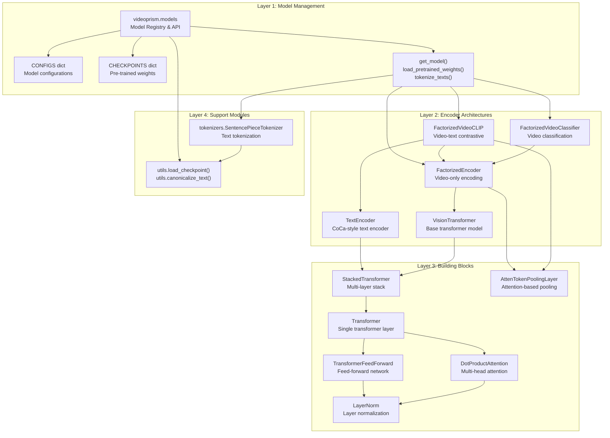
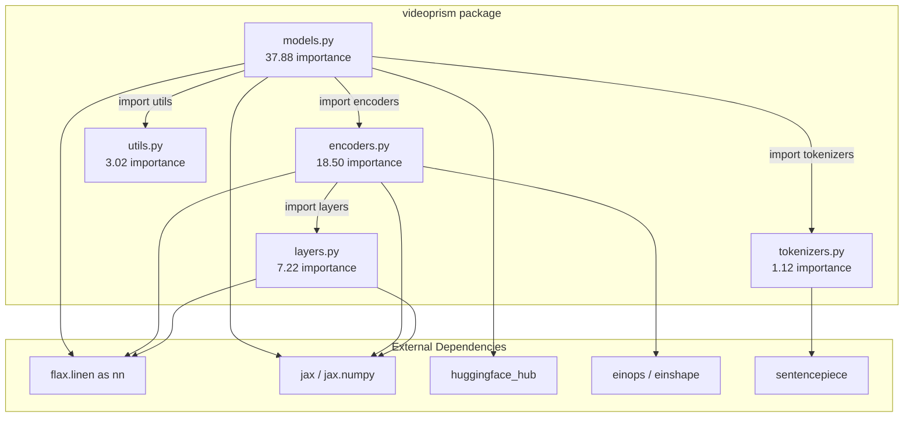
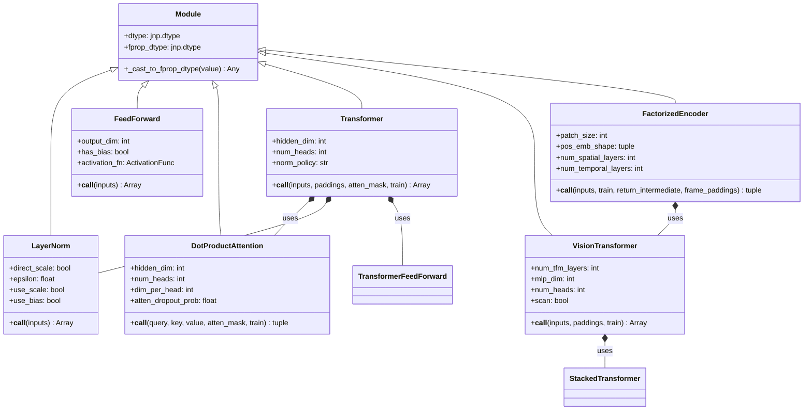
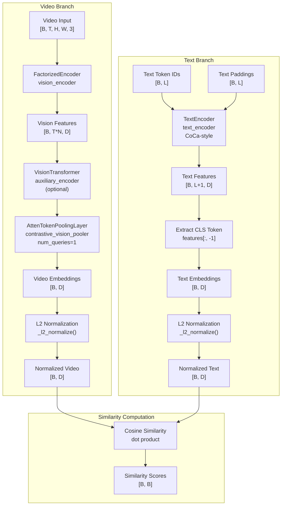
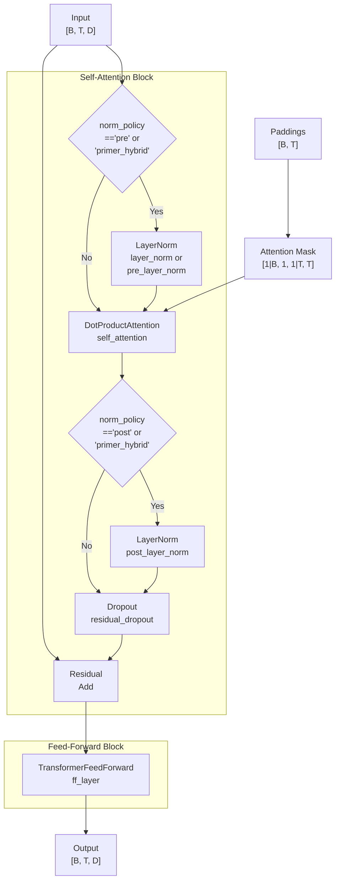
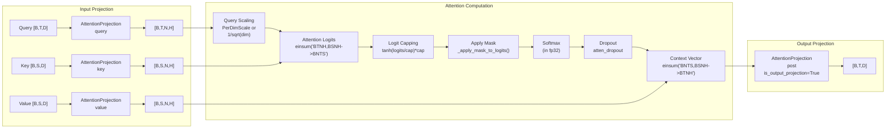
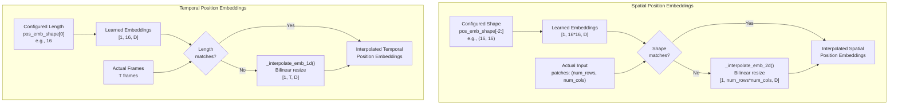
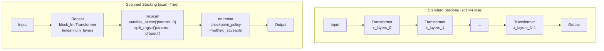
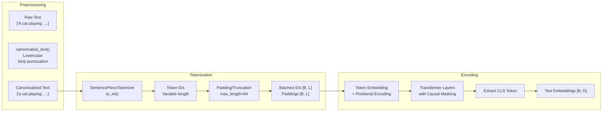

<!-- source: DeepWiki mcp.deepwiki.com · repo google-deepmind/videoprism · page 4 Core Architecture · fetched 2026-10-26 -->

# Core Architecture

<details>
<summary>Relevant source files</summary>

The following files were used as context for generating this wiki page:

- [videoprism/encoders.py](videoprism/encoders.py)
- [videoprism/layers.py](videoprism/layers.py)
- [videoprism/models.py](videoprism/models.py)

</details>


This document provides a deep dive into the internal architecture and components of VideoPrism. It explains how the different modules are organized, how they interact, and the key abstractions that enable the system's flexibility and modularity.

For specific implementation details of individual components, see the child pages: [Model Management System](#4.1), [Encoder Architectures](#4.2), [Layer Components](#4.3), [Text Tokenization](#4.4), and [Utilities](#4.5). For practical usage guidance, see [Usage Guide](#5).

## Architectural Overview

VideoPrism follows a layered architecture where each layer builds upon lower-level abstractions. The system is organized into four primary layers, each with distinct responsibilities:



**Layer 1 (Model Management)** serves as the primary user interface, providing model instantiation and checkpoint loading through a registry-based system. **Layer 2 (Encoder Architectures)** implements the complete neural network models for video and text encoding. **Layer 3 (Building Blocks)** provides reusable transformer components that compose into larger architectures. **Layer 4 (Support Modules)** handles text processing and checkpoint I/O operations.

Sources: [videoprism/models.py:1-408](), [videoprism/encoders.py:1-911](), [videoprism/layers.py:1-1137]()

## Module Hierarchy and Dependencies

The following diagram shows the concrete module structure and import dependencies between files:



The dependency graph follows a strict hierarchy: `models.py` depends on all other modules but is not imported by them. `encoders.py` depends only on `layers.py`. `layers.py` has no internal dependencies. This design enables modular testing and reuse.

Sources: [videoprism/models.py:39-49](), [videoprism/encoders.py:17-28](), [videoprism/layers.py:17-24]()

## Core Abstraction: Module Base Class

All VideoPrism neural network components inherit from `layers.Module`, which extends `flax.linen.nn.Module` with dtype management:



The `Module` base class provides two key attributes: `dtype` (parameter storage precision, typically `jnp.float32`) and `fprop_dtype` (computation precision). The `_cast_to_fprop_dtype()` method ensures all activations are cast to the appropriate precision for forward propagation, enabling mixed-precision training.

Sources: [videoprism/layers.py:182-206]()

## Model Registry System

The model management layer uses three central dictionaries to organize model definitions, configurations, and pre-trained weights:

| Registry | Purpose | Example Keys | Value Type |
|----------|---------|--------------|------------|
| `MODELS` | Maps model names to builder functions | `'videoprism_public_v1_base'`<br/>`'videoprism_lvt_public_v1_large'` | `Callable[[], nn.Module]` |
| `CONFIGS` | Stores model hyperparameters | `'videoprism_v1_base'`<br/>`'videoprism_lvt_v1_base'` | `dict[str, Any]` |
| `CHECKPOINTS` | Maps models to HuggingFace locations | `'videoprism_public_v1_base'` | `tuple[str, str]` (repo_id, filename) |

The `MODELS` registry associates user-facing model names with factory functions:

```python
MODELS = {
    'videoprism_public_v1_base': videoprism_v1_base,
    'videoprism_public_v1_large': videoprism_v1_large,
    'videoprism_lvt_public_v1_base': functools.partial(
        videoprism_lvt_v1_base, text_tokenizer='c4_en'
    ),
    'videoprism_lvt_public_v1_large': functools.partial(
        videoprism_lvt_v1_large, text_tokenizer='c4_en'
    ),
}
```

Each factory function retrieves configuration from `CONFIGS` and instantiates the appropriate encoder class. The `CHECKPOINTS` registry maps model names to `(repo_id, filename)` tuples for downloading pre-trained weights from HuggingFace Hub.

Sources: [videoprism/models.py:55-233]()

## Video Encoding Pipeline

The video encoding pipeline transforms raw video frames into spatiotemporal feature representations through a factorized architecture:

```mermaid
flowchart LR
    subgraph "Input Processing"
        VIDEO["Video Tensor<br/>[B, T, H, W, 3]"]
        RESHAPE["Reshape<br/>[B*T, H, W, 3]"]
        PATCH["_image_to_patch()<br/>Patch Extraction"]
        PATCHES["Patches<br/>[B*T, N, P²*C]"]
    end
    
    subgraph "Spatial Encoding"
        PROJ["FeedForward<br/>patch_projection"]
        SPATIALPOS["TrainablePositionalEmbedding<br/>spatial_pos_emb"]
        SPATIALEMB["Spatial Embeddings<br/>[B*T, N, D]"]
        SPATIALVIT["VisionTransformer<br/>spatial_encoder<br/>12/24 layers"]
        SPATIALLN["LayerNorm<br/>spatial_ln"]
        SPATIALFEAT["Spatial Features<br/>[B*T, N, D]"]
    end
    
    subgraph "Temporal Encoding"
        RESHAPET["Reshape<br/>[B*N, T, D]"]
        TEMPORALPOS["TrainablePositionalEmbedding<br/>temporal_pos_emb"]
        TEMPORALEMB["Temporal Embeddings<br/>[B*N, T, D]"]
        TEMPORALVIT["VisionTransformer<br/>temporal_encoder<br/>4 layers"]
        TEMPORALLN["LayerNorm<br/>temporal_ln"]
        TEMPFEAT["Temporal Features<br/>[B*N, T, D]"]
    end
    
    subgraph "Output"
        FINAL["Final Embeddings<br/>[B, T*N, D]"]
    end
    
    VIDEO --> RESHAPE
    RESHAPE --> PATCH
    PATCH --> PATCHES
    PATCHES --> PROJ
    PROJ --> SPATIALPOS
    SPATIALPOS --> SPATIALEMB
    SPATIALEMB --> SPATIALVIT
    SPATIALVIT --> SPATIALLN
    SPATIALLN --> SPATIALFEAT
    SPATIALFEAT --> RESHAPET
    RESHAPET --> TEMPORALPOS
    TEMPORALPOS --> TEMPORALEMB
    TEMPORALEMB --> TEMPORALVIT
    TEMPORALVIT --> TEMPORALLN
    TEMPORALLN --> TEMPFEAT
    TEMPFEAT --> FINAL
```



**Patch Extraction**: Videos are reshaped to `[B*T, H, W, 3]` and converted to patches of size `patch_size × patch_size`. The `_image_to_patch()` function uses `einops.rearrange()` to extract non-overlapping patches, producing a sequence of shape `[B*T, N, P²*C]` where `N = (H/P) × (W/P)`.

**Spatial Encoding**: Each frame is processed independently. Patches are linearly projected to `model_dim` dimensions via `FeedForward` layer named `patch_projection`. Learnable 2D positional embeddings are added (with interpolation if input resolution differs from `pos_emb_shape`). The augmented patches pass through a `VisionTransformer` (spatial_encoder) with `num_spatial_layers` transformer blocks.

**Temporal Encoding**: Spatial features are reshaped to `[B*N, T, D]` so each spatial location across time forms a sequence. Learnable 1D temporal positional embeddings are added (with interpolation for variable frame counts). A second `VisionTransformer` (temporal_encoder) with `num_temporal_layers` processes temporal dependencies. The output is reshaped to `[B, T*N, D]`.

Sources: [videoprism/encoders.py:391-581](), [videoprism/encoders.py:70-105](), [videoprism/encoders.py:107-166]()

## Video-Text Contrastive Architecture

`FactorizedVideoCLIP` extends the video encoder with text processing capabilities for cross-modal tasks:



**Video Branch Processing**: The video encoder produces spatiotemporal features `[B, T*N, D]`. An optional `auxiliary_encoder` (additional `VisionTransformer` with `num_auxiliary_layers` blocks) further processes these features. An `AttenTokenPoolingLayer` with a single learnable query performs attention-based pooling to produce global video embeddings `[B, D]`. L2 normalization yields the final contrastive representation.

**Text Branch Processing**: The `TextEncoder` uses a CoCa-style architecture with a causal transformer and an appended class token. Token IDs are embedded, positional encodings added, and the sequence (including class token) passes through `num_unimodal_layers` transformer layers. The final class token (last position) serves as the global text embedding, which is then L2-normalized.

**Contrastive Learning**: The normalized video and text embeddings lie in a shared embedding space. Cosine similarity (dot product of normalized vectors) enables video-text retrieval, zero-shot classification, and other cross-modal tasks.

Sources: [videoprism/encoders.py:762-911](), [videoprism/encoders.py:656-760](), [videoprism/encoders.py:50-68]()

## Transformer Implementation

The `Transformer` class implements a single transformer layer with the following structure:



**Normalization Policy**: The `norm_policy` attribute controls when layer normalization is applied:
- `'pre'`: Before each transformation (pre-norm)
- `'post'`: After each transformation (post-norm)
- `'primer_hybrid'`: Before and after (Primer architecture)
- `'post_skip'`: After residual connection

**Self-Attention**: The `DotProductAttention` layer computes multi-head self-attention with query, key, and value all derived from the input. The attention mask combines padding masks and optional causal masks to prevent attention to invalid positions.

**Feed-Forward Network**: The `TransformerFeedForward` layer implements a two-layer MLP with configurable activation function, dropout, and normalization. It follows the same normalization policy as the attention block.

Sources: [videoprism/layers.py:749-873](), [videoprism/layers.py:316-431](), [videoprism/layers.py:530-747]()

## Attention Mechanism Details

The `DotProductAttention` implementation follows standard multi-head attention with several configurable features:



**Projection**: The `AttentionProjection` layer projects query, key, and value from dimension `D` to `[N, H]` shape (N heads, H dimensions per head) using einsum operations. Bias terms are optional via `use_bias`.

**Query Scaling**: Queries are scaled by either a learnable `PerDimScale` layer (when `internal_enable_per_dim_scale=True`) or by `1/sqrt(dim_per_head)` (when `False`). This prevents attention logits from growing too large.

**Logit Capping**: When `atten_logit_cap > 0`, attention logits are bounded by applying `tanh(logits / cap) * cap`. This stabilizes training for large models.

**Masking**: The `_apply_mask_to_logits()` function sets masked positions to large negative values (using `_get_large_negative_number()`). This ensures softmax assigns near-zero probability to invalid positions.

**Context Aggregation**: After softmax and dropout, the attention probabilities weight the value vectors to produce the context output, which is then projected back to the original dimension `D`.

Sources: [videoprism/layers.py:530-747](), [videoprism/layers.py:433-500](), [videoprism/layers.py:502-528](), [videoprism/layers.py:51-73]()

## Position Embedding Interpolation

VideoPrism supports variable input resolutions and frame counts through position embedding interpolation:



**Spatial Interpolation**: The `TrainablePositionalEmbedding` layer learns 2D spatial position embeddings for the configured `pos_emb_shape[-2:]` (e.g., 16×16 patches). When the actual input has different spatial dimensions, `_interpolate_emb_2d()` uses `jax.image.resize()` with bilinear interpolation to match the target shape. The embedding is first reshaped from `[1, H*W, D]` to `[H, W, D]`, resized to `[H', W', D]`, then flattened back to `[1, H'*W', D]`.

**Temporal Interpolation**: Similarly, `TrainablePositionalEmbedding` learns 1D temporal position embeddings for `pos_emb_shape[0]` frames. For videos with different frame counts, `_interpolate_emb_1d()` resizes the embeddings from `[1, T, D]` to match the actual frame count using bilinear interpolation.

This design allows models trained on specific input sizes to generalize to arbitrary resolutions and video lengths at inference time without retraining.

Sources: [videoprism/encoders.py:107-129](), [videoprism/encoders.py:131-166](), [videoprism/encoders.py:496-514](), [videoprism/encoders.py:542-553]()

## Scanning and Rematerialization

For memory-efficient training of deep models, VideoPrism uses Flax's `nn.scan` and `nn.remat` features:



**Standard Stacking**: When `scan=False`, `StackedTransformer` creates `num_layers` separate `Transformer` instances, each with its own parameter tree. This is straightforward but memory-intensive for deep models.

**Scanned Stacking**: When `scan=True`, `StackedTransformer` uses the `Repeat` layer to apply a single `Transformer` definition multiple times via `nn.scan`. The `variable_axes={'params': 0}` argument tells Flax to stack parameters along axis 0, creating one parameter tensor per layer. The `split_rngs` argument ensures each layer uses different random number generators for dropout.

**Rematerialization**: `nn.remat` wraps the transformer forward pass to save memory during backward pass. Instead of storing all intermediate activations, it recomputes them during backpropagation. The `checkpoint_policy='nothing_saveable'` ensures maximum memory savings.

This pattern reduces peak memory usage significantly for models with many layers (e.g., ViT-L with 24 spatial layers).

Sources: [videoprism/layers.py:875-938](), [videoprism/layers.py:1031-1041](), [videoprism/encoders.py:517-527](), [videoprism/encoders.py:556-566]()

## Configuration System

Model configurations are stored as dictionaries in the `CONFIGS` registry with hyperparameters for each model variant:

| Configuration Key | Model Type | Key Parameters |
|-------------------|------------|----------------|
| `videoprism_v1_base` | Video encoder | `patch_size=18`, `model_dim=768`, `num_spatial_layers=12`, `num_temporal_layers=4`, `num_heads=12` |
| `videoprism_v1_large` | Video encoder | `patch_size=18`, `model_dim=1024`, `num_spatial_layers=24`, `num_temporal_layers=4`, `num_heads=16` |
| `videoprism_lvt_v1_base` | Video-text CLIP | Base video encoder + `num_auxiliary_layers=2`, `num_unimodal_layers=12`, `enable_causal_atten=True` |
| `videoprism_lvt_v1_large` | Video-text CLIP | Large video encoder + `num_auxiliary_layers=2`, `num_unimodal_layers=12`, `enable_causal_atten=True` |

**Positional Embedding Shapes**: The `pos_emb_shape` tuple specifies `(T, H, W)` dimensions for learnable position embeddings. Base models use `(16, 16, 16)` for 16 frames × 16×16 spatial patches. Large models use `(8, 16, 16)` for 8 frames due to their increased capacity.

**Attention Logit Capping**: All configurations set `atten_logit_cap=50.0` to stabilize attention during training.

**Normalization Policies**: Video encoders use `norm_policy='pre'` (pre-norm), while LvT models use `'pre'` for base and `'primer_hybrid'` for giant variants.

**Scanning**: All public models enable `scan=True` for memory-efficient training.

The configuration dictionaries are passed as keyword arguments to encoder constructors via the factory functions in `MODELS`.

Sources: [videoprism/models.py:82-161](), [videoprism/models.py:164-222]()

## Text Processing Pipeline

Text inputs undergo several preprocessing steps before encoding:



**Canonicalization**: The `utils.canonicalize_text()` function normalizes text by converting to lowercase and removing or replacing punctuation. This standardization improves tokenization consistency and model robustness.

**Tokenization**: The `SentencePieceTokenizer` converts text strings to integer token IDs. The tokenizer uses a vocabulary of 32,000 tokens (for C4-English). The `tokenize_texts()` function in `models.py` handles batching, padding to `max_length=64`, and creating padding masks (1 = padding position).

**Text Encoder**: The `TextEncoder` uses `Embedding` layer for token embedding, `PositionalEmbedding` for position encoding, and a stack of causal transformer layers. A learnable class token is appended to the sequence, and its final representation serves as the global text embedding.

Sources: [videoprism/models.py:355-408](), [videoprism/encoders.py:656-760]()

## Checkpoint Format

Pre-trained weights are stored as nested dictionaries (JAX Pytrees) in `.npz` format:

```
checkpoint.npz:
├── params/
│   ├── encoder/
│   │   ├── patch_projection/
│   │   │   ├── linear/
│   │   │   │   ├── kernel: [P²*C, D]
│   │   │   │   └── bias: [D]
│   │   ├── spatial_pos_emb/
│   │   │   └── emb_var: [H*W, D]
│   │   ├── spatial_encoder/
│   │   │   └── transformers_stack/
│   │   │       └── x_layers/ (if scan=True)
│   │   │           ├── self_attention/
│   │   │           │   ├── query/w: [num_layers, D, N, H]
│   │   │           │   ├── key/w: [num_layers, D, N, H]
│   │   │           │   ├── value/w: [num_layers, D, N, H]
│   │   │           │   └── post/w: [num_layers, D, N, H]
│   │   │           └── ff_layer/
│   │   │               ├── ffn_layer1/linear/kernel: [num_layers, D, H']
│   │   │               └── ffn_layer2/linear/kernel: [num_layers, H', D]
│   │   ├── temporal_pos_emb/
│   │   │   └── emb_var: [T, D]
│   │   └── temporal_encoder/
│   │       └── ... (similar structure)
```

**Pytree Structure**: Flax models store parameters as nested dictionaries matching the module hierarchy. Each layer's parameters are accessible via path like `params['encoder']['spatial_encoder']['transformers_stack']`.

**Scanned Parameters**: When `scan=True`, layer parameters have an additional leading dimension of size `num_layers`. The `nn.scan` mechanism automatically handles indexing into this dimension during the forward pass.

**Loading**: The `utils.load_checkpoint()` function deserializes `.npz` files into Python dictionaries, which are then converted to JAX arrays via `jax.tree_util.tree_map(jnp.asarray, variables)`.

**HuggingFace Integration**: The `load_pretrained_weights()` function uses `huggingface_hub.hf_hub_download()` to fetch checkpoints from the HuggingFace Hub based on the `CHECKPOINTS` registry. This provides transparent access to pre-trained weights without manual downloads.

Sources: [videoprism/models.py:306-337](), [videoprism/models.py:62-80]()

## Summary

The VideoPrism architecture follows a strictly layered design:

1. **Model Management Layer** (`models.py`) provides the public API via registries (`MODELS`, `CONFIGS`, `CHECKPOINTS`) and functions (`get_model()`, `load_pretrained_weights()`, `tokenize_texts()`)

2. **Encoder Architectures Layer** (`encoders.py`) implements complete models: `FactorizedEncoder` for video-only tasks, `FactorizedVideoCLIP` for video-text tasks, `TextEncoder` for text, and `VisionTransformer` as the base transformer model

3. **Building Blocks Layer** (`layers.py`) provides reusable components: `Transformer` (single layer), `StackedTransformer` (multi-layer stack), `DotProductAttention` (multi-head attention), `TransformerFeedForward` (FFN), `LayerNorm`, and utility classes

4. **Support Modules** (`tokenizers.py`, `utils.py`) handle text tokenization and checkpoint I/O

Key architectural features include factorized spatial-temporal encoding, position embedding interpolation for variable inputs, attention-based pooling, and memory-efficient scanning with rematerialization. All components inherit from `layers.Module` for consistent dtype management across the stack.

For detailed implementation information, see the child pages on specific subsystems.

Sources: [videoprism/models.py:1-408](), [videoprism/encoders.py:1-911](), [videoprism/layers.py:1-1137]()

---

