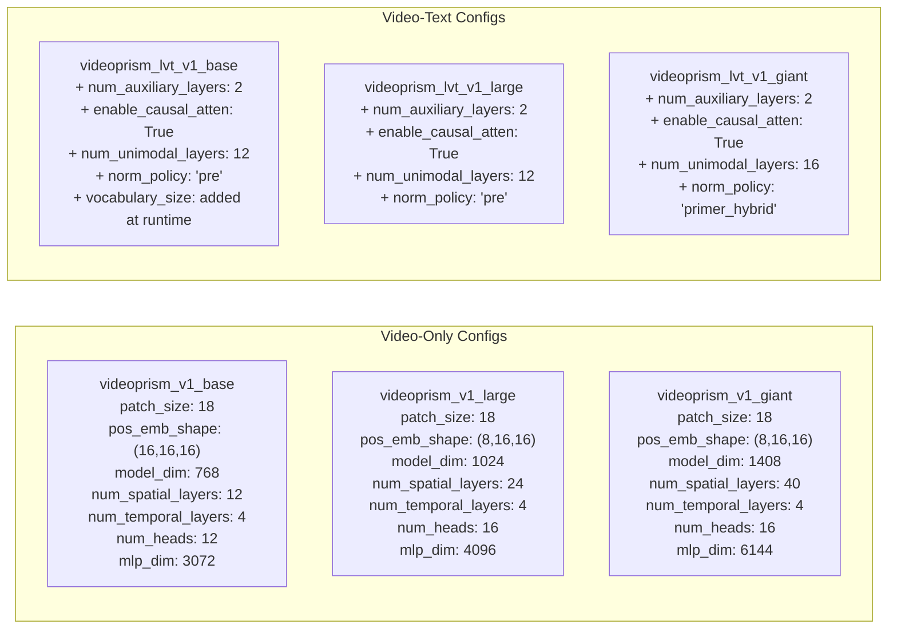
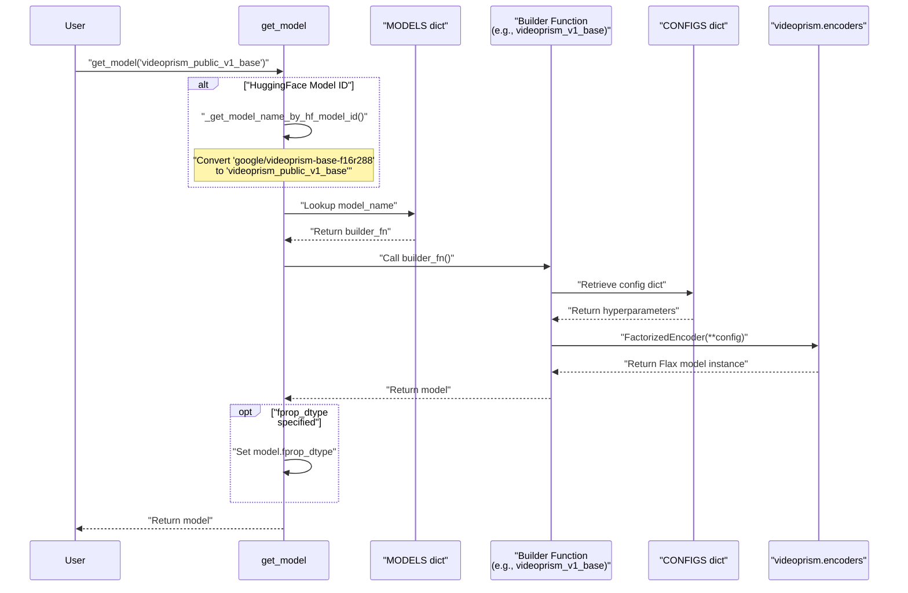
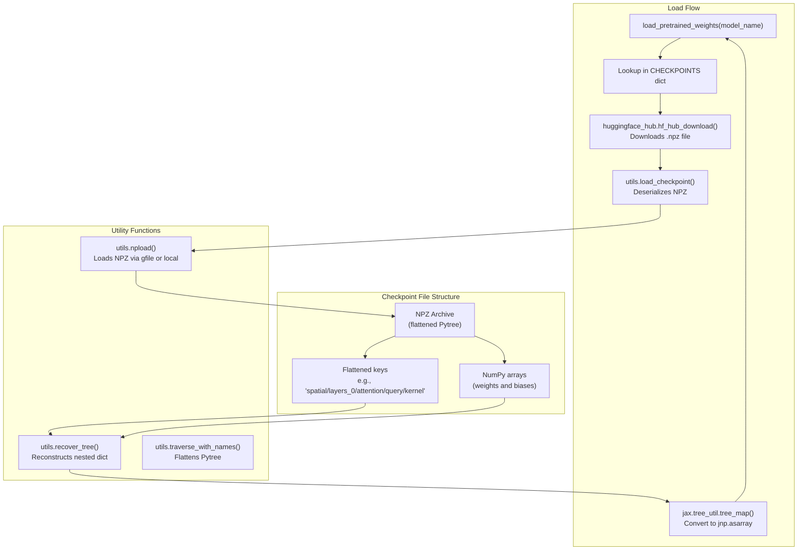
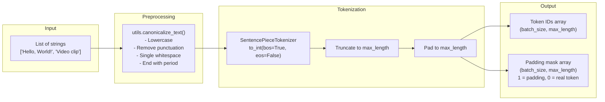
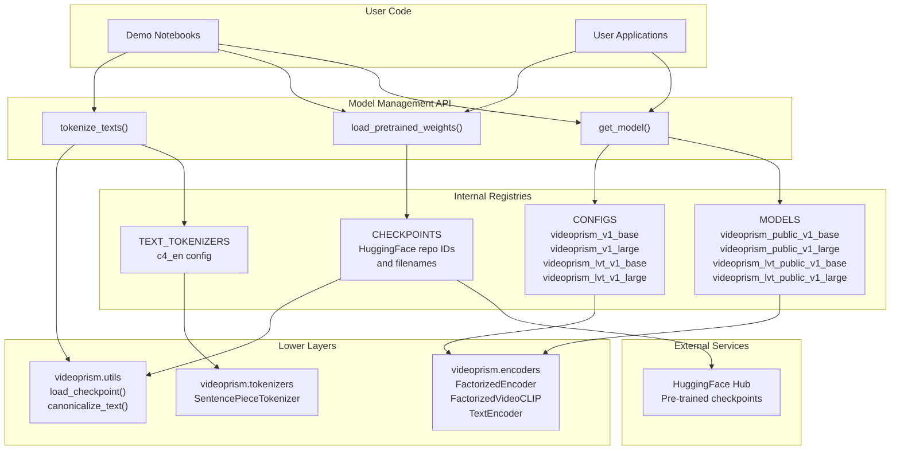

<!-- source: DeepWiki mcp.deepwiki.com · repo google-deepmind/videoprism · page 4.1 Model Management System · fetched 2026-10-26 -->

# Model Management System

<details>
<summary>Relevant source files</summary>

The following files were used as context for generating this wiki page:

- [videoprism/models.py](videoprism/models.py)
- [videoprism/utils.py](videoprism/utils.py)
- [videoprism/utils_test.py](videoprism/utils_test.py)

</details>


## Purpose and Scope

The Model Management System is the central hub of VideoPrism, serving as the primary API layer for model instantiation, checkpoint loading, and configuration management. This system coordinates access to all model architectures and pre-trained weights through a registry-based design pattern. It handles the entire lifecycle from model creation to loading pre-trained parameters from HuggingFace Hub.

This document covers the internal architecture of the model management layer, including the registry dictionaries, model building functions, checkpoint loading mechanisms, and tokenization utilities. For information about the actual neural network architectures being managed, see [Encoder Architectures](#4.2). For practical usage examples, see [Loading Custom Checkpoints](#5.3).

**Sources:** [videoprism/models.py:1-37]()

---

## System Architecture Overview

The Model Management System is implemented primarily in `videoprism/models.py` and consists of three core registry dictionaries and their associated accessor functions. The system follows a two-phase initialization pattern: first instantiating the model architecture, then separately loading pre-trained weights.

```mermaid
graph TB
    subgraph "Registry Layer"
        MODELS["MODELS dict<br/>{model_name: builder_fn}"]
        CONFIGS["CONFIGS dict<br/>{config_name: hyperparams}"]
        CHECKPOINTS["CHECKPOINTS dict<br/>{model_name: (repo_id, filename)}"]
        TEXT_TOKENIZERS["TEXT_TOKENIZERS dict<br/>{tokenizer_name: config}"]
    end
    
    subgraph "Public API Functions"
        get_model["get_model()"]
        load_pretrained_weights["load_pretrained_weights()"]
        load_text_tokenizer["load_text_tokenizer()"]
        tokenize_texts["tokenize_texts()"]
        has_model["has_model()"]
    end
    
    subgraph "Model Builder Functions"
        videoprism_v1_base["videoprism_v1_base()"]
        videoprism_v1_large["videoprism_v1_large()"]
        videoprism_lvt_v1_base["videoprism_lvt_v1_base()"]
        videoprism_lvt_v1_large["videoprism_lvt_v1_large()"]
        videoprism_vc_v1_base["videoprism_vc_v1_base()"]
    end
    
    subgraph "External Dependencies"
        encoders["videoprism.encoders<br/>FactorizedEncoder<br/>FactorizedVideoCLIP<br/>FactorizedVideoClassifier"]
        tokenizers["videoprism.tokenizers<br/>SentencePieceTokenizer"]
        utils["videoprism.utils<br/>load_checkpoint()<br/>canonicalize_text()"]
        hf["huggingface_hub<br/>hf_hub_download()"]
    end
    
    get_model --> MODELS
    get_model --> videoprism_v1_base
    load_pretrained_weights --> CHECKPOINTS
    load_pretrained_weights --> hf
    load_pretrained_weights --> utils
    load_text_tokenizer --> TEXT_TOKENIZERS
    tokenize_texts --> tokenizers
    tokenize_texts --> utils
    has_model --> MODELS
    
    MODELS --> videoprism_v1_base
    MODELS --> videoprism_v1_large
    MODELS --> videoprism_lvt_v1_base
    MODELS --> videoprism_lvt_v1_large
    
    videoprism_v1_base --> CONFIGS
    videoprism_v1_base --> encoders
    videoprism_lvt_v1_base --> CONFIGS
    videoprism_lvt_v1_base --> TEXT_TOKENIZERS
    videoprism_lvt_v1_base --> encoders
    videoprism_vc_v1_base --> CONFIGS
    videoprism_vc_v1_base --> encoders
```



**Sources:** [videoprism/models.py:39-233]()

---

## Model Registry (MODELS)

The `MODELS` dictionary maps public model names to builder functions that instantiate Flax model instances. This registry serves as the primary lookup table for model creation.

### Registry Structure

| Model Name | Builder Function | Model Type | Parameters |
|------------|------------------|------------|------------|
| `videoprism_public_v1_base` | `videoprism_v1_base` | FactorizedEncoder | 114M |
| `videoprism_public_v1_large` | `videoprism_v1_large` | FactorizedEncoder | 354M |
| `videoprism_lvt_public_v1_base` | `videoprism_lvt_v1_base` | FactorizedVideoCLIP | 248M |
| `videoprism_lvt_public_v1_large` | `videoprism_lvt_v1_large` | FactorizedVideoCLIP | 580M |

The registry uses `functools.partial` to pre-configure builder functions with default arguments:

```python
MODELS = {
    'videoprism_public_v1_base': videoprism_v1_base,
    'videoprism_public_v1_large': videoprism_v1_large,
    'videoprism_lvt_public_v1_base': functools.partial(
        videoprism_lvt_v1_base, text_tokenizer='c4_en'
    ),
    'videoprism_lvt_public_v1_large': functools.partial(
        videoprism_lvt_v1_large, text_tokenizer='c4_en'
    ),
}
```

### Builder Functions

Each builder function retrieves configuration from the `CONFIGS` dictionary and passes it to the appropriate encoder class:

- **Video-Only Models**: [videoprism/models.py:164-176]() - `videoprism_v1_base()`, `videoprism_v1_large()`, `videoprism_v1_giant()` create `FactorizedEncoder` instances
- **Video-Text Models**: [videoprism/models.py:179-197]() - `videoprism_lvt_v1_base()`, `videoprism_lvt_v1_large()`, `videoprism_lvt_v1_giant()` create `FactorizedVideoCLIP` instances with vocabulary size configuration
- **Classification Models**: [videoprism/models.py:200-221]() - `videoprism_vc_v1_base()`, `videoprism_vc_v1_large()`, `videoprism_vc_v1_giant()` create `FactorizedVideoClassifier` instances with custom number of classes

**Sources:** [videoprism/models.py:224-233](), [videoprism/models.py:164-221]()

---

## Configuration System (CONFIGS)

The `CONFIGS` dictionary stores hyperparameters for each model variant. Each configuration is a dictionary of architectural parameters that define the model structure.

### Configuration Schema



### Common Parameters

All configurations share these base parameters:
- `patch_size`: Size of video patches (18x18 pixels)
- `pos_emb_shape`: Shape of positional embeddings (T, H, W)
- `model_dim`: Dimension of model embeddings
- `num_spatial_layers`: Number of spatial transformer layers
- `num_temporal_layers`: Number of temporal transformer layers
- `num_heads`: Number of attention heads
- `mlp_dim`: Dimension of feedforward network
- `atten_logit_cap`: Attention logit capping value (50.0)
- `scan`: Whether to use `nn.scan` for layer iteration (True)

### Video-Text-Specific Parameters

Video-text models (LvT variants) include additional parameters:
- `num_auxiliary_layers`: Number of auxiliary decoder layers
- `enable_causal_atten`: Enable causal attention masking
- `num_unimodal_layers`: Number of text encoder layers
- `norm_policy`: Normalization policy ('pre', 'primer_hybrid')
- `vocabulary_size`: Text vocabulary size (added at runtime)

**Sources:** [videoprism/models.py:82-161]()

---

## Checkpoint Registry (CHECKPOINTS)

The `CHECKPOINTS` dictionary maps model names to HuggingFace Hub locations where pre-trained weights are stored. Each entry is a tuple of `(repository_id, filename)`.

### Checkpoint Locations

| Model Name | Repository ID | Filename |
|------------|---------------|----------|
| `videoprism_public_v1_base` | `google/videoprism-base-f16r288` | `flax_base_f16r288_repeated.npz` |
| `videoprism_public_v1_large` | `google/videoprism-large-f8r288` | `flax_large_f8r288_repeated.npz` |
| `videoprism_lvt_public_v1_base` | `google/videoprism-lvt-base-f16r288` | `flax_lvt_base_f16r288_repeated.npz` |
| `videoprism_lvt_public_v1_large` | `google/videoprism-lvt-large-f8r288` | `flax_lvt_large_f8r288_repeated.npz` |

The checkpoint naming convention encodes frame count and resolution:
- `f16r288`: 16 frames at 288x288 resolution
- `f8r288`: 8 frames at 288x288 resolution
- `repeated`: Indicates position embeddings are repeated for variable frame counts

### HuggingFace Model ID Support

The system supports using HuggingFace model IDs directly (e.g., `google/videoprism-base-f16r288`) in addition to internal model names. The function `_get_model_name_by_hf_model_id()` [videoprism/models.py:236-252]() performs the reverse lookup from repository ID to model name.

**Sources:** [videoprism/models.py:62-80](), [videoprism/models.py:236-252]()

---

## Model Instantiation Flow

The model instantiation process is handled by the `get_model()` function, which follows a lookup-and-build pattern.



### Function Signature and Logic

The `get_model()` function [videoprism/models.py:268-303]() accepts:
- `model_name`: String name or HuggingFace model ID
- `model_fn`: Optional custom builder function (bypasses registry)
- `models`: Optional custom MODELS dictionary
- `fprop_dtype`: Optional dtype for forward propagation

The function performs these steps:
1. Convert HuggingFace model ID to internal name if needed
2. Look up builder function in MODELS dictionary
3. Call builder function to instantiate model
4. Optionally set `fprop_dtype` on the model instance
5. Return the Flax model

### Model Validation

The `has_model()` function [videoprism/models.py:255-265]() checks if a model name exists in the registry, supporting both internal names and HuggingFace model IDs.

**Sources:** [videoprism/models.py:268-303](), [videoprism/models.py:255-265]()

---

## Checkpoint Loading Mechanism

The checkpoint loading system fetches pre-trained weights from HuggingFace Hub and deserializes them into JAX Pytrees that can be used with Flax models.



### Loading Function

The `load_pretrained_weights()` function [videoprism/models.py:306-336]() accepts:
- `model_name`: String name or HuggingFace model ID
- `checkpoint_path`: Optional local path (bypasses HuggingFace download)
- `checkpoints`: Optional custom CHECKPOINTS dictionary

The function performs these steps:
1. If no checkpoint path provided, look up in CHECKPOINTS dictionary
2. Download checkpoint from HuggingFace Hub using `hf_hub_download()`
3. Load checkpoint using `utils.load_checkpoint()` [videoprism/utils.py:124-136]()
4. Convert all arrays to JAX arrays using `jax.tree_util.tree_map()`
5. Return the parameters as a JAX Pytree

### Checkpoint Format

Checkpoints are stored as NumPy NPZ archives with flattened key-value pairs. The keys use forward slashes to indicate nested structure (e.g., `spatial/layers_0/attention/query/kernel`). The `utils.recover_tree()` function [videoprism/utils.py:82-103]() reconstructs the nested dictionary structure from these flat keys.

### File Loading Utilities

The system supports loading from both local paths and remote paths (e.g., Google Cloud Storage):
- `utils.npload()` [videoprism/utils.py:106-121]() handles local files directly and remote files via TensorFlow's `gfile` and `BytesIO`
- The function gracefully handles both single-array files (from `np.save`) and archive files (from `np.savez`)

**Sources:** [videoprism/models.py:306-336](), [videoprism/utils.py:124-136](), [videoprism/utils.py:82-121]()

---

## Text Tokenization System

The Model Management System includes utilities for loading text tokenizers and tokenizing text inputs for video-text models.

### Tokenizer Registry

The `TEXT_TOKENIZERS` dictionary [videoprism/models.py:55-60]() maps tokenizer names to configuration:

```python
TEXT_TOKENIZERS = {
    'c4_en': {
        'model_path': 'gs://t5-data/vocabs/cc_en.32000/sentencepiece.model',
        'vocab_size': 32_000,
    },
}
```

Currently, only the `c4_en` tokenizer (C4 English dataset, 32K vocabulary) is supported.

### Tokenizer Loading

The `load_text_tokenizer()` function [videoprism/models.py:339-352]() loads a SentencePiece tokenizer:
1. Validates tokenizer name exists in `TEXT_TOKENIZERS`
2. Retrieves model path from registry
3. Creates `tokenizers.SentencePieceTokenizer` instance
4. Returns the tokenizer

### Text Tokenization Flow



### Text Tokenization Function

The `tokenize_texts()` function [videoprism/models.py:355-407]() processes a batch of texts:

**Parameters:**
- `tokenizer`: The tokenizer instance
- `inputs`: List of text strings
- `max_length`: Maximum sequence length (default: 64)
- `add_bos`: Whether to add beginning-of-sentence token (default: inferred from tokenizer)
- `canonicalize`: Whether to canonicalize text (default: True)

**Processing Steps:**
1. Canonicalize texts using `utils.canonicalize_text()` [videoprism/utils.py:139-168]()
2. Tokenize each text using `tokenizer.to_int()`
3. Truncate sequences exceeding `max_length`
4. Create padding masks (0 for real tokens, 1 for padding)
5. Pad sequences shorter than `max_length` with zeros
6. Return tuple of (token_ids, paddings) as NumPy arrays

**Canonicalization Rules:**
- Replace all punctuation with whitespace
- Convert to lowercase
- Leave only single whitespace between words
- End with a period

Example: `"Hello, World!"` → `"hello world."`

**Sources:** [videoprism/models.py:54-60](), [videoprism/models.py:339-407](), [videoprism/utils.py:139-168]()

---

## Integration with Other Components

The Model Management System serves as the integration point between user code and the internal architecture components.



### Dependency Flow

The Model Management System depends on:
- **videoprism.encoders**: For instantiating model architectures (see [Encoder Architectures](#4.2))
- **videoprism.tokenizers**: For text tokenization (see [Text Tokenization](#4.4))
- **videoprism.utils**: For checkpoint loading and text preprocessing (see [Utilities](#4.5))
- **huggingface_hub**: For downloading pre-trained checkpoints from HuggingFace Hub
- **JAX/Flax**: For model definition and parameter handling

Components that depend on the Model Management System:
- Demo notebooks (see [Quick Start with Demo Notebooks](#2.2))
- User applications for video encoding and video-text retrieval
- Testing infrastructure (see [Testing](#7.2))

**Sources:** [videoprism/models.py:39-50]()

---

## Usage Patterns

The typical usage pattern involves two distinct phases: model instantiation and weight loading.

### Basic Video Encoding Example

```python
from videoprism import models as vp

# Phase 1: Instantiate model architecture
model_name = 'videoprism_public_v1_base'
flax_model = vp.get_model(model_name)

# Phase 2: Load pre-trained weights
loaded_state = vp.load_pretrained_weights(model_name)

# Phase 3: Use the model
@jax.jit
def forward_fn(inputs):
  return flax_model.apply(loaded_state, inputs, train=False)

# Video input shape: (batch_size, num_frames, height, width, channels)
# Expected: (batch_size, 16, 288, 288, 3) with values in [0.0, 1.0]
video_input = ...
embeddings = forward_fn(video_input)
# Output shape: (batch_size, 4096, 768)
# Can be reshaped to (batch_size, 16, 16, 16, 768) for spatiotemporal features
```

### Video-Text Model Example

```python
from videoprism import models as vp

# Load video-text model
model_name = 'videoprism_lvt_public_v1_base'
model = vp.get_model(model_name)
params = vp.load_pretrained_weights(model_name)

# Load tokenizer
tokenizer = vp.load_text_tokenizer('c4_en')

# Prepare text inputs
texts = ['A dog playing in the park', 'A cat sleeping on a couch']
text_ids, text_paddings = vp.tokenize_texts(tokenizer, texts, max_length=64)

# Forward pass
video_input = ...
outputs = model.apply(
    params,
    video_input,
    text_ids,
    text_paddings,
    train=False
)
```

### Custom Configuration Example

```python
# Use custom model registry
custom_models = {
    'my_custom_model': lambda: encoders.FactorizedEncoder(
        patch_size=18,
        model_dim=512,
        num_spatial_layers=8,
        num_temporal_layers=2,
        # ... other params
    )
}

model = vp.get_model('my_custom_model', models=custom_models)
```

**Sources:** [videoprism/models.py:22-36]()

---

## Error Handling and Validation

The Model Management System includes validation and error handling at key points:

### Model Name Validation

The `has_model()` function [videoprism/models.py:255-265]() checks model availability:
- Returns `True` if model exists in registry
- Supports both internal names and HuggingFace model IDs
- Performs reverse lookup for HuggingFace IDs using `_get_model_name_by_hf_model_id()`

### Missing Model Errors

`get_model()` raises `ValueError` if:
- Model name not found in MODELS dictionary [videoprism/models.py:295-296]()
- HuggingFace model ID cannot be mapped to internal name [videoprism/models.py:292-293]()

### Missing Checkpoint Errors

`load_pretrained_weights()` will raise `KeyError` if:
- Model name not found in CHECKPOINTS dictionary [videoprism/models.py:330]()

### Missing Tokenizer Errors

`load_text_tokenizer()` raises `ValueError` if:
- Tokenizer name not found in TEXT_TOKENIZERS dictionary [videoprism/models.py:349]()

**Sources:** [videoprism/models.py:255-265](), [videoprism/models.py:268-303](), [videoprism/models.py:306-336](), [videoprism/models.py:339-352]()

---

## Constants and Configuration Values

The Model Management System defines several important constants:

### Classification Constants

```python
K400_NUM_CLASSES: int = 400  # Kinetics-400 dataset classes
SSV2_NUM_CLASSES: int = 174  # Something-Something V2 dataset classes
```

These constants [videoprism/models.py:51-52]() are used when building classification models with `videoprism_vc_v1_*()` functions.

### Text Processing Constants

```python
TEXT_MAX_LEN: int = 64  # Default maximum text sequence length
```

This constant [videoprism/models.py:54]() defines the default maximum length for tokenized text sequences.

### Input Specifications

From the module docstring [videoprism/models.py:17-20]():
- **Video input shape**: `(batch_size, 16, 288, 288, 3)` for base model
- **Video normalization**: RGB values in range `[0.0, 1.0]`
- **Video output shape**: `(batch_size, 4096, 768)` which can be reshaped to `(batch_size, 16, 16, 16, 768)` for spatiotemporal representations

**Sources:** [videoprism/models.py:51-54](), [videoprism/models.py:17-20]()

---

