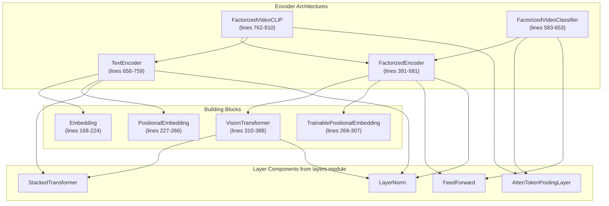
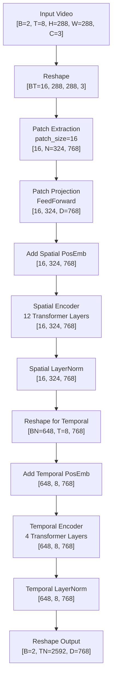
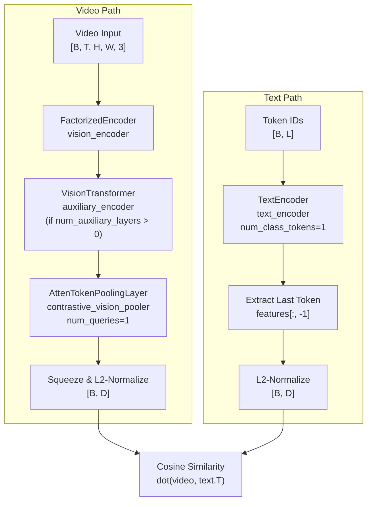

<!-- source: DeepWiki mcp.deepwiki.com · repo google-deepmind/videoprism · page 4.2 Encoder Architectures · fetched 2026-10-26 -->

# Encoder Architectures

<details>
<summary>Relevant source files</summary>

The following files were used as context for generating this wiki page:

- [videoprism/encoders.py](videoprism/encoders.py)
- [videoprism/encoders_test.py](videoprism/encoders_test.py)

</details>


## Purpose and Scope

This page provides an overview of the neural network encoder architectures implemented in VideoPrism. These encoders transform raw video frames and text into dense embedding representations for downstream tasks. The page covers the architecture designs, common building blocks, and data flow patterns shared across the encoder implementations.

For detailed documentation of individual encoders, see:
- [FactorizedEncoder](#4.2.1) - Video-only encoder with factorized spatial-temporal processing
- [FactorizedVideoCLIP](#4.2.2) - Video-text contrastive learning model
- [TextEncoder](#4.2.3) - Text sequence encoder

For information on how to instantiate and use these encoders, see [Model Management System](#4.1). For the underlying transformer components, see [Layer Components](#4.3).

## Architecture Overview

VideoPrism implements four main encoder architectures, all defined in [videoprism/encoders.py](). These architectures share common design patterns but serve different purposes:

| Encoder Class | Purpose | Input | Output | Key Features |
|---------------|---------|-------|--------|--------------|
| `FactorizedEncoder` | Video feature extraction | Video frames `[B, T, H, W, 3]` | Spatiotemporal embeddings `[B, T*N, D]` | Factorized spatial-temporal processing, no classification head |
| `FactorizedVideoCLIP` | Video-text contrastive learning | Video frames + text tokens | Video embeddings `[B, D]`, text embeddings `[B, D]` | Contrastive embeddings, L2-normalized, attention pooling |
| `FactorizedVideoClassifier` | Video classification | Video frames `[B, T, H, W, 3]` | Class logits `[B, num_classes]` | Built on `FactorizedEncoder`, adds attention pooling + projection head |
| `TextEncoder` | Text sequence encoding | Token IDs `[B, L]` | Token features `[B, L, D]` | CoCa-style, optional causal attention, class tokens |

**Sources:** [videoprism/encoders.py:391-910]()

## Component Hierarchy

The following diagram shows how encoder classes are composed from building blocks:



**Sources:** [videoprism/encoders.py:168-910]()

## Common Building Blocks

### Embedding Layers

Three embedding layer implementations provide different strategies for converting discrete indices to continuous vectors:

**`Embedding`** [videoprism/encoders.py:168-224]() - Basic vocabulary embedding with two lookup styles:
- `lookup_style='index'`: Direct indexing (faster)
- `lookup_style='matmul'`: Matrix multiplication via one-hot encoding
- Optional `scale_sqrt_depth` multiplies embeddings by √D
- Optional `set_nan_for_oob_id` marks out-of-bounds indices

**`PositionalEmbedding`** [videoprism/encoders.py:227-266]() - Sinusoidal positional encoding:
- Generates position embeddings without learned parameters
- Uses geometric series of sine/cosine frequencies
- Configurable `min_timescale` and `max_timescale` (default 1 to 10,000)

**`TrainablePositionalEmbedding`** [videoprism/encoders.py:269-307]() - Learned positional embedding:
- Trainable parameters up to `max_seq_length`
- Used in `FactorizedEncoder` for spatial and temporal positions
- Supports dynamic sequence lengths via slicing

**Sources:** [videoprism/encoders.py:168-307]()

### VisionTransformer

The `VisionTransformer` class [videoprism/encoders.py:310-388]() is a lightweight wrapper around `StackedTransformer` from the layers module. It provides a standard Vision Transformer (ViT) implementation with:

- Configurable number of transformer layers (`num_tfm_layers`)
- Multi-head self-attention (`num_heads`)
- Feed-forward networks with configurable hidden dimension (`mlp_dim`)
- Dropout controls for attention, residual, and FFN layers
- Normalization policy options: `'pre'`, `'post'`, `'primer_hybrid'`, `'post_skip'`
- Optional `nn.scan` for memory-efficient training
- Optional attention logit capping via `atten_logit_cap`

The class accepts sequences of embeddings `[B, N, D]` with optional padding masks and applies transformer layers to produce output features of the same shape.

**Sources:** [videoprism/encoders.py:310-388]()

## Factorized Spatial-Temporal Processing

The core innovation in VideoPrism's video encoders is the **factorized approach** that separates spatial and temporal processing. This design is based on the ViViT paper and implemented in `FactorizedEncoder`.

### Architecture Pattern

```mermaid
graph LR
    subgraph "Input Processing"
        INPUT["Video Input<br/>[B, T, H, W, 3]"]
        RESHAPE["Reshape to<br/>[B*T, H, W, 3]"]
        PATCH["_image_to_patch()<br/>[B*T, N, P²*C]"]
        PROJ["FeedForward<br/>patch_projection<br/>[B*T, N, D]"]
    end
    
    subgraph "Spatial Processing"
        SPADD["Add spatial_pos_emb<br/>TrainablePositionalEmbedding"]
        SPENC["VisionTransformer<br/>spatial_encoder<br/>[B*T, N, D]"]
        SPLN["LayerNorm<br/>spatial_ln"]
    end
    
    subgraph "Temporal Processing"
        RESHAPE2["Reshape to<br/>[B*N, T, D]"]
        TEMPADD["Add temporal_pos_emb<br/>TrainablePositionalEmbedding"]
        TEMPENC["VisionTransformer<br/>temporal_encoder<br/>[B*N, T, D]"]
        TEMPLN["LayerNorm<br/>temporal_ln"]
        RESHAPE3["Reshape to<br/>[B, T*N, D]"]
    end
    
    INPUT --> RESHAPE
    RESHAPE --> PATCH
    PATCH --> PROJ
    PROJ --> SPADD
    SPADD --> SPENC
    SPENC --> SPLN
    SPLN --> RESHAPE2
    RESHAPE2 --> TEMPADD
    TEMPADD --> TEMPENC
    TEMPENC --> TEMPLN
    TEMPLN --> RESHAPE3
```



**Sources:** [videoprism/encoders.py:391-581]()

### Key Implementation Details

**Patch Extraction** [videoprism/encoders.py:439-447]()
- `_image_to_patch()` converts images to patches using `einops.rearrange`
- For patch size P, converts `[B*T, H, W, C]` → `[B*T, (H/P)*(W/P), P²*C]`
- Validates that height and width are multiples of patch size

**Position Embedding Interpolation** [videoprism/encoders.py:107-165]()
- `_interpolate_emb_2d()` for spatial positions: adapts to different image resolutions
- `_interpolate_emb_1d()` for temporal positions: adapts to different frame counts
- Uses bilinear interpolation via `jax.image.resize`
- Critical for handling variable input sizes at inference

**Factorized Processing Order**:
1. **Spatial Stage** [videoprism/encoders.py:517-531](): Process each frame independently across spatial patches
2. **Reshape** [videoprism/encoders.py:535-540](): Reorganize from `(B*T, N, D)` to `(B*N, T, D)`
3. **Temporal Stage** [videoprism/encoders.py:556-569](): Process each spatial location independently across time
4. **Reshape** [videoprism/encoders.py:570-572](): Flatten back to `(B, T*N, D)`

This factorization reduces computational complexity compared to joint space-time attention while maintaining modeling capacity.

**Sources:** [videoprism/encoders.py:70-581]()

## Encoder Architecture Details

### FactorizedEncoder

The `FactorizedEncoder` [videoprism/encoders.py:391-581]() is the core video encoding architecture used by both video-only and video-text models.

**Key Parameters:**
- `patch_size`: Spatial patch dimension (default 18)
- `pos_emb_shape`: Pretrained position embedding shape `(T, H, W)` for interpolation
- `model_dim`: Model hidden dimension (768 for Base, 1024 for Large)
- `num_spatial_layers`: Transformer layers in spatial encoder (default 12)
- `num_temporal_layers`: Transformer layers in temporal encoder (default 4)
- `num_heads`: Attention heads (12 for Base, 16 for Large)
- `mlp_dim`: Feed-forward hidden dimension (default 3072)

**Method Signatures:**
- `__call__(inputs, train, return_intermediate, frame_paddings)` - Main entry point for video tensors
- `encode_with_patches(patches, image_shape, train, return_intermediate, patches_paddings)` - Lower-level interface accepting pre-extracted patches

**Outputs:**
- Primary: Spatiotemporal embeddings `[B, T*N, D]`
- Optional (via `return_intermediate`): `spatial_features` before temporal encoding

For complete details, see [FactorizedEncoder](#4.2.1).

**Sources:** [videoprism/encoders.py:391-581]()

### FactorizedVideoCLIP

The `FactorizedVideoCLIP` [videoprism/encoders.py:762-910]() combines a factorized vision encoder with a text encoder for contrastive video-text learning.

**Architecture Components:**
1. **Vision Encoder**: `FactorizedEncoder` instance named `'vision_encoder'`
2. **Auxiliary Encoder** (optional): Additional `VisionTransformer` layers for refinement
3. **Vision Pooler**: `AttenTokenPoolingLayer` named `'contrastive_vision_pooler'` with single query
4. **Text Encoder**: `TextEncoder` instance named `'text_encoder'`

**Key Parameters:**
- Video parameters: `patch_size`, `pos_emb_shape`, `num_spatial_layers`, `num_temporal_layers`
- Text parameters: `vocabulary_size`, `num_unimodal_layers`, `enable_causal_atten`
- Shared: `model_dim`, `num_heads`, `mlp_dim`, `atten_logit_cap`
- `num_auxiliary_layers`: Additional transformer layers after factorized encoding (default 0)

**Method Signature:**
```
__call__(inputs, text_token_ids, text_paddings, train, normalize, return_intermediate, frame_paddings)
```

**Outputs:**
- `video_embeddings`: L2-normalized video embeddings `[B, D]` (if `inputs` provided)
- `text_embeddings`: L2-normalized text embeddings `[B, D]` (if `text_token_ids` provided)
- `outputs` dict: Optional intermediate features including `spatial_features`, `spatiotemporal_features`, `frame_embeddings`

The `normalize` parameter (default `True`) applies L2-normalization via `_l2_normalize()` [videoprism/encoders.py:50-67]() to both modalities for cosine similarity computation.

For complete details, see [FactorizedVideoCLIP](#4.2.2).

**Sources:** [videoprism/encoders.py:762-910]()

### FactorizedVideoClassifier

The `FactorizedVideoClassifier` [videoprism/encoders.py:583-653]() wraps `FactorizedEncoder` with classification layers for supervised video understanding tasks.

**Architecture Flow:**
1. `FactorizedEncoder` named `'encoder'` produces spatiotemporal features `[B, T*N, D]`
2. `AttenTokenPoolingLayer` named `'atten_pooler'` aggregates to single embedding `[B, D]`
3. `FeedForward` named `'projection'` projects to class logits `[B, num_classes]`

**Parameters:**
- `encoder_params`: Dict passed to `FactorizedEncoder` constructor
- `num_classes`: Number of output classes

**Outputs:**
- `logits`: Classification logits `[B, num_classes]`
- `outputs` dict: Optional intermediate features including `spatial_features`, `spatiotemporal_features`, `global_embeddings`

The attention pooling layer uses learnable queries to aggregate variable-length sequences, making it suitable for videos with different numbers of frames.

**Sources:** [videoprism/encoders.py:583-653]()

### TextEncoder

The `TextEncoder` [videoprism/encoders.py:656-759]() implements a CoCa-style transformer for processing text sequences.

**Key Features:**
- Token embedding with vocabulary lookup
- Sinusoidal positional embeddings (non-trainable)
- Optional learnable class tokens appended to sequence
- Configurable causal or bidirectional attention
- Transformer stack with configurable depth

**Parameters:**
- `vocabulary_size`: Token vocabulary size (default 128, actual models use ~32k)
- `num_class_tokens`: Learnable tokens appended to sequence (0 or 1)
- `enable_causal_atten`: Whether to use causal masking (default `True`)
- `model_dim`, `num_layers`, `mlp_dim`, `num_heads`: Architecture dimensions
- `enable_per_dim_scale`: Whether to scale attention by 1/√d per dimension

**Processing Flow:**
1. Token IDs → `Embedding` lookup (`'token_emb'`)
2. Add `PositionalEmbedding` (`'pos_emb'`)
3. Optionally concatenate class tokens (`'cls_emb'`)
4. Pass through `StackedTransformer` (`'unimodal_transformer'`)
5. Apply final `LayerNorm` (`'unimodal_ln'`)

**Output:** Token-level features `[B, L+num_class_tokens, D]`

In `FactorizedVideoCLIP`, the last token (class token at position `-1`) is extracted as the global text embedding for contrastive learning.

For complete details, see [TextEncoder](#4.2.3).

**Sources:** [videoprism/encoders.py:656-759]()

## Data Flow Examples

### Video-Only Encoding

The following diagram traces data shapes through `FactorizedEncoder`:



**Sources:** [videoprism/encoders.py:434-572]()

### Video-Text Contrastive Encoding

The following shows dual-modality processing in `FactorizedVideoCLIP`:



**Sources:** [videoprism/encoders.py:820-908]()

## Helper Functions

The encoder module includes utility functions for common operations:

**`_contains(collection, key)`** [videoprism/encoders.py:36-47]()
- Checks if a collection contains a key, or returns boolean if `collection` is bool
- Used to parse `return_intermediate` parameter (bool or set of strings)

**`_l2_normalize(x, axis, epsilon)`** [videoprism/encoders.py:50-67]()
- L2-normalizes array along specified axis
- Always converts to float32 for stability
- Used for contrastive embeddings in `FactorizedVideoCLIP`

**`_image_to_patch(inputs, patch_size)`** [videoprism/encoders.py:70-104]()
- Converts image `[B, H, W, C]` to patches `[B, N, P²*C]`
- Uses `einops.rearrange` for efficient tensor reshaping
- Validates dimensions are multiples of patch size

**`_interpolate_emb_1d(emb, target_emb_length)`** [videoprism/encoders.py:107-128]()
- Interpolates 1D positional embedding to new length
- Uses `jax.image.resize` with bilinear interpolation
- Used for temporal position embeddings

**`_interpolate_emb_2d(emb, source_emb_shape, target_emb_shape)`** [videoprism/encoders.py:131-165]()
- Interpolates 2D positional embedding to new spatial shape
- Reshapes, resizes, and flattens back to sequence
- Used for spatial position embeddings

**Sources:** [videoprism/encoders.py:36-165]()

## Testing

Comprehensive tests in [videoprism/encoders_test.py]() validate encoder implementations:

| Test | Coverage | Key Validations |
|------|----------|-----------------|
| `test_embedding_layer` | `Embedding` class | Output shape, parameter count |
| `test_positional_embedding_layer` | `PositionalEmbedding` | Zero parameters, correct shape |
| `test_trainable_positional_embedding_layer` | `TrainablePositionalEmbedding` | Trainable parameters, matmul lookup |
| `test_vision_transformer` | `VisionTransformer` | Scan mode, train mode, parameter count |
| `test_factorized_encoder` | `FactorizedEncoder` | Spatial/temporal processing, intermediate outputs, frame padding |
| `test_factorized_video_classifier` | `FactorizedVideoClassifier` | Classification output, intermediate features |
| `test_text_encoder` | `TextEncoder` | Causal attention, class tokens, padding |
| `test_factorized_video_clip` | `FactorizedVideoCLIP` | Dual-modality encoding, normalization, selective intermediate returns |

Tests use `chex.variants` for JIT/non-JIT execution and parameterized testing for different configurations (scan, train mode, return_intermediate options).

**Sources:** [videoprism/encoders_test.py:26-375]()

---

