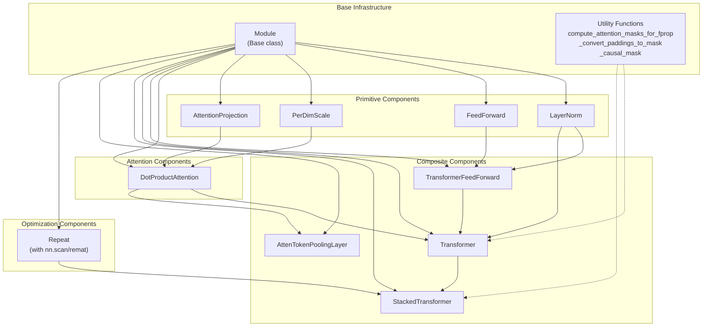
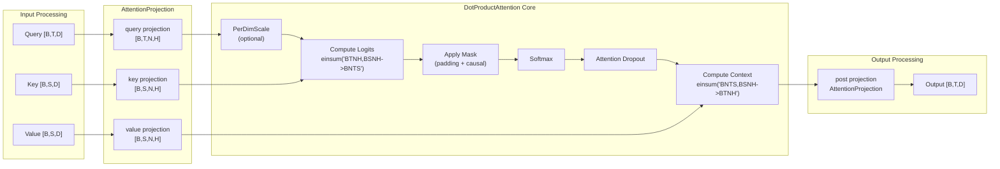
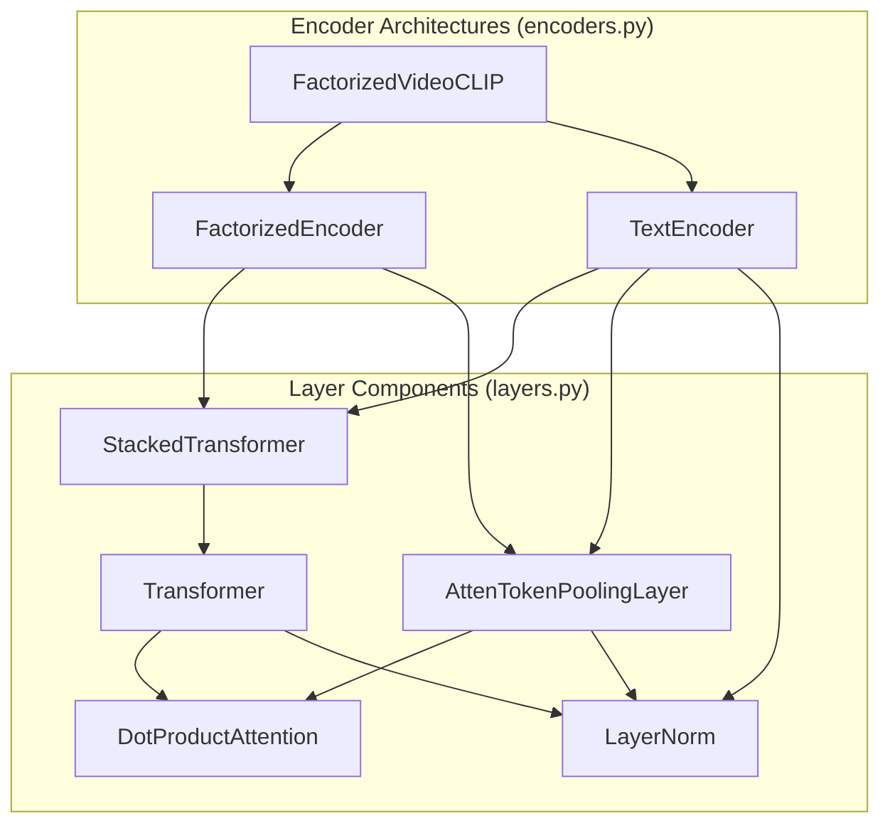

<!-- source: DeepWiki mcp.deepwiki.com · repo google-deepmind/videoprism · page 4.3 Layer Components · fetched 2026-10-26 -->

# Layer Components

<details>
<summary>Relevant source files</summary>

The following files were used as context for generating this wiki page:

- [videoprism/layers.py](videoprism/layers.py)
- [videoprism/layers_test.py](videoprism/layers_test.py)

</details>


This page documents the building block layers in VideoPrism, which are reusable Transformer components implemented in Flax. These layers form the foundation for the encoder architectures described in [Encoder Architectures](#4.2).

For information about the complete encoder models that use these layers, see [Encoder Architectures](#4.2). For the API reference, see [videoprism.layers](#6.3).

**Sources:** [videoprism/layers.py:1-1137]()

## Overview

The `videoprism.layers` module provides a collection of neural network primitives built on Flax/JAX. All components inherit from a base `Module` class that handles dtype management for mixed-precision training. The module includes:

- **Normalization**: `LayerNorm` with configurable scale/bias options
- **Feed-forward networks**: `FeedForward` and `TransformerFeedForward` with residual connections
- **Attention mechanisms**: `DotProductAttention` with multi-head support
- **Composite layers**: `Transformer` and `StackedTransformer` blocks
- **Pooling**: `AttenTokenPoolingLayer` for token aggregation
- **Utilities**: Masking functions and activation helpers

**Sources:** [videoprism/layers.py:15-32]()

## Component Hierarchy



**Sources:** [videoprism/layers.py:182-1137]()

## Base Module Class

### Module

The `Module` class serves as the base for all layer components, providing dtype management for mixed-precision training.

| Attribute | Type | Description |
|-----------|------|-------------|
| `dtype` | `jnp.dtype` | Default dtype for all variables (default: `float32`) |
| `fprop_dtype` | `jnp.dtype` | Activations dtype to use during forward propagation (default: `float32`) |

The `_cast_to_fprop_dtype` method automatically converts values to the desired computation dtype, enabling efficient mixed-precision training where parameters are stored in one dtype but computations happen in another.

**Sources:** [videoprism/layers.py:182-206]()

## Normalization Components

### LayerNorm

Implements layer normalization with configurable scaling and bias.

| Attribute | Type | Default | Description |
|-----------|------|---------|-------------|
| `direct_scale` | `bool` | `False` | Apply scale directly without +1.0; var initialized to 1.0 when True |
| `epsilon` | `float` | `1e-6` | Small value to prevent division by zero in rsqrt |
| `use_scale` | `bool` | `True` | Whether to use learned scaling parameter |
| `use_bias` | `bool` | `True` | Whether to use learned bias parameter |
| `reductions_in_fp32` | `bool` | `False` | Compute mean/variance in fp32 for stable training |

The layer computes: `(inputs - mean) / sqrt(variance + epsilon)`, then optionally applies learned scale and bias parameters.

**Sources:** [videoprism/layers.py:208-271](), [videoprism/layers_test.py:36-48]()

## Feed-Forward Components

### FeedForward

A single linear projection layer with optional activation function.

| Attribute | Type | Default | Description |
|-----------|------|---------|-------------|
| `output_dim` | `int` | `0` | Output dimension |
| `has_bias` | `bool` | `True` | Whether to include bias weights |
| `activation_fn` | `ActivationFunc` | `nn.relu` | Activation function to apply |
| `weight_init` | `Initializer` | `lecun_normal()` | Weight initialization function |
| `bias_init` | `Initializer` | `zeros_init()` | Bias initialization function |

**Sources:** [videoprism/layers.py:273-314](), [videoprism/layers_test.py:51-63]()

### TransformerFeedForward

A two-layer feed-forward network with residual connection, dropout, and flexible normalization policies.

| Attribute | Type | Default | Description |
|-----------|------|---------|-------------|
| `output_dim` | `int` | `0` | Output dimension (uses input_dim if 0) |
| `hidden_dim` | `int` | `0` | Hidden layer dimension |
| `has_bias` | `bool` | `True` | Whether to use bias in linear layers |
| `activation_fn` | `ActivationFunc` | `nn.relu` | Activation function |
| `residual_dropout_prob` | `float` | `0.0` | Dropout probability for residual connection |
| `relu_dropout_prob` | `float` | `0.0` | Dropout probability after activation |
| `add_skip_connection` | `bool` | `True` | Whether to add residual connection |
| `residual_weight` | `float` | `1.0` | Scaling factor for residual |
| `norm_policy` | `str` | `'pre'` | Normalization policy: `'pre'`, `'post'`, `'post_skip'`, `'primer_hybrid'` |

**Normalization Policies:**
- `'pre'`: LayerNorm before FFN
- `'post'`: LayerNorm after FFN, before residual
- `'post_skip'`: LayerNorm after residual connection
- `'primer_hybrid'`: LayerNorm both before and after FFN

**Sources:** [videoprism/layers.py:316-431](), [videoprism/layers_test.py:67-88]()

## Attention Components

### Attention Data Flow



**Sources:** [videoprism/layers.py:530-747]()

### AttentionProjection

Performs multi-head projection for queries, keys, values, or output.

| Attribute | Type | Description |
|-----------|------|-------------|
| `output_dim` | `int` | Input dimension (for output projection) |
| `num_heads` | `int` | Number of attention heads |
| `dim_per_head` | `int` | Dimension of each head |
| `is_output_projection` | `bool` | If True: `[...,N,H] -> [...,D]`, else: `[...,D] -> [...,N,H]` |
| `use_bias` | `bool` | Whether to include bias |

The projection uses einsum operations:
- Forward: `"...D,DNH->...NH"` (query/key/value)
- Backward: `"...NH,DNH->...D"` (output projection)

**Sources:** [videoprism/layers.py:433-500](), [videoprism/layers_test.py:91-122]()

### PerDimScale

Applies learned per-dimension scaling with softplus normalization.

The layer computes: `inputs * (r_softplus_0 / sqrt(dim)) * softplus(per_dim_scale)`, where `r_softplus_0 = 1.442695041` is the reciprocal of `softplus(0.0)`.

**Sources:** [videoprism/layers.py:502-528](), [videoprism/layers_test.py:125-137]()

### DotProductAttention

Multi-head dot-product attention mechanism.

| Attribute | Type | Default | Description |
|-----------|------|---------|-------------|
| `hidden_dim` | `int` | `0` | Number of hidden nodes |
| `num_heads` | `int` | `1` | Number of attention heads |
| `dim_per_head` | `int \| None` | `None` | Dimension per head (defaults to `hidden_dim // num_heads`) |
| `atten_dropout_prob` | `float` | `0.0` | Attention weight dropout probability |
| `use_bias` | `bool` | `True` | Whether to use bias in projections |
| `internal_enable_query_scale` | `bool` | `True` | Enable query vector scaling |
| `internal_enable_per_dim_scale` | `bool` | `True` | Enable per-dimension scaling |
| `scale_query_by_dim_per_head` | `bool` | `False` | Scale query by `dim_per_head` instead of `hidden_dim // num_heads` |
| `scale_logits_by_head_dims` | `bool` | `False` | Apply `1/sqrt(head_dim)` scaling to logits |
| `atten_logit_cap` | `float` | `0.0` | Cap logits with tanh (disabled if ≤ 0) |
| `use_qk_norm` | `bool` | `False` | Apply LayerNorm to queries and keys |

**Attention Computation:**
1. Project inputs to queries, keys, values: `[B,T,D] -> [B,T,N,H]`
2. Scale queries (if enabled)
3. Compute logits: `einsum('BTNH,BSNH->BNTS', query, key)`
4. Apply masking and logit capping
5. Apply softmax (always in fp32)
6. Apply attention dropout
7. Compute weighted values: `einsum('BNTS,BSNH->BTNH', probs, value)`
8. Project output: `[B,T,N,H] -> [B,T,D]`

**Sources:** [videoprism/layers.py:530-747](), [videoprism/layers_test.py:140-185]()

## Composite Components

### Transformer

A complete Transformer layer combining self-attention and feed-forward network.

| Attribute | Type | Default | Description |
|-----------|------|---------|-------------|
| `hidden_dim` | `int` | `0` | FFN hidden dimension |
| `num_heads` | `int` | `0` | Number of attention heads |
| `dim_per_head` | `int \| None` | `None` | Dimension per head |
| `atten_dropout_prob` | `float` | `0.0` | Attention dropout probability |
| `residual_dropout_prob` | `float` | `0.0` | Residual dropout probability |
| `relu_dropout_prob` | `float` | `0.0` | FFN activation dropout probability |
| `norm_policy` | `str` | `'pre'` | Normalization policy |
| `use_bias` | `bool` | `True` | Whether to use bias |
| `activation_fn` | `ActivationFunc` | `nn.relu` | Activation function |
| `internal_enable_per_dim_scale` | `bool` | `True` | Enable per-dim scaling in attention |
| `atten_logit_cap` | `float` | `0.0` | Attention logit capping value |

**Layer Structure:**
```
Input [B,T,H]
  ↓
[Optional: Pre-LayerNorm]
  ↓
DotProductAttention (self-attention)
  ↓
[Optional: Post-LayerNorm]
  ↓
Residual Dropout + Skip Connection
  ↓
[Optional: Post-Skip LayerNorm]
  ↓
TransformerFeedForward
  ↓
Output [B,T,H]
```

**Sources:** [videoprism/layers.py:749-873](), [videoprism/layers_test.py:188-215]()

### StackedTransformer

A stack of `Transformer` layers with optional scan-based optimization.

| Attribute | Type | Default | Description |
|-----------|------|---------|-------------|
| `num_layers` | `int` | `0` | Number of Transformer layers |
| `hidden_dim` | `int` | `0` | FFN hidden dimension |
| `num_heads` | `int` | `0` | Number of attention heads |
| `dim_per_head` | `int \| None` | `None` | Dimension per head |
| `dropout_prob` | `float` | `0.0` | Default dropout (overridden by specific dropouts) |
| `atten_dropout_prob` | `float \| None` | `None` | Attention dropout (uses `dropout_prob` if None) |
| `residual_dropout_prob` | `float \| None` | `None` | Residual dropout (uses `dropout_prob` if None) |
| `relu_dropout_prob` | `float \| None` | `None` | FFN dropout (uses `dropout_prob` if None) |
| `input_dropout_prob` | `float` | `0.0` | Dropout applied to input |
| `norm_policy` | `str` | `'pre'` | Normalization policy |
| `use_bias` | `bool` | `True` | Whether to use bias |
| `activation_fn` | `ActivationFunc` | `nn.relu` | Activation function |
| `internal_enable_per_dim_scale` | `bool` | `True` | Enable per-dim scaling |
| `atten_logit_cap` | `float` | `0.0` | Attention logit capping |
| `enable_causal_atten` | `bool` | `False` | Enable causal masking |
| `scan` | `bool` | `False` | Use `nn.scan` for memory efficiency |

**Scan Optimization:** When `scan=True`, the stack uses `nn.scan` with `nn.remat` to reduce memory usage during training by recomputing activations instead of storing them. This significantly reduces memory footprint for deep stacks at the cost of additional computation.

**Sources:** [videoprism/layers.py:940-1042](), [videoprism/layers_test.py:218-249]()

### Repeat

Generic layer repeater with gradient checkpointing support.

| Attribute | Type | Default | Description |
|-----------|------|---------|-------------|
| `block_fn` | `Callable` | - | Function/module to repeat |
| `times` | `int` | `0` | Number of repetitions |
| `checkpoint_policy` | `str` | `'nothing_saveable'` | JAX checkpoint policy for `nn.remat` |

The `Repeat` layer uses `nn.scan` to efficiently apply the same function multiple times with parameter sharing across the scan dimension. Combined with `nn.remat`, it enables memory-efficient training of deep networks.

**Sources:** [videoprism/layers.py:875-938]()

### AttenTokenPoolingLayer

Learnable attention-based pooling that aggregates a sequence of tokens into a fixed number of output tokens.

| Attribute | Type | Default | Description |
|-----------|------|---------|-------------|
| `query_dim` | `int \| None` | `None` | Query dimension (defaults to input_dim) |
| `hidden_dim` | `int` | `0` | Hidden dimension for attention (defaults to 4 * input_dim if 0) |
| `num_heads` | `int` | `1` | Number of attention heads |
| `num_queries` | `int` | `1` | Number of pooled output tokens |
| `add_layer_norm` | `bool` | `True` | Apply LayerNorm to pooled output |
| `dropout_prob` | `float` | `0.0` | Dropout probability on pooled tokens |
| `use_qk_norm` | `bool` | `False` | Apply QK normalization in attention |
| `use_bias` | `bool` | `True` | Whether to use bias |
| `internal_enable_per_dim_scale` | `bool` | `True` | Enable per-dim scaling |

The layer learns `num_queries` query vectors as parameters, which attend over the input token sequence to produce a fixed number of pooled representations.

**Input:** `[B, T, H]` tokens  
**Output:** `[B, num_queries, H]` pooled tokens

**Sources:** [videoprism/layers.py:1044-1137](), [videoprism/layers_test.py:251-283]()

## Masking Utilities

The module provides several utility functions for creating and managing attention masks:

| Function | Description |
|----------|-------------|
| `compute_attention_masks_for_fprop` | Combines padding and causal masks for self-attention |
| `_convert_paddings_to_mask` | Converts binary paddings `[B,T]` to attention mask `[B,1,1,T]` |
| `_causal_mask` | Creates causal (autoregressive) mask `[1,1,T,T]` |
| `_merge_masks` | Merges two masks by taking minimum (most restrictive) |
| `_apply_mask_to_logits` | Applies floating-point mask to logits efficiently |
| `_get_large_negative_number` | Returns large negative value for given dtype (used in masking) |

**Mask Encoding:** Masks are represented as floating-point tensors where:
- `0.0` indicates the position is **valid** (not masked)
- Large negative values (≈ `-0.7 * dtype_max`) indicate the position is **masked**

This encoding allows masks to be added directly to attention logits before softmax.

**Sources:** [videoprism/layers.py:39-180]()

## Usage Patterns

### Creating a Transformer Stack

```python
# Example: Creating a 12-layer Transformer encoder
encoder = layers.StackedTransformer(
    num_layers=12,
    hidden_dim=3072,  # FFN hidden dimension (typically 4x model dimension)
    num_heads=12,
    dropout_prob=0.1,
    norm_policy='pre',  # Pre-LayerNorm (like BERT/GPT)
    activation_fn=layers.gelu,
    scan=True,  # Enable memory-efficient scanning
    dtype=jnp.float32,
    fprop_dtype=jnp.bfloat16,  # Mixed precision: bfloat16 activations
)

# Forward pass
outputs = encoder(
    inputs=video_tokens,  # [batch, seq_len, dim]
    paddings=padding_mask,  # [batch, seq_len]
    train=True,
)
```

### Custom Attention Pooling

```python
# Example: Pool video tokens into 4 global features
pooler = layers.AttenTokenPoolingLayer(
    num_queries=4,  # Number of output tokens
    num_heads=8,
    hidden_dim=2048,
    add_layer_norm=True,
    dropout_prob=0.1,
)

# Pool temporal tokens
global_features = pooler(
    tokens=frame_features,  # [batch, num_frames, dim]
    paddings=frame_paddings,  # [batch, num_frames]
    train=True,
)  # Output: [batch, 4, dim]
```

**Sources:** [videoprism/layers.py:1-1137](), [videoprism/layers_test.py:1-287]()

## Testing

The layer components are thoroughly tested in `videoprism/layers_test.py` with tests covering:

- Shape validation for all components
- Parameter counting to verify architecture
- Forward pass correctness
- Both training and inference modes
- JIT compilation compatibility
- Mixed precision dtype handling
- Scan-based and non-scan implementations

**Test Coverage:**

| Component | Test Function | Key Assertions |
|-----------|---------------|----------------|
| `LayerNorm` | `test_layer_norm` | Shape preservation, 2 parameters (scale, bias) |
| `FeedForward` | `test_feedforward_layer` | Output dimension, 2 parameters |
| `TransformerFeedForward` | `test_transformer_feedforward` | Residual connection, 6 parameters |
| `AttentionProjection` | `test_mhd_projection` | Multi-head reshaping, 2 parameters |
| `PerDimScale` | `test_per_dim_scale` | Per-dimension scaling, 1 parameter |
| `DotProductAttention` | `test_mha` | Attention shape, probability shape, 8-9 parameters |
| `Transformer` | `test_transformer_layer` | Combined attention+FFN, 17 parameters |
| `StackedTransformer` | `test_stacked_transformer_layer` | Scan vs non-scan equivalence |
| `AttenTokenPoolingLayer` | `test_atten_token_pooling_layer` | Token pooling, 12 parameters |

**Sources:** [videoprism/layers_test.py:1-287]()

## Component Usage in Encoders

The layer components are used extensively throughout the encoder architectures:



**Key Usage Patterns:**
- **FactorizedEncoder** uses `StackedTransformer` for spatial/temporal encoding and `AttenTokenPoolingLayer` for global feature extraction
- **TextEncoder** uses `StackedTransformer` for text token processing and `AttenTokenPoolingLayer` for sequence pooling
- All encoders rely on the `LayerNorm` and `DotProductAttention` primitives

**Sources:** [videoprism/layers.py:1-1137](), Referenced in [Encoder Architectures](#4.2)

---

