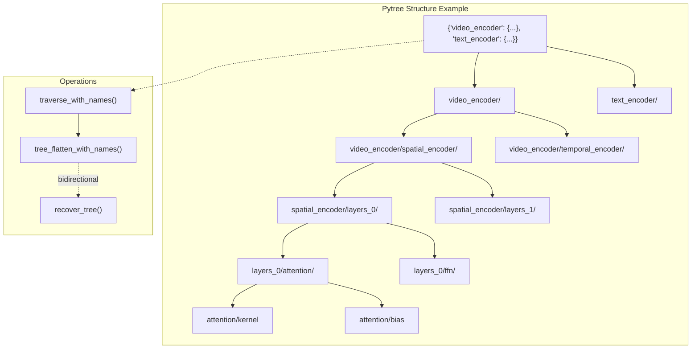
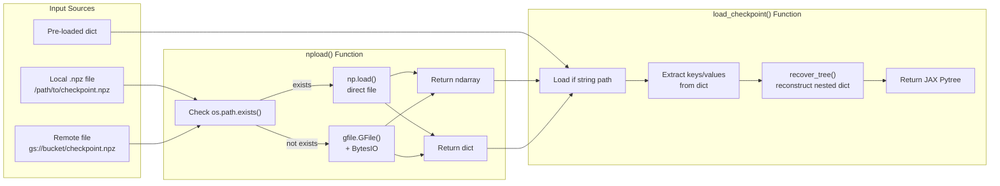
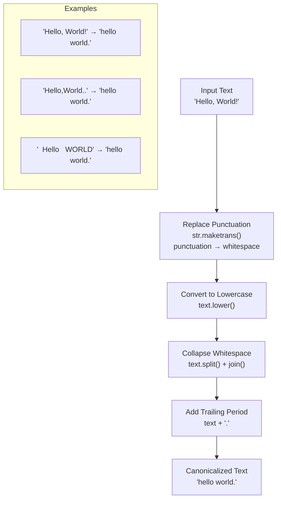
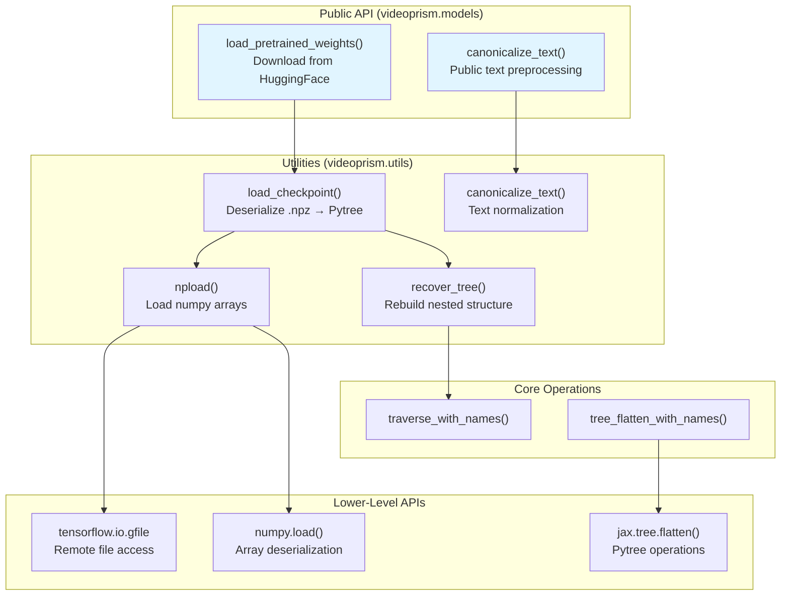

<!-- source: DeepWiki mcp.deepwiki.com · repo google-deepmind/videoprism · page 4.5 Utilities · fetched 2026-10-26 -->

# Utilities

<details>
<summary>Relevant source files</summary>

The following files were used as context for generating this wiki page:

- [videoprism/utils.py](videoprism/utils.py)
- [videoprism/utils_test.py](videoprism/utils_test.py)

</details>


## Purpose and Scope

The `videoprism.utils` module provides utility functions for three primary purposes: JAX Pytree manipulation, checkpoint loading, and text preprocessing. These utilities support the model management system ([4.1](#4.1)) by enabling deserialization of model parameters from `.npz` files and preparing text inputs for tokenization ([4.4](#4.4)).

This page documents the internal utility functions. For high-level model loading APIs, see [Model Management System](#4.1). For text tokenization workflows, see [Text Tokenization](#4.4).

**Sources:** [videoprism/utils.py:1-169]()

## Module Overview

The utilities module contains five core functions organized into three functional groups:

| Function Group | Functions | Purpose |
|----------------|-----------|---------|
| **Pytree Operations** | `traverse_with_names()`, `tree_flatten_with_names()`, `recover_tree()` | Navigate and transform nested dictionary structures with path-based naming |
| **Checkpoint Loading** | `npload()`, `load_checkpoint()` | Deserialize JAX Pytrees from `.npz` checkpoint files |
| **Text Processing** | `canonicalize_text()` | Normalize text strings for consistent tokenization |

These utilities operate at a lower level than the public APIs in `videoprism.models` and are primarily used internally by the framework.

**Sources:** [videoprism/utils.py:15-169]()

---

## JAX Pytree Operations

### Pytree Structure and Naming

VideoPrism stores model parameters as nested JAX Pytrees (dictionaries and sequences). The utilities module provides functions to traverse these structures while maintaining hierarchical path names using "/" as a separator.



**Diagram: JAX Pytree operations maintain hierarchical path names during traversal and flattening**

**Sources:** [videoprism/utils.py:28-103]()

### traverse_with_names()

The `traverse_with_names()` function recursively traverses nested dictionaries and sequences, yielding tuples of `(path_name, value)` where path names use "/" as separators.

**Function signature:**
```python
def traverse_with_names(tree, with_inner_nodes=False)
```

**Parameters:**
- `tree`: JAX Pytree object (nested dicts/sequences)
- `with_inner_nodes`: Whether to emit non-leaf nodes (default: `False`)

**Behavior:**
- Sorts dictionary keys for deterministic traversal [videoprism/utils.py:44]()
- Handles `None` values gracefully [videoprism/utils.py:41-42]()
- Yields `(path, value)` tuples where path is hierarchical (e.g., `"encoder/layer_0/attention/kernel"`)
- Returns a generator that can be iterated

**Example traversal output:**
```
"video_encoder/spatial/layers_0/attention/kernel" → ndarray(...)
"video_encoder/spatial/layers_0/attention/bias" → ndarray(...)
"video_encoder/spatial/layers_0/ffn/kernel" → ndarray(...)
```

**Sources:** [videoprism/utils.py:28-58]()

### tree_flatten_with_names()

The `tree_flatten_with_names()` function flattens a Pytree into a list of `(name, value)` pairs while preserving the correspondence with JAX's `tree.flatten()` ordering.

**Function signature:**
```python
def tree_flatten_with_names(tree) -> list[tuple[str, Any]]
```

**Algorithm:**
1. Flatten tree using `jax.tree.flatten()` to get values and tree definition [videoprism/utils.py:69]()
2. Create a token tree by unflattening sequential tokens [videoprism/utils.py:71-72]()
3. Traverse the token tree to extract names and permutation [videoprism/utils.py:73]()
4. Apply inverse permutation to match JAX's ordering [videoprism/utils.py:74]()
5. Return list of `(name, value)` pairs [videoprism/utils.py:79]()

The function includes an assertion to verify that custom traversal visits the same number of leaves as JAX's built-in traversal [videoprism/utils.py:77]().

**Sources:** [videoprism/utils.py:60-80]()

### recover_tree()

The `recover_tree()` function reconstructs nested dictionary structures from flat lists of path names and values, performing the inverse operation of flattening.

**Function signature:**
```python
def recover_tree(keys, values) -> dict
```

**Algorithm:**
1. Initialize empty tree dictionary and sub-trees collection [videoprism/utils.py:92-93]()
2. For each key-value pair:
   - If key has no "/", add directly to tree [videoprism/utils.py:95-96]()
   - Otherwise, split on first "/" and add to appropriate sub-tree [videoprism/utils.py:98-99]()
3. Recursively recover sub-trees [videoprism/utils.py:100-102]()

This enables deserialization from flat `.npz` file formats back into structured parameter dictionaries.

**Sources:** [videoprism/utils.py:82-103]()

---

## Checkpoint Loading

### Checkpoint Loading Pipeline

The checkpoint loading system deserializes model parameters from `.npz` files, supporting both local and remote (Google Cloud Storage) paths via TensorFlow's `gfile` API.



**Diagram: Checkpoint loading flow from file paths or dicts to JAX Pytrees**

**Sources:** [videoprism/utils.py:106-137]()

### npload()

The `npload()` function loads NumPy arrays from `.npz` files, handling both local and remote paths.

**Function signature:**
```python
def npload(fname) -> np.ndarray | dict
```

**Path handling:**
- **Local paths:** Uses `np.load()` directly if `os.path.exists(fname)` [videoprism/utils.py:109-110]()
- **Remote paths:** Uses TensorFlow's `gfile.GFile()` to read into memory, then wraps in `io.BytesIO` for NumPy [videoprism/utils.py:112-115]()
  - This approach is necessary because `np.load()` requires file seeks, which are not supported by all remote file systems

**Return value:**
- Single `.npy` files return `np.ndarray` [videoprism/utils.py:118-119]()
- `.npz` archives return `dict[str, np.ndarray]` [videoprism/utils.py:121]()

**Note:** The function explicitly disables pickle loading (`allow_pickle=False`) for security [videoprism/utils.py:110]().

**Sources:** [videoprism/utils.py:106-122]()

### load_checkpoint()

The `load_checkpoint()` function is the primary entry point for loading model parameters, converting flat `.npz` key-value pairs into nested Pytree structures.

**Function signature:**
```python
def load_checkpoint(npz) -> Pytree
```

**Parameters:**
- `npz`: Either a string path to `.npz` file or a pre-loaded dict

**Workflow:**
1. Load from file if string path provided [videoprism/utils.py:133-134]()
2. Extract all key-value pairs from dict [videoprism/utils.py:135]()
3. Call `recover_tree()` to reconstruct nested structure [videoprism/utils.py:136]()

**Usage in model system:**
This function is called by `videoprism.models.load_pretrained_weights()` after downloading checkpoints from HuggingFace Hub. The returned Pytree can be passed directly to `model.apply(params, ...)`.

**Sources:** [videoprism/utils.py:124-137]()

---

## Text Canonicalization

### Text Preprocessing Pipeline

The `canonicalize_text()` function standardizes text inputs to ensure consistent tokenization across different text formats. This is critical for the VideoCLIP models where text queries must match the preprocessing used during training.



**Diagram: Text canonicalization pipeline transforms raw text into standardized format**

**Sources:** [videoprism/utils.py:139-168](), [videoprism/utils_test.py:23-26]()

### canonicalize_text()

The `canonicalize_text()` function applies a four-step normalization process to text strings.

**Function signature:**
```python
def canonicalize_text(text: str) -> str
```

**Normalization steps:**

1. **Replace all punctuation with whitespace** [videoprism/utils.py:159-161]()
   - Uses `string.punctuation` constant (includes `!"#$%&'()*+,-./:;<=>?@[\]^_`{|}~`)
   - Applies `str.maketrans()` for efficient character replacement

2. **Convert to lowercase** [videoprism/utils.py:162-163]()
   - Ensures case-insensitive matching

3. **Collapse whitespace** [videoprism/utils.py:164-165]()
   - `text.split()` removes all whitespace and splits into words
   - `" ".join()` rejoins with single spaces

4. **Append period** [videoprism/utils.py:166-167]()
   - Ensures consistent sentence termination

**Examples:**

| Input | Output |
|-------|--------|
| `"Hello, World!"` | `"hello world."` |
| `"Hello,World.."` | `"hello world."` |
| `"  Hello   WORLD"` | `"hello world."` |

**Integration:**
This function is called by `videoprism.models.canonicalize_text()` which serves as the public API. The canonicalized text is then passed to the SentencePiece tokenizer.

**Sources:** [videoprism/utils.py:139-168](), [videoprism/utils_test.py:23-26]()

---

## Integration with Model Management System

The utilities module integrates with the broader VideoPrism architecture through the model management system and text processing pipeline.



**Diagram: Utilities module integration showing how public APIs depend on internal utility functions**

**Sources:** [videoprism/utils.py:1-169]()

### Checkpoint Loading Integration

The checkpoint loading flow through the system layers:

1. **User calls** `videoprism.models.load_pretrained_weights(model_id)` ([4.1](#4.1))
2. **Models module** downloads `.npz` from HuggingFace Hub via `hf_hub_download()`
3. **Models module** calls `utils.load_checkpoint(checkpoint_path)`
4. **Utils module** loads and deserializes the checkpoint, returning JAX Pytree
5. **User applies** parameters: `model.apply(params, inputs)`

This separation allows the model management system to focus on registry and download logic while delegating low-level deserialization to the utilities module.

**Sources:** [videoprism/utils.py:124-137]()

### Text Preprocessing Integration

The text canonicalization flow through the system layers:

1. **User provides** raw text strings (e.g., `"A person is riding a bicycle!"`)
2. **Models module** calls `videoprism.models.canonicalize_text()` wrapper
3. **Utils module** performs normalization returning `"a person is riding a bicycle."`
4. **Tokenizers module** ([4.4](#4.4)) encodes canonicalized text to token IDs
5. **Encoder module** processes tokens through TextEncoder ([4.2.3](#4.2.3))

This pipeline ensures that all text inputs receive consistent preprocessing regardless of entry point.

**Sources:** [videoprism/utils.py:139-168]()

---

## Usage Examples

### Loading a Checkpoint from Local Path

```python
from videoprism import utils

# Load checkpoint from local .npz file
params = utils.load_checkpoint("/path/to/checkpoint.npz")

# Access nested parameters
video_encoder_params = params['video_encoder']
attention_kernel = params['video_encoder']['layers_0']['attention']['kernel']
```

### Loading a Checkpoint from Remote Storage

```python
# Load from Google Cloud Storage
params = utils.load_checkpoint("gs://bucket/model_checkpoints/checkpoint.npz")

# The function automatically uses gfile for remote paths
```

### Working with Pytree Names

```python
# Flatten a parameter tree with names
named_params = utils.tree_flatten_with_names(params)

# Inspect parameter names and shapes
for name, value in named_params:
    print(f"{name}: {value.shape}")
# Output:
# video_encoder/layers_0/attention/kernel: (768, 768)
# video_encoder/layers_0/attention/bias: (768,)
# ...
```

### Canonicalizing Text

```python
# Prepare text for tokenization
raw_text = "A person is riding a bicycle!"
canonical = utils.canonicalize_text(raw_text)
# Result: "a person is riding a bicycle."

# Multiple texts
texts = ["Hello, World!", "Test-case: UPPER case"]
canonical_texts = [utils.canonicalize_text(t) for t in texts]
# Results: ["hello world.", "test case upper case."]
```

**Sources:** [videoprism/utils.py:1-169]()

---

## Testing

The utilities module includes comprehensive tests in [videoprism/utils_test.py](). The test suite validates:

### Text Canonicalization Tests

The `UtilsTest.test_canonicalize_text()` method verifies the canonicalization function with three test cases [videoprism/utils_test.py:23-26]():

| Input | Expected Output | Validates |
|-------|----------------|-----------|
| `"Hello, World!"` | `"hello world."` | Punctuation removal, lowercase, period |
| `"Hello,World.."` | `"hello world."` | Multiple punctuation, no space insertion |
| `"  Hello   WORLD"` | `"hello world."` | Whitespace collapse, uppercase handling |

These tests ensure that the canonicalization produces consistent output regardless of input formatting variations.

**Sources:** [videoprism/utils_test.py:21-30]()

---

## Summary

The `videoprism.utils` module provides foundational infrastructure for the VideoPrism framework:

- **Pytree operations** enable navigation and manipulation of nested parameter structures
- **Checkpoint loading** deserializes model weights from `.npz` files with support for local and remote storage
- **Text canonicalization** standardizes text inputs for consistent tokenization

These utilities are used internally by the model management system ([4.1](#4.1)) and text processing pipeline ([4.4](#4.4)), providing low-level operations that support high-level model loading and inference workflows.

**Sources:** [videoprism/utils.py:1-169](), [videoprism/utils_test.py:1-30]()

---

