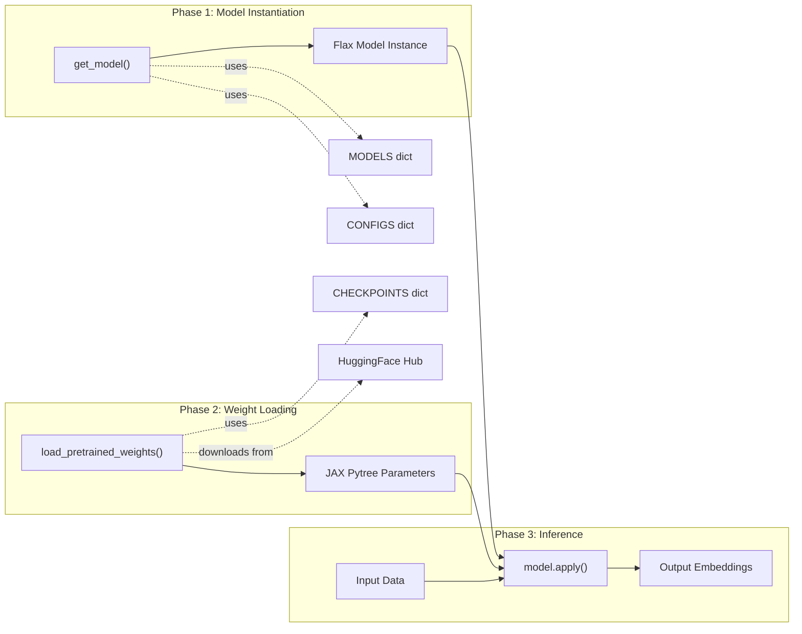
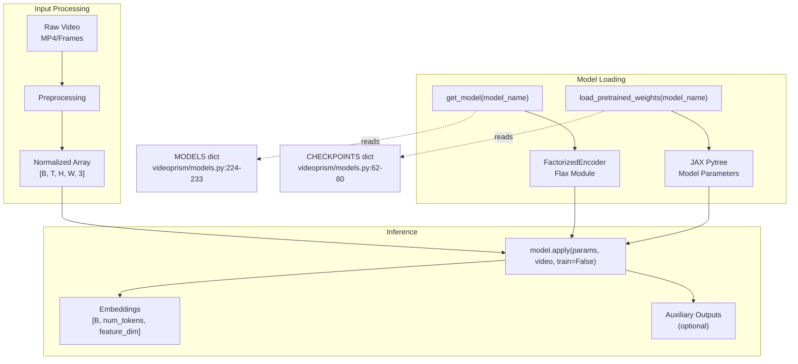
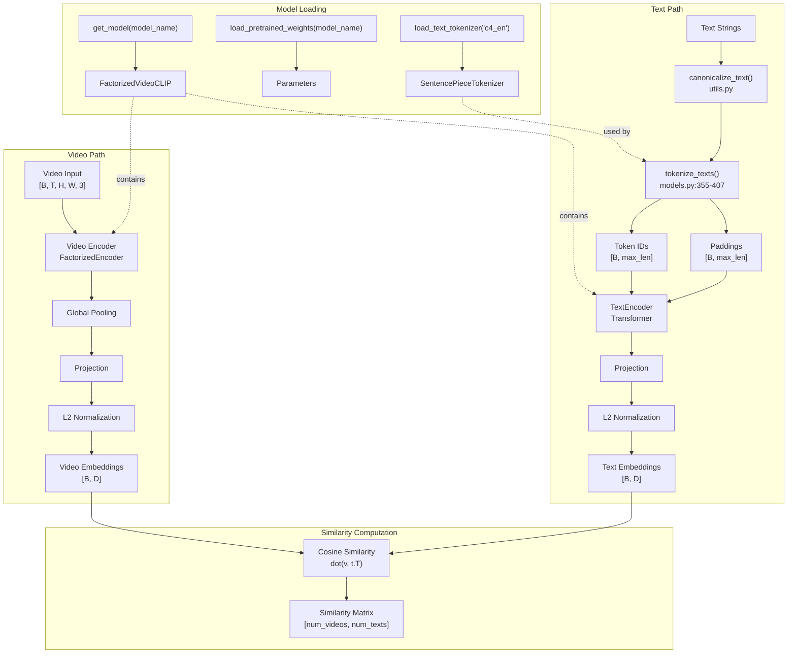
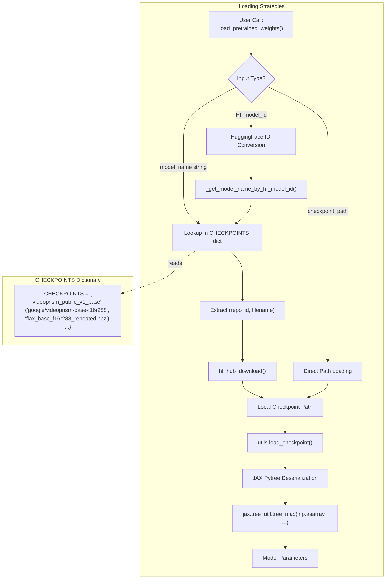
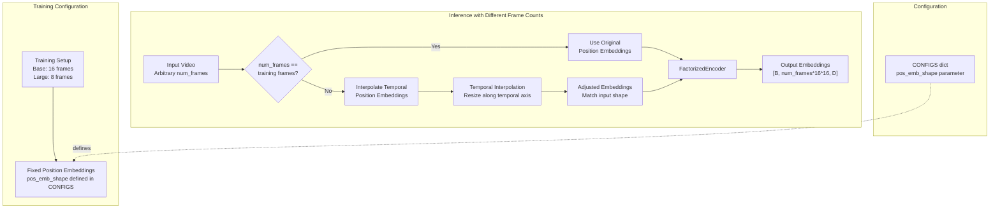

<!-- source: DeepWiki mcp.deepwiki.com · repo google-deepmind/videoprism · page 5 Usage Guide · fetched 2026-10-26 -->

# Usage Guide

<details>
<summary>Relevant source files</summary>

The following files were used as context for generating this wiki page:

- [README.md](README.md)
- [videoprism/colabs/videoprism_video_encoder_demo.ipynb](videoprism/colabs/videoprism_video_encoder_demo.ipynb)
- [videoprism/colabs/videoprism_video_text_demo.ipynb](videoprism/colabs/videoprism_video_text_demo.ipynb)
- [videoprism/models.py](videoprism/models.py)

</details>


## Purpose and Scope

This guide provides practical instructions for using VideoPrism models in various scenarios. It covers the complete workflow from model instantiation and checkpoint loading to inference for both video-only and video-text tasks.

For architectural details about the model implementations, see [Core Architecture](#4). For API reference documentation, see [API Reference](#6). For quick examples to get started, see [Quick Start with Demo Notebooks](#2.2).

---

## Basic Workflow Overview

The standard VideoPrism usage pattern follows a two-phase initialization followed by inference. Understanding this workflow is essential for all use cases.



**Workflow Diagram: Core VideoPrism Usage Pattern**

The separation between model instantiation and weight loading allows flexibility: you can create models with random initialization for training, or load different checkpoint versions into the same architecture.

**Sources:** [videoprism/models.py:268-304](), [videoprism/models.py:306-337](), [README.md:49-86]()

---

## Model Selection

VideoPrism provides four public model variants with different capabilities and sizes:

| Model Name | Configuration Key | Model Type | Parameters | Use Case |
|------------|------------------|------------|------------|----------|
| VideoPrism-B | `videoprism_public_v1_base` | Video-only | 114M | Video feature extraction, classification |
| VideoPrism-L | `videoprism_public_v1_large` | Video-only | 354M | Higher quality video features |
| VideoPrism-LvT-B | `videoprism_lvt_public_v1_base` | Video-text | 248M | Cross-modal retrieval, zero-shot classification |
| VideoPrism-LvT-L | `videoprism_lvt_public_v1_large` | Video-text | 580M | Higher quality cross-modal tasks |

The configuration keys are used with `get_model()` and `load_pretrained_weights()` functions. Video-only models use `FactorizedEncoder`, while video-text models use `FactorizedVideoCLIP` internally.

**Sources:** [videoprism/models.py:224-233](), [README.md:88-112]()

---

## Video Feature Extraction

### Overview

Video feature extraction uses video-only models (`videoprism_public_v1_base` or `videoprism_public_v1_large`) to encode videos into spatiotemporal embeddings. The output embeddings can be used for downstream tasks like classification, retrieval, or temporal localization.



**Workflow Diagram: Video Feature Extraction Pipeline**

### Input Requirements

Video inputs must satisfy these requirements:

| Requirement | Value | Notes |
|-------------|-------|-------|
| Shape | `[batch_size, num_frames, 288, 288, 3]` | Height and width must be 288 |
| Value range | `[0.0, 1.0]` | Normalized pixel values |
| Data type | `float32` or `bfloat16` | bfloat16 reduces memory usage |
| Aspect ratio | 1:1 | Videos must be center-cropped to square |

The `num_frames` dimension can vary at inference time through positional embedding interpolation (see [Working with Variable Frame Counts](#5.4)). Training uses 16 frames for Base models and 8 frames for Large models.

### Implementation Pattern

The typical implementation follows this pattern as shown in [videoprism/models.py:22-36]():

1. **Model instantiation:** Call `get_model(model_name)` to create the Flax module
2. **Weight loading:** Call `load_pretrained_weights(model_name)` to load pre-trained parameters
3. **JIT compilation:** Wrap inference in `@jax.jit` decorator for performance
4. **Forward pass:** Call `flax_model.apply(loaded_state, inputs, train=False)`

The `train=False` argument disables dropout and other training-specific behaviors. The function returns a tuple: `(embeddings, auxiliary_outputs)` where embeddings have shape `[batch_size, num_tokens, feature_dim]`.

### Output Format

The output embeddings have shape `[batch_size, num_frames * 16 * 16, feature_channels]` which represents a spatiotemporal grid. This can be reshaped to `[batch_size, num_frames, 16, 16, feature_channels]` for explicit spatial-temporal structure:

- **Spatial dimensions:** 16×16 grid per frame (from 288/18 patch size = 16)
- **Temporal dimension:** `num_frames` timesteps
- **Feature channels:** 768 for Base, 1024 for Large

The embeddings capture hierarchical spatiotemporal features processed by the `FactorizedEncoder` architecture's separate spatial and temporal transformer layers.

### Complete Example Reference

A complete working example is provided in [videoprism/colabs/videoprism_video_encoder_demo.ipynb:119-174](). The demo shows:

1. Video loading and preprocessing: [videoprism/colabs/videoprism_video_encoder_demo.ipynb:84-108]()
2. Model setup with optional bfloat16: [videoprism/colabs/videoprism_video_encoder_demo.ipynb:119-140]()
3. Feature extraction on example video: [videoprism/colabs/videoprism_video_encoder_demo.ipynb:159-174]()

**Sources:** [videoprism/models.py:15-36](), [videoprism/colabs/videoprism_video_encoder_demo.ipynb:119-174](), [README.md:53-63](), [README.md:99-106]()

---

## Video-Text Retrieval

### Overview

Video-text retrieval uses video-text models (`videoprism_lvt_public_v1_base` or `videoprism_lvt_public_v1_large`) to encode videos and text into a shared embedding space. The models use `FactorizedVideoCLIP` architecture which produces globally-pooled embeddings for both modalities that can be compared using cosine similarity.



**Architecture Diagram: Video-Text Contrastive Learning Pipeline**

### Text Processing Pipeline

Text inputs must be tokenized before being passed to the model. The pipeline consists of three stages:

1. **Text canonicalization** (optional): The `canonicalize_text()` function in [videoprism/utils.py]() normalizes text by:
   - Converting to lowercase
   - Removing punctuation and special characters
   - Standardizing whitespace

2. **Tokenization**: The `tokenize_texts()` function in [videoprism/models.py:355-407]() converts strings to integer token IDs:
   - Loads SentencePiece tokenizer via `load_text_tokenizer('c4_en')`
   - Applies canonicalization if `canonicalize=True` (default)
   - Adds beginning-of-sentence token if `add_bos` is True
   - Pads/truncates sequences to `max_length` (default 64)
   - Returns tuple of `(token_ids, paddings)` arrays

3. **Encoding**: The `TextEncoder` processes token sequences through transformer layers

### Required Function Signature

The video-text models require this specific call signature for `apply()`:

```
model.apply(params, video_inputs, text_token_ids, text_token_paddings, train=False)
```

Returns a tuple: `(video_embeddings, text_embeddings, auxiliary_outputs)`

- `video_embeddings`: Shape `[batch_size, feature_dim]` - globally pooled video features
- `text_embeddings`: Shape `[batch_size, feature_dim]` - globally pooled text features  
- `auxiliary_outputs`: Dictionary with additional model outputs

Both embedding types are L2-normalized and can be directly compared via dot product for cosine similarity.

### Similarity Computation

To compute similarities between N videos and M texts:

1. Encode videos to get embeddings of shape `[N, D]`
2. Encode texts to get embeddings of shape `[M, D]`
3. Compute similarity matrix: `similarity = video_embeddings @ text_embeddings.T`
4. Result has shape `[N, M]` where `similarity[i, j]` is the cosine similarity between video i and text j

The demo notebook provides a complete implementation in [videoprism/colabs/videoprism_video_text_demo.ipynb:127-156]().

### Inference Optimization

Either modality can be skipped during inference by passing `None`:

- **Video-only inference:** Pass `None` for `text_token_ids` and `text_token_paddings`
- **Text-only inference:** Pass `None` for `video_inputs`

This allows efficient batch processing when encoding large video or text datasets separately.

### Complete Example Reference

A complete working example is provided in [videoprism/colabs/videoprism_video_text_demo.ipynb:161-291](). The demo shows:

1. Text tokenization: [videoprism/colabs/videoprism_video_text_demo.ipynb:230-242]()
2. Joint encoding: [videoprism/colabs/videoprism_video_text_demo.ipynb:253-263]()
3. Similarity computation and ranking: [videoprism/colabs/videoprism_video_text_demo.ipynb:127-156](), [videoprism/colabs/videoprism_video_text_demo.ipynb:274-285]()

**Sources:** [videoprism/models.py:179-197](), [videoprism/models.py:339-407](), [videoprism/colabs/videoprism_video_text_demo.ipynb:161-291](), [README.md:65-86]()

---

## Loading Custom Checkpoints

### Loading Mechanisms

VideoPrism supports multiple checkpoint loading mechanisms through the `load_pretrained_weights()` function defined in [videoprism/models.py:306-337]().



**Checkpoint Loading Flow Diagram**

### Supported Input Formats

The `load_pretrained_weights()` function accepts three input formats:

| Input Type | Example | Description |
|------------|---------|-------------|
| Model name | `'videoprism_public_v1_base'` | Looks up in `CHECKPOINTS` dict and downloads from HuggingFace |
| HuggingFace ID | `'google/videoprism-base-f16r288'` | Converts to model name then proceeds as above |
| Local path | `'/path/to/checkpoint.npz'` | Loads directly from filesystem |

The implementation handles all three cases in [videoprism/models.py:322-337]().

### HuggingFace Hub Integration

The default checkpoints are hosted on HuggingFace Hub. The `CHECKPOINTS` dictionary in [videoprism/models.py:62-80]() maps model names to `(repo_id, filename)` tuples:

- **Repository ID:** The HuggingFace repository containing the checkpoint
- **Filename:** The specific checkpoint file within the repository

The `huggingface_hub.hf_hub_download()` function automatically downloads and caches checkpoints locally. Subsequent loads reuse the cached file.

### Custom Checkpoint Loading

To load a custom checkpoint from a local path:

```python
# Option 1: Specify checkpoint_path directly
params = vp.load_pretrained_weights(
    model_name=None, 
    checkpoint_path='/path/to/custom_checkpoint.npz'
)

# Option 2: Use custom checkpoints dictionary
custom_checkpoints = {
    'my_model': '/path/to/checkpoint.npz'
}
params = vp.load_pretrained_weights(
    model_name='my_model',
    checkpoints=custom_checkpoints
)
```

The checkpoint file must be in the format produced by `utils.load_checkpoint()`, which expects NumPy `.npz` files containing JAX Pytree structures.

### Checkpoint Format

Checkpoints are stored as NumPy `.npz` files containing a nested dictionary structure representing the Flax model parameters. The structure follows the Flax parameter tree hierarchy:

- Top-level keys correspond to model components (e.g., `'spatial_encoder'`, `'temporal_encoder'`)
- Nested dictionaries contain layer parameters
- Leaf nodes are NumPy arrays with parameter values

The `load_checkpoint()` function in [videoprism/utils.py]() handles deserialization and returns a JAX Pytree that matches the model's parameter structure.

**Sources:** [videoprism/models.py:306-337](), [videoprism/models.py:62-80](), [videoprism/models.py:236-253]()

---

## Working with Variable Frame Counts

### Position Embedding Interpolation

VideoPrism models support variable frame counts through temporal position embedding interpolation. Models are trained with fixed frame counts (16 for Base, 8 for Large) but can process videos with different lengths at inference time.



**Position Embedding Interpolation Diagram**

### Configuration Parameters

The `pos_emb_shape` parameter in the `CONFIGS` dictionary [videoprism/models.py:82-161]() defines the trained position embedding dimensions:

| Model | pos_emb_shape | Training Frames | Spatial Grid |
|-------|---------------|-----------------|--------------|
| Base | `(16, 16, 16)` | 16 | 16×16 per frame |
| Large | `(8, 16, 16)` | 8 | 16×16 per frame |
| Giant | `(8, 16, 16)` | 8 | 16×16 per frame |

The shape represents `(temporal_positions, height_positions, width_positions)`. The spatial dimensions (16×16) remain constant because they're determined by the patch size (18) and input resolution (288).

### How Interpolation Works

When processing a video with N frames different from the training frame count:

1. **Spatial embeddings:** No interpolation needed - always 16×16 grid from 288×288 input
2. **Temporal embeddings:** Interpolated from trained length to N frames using bilinear/trilinear interpolation
3. **Combined:** Spatiotemporal position embeddings are added to patch embeddings

The interpolation is handled automatically by the `FactorizedEncoder` implementation in the encoders module. No user action is required.

### Practical Guidelines

**Recommended frame counts:**
- For Base models: Use 8-32 frames for best results
- For Large models: Use 4-16 frames for best results
- Extreme deviations from training length may degrade performance

**Memory considerations:**
- Output token count scales linearly with frame count: `num_tokens = num_frames × 16 × 16`
- Base: 16 frames → 4096 tokens, Large: 8 frames → 2048 tokens
- Processing 32 frames doubles memory usage and compute time

**Input shape flexibility:**
```python
# All valid inputs for same model:
video_8frames = jnp.zeros([1, 8, 288, 288, 3])    # 2048 tokens
video_16frames = jnp.zeros([1, 16, 288, 288, 3])  # 4096 tokens
video_32frames = jnp.zeros([1, 32, 288, 288, 3])  # 8192 tokens

# All work with same model and weights
embeddings_8, _ = model.apply(params, video_8frames, train=False)
embeddings_16, _ = model.apply(params, video_16frames, train=False)
embeddings_32, _ = model.apply(params, video_32frames, train=False)
```

### Video-Text Model Considerations

For video-text models (`FactorizedVideoCLIP`), the variable frame count capability applies only to the video encoder component. The text encoder has a fixed maximum sequence length of 64 tokens defined by `TEXT_MAX_LEN` in [videoprism/models.py:54]().

When processing multiple videos with different frame counts in a batch, pad all videos to the same length for efficient computation.

**Sources:** [videoprism/models.py:82-161](), [README.md:99-106]()

---

## Performance Optimization

### Data Type Selection

VideoPrism supports both `float32` and `bfloat16` data types for inference:

| Data Type | Precision | Memory Usage | Speed | Use Case |
|-----------|-----------|--------------|-------|----------|
| `float32` | Full | 4 bytes/value | Baseline | Highest accuracy requirements |
| `bfloat16` | Reduced | 2 bytes/value | ~2× faster | Production inference with acceptable accuracy |

To use bfloat16, set the `fprop_dtype` parameter when calling `get_model()`:

```python
model = vp.get_model(model_name, fprop_dtype=jnp.bfloat16)
```

This is demonstrated in both demo notebooks at [videoprism/colabs/videoprism_video_encoder_demo.ipynb:130-131]() and [videoprism/colabs/videoprism_video_text_demo.ipynb:173-174]().

### JIT Compilation

All model forward passes should be wrapped with `@jax.jit` decorator for optimal performance:

```python
@jax.jit
def forward_fn(inputs):
    return flax_model.apply(loaded_state, inputs, train=False)
```

The JIT compiler traces the computation graph once and generates optimized machine code. The first call has compilation overhead, but subsequent calls execute much faster.

### Batch Processing

Process multiple videos in a batch by stacking them along the batch dimension:

```python
# Single video: [1, num_frames, 288, 288, 3]
# Batch of videos: [batch_size, num_frames, 288, 288, 3]

batch_videos = jnp.stack([video1, video2, video3], axis=0)
batch_embeddings, _ = forward_fn(batch_videos)
```

Larger batch sizes improve GPU/TPU utilization but require more memory.

**Sources:** [videoprism/colabs/videoprism_video_encoder_demo.ipynb:126-137](), [videoprism/colabs/videoprism_video_text_demo.ipynb:169-187](), [videoprism/models.py:301-303]()

---

