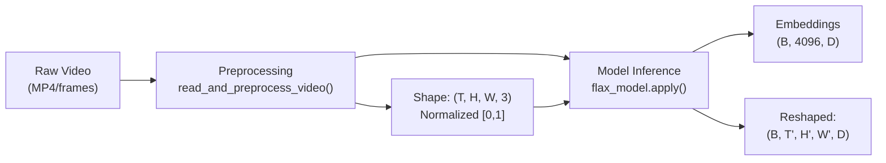
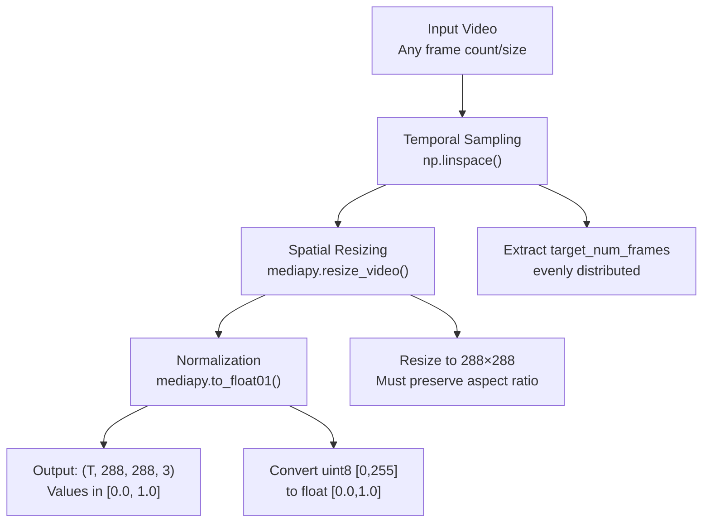
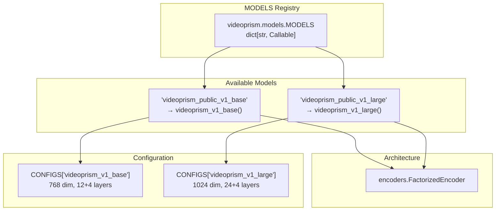
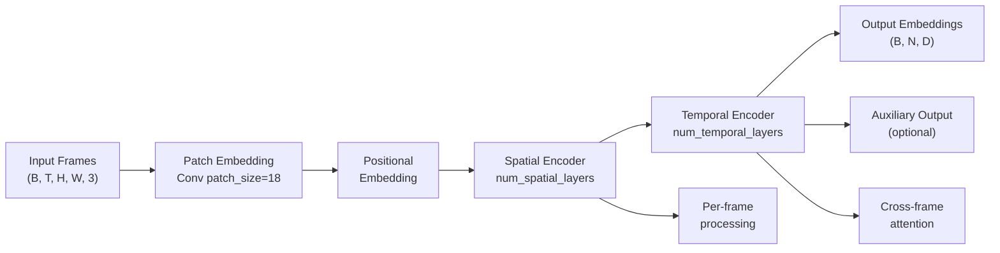
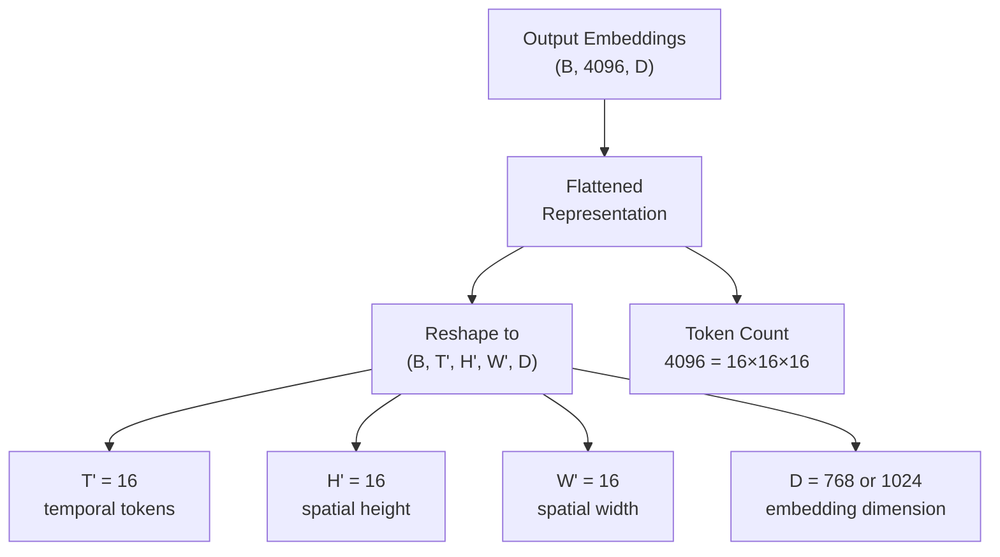
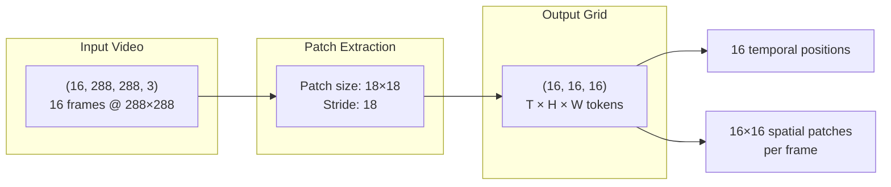
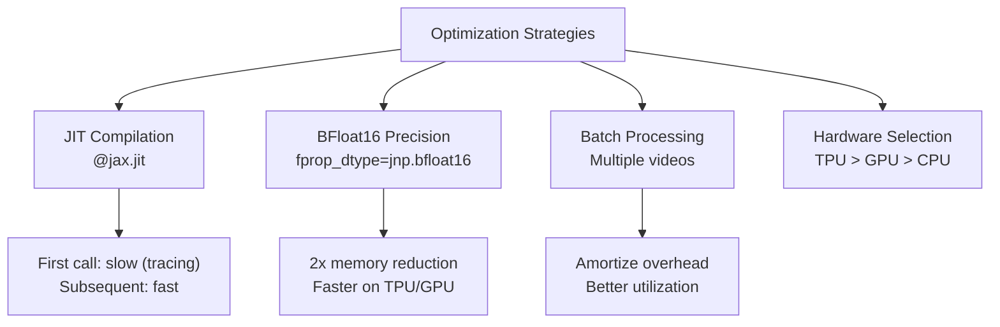
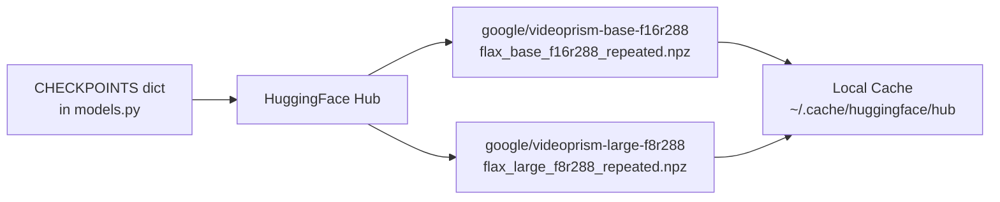

<!-- source: DeepWiki mcp.deepwiki.com · repo google-deepmind/videoprism · page 5.1 Video Feature Extraction · fetched 2026-10-26 -->

# Video Feature Extraction

<details>
<summary>Relevant source files</summary>

The following files were used as context for generating this wiki page:

- [videoprism/colabs/videoprism_video_encoder_demo.ipynb](videoprism/colabs/videoprism_video_encoder_demo.ipynb)
- [videoprism/colabs/videoprism_video_text_demo.ipynb](videoprism/colabs/videoprism_video_text_demo.ipynb)
- [videoprism/models.py](videoprism/models.py)

</details>


## Purpose and Scope

This page documents how to extract spatiotemporal feature embeddings from videos using VideoPrism video-only encoder models (`FactorizedEncoder`). These embeddings capture rich semantic and temporal information suitable for downstream tasks like action recognition, video classification, and temporal localization.

For video-text cross-modal tasks (retrieval, zero-shot classification), see [Video-Text Retrieval](#5.2). For information on loading custom model checkpoints, see [Loading Custom Checkpoints](#5.3).

## Overview

Video feature extraction in VideoPrism follows a standard encoder-only pattern: preprocess video frames, pass them through the `FactorizedEncoder`, and obtain dense spatiotemporal embeddings. The base workflow involves three main steps:



Sources: [videoprism/colabs/videoprism_video_encoder_demo.ipynb:84-108]()

## Input Requirements

### Video Format and Shape

VideoPrism video encoders expect inputs with specific dimensions and value ranges:

| Property | Base Model (v1_base) | Large Model (v1_large) |
|----------|---------------------|------------------------|
| Input Shape | `(batch, 16, 288, 288, 3)` | `(batch, 8, 288, 288, 3)` |
| Frame Count | 16 | 8 |
| Spatial Resolution | 288×288 | 288×288 |
| Pixel Value Range | [0.0, 1.0] | [0.0, 1.0] |
| Color Format | RGB | RGB |
| Data Type | float32 or bfloat16 | float32 or bfloat16 |

Sources: [videoprism/models.py:17-20](), [videoprism/models.py:83-104]()

### Preprocessing Pipeline

Video preprocessing involves three critical steps:



**Aspect Ratio Constraint**: The current implementation requires that input videos match the target aspect ratio. Resizing does not perform center cropping or padding.

Sources: [videoprism/colabs/videoprism_video_encoder_demo.ipynb:84-108]()

### Preprocessing Implementation

```python
# Reference implementation from demo notebook
def read_and_preprocess_video(
    filename: str, 
    target_num_frames: int, 
    target_frame_size: tuple[int, int]
):
  # 1. Read video frames
  frames = mediapy.read_video(filename)
  
  # 2. Temporal sampling: select target_num_frames evenly
  frame_indices = np.linspace(
      0, len(frames), num=target_num_frames, endpoint=False, dtype=np.int32
  )
  frames = np.asarray([frames[i] for i in frame_indices])
  
  # 3. Spatial resizing (aspect ratio must match)
  frames = mediapy.resize_video(frames, shape=target_frame_size)
  
  # 4. Normalize to [0.0, 1.0]
  frames = mediapy.to_float01(frames)
  
  return frames
```

Sources: [videoprism/colabs/videoprism_video_encoder_demo.ipynb:84-108]()

## Model Loading and Initialization

### Model Architecture Selection

VideoPrism provides two video-only encoder variants accessible through the `MODELS` registry:



| Model Name | Parameters | Config | Embedding Dim | Spatial Layers | Temporal Layers |
|------------|-----------|---------|---------------|----------------|-----------------|
| `videoprism_public_v1_base` | 114M | [videoprism_v1_base](videoprism/models.py:83-93) | 768 | 12 | 4 |
| `videoprism_public_v1_large` | 354M | [videoprism_v1_large](videoprism/models.py:94-104) | 1024 | 24 | 4 |

Sources: [videoprism/models.py:224-233](), [videoprism/models.py:83-104](), [videoprism/models.py:164-176]()

### Loading Model and Weights

The two-phase initialization pattern separates model instantiation from weight loading:

```mermaid
sequenceDiagram
    participant User
    participant get_model as "vp.get_model()"
    participant MODELS as "MODELS dict"
    participant CONFIGS as "CONFIGS dict"
    participant Encoder as "FactorizedEncoder"
    
    User->>get_model: get_model('videoprism_public_v1_base')
    get_model->>MODELS: Look up model function
    MODELS-->>get_model: videoprism_v1_base()
    get_model->>CONFIGS: Retrieve config dict
    get_model->>Encoder: FactorizedEncoder(**config)
    Encoder-->>get_model: Flax model instance
    get_model-->>User: Return flax_model
    
    Note over User: Model has architecture<br/>but no trained weights
    
    User->>load_weights as "vp.load_pretrained_weights()": load_pretrained_weights('videoprism_public_v1_base')
    load_weights->>CHECKPOINTS as "CHECKPOINTS dict": Look up HF coordinates
    CHECKPOINTS-->>load_weights: (repo_id, filename)
    load_weights->>HF as "HuggingFace Hub": hf_hub_download()
    HF-->>load_weights: checkpoint_path
    load_weights->>utils as "utils.load_checkpoint()": Load from path
    utils-->>load_weights: JAX PyTree of parameters
    load_weights-->>User: Return loaded_state
```

**Code Pattern**:

```python
from videoprism import models as vp
import jax

# Phase 1: Instantiate model architecture
model_name = 'videoprism_public_v1_base'
flax_model = vp.get_model(model_name)

# Phase 2: Load pre-trained weights from HuggingFace
loaded_state = vp.load_pretrained_weights(model_name)

# Phase 3: Create JIT-compiled forward function
@jax.jit
def forward_fn(inputs, train=False):
    return flax_model.apply(loaded_state, inputs, train=train)
```

Sources: [videoprism/models.py:268-303](), [videoprism/models.py:306-336](), [videoprism/colabs/videoprism_video_encoder_demo.ipynb:119-137]()

### Optional: BFloat16 Precision

For faster inference on TPU/GPU hardware, you can specify `bfloat16` computation:

```python
import jax.numpy as jnp

fprop_dtype = jnp.bfloat16
flax_model = vp.get_model(model_name, fprop_dtype=fprop_dtype)

# Convert input frames to bfloat16
frames = frames.astype(jnp.bfloat16)
```

Sources: [videoprism/colabs/videoprism_video_encoder_demo.ipynb:126-131](), [videoprism/models.py:301-302]()

## Performing Feature Extraction

### Forward Pass

The `FactorizedEncoder.apply()` method takes preprocessed video frames and returns spatiotemporal embeddings:



**API Signature**:

```python
embeddings, auxiliary = flax_model.apply(
    variables,      # loaded_state (JAX PyTree)
    inputs,         # video frames (B, T, H, W, 3)
    train=False     # inference mode
)
```

**Input**: 
- `variables`: Pre-trained weights from `load_pretrained_weights()`
- `inputs`: Preprocessed video tensor with shape `(batch, frames, height, width, 3)`
- `train`: Boolean, set to `False` for inference

**Output**:
- `embeddings`: Dense spatiotemporal features with shape `(batch, num_tokens, embedding_dim)`
- `auxiliary`: Additional model outputs (typically unused in feature extraction)

Sources: [videoprism/models.py:30-32](), [videoprism/colabs/videoprism_video_encoder_demo.ipynb:135-137](), [videoprism/colabs/videoprism_video_encoder_demo.ipynb:173]()

### Example: Single Video Encoding

```python
# Preprocess video
frames = read_and_preprocess_video(
    'path/to/video.mp4',
    target_num_frames=16,
    target_frame_size=[288, 288]
)

# Add batch dimension and convert to JAX array
frames = jnp.asarray(frames[None, ...])  # Shape: (1, 16, 288, 288, 3)

# Extract features
embeddings, _ = forward_fn(frames)  # Shape: (1, 4096, 768)
```

Sources: [videoprism/colabs/videoprism_video_encoder_demo.ipynb:161-174]()

## Understanding Output Embeddings

### Embedding Structure

The output embeddings have a specific structure that encodes spatiotemporal information:



| Model | Output Shape (Flattened) | Output Shape (Spatial) | Positional Embedding Shape |
|-------|-------------------------|------------------------|----------------------------|
| Base | `(batch, 4096, 768)` | `(batch, 16, 16, 16, 768)` | `(16, 16, 16)` |
| Large | `(batch, 4096, 1024)` | `(batch, 8, 16, 16, 1024)` | `(8, 16, 16)` |

**Key Properties**:
- Each position in the output corresponds to a spatiotemporal patch in the input
- The embeddings can be reshaped to 4D `(time, height, width, embedding_dim)` for spatial analysis
- The flat representation is suitable for global pooling or direct use in downstream classifiers

Sources: [videoprism/models.py:17-20](), [videoprism/models.py:83-93](), [videoprism/models.py:94-104]()

### Token Layout

The 4096 tokens in the base model represent a factorized spatiotemporal grid:



**Computation**:
- Spatial patches per frame: `288 / 18 = 16` (both H and W dimensions)
- Temporal frames: `16` (configurable via `pos_emb_shape`)
- Total tokens: `16 × 16 × 16 = 4096`

Sources: [videoprism/models.py:83-93]()

## Complete Workflow Example

### End-to-End Code

```python
import jax
import jax.numpy as jnp
import mediapy
import numpy as np
from videoprism import models as vp

# Configuration
MODEL_NAME = 'videoprism_public_v1_base'
NUM_FRAMES = 16
FRAME_SIZE = 288

# 1. Load model and weights
flax_model = vp.get_model(MODEL_NAME)
loaded_state = vp.load_pretrained_weights(MODEL_NAME)

@jax.jit
def forward_fn(inputs):
    return flax_model.apply(loaded_state, inputs, train=False)

# 2. Preprocess video
def read_and_preprocess_video(filename, target_num_frames, target_frame_size):
    frames = mediapy.read_video(filename)
    
    # Temporal sampling
    frame_indices = np.linspace(
        0, len(frames), num=target_num_frames, endpoint=False, dtype=np.int32
    )
    frames = np.asarray([frames[i] for i in frame_indices])
    
    # Spatial resizing
    frames = mediapy.resize_video(frames, shape=target_frame_size)
    
    # Normalize to [0.0, 1.0]
    frames = mediapy.to_float01(frames)
    
    return frames

# 3. Extract features
frames = read_and_preprocess_video(
    'video.mp4',
    target_num_frames=NUM_FRAMES,
    target_frame_size=[FRAME_SIZE, FRAME_SIZE]
)
frames = jnp.asarray(frames[None, ...])  # Add batch dimension

embeddings, _ = forward_fn(frames)
print(f'Output shape: {embeddings.shape}')  # (1, 4096, 768)

# 4. Optional: Reshape to spatiotemporal grid
spatial_embeddings = embeddings.reshape(1, 16, 16, 16, 768)
```

Sources: [videoprism/colabs/videoprism_video_encoder_demo.ipynb:119-174]()

### Processing Multiple Videos

For batch processing, concatenate videos along the batch dimension:

```python
# Load multiple videos
video_files = ['video1.mp4', 'video2.mp4', 'video3.mp4']
batch_frames = []

for video_file in video_files:
    frames = read_and_preprocess_video(
        video_file, 
        target_num_frames=NUM_FRAMES,
        target_frame_size=[FRAME_SIZE, FRAME_SIZE]
    )
    batch_frames.append(frames)

# Stack into batch: (batch_size, 16, 288, 288, 3)
batch_frames = jnp.stack(batch_frames)

# Extract features for entire batch
batch_embeddings, _ = forward_fn(batch_frames)
print(f'Batch output shape: {batch_embeddings.shape}')  # (3, 4096, 768)
```

## Performance Considerations

### Memory Requirements

| Model | Parameter Count | Peak Memory (fp32) | Peak Memory (bf16) |
|-------|----------------|-------------------|-------------------|
| Base | 114M | ~2.5 GB | ~1.5 GB |
| Large | 354M | ~7 GB | ~4 GB |

**Note**: Memory usage includes model parameters and activations during forward pass. Batch processing increases memory proportionally.

### Inference Speed Optimization



**Recommended Practices**:
1. Always use `@jax.jit` for the forward function (automatic compilation)
2. Enable bfloat16 on TPU/GPU hardware for 2x speedup
3. Process videos in batches when possible
4. Reuse the compiled forward function across multiple calls

Sources: [videoprism/colabs/videoprism_video_encoder_demo.ipynb:135-137](), [videoprism/colabs/videoprism_video_encoder_demo.ipynb:126-131]()

### Checkpoint Source

All pre-trained checkpoints are hosted on HuggingFace Hub and downloaded automatically:



Checkpoints are cached locally after first download, making subsequent loads instant.

Sources: [videoprism/models.py:62-80](), [videoprism/models.py:330-333]()

---

