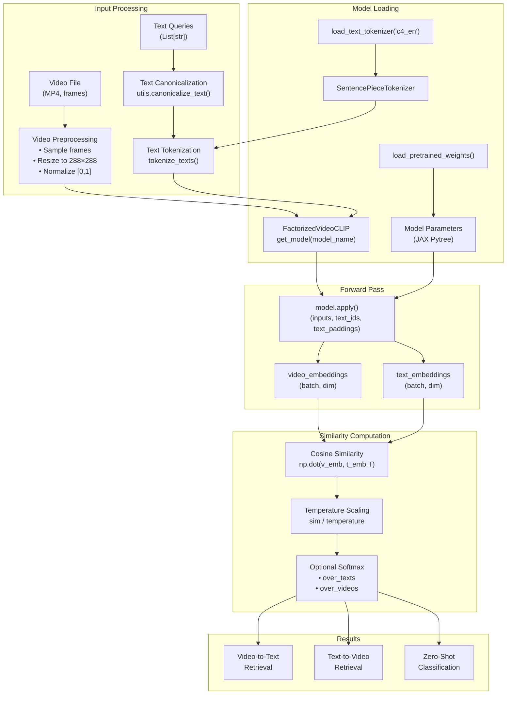
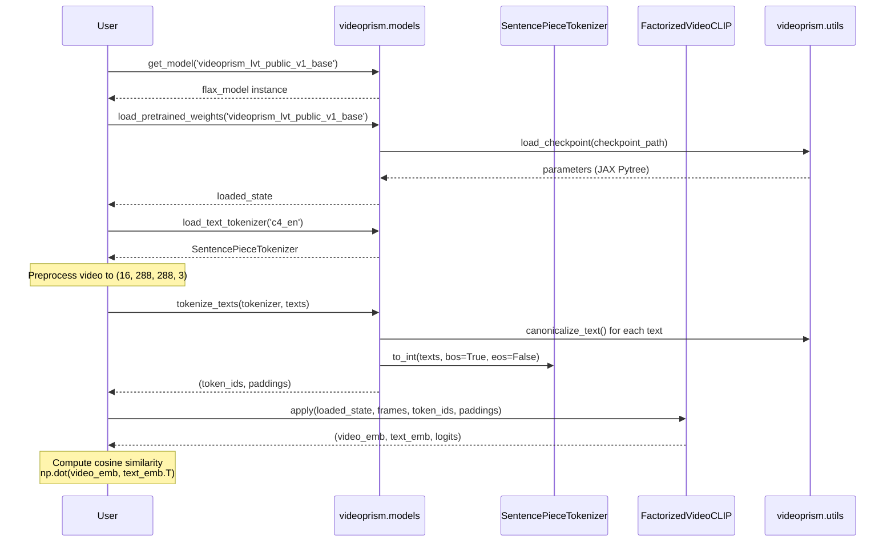
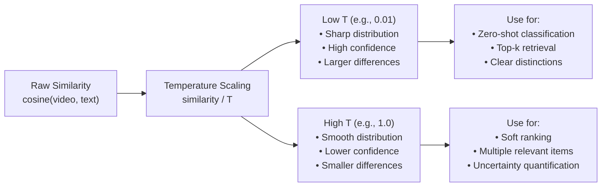

<!-- source: DeepWiki mcp.deepwiki.com · repo google-deepmind/videoprism · page 5.2 Video-Text Retrieval · fetched 2026-10-26 -->

# Video-Text Retrieval

<details>
<summary>Relevant source files</summary>

The following files were used as context for generating this wiki page:

- [videoprism/colabs/videoprism_video_encoder_demo.ipynb](videoprism/colabs/videoprism_video_encoder_demo.ipynb)
- [videoprism/colabs/videoprism_video_text_demo.ipynb](videoprism/colabs/videoprism_video_text_demo.ipynb)
- [videoprism/models.py](videoprism/models.py)

</details>


## Purpose and Scope

This page provides a practical guide for using VideoPrism's cross-modal video-text models to perform retrieval tasks and zero-shot classification. It covers how to encode videos and text into a shared embedding space, compute similarities, and interpret results for various applications.

For video-only feature extraction without text capabilities, see [Video Feature Extraction](#5.1). For details on the underlying FactorizedVideoCLIP architecture, see [FactorizedVideoCLIP](#4.2.2).

## Model Selection

Video-text retrieval requires the VideoPrism-LvT (Language-vision-Text) models, which implement the `FactorizedVideoCLIP` architecture. Two variants are available:

| Model Name | Architecture | Parameters | Video Encoder | Text Encoder | Input Frames |
|------------|--------------|------------|---------------|--------------|--------------|
| `videoprism_lvt_public_v1_base` | FactorizedVideoCLIP | 248M | ViT-B (114M) | Transformer (134M) | 16 |
| `videoprism_lvt_public_v1_large` | FactorizedVideoCLIP | 580M | ViT-L (354M) | Transformer (226M) | 8 |

These models are trained with contrastive learning to align video and text embeddings in a shared space, enabling cross-modal retrieval and zero-shot classification.

**Sources:** [videoprism/models.py:179-197](), [videoprism/models.py:72-79](), [videoprism/models.py:116-145]()

## System Architecture



**Sources:** [videoprism/colabs/videoprism_video_text_demo.ipynb:160-193](), [videoprism/models.py:306-337](), [videoprism/models.py:355-407]()

## Data Flow and API Usage



**Sources:** [videoprism/colabs/videoprism_video_text_demo.ipynb:160-193](), [videoprism/models.py:268-303](), [videoprism/models.py:339-352](), [videoprism/models.py:355-407]()

## Prerequisites

### Video Format Requirements

Videos must be preprocessed to match the model's expected input shape:

| Parameter | Value | Notes |
|-----------|-------|-------|
| Number of frames | 16 (base) or 8 (large) | Uniform temporal sampling |
| Frame resolution | 288 × 288 pixels | Square aspect ratio required |
| Pixel value range | [0.0, 1.0] | Float32 or bfloat16 |
| Color format | RGB | 3 channels |
| Batch shape | `(batch, frames, height, width, 3)` | |

### Text Format Requirements

Text queries are processed through tokenization:

| Parameter | Default | Notes |
|-----------|---------|-------|
| Maximum length | 64 tokens | Defined in `TEXT_MAX_LEN` |
| Tokenizer | SentencePiece (c4_en) | 32,000 vocab size |
| Canonicalization | Enabled | Lowercase, punctuation removal |
| Special tokens | BOS added, EOS omitted | |
| Padding | Zeros with mask | 1.0 indicates padding |

**Sources:** [videoprism/models.py:51-60](), [videoprism/colabs/videoprism_video_text_demo.ipynb:100-124]()

## Step-by-Step Workflow

### 1. Model and Tokenizer Loading

```python
from videoprism import models as vp
import jax.numpy as jnp

# Select model variant
MODEL_NAME = 'videoprism_lvt_public_v1_base'

# Load model architecture and weights
flax_model = vp.get_model(MODEL_NAME)
loaded_state = vp.load_pretrained_weights(MODEL_NAME)

# Load text tokenizer
text_tokenizer = vp.load_text_tokenizer('c4_en')

# Define forward function
@jax.jit
def forward_fn(video_inputs, text_token_ids, text_paddings, train=False):
    return flax_model.apply(
        loaded_state,
        video_inputs,
        text_token_ids,
        text_paddings,
        train=train,
    )
```

The `get_model()` function instantiates the `FactorizedVideoCLIP` architecture from the `CONFIGS` dictionary [videoprism/models.py:179-183](), while `load_pretrained_weights()` downloads checkpoints from HuggingFace Hub [videoprism/models.py:330-333]().

**Sources:** [videoprism/models.py:268-303](), [videoprism/models.py:306-337](), [videoprism/models.py:339-352](), [videoprism/colabs/videoprism_video_text_demo.ipynb:160-193]()

### 2. Video Preprocessing

Videos must be read, temporally sampled, resized, and normalized:

```python
import mediapy
import numpy as np

def read_and_preprocess_video(
    filename: str, 
    target_num_frames: int, 
    target_frame_size: tuple[int, int]
):
    # Read video frames
    frames = mediapy.read_video(filename)
    
    # Uniform temporal sampling
    frame_indices = np.linspace(
        0, len(frames), 
        num=target_num_frames, 
        endpoint=False, 
        dtype=np.int32
    )
    frames = np.array([frames[i] for i in frame_indices])
    
    # Resize to target resolution
    frames = mediapy.resize_video(frames, shape=target_frame_size)
    
    # Normalize to [0.0, 1.0]
    frames = mediapy.to_float01(frames)
    
    return frames

# Preprocess and add batch dimension
frames = read_and_preprocess_video(
    VIDEO_FILE_PATH,
    target_num_frames=16,
    target_frame_size=[288, 288],
)
frames = jnp.asarray(frames[None, ...])  # Shape: (1, 16, 288, 288, 3)
```

**Sources:** [videoprism/colabs/videoprism_video_text_demo.ipynb:100-124](), [videoprism/colabs/videoprism_video_text_demo.ipynb:208-219]()

### 3. Text Tokenization

Text queries are canonicalized, tokenized, and padded to a fixed length:

```python
# Define text queries
text_queries = [
    'a video of playing drums.',
    'a video of sitting.',
    'a video of playing flute.',
    'a video of playing at playground.',
    'a video of concert.',
]

# Tokenize texts
text_ids, text_paddings = vp.tokenize_texts(
    text_tokenizer, 
    text_queries,
    max_length=64,
    add_bos=True,
    canonicalize=True,
)
# text_ids shape: (5, 64) - token IDs
# text_paddings shape: (5, 64) - 1.0 for padding positions, 0.0 otherwise
```

The `tokenize_texts()` function applies text canonicalization via `utils.canonicalize_text()` [videoprism/models.py:379](), then uses the SentencePiece tokenizer to convert strings to integer IDs [videoprism/models.py:385](), padding or truncating to `max_length` [videoprism/models.py:387-402]().

**Sources:** [videoprism/models.py:355-407](), [videoprism/colabs/videoprism_video_text_demo.ipynb:229-242]()

### 4. Computing Embeddings

The forward pass generates L2-normalized embeddings for both modalities:

```python
# Forward pass through model
video_embeddings, text_embeddings, _ = forward_fn(
    frames, 
    text_ids, 
    text_paddings
)

# video_embeddings shape: (1, 768) for base model
# text_embeddings shape: (5, 768) for base model
# Both are L2-normalized unit vectors
```

The `FactorizedVideoCLIP.apply()` method returns three outputs: video embeddings, text embeddings, and auxiliary logits. The embeddings are already L2-normalized within the model architecture.

**Sources:** [videoprism/colabs/videoprism_video_text_demo.ipynb:254-255](), [videoprism/encoders.py:FactorizedVideoCLIP]()

### 5. Similarity Computation

Cosine similarity is computed as the dot product of normalized embeddings:

```python
def compute_similarity_matrix(
    video_embeddings,
    text_embeddings,
    temperature: float,
    apply_softmax: str | None = None,
) -> np.ndarray:
    """Computes cosine similarity matrix between videos and texts."""
    emb_dim = video_embeddings[0].shape[-1]
    
    # Reshape to 2D arrays
    video_embeddings = np.array(video_embeddings).reshape(-1, emb_dim)
    text_embeddings = np.array(text_embeddings).reshape(-1, emb_dim)
    
    # Compute cosine similarity (dot product of normalized vectors)
    similarity_matrix = np.dot(video_embeddings, text_embeddings.T)
    
    # Apply temperature scaling
    if temperature is not None:
        similarity_matrix /= temperature
    
    # Apply softmax (optional)
    if apply_softmax == 'over_videos':
        similarity_matrix = np.exp(similarity_matrix)
        similarity_matrix = similarity_matrix / np.sum(
            similarity_matrix, axis=0, keepdims=True
        )
    elif apply_softmax == 'over_texts':
        similarity_matrix = np.exp(similarity_matrix)
        similarity_matrix = similarity_matrix / np.sum(
            similarity_matrix, axis=1, keepdims=True
        )
    
    return similarity_matrix

# Compute similarity matrix
similarity_matrix = compute_similarity_matrix(
    video_embeddings,
    text_embeddings,
    temperature=0.01,
    apply_softmax='over_texts',
)
# Shape: (num_videos, num_texts)
# Values are probabilities when softmax is applied
```

**Sources:** [videoprism/colabs/videoprism_video_text_demo.ipynb:127-156](), [videoprism/colabs/videoprism_video_text_demo.ipynb:254-263]()

## Use Cases

### Video-to-Text Retrieval

Rank text descriptions by their relevance to a query video:

```python
# Compute similarities with softmax over texts
similarity_matrix = compute_similarity_matrix(
    video_embeddings,
    text_embeddings,
    temperature=0.01,
    apply_softmax='over_texts',
)

# Get similarities for first video
v2t_similarity_vector = similarity_matrix[0]

# Rank texts by similarity
top_indices = np.argsort(v2t_similarity_vector)[::-1]

print(f'Query video: {VIDEO_FILE_PATH}')
for k, j in enumerate(top_indices):
    print(
        f'Top-{k+1} retrieved text: {text_queries[j]} '
        f'[Similarity = {v2t_similarity_vector[j]:.4f}]'
    )
```

**Output interpretation:**
- Similarity values are probabilities (sum to 1.0 when `apply_softmax='over_texts'`)
- Higher values indicate stronger video-text alignment
- Top-ranked text is the most relevant description

**Sources:** [videoprism/colabs/videoprism_video_text_demo.ipynb:274-285]()

### Text-to-Video Retrieval

Rank videos by their relevance to a text query:

```python
# Compute similarities with softmax over videos
similarity_matrix = compute_similarity_matrix(
    video_embeddings,
    text_embeddings,
    temperature=0.01,
    apply_softmax='over_videos',
)

# Get similarities for first text query
t2v_similarity_vector = similarity_matrix[:, 0]

# Rank videos by similarity
top_indices = np.argsort(t2v_similarity_vector)[::-1]

print(f'Query text: {text_queries[0]}')
for k, j in enumerate(top_indices):
    print(
        f'Top-{k+1} retrieved video: {video_files[j]} '
        f'[Similarity = {t2v_similarity_vector[j]:.4f}]'
    )
```

**Sources:** [videoprism/colabs/videoprism_video_text_demo.ipynb:127-156]()

### Zero-Shot Video Classification

Classify videos by comparing against candidate class descriptions:

```python
# Define class labels as text prompts
class_labels = [
    'playing drums',
    'sitting',
    'playing flute',
    'playing at playground',
    'concert',
]

# Create text prompts with template
PROMPT_TEMPLATE = 'a video of {}.'
text_queries = [PROMPT_TEMPLATE.format(label) for label in class_labels]

# Tokenize and encode
text_ids, text_paddings = vp.tokenize_texts(text_tokenizer, text_queries)
video_embeddings, text_embeddings, _ = forward_fn(
    frames, text_ids, text_paddings
)

# Compute similarities with softmax over texts (class probabilities)
similarity_matrix = compute_similarity_matrix(
    video_embeddings,
    text_embeddings,
    temperature=0.01,
    apply_softmax='over_texts',
)

# Get predicted class
class_probs = similarity_matrix[0]  # Shape: (num_classes,)
predicted_class_idx = np.argmax(class_probs)
predicted_class = class_labels[predicted_class_idx]

print(f'Predicted class: {predicted_class}')
print(f'Confidence: {class_probs[predicted_class_idx]:.4f}')
print('\nAll class probabilities:')
for i, (label, prob) in enumerate(zip(class_labels, class_probs)):
    print(f'  {label}: {prob:.4f}')
```

**Key considerations:**
- Use consistent prompt templates for all classes
- Apply softmax over texts to get valid probability distributions
- Temperature parameter controls confidence calibration (lower = more confident)
- Works without any task-specific training

**Sources:** [videoprism/colabs/videoprism_video_text_demo.ipynb:229-242](), [videoprism/colabs/videoprism_video_text_demo.ipynb:196-204]()

## Temperature Scaling

The temperature parameter controls the sharpness of the similarity distribution:



**Typical values:**
- Classification: `temperature=0.01` to `0.05`
- Retrieval: `temperature=0.01` to `0.1`
- Raw similarities: `temperature=None` (no scaling)

**Sources:** [videoprism/colabs/videoprism_video_text_demo.ipynb:257](), [videoprism/colabs/videoprism_video_text_demo.ipynb:142-143]()

## Complete Example

Here is a full end-to-end example combining all components:

```python
import jax
import jax.numpy as jnp
import numpy as np
import mediapy
from videoprism import models as vp

# 1. Load model and tokenizer
MODEL_NAME = 'videoprism_lvt_public_v1_base'
flax_model = vp.get_model(MODEL_NAME)
loaded_state = vp.load_pretrained_weights(MODEL_NAME)
text_tokenizer = vp.load_text_tokenizer('c4_en')

@jax.jit
def forward_fn(inputs, text_token_ids, text_paddings):
    return flax_model.apply(
        loaded_state, inputs, text_token_ids, text_paddings, train=False
    )

# 2. Preprocess video
def preprocess_video(filename, num_frames=16, frame_size=288):
    frames = mediapy.read_video(filename)
    indices = np.linspace(0, len(frames), num=num_frames, endpoint=False, dtype=np.int32)
    frames = np.array([frames[i] for i in indices])
    frames = mediapy.resize_video(frames, shape=[frame_size, frame_size])
    frames = mediapy.to_float01(frames)
    return jnp.asarray(frames[None, ...])

video = preprocess_video('path/to/video.mp4')

# 3. Prepare text queries
text_queries = [
    'a video of playing drums.',
    'a video of sitting.',
    'a video of playing flute.',
]
text_ids, text_paddings = vp.tokenize_texts(text_tokenizer, text_queries)

# 4. Compute embeddings
video_emb, text_emb, _ = forward_fn(video, text_ids, text_paddings)

# 5. Compute similarities
video_emb = np.array(video_emb).reshape(-1, video_emb.shape[-1])
text_emb = np.array(text_emb).reshape(-1, text_emb.shape[-1])
similarity = np.dot(video_emb, text_emb.T) / 0.01  # temperature=0.01

# Apply softmax for classification
probs = np.exp(similarity) / np.sum(np.exp(similarity), axis=1, keepdims=True)

# 6. Get results
predicted_idx = np.argmax(probs[0])
print(f'Predicted: {text_queries[predicted_idx]} (prob={probs[0, predicted_idx]:.4f})')
```

**Sources:** [videoprism/colabs/videoprism_video_text_demo.ipynb:160-291]()

## Performance Considerations

### Batch Processing

Process multiple videos or texts in batches for efficiency:

```python
# Batch multiple videos
videos = jnp.stack([preprocess_video(f) for f in video_files])  # (N, 16, 288, 288, 3)

# Batch texts (already done in tokenize_texts)
text_ids, text_paddings = vp.tokenize_texts(tokenizer, text_list)  # (M, 64)

# Single forward pass
video_emb, text_emb, _ = forward_fn(videos, text_ids, text_paddings)
# video_emb: (N, 768), text_emb: (M, 768)

# Compute all-pairs similarity
similarity_matrix = np.dot(video_emb, text_emb.T)  # (N, M)
```

### Mixed Precision

Use bfloat16 for faster inference on supported hardware:

```python
# Load model with bfloat16 precision
flax_model = vp.get_model(MODEL_NAME, fprop_dtype=jnp.bfloat16)

# Cast inputs
frames = frames.astype(jnp.bfloat16)
text_paddings = text_paddings.astype(jnp.bfloat16)

# Embeddings will be computed in bfloat16
video_emb, text_emb, _ = forward_fn(frames, text_ids, text_paddings)
```

**Sources:** [videoprism/colabs/videoprism_video_text_demo.ipynb:169-173](), [videoprism/colabs/videoprism_video_text_demo.ipynb:218-219]()

## Troubleshooting

### Common Issues

| Issue | Cause | Solution |
|-------|-------|----------|
| Shape mismatch error | Wrong number of frames | Use 16 frames for base, 8 for large |
| Low similarity scores | Not normalized | Embeddings are already L2-normalized |
| Memory error | Batch too large | Process videos/texts in smaller batches |
| Aspect ratio error | Non-square video | Crop or pad video to square before resize |
| Poor results | Missing canonicalization | Set `canonicalize=True` in `tokenize_texts()` |

### Debugging Tips

```python
# Check input shapes
print(f'Video shape: {frames.shape}')  # Expected: (batch, 16, 288, 288, 3)
print(f'Text IDs shape: {text_ids.shape}')  # Expected: (batch, 64)
print(f'Text paddings shape: {text_paddings.shape}')  # Expected: (batch, 64)

# Verify embeddings are normalized
video_norm = np.linalg.norm(video_emb, axis=-1)
text_norm = np.linalg.norm(text_emb, axis=-1)
print(f'Video embedding norms: {video_norm}')  # Should be ~1.0
print(f'Text embedding norms: {text_norm}')  # Should be ~1.0

# Check similarity range
print(f'Similarity range: [{similarity_matrix.min():.4f}, {similarity_matrix.max():.4f}]')
# Should be in [-1.0, 1.0] for cosine similarity
```

**Sources:** [videoprism/colabs/videoprism_video_text_demo.ipynb:127-156](), [videoprism/models.py:355-407]()

---

