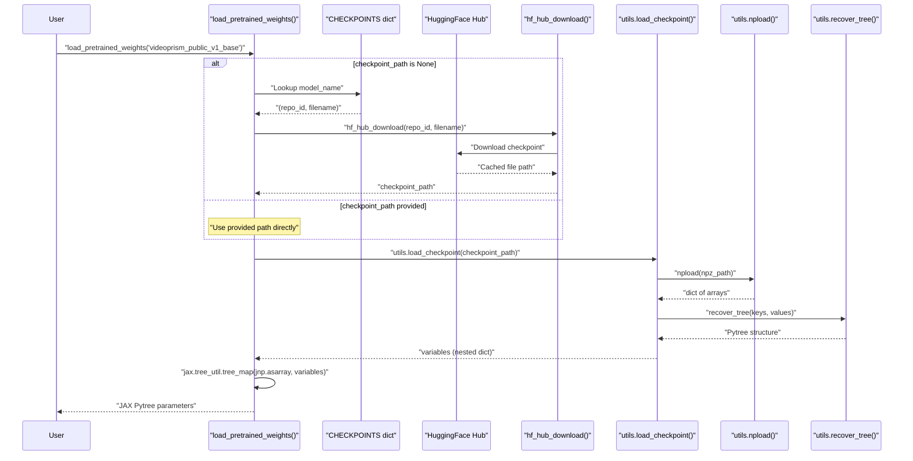
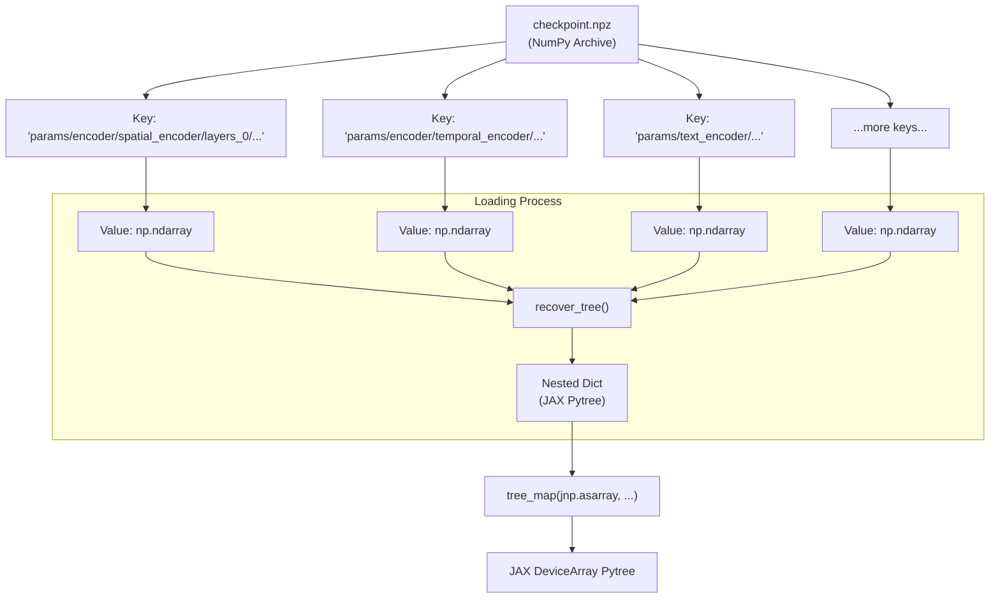

<!-- source: DeepWiki mcp.deepwiki.com · repo google-deepmind/videoprism · page 5.3 Loading Custom Checkpoints · fetched 2026-10-26 -->

# Loading Custom Checkpoints

<details>
<summary>Relevant source files</summary>

The following files were used as context for generating this wiki page:

- [videoprism/models.py](videoprism/models.py)
- [videoprism/utils.py](videoprism/utils.py)
- [videoprism/utils_test.py](videoprism/utils_test.py)

</details>


This page covers how to load model checkpoints in VideoPrism, including loading from HuggingFace Hub, local file paths, and custom checkpoint registries. For information about model instantiation and configuration, see [Model Management System](#4.1). For API details, see [videoprism.models API Reference](#6.1).

## Overview

VideoPrism separates model architecture instantiation from weight loading. After creating a model with `get_model()`, you load pre-trained weights with `load_pretrained_weights()`. This function supports three checkpoint sources:

1. **Default Registry** - Pre-configured HuggingFace Hub checkpoints via model name
2. **Direct Path** - Local or remote file paths to `.npz` checkpoint files  
3. **Custom Registry** - User-provided checkpoint mappings

All checkpoints are stored as NumPy `.npz` files containing flattened JAX Pytree structures that are reconstructed during loading.

## Default Checkpoint Loading

The `CHECKPOINTS` dictionary in [videoprism/models.py:62-80]() maps model names to HuggingFace Hub locations. Each entry is a tuple of `(repository_id, filename)`.

```python
from videoprism import models as vp

# Load model architecture
model = vp.get_model('videoprism_public_v1_base')

# Load pre-trained weights from HuggingFace Hub
params = vp.load_pretrained_weights('videoprism_public_v1_base')

# Use model
outputs = model.apply(params, video_inputs, train=False)
```

**Available Models in CHECKPOINTS:**

| Model Name | HuggingFace Repository | Checkpoint File |
|------------|------------------------|-----------------|
| `videoprism_public_v1_base` | `google/videoprism-base-f16r288` | `flax_base_f16r288_repeated.npz` |
| `videoprism_public_v1_large` | `google/videoprism-large-f8r288` | `flax_large_f8r288_repeated.npz` |
| `videoprism_lvt_public_v1_base` | `google/videoprism-lvt-base-f16r288` | `flax_lvt_base_f16r288_repeated.npz` |
| `videoprism_lvt_public_v1_large` | `google/videoprism-lvt-large-f8r288` | `flax_lvt_large_f8r288_repeated.npz` |

The function automatically downloads checkpoints from HuggingFace Hub using `huggingface_hub.hf_hub_download()` [videoprism/models.py:331-333]() and caches them locally for subsequent use.

**Sources:** [videoprism/models.py:62-80](), [videoprism/models.py:306-336]()

## Checkpoint Loading Flow



**Sources:** [videoprism/models.py:306-336](), [videoprism/utils.py:124-136]()

## Loading from Local or Remote Paths

You can bypass the `CHECKPOINTS` registry by providing a direct `checkpoint_path`. This supports both local file paths and remote paths accessible via TensorFlow's `gfile`.

```python
from videoprism import models as vp

# Load from local path
params = vp.load_pretrained_weights(
    model_name=None,
    checkpoint_path='/path/to/my_checkpoint.npz'
)

# Load from Google Cloud Storage
params = vp.load_pretrained_weights(
    model_name=None,
    checkpoint_path='gs://my-bucket/checkpoints/model.npz'
)
```

The `checkpoint_path` parameter takes precedence over `model_name`. If both are provided, `checkpoint_path` is used [videoprism/models.py:324]().

**Path Resolution Logic:**
- If `checkpoint_path` is `None`, look up `model_name` in `CHECKPOINTS` dictionary
- If file exists locally, load with `np.load()` [videoprism/utils.py:109-110]()
- Otherwise, read via `gfile.GFile()` for remote paths [videoprism/utils.py:113-115]()

**Sources:** [videoprism/models.py:306-336](), [videoprism/utils.py:106-121]()

## Loading with HuggingFace Model IDs

The `load_pretrained_weights()` function also accepts HuggingFace repository IDs directly (format: `google/videoprism-*`). This is converted to the corresponding model name internally.

```python
from videoprism import models as vp

# These are equivalent:
params1 = vp.load_pretrained_weights('videoprism_public_v1_base')
params2 = vp.load_pretrained_weights('google/videoprism-base-f16r288')
```

The function `_get_model_name_by_hf_model_id()` [videoprism/models.py:236-252]() performs the lookup:
- Iterates through `CHECKPOINTS` entries
- Matches the repository ID (first element of tuple)
- Returns the corresponding model name
- Returns `None` if not found

**Sources:** [videoprism/models.py:236-252](), [videoprism/models.py:326-328]()

## Custom Checkpoint Registries

For advanced use cases, you can provide a custom `checkpoints` mapping to override the default `CHECKPOINTS` registry. This is useful for:
- Testing with experimental checkpoints
- Loading fine-tuned model variants
- Organizing multiple checkpoint versions

```python
from videoprism import models as vp

custom_checkpoints = {
    'my_finetuned_model': ('my-org/my-model-repo', 'checkpoint.npz'),
    'local_model': '/path/to/local_checkpoint.npz'
}

# Load with custom registry
params = vp.load_pretrained_weights(
    model_name='my_finetuned_model',
    checkpoints=custom_checkpoints
)
```

The `checkpoints` parameter accepts two formats:
- **HuggingFace tuple:** `(repo_id, filename)` - Downloads from HuggingFace Hub
- **Direct path:** String path to checkpoint file

**Sources:** [videoprism/models.py:306-336]()

## Checkpoint File Format

VideoPrism checkpoints are stored as NumPy `.npz` archives containing flattened JAX Pytree structures. Each parameter's key represents its hierarchical path using `/` as a separator.

### File Structure



### Pytree Recovery

The `recover_tree()` function [videoprism/utils.py:82-103]() reconstructs the nested dictionary structure from flattened keys:

1. **Parse keys** - Split on `/` to identify hierarchy
2. **Build nested structure** - Recursively create nested dictionaries
3. **Assign leaf values** - Place NumPy arrays at leaf nodes

Example transformation:
```python
# Flattened format in .npz
{
    'params/encoder/layer_0/kernel': array(...),
    'params/encoder/layer_0/bias': array(...),
    'params/encoder/layer_1/kernel': array(...)
}

# Recovered Pytree structure
{
    'params': {
        'encoder': {
            'layer_0': {'kernel': array(...), 'bias': array(...)},
            'layer_1': {'kernel': array(...)}
        }
    }
}
```

**Sources:** [videoprism/utils.py:82-136]()

## Checkpoint Loading Implementation

```mermaid
graph TB
    subgraph "load_checkpoint() - utils.py:124-136"
        LC_START["Input: npz (path or dict)"]
        LC_CHECK{"Is npz a string?"}
        LC_LOAD["npload(npz)"]
        LC_ITEMS["Extract items()"]
        LC_UNZIP["Unzip to (keys, values)"]
        LC_RECOVER["recover_tree(keys, values)"]
        LC_RETURN["Return: Pytree"]
        
        LC_START --> LC_CHECK
        LC_CHECK -->|"Yes"| LC_LOAD
        LC_CHECK -->|"No (already dict)"| LC_ITEMS
        LC_LOAD --> LC_ITEMS
        LC_ITEMS --> LC_UNZIP
        LC_UNZIP --> LC_RECOVER
        LC_RECOVER --> LC_RETURN
    end
    
    subgraph "npload() - utils.py:106-121"
        NP_CHECK{"os.path.exists(fname)?"}
        NP_LOCAL["np.load(fname)"]
        NP_REMOTE["gfile.GFile(fname)"]
        NP_BYTES["BytesIO(data)"]
        NP_TYPE{"Is ndarray?"}
        NP_SINGLE["Return: ndarray"]
        NP_DICT["Return: dict"]
        
        NP_CHECK -->|"Yes"| NP_LOCAL
        NP_CHECK -->|"No"| NP_REMOTE
        NP_REMOTE --> NP_BYTES
        NP_BYTES --> NP_TYPE
        NP_LOCAL --> NP_TYPE
        NP_TYPE -->|"Yes"| NP_SINGLE
        NP_TYPE -->|"No (zip)"| NP_DICT
    end
    
    subgraph "recover_tree() - utils.py:82-103"
        RT_INIT["tree = {}<br/>sub_trees = defaultdict(list)"]
        RT_ITER["For each (key, value)"]
        RT_SPLIT{"Contains '/'?"}
        RT_DIRECT["tree[key] = value"]
        RT_SUB["Split key<br/>Add to sub_trees"]
        RT_RECURSE["Recursively call recover_tree()<br/>for each subtree"]
        RT_MERGE["Merge subtrees into tree"]
        RT_RETURN2["Return: tree"]
        
        RT_INIT --> RT_ITER
        RT_ITER --> RT_SPLIT
        RT_SPLIT -->|"No"| RT_DIRECT
        RT_SPLIT -->|"Yes"| RT_SUB
        RT_DIRECT --> RT_RECURSE
        RT_SUB --> RT_RECURSE
        RT_RECURSE --> RT_MERGE
        RT_MERGE --> RT_RETURN2
    end
```



**Key Functions:**

| Function | Location | Purpose |
|----------|----------|---------|
| `load_checkpoint()` | [videoprism/utils.py:124-136]() | Main entry point for loading `.npz` checkpoints |
| `npload()` | [videoprism/utils.py:106-121]() | Handles file I/O for local and remote paths |
| `recover_tree()` | [videoprism/utils.py:82-103]() | Reconstructs nested Pytree from flat key-value pairs |
| `traverse_with_names()` | [videoprism/utils.py:28-57]() | Helper for traversing Pytrees with path names |
| `tree_flatten_with_names()` | [videoprism/utils.py:60-79]() | Flattens Pytree with hierarchical names |

**Sources:** [videoprism/utils.py:28-136]()

## Error Handling

The checkpoint loading system includes several validation checks:

**Model Name Validation:**
- `load_pretrained_weights()` checks if `model_name` exists in `checkpoints` mapping
- Raises `KeyError` if model name not found and no `checkpoint_path` provided [videoprism/models.py:330]()

**File Path Validation:**
- `npload()` uses `os.path.exists()` to check local paths [videoprism/utils.py:109]()
- Falls back to `gfile` for remote paths
- `np.load()` uses `allow_pickle=False` for security [videoprism/utils.py:110, 115]()

**HuggingFace Download:**
- `hf_hub_download()` raises exceptions if repository or file not found
- Exceptions propagate to caller with informative error messages

**Sources:** [videoprism/models.py:306-336](), [videoprism/utils.py:106-121]()

## JAX Array Conversion

After loading, the nested dictionary is converted to JAX arrays using `jax.tree_util.tree_map()` [videoprism/models.py:336]():

```python
variables = utils.load_checkpoint(checkpoint_path)
return jax.tree_util.tree_map(jnp.asarray, variables)
```

This transformation:
1. **Preserves structure** - Maintains the nested Pytree shape
2. **Converts arrays** - Changes NumPy arrays to JAX `DeviceArray`
3. **Enables JIT compilation** - Prepares parameters for `jax.jit` decorated functions
4. **Device placement** - Arrays are placed on default JAX device (CPU/GPU/TPU)

**Sources:** [videoprism/models.py:336]()

## Complete Loading Example

```python
from videoprism import models as vp
import jax

# Option 1: Load from default registry
model_name = 'videoprism_public_v1_base'
model = vp.get_model(model_name)
params = vp.load_pretrained_weights(model_name)

# Option 2: Load from local path
params = vp.load_pretrained_weights(
    model_name=None,
    checkpoint_path='./my_checkpoint.npz'
)

# Option 3: Load with custom registry
custom_checkpoints = {
    'my_model': ('my-hub/repo', 'checkpoint.npz')
}
params = vp.load_pretrained_weights(
    model_name='my_model',
    checkpoints=custom_checkpoints
)

# Use the loaded parameters
@jax.jit
def encode_video(video):
    return model.apply(params, video, train=False)

video_features = encode_video(video_inputs)
```

**Sources:** [videoprism/models.py:22-36](), [videoprism/models.py:306-336]()

---

