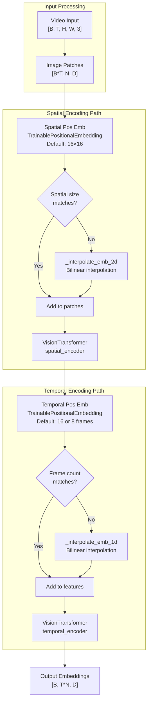
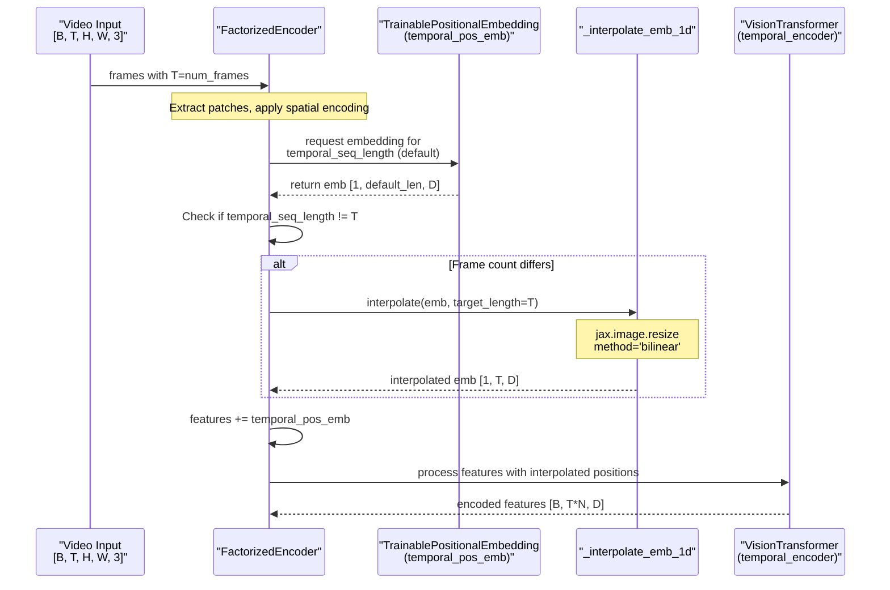
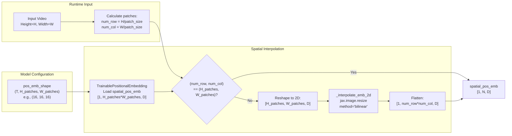
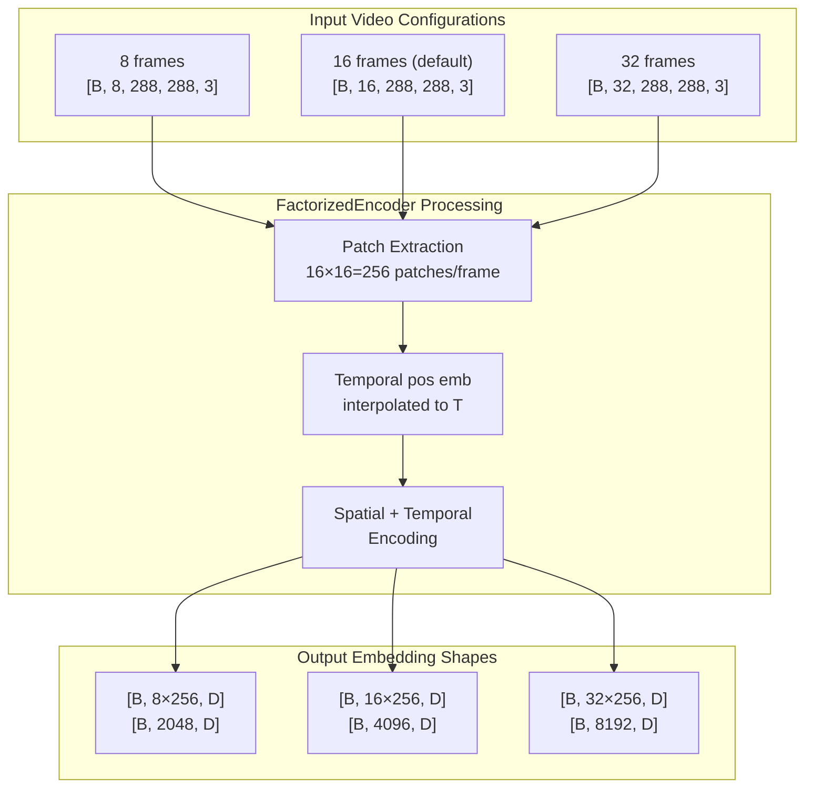
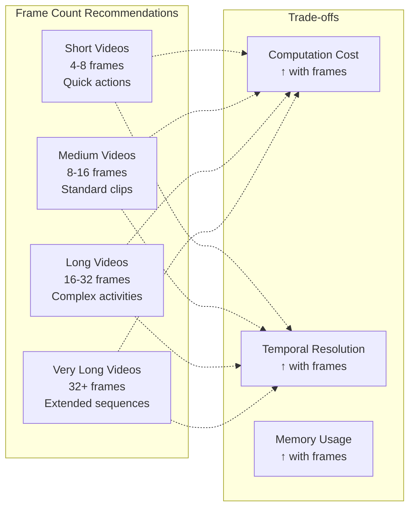

<!-- source: DeepWiki mcp.deepwiki.com · repo google-deepmind/videoprism · page 5.4 Working with Variable Frame Counts · fetched 2026-10-26 -->

# Working with Variable Frame Counts

<details>
<summary>Relevant source files</summary>

The following files were used as context for generating this wiki page:

- [README.md](README.md)
- [videoprism/encoders.py](videoprism/encoders.py)

</details>


## Purpose and Scope

This page explains how VideoPrism models handle videos with varying numbers of frames through position embedding interpolation. VideoPrism models are trained with specific frame counts (16 frames for VideoPrism-B, 8 frames for VideoPrism-L) but can process videos with arbitrary frame counts at inference time. This flexibility is achieved through automatic interpolation of positional embeddings to match the input video's temporal length.

For general video feature extraction workflows, see [Video Feature Extraction](#5.1). For information about model architectures, see [FactorizedEncoder](#4.2.1).

---

## Position Embedding Interpolation Overview

VideoPrism uses **trainable positional embeddings** to encode spatial and temporal information in video sequences. When a video with a different number of frames is provided at inference time, the model automatically interpolates the learned positional embeddings to match the new sequence length.

### Interpolation Architecture



**Sources:** [videoprism/encoders.py:391-580](), [videoprism/encoders.py:107-166]()

---

## Temporal Position Embedding Interpolation

The temporal position embedding interpolation enables the model to process videos with different numbers of frames than the training configuration.

### Code Implementation Flow



**Sources:** [videoprism/encoders.py:543-553](), [videoprism/encoders.py:107-128]()

### Implementation Details

The temporal interpolation occurs in `FactorizedEncoder.encode_with_patches`:

**Key Code Locations:**

| Component | File Location | Purpose |
|-----------|---------------|---------|
| `TrainablePositionalEmbedding` | [videoprism/encoders.py:269-308]() | Learns temporal position embeddings |
| `_interpolate_emb_1d` | [videoprism/encoders.py:107-128]() | Performs 1D bilinear interpolation |
| Temporal interpolation logic | [videoprism/encoders.py:543-553]() | Conditionally interpolates based on frame count |
| `pos_emb_shape[0]` | [videoprism/encoders.py:401]() | Stores default temporal sequence length |

**Interpolation Process:**

1. **Retrieve learned embeddings:** The model loads temporal positional embeddings trained at the default sequence length (stored in `pos_emb_shape[0]`)
2. **Check frame count:** Compares input frame count `t` against `temporal_seq_length`
3. **Interpolate if needed:** If counts differ, calls `_interpolate_emb_1d(temporal_pos_emb, t)`
4. **Apply to features:** Adds interpolated embeddings to feature tensor before temporal encoding

**Sources:** [videoprism/encoders.py:543-553]()

---

## Spatial Position Embedding Interpolation

While less commonly modified, spatial position embeddings are also interpolated when input resolution differs from the training configuration.

### Spatial Interpolation Implementation



**Sources:** [videoprism/encoders.py:497-514](), [videoprism/encoders.py:131-166]()

---

## Default Training Configurations

Each VideoPrism model variant is trained with specific frame counts and spatial resolutions that define the default position embedding shapes.

### Model Configuration Table

| Model | Configuration Name | Default Frames | Spatial Resolution | `pos_emb_shape` | Patch Size |
|-------|-------------------|----------------|-------------------|-----------------|------------|
| VideoPrism-B | `videoprism_public_v1_base` | 16 | 288×288 | (16, 16, 16) | 18 |
| VideoPrism-L | `videoprism_public_v1_large` | 8 | 288×288 | (8, 16, 16) | 18 |
| VideoPrism-LvT-B | `videoprism_lvt_public_v1_base` | 16 | 288×288 | (16, 16, 16) | 18 |
| VideoPrism-LvT-L | `videoprism_lvt_public_v1_large` | 8 | 288×288 | (8, 16, 16) | 18 |

**Note:** The `pos_emb_shape` tuple represents `(temporal_length, spatial_height, spatial_width)` in terms of patch counts.

**Sources:** [README.md:99-106]()

### Calculating Spatial Patches

For an input video with shape `[B, T, 288, 288, 3]` and `patch_size=18`:
- Number of row patches: `288 / 18 = 16`
- Number of column patches: `288 / 18 = 16`
- Total patches per frame: `16 × 16 = 256`
- Total patches for T frames: `T × 256`

**Sources:** [videoprism/encoders.py:506-513]()

---

## Practical Usage Examples

### Using Different Frame Counts

The models automatically handle frame count variations without requiring any special configuration:

```python
import jax
from videoprism import models as vp

# Load model
model_name = 'videoprism_public_v1_base'  # Trained with 16 frames
flax_model = vp.get_model(model_name)
loaded_state = vp.load_pretrained_weights(model_name)

@jax.jit
def forward_fn(inputs):
    return flax_model.apply(loaded_state, inputs, train=False)

# Example 1: Use with 8 frames (fewer than training)
video_8_frames = ...  # Shape: [batch_size, 8, 288, 288, 3]
outputs_8, _ = forward_fn(video_8_frames)
# Output shape: [batch_size, 8*256, feature_channels]

# Example 2: Use with 32 frames (more than training)
video_32_frames = ...  # Shape: [batch_size, 32, 288, 288, 3]
outputs_32, _ = forward_fn(video_32_frames)
# Output shape: [batch_size, 32*256, feature_channels]

# Example 3: Use with exactly training frame count
video_16_frames = ...  # Shape: [batch_size, 16, 288, 288, 3]
outputs_16, _ = forward_fn(video_16_frames)
# Output shape: [batch_size, 16*256, feature_channels]
# No interpolation occurs - uses learned embeddings directly
```

**Sources:** [README.md:49-63](), [README.md:99-106]()

### Understanding Output Shapes

The output embedding shape scales with the number of input frames:



**Sources:** [README.md:99-106](), [videoprism/encoders.py:570-572]()

---

## Interpolation Method Details

### Bilinear Interpolation via JAX

Both temporal and spatial interpolations use JAX's built-in `jax.image.resize` function with bilinear interpolation:

**Temporal Interpolation (_interpolate_emb_1d):**

```python
# From videoprism/encoders.py:107-128
def _interpolate_emb_1d(emb: Array, target_emb_length: int) -> Array:
    """Interpolates a 1D positional embedding to a new shape.
    
    Args:
      emb: jax.Array, (1, N, D), flattened 1D positional embedding.
      target_emb_length: length of the target embedding.
    
    Returns:
      Flattened, interpolated embedding of shape (1, target_emb_length, D)
    """
    # emb shape: (1, N, D) -> squeeze -> (N, D)
    # Resize using bilinear interpolation
    target_emb = jax.image.resize(
        emb, (target_emb_length, emb_dim), method='bilinear'
    )
    # Reshape back to (1, target_emb_length, D)
    return target_emb
```

**Spatial Interpolation (_interpolate_emb_2d):**

```python
# From videoprism/encoders.py:131-166
def _interpolate_emb_2d(
    emb: Array,
    source_emb_shape: tuple[int, int],
    target_emb_shape: tuple[int, int],
) -> Array:
    """Interpolates a 2D positional embedding to a new shape.
    
    Args:
      emb: A jax.Array of shape (1, H1×W1, D) for flattened 2D positional
        embedding.
      source_emb_shape: Tuple, (H1, W1), height and width of the source embedding.
      target_emb_shape: Tuple, (H2, W2), height and width of the target embedding.
    
    Returns:
      Flattened, interpolated embedding of shape (1, H2×W2, D)
    """
    # Reshape (1, H1*W1, D) -> (H1, W1, D)
    # Resize using bilinear interpolation
    target_emb = jax.image.resize(
        emb,
        (target_emb_shape[0], target_emb_shape[1], emb_dim),
        method='bilinear',
    )
    # Flatten back to (1, H2*W2, D)
    return target_emb
```

**Sources:** [videoprism/encoders.py:107-166]()

---

## Performance Considerations

### Computational Complexity

The computational cost scales approximately linearly with the number of frames:

| Aspect | Scaling Behavior |
|--------|-----------------|
| **Temporal attention complexity** | O(T²) per spatial token, where T is frame count |
| **Total token count** | T × 256 tokens (for 288×288 input) |
| **Memory usage** | Linear in T × N × D (frames × patches × dimensions) |
| **Interpolation overhead** | Negligible compared to transformer processing |

### Recommended Frame Counts



**Guidelines:**
- **Near training frame count:** Using frame counts close to the training configuration (16 for Base, 8 for Large) minimizes interpolation artifacts
- **Power-of-2 frame counts:** Frame counts like 8, 16, 32 often provide good balance between temporal resolution and computational efficiency
- **Very long videos:** For videos longer than 64 frames, consider temporal sampling or processing in overlapping windows
- **Very short videos:** Frame counts below 4 may lose temporal context; consider frame duplication if needed

**Sources:** [README.md:99-106]()

---

## Integration with Model Architecture

### Position Embedding Flow in FactorizedEncoder

```mermaid
graph TB
    subgraph Initialization["Model Initialization"]
        CONFIG["Model Config<br/>pos_emb_shape=(T_train, H, W)"]
        CREATE_SPATIAL["Create TrainablePositionalEmbedding<br/>name='spatial_pos_emb'<br/>max_seq_length=H*W"]
        CREATE_TEMPORAL["Create TrainablePositionalEmbedding<br/>name='temporal_pos_emb'<br/>max_seq_length=T_train"]
    end
    
    subgraph Runtime["Runtime (Forward Pass)"]
        INPUT_VIDEO["Input: [B, T_input, H_input, W_input, 3]"]
        CALC_PATCHES["Calculate patch counts:<br/>H_p = H_input/patch_size<br/>W_p = W_input/patch_size"]
        
        SPATIAL_CHECK{"H_p*W_p<br/>== H*W?"}
        SPATIAL_USE["Use learned<br/>spatial embeddings"]
        SPATIAL_INTERP_CALL["Call _interpolate_emb_2d<br/>(spatial_pos_emb,<br/>(H, W), (H_p, W_p))"]
        
        SPATIAL_ENC["Apply spatial_encoder<br/>VisionTransformer"]
        
        TEMPORAL_CHECK{"T_input<br/>== T_train?"}
        TEMPORAL_USE["Use learned<br/>temporal embeddings"]
        TEMPORAL_INTERP_CALL["Call _interpolate_emb_1d<br/>(temporal_pos_emb,<br/>T_input)"]
        
        TEMPORAL_ENC["Apply temporal_encoder<br/>VisionTransformer"]
        OUTPUT["Output: [B, T_input*N, D]"]
    end
    
    CONFIG --> CREATE_SPATIAL
    CONFIG --> CREATE_TEMPORAL
    
    INPUT_VIDEO --> CALC_PATCHES
    CALC_PATCHES --> SPATIAL_CHECK
    SPATIAL_CHECK -->|Yes| SPATIAL_USE
    SPATIAL_CHECK -->|No| SPATIAL_INTERP_CALL
    SPATIAL_USE --> SPATIAL_ENC
    SPATIAL_INTERP_CALL --> SPATIAL_ENC
    
    SPATIAL_ENC --> TEMPORAL_CHECK
    TEMPORAL_CHECK -->|Yes| TEMPORAL_USE
    TEMPORAL_CHECK -->|No| TEMPORAL_INTERP_CALL
    TEMPORAL_USE --> TEMPORAL_ENC
    TEMPORAL_INTERP_CALL --> TEMPORAL_ENC
    
    TEMPORAL_ENC --> OUTPUT
```



**Sources:** [videoprism/encoders.py:391-580]()

---

## Common Use Cases

### Video Classification with Variable Lengths

```python
# Videos of different lengths in the same batch
# Note: Typically you'd use frame_paddings to handle this properly

import jax.numpy as jnp

# Shorter video: pad to consistent shape or process separately
video_short = ...  # [1, 8, 288, 288, 3]
outputs_short, _ = forward_fn(video_short)  # [1, 2048, D]

# Longer video
video_long = ...  # [1, 24, 288, 288, 3]
outputs_long, _ = forward_fn(video_long)  # [1, 6144, D]

# Pool outputs to fixed size for classification
pooled_short = jnp.mean(outputs_short, axis=1)  # [1, D]
pooled_long = jnp.mean(outputs_long, axis=1)   # [1, D]
```

### Temporal Action Localization

```python
# Process long video with many frames for temporal localization
long_video = ...  # [1, 64, 288, 288, 3]
embeddings, _ = forward_fn(long_video)  # [1, 64*256, D]

# Reshape to [1, 64, 256, D] for per-frame analysis
batch_size = 1
num_frames = 64
patches_per_frame = 256
embeddings_per_frame = embeddings.reshape(
    batch_size, num_frames, patches_per_frame, -1
)

# Pool spatial dimension to get per-frame features
frame_features = jnp.mean(embeddings_per_frame, axis=2)  # [1, 64, D]
# Now apply temporal action localization on frame_features
```

**Sources:** [README.md:99-106]()

---

## Limitations and Constraints

### Input Requirements

| Constraint | Value | Notes |
|------------|-------|-------|
| **Spatial Resolution** | 288×288 | Fixed, must be pre-processed to this size |
| **Patch Size** | 18 | Fixed by model architecture |
| **Minimum Frames** | 1 | Theoretically supported but may lose temporal context |
| **Maximum Frames** | No hard limit | Memory and computation grow linearly with frame count |
| **RGB Normalization** | [0.0, 1.0] | Input values must be normalized to this range |

### Interpolation Quality

- **Nearest to training configuration:** Best quality when frame count is close to the training frame count (16 for Base, 8 for Large)
- **Significant deviation:** Large differences (e.g., 100+ frames on a model trained with 16) may introduce interpolation artifacts
- **Bilinear method:** Uses bilinear interpolation which provides smooth transitions but may blur high-frequency positional patterns

**Sources:** [README.md:99-106](), [videoprism/encoders.py:107-166]()

---

## Summary

VideoPrism's variable frame count support provides flexibility for processing videos of different lengths through automatic position embedding interpolation:

1. **Automatic interpolation:** No user configuration required; the model detects frame count mismatches and interpolates automatically
2. **Bilinear method:** Uses JAX's `jax.image.resize` with bilinear interpolation for smooth embedding adaptation
3. **Both dimensions:** Supports interpolation for both temporal (frame count) and spatial (resolution) dimensions
4. **Training configurations:** VideoPrism-B trained with 16 frames, VideoPrism-L with 8 frames
5. **Linear scaling:** Output shape and computational cost scale linearly with frame count

**Key Code Components:**
- `_interpolate_emb_1d` - [videoprism/encoders.py:107-128]()
- `_interpolate_emb_2d` - [videoprism/encoders.py:131-166]()
- Temporal interpolation logic - [videoprism/encoders.py:543-553]()
- Spatial interpolation logic - [videoprism/encoders.py:497-514]()

---

