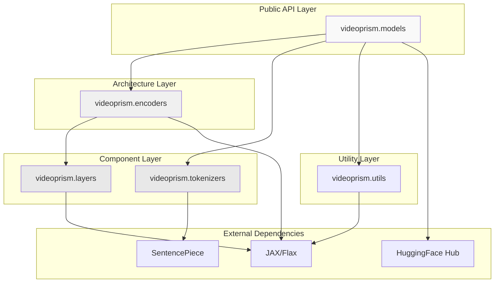
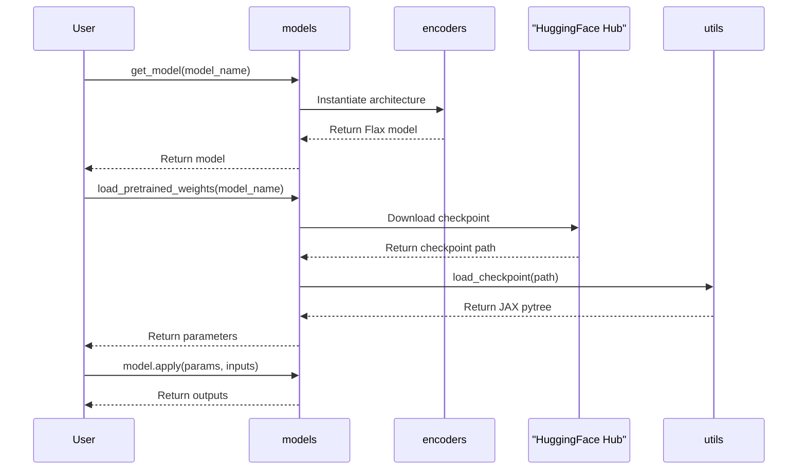
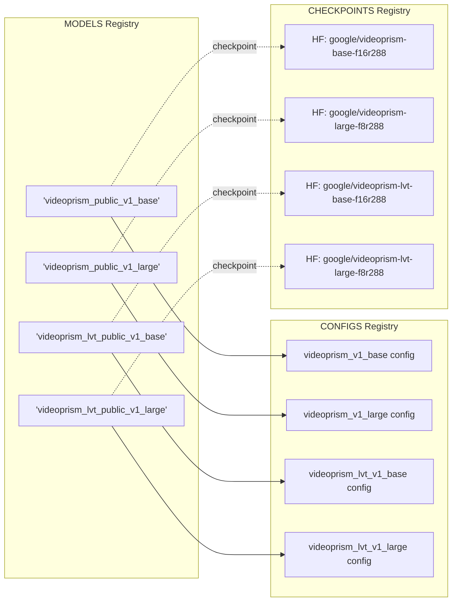
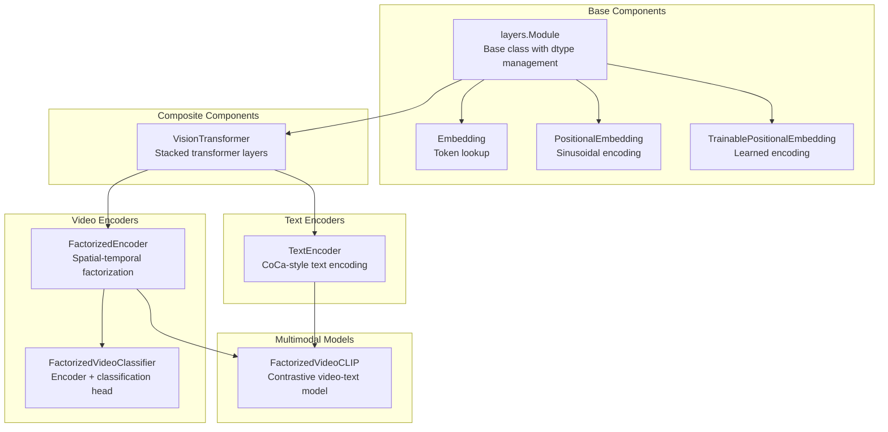
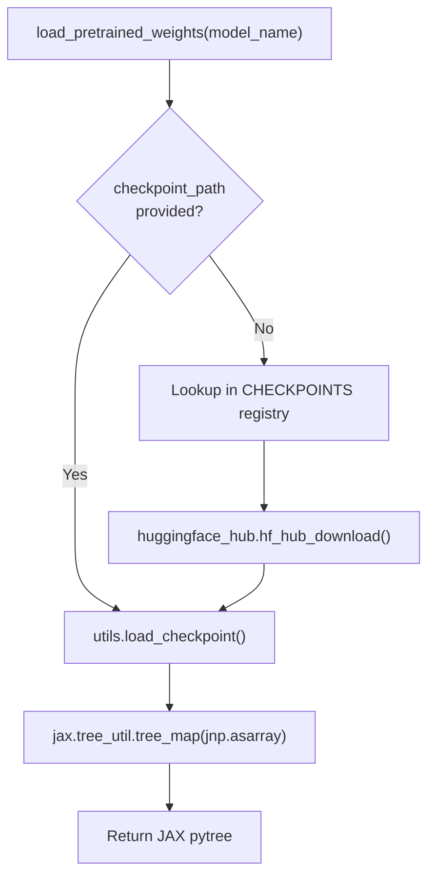
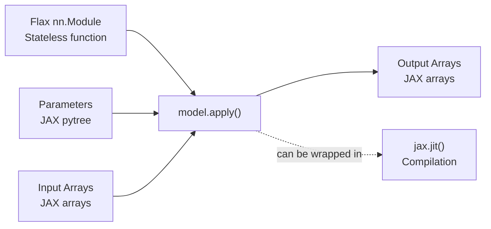

<!-- source: DeepWiki mcp.deepwiki.com · repo google-deepmind/videoprism · page 6 API Reference · fetched 2026-10-26 -->

# API Reference

<details>
<summary>Relevant source files</summary>

The following files were used as context for generating this wiki page:

- [videoprism/encoders.py](videoprism/encoders.py)
- [videoprism/models.py](videoprism/models.py)

</details>


This document provides a comprehensive reference for the VideoPrism public API. It covers all modules, classes, and functions available for loading models, extracting features, and processing video and text inputs.

For practical usage examples, see [Usage Guide](#5). For architectural details about how these components work internally, see [Core Architecture](#4).

## Overview

The VideoPrism API is organized into five main modules:

| Module | Purpose | Key Functions/Classes |
|--------|---------|----------------------|
| `videoprism.models` | Model registry, loading, and tokenization | `get_model()`, `load_pretrained_weights()`, `tokenize_texts()` |
| `videoprism.encoders` | Neural network architectures | `FactorizedEncoder`, `FactorizedVideoCLIP`, `TextEncoder` |
| `videoprism.layers` | Transformer building blocks | `Transformer`, `DotProductAttention`, `LayerNorm` |
| `videoprism.tokenizers` | Text tokenization utilities | `SentencePieceTokenizer`, `Tokenizer` protocol |
| `videoprism.utils` | Helper functions | `load_checkpoint()`, `canonicalize_text()` |

Detailed API documentation for each module is available on the following pages:
- [videoprism.models](#6.1)
- [videoprism.encoders](#6.2)
- [videoprism.layers](#6.3)
- [videoprism.tokenizers](#6.4)
- [videoprism.utils](#6.5)

## Module Dependency Structure



**Sources:** [videoprism/models.py:1-408](), [videoprism/encoders.py:1-911]()

## Core API Pattern

The VideoPrism API follows a two-phase initialization pattern:



**Sources:** [videoprism/models.py:268-337]()

## Quick Reference: Common Usage Patterns

### Pattern 1: Load and Use a Video Encoder

```python
from videoprism import models as vp

# Phase 1: Get model architecture
model = vp.get_model('videoprism_public_v1_base')

# Phase 2: Load pretrained weights
params = vp.load_pretrained_weights('videoprism_public_v1_base')

# Phase 3: Apply model
outputs, _ = model.apply(params, video_inputs, train=False)
```

### Pattern 2: Load and Use a Video-Text Model

```python
from videoprism import models as vp

# Get model and weights
model = vp.get_model('videoprism_lvt_public_v1_base')
params = vp.load_pretrained_weights('videoprism_lvt_public_v1_base')

# Load tokenizer for text processing
tokenizer = vp.load_text_tokenizer('c4_en')
token_ids, paddings = vp.tokenize_texts(tokenizer, text_list)

# Apply model to both modalities
video_emb, text_emb, _ = model.apply(
    params, video_inputs, token_ids, paddings, train=False
)
```

### Pattern 3: Use Custom Checkpoint Path

```python
from videoprism import models as vp

model = vp.get_model('videoprism_public_v1_base')
params = vp.load_pretrained_weights(
    model_name=None,
    checkpoint_path='/path/to/checkpoint.npz'
)
```

**Sources:** [videoprism/models.py:15-36](), [videoprism/models.py:268-337]()

## Model Registry System

The `models` module maintains three core registries that map model names to their configurations, architectures, and checkpoints:



**Sources:** [videoprism/models.py:62-233]()

## Encoder Architecture Hierarchy



**Sources:** [videoprism/encoders.py:168-911]()

## Input/Output Specifications

### Video-Only Models (FactorizedEncoder)

| Input | Shape | Type | Description |
|-------|-------|------|-------------|
| `inputs` | `(B, T, H, W, 3)` | `jax.Array` | Video frames, normalized to [0, 1] |
| `train` | scalar | `bool` | Training mode flag |
| `frame_paddings` | `(B, T)` | `jax.Array` | Optional padding mask (1 = padding) |

| Output | Shape | Type | Description |
|--------|-------|------|-------------|
| `embeddings` | `(B, T*N, D)` | `jax.Array` | Spatiotemporal features |
| `outputs` | dict | `dict[str, Array]` | Optional intermediate features |

**Sources:** [videoprism/encoders.py:411-456]()

### Video-Text Models (FactorizedVideoCLIP)

| Input | Shape | Type | Description |
|-------|-------|------|-------------|
| `inputs` | `(B, T, H, W, 3)` | `jax.Array` | Video frames (optional) |
| `text_token_ids` | `(B, L)` | `jax.Array` | Text token IDs (optional) |
| `text_paddings` | `(B, L)` | `jax.Array` | Text padding mask (required if text provided) |
| `train` | scalar | `bool` | Training mode flag |
| `normalize` | scalar | `bool` | Whether to L2-normalize embeddings |

| Output | Shape | Type | Description |
|--------|-------|------|-------------|
| `video_embeddings` | `(B, D)` | `jax.Array` | Global video embedding (if video provided) |
| `text_embeddings` | `(B, D)` | `jax.Array` | Global text embedding (if text provided) |
| `outputs` | dict | `dict[str, Array]` | Optional intermediate features |

**Sources:** [videoprism/encoders.py:783-910]()

## Text Processing Pipeline


**Sources:** [videoprism/models.py:355-407]()

## Model Configuration Parameters

### FactorizedEncoder Configuration

| Parameter | Type | Description | Default |
|-----------|------|-------------|---------|
| `patch_size` | `int` | Dimension of square video patches | 18 |
| `pos_emb_shape` | `tuple[int, int, int]` | Positional embedding shape (T, H, W) | (16, 16, 16) |
| `model_dim` | `int` | Model hidden dimension | 768 |
| `num_spatial_layers` | `int` | Number of spatial transformer layers | 12 |
| `num_temporal_layers` | `int` | Number of temporal transformer layers | 4 |
| `num_heads` | `int` | Number of attention heads | 12 |
| `mlp_dim` | `int` | MLP hidden dimension | 3072 |
| `atten_logit_cap` | `float` | Attention logit capping value | 50.0 |
| `scan` | `bool` | Use nn.scan for memory efficiency | True |

**Sources:** [videoprism/encoders.py:391-409](), [videoprism/models.py:82-161]()

### FactorizedVideoCLIP Configuration

All FactorizedEncoder parameters plus:

| Parameter | Type | Description | Default |
|-----------|------|-------------|---------|
| `vocabulary_size` | `int` | Size of text vocabulary | 32000 |
| `num_unimodal_layers` | `int` | Number of text encoder layers | 12 |
| `num_auxiliary_layers` | `int` | Additional vision encoder layers | 2 |
| `enable_causal_atten` | `bool` | Enable causal masking in text encoder | True |
| `norm_policy` | `str` | Normalization policy ('pre', 'post', etc.) | 'pre' |

**Sources:** [videoprism/encoders.py:762-781](), [videoprism/models.py:116-160]()

## Checkpoint Loading Process



**Sources:** [videoprism/models.py:306-336]()

## Return Value Structure

### Basic Encoder Output

When `return_intermediate=False` (default):
```python
embeddings, outputs = model.apply(params, inputs, train=False)
# embeddings: (B, T*N, D)
# outputs: {} (empty dict)
```

### With Intermediate Features

When `return_intermediate=True` or `return_intermediate={'spatial_features'}`:
```python
embeddings, outputs = model.apply(
    params, inputs, train=False, return_intermediate=True
)
# embeddings: (B, T*N, D)
# outputs: {
#   'spatial_features': (B, T*N, D)  # From spatial encoder
# }
```

**Sources:** [videoprism/encoders.py:411-456](), [videoprism/encoders.py:574-579]()

## Available Model Variants

### Video-Only Models

| Model Name | Architecture | Parameters | Config |
|------------|-------------|------------|--------|
| `videoprism_public_v1_base` | FactorizedEncoder | 114M | ViT-B, 16 frames, 12 spatial + 4 temporal layers |
| `videoprism_public_v1_large` | FactorizedEncoder | 354M | ViT-L, 8 frames, 24 spatial + 4 temporal layers |

### Video-Text Models

| Model Name | Architecture | Parameters | Config |
|------------|-------------|------------|--------|
| `videoprism_lvt_public_v1_base` | FactorizedVideoCLIP | 248M | ViT-B + text encoder, 16 frames |
| `videoprism_lvt_public_v1_large` | FactorizedVideoCLIP | 580M | ViT-L + text encoder, 8 frames |

**Sources:** [videoprism/models.py:62-80](), [videoprism/models.py:224-233]()

## Function Signatures Summary

### Core Model Functions

```python
def has_model(
    model_name: str,
    models: Mapping[str, Callable[[], nn.Module]] | None = None,
) -> bool

def get_model(
    model_name: str | None,
    model_fn: Callable[[], nn.Module] | None = None,
    models: Mapping[str, Callable[[], nn.Module]] | None = None,
    fprop_dtype: jax.typing.DTypeLike | None = None,
) -> nn.Module

def load_pretrained_weights(
    model_name: str | None,
    checkpoint_path: str | None = None,
    checkpoints: Mapping[str, str | tuple[str, str]] | None = None,
) -> jax.Array

def load_text_tokenizer(name: str) -> tokenizers.Tokenizer

def tokenize_texts(
    tokenizer: tokenizers.Tokenizer,
    inputs: Sequence[str],
    max_length: int = 64,
    add_bos: bool | None = None,
    canonicalize: bool = True,
) -> tuple[np.ndarray, np.ndarray]
```

**Sources:** [videoprism/models.py:255-407]()

## JAX/Flax Integration

VideoPrism models are implemented as Flax `nn.Module` subclasses. The standard pattern for using them with JAX is:



**Sources:** [videoprism/models.py:22-36](), [videoprism/encoders.py:24-31]()

## Constants and Defaults

| Constant | Value | Purpose |
|----------|-------|---------|
| `TEXT_MAX_LEN` | 64 | Default maximum text sequence length |
| `K400_NUM_CLASSES` | 400 | Kinetics-400 dataset class count |
| `SSV2_NUM_CLASSES` | 174 | Something-Something-v2 dataset class count |

### Text Tokenizer Registry

| Name | Vocab Size | Model Path |
|------|-----------|------------|
| `c4_en` | 32,000 | `gs://t5-data/vocabs/cc_en.32000/sentencepiece.model` |

**Sources:** [videoprism/models.py:51-60]()

## Error Handling

Common errors and their causes:

| Error | Cause | Solution |
|-------|-------|----------|
| `ValueError: Model X not found` | Invalid model name | Use one of the registered model names |
| `ValueError: Text tokenizer X not found` | Invalid tokenizer name | Use 'c4_en' or register custom tokenizer |
| `AssertionError: Text paddings are required` | Missing text_paddings argument | Provide paddings when using text_token_ids |
| `ValueError: Image height/width not multiple of patch_size` | Invalid input resolution | Resize to multiple of 18 (default patch_size) |

**Sources:** [videoprism/models.py:268-352](), [videoprism/encoders.py:80-90](), [videoprism/encoders.py:887-888]()

---

For detailed documentation of each module's classes, methods, and parameters, refer to the following pages:

- **[videoprism.models API](#6.1)** - Complete reference for model loading and management
- **[videoprism.encoders API](#6.2)** - Encoder architecture specifications
- **[videoprism.layers API](#6.3)** - Transformer layer components
- **[videoprism.tokenizers API](#6.4)** - Text tokenization interfaces
- **[videoprism.utils API](#6.5)** - Utility function reference

---

