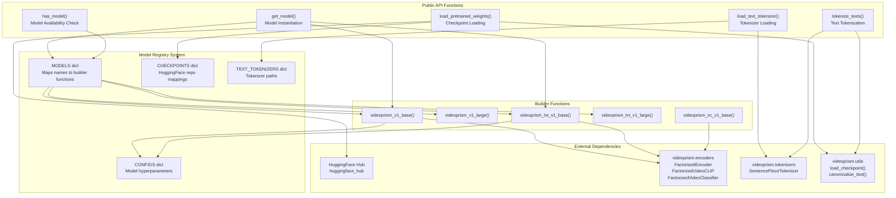
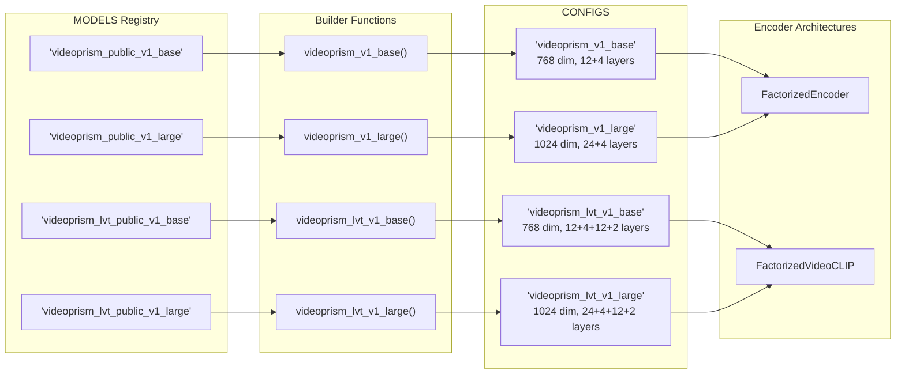
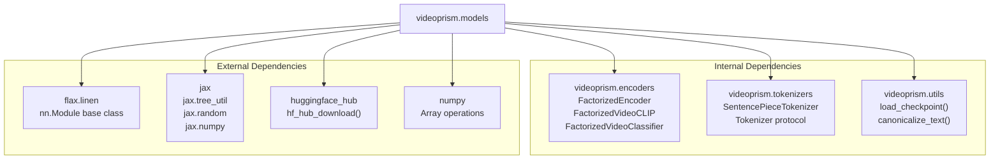

<!-- source: DeepWiki mcp.deepwiki.com · repo google-deepmind/videoprism · page 6.1 videoprism.models · fetched 2026-10-26 -->

# videoprism.models

<details>
<summary>Relevant source files</summary>

The following files were used as context for generating this wiki page:

- [videoprism/models.py](videoprism/models.py)
- [videoprism/models_test.py](videoprism/models_test.py)

</details>


## Purpose and Scope

This page documents the API reference for the `videoprism.models` module, which provides the primary interface for instantiating VideoPrism models and loading pre-trained weights. This module serves as the central registry and factory for all model variants, managing configurations, checkpoints, and model builders.

**Related pages:**
- For architectural details of the encoder implementations, see [videoprism.encoders](#6.2)
- For practical usage examples, see [Video Feature Extraction](#5.1) and [Video-Text Retrieval](#5.2)
- For configuration details, see [Model Configurations](#8.1) and [Checkpoint Registry](#8.2)

**Sources:** [videoprism/models.py:1-37]()

---

## Module Overview

The `videoprism.models` module acts as the coordination layer between users and the underlying encoder architectures. It manages three core registries (`MODELS`, `CONFIGS`, `CHECKPOINTS`) and provides functions to instantiate models and load pre-trained weights from HuggingFace Hub.

### Architecture of the Models Module



**Sources:** [videoprism/models.py:38-408]()

---

## Model Registry System

The module uses three primary dictionaries to manage model variants, configurations, and checkpoints.

### MODELS Dictionary

Maps model names to builder functions. This is the primary registry for publicly available models.

**Structure:** `dict[str, Callable[[], nn.Module]]`

| Model Name | Builder Function | Architecture |
|------------|------------------|--------------|
| `videoprism_public_v1_base` | `videoprism_v1_base` | FactorizedEncoder |
| `videoprism_public_v1_large` | `videoprism_v1_large` | FactorizedEncoder |
| `videoprism_lvt_public_v1_base` | `videoprism_lvt_v1_base` | FactorizedVideoCLIP |
| `videoprism_lvt_public_v1_large` | `videoprism_lvt_v1_large` | FactorizedVideoCLIP |

**Sources:** [videoprism/models.py:224-233]()

### CONFIGS Dictionary

Stores hyperparameter configurations for all model variants (including non-public giant variants).

**Structure:** `dict[str, dict[str, Any]]`

**Key Parameters:**
- `patch_size`: Spatial patch size (default: 18)
- `pos_emb_shape`: Positional embedding shape (T, H, W)
- `model_dim`: Hidden dimension size
- `num_spatial_layers`: Number of spatial transformer layers
- `num_temporal_layers`: Number of temporal transformer layers
- `num_heads`: Number of attention heads
- `mlp_dim`: Feed-forward network dimension
- `atten_logit_cap`: Attention logit capping value
- `scan`: Whether to use JAX scan for layer loops

**Video-Text Specific Parameters:**
- `vocabulary_size`: Text tokenizer vocabulary size
- `num_auxiliary_layers`: Number of auxiliary text layers
- `enable_causal_atten`: Enable causal attention for text
- `num_unimodal_layers`: Number of text-only transformer layers
- `norm_policy`: Normalization policy ('pre', 'primer_hybrid')

**Sources:** [videoprism/models.py:82-161]()

### CHECKPOINTS Dictionary

Maps model names to HuggingFace Hub repository IDs and checkpoint filenames.

**Structure:** `dict[str, tuple[str, str]]`

| Model Name | HuggingFace Repo | Filename |
|------------|------------------|----------|
| `videoprism_public_v1_base` | `google/videoprism-base-f16r288` | `flax_base_f16r288_repeated.npz` |
| `videoprism_public_v1_large` | `google/videoprism-large-f8r288` | `flax_large_f8r288_repeated.npz` |
| `videoprism_lvt_public_v1_base` | `google/videoprism-lvt-base-f16r288` | `flax_lvt_base_f16r288_repeated.npz` |
| `videoprism_lvt_public_v1_large` | `google/videoprism-lvt-large-f8r288` | `flax_lvt_large_f8r288_repeated.npz` |

**Sources:** [videoprism/models.py:62-80]()

### TEXT_TOKENIZERS Dictionary

Defines available text tokenizers with their paths and vocabulary sizes.

**Structure:** `dict[str, dict[str, str | int]]`

Currently contains:
- `c4_en`: C4 English tokenizer (32,000 vocab size, SentencePiece model)

**Sources:** [videoprism/models.py:54-60]()

---

## Public API Functions

### get_model()

Instantiates a Flax model by name or custom builder function.

**Signature:**
```python
def get_model(
    model_name: str | None,
    model_fn: Callable[[], nn.Module] | None = None,
    models: Mapping[str, Callable[[], nn.Module]] | None = None,
    fprop_dtype: jax.typing.DTypeLike | None = None,
) -> nn.Module
```

**Parameters:**
- `model_name`: Model identifier (e.g., `'videoprism_public_v1_base'`) or HuggingFace model ID (e.g., `'google/videoprism-base-f16r288'`)
- `model_fn`: Optional custom model builder function (overrides `model_name`)
- `models`: Custom model registry (defaults to `MODELS`)
- `fprop_dtype`: Optional dtype for forward propagation

**Returns:** Instantiated Flax `nn.Module`

**Raises:** `ValueError` if model name not found

**Example:**
```python
model = models.get_model('videoprism_public_v1_base')
# Or using HuggingFace ID:
model = models.get_model('google/videoprism-base-f16r288')
```

**Sources:** [videoprism/models.py:268-303]()

### load_pretrained_weights()

Downloads and loads pre-trained model weights from HuggingFace Hub or local path.

**Signature:**
```python
def load_pretrained_weights(
    model_name: str | None,
    checkpoint_path: str | None = None,
    checkpoints: Mapping[str, str | tuple[str, str]] | None = None,
) -> PyTree
```

**Parameters:**
- `model_name`: Model identifier or HuggingFace model ID
- `checkpoint_path`: Optional local checkpoint path (overrides `model_name`)
- `checkpoints`: Custom checkpoint registry (defaults to `CHECKPOINTS`)

**Returns:** JAX PyTree containing model parameters

**Example:**
```python
params = models.load_pretrained_weights('videoprism_public_v1_base')
# Or from local path:
params = models.load_pretrained_weights(None, checkpoint_path='/path/to/checkpoint.npz')
```

**Sources:** [videoprism/models.py:306-336]()

### Model Instantiation and Loading Flow

```mermaid
sequenceDiagram
    participant User
    participant get_model
    participant MODELS
    participant builder["Builder Function<br/>(e.g., videoprism_v1_base)"]
    participant CONFIGS
    participant encoders["videoprism.encoders"]
    
    participant load_weights["load_pretrained_weights()"]
    participant CHECKPOINTS
    participant HF["HuggingFace Hub"]
    participant utils["utils.load_checkpoint()"]
    
    User->>get_model: get_model('videoprism_public_v1_base')
    get_model->>MODELS: Lookup model name
    MODELS-->>get_model: Return builder function
    get_model->>builder: Call builder()
    builder->>CONFIGS: Retrieve config dict
    CONFIGS-->>builder: Return hyperparameters
    builder->>encoders: FactorizedEncoder(**config)
    encoders-->>builder: Return model instance
    builder-->>get_model: Return model
    get_model-->>User: Return Flax model
    
    User->>load_weights: load_pretrained_weights('videoprism_public_v1_base')
    load_weights->>CHECKPOINTS: Lookup checkpoint info
    CHECKPOINTS-->>load_weights: (repo_id, filename)
    load_weights->>HF: hf_hub_download(repo_id, filename)
    HF-->>load_weights: Local checkpoint path
    load_weights->>utils: load_checkpoint(path)
    utils-->>load_weights: Parameters PyTree
    load_weights-->>User: Return parameters
```

**Sources:** [videoprism/models.py:268-336]()

### has_model()

Checks if a model is available in the registry.

**Signature:**
```python
def has_model(
    model_name: str,
    models: Mapping[str, Callable[[], nn.Module]] | None = None,
) -> bool
```

**Parameters:**
- `model_name`: Model identifier or HuggingFace model ID
- `models`: Custom model registry (defaults to `MODELS`)

**Returns:** `True` if model exists, `False` otherwise

**Example:**
```python
if models.has_model('videoprism_public_v1_base'):
    model = models.get_model('videoprism_public_v1_base')
```

**Sources:** [videoprism/models.py:255-265]()

### load_text_tokenizer()

Loads a SentencePiece tokenizer by name.

**Signature:**
```python
def load_text_tokenizer(name: str) -> tokenizers.Tokenizer
```

**Parameters:**
- `name`: Tokenizer name from `TEXT_TOKENIZERS` (currently only `'c4_en'`)

**Returns:** `SentencePieceTokenizer` instance

**Raises:** `ValueError` if tokenizer name not found

**Example:**
```python
tokenizer = models.load_text_tokenizer('c4_en')
```

**Sources:** [videoprism/models.py:339-352]()

### tokenize_texts()

Tokenizes a batch of text strings with padding.

**Signature:**
```python
def tokenize_texts(
    tokenizer: tokenizers.Tokenizer,
    inputs: Sequence[str],
    max_length: int = TEXT_MAX_LEN,
    add_bos: bool | None = None,
    canonicalize: bool = True,
) -> tuple[np.ndarray, np.ndarray]
```

**Parameters:**
- `tokenizer`: Tokenizer instance (from `load_text_tokenizer()`)
- `inputs`: List of text strings
- `max_length`: Maximum sequence length (default: 64)
- `add_bos`: Add beginning-of-sentence token (auto-detected if `None`)
- `canonicalize`: Apply text canonicalization (lowercase, punctuation removal)

**Returns:** Tuple of `(token_ids, paddings)`:
- `token_ids`: `np.ndarray` of shape `(batch_size, max_length)`, dtype `int32`
- `paddings`: `np.ndarray` of shape `(batch_size, max_length)`, dtype `float32` (1.0 indicates padding)

**Example:**
```python
tokenizer = models.load_text_tokenizer('c4_en')
token_ids, paddings = models.tokenize_texts(
    tokenizer,
    ['a dog playing', 'a cat sleeping'],
    max_length=64,
)
```

**Sources:** [videoprism/models.py:355-407]()

---

## Builder Functions

Builder functions instantiate specific model architectures with pre-defined configurations.

### Video-Only Model Builders

These functions create `FactorizedEncoder` instances for video-only tasks.

#### videoprism_v1_base()

**Signature:** `def videoprism_v1_base() -> encoders.FactorizedEncoder`

**Configuration:**
- 114M parameters
- 768 model dimension
- 12 spatial layers + 4 temporal layers
- ViT-B backbone
- 16×16×16 position embedding shape
- Input: (16, 288, 288) frames

**Sources:** [videoprism/models.py:164-166]()

#### videoprism_v1_large()

**Signature:** `def videoprism_v1_large() -> encoders.FactorizedEncoder`

**Configuration:**
- 354M parameters
- 1024 model dimension
- 24 spatial layers + 4 temporal layers
- ViT-L backbone
- 8×16×16 position embedding shape
- Input: (8, 288, 288) frames

**Sources:** [videoprism/models.py:169-171]()

#### videoprism_v1_giant()

**Signature:** `def videoprism_v1_giant() -> encoders.FactorizedEncoder`

**Configuration:**
- 1408 model dimension
- 40 spatial layers + 4 temporal layers
- 8×16×16 position embedding shape
- Not publicly available in `MODELS` registry

**Sources:** [videoprism/models.py:174-176]()

### Video-Text Model Builders

These functions create `FactorizedVideoCLIP` instances for cross-modal tasks.

#### videoprism_lvt_v1_base()

**Signature:** `def videoprism_lvt_v1_base(text_tokenizer: str = 'c4_en') -> encoders.FactorizedVideoCLIP`

**Configuration:**
- 248M parameters (114M video + 134M text)
- 768 model dimension
- 12 spatial + 4 temporal video layers
- 12 unimodal text layers + 2 auxiliary layers
- Causal attention enabled
- Pre-normalization policy

**Sources:** [videoprism/models.py:179-183]()

#### videoprism_lvt_v1_large()

**Signature:** `def videoprism_lvt_v1_large(text_tokenizer: str = 'c4_en') -> encoders.FactorizedVideoCLIP`

**Configuration:**
- 580M parameters (354M video + 226M text)
- 1024 model dimension
- 24 spatial + 4 temporal video layers
- 12 unimodal text layers + 2 auxiliary layers

**Sources:** [videoprism/models.py:186-190]()

#### videoprism_lvt_v1_giant()

**Signature:** `def videoprism_lvt_v1_giant(text_tokenizer: str = 'c4_en') -> encoders.FactorizedVideoCLIP`

**Configuration:**
- 1408 model dimension
- 40 spatial + 4 temporal video layers
- 16 unimodal text layers + 2 auxiliary layers
- Primer hybrid normalization policy
- Not publicly available in `MODELS` registry

**Sources:** [videoprism/models.py:193-197]()

### Classification Model Builders

These functions create `FactorizedVideoClassifier` instances with classification heads.

#### videoprism_vc_v1_base()

**Signature:** `def videoprism_vc_v1_base(num_classes: int) -> encoders.FactorizedVideoClassifier`

Wraps `videoprism_v1_base` with a classification head.

**Sources:** [videoprism/models.py:200-205]()

#### videoprism_vc_v1_large()

**Signature:** `def videoprism_vc_v1_large(num_classes: int) -> encoders.FactorizedVideoClassifier`

Wraps `videoprism_v1_large` with a classification head.

**Sources:** [videoprism/models.py:208-213]()

#### videoprism_vc_v1_giant()

**Signature:** `def videoprism_vc_v1_giant(num_classes: int) -> encoders.FactorizedVideoClassifier`

Wraps `videoprism_v1_giant` with a classification head.

**Sources:** [videoprism/models.py:216-221]()

### Builder Function Mapping



**Sources:** [videoprism/models.py:82-233]()

---

## Module Constants

### K400_NUM_CLASSES

Number of classes in Kinetics-400 dataset: `400`

**Sources:** [videoprism/models.py:51]()

### SSV2_NUM_CLASSES

Number of classes in Something-Something-v2 dataset: `174`

**Sources:** [videoprism/models.py:52]()

### TEXT_MAX_LEN

Default maximum text sequence length: `64`

**Sources:** [videoprism/models.py:54]()

---

## Internal Helper Functions

### _get_model_name_by_hf_model_id()

Converts a HuggingFace model ID to internal model name.

**Signature:**
```python
def _get_model_name_by_hf_model_id(model_id: str) -> str | None
```

**Example:**
- Input: `'google/videoprism-base-f16r288'`
- Output: `'videoprism_public_v1_base'`

This function is used internally by `get_model()` and `has_model()` to support HuggingFace model IDs.

**Sources:** [videoprism/models.py:236-252]()

---

## Usage Patterns

### Complete Model Instantiation and Inference

```python
from videoprism import models as vp
import jax

# 1. Instantiate model architecture
model_name = 'videoprism_public_v1_base'
flax_model = vp.get_model(model_name)

# 2. Load pre-trained weights
params = vp.load_pretrained_weights(model_name)

# 3. Define forward function
@jax.jit
def forward_fn(inputs):
    return flax_model.apply(params, inputs, train=False)

# 4. Run inference
video_inputs = jnp.asarray(...)  # shape: (batch, 16, 288, 288, 3)
embeddings, _ = forward_fn(video_inputs)
# embeddings shape: (batch, 4096, 768)
```

**Sources:** [videoprism/models.py:22-36]()

### Video-Text Model Usage

```python
from videoprism import models as vp

# Instantiate video-text model
model = vp.get_model('videoprism_lvt_public_v1_base')
params = vp.load_pretrained_weights('videoprism_lvt_public_v1_base')

# Load tokenizer and tokenize text
tokenizer = vp.load_text_tokenizer('c4_en')
texts = ['a dog playing', 'a cat sleeping']
token_ids, paddings = vp.tokenize_texts(tokenizer, texts)

# Run inference
@jax.jit
def forward_fn(video_inputs, text_token_ids, text_paddings):
    return model.apply(
        params,
        video_inputs,
        text_token_ids,
        text_paddings,
        train=False,
    )

video_embeddings, text_embeddings, _ = forward_fn(
    video_inputs, token_ids, paddings
)
# Both embeddings shape: (batch, 768) for base model
```

**Sources:** [videoprism/models_test.py:55-91]()

### Model Availability Check

```python
from videoprism import models

# Check if model exists before loading
if models.has_model('videoprism_public_v1_base'):
    model = models.get_model('videoprism_public_v1_base')
else:
    print('Model not available')

# Also works with HuggingFace IDs
if models.has_model('google/videoprism-base-f16r288'):
    model = models.get_model('google/videoprism-base-f16r288')
```

**Sources:** [videoprism/models.py:255-265](), [videoprism/models_test.py:28-34]()

### Custom Model Configuration

```python
from videoprism import models

# Use custom model registry
custom_models = {
    'my_custom_model': lambda: models.videoprism_v1_base(),
}

model = models.get_model('my_custom_model', models=custom_models)

# Or use custom builder function directly
def my_builder():
    return models.videoprism_v1_large()

model = models.get_model(None, model_fn=my_builder)
```

**Sources:** [videoprism/models.py:268-303]()

---

## Module Dependencies



**Sources:** [videoprism/models.py:39-49]()

---

## Testing

The module is tested in [videoprism/models_test.py](), which verifies:

1. **Model availability checks** - Tests `has_model()` for various model names
2. **Video-only model instantiation** - Tests `videoprism_v1_base()` with different frame counts
3. **Video-text model instantiation** - Tests `videoprism_lvt_v1_base()` with text inputs
4. **Text tokenization** - Tests `tokenize_texts()` with padding and truncation

**Key Test Cases:**
- Variable frame counts (8, 16 frames) with position embedding interpolation
- Output shape validation for video embeddings: `(batch, num_frames * 256, 768)`
- Output shape validation for video-text embeddings: `(batch, 768)` for both modalities
- Tokenization with padding masks and sequence length constraints

**Sources:** [videoprism/models_test.py:1-121]()

---

