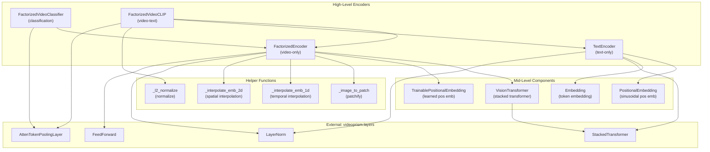
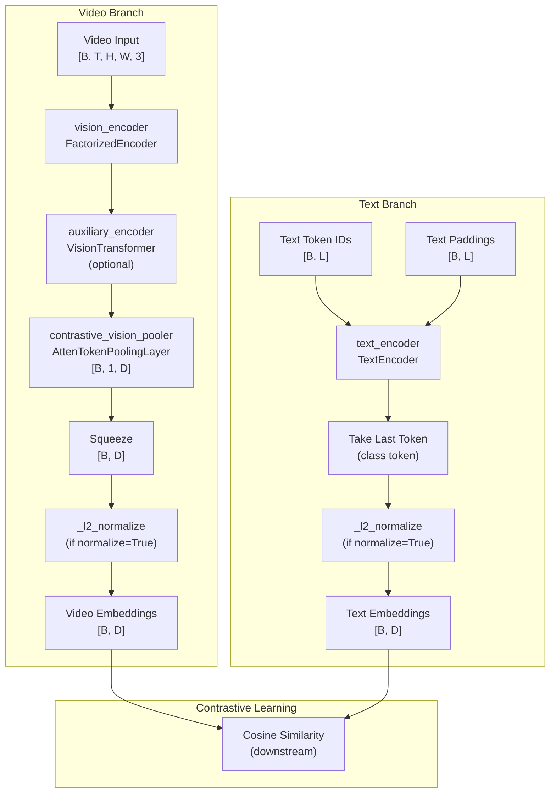
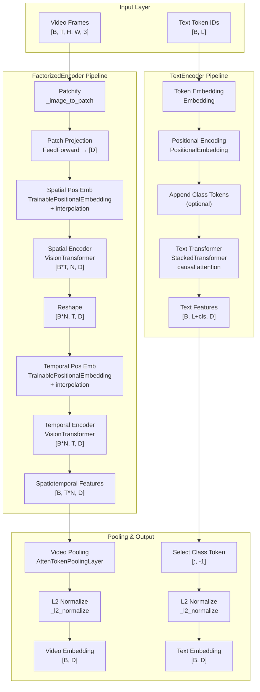

<!-- source: DeepWiki mcp.deepwiki.com · repo google-deepmind/videoprism · page 6.2 videoprism.encoders · fetched 2026-10-26 -->

# videoprism.encoders

<details>
<summary>Relevant source files</summary>

The following files were used as context for generating this wiki page:

- [videoprism/encoders.py](videoprism/encoders.py)
- [videoprism/encoders_test.py](videoprism/encoders_test.py)

</details>


## Purpose and Scope

This page provides API reference documentation for the `videoprism.encoders` module, which implements the core neural network architectures for video and text encoding. This module contains the primary encoder classes including `FactorizedEncoder`, `FactorizedVideoCLIP`, `FactorizedVideoClassifier`, and `TextEncoder`, as well as supporting embedding and transformer components.

For information on how to load and use these encoders in practice, see [Usage Guide](#5). For the model management layer that instantiates these encoders, see [videoprism.models](#6.1). For the underlying transformer building blocks, see [videoprism.layers](#6.3).

**Sources:** [videoprism/encoders.py:1-15]()

---

## Module Overview

The `videoprism.encoders` module defines the complete encoder architectures used in VideoPrism. The class hierarchy follows a compositional pattern where high-level encoders are built from lower-level components.



**Key Architecture Classes:**

| Class | Purpose | Input Shape | Output Shape |
|-------|---------|-------------|--------------|
| `FactorizedEncoder` | Factorized video encoder with separate spatial/temporal processing | `[B, T, H, W, 3]` | `[B, T*N, D]` |
| `FactorizedVideoClassifier` | Video classification with `FactorizedEncoder` backbone | `[B, T, H, W, 3]` | `[B, num_classes]` |
| `FactorizedVideoCLIP` | Video-text contrastive learning model | `[B, T, H, W, 3]` + `[B, L]` | `[B, D]` + `[B, D]` |
| `TextEncoder` | CoCa-style text encoder with causal attention | `[B, L]` | `[B, L, D]` |
| `VisionTransformer` | Standard ViT with stacked transformers | `[B, N, D]` | `[B, N, D]` |

**Sources:** [videoprism/encoders.py:17-34](), [videoprism/encoders.py:391-911]()

---

## Helper Functions

### `_contains(collection, key)`

Checks if a collection contains a key, handling both collections and boolean values.

**Parameters:**
- `collection: Collection[str] | bool` - A collection of strings or a boolean value
- `key: str` - The key to check

**Returns:**
- `bool` - True if collection contains the key or collection is True

**Sources:** [videoprism/encoders.py:36-48]()

---

### `_l2_normalize(x, axis=-1, epsilon=1e-12)`

L2-normalizes a JAX array along specified dimensions. Always converts to float32 internally for numerical stability before converting back to the original dtype.

**Parameters:**
- `x: Array` - Input array
- `axis: int | Sequence[int]` - Axis or axes to normalize (default: -1)
- `epsilon: float` - Small constant for numerical stability (default: 1e-12)

**Returns:**
- `Array` - Normalized array with same shape and dtype as input

**Sources:** [videoprism/encoders.py:50-68]()

---

### `_image_to_patch(inputs, patch_size)`

Converts an image tensor into patches by rearranging spatial dimensions.

**Parameters:**
- `inputs: Array` - Input tensor of shape `[B, H, W, C]`
- `patch_size: int` - Dimension of square patch

**Returns:**
- `Array` - Patches of shape `[B, (H*W)/P^2, P^2*C]`

**Raises:**
- `ValueError` - If input is not 4D or if image dimensions are not divisible by patch_size

**Sources:** [videoprism/encoders.py:70-104]()

---

### `_interpolate_emb_1d(emb, target_emb_length)`

Interpolates a 1D positional embedding to a new sequence length using bilinear interpolation.

**Parameters:**
- `emb: Array` - Flattened 1D positional embedding of shape `(1, N, D)`
- `target_emb_length: int` - Target sequence length

**Returns:**
- `Array` - Interpolated embedding of shape `(1, target_emb_length, D)`

**Raises:**
- `ValueError` - If embedding shape is not `(1, N, D)`

**Sources:** [videoprism/encoders.py:107-128]()

---

### `_interpolate_emb_2d(emb, source_emb_shape, target_emb_shape)`

Interpolates a 2D positional embedding to a new spatial shape using bilinear interpolation.

**Parameters:**
- `emb: Array` - Flattened 2D positional embedding of shape `(1, H1*W1, D)`
- `source_emb_shape: tuple[int, int]` - Source shape `(H1, W1)`
- `target_emb_shape: tuple[int, int]` - Target shape `(H2, W2)`

**Returns:**
- `Array` - Interpolated embedding of shape `(1, H2*W2, D)`

**Raises:**
- `ValueError` - If embedding shape doesn't match source_emb_shape

**Sources:** [videoprism/encoders.py:131-165]()

---

## Embedding Layers

### `Embedding`

A simple embedding layer that performs embedding lookups from token IDs. Extends `layers.Module`.

**Attributes:**

| Attribute | Type | Default | Description |
|-----------|------|---------|-------------|
| `num_classes` | `int` | 0 | Number of tokens in vocabulary |
| `input_dim` | `int` | 0 | Embedding dimension (called `input_dim` for compatibility) |
| `lookup_style` | `str` | `"index"` | Lookup style: `"index"` or `"matmul"` |
| `scale_sqrt_depth` | `bool` | False | Whether to scale embeddings by sqrt(embedding_dim) |
| `set_nan_for_oob_id` | `bool` | False | Set NaN for out-of-bounds IDs |

**Methods:**

#### `__call__(ids: Array) -> Array`

Performs embedding lookup.

**Parameters:**
- `ids: Array` - Token indices of any shape `[...]`

**Returns:**
- `Array` - Embeddings of shape `[..., input_dim]`

**Sources:** [videoprism/encoders.py:168-224](), [videoprism/encoders_test.py:28-47]()

---

### `PositionalEmbedding`

Generates sinusoidal positional embeddings for 1D sequences (non-trainable). Extends `layers.Module`.

**Attributes:**

| Attribute | Type | Default | Description |
|-----------|------|---------|-------------|
| `embedding_dim` | `int` | 0 | Dimension of embedding |
| `min_timescale` | `int` | 1 | Start of geometric index |
| `max_timescale` | `int` | 10000 | End of geometric index |

**Methods:**

#### `__call__(seq_length: int) -> Array`

Generates positional embeddings.

**Parameters:**
- `seq_length: int` - Sequence length

**Returns:**
- `Array` - Positional embeddings of shape `[1, seq_length, embedding_dim]`

**Sources:** [videoprism/encoders.py:227-266](), [videoprism/encoders_test.py:49-66]()

---

### `TrainablePositionalEmbedding`

Generates trainable positional embeddings for 1D sequences. Extends `layers.Module`.

**Attributes:**

| Attribute | Type | Default | Description |
|-----------|------|---------|-------------|
| `embedding_dim` | `int` | 0 | Dimension of embedding |
| `max_seq_length` | `int` | 10240 | Maximum sequence length |
| `lookup_style` | `str` | `"matmul"` | Lookup style (currently only `"matmul"` supported) |

**Methods:**

#### `__call__(seq_length: int) -> Array`

Generates trainable positional embeddings.

**Parameters:**
- `seq_length: int` - Sequence length (must be ≤ max_seq_length)

**Returns:**
- `Array` - Positional embeddings of shape `[1, seq_length, embedding_dim]`

**Sources:** [videoprism/encoders.py:269-307](), [videoprism/encoders_test.py:68-85]()

---

## VisionTransformer

A minimalistic Vision Transformer implementation using stacked transformer layers. Extends `layers.Module`.

**Attributes:**

| Attribute | Type | Default | Description |
|-----------|------|---------|-------------|
| `num_tfm_layers` | `int` | 12 | Number of transformer layers |
| `mlp_dim` | `int` | 3072 | Hidden dimension of FFN |
| `num_heads` | `int` | 12 | Number of attention heads |
| `xformer_has_bias` | `bool` | True | Whether to use bias in transformers |
| `xformer_dropout_prob` | `float` | 0.0 | General dropout probability |
| `xformer_atten_dropout_prob` | `float \| None` | None | Attention dropout probability |
| `xformer_residual_dropout_prob` | `float \| None` | None | Residual dropout probability |
| `xformer_relu_dropout_prob` | `float \| None` | None | FFN dropout probability |
| `atten_logit_cap` | `float` | 0.0 | Cap attention logits with tanh (0 = disabled) |
| `norm_policy` | `str` | `"pre"` | Normalization policy: `"pre"`, `"post"`, `"primer_hybrid"`, `"post_skip"` |
| `scan` | `bool` | False | Whether to use `nn.remat` and `nn.scan` for efficiency |

**Methods:**

#### `__call__(inputs: Array, paddings: Array | None = None, train: bool = False) -> Array`

Applies the ViT model to input sequences.

**Parameters:**
- `inputs: Array` - Input tensor of shape `[B, N, D]` (sequences of embeddings or patches)
- `paddings: Array | None` - Optional padding mask of shape `[B, N]` (1 = padding)
- `train: bool` - Whether model is in training mode

**Returns:**
- `Array` - Output tensor of shape `[B, N, D]`

**Implementation Details:**
- Uses `layers.StackedTransformer` internally
- Applies GELU activation
- Supports causal attention (disabled by default)

**Sources:** [videoprism/encoders.py:310-388](), [videoprism/encoders_test.py:87-113]()

---

## FactorizedEncoder

Factorized encoder implementing Model-2 from the ViViT paper. Applies separate spatial and temporal transformer processing for video data. Extends `layers.Module`.

**Reference:** [ViViT: A Video Vision Transformer](https://arxiv.org/abs/2103.15691)

```mermaid
graph LR
    subgraph "Input Processing"
        INPUT["Video Input<br/>[B, T, H, W, 3]"]
        RESHAPE["Reshape<br/>[B*T, H, W, 3]"]
        PATCH["_image_to_patch<br/>[B*T, N, P²×C]"]
        PROJ["patch_projection<br/>FeedForward<br/>[B*T, N, D]"]
    end
    
    subgraph "Spatial Processing"
        SPOS["spatial_pos_emb<br/>TrainablePositionalEmbedding<br/>+ _interpolate_emb_2d"]
        SENC["spatial_encoder<br/>VisionTransformer<br/>[B*T, N, D]"]
        SLN["spatial_ln<br/>LayerNorm"]
    end
    
    subgraph "Temporal Processing"
        TRESHAPE["Reshape<br/>[B*N, T, D]"]
        TPOS["temporal_pos_emb<br/>TrainablePositionalEmbedding<br/>+ _interpolate_emb_1d"]
        TENC["temporal_encoder<br/>VisionTransformer<br/>[B*N, T, D]"]
        TLN["temporal_ln<br/>LayerNorm"]
        FINAL["Reshape<br/>[B, T*N, D]"]
    end
    
    INPUT --> RESHAPE
    RESHAPE --> PATCH
    PATCH --> PROJ
    PROJ --> SPOS
    SPOS --> SENC
    SENC --> SLN
    SLN --> TRESHAPE
    TRESHAPE --> TPOS
    TPOS --> TENC
    TENC --> TLN
    TLN --> FINAL
```



**Attributes:**

| Attribute | Type | Default | Description |
|-----------|------|---------|-------------|
| `patch_size` | `int` | 18 | Size of square spatial patches |
| `pos_emb_shape` | `tuple[int, int, int]` | (16, 16, 16) | Shape for positional embeddings (T, H, W) |
| `model_dim` | `int` | 768 | Model dimension |
| `num_spatial_layers` | `int` | 12 | Number of spatial transformer layers |
| `num_temporal_layers` | `int` | 4 | Number of temporal transformer layers |
| `num_heads` | `int` | 12 | Number of attention heads |
| `mlp_dim` | `int` | 3072 | Hidden dimension of FFN |
| `atten_logit_cap` | `float` | 0.0 | Attention logit cap |
| `norm_policy` | `str` | `"pre"` | Normalization policy |
| `scan` | `bool` | False | Whether to use `nn.scan` |

**Methods:**

#### `__call__(inputs: Array, train: bool = False, return_intermediate: bool | Collection[str] = False, frame_paddings: Array | None = None) -> tuple[Array, dict[str, Array]]`

Computes video embeddings with factorized spatial-temporal encoding.

**Parameters:**
- `inputs: Array` - Input video tensor of shape `[B, T, H, W, 3]` where H == W
- `train: bool` - Whether model is in training mode
- `return_intermediate: bool | Collection[str]` - Whether to return intermediate features. Can be:
  - `False`: No intermediate outputs
  - `True`: All intermediate outputs
  - `Collection[str]`: Specific features (e.g., `{'spatial_features'}`)
- `frame_paddings: Array | None` - Binary mask of shape `[B, T]` (1 = padding frame)

**Returns:**
- `embeddings: Array` - Video embeddings of shape `[B, T*N, D]`
- `outputs: dict[str, Array]` - Dictionary containing:
  - `'spatial_features'`: Shape `[B, T*N, D]` (if requested)

#### `encode_with_patches(patches: Array, image_shape: tuple[int, int, int], train: bool = False, return_intermediate: bool | Collection[str] = False, patches_paddings: Array | None = None) -> tuple[Array, dict[str, Array]]`

Computes predictions from pre-extracted patches (advanced usage).

**Parameters:**
- `patches: Array` - Input patches of shape `[B*T, (H*W)/P^2, P^2*C]`
- `image_shape: tuple[int, int, int]` - Original image shape (T, H, W)
- `train: bool` - Whether model is in training mode
- `return_intermediate: bool | Collection[str]` - Whether to return intermediate features
- `patches_paddings: Array | None` - Binary mask of shape `[B*T, (H*W)/P^2]`

**Returns:**
- `embeddings: Array` - Video embeddings of shape `[B, T*N, D]`
- `outputs: dict[str, Array]` - Dictionary with intermediate features if requested

**Architecture Flow:**
1. **Patchification**: Convert video frames to patches using `_image_to_patch`
2. **Projection**: Project patches to model dimension
3. **Spatial Encoding**: Add spatial positional embeddings (with interpolation if needed), apply spatial transformer
4. **Reshape**: Convert from `[B*T, N, D]` to `[B*N, T, D]` to process temporal dimension
5. **Temporal Encoding**: Add temporal positional embeddings (with interpolation if needed), apply temporal transformer
6. **Output**: Reshape to `[B, T*N, D]`

**Sources:** [videoprism/encoders.py:391-580](), [videoprism/encoders_test.py:115-181]()

---

## FactorizedVideoClassifier

Video classifier using `FactorizedEncoder` as backbone with attention pooling and projection head. Extends `layers.Module`.

**Attributes:**

| Attribute | Type | Default | Description |
|-----------|------|---------|-------------|
| `encoder_params` | `dict[str, Any]` | `{}` | Parameters to pass to `FactorizedEncoder` |
| `num_classes` | `int` | 0 | Number of output classes |

**Methods:**

#### `__call__(inputs: Array, train: bool = False, return_intermediate: bool | Collection[str] = False, frame_paddings: Array | None = None) -> tuple[Array, dict[str, Array]]`

Applies video classifier to inputs.

**Parameters:**
- `inputs: Array` - Input tensor of shape `[B, T, H, W, 3]`
- `train: bool` - Whether model is in training mode
- `return_intermediate: bool | Collection[str]` - Whether to return intermediate features
- `frame_paddings: Array | None` - Binary mask of shape `[B, T]` (1 = padding frame)

**Returns:**
- `logits: Array` - Classification logits of shape `[B, num_classes]`
- `outputs: dict[str, Array]` - Dictionary containing (if requested):
  - `'spatial_features'`: Shape `[B, T*N, D]`
  - `'spatiotemporal_features'`: Shape `[B, T*N, D]`
  - `'global_embeddings'`: Shape `[B, D]`

**Architecture Components:**
1. `encoder`: `FactorizedEncoder` for spatiotemporal feature extraction
2. `atten_pooler`: `AttenTokenPoolingLayer` for global pooling (1 query)
3. `projection`: `FeedForward` layer for classification head

**Sources:** [videoprism/encoders.py:583-653](), [videoprism/encoders_test.py:183-237]()

---

## TextEncoder

CoCa-style text encoder with causal attention and optional class tokens. Extends `layers.Module`.

**Reference:** [CoCa: Contrastive Captioners](https://arxiv.org/abs/2205.01917)

**Attributes:**

| Attribute | Type | Default | Description |
|-----------|------|---------|-------------|
| `vocabulary_size` | `int` | 128 | Vocabulary size |
| `num_class_tokens` | `int` | 0 | Number of class tokens to append |
| `enable_causal_atten` | `bool` | True | Whether to enable causal attention |
| `model_dim` | `int` | 768 | Model dimension |
| `num_layers` | `int` | 12 | Number of transformer layers |
| `mlp_dim` | `int` | 3072 | Hidden dimension of FFN |
| `num_heads` | `int` | 12 | Number of attention heads |
| `atten_logit_cap` | `float` | 0.0 | Attention logit cap |
| `norm_policy` | `str` | `"pre"` | Normalization policy |
| `enable_per_dim_scale` | `bool` | False | Enable per-dimension attention scaling |
| `scan` | `bool` | False | Whether to use `nn.scan` |

**Methods:**

#### `__call__(inputs: Array, paddings: Array, train: bool = False) -> Array`

Applies text encoder to token IDs.

**Parameters:**
- `inputs: Array` - Token IDs of shape `[B, N]`
- `paddings: Array` - Padding mask of shape `[B, N]` (1 = padding)
- `train: bool` - Whether model is in training mode

**Returns:**
- `Array` - Text features of shape `[B, N, D]` or `[B, N+num_class_tokens, D]` if class tokens are used

**Architecture Flow:**
1. **Token Embedding**: Lookup embeddings for token IDs using `Embedding` with `scale_sqrt_depth=True`
2. **Positional Encoding**: Add sinusoidal positional embeddings using `PositionalEmbedding`
3. **Class Tokens**: Optionally append trainable class tokens
4. **Transformer**: Apply `StackedTransformer` with causal attention (if enabled) and ReLU activation
5. **Normalization**: Apply final LayerNorm

**Sources:** [videoprism/encoders.py:656-759](), [videoprism/encoders_test.py:239-274]()

---

## FactorizedVideoCLIP

Video-text contrastive learning model combining factorized video encoder and text encoder. Extends `layers.Module`.



**Attributes:**

| Attribute | Type | Default | Description |
|-----------|------|---------|-------------|
| **Vision Parameters** |||
| `patch_size` | `int` | 18 | Size of spatial patches |
| `pos_emb_shape` | `tuple[int, int, int]` | (16, 16, 16) | Positional embedding shape |
| `num_spatial_layers` | `int` | 12 | Number of spatial layers |
| `num_temporal_layers` | `int` | 4 | Number of temporal layers |
| `mlp_dim` | `int` | 3072 | FFN hidden dimension |
| `num_auxiliary_layers` | `int` | 0 | Number of auxiliary transformer layers |
| **Text Parameters** |||
| `vocabulary_size` | `int` | 128 | Text vocabulary size |
| `enable_causal_atten` | `bool` | True | Enable causal attention in text encoder |
| `num_unimodal_layers` | `int` | 12 | Number of text transformer layers |
| `norm_policy` | `str` | `"pre"` | Normalization policy |
| **Shared Parameters** |||
| `model_dim` | `int` | 768 | Model dimension |
| `num_heads` | `int` | 12 | Number of attention heads |
| `atten_logit_cap` | `float` | 0.0 | Attention logit cap |
| `scan` | `bool` | False | Whether to use `nn.scan` |

**Methods:**

#### `__call__(inputs: Array | None = None, text_token_ids: Array | None = None, text_paddings: Array | None = None, train: bool = False, normalize: bool = True, return_intermediate: bool | Collection[str] = False, frame_paddings: Array | None = None) -> tuple[Array | None, Array | None, dict[str, Array]]`

Computes video and/or text embeddings for contrastive learning.

**Parameters:**
- `inputs: Array | None` - Video frames of shape `[B, T, H, W, 3]` (None to skip video encoding)
- `text_token_ids: Array | None` - Text token IDs of shape `[B, L]` (None to skip text encoding)
- `text_paddings: Array | None` - Text padding mask of shape `[B, L]` (required if text_token_ids provided)
- `train: bool` - Whether model is in training mode
- `normalize: bool` - Whether to L2-normalize output embeddings
- `return_intermediate: bool | Collection[str]` - Whether to return intermediate features
- `frame_paddings: Array | None` - Video frame padding mask of shape `[B, T]`

**Returns:**
- `video_embeddings: Array | None` - Video embeddings of shape `[B, D]` (None if inputs is None)
- `text_embeddings: Array | None` - Text embeddings of shape `[B, D]` (None if text_token_ids is None)
- `outputs: dict[str, Array]` - Dictionary containing (if requested):
  - `'spatial_features'`: Shape `[B, T*N, D]`
  - `'spatiotemporal_features'`: Shape `[B, T*N, D]`
  - `'frame_embeddings'`: Shape `[B, T, D]`

**Architecture Details:**

**Video Branch:**
1. `vision_encoder`: `FactorizedEncoder` extracts spatiotemporal features
2. `auxiliary_encoder`: Optional additional transformer layers (if `num_auxiliary_layers > 0`)
3. `contrastive_vision_pooler`: Attention pooling with hidden_dim=`model_dim * 4` to produce single global embedding
4. L2 normalization (if `normalize=True`)

**Text Branch:**
1. `text_encoder`: `TextEncoder` with 1 class token appended
2. Extract last token (class token) as global text representation
3. L2 normalization (if `normalize=True`)

**Usage Pattern:**
```python
# Encode both modalities
video_emb, text_emb, _ = model(
    inputs=video_frames,
    text_token_ids=token_ids,
    text_paddings=paddings
)
similarity = jnp.einsum('bd,bd->b', video_emb, text_emb)

# Encode only video
video_emb, _, _ = model(inputs=video_frames)

# Encode only text
_, text_emb, _ = model(text_token_ids=token_ids, text_paddings=paddings)
```

**Sources:** [videoprism/encoders.py:762-910](), [videoprism/encoders_test.py:276-371]()

---

## Data Flow Summary

The following diagram shows how data flows through the encoder architectures:



**Key Design Principles:**

1. **Factorization**: Video encoding separates spatial (per-frame) and temporal (across-frame) processing for efficiency
2. **Interpolation**: Positional embeddings are interpolated to handle variable frame counts and resolutions
3. **Pooling**: Attention-based pooling produces fixed-size embeddings from variable-length sequences
4. **Normalization**: L2 normalization enables cosine similarity for contrastive learning
5. **Modularity**: Components can be used independently (video-only, text-only, or jointly)

**Sources:** [videoprism/encoders.py:391-910](), [videoprism/encoders_test.py:115-371]()

---

