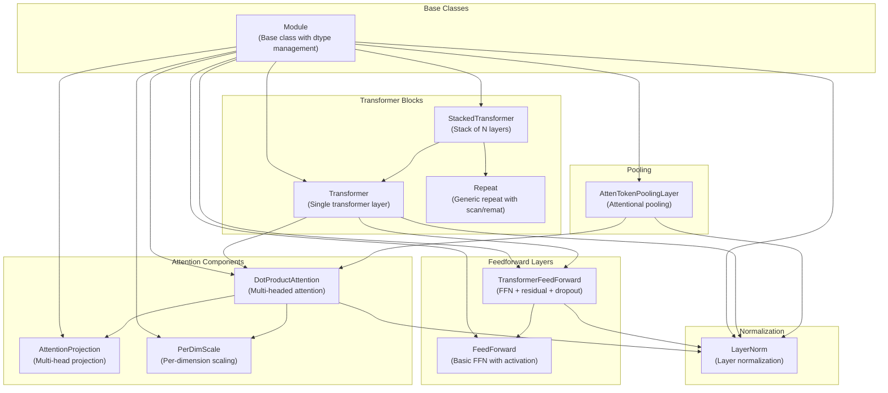
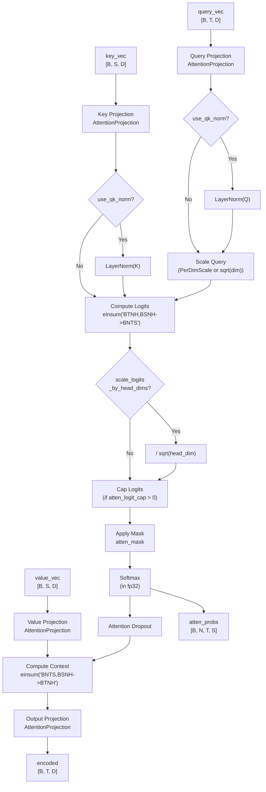
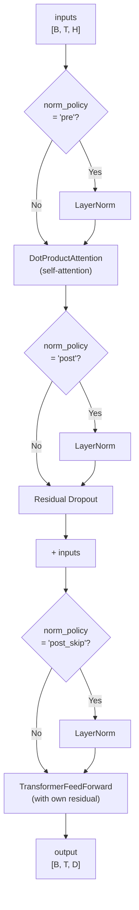
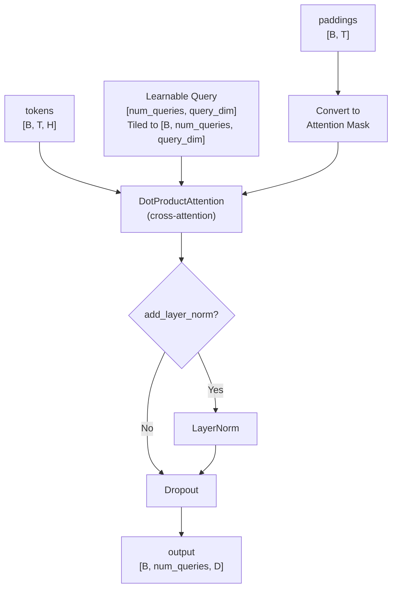

<!-- source: DeepWiki mcp.deepwiki.com · repo google-deepmind/videoprism · page 6.3 videoprism.layers · fetched 2026-10-26 -->

# videoprism.layers

<details>
<summary>Relevant source files</summary>

The following files were used as context for generating this wiki page:

- [videoprism/layers.py](videoprism/layers.py)
- [videoprism/layers_test.py](videoprism/layers_test.py)

</details>


## Overview

This module provides the foundational building blocks for constructing Transformer-based neural network architectures in VideoPrism. It implements reusable components including layer normalization, feedforward networks, multi-headed attention mechanisms, and complete transformer layers. These components are assembled by higher-level encoder architectures to create the video and text processing models.

For complete encoder architectures that use these layers, see [videoprism.encoders](#6.2). For the model management interface, see [videoprism.models](#6.1).

**Sources:** [videoprism/layers.py:1-1137]()

---

## Module Hierarchy

The following diagram shows the class hierarchy and composition relationships between layer components:



**Sources:** [videoprism/layers.py:182-1137]()

---

## Base Classes

### Module

The base class for all layer components, providing dtype management functionality.

**Location:** [videoprism/layers.py:182-206]()

**Attributes:**

| Attribute | Type | Default | Description |
|-----------|------|---------|-------------|
| `dtype` | `jnp.dtype` | `jnp.float32` | Default dtype for all variables (parameters) |
| `fprop_dtype` | `jnp.dtype` | `jnp.float32` | Dtype for activations during forward propagation |

**Key Methods:**

- `_cast_to_fprop_dtype(value)`: Casts values to the desired `fprop_dtype` using `jax.tree_util.tree_map`

**Usage Pattern:**
All layer classes inherit from `Module` and use `_cast_to_fprop_dtype()` to ensure consistent dtype handling for mixed-precision training.

**Sources:** [videoprism/layers.py:182-206]()

---

## Normalization Layers

### LayerNorm

Layer normalization implementation with optional scaling and bias.

**Location:** [videoprism/layers.py:208-271]()

**Attributes:**

| Attribute | Type | Default | Description |
|-----------|------|---------|-------------|
| `direct_scale` | `bool` | `False` | Whether to apply scale directly without +1.0 offset |
| `epsilon` | `float` | `1e-6` | Small value to guard rsqrt operation |
| `use_scale` | `bool` | `True` | Whether to use learned scaling parameter |
| `use_bias` | `bool` | `True` | Whether to use learned bias parameter |
| `reductions_in_fp32` | `bool` | `False` | Whether to compute mean/variance in fp32 for stability |

**Signature:**
```python
def __call__(self, inputs: Array) -> Array
```

**Input/Output:**
- **Input:** `[..., dim]` - Input tensor of any rank
- **Output:** `[..., dim]` - Normalized tensor of same shape

**Implementation Details:**
1. Computes mean and variance over last dimension: `mean = jnp.mean(inputs, axis=[-1])`
2. Normalizes: `(inputs - mean) * rsqrt(var + epsilon)`
3. Optionally applies learned scale and bias parameters

**Sources:** [videoprism/layers.py:208-271](), [videoprism/layers_test.py:36-48]()

---

## Feedforward Layers

### FeedForward

Basic feedforward layer with configurable activation function.

**Location:** [videoprism/layers.py:273-314]()

**Attributes:**

| Attribute | Type | Default | Description |
|-----------|------|---------|-------------|
| `output_dim` | `int` | `0` | Output dimension |
| `has_bias` | `bool` | `True` | Whether to include bias |
| `activation_fn` | `ActivationFunc` | `nn.relu` | Activation function |
| `weight_init` | `Initializer` | `lecun_normal()` | Weight initialization |
| `bias_init` | `Initializer` | `zeros_init()` | Bias initialization |

**Signature:**
```python
def __call__(self, inputs: Array) -> Array
```

**Implementation:**
Uses `nn.Dense` for linear projection followed by activation function.

**Sources:** [videoprism/layers.py:273-314](), [videoprism/layers_test.py:51-63]()

---

### TransformerFeedForward

Complete feedforward block with residual connection, dropout, and normalization.

**Location:** [videoprism/layers.py:316-431]()

**Attributes:**

| Attribute | Type | Default | Description |
|-----------|------|---------|-------------|
| `output_dim` | `int` | `0` | Output dimension (0 = same as input) |
| `hidden_dim` | `int` | `0` | Hidden dimension for FFN |
| `has_bias` | `bool` | `True` | Whether to use bias |
| `activation_fn` | `ActivationFunc` | `nn.relu` | Activation function |
| `residual_dropout_prob` | `float` | `0.0` | Dropout on residual connection |
| `relu_dropout_prob` | `float` | `0.0` | Dropout after activation |
| `add_skip_connection` | `bool` | `True` | Whether to add residual |
| `residual_weight` | `float` | `1.0` | Weight for residual: `output = fn(x) * weight + x` |
| `norm_policy` | `str` | `"pre"` | Normalization placement: `"pre"`, `"post"`, `"post_skip"`, `"primer_hybrid"` |

**Signature:**
```python
def __call__(self, inputs: Array, paddings: Array | None, train: bool) -> Array
```

**Computation Flow:**

```mermaid
graph LR
    Input["inputs<br/>[B, T, D]"] --> PreNorm{"norm_policy<br/>= 'pre'?"}
    PreNorm -->|Yes| LN1["LayerNorm"]
    PreNorm -->|No| FFN1
    LN1 --> FFN1["FFN Layer 1<br/>(hidden_dim)"]
    FFN1 --> Pad1["Apply paddings"]
    Pad1 --> Drop1["RELU Dropout"]
    Drop1 --> FFN2["FFN Layer 2<br/>(output_dim)"]
    FFN2 --> Pad2["Apply paddings"]
    Pad2 --> PostNorm{"norm_policy<br/>= 'post'?"}
    PostNorm -->|Yes| LN2["LayerNorm"]
    PostNorm -->|No| Drop2
    LN2 --> Drop2["Residual Dropout"]
    Drop2 --> Skip["Skip Connection<br/>+ input"]
    Skip --> PostSkipNorm{"norm_policy<br/>= 'post_skip'?"}
    PostSkipNorm -->|Yes| LN3["LayerNorm"]
    PostSkipNorm -->|No| Output
    LN3 --> Output["output<br/>[B, T, D]"]
```



**Sources:** [videoprism/layers.py:316-431](), [videoprism/layers_test.py:67-88]()

---

## Attention Layers

### AttentionProjection

Projects input tensors for multi-headed attention (query, key, value projections and output projection).

**Location:** [videoprism/layers.py:433-500]()

**Attributes:**

| Attribute | Type | Default | Description |
|-----------|------|---------|-------------|
| `output_dim` | `int` | `0` | Input dimension (for output projection) |
| `num_heads` | `int` | `0` | Number of attention heads |
| `dim_per_head` | `int` | `0` | Dimension per head |
| `is_output_projection` | `bool` | `False` | Direction: `False` for Q/K/V, `True` for output |
| `use_bias` | `bool` | `True` | Whether to use bias |

**Einsum Equations:**
- **Q/K/V projection:** `"{batch}D,DNH->{batch}NH"` - Projects `[..., D]` → `[..., N, H]`
- **Output projection:** `"{batch}NH,DNH->{batch}D"` - Projects `[..., N, H]` → `[..., D]`

Where `D` = input/output dimension, `N` = num_heads, `H` = dim_per_head

**Sources:** [videoprism/layers.py:433-500](), [videoprism/layers_test.py:91-122]()

---

### PerDimScale

Learnable per-dimension scaling with softplus activation.

**Location:** [videoprism/layers.py:502-528]()

**Computation:**
```
scale = (r_softplus_0 / sqrt(dim)) * softplus(per_dim_scale)
output = inputs * scale
```

Where `r_softplus_0 = 1.442695041 = 1.0/softplus(0.0)`

**Usage:** Used internally by `DotProductAttention` to scale query vectors when `internal_enable_per_dim_scale=True`.

**Sources:** [videoprism/layers.py:502-528](), [videoprism/layers_test.py:125-137]()

---

### DotProductAttention

Multi-headed dot-product attention mechanism.

**Location:** [videoprism/layers.py:530-747]()

**Key Attributes:**

| Attribute | Type | Default | Description |
|-----------|------|---------|-------------|
| `hidden_dim` | `int` | `0` | Hidden dimension |
| `num_heads` | `int` | `1` | Number of attention heads |
| `dim_per_head` | `int \| None` | `None` | Dimension per head (default: `hidden_dim // num_heads`) |
| `atten_dropout_prob` | `float` | `0.0` | Dropout on attention weights |
| `use_bias` | `bool` | `True` | Whether to use bias in projections |
| `internal_enable_query_scale` | `bool` | `True` | Enable query scaling |
| `internal_enable_per_dim_scale` | `bool` | `True` | Enable per-dimension scaling |
| `scale_logits_by_head_dims` | `bool` | `False` | Scale logits by `1/sqrt(head_dim)` |
| `atten_logit_cap` | `float` | `0.0` | Cap logits with tanh (if > 0) |
| `use_qk_norm` | `bool` | `False` | Apply LayerNorm to Q and K |

**Signature:**
```python
def __call__(
    self,
    query_vec: Array,  # [B, T, D]
    key_vec: Array,    # [B, S, D]
    value_vec: Array,  # [B, S, D]
    atten_mask: Array, # [1|B, 1, 1|T, S]
    train: bool,
) -> tuple[Array, Array]  # ([B, T, D], [B, N, T, S])
```

**Attention Computation Flow:**



**Sources:** [videoprism/layers.py:530-747](), [videoprism/layers_test.py:140-185]()

---

## Transformer Blocks

### Transformer

Single transformer layer combining multi-headed attention and feedforward network.

**Location:** [videoprism/layers.py:749-873]()

**Key Attributes:**

| Attribute | Type | Default | Description |
|-----------|------|---------|-------------|
| `hidden_dim` | `int` | `0` | Hidden dimension for FFN |
| `num_heads` | `int` | `0` | Number of attention heads |
| `dim_per_head` | `int \| None` | `None` | Dimension per head |
| `atten_dropout_prob` | `float` | `0.0` | Attention dropout |
| `residual_dropout_prob` | `float` | `0.0` | Residual dropout |
| `relu_dropout_prob` | `float` | `0.0` | FFN dropout |
| `norm_policy` | `str` | `"pre"` | Normalization policy |
| `use_bias` | `bool` | `True` | Whether to use bias |
| `activation_fn` | `ActivationFunc` | `nn.relu` | Activation function |
| `internal_enable_per_dim_scale` | `bool` | `True` | Enable per-dim scaling |
| `atten_logit_cap` | `float` | `0.0` | Attention logit cap |

**Signature:**
```python
def __call__(
    self,
    inputs: Array,      # [B, T, H]
    paddings: Array,    # [B, T]
    atten_mask: Array,  # [1|B, 1, 1|T, T]
    train: bool,
) -> Array             # [B, T, D]
```

**Layer Structure:**



**Sources:** [videoprism/layers.py:749-873](), [videoprism/layers_test.py:188-215]()

---

### StackedTransformer

Stack of N transformer layers with optional scan optimization.

**Location:** [videoprism/layers.py:940-1042]()

**Key Attributes:**

| Attribute | Type | Default | Description |
|-----------|------|---------|-------------|
| `num_layers` | `int` | `0` | Number of transformer layers |
| `hidden_dim` | `int` | `0` | Hidden dimension for FFN |
| `num_heads` | `int` | `0` | Number of attention heads |
| `dim_per_head` | `int \| None` | `None` | Dimension per head |
| `dropout_prob` | `float` | `0.0` | Default dropout probability |
| `atten_dropout_prob` | `float \| None` | `None` | Attention dropout (falls back to `dropout_prob`) |
| `residual_dropout_prob` | `float \| None` | `None` | Residual dropout (falls back to `dropout_prob`) |
| `relu_dropout_prob` | `float \| None` | `None` | FFN dropout (falls back to `dropout_prob`) |
| `input_dropout_prob` | `float` | `0.0` | Dropout on input before layers |
| `norm_policy` | `str` | `"pre"` | Normalization policy |
| `use_bias` | `bool` | `True` | Whether to use bias |
| `activation_fn` | `ActivationFunc` | `nn.relu` | Activation function |
| `internal_enable_per_dim_scale` | `bool` | `True` | Enable per-dim scaling |
| `atten_logit_cap` | `float` | `0.0` | Attention logit cap |
| `enable_causal_atten` | `bool` | `False` | Enable causal masking |
| `scan` | `bool` | `False` | Use `nn.scan` for memory efficiency |

**Signature:**
```python
def __call__(
    self,
    inputs: Array,    # [B, T, H]
    paddings: Array,  # [B, T]
    train: bool,
) -> Array           # [B, T, D]
```

**Implementation Modes:**

1. **Regular mode (`scan=False`):** Creates `num_layers` independent transformer modules
2. **Scan mode (`scan=True`):** Uses `Repeat` with `nn.scan` for memory-efficient layer stacking

**Attention Mask Computation:**
Automatically computes attention masks from paddings and causal requirements using `compute_attention_masks_for_fprop()`.

**Sources:** [videoprism/layers.py:940-1042](), [videoprism/layers_test.py:218-249]()

---

### Repeat

Generic layer repetition with gradient checkpointing and scan optimization.

**Location:** [videoprism/layers.py:875-938]()

**Attributes:**

| Attribute | Type | Default | Description |
|-----------|------|---------|-------------|
| `block_fn` | `Callable` | - | Block function to repeat |
| `times` | `int` | `0` | Number of times to repeat |
| `checkpoint_policy` | `str` | `"nothing_saveable"` | Checkpoint policy for `nn.remat` |

**Key Methods:**

- `__call__(inputs, *args, **kwargs)`: Forwards inputs through repeated block layers
- `call_with_custom_method(inputs, *args, main_fn, **kwargs)`: Allows custom layer creation

**Implementation:**
Uses `nn.scan` with `nn.remat` for memory-efficient layer stacking:
```python
scan_fn = nn.scan(
    rematted_body_fn,
    variable_axes={'params': 0},
    split_rngs={'params': True, 'dropout': True},
    length=self.times,
)
```

**Sources:** [videoprism/layers.py:875-938]()

---

## Pooling Layers

### AttenTokenPoolingLayer

Attentional pooling layer that produces fixed-size representations from variable-length sequences.

**Location:** [videoprism/layers.py:1044-1137]()

**Key Attributes:**

| Attribute | Type | Default | Description |
|-----------|------|---------|-------------|
| `query_dim` | `int \| None` | `None` | Query dimension (default: same as input) |
| `hidden_dim` | `int` | `0` | Hidden dimension (default: 4 * input_dim) |
| `num_heads` | `int` | `1` | Number of attention heads |
| `num_queries` | `int` | `1` | Number of learnable query vectors |
| `add_layer_norm` | `bool` | `True` | Apply LayerNorm to output |
| `dropout_prob` | `float` | `0.0` | Dropout probability |
| `use_qk_norm` | `bool` | `False` | Use QK normalization |
| `use_bias` | `bool` | `True` | Whether to use bias |
| `internal_enable_per_dim_scale` | `bool` | `True` | Enable per-dim scaling |

**Signature:**
```python
def __call__(
    self,
    tokens: Array,           # [B, T, H]
    paddings: Array | None,  # [B, T]
    train: bool,
) -> Array                   # [B, N, D]
```

**Pooling Mechanism:**



**Use Cases:**
- Reducing sequence length from `T` tokens to `num_queries` tokens
- Creating global representations (e.g., `num_queries=1` for single vector)
- Used in encoder architectures for dimensionality reduction

**Sources:** [videoprism/layers.py:1044-1137](), [videoprism/layers_test.py:252-283]()

---

## Utility Functions

### Masking and Padding Functions

**compute_attention_masks_for_fprop**

Computes attention masks from input paddings and optional causal masking.

**Location:** [videoprism/layers.py:155-180]()

**Signature:**
```python
def compute_attention_masks_for_fprop(
    inputs: Array,           # [B, T, H]
    paddings: Array,         # [B, T]
    causal_attention: bool = False,
) -> Array                   # [1|B, 1, 1|T, T]
```

**Implementation:**
1. Converts paddings to mask: `[B, T]` → `[B, 1, 1, T]` with large negative values
2. If causal, creates lower-triangular mask: `[1, 1, T, T]`
3. Merges masks by taking minimum (more restrictive)

---

**Helper Functions:**

| Function | Location | Description |
|----------|----------|-------------|
| `identity(x)` | [videoprism/layers.py:34-36]() | Identity activation function |
| `_get_large_negative_number(dtype)` | [videoprism/layers.py:39-48]() | Returns large negative value for masking |
| `_apply_mask_to_logits(logits, mask)` | [videoprism/layers.py:51-73]() | Applies floating-point mask to logits |
| `_convert_paddings_to_mask(paddings, dtype)` | [videoprism/layers.py:75-90]() | Converts binary paddings to attention mask |
| `_causal_mask(input_t)` | [videoprism/layers.py:92-109]() | Computes causal (lower-triangular) mask |
| `_merge_masks(a, b)` | [videoprism/layers.py:111-153]() | Merges two masks by taking minimum |

**Sources:** [videoprism/layers.py:34-180]()

---

## Common Configuration Patterns

### Normalization Policies

The `norm_policy` attribute controls where layer normalization is applied:

| Policy | Description | LayerNorm Placement |
|--------|-------------|---------------------|
| `"pre"` | Pre-normalization (default) | Before transformation |
| `"post"` | Post-normalization | After transformation |
| `"post_skip"` | Post-skip normalization | After skip connection |
| `"primer_hybrid"` | Hybrid approach | Before AND after transformation |

### Dtype Management

All layers inherit from `Module` which provides:
- `dtype`: Parameter storage dtype (typically `jnp.float32`)
- `fprop_dtype`: Activation computation dtype (e.g., `jnp.bfloat16` for mixed precision)

Parameters are stored in `dtype` but cast to `fprop_dtype` during computation using `_cast_to_fprop_dtype()`.

### Dropout Configuration

Transformer layers support multiple dropout types:
- `atten_dropout_prob`: Dropout on attention weights
- `residual_dropout_prob`: Dropout on residual connections
- `relu_dropout_prob`: Dropout after FFN activation
- `input_dropout_prob`: Dropout on input (StackedTransformer only)

All dropouts are disabled when `train=False`.

**Sources:** [videoprism/layers.py:182-206](), [videoprism/layers.py:344](), [videoprism/layers.py:780](), [videoprism/layers.py:980]()

---

## Usage Examples

### Creating a Simple Transformer Stack

```python
# Create a stack of 12 transformer layers
stacked_tfm = layers.StackedTransformer(
    num_layers=12,
    hidden_dim=3072,        # FFN hidden dimension
    num_heads=12,
    dropout_prob=0.1,
    norm_policy='pre',
    activation_fn=layers.gelu,
    scan=True,              # Use scan for memory efficiency
)

# Forward pass
outputs = stacked_tfm(
    inputs=video_tokens,    # [B, T, 768]
    paddings=padding_mask,  # [B, T]
    train=True,
)
# outputs shape: [B, T, 768]
```

### Using Attention Pooling

```python
# Pool sequence to single vector
pooler = layers.AttenTokenPoolingLayer(
    num_queries=1,          # Single output token
    num_heads=8,
    hidden_dim=768,
    dropout_prob=0.1,
)

# Forward pass
pooled = pooler(
    tokens=encoder_output,  # [B, T, 768]
    paddings=padding_mask,  # [B, T]
    train=True,
)
# pooled shape: [B, 1, 768]
```

**Sources:** [videoprism/layers_test.py:222-249](), [videoprism/layers_test.py:256-283]()

---

## Testing

Comprehensive tests for all layer components are located in [videoprism/layers_test.py:1-288](). Tests cover:

- Shape validation for all layers
- Parameter count verification
- Forward pass functionality with JIT compilation
- Different configuration combinations (dropout, normalization policies, etc.)
- Scan vs. non-scan modes for `StackedTransformer`

**Test Coverage Summary:**

| Component | Test Method | Lines |
|-----------|-------------|-------|
| LayerNorm | `test_layer_norm` | [36-48]() |
| FeedForward | `test_feedforward_layer` | [51-63]() |
| TransformerFeedForward | `test_transformer_feedforward` | [67-88]() |
| AttentionProjection | `test_mhd_projection` | [91-122]() |
| PerDimScale | `test_per_dim_scale` | [125-137]() |
| DotProductAttention | `test_mha` | [140-185]() |
| Transformer | `test_transformer_layer` | [188-215]() |
| StackedTransformer | `test_stacked_transformer_layer` | [218-249]() |
| AttenTokenPoolingLayer | `test_atten_token_pooling_layer` | [252-283]() |

**Sources:** [videoprism/layers_test.py:1-288]()

---

