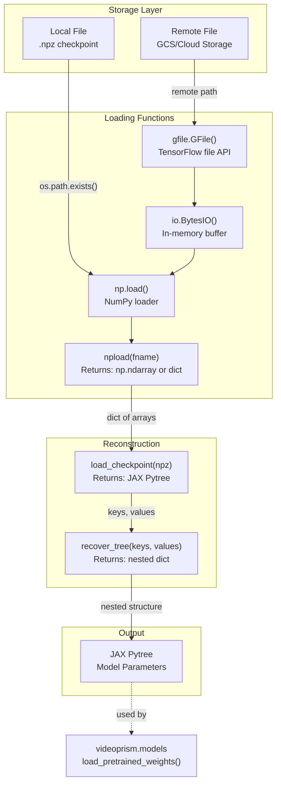
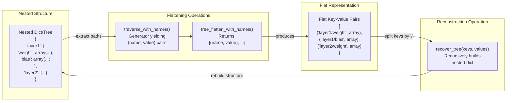
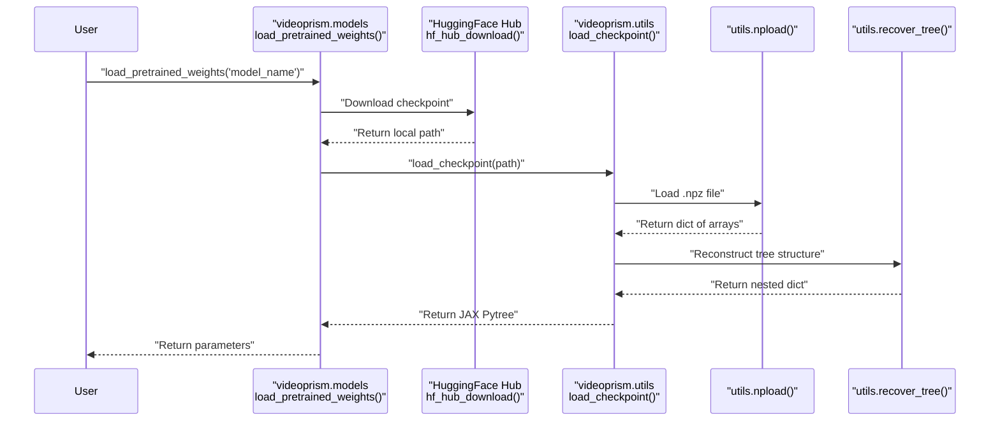

<!-- source: DeepWiki mcp.deepwiki.com · repo google-deepmind/videoprism · page 6.5 videoprism.utils · fetched 2026-10-26 -->

# videoprism.utils

<details>
<summary>Relevant source files</summary>

The following files were used as context for generating this wiki page:

- [videoprism/utils.py](videoprism/utils.py)
- [videoprism/utils_test.py](videoprism/utils_test.py)

</details>


## Purpose and Scope

This page documents the `videoprism.utils` module, which provides utility functions for checkpoint loading, JAX Pytree manipulation, and text preprocessing. These utilities support the core VideoPrism functionality by handling serialization/deserialization of model parameters and text normalization for video-text models.

For information about how these utilities are used in the model loading workflow, see [Model Management System](#4.1). For the complete models API that uses these utilities, see [videoprism.models](#6.1).

**Sources:** [videoprism/utils.py:1-169]()

## Module Overview

The `videoprism.utils` module contains two primary categories of functionality:

1. **Checkpoint Loading and Pytree Operations**: Functions for loading NumPy checkpoint files and manipulating JAX Pytree structures
2. **Text Processing**: Text canonicalization for consistent text preprocessing

| Category | Functions | Purpose |
|----------|-----------|---------|
| Checkpoint Loading | `npload`, `load_checkpoint` | Load model parameters from `.npz` files |
| Pytree Traversal | `traverse_with_names`, `tree_flatten_with_names` | Extract named paths from nested structures |
| Pytree Reconstruction | `recover_tree` | Reconstruct nested dicts from flat key-value pairs |
| Text Processing | `canonicalize_text` | Normalize text for consistent encoding |

**Sources:** [videoprism/utils.py:1-169]()

---

## Checkpoint Loading Pipeline

The following diagram shows how checkpoint loading functions work together to deserialize model parameters from storage into JAX Pytrees:



**Sources:** [videoprism/utils.py:106-136]()

---

## Pytree Transformation Flow

This diagram illustrates the bidirectional transformation between flat and nested pytree representations:



**Sources:** [videoprism/utils.py:28-103]()

---

## Function Reference

### Checkpoint Loading Functions

#### `npload(fname: str) -> np.ndarray | dict`

Loads NumPy arrays from local or remote file paths with automatic handling of both single-array files (`.npy`) and multi-array archives (`.npz`).

**Parameters:**
- `fname`: Path to the checkpoint file (local or remote)

**Returns:**
- `np.ndarray` if loading a single-array file
- `dict` if loading a `.npz` archive

**Implementation Details:**
- Checks `os.path.exists()` for local files for direct loading
- Uses `gfile.GFile` for remote paths (GCS, cloud storage)
- Routes remote data through `io.BytesIO` to satisfy `np.load`'s seek requirement
- Sets `allow_pickle=False` for security

**Sources:** [videoprism/utils.py:106-121]()

---

#### `load_checkpoint(npz: str | dict) -> dict`

Loads a JAX Pytree from an `.npz` checkpoint file by reconstructing the nested dictionary structure from flat key-value pairs.

**Parameters:**
- `npz`: Either a file path to `.npz` checkpoint or an already-loaded dict-like object

**Returns:**
- JAX Pytree (nested dict) representing model parameters

**Usage Pattern:**
```python
# Load from file path
params = load_checkpoint('path/to/checkpoint.npz')

# Load from already-loaded dict
npz_data = npload('path/to/checkpoint.npz')
params = load_checkpoint(npz_data)
```

**Process Flow:**
1. Calls `npload()` if `npz` is a string path
2. Extracts keys and values from the flat dict
3. Calls `recover_tree()` to reconstruct nested structure

**Sources:** [videoprism/utils.py:124-136]()

---

### Pytree Manipulation Functions

#### `traverse_with_names(tree, with_inner_nodes=False) -> Generator[tuple[str, Any], None, None]`

Traverses nested dicts/sequences and yields `(leaf_name, leaf_val)` pairs with path-like names using `/` as separator.

**Parameters:**
- `tree`: JAX Pytree object (nested dicts, sequences, or leaf values)
- `with_inner_nodes`: If `True`, also yields intermediate nodes (default: `False`)

**Yields:**
- Tuples of `(leaf_name, leaf_value)` where names are hierarchical paths like `"layer1/weight"`

**Behavior:**
- Returns early if `tree is None`
- Sorts dict keys for deterministic traversal
- Uses numeric indices for sequences
- Strips trailing `/` from paths

**Sources:** [videoprism/utils.py:28-57]()

---

#### `tree_flatten_with_names(tree) -> list[tuple[str, Any]]`

Flattens a JAX Pytree and associates each leaf value with its hierarchical name.

**Parameters:**
- `tree`: JAX Pytree object

**Returns:**
- List of `(name, value)` tuples where names represent paths in the tree

**Implementation Strategy:**
1. Uses `jax.tree.flatten()` to get canonical flattening
2. Creates a token tree with same structure
3. Uses `traverse_with_names()` to generate names
4. Applies inverse permutation to align names with JAX's flattening order
5. Validates that custom traversal matches JAX's leaf count

**Sources:** [videoprism/utils.py:60-79]()

---

#### `recover_tree(keys: Sequence[str], values: Sequence[Any]) -> dict`

Reconstructs a nested tree structure from flat key-value pairs where keys use `/` as path separator.

**Parameters:**
- `keys`: List of hierarchical keys (e.g., `["layer1/weight", "layer1/bias"]`)
- `values`: List of corresponding leaf values

**Returns:**
- Nested dict representing the tree structure

**Algorithm:**
1. Iterates through key-value pairs
2. For keys without `/`, directly assigns to output dict
3. For keys with `/`, splits at first occurrence and groups by prefix
4. Recursively calls itself on grouped subtrees
5. Builds nested structure bottom-up

**Example:**
```python
keys = ["a/b", "a/c", "d"]
values = [1, 2, 3]
result = recover_tree(keys, values)
# Returns: {'a': {'b': 1, 'c': 2}, 'd': 3}
```

**Sources:** [videoprism/utils.py:82-103]()

---

### Text Processing Functions

#### `canonicalize_text(text: str) -> str`

Canonicalizes text by applying consistent normalization rules for text encoding.

**Parameters:**
- `text`: Input text string

**Returns:**
- Canonicalized text string

**Canonicalization Rules:**

| Rule | Description | Example |
|------|-------------|---------|
| Punctuation Replacement | Replace all punctuation with whitespace | `"Hello, World!"` → `"Hello  World "` |
| Lowercase Conversion | Convert all characters to lowercase | `"Hello World"` → `"hello world"` |
| Whitespace Normalization | Collapse multiple spaces to single space | `"hello  world"` → `"hello world"` |
| Period Addition | Append period at end | `"hello world"` → `"hello world."` |

**Example Transformations:**
```python
canonicalize_text("Hello, World!")  # Returns: "hello world."
canonicalize_text("Hello,World..")  # Returns: "hello world."
canonicalize_text("  Hello   WORLD")  # Returns: "hello world."
```

**Implementation Details:**
- Uses `str.maketrans()` to replace all `string.punctuation` characters
- Uses `str.split()` and `str.join()` for whitespace normalization
- Always appends a period, regardless of original punctuation

**Sources:** [videoprism/utils.py:139-168](), [videoprism/utils_test.py:23-26]()

---

## Usage in VideoPrism

The following table shows how different parts of the VideoPrism codebase use these utilities:

| Caller | Function Used | Purpose |
|--------|---------------|---------|
| `videoprism.models.load_pretrained_weights()` | `load_checkpoint()` | Load model parameters from HuggingFace Hub |
| `videoprism.models._canonicalize_texts()` | `canonicalize_text()` | Normalize text before tokenization |
| `videoprism.models._canonicalize_texts()` | `canonicalize_text()` | Preprocess queries for video-text retrieval |

**Sources:** [videoprism/utils.py:1-169]()

---

## Integration with Model Loading

This diagram shows how `videoprism.utils` integrates with the broader model loading workflow:



**Sources:** [videoprism/utils.py:124-136]()

---

## Dependencies

The `videoprism.utils` module depends on the following external libraries:

| Library | Usage | Import Path |
|---------|-------|-------------|
| JAX | Pytree operations | `import jax` |
| NumPy | Array loading and manipulation | `import numpy as np` |
| TensorFlow | Remote file access via `gfile` | `from tensorflow.io import gfile` |
| Python stdlib | Collections, IO, OS operations | `import collections, io, os, string` |

**Sources:** [videoprism/utils.py:17-25]()

---

## Testing

The module includes unit tests in `videoprism/utils_test.py` that verify:

- Text canonicalization with various inputs
- Expected transformations for punctuation, case, and whitespace

**Test Coverage:**

| Test | Function Tested | Assertions |
|------|-----------------|------------|
| `test_canonicalize_text` | `canonicalize_text()` | Verifies 3 example transformations |

**Sources:** [videoprism/utils_test.py:21-30]()

---

