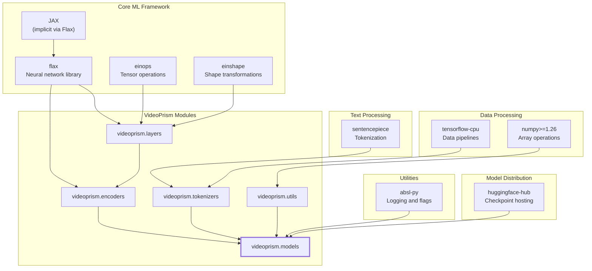
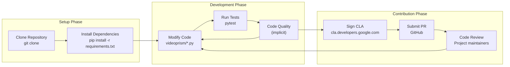
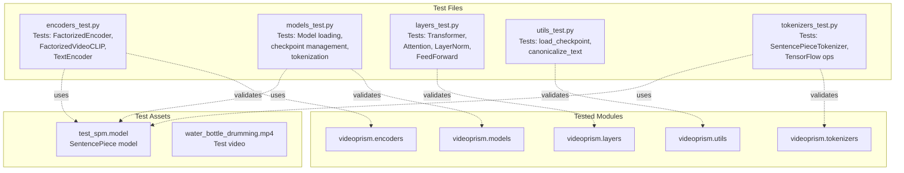
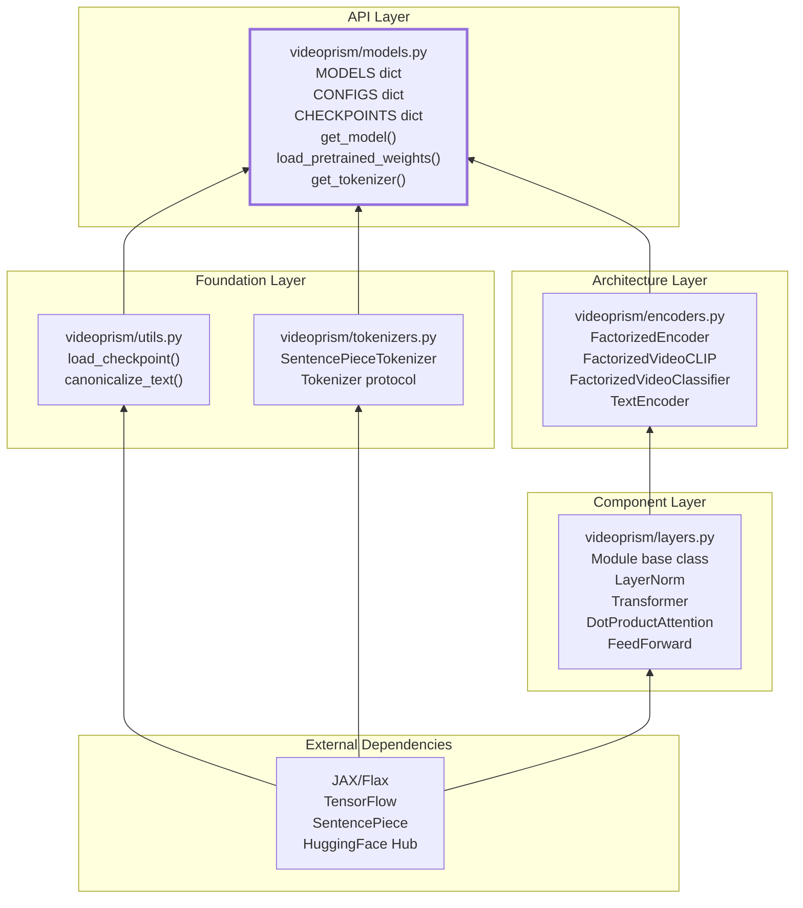
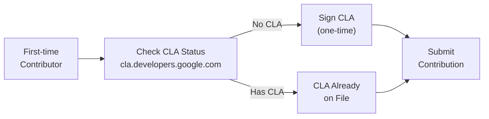

<!-- source: DeepWiki mcp.deepwiki.com · repo google-deepmind/videoprism · page 7 Development · fetched 2026-10-26 -->

# Development

Relevant source files

The following files were used as context for generating this wiki page:

- [CONTRIBUTING.md](CONTRIBUTING.md)
- [requirements.txt](requirements.txt)

This page provides an overview of the development infrastructure for VideoPrism, including dependency management, testing, and contribution workflows. It is intended for developers who want to contribute to the codebase, extend functionality, or understand the project's technical foundation.

For detailed API documentation, see [API Reference](#6). For usage examples and practical guides, see [Usage Guide](#5).

## Development Environment Overview

VideoPrism is built on a stack of scientific Python libraries and follows standard practices for JAX/Flax-based machine learning projects. The codebase is structured to facilitate modular development, with clear separation between model architectures, layer components, utilities, and the model management system.

### Dependency Stack

The project's dependencies fall into several categories:

**Dependency Architecture**: Core dependencies (JAX/Flax, einops) support the layer and encoder implementations. TensorFlow is used exclusively for data processing in demos and tokenizers. SentencePiece provides text tokenization. HuggingFace Hub enables checkpoint distribution. NumPy and absl-py provide utility functions.

Sources: [requirements.txt:1-8]()

### Key Dependency Roles

| Dependency | Version Requirement | Primary Usage | Module(s) |
|------------|-------------------|---------------|-----------|
| `numpy` | >=1.26 | Array operations, checkpoint loading | `videoprism.utils` |
| `absl-py` | (unspecified) | Logging and command-line flags | All modules |
| `einops` | (unspecified) | Tensor rearrangement operations | `videoprism.layers`, `videoprism.encoders` |
| `einshape` | (unspecified) | Shape checking and transformation | `videoprism.layers` |
| `flax` | (unspecified) | Neural network module system | `videoprism.layers`, `videoprism.encoders` |
| `huggingface-hub` | (unspecified) | Downloading pre-trained checkpoints | `videoprism.models` |
| `sentencepiece` | (unspecified) | SentencePiece tokenization | `videoprism.tokenizers` |
| `tensorflow-cpu` | (unspecified) | TensorFlow operations for tokenization | `videoprism.tokenizers` |

Sources: [requirements.txt:1-8]()

## Development Workflow

**Development Lifecycle**: Contributors clone the repository, install dependencies, make code changes, run tests, and submit pull requests after signing the CLA. The review process may require additional iterations.

Sources: [CONTRIBUTING.md:1-25]()

## Testing Infrastructure Overview

VideoPrism includes a comprehensive testing suite covering all major components. The test files mirror the module structure and test at multiple levels of abstraction.

### Test File Organization

**Test Structure**: Each major module has a corresponding test file. Test assets include a SentencePiece model for tokenization testing and a video file for integration tests.

For detailed information on running tests and test patterns, see [Testing](#7.2).

Sources: Based on high-level diagram "Diagram 6: Testing and Quality Assurance Structure"

### Test Coverage Matrix

| Test File | Target Module | Test Categories | Key Validations |
|-----------|--------------|-----------------|-----------------|
| `encoders_test.py` | `videoprism.encoders` | Shape validation, parameter counting, functional tests | Output dimensions, forward pass correctness |
| `models_test.py` | `videoprism.models` | Integration tests, checkpoint loading | Model instantiation, weight loading, end-to-end flows |
| `layers_test.py` | `videoprism.layers` | Unit tests, shape validation | Transformer components, attention mechanisms |
| `utils_test.py` | `videoprism.utils` | Utility function tests | Checkpoint deserialization, text preprocessing |
| `tokenizers_test.py` | `videoprism.tokenizers` | Tokenization tests | SentencePiece protocol, TensorFlow ops |

Sources: Based on high-level diagram "Diagram 6: Testing and Quality Assurance Structure"

## Code Organization for Developers

Understanding the module hierarchy is essential for development work. The codebase follows a layered architecture where higher-level modules depend on lower-level ones.

**Module Hierarchy**: Development typically involves working at specific layers. Low-level changes (e.g., new attention mechanisms) affect `layers.py`. Architectural changes affect `encoders.py`. API changes affect `models.py`. Each layer depends only on layers below it.

Sources: Based on high-level diagram "Diagram 4: Dependency and Component Hierarchy"

### Common Development Scenarios

```mermaid
graph TD
    subgraph "Scenario 1: Add New Layer Component"
        S1A["Define in layers.py<br/>Inherit from Module"]
        S1B["Write tests in<br/>layers_test.py"]
        S1C["Use in encoder<br/>architectures"]
    end
    
    subgraph "Scenario 2: Add New Encoder"
        S2A["Define in encoders.py<br/>Compose layer components"]
        S2B["Add config to<br/>CONFIGS dict in models.py"]
        S2C["Write tests in<br/>encoders_test.py"]
        S2D["Register in MODELS dict"]
    end
    
    subgraph "Scenario 3: Add Checkpoint"
        S3A["Upload to<br/>HuggingFace Hub"]
        S3B["Add entry to<br/>CHECKPOINTS dict"]
        S3C["Test loading in<br/>models_test.py"]
    end
    
    subgraph "Scenario 4: Modify Tokenization"
        S4A["Update tokenizers.py"]
        S4B["Test in<br/>tokenizers_test.py"]
        S4C["Verify integration<br/>in models_test.py"]
    end
    
    S1A --> S1B
    S1B --> S1C
    
    S2A --> S2B
    S2B --> S2C
    S2C --> S2D
    
    S3A --> S3B
    S3B --> S3C
    
    S4A --> S4B
    S4B --> S4C
```

**Development Patterns**: Different modification types follow specific patterns. Layer components are added bottom-up (define, test, integrate). New models require configuration registration. Checkpoints need HuggingFace distribution. Tokenization changes require cross-module validation.

Sources: Based on system architecture understanding

## Code Style and Conventions

While not explicitly documented in the provided files, the codebase follows several conventions observable from the architecture:

### Module Organization

- **Single responsibility**: Each module handles one aspect (layers, encoders, models, utilities, tokenizers)
- **Flax patterns**: All neural network components inherit from `flax.linen.Module` via the custom `Module` base class in `layers.py`
- **Type hints**: Used throughout for clarity and IDE support
- **Dataclasses**: Configuration objects use Python dataclasses

### Naming Conventions

| Code Entity | Convention | Example |
|-------------|-----------|---------|
| Classes | PascalCase | `FactorizedEncoder`, `TextEncoder` |
| Functions | snake_case | `get_model()`, `load_checkpoint()` |
| Constants/Configs | UPPER_SNAKE_CASE | `MODELS`, `CONFIGS`, `CHECKPOINTS` |
| Private functions | Leading underscore | (if any) |
| Module attributes | snake_case | `num_layers`, `hidden_size` |

Sources: Inferred from system architecture diagrams and common Python conventions

## Contribution Process

Contributors must follow Google's standard open-source contribution process:

### Contributor License Agreement (CLA)

**CLA Requirement**: All contributors must sign a Contributor License Agreement before their code can be accepted. This is typically a one-time process that applies across multiple Google open-source projects.

Sources: [CONTRIBUTING.md:3-13]()

### Pull Request Workflow

1. **Fork and Clone**: Fork the repository and clone to local machine
2. **Create Branch**: Create a feature branch for changes
3. **Make Changes**: Implement modifications following code conventions
4. **Test Locally**: Run test suite to verify changes
5. **Commit**: Write clear commit messages
6. **Push**: Push branch to forked repository
7. **Open PR**: Create pull request against main repository
8. **Review**: Respond to reviewer feedback
9. **Merge**: Maintainers merge after approval

All submissions require code review, including submissions by project members. GitHub pull requests are used for all reviews.

Sources: [CONTRIBUTING.md:15-20]()

### Community Guidelines

The project follows [Google's Open Source Community Guidelines](https://opensource.google/conduct/), which establish expectations for respectful and constructive collaboration.

Sources: [CONTRIBUTING.md:22-25]()

## Development Resources

For more detailed information on specific development topics:

- **Dependencies and Environment**: See [Dependencies and Environment](#7.1) for detailed dependency roles and setup instructions
- **Testing**: See [Testing](#7.2) for comprehensive testing guide, test execution, and test patterns
- **Contributing**: See [Contributing](#7.3) for detailed contribution guidelines and best practices

For understanding the codebase architecture:
- **Model Management**: See [Model Management System](#4.1)
- **Encoder Architectures**: See [Encoder Architectures](#4.2)
- **Layer Components**: See [Layer Components](#4.3)

For API documentation:
- **Models API**: See [videoprism.models](#6.1)
- **Encoders API**: See [videoprism.encoders](#6.2)
- **Layers API**: See [videoprism.layers](#6.3)

Sources: Table of contents structure

---

