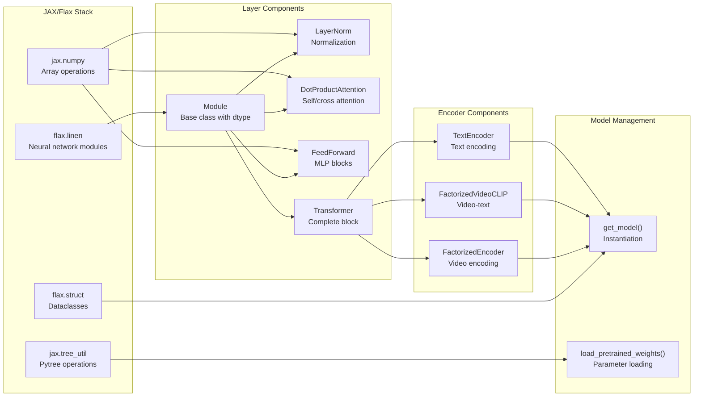
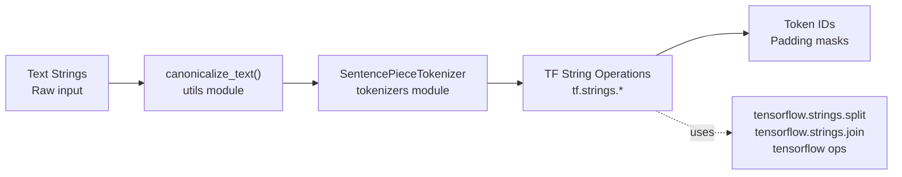
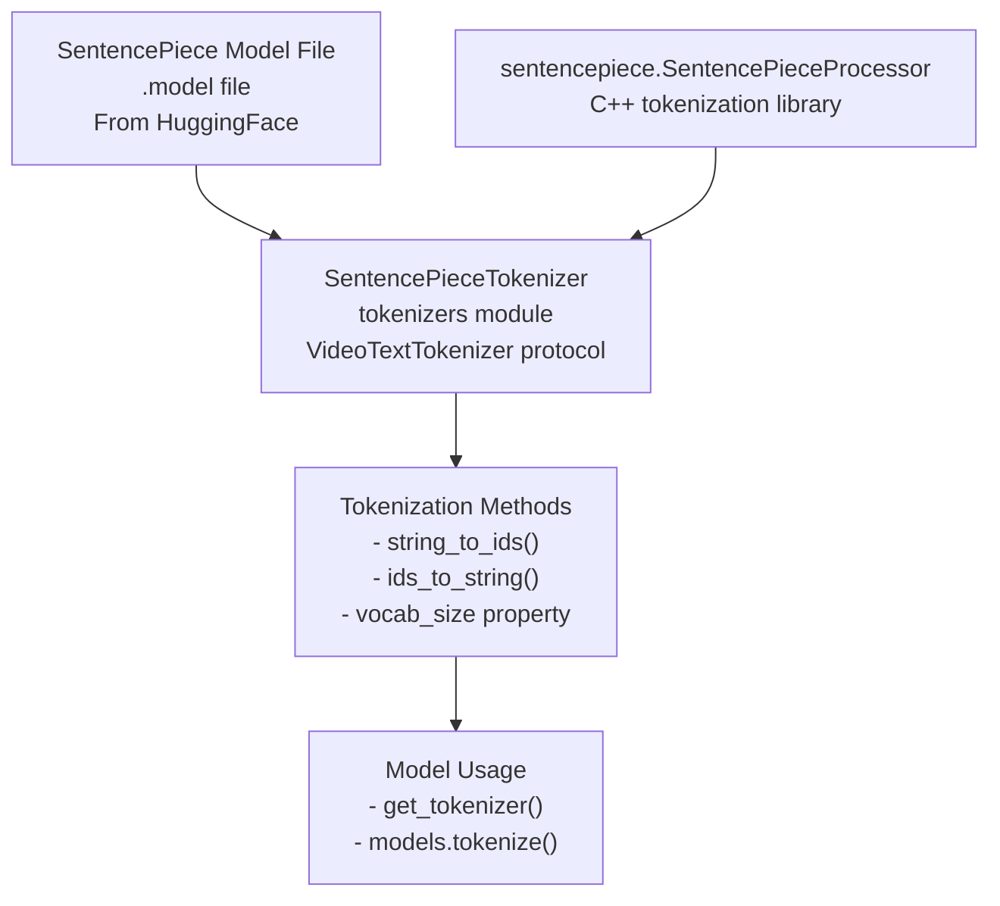
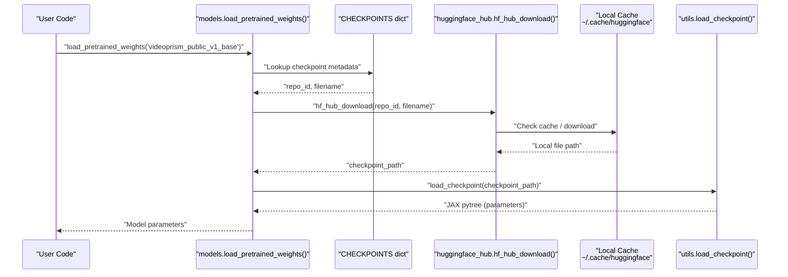
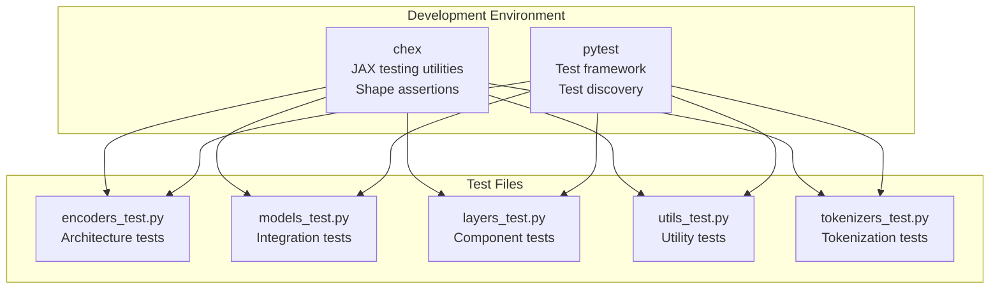
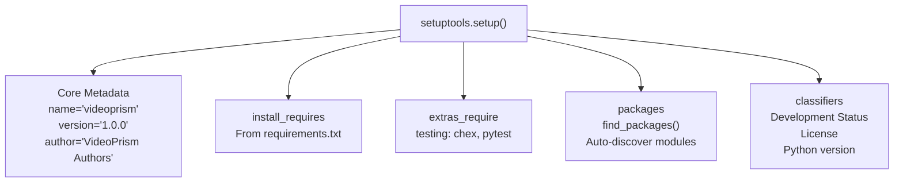
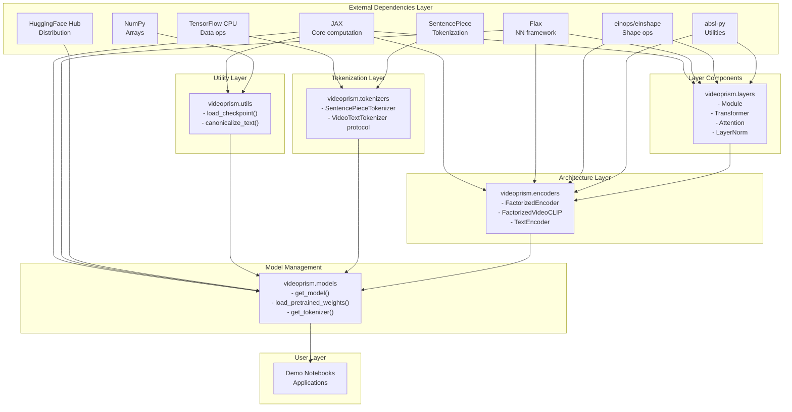

<!-- source: DeepWiki mcp.deepwiki.com · repo google-deepmind/videoprism · page 7.1 Dependencies and Environment · fetched 2026-10-26 -->

# Dependencies and Environment

<details>
<summary>Relevant source files</summary>

The following files were used as context for generating this wiki page:

- [requirements.txt](requirements.txt)
- [setup.py](setup.py)

</details>


## Purpose and Scope

This page provides a comprehensive overview of VideoPrism's dependencies and how they are used throughout the codebase. It covers the core runtime dependencies required for model inference, development dependencies for testing and contribution, and the roles each dependency plays in the system architecture.

For information about installing these dependencies, see [Installation](#2.1). For information about running tests with these dependencies, see [Testing](#7.2).

---

## Core Runtime Dependencies

VideoPrism's runtime dependencies are specified in [requirements.txt:1-8]() and managed via [setup.py:24-26](). The system relies on a carefully selected set of libraries that serve distinct purposes in the architecture.

### Overview Table

| Dependency | Version Constraint | Primary Role | Used By |
|------------|-------------------|--------------|---------|
| `numpy` | `>=1.26` | Array operations, numerical computing | All modules |
| `flax` | (latest) | Neural network framework (Flax/JAX) | `encoders`, `layers`, `models` |
| `jax` | (implicit via flax) | Automatic differentiation, XLA compilation | `encoders`, `layers`, `models` |
| `tensorflow-cpu` | (latest) | Data pipeline, preprocessing | `tokenizers`, demos |
| `sentencepiece` | (latest) | Text tokenization | `tokenizers`, `models` |
| `huggingface-hub` | (latest) | Pre-trained checkpoint distribution | `models` |
| `einops` | (latest) | Tensor shape manipulation | `encoders`, `layers` |
| `einshape` | (latest) | Type-checked tensor operations | `encoders` |
| `absl-py` | (latest) | Logging, flags, testing utilities | All modules |

**Sources:** [requirements.txt:1-8](), [setup.py:24-26]()

---

## Dependency Architecture

The following diagram maps each dependency to the specific VideoPrism modules and components that utilize it:

```mermaid
graph TD
    subgraph "Core Dependencies"
        JAX["jax (implicit)<br/>Automatic Differentiation<br/>XLA Compilation"]
        FLAX["flax<br/>Neural Network Framework<br/>Module System"]
        TF["tensorflow-cpu<br/>Data Pipeline<br/>TF ops"]
        SP["sentencepiece<br/>Text Tokenization<br/>SentencePiece models"]
        HF["huggingface-hub<br/>Model Distribution<br/>hf_hub_download()"]
        NP["numpy>=1.26<br/>Array Operations<br/>ndarray"]
        EINOPS["einops<br/>rearrange(), repeat()<br/>Shape manipulation"]
        EINSHAPE["einshape<br/>Type-checked einops<br/>jax_einshape()"]
        ABSL["absl-py<br/>logging, flags<br/>app, testing"]
    end
    
    subgraph "VideoPrism Modules"
        LAYERS["videoprism.layers<br/>- Module base class<br/>- Transformer<br/>- DotProductAttention<br/>- LayerNorm"]
        ENCODERS["videoprism.encoders<br/>- FactorizedEncoder<br/>- FactorizedVideoCLIP<br/>- TextEncoder"]
        MODELS["videoprism.models<br/>- get_model()<br/>- load_pretrained_weights()<br/>- Model registry"]
        TOKENIZERS["videoprism.tokenizers<br/>- SentencePieceTokenizer<br/>- TF tokenization ops"]
        UTILS["videoprism.utils<br/>- load_checkpoint()<br/>- canonicalize_text()"]
        TESTS["Test Files<br/>- *_test.py<br/>- Unit tests"]
    end
    
    FLAX --> LAYERS
    FLAX --> ENCODERS
    FLAX --> MODELS
    
    JAX --> LAYERS
    JAX --> ENCODERS
    JAX --> MODELS
    JAX --> UTILS
    
    TF --> TOKENIZERS
    
    SP --> TOKENIZERS
    SP --> MODELS
    
    HF --> MODELS
    
    NP --> UTILS
    NP --> LAYERS
    NP --> ENCODERS
    
    EINOPS --> ENCODERS
    EINOPS --> LAYERS
    
    EINSHAPE --> ENCODERS
    
    ABSL --> TESTS
    ABSL --> LAYERS
    ABSL --> ENCODERS
```



**Dependency Hierarchy: Core Dependencies to Module Usage**

**Sources:** [requirements.txt:1-8]()

---

## JAX and Flax: Neural Network Framework

**Role:** JAX provides the foundation for all neural network computations in VideoPrism, while Flax provides the module system for building neural networks.

### Key Capabilities Used

| Capability | Usage in VideoPrism | Code Location |
|------------|---------------------|---------------|
| `flax.linen.Module` | Base class for all neural network components | `videoprism.layers.Module` |
| `jax.numpy` | Array operations in forward passes | All encoder and layer implementations |
| `jax.tree_util` | Parameter tree operations, pytree manipulation | `videoprism.utils.load_checkpoint` |
| `flax.struct.dataclass` | Configuration objects | Model config definitions |
| XLA compilation | Optimized execution on TPU/GPU | Implicit in all computations |
| Automatic differentiation | Training support (external to this codebase) | Not directly used in inference code |

### Dependency Flow for Neural Network Operations



**JAX/Flax Integration: From Framework to Models**

**Sources:** [requirements.txt:5]()

---

## TensorFlow: Data Pipeline Support

**Role:** TensorFlow is used exclusively for data preprocessing operations in the tokenization pipeline, not for model definition or training.

### Usage Pattern



**TensorFlow Usage: Limited to Text Processing Pipeline**

### Why tensorflow-cpu?

VideoPrism specifies `tensorflow-cpu` rather than the full TensorFlow package to:
1. Reduce installation size and complexity
2. Avoid GPU library conflicts (JAX handles GPU/TPU operations)
3. Provide only the necessary string manipulation utilities

**Sources:** [requirements.txt:8]()

---

## SentencePiece: Text Tokenization

**Role:** SentencePiece provides subword tokenization for text inputs, enabling the model to handle diverse vocabulary while maintaining a fixed token space.

### Integration Points

The `sentencepiece` library is wrapped by `videoprism.tokenizers.SentencePieceTokenizer`:



**SentencePiece Integration: From Model File to Tokenization**

### Model Loading

VideoPrism models use SentencePiece models hosted on HuggingFace Hub. The tokenizer is loaded via `videoprism.models.get_tokenizer()`, which downloads the `.model` file and instantiates a `SentencePieceProcessor`.

**Sources:** [requirements.txt:7]()

---

## HuggingFace Hub: Model Distribution

**Role:** The `huggingface-hub` library provides the infrastructure for downloading pre-trained model checkpoints and tokenizer files from HuggingFace's model repository.

### Checkpoint Loading Flow



**HuggingFace Hub Integration: Checkpoint Download and Loading**

### Repository Structure

All VideoPrism models are hosted in the repository: `google-deepmind/videoprism`

| Model Variant | Filename | Purpose |
|---------------|----------|---------|
| Video-only models | `videoprism_*.npz` | Factorized video encoders |
| Video-text models | `videoprism_lvt_*.npz` | VideoCLIP models |
| Tokenizers | `*.model` | SentencePiece models |

**Sources:** [requirements.txt:6]()

---

## NumPy: Numerical Operations

**Role:** NumPy provides fundamental array operations and is used for checkpoint loading, data preprocessing, and as the base array type for JAX operations.

### Primary Usage Areas

1. **Checkpoint Loading:** Deserialization of `.npz` checkpoint files in `videoprism.utils.load_checkpoint`
2. **Array Operations:** Preprocessing and reshaping operations before JAX conversion
3. **Type Conversion:** Converting between JAX arrays and NumPy arrays when needed

**Note:** While JAX provides `jax.numpy` which mirrors NumPy's API, the standard `numpy` library is still required for certain I/O operations and interoperability with non-JAX code.

**Sources:** [requirements.txt:1]()

---

## Shape Manipulation: einops and einshape

### einops

**Role:** The `einops` library provides intuitive tensor reshape operations using Einstein notation-style syntax.

**Usage Examples in VideoPrism:**
- Rearranging video tensors from `(batch, time, height, width, channels)` to patch sequences
- Reshaping attention outputs
- Broadcasting operations across spatial and temporal dimensions

### einshape

**Role:** `einshape` extends `einops` with type checking for JAX arrays, providing compile-time shape validation.

**Benefits:**
- Catches shape mismatches early in development
- Self-documenting code through explicit shape annotations
- Integration with JAX's shape inference

**Sources:** [requirements.txt:3-4]()

---

## Utility Library: absl-py

**Role:** Google's `absl-py` provides standardized Python utilities for logging, command-line flags, and testing.

### Usage in VideoPrism

| Module | Usage |
|--------|-------|
| `absl.logging` | Structured logging throughout the codebase |
| `absl.testing` | Base classes for unit tests in `*_test.py` files |
| `absl.app` | Application entry points (if used in examples) |

**Sources:** [requirements.txt:2]()

---

## Development Dependencies

Development dependencies are specified in [setup.py:28-31]() and are installed via the `[testing]` extra:

```bash
pip install -e .[testing]
```

### Testing Dependencies

| Dependency | Purpose | Used In |
|------------|---------|---------|
| `chex` | Testing utilities for JAX/Flax code, shape assertions | All `*_test.py` files |
| `pytest` | Test runner and framework | Test execution |

### Development Dependency Graph



**Development Dependencies: Testing Infrastructure**

**Sources:** [setup.py:28-31]()

---

## Installation Configuration

### setup.py Structure

The package is configured via [setup.py:33-61]() with the following key specifications:



**setup.py Configuration: Package Definition**

### Installation Modes

| Mode | Command | Use Case |
|------|---------|----------|
| Standard | `pip install videoprism` | Production use |
| Development | `pip install -e .` | Local development without testing |
| Development + Testing | `pip install -e .[testing]` | Full development environment |

**Sources:** [setup.py:33-61]()

---

## Environment Requirements

### Python Version

VideoPrism requires Python 3.8 or later, as implied by the `numpy>=1.26` requirement which dropped support for older Python versions.

### Hardware Considerations

| Hardware | Supported via JAX | Notes |
|----------|------------------|-------|
| CPU | ✓ | Full functionality, slower inference |
| GPU (NVIDIA) | ✓ | Requires `jax[cuda]` installation |
| TPU | ✓ | Requires `jax[tpu]` installation |
| Apple Silicon | ✓ | Supported via JAX Metal plugin |

**Note:** The codebase itself is hardware-agnostic. Hardware acceleration is configured through JAX installation rather than VideoPrism dependencies.

### Memory Requirements

Typical memory requirements for inference (approximate):

| Model Variant | Parameters | Minimum RAM |
|--------------|-----------|-------------|
| VideoPrism-B | 114M | 4GB |
| VideoPrism-L | 354M | 8GB |
| VideoPrism-LvT-B | 248M | 6GB |
| VideoPrism-LvT-L | 580M | 12GB |

---

## Dependency Update Policy

### Version Pinning Philosophy

VideoPrism uses **minimum version constraints** rather than exact pinning:
- Only `numpy>=1.26` has a version constraint
- Other dependencies use latest versions
- This provides flexibility while ensuring NumPy compatibility

### Compatibility Considerations

| Dependency | Breaking Change Risk | Mitigation |
|------------|---------------------|------------|
| JAX/Flax | Medium (API changes) | Test suite catches issues |
| TensorFlow | Low (using stable APIs) | Only using string ops |
| SentencePiece | Low (stable API) | Model format unchanged |
| HuggingFace Hub | Low (stable API) | Simple download function |

**Sources:** [requirements.txt:1-8]()

---

## Complete Dependency Hierarchy

The following diagram shows the full dependency tree from external packages to VideoPrism modules:



**Complete Dependency Hierarchy: External Dependencies to User Layer**

**Sources:** [requirements.txt:1-8](), [setup.py:24-31]()

---

## Summary

VideoPrism's dependency architecture is designed for modularity and clarity:

1. **JAX/Flax** provides the neural network foundation with automatic differentiation and module system
2. **TensorFlow** handles data preprocessing (specifically string operations for tokenization)
3. **SentencePiece** manages text tokenization with subword models
4. **HuggingFace Hub** distributes pre-trained checkpoints
5. **NumPy, einops, einshape** support array operations and shape manipulation
6. **absl-py** provides standardized utilities
7. **chex, pytest** enable comprehensive testing

This careful selection of dependencies balances functionality, performance, and maintainability while minimizing external complexity. For installation instructions, see [Installation](#2.1). For testing with these dependencies, see [Testing](#7.2).

---

