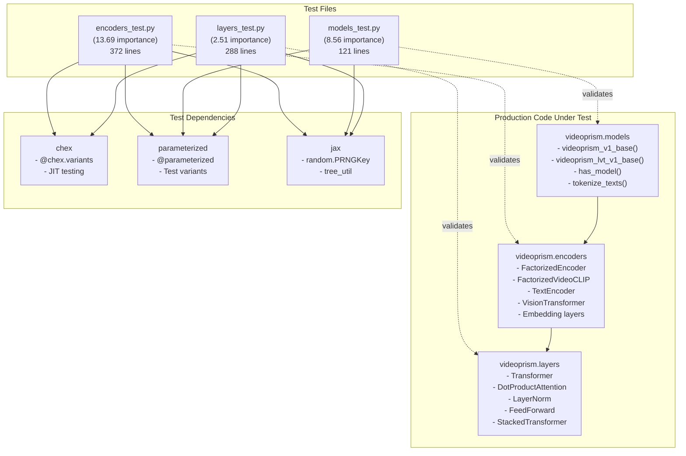
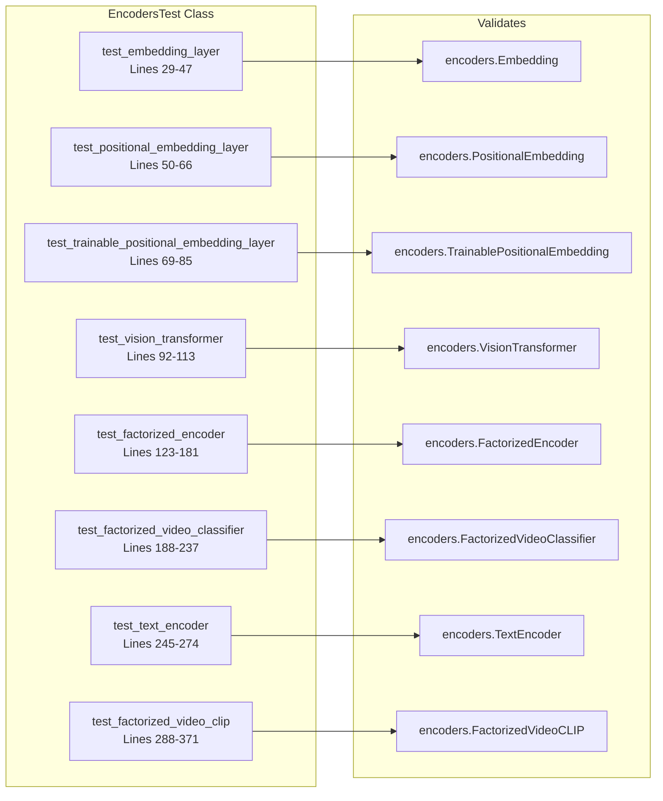
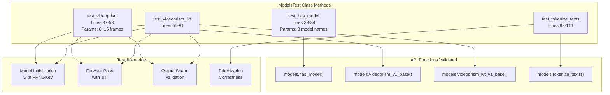
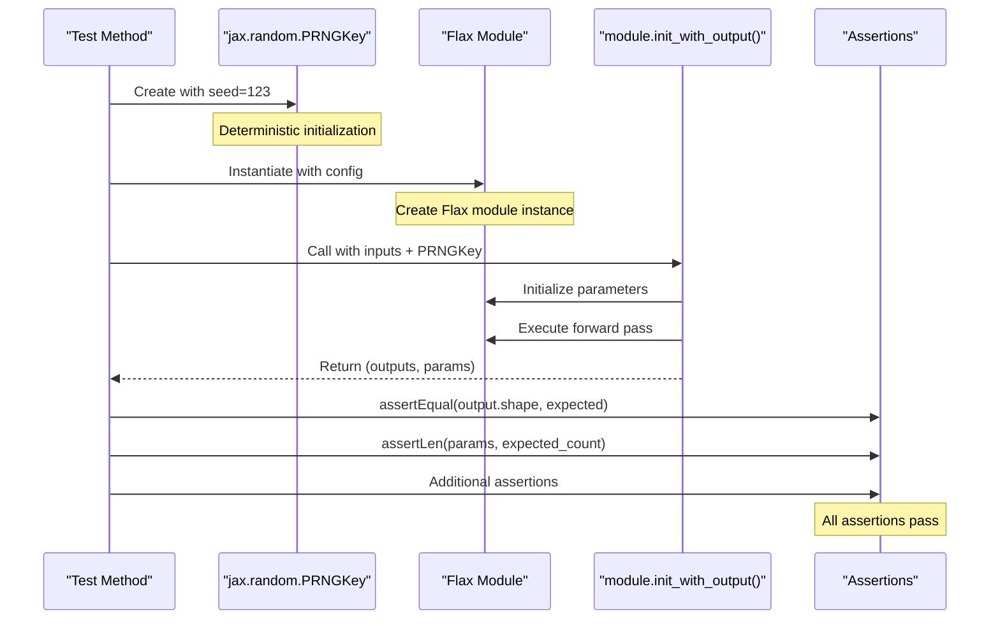
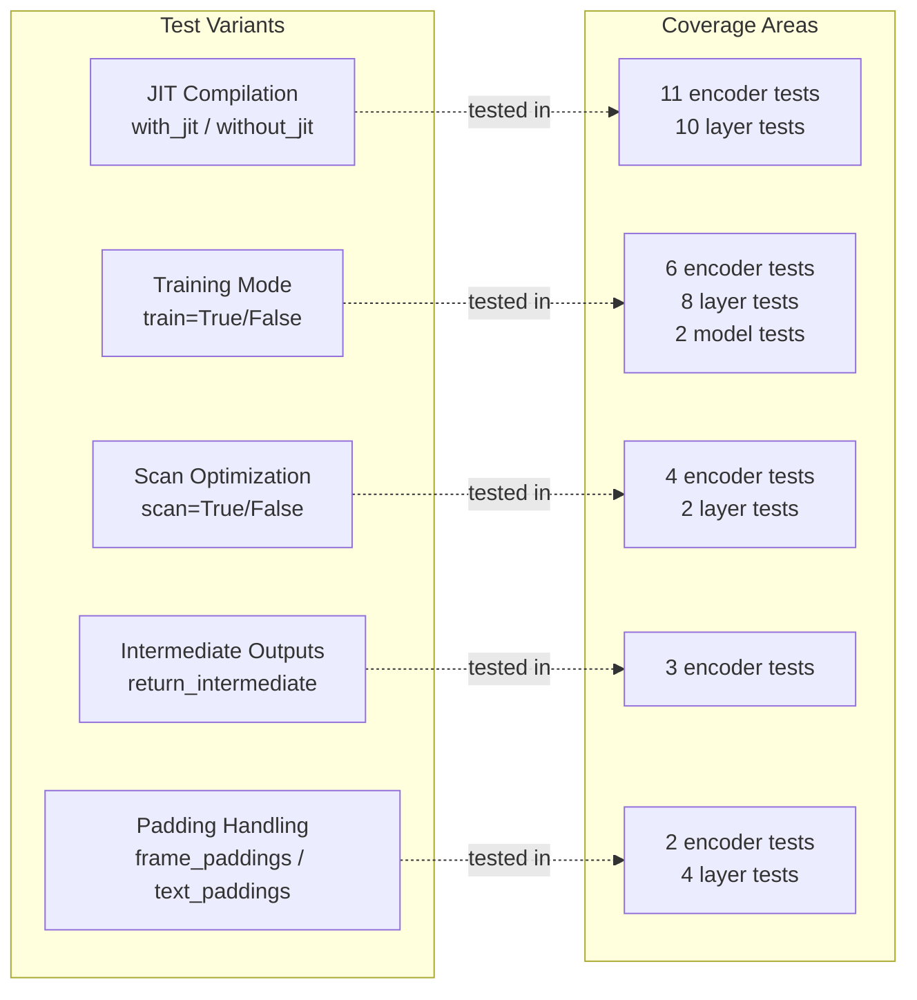
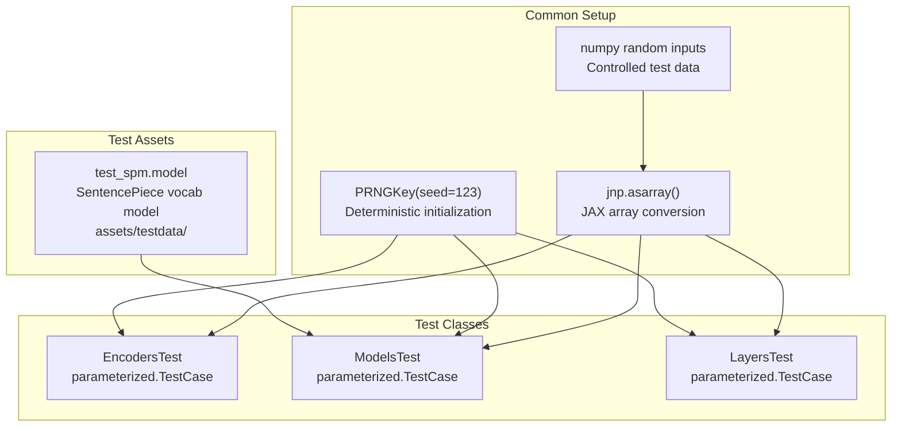

<!-- source: DeepWiki mcp.deepwiki.com · repo google-deepmind/videoprism · page 7.2 Testing · fetched 2026-10-26 -->

# Testing

<details>
<summary>Relevant source files</summary>

The following files were used as context for generating this wiki page:

- [videoprism/encoders_test.py](videoprism/encoders_test.py)
- [videoprism/layers_test.py](videoprism/layers_test.py)
- [videoprism/models_test.py](videoprism/models_test.py)

</details>


This document provides a comprehensive overview of the testing infrastructure for VideoPrism, including test organization, coverage, patterns, and execution procedures. The test suite validates model architectures, layer components, and integration points to ensure correctness and reliability.

For information about the development environment and dependencies, see [Dependencies and Environment](#7.1). For contributing guidelines, see [Contributing](#7.3).

---

## Test Infrastructure Overview

The VideoPrism test suite uses Python's `absltest` framework with JAX-specific testing utilities from `chex` and `parameterized` for comprehensive validation. The tests are organized into three primary test modules that correspond to the architectural layers of the system.

### Test Framework Stack

| Framework | Purpose | Usage in VideoPrism |
|-----------|---------|---------------------|
| `absltest` | Base testing framework | Main test runner, inherited by all test classes |
| `chex` | JAX testing utilities | JIT variant testing, shape assertions |
| `parameterized` | Test parameterization | Testing multiple configurations with same test logic |
| `jax.random.PRNGKey` | Deterministic randomness | Reproducible initialization with fixed seeds |

**Sources:** [videoprism/encoders_test.py:17-23](), [videoprism/models_test.py:17-23](), [videoprism/layers_test.py:17-23]()

### Test Assets

The test suite includes shared test assets for consistent validation:

- **test_spm.model**: SentencePiece tokenizer model for text processing tests, located at `assets/testdata/test_spm.model`
- **water_bottle_drumming.mp4**: Sample video file for end-to-end integration tests (referenced but not shown in provided files)

**Sources:** [videoprism/models_test.py:95-98]()

---

## Test Organization and Coverage



**Diagram: Test File Organization and Dependencies**

This diagram shows how test files map to production code modules and their testing dependencies.

**Sources:** [videoprism/encoders_test.py:1-375](), [videoprism/models_test.py:1-121](), [videoprism/layers_test.py:1-288]()

---

## Test Coverage by Component

### encoders_test.py - Encoder Architecture Tests

The `EncodersTest` class validates all encoder architectures and embedding components. This is the highest-importance test file (13.69) covering the core neural network implementations.



**Diagram: Encoder Test Coverage Mapping**

**Key Test Methods:**

| Test Method | Lines | Validates | Test Variants |
|-------------|-------|-----------|---------------|
| `test_embedding_layer` | 29-47 | `Embedding` class initialization and output shapes | JIT/non-JIT |
| `test_positional_embedding_layer` | 50-66 | `PositionalEmbedding` sinusoidal encoding | JIT/non-JIT |
| `test_trainable_positional_embedding_layer` | 69-85 | `TrainablePositionalEmbedding` with matmul lookup | JIT/non-JIT |
| `test_vision_transformer` | 92-113 | `VisionTransformer` forward pass | scan×train (4 variants) |
| `test_factorized_encoder` | 123-181 | `FactorizedEncoder` spatial-temporal processing | 5 variants including frame paddings |
| `test_factorized_video_classifier` | 188-237 | `FactorizedVideoClassifier` end-to-end | train×return_intermediate |
| `test_text_encoder` | 245-274 | `TextEncoder` with token embeddings | scan×train (3 variants) |
| `test_factorized_video_clip` | 288-371 | `FactorizedVideoCLIP` video-text joint encoding | 4 variants including selective intermediate |

**Sources:** [videoprism/encoders_test.py:26-375]()

#### Detailed Test Patterns in encoders_test.py

**Shape Validation Pattern:**
```python
# Example from test_factorized_encoder (lines 168-174)
embeddings.shape == (batch_size, num_frames * (image_size // patch_size) ** 2, dim)
```

**Parameter Count Validation:**
```python
# Lines 170, 224, 273, 340 - validates expected parameter counts
self.assertLen(jax.tree_util.tree_flatten(params)[0], expected_count)
```

**JIT Compilation Testing:**
```python
# Using chex.variants decorator (lines 28, 49, 87, etc.)
@chex.variants(with_jit=True, without_jit=True)
```

**Sources:** [videoprism/encoders_test.py:28-375]()

---

### models_test.py - Model Integration Tests

The `ModelsTest` class validates the high-level model API and integration between components.



**Diagram: Model Integration Test Flow**

**Test Specifications:**

| Test | Input Configuration | Expected Output | Validation |
|------|---------------------|-----------------|------------|
| `test_has_model` | Model names: base, large, giant | Boolean existence flags | Returns True for base/large, False for giant |
| `test_videoprism` | Videos: 1×{8,16}×288×288×3 | Embeddings: 1×{2048,4096}×768 | Shape matches num_frames × 256 patches |
| `test_videoprism_lvt` | Video: 1×16×288×288×3<br/>Text: 1×256 tokens | Video emb: 1×768<br/>Text emb: 1×768 | Joint embeddings in shared space |
| `test_tokenize_texts` | 3 text strings, max_length=6 | Token IDs and padding masks | Correct SentencePiece encoding |

**Sources:** [videoprism/models_test.py:26-121]()

---

### layers_test.py - Layer Component Tests

The `LayersTest` class validates individual building blocks used throughout the architecture.

```mermaid
graph TB
    subgraph "LayersTest Methods"
        ID["test_identity<br/>Lines 28-32"]
        LN["test_layer_norm<br/>Lines 36-48"]
        FF["test_feedforward_layer<br/>Lines 51-63"]
        TFF["test_transformer_feedforward<br/>Lines 67-88"]
        PROJ["test_mhd_projection<br/>Lines 96-122"]
        SCALE["test_per_dim_scale<br/>Lines 125-137"]
        MHA["test_mha<br/>Lines 145-185"]
        TFM["test_transformer_layer<br/>Lines 189-215"]
        STACK["test_stacked_transformer_layer<br/>Lines 222-249"]
        POOL["test_atten_token_pooling_layer<br/>Lines 256-283"]
    end
    
    subgraph "Layer Classes"
        ID_L["layers.identity"]
        LN_L["layers.LayerNorm"]
        FF_L["layers.FeedForward"]
        TFF_L["layers.TransformerFeedForward"]
        PROJ_L["layers.AttentionProjection"]
        SCALE_L["layers.PerDimScale"]
        MHA_L["layers.DotProductAttention"]
        TFM_L["layers.Transformer"]
        STACK_L["layers.StackedTransformer"]
        POOL_L["layers.AttenTokenPoolingLayer"]
    end
    
    ID --> ID_L
    LN --> LN_L
    FF --> FF_L
    TFF --> TFF_L
    PROJ --> PROJ_L
    SCALE --> SCALE_L
    MHA --> MHA_L
    TFM --> TFM_L
    STACK --> STACK_L
    POOL --> POOL_L
```



**Diagram: Layer Component Test Coverage**

**Test Parameterization Examples:**

| Test | Parameters | Variants | Purpose |
|------|------------|----------|---------|
| `test_layer_norm` | `direct_scale`: True/False | 2 | Validate both scaling modes |
| `test_mhd_projection` | Input/output dims, heads, projection type | 3 configs | Multi-head projection shapes |
| `test_mha` | `enable_query_scale`, `enable_per_dim_scale`, `train` | 8 (2³) | Attention mechanism configurations |
| `test_transformer_layer` | `train`: True/False | 2 | Training vs inference mode |
| `test_stacked_transformer_layer` | `scan`, `train` | 4 (2²) | Scan optimization and training modes |
| `test_atten_token_pooling_layer` | `num_queries`: 1/4, `train` | 4 | Single vs multi-query pooling |

**Sources:** [videoprism/layers_test.py:26-288]()

---

## Common Test Patterns

### 1. Initialization and Shape Validation Pattern

All tests follow a consistent pattern for module initialization and output shape validation:

```python
# Pattern used throughout test suite
prng_key = jax.random.PRNGKey(seed=123)
module = ModuleClass(name='test_module', **config_params)

@self.variant  # or @jax.jit
def var_fn():
    return module.init_with_output(prng_key, inputs, **kwargs)

outputs, params = var_fn()
self.assertEqual(outputs.shape, expected_shape)
```

This pattern appears in:
- [videoprism/encoders_test.py:32-46]() - Embedding layer test
- [videoprism/layers_test.py:39-48]() - LayerNorm test
- [videoprism/models_test.py:44-53]() - VideoPrism model test

**Sources:** [videoprism/encoders_test.py:29-375](), [videoprism/layers_test.py:28-288](), [videoprism/models_test.py:37-91]()

### 2. Parameter Count Validation

Tests validate the expected number of trainable parameters to catch architecture changes:

```python
# Example from encoders_test.py
self.assertLen(jax.tree_util.tree_flatten(params)[0], expected_param_count)
```

**Parameter Count Assertions:**

| Test | Line | Expected Count (Scan) | Expected Count (No Scan) |
|------|------|----------------------|--------------------------|
| `test_vision_transformer` | 112 | 16 | 32 |
| `test_factorized_encoder` | 170 | 40 | 72 |
| `test_factorized_video_classifier` | 224 | 54 | N/A |
| `test_text_encoder` | 273 | 20 | 36 |
| `test_factorized_video_clip` | 340 | 88 | 136 |
| `test_stacked_transformer_layer` | 248 | 17 | 68 |

**Sources:** [videoprism/encoders_test.py:112-340](), [videoprism/layers_test.py:248]()

### 3. JIT Compilation Testing with chex.variants

The `@chex.variants` decorator enables testing both JIT-compiled and eager execution modes:

```python
@chex.variants(with_jit=True, without_jit=True)
def test_method(self):
    @self.variant
    def var_fn():
        return module.init_with_output(...)
```

This pattern ensures:
- Models work correctly under JIT compilation
- No shape/type mismatches occur during tracing
- Performance optimizations don't break functionality

**Sources:** [videoprism/encoders_test.py:28](), [videoprism/layers_test.py:34]()

### 4. Parameterized Test Variants

Using `@parameterized.named_parameters` or `@parameterized.product` for testing multiple configurations:

```python
@parameterized.named_parameters(
    ('train', False, True, False),
    ('scan', True, False, False),
    ('scan_and_train', True, True, False),
)
def test_factorized_encoder(self, scan: bool, train: bool, return_intermediate: bool):
    # Test with different configurations
```

**Sources:** [videoprism/encoders_test.py:116-122](), [videoprism/layers_test.py:140-143]()

### 5. Padding and Masking Tests

Tests validate proper handling of variable-length sequences and masked inputs:

```python
# Frame padding test (encoders_test.py:138-142)
np_frame_paddings = np.zeros((batch_size, num_frames), dtype='float32')
np_frame_paddings[:, num_frames // 2:] = 1  # Pad second half
frame_paddings = jnp.asarray(np_frame_paddings)

# Text padding test (encoders_test.py:251-253)
np_paddings = np.zeros([batch_size, seq_len], dtype='float32')
np_paddings[:, seq_len // 2:] = 1
```

**Sources:** [videoprism/encoders_test.py:138-253](), [videoprism/layers_test.py:73-74]()

---

## Running Tests

### Executing Individual Test Files

Run specific test modules using Python's unittest discovery:

```bash
# Run all encoder tests
python -m videoprism.encoders_test

# Run all model tests
python -m videoprism.models_test

# Run all layer tests
python -m videoprism.layers_test
```

### Running Specific Test Cases

Execute individual test methods:

```bash
# Run specific test class
python -m videoprism.encoders_test EncodersTest

# Run specific test method
python -m videoprism.encoders_test EncodersTest.test_factorized_encoder
```

### Running All Tests

Execute the entire test suite:

```bash
# From repository root
python -m pytest videoprism/

# Or using absltest
python -m unittest discover -s videoprism -p '*_test.py'
```

**Sources:** [videoprism/encoders_test.py:374-375](), [videoprism/models_test.py:119-120](), [videoprism/layers_test.py:286-287]()

---

## Test Execution Flow



**Diagram: Typical Test Execution Sequence**

This sequence diagram shows the standard flow for initializing and testing a Flax module with deterministic random seeds and shape validation.

**Sources:** [videoprism/encoders_test.py:33-46](), [videoprism/models_test.py:43-53]()

---

## Test Coverage Summary

### Coverage by Architecture Layer

| Layer | Test File | Lines of Test Code | Number of Test Methods | Parameter Count Checks |
|-------|-----------|-------------------|----------------------|----------------------|
| Encoders | encoders_test.py | 372 | 8 | Yes (6 methods) |
| Models | models_test.py | 121 | 4 | No (integration focus) |
| Layers | layers_test.py | 288 | 10 | Yes (8 methods) |

### Test Variant Coverage



**Diagram: Test Variant Coverage Across Codebase**

**Sources:** [videoprism/encoders_test.py:1-375](), [videoprism/models_test.py:1-121](), [videoprism/layers_test.py:1-288]()

---

## Integration Test Scenarios

### End-to-End Model Tests

The model tests in `models_test.py` provide integration testing by:

1. **Model Instantiation**: Creating models via public API functions
2. **Parameter Initialization**: Using `model.init()` with random keys
3. **JIT Compilation**: Wrapping forward pass in `@jax.jit`
4. **Shape Validation**: Verifying output dimensions match expected

Example integration test flow:

```python
# From test_videoprism (lines 37-53)
mdl = models.videoprism_v1_base()
mdl_params = mdl.init(prng_key, inputs, train=False)

@jax.jit
def forward_fn(mdl_inputs):
    return mdl.apply(mdl_params, mdl_inputs, train=False)

embeddings, _ = forward_fn(inputs)
```

**Sources:** [videoprism/models_test.py:37-91]()

### Tokenization Integration

The `test_tokenize_texts` method validates the complete tokenization pipeline including:
- SentencePiece model loading from assets
- Text tokenization with padding
- Truncation to max_length
- Padding mask generation

**Expected Behavior:**
```python
# Input: ['blah', 'blah blah', 'blah blah blah']
# Output IDs: [[80, 180, 60, 0, 0, 0],
#             [80, 180, 60, 80, 180, 60],
#             [80, 180, 60, 80, 180, 60]]
# Paddings:   [[0, 0, 0, 1, 1, 1],
#             [0, 0, 0, 0, 0, 0],
#             [0, 0, 0, 0, 0, 0]]
```

**Sources:** [videoprism/models_test.py:93-116]()

---

## Test Assertions Reference

### Common Assertion Patterns

| Assertion Type | Code Pattern | Purpose | Example Location |
|----------------|--------------|---------|------------------|
| Shape equality | `self.assertEqual(tensor.shape, expected_shape)` | Validate output dimensions | [encoders_test.py:47]() |
| Parameter count | `self.assertLen(tree_flatten(params)[0], count)` | Verify architecture | [encoders_test.py:112]() |
| Tree structure | `self.assertEmpty(outputs)` | Check empty dictionaries | [encoders_test.py:181]() |
| Array equality | `np.testing.assert_array_equal(a, b)` | Exact value matching | [models_test.py:106-115]() |
| Boolean checks | `self.assertEqual(has_model(name), exists)` | API functionality | [models_test.py:34]() |
| Set equality | `self.assertEqual(set(outputs.keys()), expected_keys)` | Dictionary keys | [encoders_test.py:348-356]() |

**Sources:** [videoprism/encoders_test.py:46-356](), [videoprism/models_test.py:34-115](), [videoprism/layers_test.py:31-283]()

---

## Test Dependencies and Fixtures

### Required Imports

All test files require the following imports:

```python
from absl.testing import absltest
from absl.testing import parameterized
import chex
import jax
from jax import numpy as jnp
import numpy as np
```

**Sources:** [videoprism/encoders_test.py:17-23](), [videoprism/models_test.py:17-23](), [videoprism/layers_test.py:17-23]()

### Test Fixtures



**Diagram: Test Fixture Dependencies**

**Sources:** [videoprism/models_test.py:94-98](), [videoprism/encoders_test.py:33](), [videoprism/layers_test.py:39]()

---

## Best Practices Demonstrated

The test suite demonstrates several best practices for testing JAX/Flax models:

1. **Deterministic Initialization**: All tests use fixed random seeds (`seed=123`) for reproducibility
2. **JIT Testing**: Tests verify both JIT-compiled and eager execution modes
3. **Parameter Validation**: Architecture changes are caught by parameter count assertions
4. **Shape Validation**: Output dimensions are always validated against expected shapes
5. **Variant Coverage**: Parameterized tests cover multiple configurations (scan, train, etc.)
6. **Integration Testing**: Model-level tests validate end-to-end workflows
7. **Clear Naming**: Test methods use descriptive names indicating what they validate
8. **Isolation**: Each test creates its own module instances and parameters

**Sources:** [videoprism/encoders_test.py:1-375](), [videoprism/models_test.py:1-121](), [videoprism/layers_test.py:1-288]()

---

