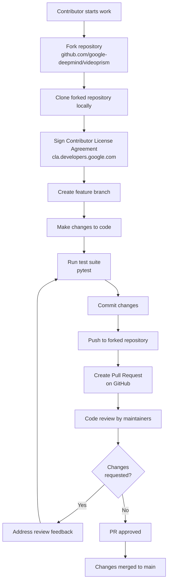
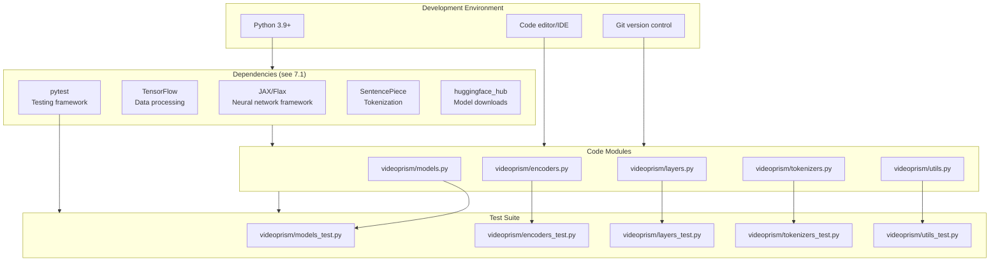
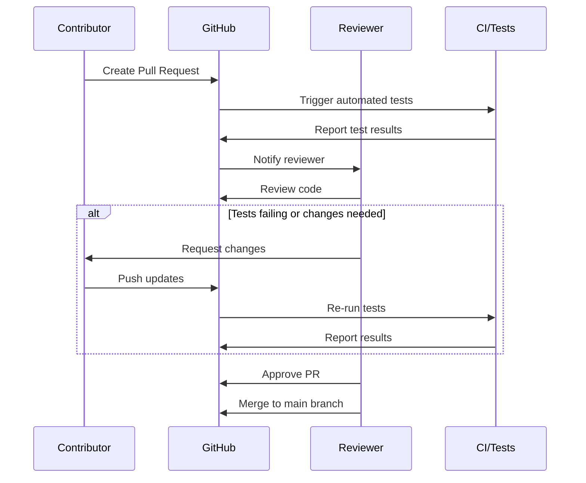
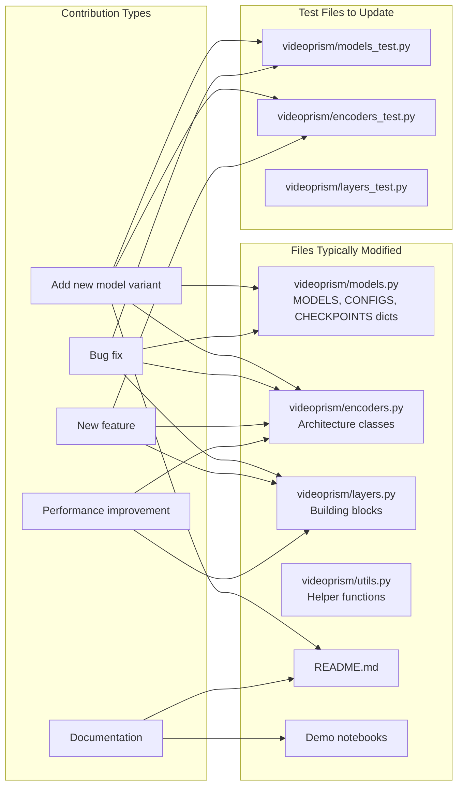

<!-- source: DeepWiki mcp.deepwiki.com · repo google-deepmind/videoprism · page 7.3 Contributing · fetched 2026-10-26 -->

# Contributing

<details>
<summary>Relevant source files</summary>

The following files were used as context for generating this wiki page:

- [CONTRIBUTING.md](CONTRIBUTING.md)

</details>


## Purpose and Scope

This document provides guidelines for contributing code to the VideoPrism project. It covers the Contributor License Agreement (CLA) requirements, code review process, development setup, testing expectations, and community standards. For information about the testing infrastructure and how to run tests, see [Testing](#7.2). For details on dependencies and environment configuration, see [Dependencies and Environment](#7.1).

---

## Contribution Workflow

The following diagram illustrates the complete process for contributing changes to the VideoPrism codebase:



**Sources:** [CONTRIBUTING.md:1-25]()

---

## Prerequisites

Before contributing to VideoPrism, ensure you have:

| Requirement | Description |
|------------|-------------|
| **GitHub Account** | Required for forking repository and creating pull requests |
| **CLA Signature** | Must sign Google's Contributor License Agreement |
| **Development Environment** | Python 3.9+, JAX, Flax, and other dependencies installed |
| **Testing Framework** | pytest and associated test utilities |
| **Git** | Version control system for managing code changes |

**Sources:** [CONTRIBUTING.md:1-25]()

---

## Contributor License Agreement (CLA)

All contributions to VideoPrism require a signed Contributor License Agreement. This is a one-time requirement per contributor.

### Key Points

- **Copyright Retention**: You or your employer retain copyright to your contributions
- **Permission Grant**: The CLA grants Google permission to use and redistribute your contributions as part of the project
- **One-Time Process**: If you've previously signed a CLA for another Google project, you typically don't need to sign again
- **URL**: <https://cla.developers.google.com/>

### Verification

Before your pull request can be merged, automated systems will verify your CLA status. If you haven't signed the CLA, you'll receive instructions in the pull request comments.

**Sources:** [CONTRIBUTING.md:3-13]()

---

## Development Setup

The following diagram shows the relationship between the development environment, code modules, and testing infrastructure:



**Sources:** [CONTRIBUTING.md:1-25]()

---

## Code Review Process

All submissions to VideoPrism undergo code review through GitHub pull requests. This applies to both external contributors and project maintainers.

### Pull Request Guidelines

1. **Clear Description**: Provide a detailed description of changes, including motivation and implementation approach
2. **Scope**: Keep changes focused and atomic - separate unrelated changes into different PRs
3. **Tests**: Include or update tests to cover modified functionality
4. **Documentation**: Update relevant documentation if public APIs change
5. **Commit Messages**: Write clear, descriptive commit messages

### Review Workflow



### What Reviewers Check

| Aspect | Description |
|--------|-------------|
| **Correctness** | Code logic is sound and achieves stated goals |
| **Tests** | Adequate test coverage for new/modified functionality |
| **Style** | Code follows project conventions and is readable |
| **Documentation** | Public interfaces are documented; changes explained |
| **Dependencies** | New dependencies are justified and properly declared |
| **Performance** | Changes don't introduce unnecessary performance regressions |

**Sources:** [CONTRIBUTING.md:15-20]()

---

## Testing Requirements

Before submitting a pull request, contributors should run the test suite to ensure changes don't break existing functionality. For detailed information on the testing infrastructure, see [Testing](#7.2).

### Running Tests

The VideoPrism test suite uses `pytest`. To run all tests:

```bash
pytest videoprism/
```

To run tests for a specific module:

```bash
pytest videoprism/encoders_test.py
pytest videoprism/models_test.py
```

### Test Coverage Expectations

The following table shows which test files validate which code modules:

| Code Module | Test File | Key Test Areas |
|-------------|-----------|----------------|
| `videoprism/models.py` | `videoprism/models_test.py` | Model loading, weight loading, tokenization |
| `videoprism/encoders.py` | `videoprism/encoders_test.py` | Architecture forward passes, shape validation |
| `videoprism/layers.py` | `videoprism/layers_test.py` | Layer components, parameter counts |
| `videoprism/tokenizers.py` | `videoprism/tokenizers_test.py` | Tokenization, padding, masking |
| `videoprism/utils.py` | `videoprism/utils_test.py` | Checkpoint loading, text canonicalization |

### Test Patterns

Contributors should follow existing test patterns when adding new tests:

- **Shape Validation**: Verify output tensor shapes match expected dimensions
- **Parameter Counting**: Ensure model parameter counts are correct
- **Functional Tests**: Validate forward pass executes without errors
- **Integration Tests**: Test end-to-end workflows

**Sources:** [CONTRIBUTING.md:1-25]()

---

## Code Modification Areas

The following diagram maps common contribution types to the code files they typically involve:



**Sources:** [CONTRIBUTING.md:1-25]()

---

## Community Guidelines

VideoPrism follows [Google's Open Source Community Guidelines](https://opensource.google/conduct/). All contributors and maintainers are expected to adhere to these standards.

### Core Principles

- **Be respectful**: Treat all community members with respect, regardless of experience level or background
- **Be welcoming**: Foster an inclusive environment for contributors of all skill levels
- **Be considerate**: Understand that people have different perspectives and experiences
- **Be collaborative**: Work together to resolve conflicts and improve the project
- **Focus on the project**: Keep discussions focused on the technical aspects of VideoPrism

### Unacceptable Behavior

- Harassment, discrimination, or intimidation of any kind
- Trolling, insulting, or derogatory comments
- Personal attacks or political arguments
- Publishing private information without permission
- Any conduct that would be inappropriate in a professional setting

### Reporting Issues

If you experience or witness unacceptable behavior, report it to the project maintainers through GitHub's reporting mechanisms.

**Sources:** [CONTRIBUTING.md:22-25]()

---

## Submitting Your First Contribution

For first-time contributors, consider starting with:

1. **Documentation improvements**: Fix typos, clarify explanations, or add examples
2. **Test coverage**: Add tests for existing functionality
3. **Bug fixes**: Address issues labeled as "good first issue" or "help wanted"
4. **Example code**: Contribute usage examples or demo notebooks

### Checklist Before Submitting

- [ ] CLA signed at <https://cla.developers.google.com/>
- [ ] Code follows existing style and conventions
- [ ] Tests added/updated and passing locally (`pytest videoprism/`)
- [ ] Documentation updated if public APIs changed
- [ ] Commit messages are clear and descriptive
- [ ] Pull request description explains changes thoroughly

**Sources:** [CONTRIBUTING.md:1-25]()

---

## Additional Resources

- **GitHub Help**: <https://help.github.com/articles/about-pull-requests/>
- **CLA Portal**: <https://cla.developers.google.com/>
- **Community Guidelines**: <https://opensource.google/conduct/>
- **Testing Documentation**: See [Testing](#7.2)
- **Dependencies**: See [Dependencies and Environment](#7.1)

**Sources:** [CONTRIBUTING.md:18-20](), [CONTRIBUTING.md:22-25]()

---

