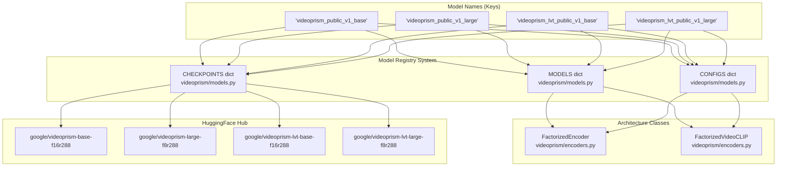
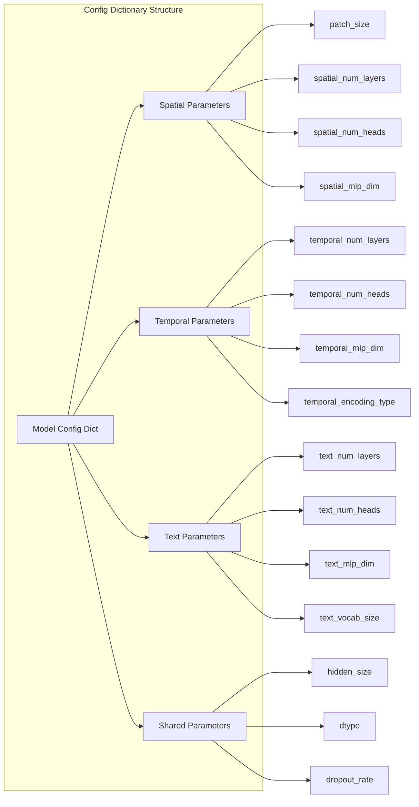
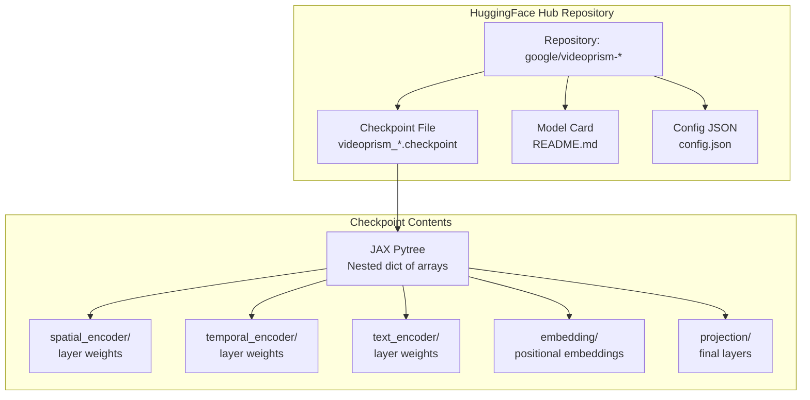
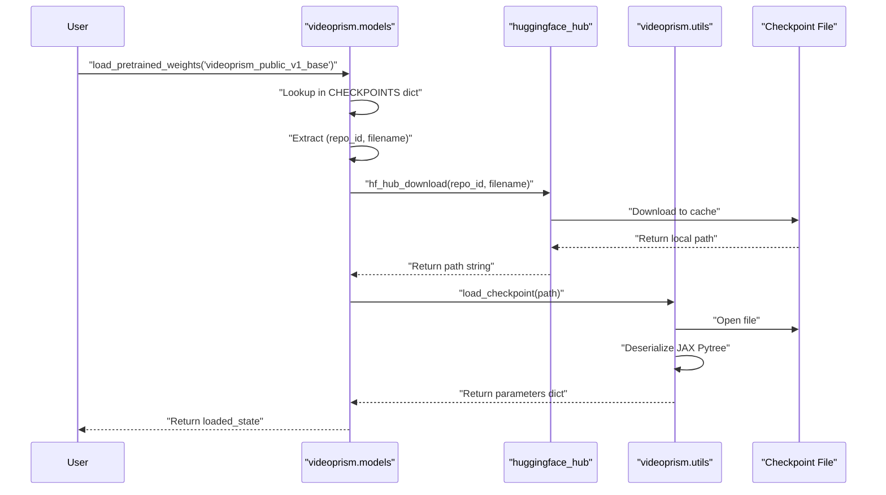
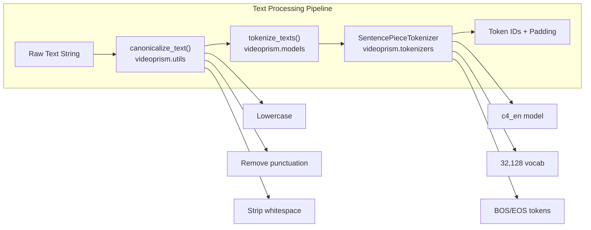

<!-- source: DeepWiki mcp.deepwiki.com · repo google-deepmind/videoprism · page 8 Appendix · fetched 2026-10-26 -->

# Appendix

<details>
<summary>Relevant source files</summary>

The following files were used as context for generating this wiki page:

- [LICENSE](LICENSE)
- [README.md](README.md)

</details>


This appendix provides supplementary reference material for the VideoPrism codebase, including complete model configuration specifications, checkpoint registry details, and licensing information. This section is intended as a quick-reference guide for developers and users who need detailed technical specifications or legal information.

For model architecture details and usage patterns, see [Core Architecture](#4). For practical usage examples, see [Usage Guide](#5). For API documentation, see [API Reference](#6).

---

## Overview of Reference Material

The appendix is organized into three main sections:

1. **Model Configurations** ([8.1](#8.1)): Complete specifications of all model variants including architectural parameters, layer counts, embedding dimensions, and backbone configurations
2. **Checkpoint Registry** ([8.2](#8.2)): Registry mapping model names to HuggingFace Hub locations and checkpoint metadata
3. **License Information** ([8.3](#8.3)): Apache 2.0 license text and usage terms

---

## Model Registry System Structure

The VideoPrism model management system uses three core dictionaries that work together to enable model instantiation and weight loading:



**Sources:** [README.md:88-97](), [videoprism/models.py]()

The model registry follows a three-tier lookup pattern:

1. **MODELS dict**: Maps model name strings to architecture class constructors (`FactorizedEncoder` or `FactorizedVideoCLIP`)
2. **CONFIGS dict**: Maps model name strings to configuration dictionaries containing architectural hyperparameters
3. **CHECKPOINTS dict**: Maps model name strings to tuples of `(repo_id, filename)` for HuggingFace Hub downloads

---

## Model Configuration Parameters

Each model configuration in the `CONFIGS` dict contains the following parameter categories:



**Sources:** [videoprism/models.py](), [videoprism/encoders.py]()

### Video-Only Model Configurations

The video encoder models (`videoprism_public_v1_base` and `videoprism_public_v1_large`) use `FactorizedEncoder` with these key parameters:

| Parameter | Base (ViT-B) | Large (ViT-L) | Description |
|-----------|--------------|---------------|-------------|
| Total Parameters | 114M | 354M | Total trainable parameters |
| `hidden_size` | 768 | 1024 | Embedding dimension |
| `patch_size` | 16 | 16 | Spatial patch size (pixels) |
| `spatial_num_layers` | 12 | 24 | Number of spatial transformer layers |
| `spatial_num_heads` | 12 | 16 | Attention heads in spatial encoder |
| `temporal_num_layers` | 4 | 4 | Number of temporal transformer layers |
| `temporal_num_heads` | 12 | 16 | Attention heads in temporal encoder |
| Input Shape | (B, 16, 288, 288, 3) | (B, 8, 288, 288, 3) | Default frame count differs |
| Output Shape | (B, 16×16×F, C) | (B, 16×16×F, C) | Spatiotemporal features |

**Sources:** [README.md:99-106]()

### Video-Text Model Configurations

The video-text models (`videoprism_lvt_public_v1_base` and `videoprism_lvt_public_v1_large`) use `FactorizedVideoCLIP` with additional text encoder parameters:

| Parameter | LvT-Base | LvT-Large | Description |
|-----------|----------|-----------|-------------|
| Total Parameters | 248M | 580M | Video + text encoder parameters |
| Video `hidden_size` | 768 | 1024 | Video embedding dimension |
| Text `hidden_size` | 768 | 1024 | Text embedding dimension |
| `text_num_layers` | 12 | 24 | Transformer layers in text encoder |
| `text_num_heads` | 12 | 16 | Attention heads in text encoder |
| `text_vocab_size` | 32128 | 32128 | SentencePiece vocabulary size |
| Output Shape (Video) | (B, C) | (B, C) | Global video embedding |
| Output Shape (Text) | (B, C) | (B, C) | Global text embedding |

**Sources:** [README.md:108-111]()

---

## Checkpoint File Structure

Each model checkpoint is stored on HuggingFace Hub and contains serialized JAX parameters:



**Sources:** [README.md:88-97](), [videoprism/utils.py]()

### Checkpoint Loading Flow

The checkpoint loading process uses the `load_checkpoint` utility function:



**Sources:** [videoprism/models.py](), [videoprism/utils.py]()

---

## Model Naming Convention

The model naming scheme follows this pattern:

| Component | Purpose | Example Values |
|-----------|---------|----------------|
| Base prefix | Product name | `videoprism` |
| Model type | Architecture variant | `lvt` (Locked video-text), omitted for video-only |
| Access level | Release designation | `public` |
| Version | Release version | `v1` |
| Size | Model scale | `base`, `large` |

Full model names:
- `videoprism_public_v1_base`: Video-only, base size
- `videoprism_public_v1_large`: Video-only, large size
- `videoprism_lvt_public_v1_base`: Video-text (LvT), base size
- `videoprism_lvt_public_v1_large`: Video-text (LvT), large size

**Sources:** [README.md:88-97]()

---

## HuggingFace Repository Structure

Each model variant has a dedicated HuggingFace repository:

| Model Name | HuggingFace Repository | File Size | Checkpoint Filename |
|------------|------------------------|-----------|---------------------|
| `videoprism_public_v1_base` | `google/videoprism-base-f16r288` | 458MB | `videoprism_base.checkpoint` |
| `videoprism_public_v1_large` | `google/videoprism-large-f8r288` | 1.42GB | `videoprism_large.checkpoint` |
| `videoprism_lvt_public_v1_base` | `google/videoprism-lvt-base-f16r288` | 991MB | `videoprism_lvt_base.checkpoint` |
| `videoprism_lvt_public_v1_large` | `google/videoprism-lvt-large-f8r288` | 2.30GB | `videoprism_lvt_large.checkpoint` |

The repository naming convention includes frame count (`f16` or `f8`) and resolution (`r288`) information:
- `f16`: 16 frames (base models)
- `f8`: 8 frames (large models)
- `r288`: 288×288 spatial resolution

**Sources:** [README.md:88-97]()

---

## Input/Output Specifications

### Video Encoder Models

**Input Requirements:**
- Shape: `(batch_size, num_frames, 288, 288, 3)`
- RGB values normalized to `[0.0, 1.0]`
- Frame count can vary through positional embedding interpolation
- Default frame counts: 16 for Base, 8 for Large

**Output Format:**
- Shape: `(batch_size, num_frames * 16 * 16, feature_channels)`
- Can be reshaped to: `(batch_size, num_frames, 16, 16, feature_channels)`
- Feature channels: 768 for Base, 1024 for Large
- Spatiotemporal feature representation

**Sources:** [README.md:99-106]()

### Video-Text Models

**Video Input:**
- Same as video encoder models
- Can pass `None` to skip video encoding

**Text Input:**
- Token IDs: `(batch_size, max_tokens)`
- Padding masks: `(batch_size, max_tokens)`
- Tokenized using SentencePiece `c4_en` model
- Vocabulary size: 32,128 tokens

**Output Format:**
- Video embeddings: `(batch_size, feature_channels)`
- Text embeddings: `(batch_size, feature_channels)`
- L2-normalized for cosine similarity computation
- Feature channels: 768 for Base, 1024 for Large

**Sources:** [README.md:108-111]()

---

## Text Tokenization Details

The text tokenization system uses SentencePiece with the following specifications:



**Sources:** [README.md:110](), [videoprism/tokenizers.py](), [videoprism/utils.py]()

### Tokenizer Configuration

| Property | Value | Description |
|----------|-------|-------------|
| Model | `c4_en` | SentencePiece model trained on C4 dataset |
| Vocabulary Size | 32,128 | Total number of tokens |
| Special Tokens | BOS, EOS, PAD | Begin/end of sequence, padding |
| Max Sequence Length | Configurable | Depends on model input |
| Encoding | UTF-8 | Character encoding |

**Sources:** [videoprism/tokenizers.py]()

---

## Performance Benchmarks

The following tables summarize the performance of public release models compared to paper models and prior state-of-the-art:

### VideoGLUE Benchmarks (Video-Only Tasks)

| Model | K400 | MiT | SSv2 | D48 | Charades | ActivityNet | AVA | AVA-K |
|-------|------|-----|------|-----|----------|-------------|-----|-------|
| VideoPrism-B (public) | 82.9 | 39.7 | 62.2 | 64.3 | 43.5 | 36.5 | 28.3 | 30.8 |
| VideoPrism-L (public) | 85.0 | 43.3 | 64.6 | 67.6 | 53.2 | 37.0 | 32.4 | 34.5 |
| VideoPrism-B (paper) | 84.2 | 40.8 | 63.6 | 67.4 | 40.4 | 36.6 | 30.6 | 31.8 |
| VideoPrism-g (paper) | 87.2 | 45.5 | 68.5 | 71.3 | 62.3 | 37.8 | 36.2 | 37.3 |

Note: Public models use different pre-training image-text data than paper models due to data policy.

**Sources:** [README.md:113-130]()

### Zero-Shot Video-Text Retrieval

| Model | MSRVTT (v2t) | MSRVTT (t2v) | VATEX (v2t) | VATEX (t2v) | ActivityNet (v2t) | ActivityNet (t2v) |
|-------|--------------|--------------|-------------|-------------|-------------------|-------------------|
| VideoPrism-LvT-B (public) | 49.8 | 50.1 | 73.1 | 56.2 | 47.9 | 48.8 |
| VideoPrism-LvT-L (public) | 50.6 | 50.1 | 75.0 | 57.2 | 49.1 | 51.3 |
| VideoPrism-LvT-B (paper) | 50.2 | 51.4 | 76.2 | 57.7 | 47.9 | 49.6 |
| VideoPrism-LvT-g (paper) | 51.7 | 52.7 | 77.1 | 62.5 | 50.3 | 52.7 |

**Sources:** [README.md:132-141]()

### Zero-Shot Video Classification

| Model | K400 | SSv2 (Temporal) | SSv2 (Events) | NExT-QA | Charades | Charades (STA) |
|-------|------|-----------------|---------------|---------|----------|----------------|
| VideoPrism-LvT-B (public) | 69.2 | 14.6 | 11.3 | 31.1 | 26.9 | 48.6 |
| VideoPrism-LvT-L (public) | 72.4 | 18.0 | 12.4 | 32.1 | 32.4 | 50.2 |
| VideoPrism-LvT-B (paper) | 71.3 | 16.1 | 11.9 | 31.3 | 29.2 | 50.0 |
| VideoPrism-LvT-g (paper) | 74.6 | 18.6 | 15.7 | 32.7 | 32.4 | 50.4 |

**Sources:** [README.md:143-152]()

---

## Citation Information

When using VideoPrism in research, cite the following papers:

### VideoPrism Paper

```bibtex
@inproceedings{zhao2024videoprism,
  title = {{VideoPrism}: A Foundational Visual Encoder for Video Understanding},
  author = {Long Zhao and Nitesh B. Gundavarapu and Liangzhe Yuan and Hao Zhou and Shen Yan and Jennifer J. Sun and Luke Friedman and Rui Qian and Tobias Weyand and Yue Zhao and Rachel Hornung and Florian Schroff and Ming-Hsuan Yang and David A. Ross and Huisheng Wang and Hartwig Adam and Mikhail Sirotenko and Ting Liu and Boqing Gong},
  booktitle = {International Conference on Machine Learning (ICML)},
  year = {2024}
}
```

### VideoGLUE Paper

```bibtex
@article{yuan2024videoglue,
  title = {{VideoGLUE}: Video General Understanding Evaluation of Foundation Models},
  author = {Liangzhe Yuan and Nitesh Bharadwaj Gundavarapu and Long Zhao and Hao Zhou and Yin Cui and Lu Jiang and Xuan Yang and Menglin Jia and Tobias Weyand and Luke Friedman and Mikhail Sirotenko and Huisheng Wang and Florian Schroff and Hartwig Adam and Ming-Hsuan Yang and Ting Liu and Boqing Gong},
  journal = {Transactions on Machine Learning Research (TMLR)},
  year = {2024}
}
```

**Sources:** [README.md:154-173]()

---

## License Summary

The VideoPrism codebase uses dual licensing:

### Software License

**License:** Apache License, Version 2.0  
**Applies to:** All source code files (`.py`, `.ipynb`, etc.)  
**Full text:** See section [8.3](#8.3) or [LICENSE file](LICENSE)  
**Key permissions:**
- Commercial use allowed
- Modification allowed
- Distribution allowed
- Patent use granted
- Private use allowed

**Key conditions:**
- License and copyright notice must be included
- State changes must be documented
- Same license applies to derivative works
- No trademark use without permission

**Sources:** [README.md:175-189](), [LICENSE:1-202]()

### Documentation License

**License:** Creative Commons Attribution 4.0 International (CC-BY)  
**Applies to:** Non-software materials (documentation, images, etc.)  
**URL:** https://creativecommons.org/licenses/by/4.0/legalcode  
**Key permissions:**
- Share and adapt the material
- Commercial use allowed
- Must give appropriate credit

**Sources:** [README.md:175-189]()

### Copyright Notice

```
Copyright 2025 Google LLC

Licensed under the Apache License, Version 2.0 (the "License");
you may not use this file except in compliance with the License.
```

All software and materials are provided "AS IS" WITHOUT WARRANTIES OR CONDITIONS OF ANY KIND, either express or implied.

**Sources:** [README.md:177-189]()

---

## Disclaimer

This is not an official Google product. The codebase is provided as research software for educational and research purposes.

**Sources:** [README.md:191-193]()

---

## External Resources

The following external resources are referenced throughout the codebase:

| Resource | Purpose | URL |
|----------|---------|-----|
| arXiv Paper | Research publication | https://arxiv.org/abs/2402.13217 |
| Google Research Blog | Product announcement | https://research.google/blog/videoprism-* |
| HuggingFace Collection | Model weights | https://huggingface.co/collections/google/videoprism-* |
| Video Encoder Colab | Demo notebook | https://colab.research.google.com/.../videoprism_video_encoder_demo.ipynb |
| Video-Text Colab | Demo notebook | https://colab.research.google.com/.../videoprism_video_text_demo.ipynb |
| JAX Documentation | Framework docs | https://github.com/jax-ml/jax |
| Flax Documentation | Framework docs | https://github.com/google/flax |
| SentencePiece | Tokenization library | https://github.com/google/sentencepiece |

**Sources:** [README.md:1-9]()

---

