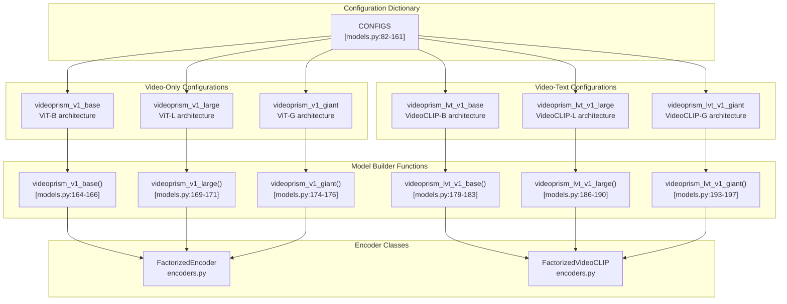
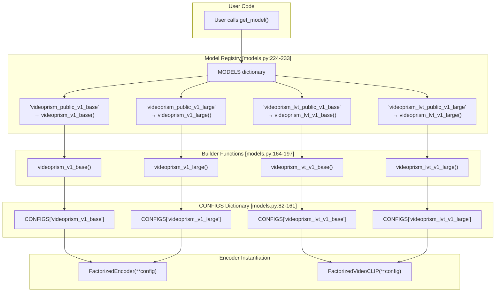
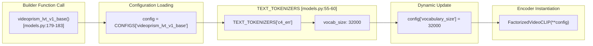

<!-- source: DeepWiki mcp.deepwiki.com · repo google-deepmind/videoprism · page 8.1 Model Configurations · fetched 2026-10-26 -->

# Model Configurations

<details>
<summary>Relevant source files</summary>

The following files were used as context for generating this wiki page:

- [videoprism/models.py](videoprism/models.py)

</details>


This page provides a complete reference for all model configurations available in VideoPrism. The configurations are stored in the `CONFIGS` dictionary and define the architectural parameters for different model variants. For information about loading and using these models, see [Model Management System](#4.1). For details about the encoder architectures that use these configurations, see [Encoder Architectures](#4.2).

## Overview

VideoPrism stores all architectural configurations in the `CONFIGS` dictionary located at [videoprism/models.py:82-161](). This dictionary maps configuration names to parameter dictionaries that specify the architecture details for each model variant. These configurations are used by model builder functions to instantiate the appropriate encoder architectures.



**Configuration Flow from Dictionary to Encoder Instances**

Sources: [videoprism/models.py:82-197]()

## Configuration Parameters

Each configuration dictionary contains parameters that define the transformer architecture. The parameters differ between video-only models (`FactorizedEncoder`) and video-text models (`FactorizedVideoCLIP`).

### Common Parameters

These parameters appear in all configurations:

| Parameter | Type | Description |
|-----------|------|-------------|
| `patch_size` | int | Size of the spatial patches extracted from video frames (in pixels) |
| `pos_emb_shape` | tuple[int, int, int] | Shape of the positional embedding grid as (temporal, height, width) |
| `model_dim` | int | Hidden dimension size throughout the transformer |
| `num_spatial_layers` | int | Number of transformer layers for spatial processing (per-frame) |
| `num_temporal_layers` | int | Number of transformer layers for temporal processing (across frames) |
| `num_heads` | int | Number of attention heads in multi-head attention |
| `mlp_dim` | int | Hidden dimension of the feedforward/MLP layers |
| `atten_logit_cap` | float | Maximum absolute value for attention logits (prevents overflow) |
| `scan` | bool | Whether to use JAX scan for memory-efficient layer execution |

### Video-Text Specific Parameters

These parameters are only present in `videoprism_lvt_*` configurations:

| Parameter | Type | Description |
|-----------|------|-------------|
| `num_auxiliary_layers` | int | Number of auxiliary decoder layers for text encoding |
| `enable_causal_atten` | bool | Whether to use causal attention masking in text encoder |
| `num_unimodal_layers` | int | Number of unimodal transformer layers in text encoder |
| `norm_policy` | str | Normalization policy: `'pre'`, `'post'`, or `'primer_hybrid'` |
| `vocabulary_size` | int | Size of the text vocabulary (added dynamically by builder functions) |

Sources: [videoprism/models.py:82-161](), [videoprism/encoders.py]()

## Video-Only Model Configurations

These configurations are used with `FactorizedEncoder` for video-only feature extraction tasks.

### Configuration Comparison Table

| Parameter | Base (ViT-B) | Large (ViT-L) | Giant (ViT-G) |
|-----------|--------------|---------------|---------------|
| **Config Key** | `videoprism_v1_base` | `videoprism_v1_large` | `videoprism_v1_giant` |
| **Patch Size** | 18 | 18 | 18 |
| **Pos Emb Shape** | (16, 16, 16) | (8, 16, 16) | (8, 16, 16) |
| **Model Dim** | 768 | 1024 | 1408 |
| **Spatial Layers** | 12 | 24 | 40 |
| **Temporal Layers** | 4 | 4 | 4 |
| **Attention Heads** | 12 | 16 | 16 |
| **MLP Dim** | 3072 | 4096 | 6144 |
| **Atten Logit Cap** | 50.0 | 50.0 | 50.0 |
| **Scan** | True | True | True |

### videoprism_v1_base

The base model configuration corresponds to a ViT-B (Vision Transformer Base) backbone with approximately 114M parameters.

```python
# Configuration at models.py:83-93
{
    'patch_size': 18,
    'pos_emb_shape': (16, 16, 16),
    'model_dim': 768,
    'num_spatial_layers': 12,
    'num_temporal_layers': 4,
    'num_heads': 12,
    'mlp_dim': 3072,
    'atten_logit_cap': 50.0,
    'scan': True,
}
```

**Key Characteristics:**
- Processes 16 frames with spatial resolution of 16×16 patches
- 12 spatial transformer layers for per-frame processing
- 4 temporal transformer layers for cross-frame processing
- Model dimension of 768 (standard ViT-B size)

### videoprism_v1_large

The large model configuration corresponds to a ViT-L (Vision Transformer Large) backbone with approximately 354M parameters.

```python
# Configuration at models.py:94-104
{
    'patch_size': 18,
    'pos_emb_shape': (8, 16, 16),
    'model_dim': 1024,
    'num_spatial_layers': 24,
    'num_temporal_layers': 4,
    'num_heads': 16,
    'mlp_dim': 4096,
    'atten_logit_cap': 50.0,
    'scan': True,
}
```

**Key Characteristics:**
- Processes 8 frames (fewer frames but deeper processing)
- 24 spatial transformer layers (2× the base model)
- Model dimension of 1024 (ViT-L size)
- Increased MLP dimension (4096 vs 3072)

### videoprism_v1_giant

The giant model configuration corresponds to a ViT-G (Vision Transformer Giant) backbone - the largest video-only variant.

```python
# Configuration at models.py:105-115
{
    'patch_size': 18,
    'pos_emb_shape': (8, 16, 16),
    'model_dim': 1408,
    'num_spatial_layers': 40,
    'num_temporal_layers': 4,
    'num_heads': 16,
    'mlp_dim': 6144,
    'atten_logit_cap': 50.0,
    'scan': True,
}
```

**Key Characteristics:**
- Processes 8 frames with deep spatial processing
- 40 spatial transformer layers (largest spatial processing)
- Model dimension of 1408 (ViT-G size)
- MLP dimension of 6144 (largest feedforward network)

Sources: [videoprism/models.py:83-115]()

## Video-Text Model Configurations (LvT)

These configurations are used with `FactorizedVideoCLIP` for video-text contrastive learning and cross-modal retrieval tasks. All LvT configurations include additional parameters for text encoding.

### Configuration Comparison Table

| Parameter | Base (LvT-B) | Large (LvT-L) | Giant (LvT-G) |
|-----------|--------------|---------------|---------------|
| **Config Key** | `videoprism_lvt_v1_base` | `videoprism_lvt_v1_large` | `videoprism_lvt_v1_giant` |
| **Patch Size** | 18 | 18 | 18 |
| **Pos Emb Shape** | (16, 16, 16) | (8, 16, 16) | (8, 16, 16) |
| **Model Dim** | 768 | 1024 | 1408 |
| **Spatial Layers** | 12 | 24 | 40 |
| **Temporal Layers** | 4 | 4 | 4 |
| **Attention Heads** | 12 | 16 | 16 |
| **MLP Dim** | 3072 | 4096 | 6144 |
| **Auxiliary Layers** | 2 | 2 | 2 |
| **Causal Attention** | True | True | True |
| **Unimodal Layers** | 12 | 12 | 16 |
| **Norm Policy** | pre | pre | primer_hybrid |
| **Atten Logit Cap** | 50.0 | 50.0 | 50.0 |
| **Scan** | True | True | True |

### videoprism_lvt_v1_base

The LvT base model configuration adds text encoding capabilities to the base video encoder, totaling approximately 248M parameters.

```python
# Configuration at models.py:116-130
{
    'patch_size': 18,
    'pos_emb_shape': (16, 16, 16),
    'num_spatial_layers': 12,
    'num_temporal_layers': 4,
    'mlp_dim': 3072,
    'num_auxiliary_layers': 2,
    'enable_causal_atten': True,
    'num_unimodal_layers': 12,
    'norm_policy': 'pre',
    'model_dim': 768,
    'num_heads': 12,
    'atten_logit_cap': 50.0,
    'scan': True,
}
```

**Key Characteristics:**
- Same video encoder as `videoprism_v1_base`
- Adds 2 auxiliary layers for cross-modal interaction
- 12 unimodal layers for text-only processing
- Uses pre-normalization policy
- Causal attention enabled for autoregressive text encoding

### videoprism_lvt_v1_large

The LvT large model configuration adds text encoding capabilities to the large video encoder, totaling approximately 580M parameters.

```python
# Configuration at models.py:131-145
{
    'patch_size': 18,
    'pos_emb_shape': (8, 16, 16),
    'num_spatial_layers': 24,
    'num_temporal_layers': 4,
    'mlp_dim': 4096,
    'num_auxiliary_layers': 2,
    'enable_causal_atten': True,
    'num_unimodal_layers': 12,
    'norm_policy': 'pre',
    'model_dim': 1024,
    'num_heads': 16,
    'atten_logit_cap': 50.0,
    'scan': True,
}
```

**Key Characteristics:**
- Same video encoder as `videoprism_v1_large`
- Larger model dimension (1024) affects text encoder size
- 2 auxiliary layers for cross-modal interaction
- 12 unimodal text layers

### videoprism_lvt_v1_giant

The LvT giant model configuration is the largest video-text model variant.

```python
# Configuration at models.py:146-160
{
    'patch_size': 18,
    'pos_emb_shape': (8, 16, 16),
    'num_spatial_layers': 40,
    'num_temporal_layers': 4,
    'mlp_dim': 6144,
    'num_auxiliary_layers': 2,
    'enable_causal_atten': True,
    'num_unimodal_layers': 16,
    'norm_policy': 'primer_hybrid',
    'model_dim': 1408,
    'num_heads': 16,
    'atten_logit_cap': 50.0,
    'scan': True,
}
```

**Key Characteristics:**
- Same video encoder as `videoprism_v1_giant`
- 16 unimodal text layers (more than base/large)
- Uses `primer_hybrid` normalization policy (different from base/large)
- Largest overall model with highest capacity

Sources: [videoprism/models.py:116-160]()

## Configuration Usage Flow



**Configuration to Model Instance Flow**

The flow from configuration to instantiated model follows this pattern:

1. User calls `get_model(model_name)` at [models.py:268-303]()
2. Function looks up builder function in `MODELS` dictionary at [models.py:224-233]()
3. Builder function retrieves configuration from `CONFIGS` at [models.py:82-161]()
4. Builder unpacks configuration and instantiates encoder class
5. Encoder class (`FactorizedEncoder` or `FactorizedVideoCLIP`) receives configuration parameters

Sources: [videoprism/models.py:82-303]()

## Dynamic Configuration Modification

The LvT model builders dynamically add the `vocabulary_size` parameter to configurations based on the selected text tokenizer:



**Dynamic Vocabulary Size Addition for LvT Models**

The `vocabulary_size` parameter is not stored in the base `CONFIGS` dictionary for LvT models. Instead, it is added dynamically by the builder functions at [models.py:182](), [models.py:189](), and [models.py:196]() based on the `TEXT_TOKENIZERS` dictionary at [models.py:55-60]().

Sources: [videoprism/models.py:55-60](), [videoprism/models.py:179-197]()

## Configuration Constants

Additional constants related to model configurations are defined at the top of the models module:

| Constant | Value | Description |
|----------|-------|-------------|
| `K400_NUM_CLASSES` | 400 | Number of classes for Kinetics-400 classification tasks |
| `SSV2_NUM_CLASSES` | 174 | Number of classes for Something-Something v2 tasks |
| `TEXT_MAX_LEN` | 64 | Maximum length for tokenized text sequences |

These constants are used by the `FactorizedVideoClassifier` models and text tokenization functions but are not part of the core encoder configurations.

Sources: [videoprism/models.py:51-54]()

## Public vs Internal Configuration Names

The public model names differ from internal configuration keys:

| Public Name | Internal Config Key | Notes |
|-------------|---------------------|-------|
| `videoprism_public_v1_base` | `videoprism_v1_base` | Public ViT-B model |
| `videoprism_public_v1_large` | `videoprism_v1_large` | Public ViT-L model |
| `videoprism_lvt_public_v1_base` | `videoprism_lvt_v1_base` | Public LvT-B model |
| `videoprism_lvt_public_v1_large` | `videoprism_lvt_v1_large` | Public LvT-L model |
| N/A | `videoprism_v1_giant` | Internal only (no public checkpoint) |
| N/A | `videoprism_lvt_v1_giant` | Internal only (no public checkpoint) |

The giant configurations exist in `CONFIGS` but do not have corresponding entries in the public `MODELS` or `CHECKPOINTS` dictionaries at [models.py:224-233]() and [models.py:62-80]().

Sources: [videoprism/models.py:62-80](), [videoprism/models.py:82-161](), [videoprism/models.py:224-233]()

---

