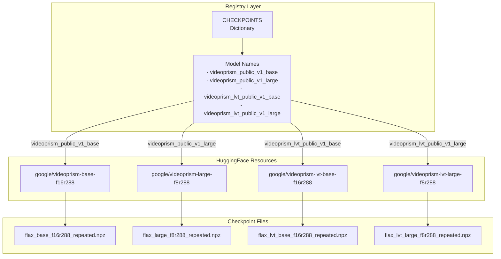
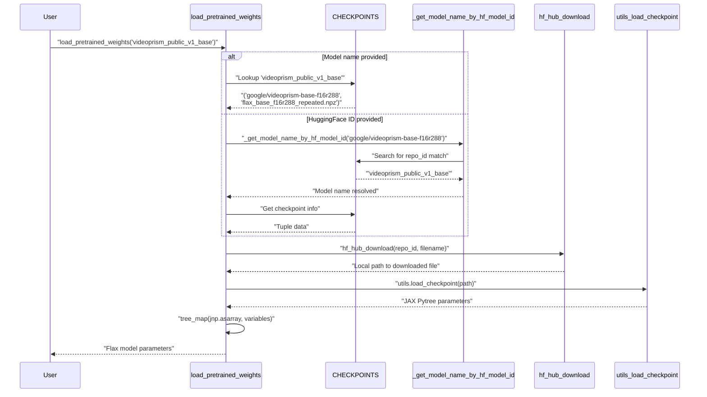
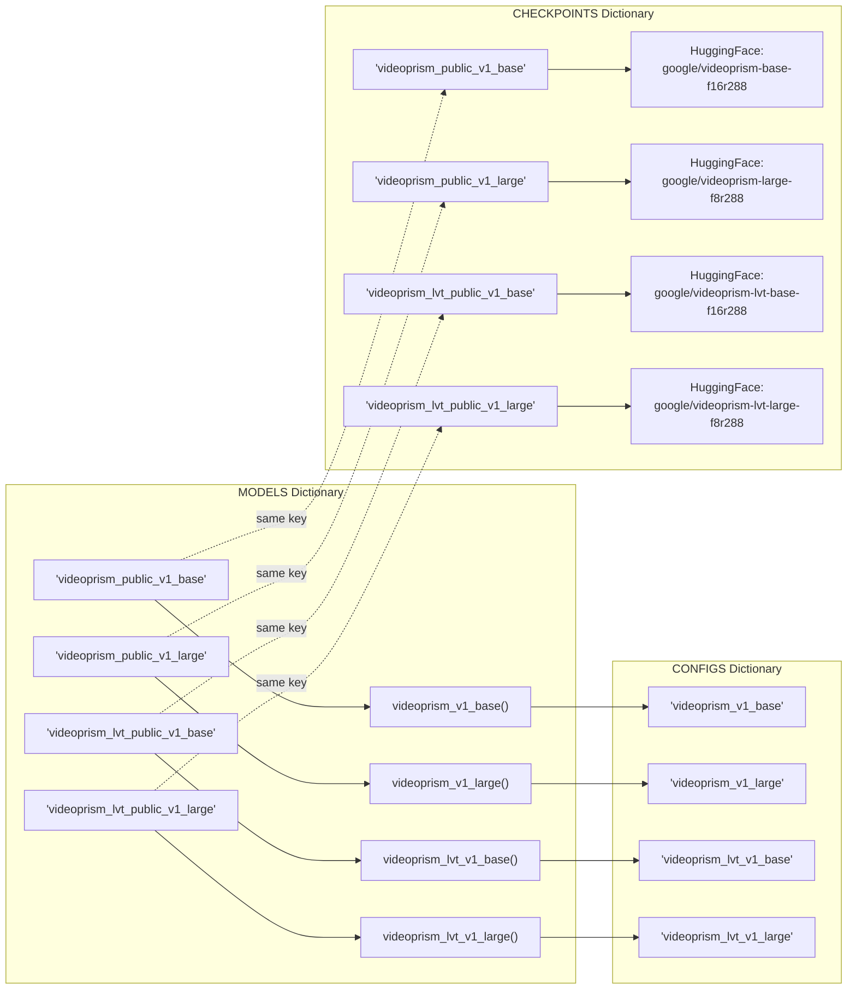

<!-- source: DeepWiki mcp.deepwiki.com · repo google-deepmind/videoprism · page 8.2 Checkpoint Registry · fetched 2026-10-26 -->

# Checkpoint Registry

<details>
<summary>Relevant source files</summary>

The following files were used as context for generating this wiki page:

- [videoprism/models.py](videoprism/models.py)

</details>


## Purpose and Scope

This page provides a complete reference of the VideoPrism checkpoint registry, which maps model names to pre-trained weights stored on HuggingFace Hub. The `CHECKPOINTS` dictionary in [videoprism/models.py:62-80]() serves as the central registry for all publicly available VideoPrism model checkpoints.

For information about model architectures and configuration parameters, see [Model Configurations](#8.1). For practical guidance on loading checkpoints, see [Loading Custom Checkpoints](#5.3).

---

## Registry Structure

The checkpoint registry is implemented as the `CHECKPOINTS` dictionary, which maps model names to tuples containing HuggingFace repository information:

```python
CHECKPOINTS = {
    'model_name': ('repository_id', 'checkpoint_filename.npz'),
    ...
}
```

Each entry contains:
- **Model Name** (key): Internal identifier used throughout the VideoPrism codebase
- **Repository ID** (tuple[0]): HuggingFace Hub repository in the format `organization/repository-name`
- **Checkpoint Filename** (tuple[1]): NPZ file containing the serialized Flax model parameters

**Sources:** [videoprism/models.py:62-80]()

---

## Available Checkpoints

The following table lists all publicly available VideoPrism checkpoints:

| Model Name | HuggingFace Repository | Checkpoint Filename | Model Type | Architecture |
|------------|------------------------|---------------------|------------|--------------|
| `videoprism_public_v1_base` | `google/videoprism-base-f16r288` | `flax_base_f16r288_repeated.npz` | Video-Only | FactorizedEncoder (Base) |
| `videoprism_public_v1_large` | `google/videoprism-large-f8r288` | `flax_large_f8r288_repeated.npz` | Video-Only | FactorizedEncoder (Large) |
| `videoprism_lvt_public_v1_base` | `google/videoprism-lvt-base-f16r288` | `flax_lvt_base_f16r288_repeated.npz` | Video-Text | FactorizedVideoCLIP (Base) |
| `videoprism_lvt_public_v1_large` | `google/videoprism-lvt-large-f8r288` | `flax_lvt_large_f8r288_repeated.npz` | Video-Text | FactorizedVideoCLIP (Large) |

**Sources:** [videoprism/models.py:62-80]()

---

## Checkpoint Naming Conventions

### Repository Naming Pattern

HuggingFace repository IDs follow the pattern:
```
google/videoprism[-lvt]-{size}-f{frames}r{resolution}
```

Components:
- `google/`: Organization namespace
- `videoprism`: Base model family
- `-lvt`: Optional suffix for "Long Video Text" (video-text models)
- `{size}`: Model size (`base` or `large`)
- `f{frames}`: Number of frames (e.g., `f16` = 16 frames, `f8` = 8 frames)
- `r{resolution}`: Input resolution (e.g., `r288` = 288x288 pixels)

### Checkpoint Filename Pattern

Checkpoint files follow the pattern:
```
flax[_lvt]_{size}_f{frames}r{resolution}_repeated.npz
```

The `_repeated` suffix indicates the checkpoint uses repeated positional embeddings for variable frame count support.

**Sources:** [videoprism/models.py:64-79]()

---

## Checkpoint Registry Architecture



**Diagram: Checkpoint Registry Structure** - Maps internal model names to HuggingFace repositories and checkpoint files.

**Sources:** [videoprism/models.py:62-80]()

---

## Checkpoint Resolution and Loading Flow



**Diagram: Checkpoint Loading Flow** - Shows how model names or HuggingFace IDs are resolved to checkpoint files and loaded into memory.

**Sources:** [videoprism/models.py:306-336](), [videoprism/models.py:236-252]()

---

## Checkpoint Model Specifications

### Video-Only Models (FactorizedEncoder)

#### videoprism_public_v1_base
- **Parameters:** 114M
- **Input Shape:** (16, 288, 288, 3) - 16 frames, 288x288 resolution
- **Output Shape:** (batch_size, 4096, 768) - Can be reshaped to (batch_size, 16, 16, 16, 768)
- **Model Dimension:** 768
- **Spatial Layers:** 12
- **Temporal Layers:** 4
- **Configuration:** [videoprism/models.py:83-93]()

#### videoprism_public_v1_large
- **Parameters:** 354M
- **Input Shape:** (8, 288, 288, 3) - 8 frames, 288x288 resolution
- **Output Shape:** (batch_size, 2048, 1024) - Can be reshaped to (batch_size, 8, 16, 16, 1024)
- **Model Dimension:** 1024
- **Spatial Layers:** 24
- **Temporal Layers:** 4
- **Configuration:** [videoprism/models.py:94-104]()

### Video-Text Models (FactorizedVideoCLIP)

#### videoprism_lvt_public_v1_base
- **Parameters:** 248M (video + text encoder)
- **Video Input Shape:** (16, 288, 288, 3)
- **Text Vocabulary:** 32,000 tokens (C4 English SentencePiece)
- **Model Dimension:** 768
- **Spatial Layers:** 12
- **Temporal Layers:** 4
- **Text Layers:** 12 unimodal + 2 auxiliary
- **Configuration:** [videoprism/models.py:116-130]()

#### videoprism_lvt_public_v1_large
- **Parameters:** 580M (video + text encoder)
- **Video Input Shape:** (8, 288, 288, 3)
- **Text Vocabulary:** 32,000 tokens (C4 English SentencePiece)
- **Model Dimension:** 1024
- **Spatial Layers:** 24
- **Temporal Layers:** 4
- **Text Layers:** 12 unimodal + 2 auxiliary
- **Configuration:** [videoprism/models.py:131-145]()

**Sources:** [videoprism/models.py:82-161]()

---

## Relationship Between Registry Dictionaries



**Diagram: Registry Dictionary Relationships** - Shows how `MODELS`, `CONFIGS`, and `CHECKPOINTS` dictionaries share common keys but serve different purposes (architecture creation, configuration parameters, and pre-trained weights respectively).

**Sources:** [videoprism/models.py:62-80](), [videoprism/models.py:82-161](), [videoprism/models.py:224-233]()

---

## Helper Functions

### _get_model_name_by_hf_model_id

The function [videoprism/models.py:236-252]() converts HuggingFace repository IDs to internal model names:

```python
def _get_model_name_by_hf_model_id(model_id: str) -> str | None
```

**Mapping:**
- `'google/videoprism-base-f16r288'` → `'videoprism_public_v1_base'`
- `'google/videoprism-large-f8r288'` → `'videoprism_public_v1_large'`
- `'google/videoprism-lvt-base-f16r288'` → `'videoprism_lvt_public_v1_base'`
- `'google/videoprism-lvt-large-f8r288'` → `'videoprism_lvt_public_v1_large'`

This allows users to specify either the internal model name or the HuggingFace repository ID when calling `load_pretrained_weights()` or `get_model()`.

### has_model

The function [videoprism/models.py:255-265]() checks if a model exists in the registry:

```python
def has_model(
    model_name: str,
    models: Mapping[str, Callable[[], nn.Module]] | None = None,
) -> bool
```

Accepts both internal model names and HuggingFace repository IDs.

**Sources:** [videoprism/models.py:236-265]()

---

## Usage Examples

### Loading by Model Name

```python
# Use internal model name
params = load_pretrained_weights('videoprism_public_v1_base')
```

### Loading by HuggingFace ID

```python
# Use HuggingFace repository ID
params = load_pretrained_weights('google/videoprism-base-f16r288')
```

### Loading from Custom Path

```python
# Load from local file (bypasses registry)
params = load_pretrained_weights(
    model_name=None,
    checkpoint_path='/path/to/checkpoint.npz'
)
```

### Using Custom Checkpoint Registry

```python
# Define custom registry
custom_checkpoints = {
    'my_model': ('my-org/my-repo', 'checkpoint.npz')
}

# Load using custom registry
params = load_pretrained_weights(
    'my_model',
    checkpoints=custom_checkpoints
)
```

**Sources:** [videoprism/models.py:306-336]()

---

## Checkpoint File Format

All checkpoint files use the NPZ (NumPy compressed archive) format containing serialized Flax model parameters. The files are structured as JAX Pytrees with the following hierarchy:

```
params/
├── spatial_encoder/
│   ├── patch_embed/
│   ├── encoder/
│   └── ...
├── temporal_encoder/
│   ├── encoder/
│   └── ...
└── (additional components depending on model type)
```

The `load_checkpoint()` utility function [videoprism/utils.py]() deserializes these files into JAX arrays that can be used with Flax's `model.apply()` method.

**Sources:** [videoprism/models.py:335-336]()

---

## HuggingFace Hub Integration

VideoPrism uses the `huggingface_hub` library for checkpoint distribution. The `load_pretrained_weights()` function calls `hf_hub_download()` [videoprism/models.py:331-333]() which:

1. Downloads the checkpoint from HuggingFace Hub if not cached
2. Stores it in the local HuggingFace cache directory (typically `~/.cache/huggingface/hub/`)
3. Returns the local file path for loading

Subsequent calls with the same checkpoint retrieve it from the local cache, avoiding redundant downloads.

**Sources:** [videoprism/models.py:331-333]()

---

## Summary

The checkpoint registry provides a centralized mapping between user-friendly model names and the actual pre-trained weights hosted on HuggingFace Hub. Key characteristics:

| Aspect | Details |
|--------|---------|
| **Registry Location** | `CHECKPOINTS` dictionary in [videoprism/models.py:62-80]() |
| **Total Checkpoints** | 4 public models (2 video-only, 2 video-text) |
| **File Format** | NPZ (serialized Flax parameters) |
| **Hosting** | HuggingFace Hub under `google/` organization |
| **ID Support** | Both internal names and HuggingFace repo IDs |
| **Loading Function** | `load_pretrained_weights()` in [videoprism/models.py:306-336]() |

**Sources:** [videoprism/models.py:62-80](), [videoprism/models.py:306-336]()

---

