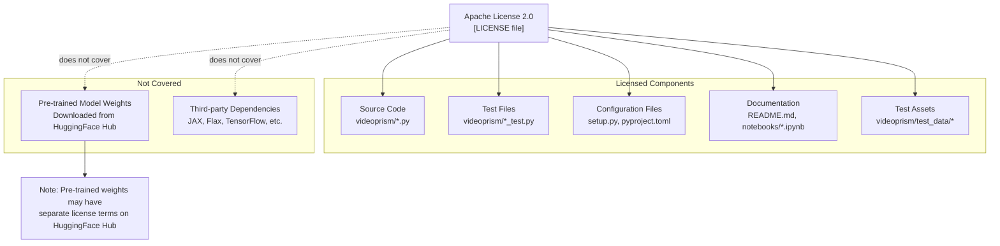
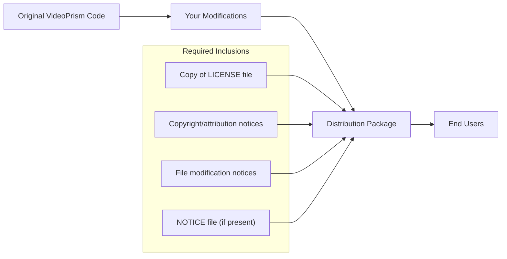
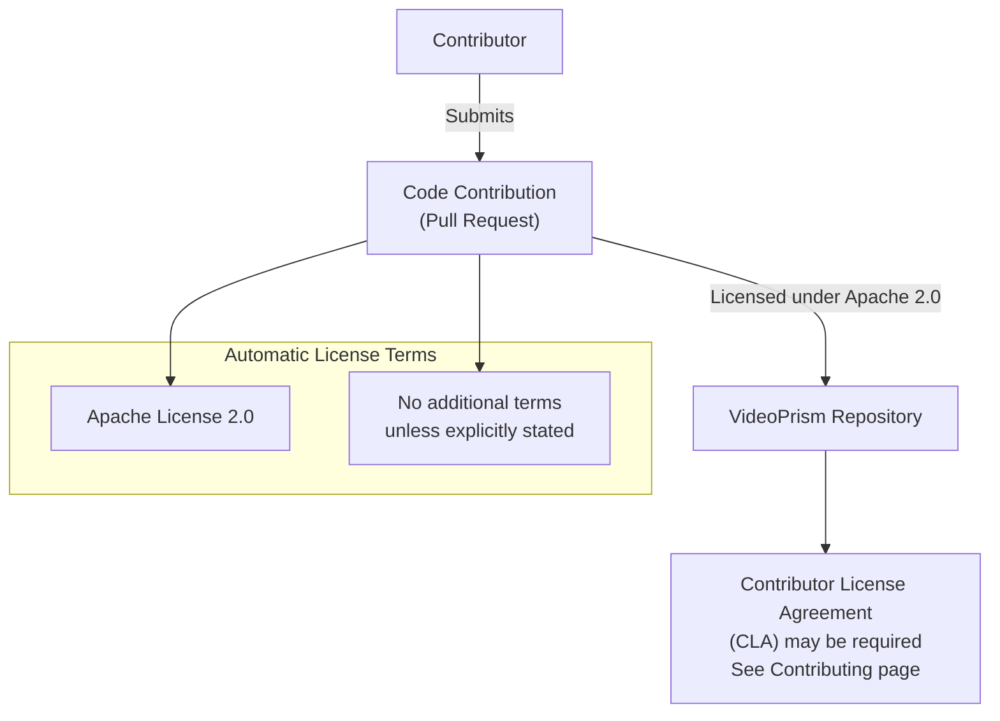

<!-- source: DeepWiki mcp.deepwiki.com · repo google-deepmind/videoprism · page 8.3 License · fetched 2026-10-26 -->

# License

Relevant source files

The following files were used as context for generating this wiki page:

- [LICENSE](LICENSE)

This page documents the licensing terms for the VideoPrism codebase. It provides a summary of the Apache License 2.0 under which this software is distributed and explains key terms for users and contributors.

For information about contributing code to the project, including Contributor License Agreement (CLA) requirements, see [Contributing](#7.3).

---

## Overview

The VideoPrism codebase is licensed under the **Apache License, Version 2.0** (January 2004). This is a permissive open-source license that allows users to freely use, modify, and distribute the software for both commercial and non-commercial purposes, subject to certain conditions.

The complete license text is available in [LICENSE:1-202]().

**Key characteristics of the Apache 2.0 License:**
- Permissive usage and distribution rights
- Patent grant protection
- Requirement to preserve copyright and attribution notices
- No warranty or liability for contributors
- Compatible with many other open-source licenses

Sources: [LICENSE:1-202]()

---

## License Scope

The Apache 2.0 license applies to all source code, documentation, and configuration files in the VideoPrism repository, including:

**Important Note:** While the source code is licensed under Apache 2.0, pre-trained model weights distributed through HuggingFace Hub may be subject to additional or different license terms. Users should review the license information provided with each model checkpoint.

Sources: [LICENSE:1-202]()

---

## Grant of Rights

The Apache 2.0 license grants the following permissions to users:

### Copyright License

Under [LICENSE:67-72](), contributors grant users:
- **Reproduce**: Make copies of the work
- **Prepare Derivative Works**: Modify and create derivative versions
- **Publicly Display and Perform**: Showcase the work publicly
- **Sublicense**: Grant these same rights to others
- **Distribute**: Share the work in Source or Object form

These rights are **perpetual**, **worldwide**, **non-exclusive**, **no-charge**, **royalty-free**, and **irrevocable** (except for patent termination conditions).

### Patent License

Under [LICENSE:74-88](), contributors also grant patent licenses for any patent claims necessarily infringed by their contributions. This protection terminates if you initiate patent litigation claiming the work infringes your patents.

Sources: [LICENSE:67-88]()

---

## Redistribution Requirements

When redistributing VideoPrism code or derivative works, you must comply with the conditions specified in [LICENSE:90-130]():

| Requirement | Description | Reference |
|-------------|-------------|-----------|
| **Include License** | Provide a copy of the Apache 2.0 License with any distribution | [LICENSE:95-96]() |
| **Mark Modifications** | Clearly indicate any files you have changed | [LICENSE:98-99]() |
| **Preserve Notices** | Retain all copyright, patent, trademark, and attribution notices | [LICENSE:101-105]() |
| **Include NOTICE File** | If present, include NOTICE file attributions in distributions | [LICENSE:107-122]() |

You may add your own copyright statements and additional license terms for your modifications, provided they comply with the original Apache 2.0 terms [LICENSE:124-129]().

Sources: [LICENSE:90-130]()

---

## Trademarks

The Apache 2.0 license does **not** grant permission to use trade names, trademarks, service marks, or product names of the Licensor [LICENSE:139-142](). The "VideoPrism" name and related trademarks remain property of Google DeepMind.

You may only use these names as required for reasonable and customary use in describing the origin of the work and reproducing the content of attribution notices.

Sources: [LICENSE:139-142]()

---

## Warranty and Liability Disclaimers

### No Warranty

The software is provided on an **"AS IS" BASIS**, without warranties or conditions of any kind [LICENSE:144-152]():

- No warranty of MERCHANTABILITY
- No warranty of FITNESS FOR A PARTICULAR PURPOSE
- No warranty of TITLE
- No warranty of NON-INFRINGEMENT

Users are solely responsible for determining the appropriateness of using or redistributing the work and assume all risks.

### Limitation of Liability

Contributors are not liable for any damages arising from use of the software [LICENSE:154-164](), including:
- Direct or indirect damages
- Special, incidental, or consequential damages
- Loss of goodwill or work stoppage
- Computer failure or malfunction
- Commercial damages or losses

This limitation applies regardless of legal theory (tort, contract, etc.) unless required by applicable law or agreed to in writing.

Sources: [LICENSE:144-164]()

---

## Contribution Terms

When you submit contributions to the VideoPrism project, your contributions are subject to the Apache 2.0 license terms [LICENSE:131-137]():

**Important:** Unless you explicitly state otherwise, any contribution you submit for inclusion is automatically under the Apache 2.0 License terms, without additional terms or conditions. Some projects may also require a Contributor License Agreement (CLA) - see [Contributing](#7.3) for details.

Sources: [LICENSE:131-137]()

---

## Full License Text

The complete Apache License 2.0 text, including all terms and conditions, definitions, and legal provisions, is available in the [LICENSE:1-202]() file at the root of the repository.

For the official Apache License 2.0 documentation, visit:
- http://www.apache.org/licenses/LICENSE-2.0

**Structure of the license document:**

| Section | Content | Lines |
|---------|---------|-------|
| Definitions | Legal definitions of key terms (License, Licensor, Work, Contribution, etc.) | [LICENSE:8-66]() |
| Copyright License | Grant of copyright permissions | [LICENSE:67-72]() |
| Patent License | Grant of patent permissions and termination conditions | [LICENSE:74-88]() |
| Redistribution | Conditions for distributing the work | [LICENSE:90-130]() |
| Contributions | Terms for submitted contributions | [LICENSE:131-137]() |
| Trademarks | Restrictions on trademark usage | [LICENSE:139-142]() |
| Warranty Disclaimer | No warranty provisions | [LICENSE:144-152]() |
| Liability Limitation | No liability provisions | [LICENSE:154-164]() |
| Additional Liability | Optional warranty/support terms | [LICENSE:166-175]() |
| Appendix | How to apply the license | [LICENSE:179-202]() |

Sources: [LICENSE:1-202]()

---

## Summary

The Apache 2.0 license enables broad usage of VideoPrism for research, commercial applications, and derivative works, while:
- Protecting contributors from liability
- Requiring attribution and notice preservation
- Granting explicit patent rights
- Allowing modification and redistribution

Users and contributors should review the full license text in [LICENSE:1-202]() to understand all terms and conditions. For contribution-specific requirements, refer to [Contributing](#7.3).

Sources: [LICENSE:1-202]()