# Page: Overview

# Overview

<details>
<summary>Relevant source files</summary>

The following files were used as context for generating this wiki page:

- [README.md](README.md)
- [videoprism/models.py](videoprism/models.py)

</details>


## Purpose and Scope

This document provides a high-level introduction to the VideoPrism codebase, explaining its purpose, architecture, and core components. VideoPrism is a foundational visual encoder system for video understanding tasks. This page covers the overall system structure, model variants, and how major components interact. For detailed information about specific subsystems, see:
- Installation and setup instructions: [Getting Started](#2)
- Individual model architectures: [Core Architecture](#4)
- Practical usage patterns: [Usage Guide](#5)
- Complete API documentation: [API Reference](#6)

Sources: [README.md:1-193](), [videoprism/models.py:15-37]()

## What is VideoPrism

VideoPrism is a general-purpose video encoder designed to handle diverse video understanding tasks including classification, retrieval, localization, captioning, and question answering. The system is built on JAX/Flax and provides pre-trained models that achieve state-of-the-art performance on 31 out of 33 public video understanding benchmarks using frozen model backbones.

The system was pre-trained on a massive multi-modal dataset:
- 1 billion image-text pairs from WebLI
- 36 million high-quality video-text pairs  
- 582 million video clips with noisy or machine-generated parallel text

The codebase provides model weight checkpoints hosted on HuggingFace Hub and utility functions for checkpoint loading and model inference.

Sources: [README.md:10-23]()

## System Architecture

VideoPrism follows a layered architecture where higher-level modules depend on lower-level building blocks. The system is organized into five primary layers:

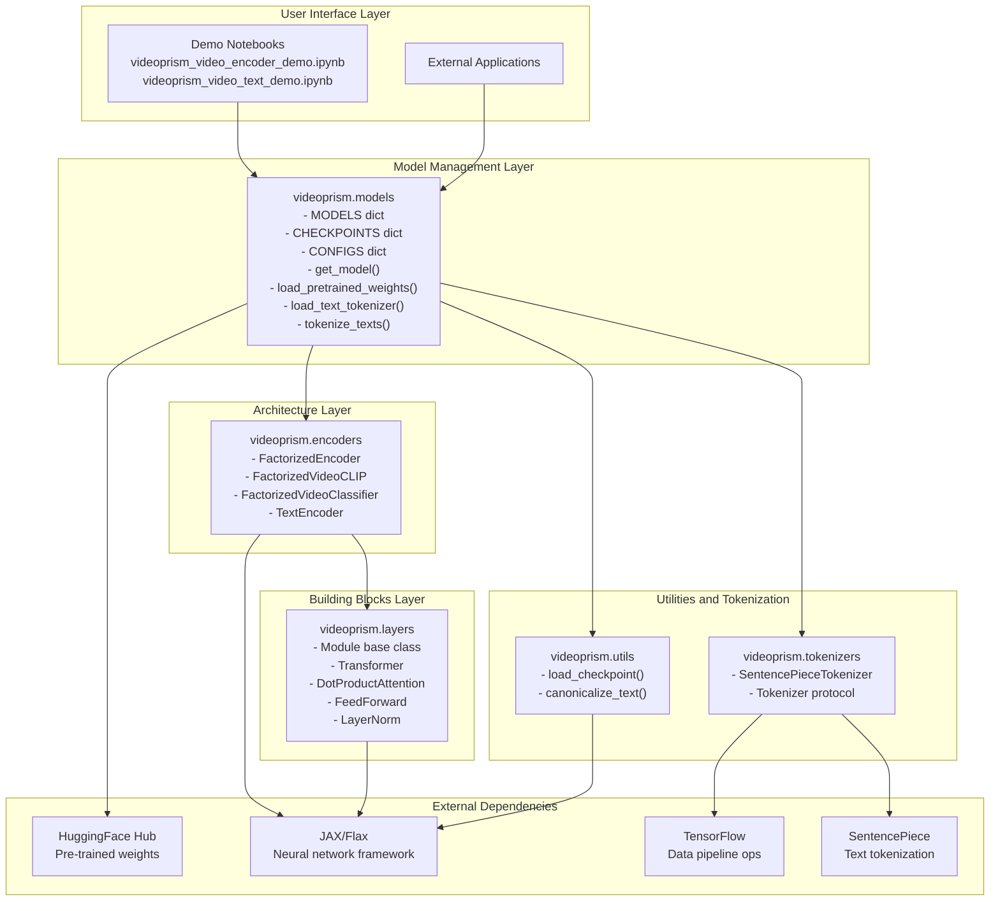

**Model Management Layer**: The `videoprism.models` module serves as the primary API and central orchestration point. It maintains three key registries (`MODELS`, `CHECKPOINTS`, `CONFIGS`) and provides functions to instantiate models and load pre-trained weights from HuggingFace Hub.

**Architecture Layer**: The `videoprism.encoders` module implements the neural network architectures, including `FactorizedEncoder` for video-only tasks and `FactorizedVideoCLIP` for cross-modal video-text tasks.

**Building Blocks Layer**: The `videoprism.layers` module provides reusable Transformer components that the encoder architectures compose together.

**Utilities and Tokenization**: Support modules handle checkpoint deserialization and text preprocessing.

Sources: [videoprism/models.py:1-408](), [README.md:22-23]()

## Model Variants

VideoPrism provides two model families with multiple size variants. All models expect video inputs with shape `(batch_size, num_frames, 288, 288, 3)` where RGB values are normalized to [0.0, 1.0].

| Model Name | Configuration Name | Model Type | Architecture Class | Backbone | Parameters | File Size |
|------------|-------------------|------------|-------------------|----------|------------|-----------|
| VideoPrism-B | `videoprism_public_v1_base` | Video encoder | `FactorizedEncoder` | ViT-B | 114M | 458MB |
| VideoPrism-L | `videoprism_public_v1_large` | Video encoder | `FactorizedEncoder` | ViT-L | 354M | 1.42GB |
| VideoPrism-LvT-B | `videoprism_lvt_public_v1_base` | Video-text encoders | `FactorizedVideoCLIP` | ViT-B | 248M | 991MB |
| VideoPrism-LvT-L | `videoprism_lvt_public_v1_large` | Video-text encoders | `FactorizedVideoCLIP` | ViT-L | 580M | 2.30GB |

### Video-Only Models

Video-only models (`FactorizedEncoder`) output spatiotemporal embeddings with shape `(batch_size, num_frames * 16 * 16, feature_channels)`. These can be reshaped to `(batch_size, num_frames, 16, 16, feature_channels)` for spatial-temporal feature access. The models support variable frame counts through positional embedding interpolation.

### Video-Text Models

Video-text models (`FactorizedVideoCLIP`) produce global embeddings with shape `(batch_size, feature_channels)` for both video and text inputs. Similarities are measured using cosine distance. Text inputs are tokenized using the `c4_en` SentencePiece model with vocabulary size 32,000.

Sources: [README.md:88-112](), [videoprism/models.py:62-80](), [videoprism/models.py:82-161](), [videoprism/models.py:224-233]()

## Model Instantiation Flow

The following diagram illustrates how models are instantiated and weights are loaded using the `videoprism.models` API:

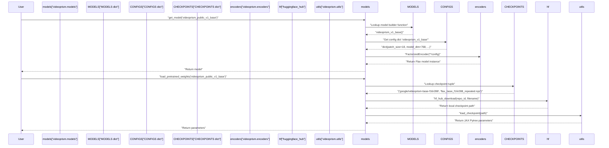

The two-phase initialization separates model architecture instantiation from weight loading:

1. **Model Instantiation**: `get_model()` looks up the configuration name in `MODELS` dict [videoprism/models.py:224-233](), retrieves the corresponding config from `CONFIGS` dict [videoprism/models.py:82-161](), and instantiates the appropriate encoder class from `videoprism.encoders`.

2. **Weight Loading**: `load_pretrained_weights()` queries the `CHECKPOINTS` dict [videoprism/models.py:62-80]() for the HuggingFace repository and filename, downloads the checkpoint using `huggingface_hub.hf_hub_download()` [videoprism/models.py:331-333](), and deserializes it using `utils.load_checkpoint()` [videoprism/models.py:335-336]().

This separation allows users to create models with custom initializations or load different checkpoint versions independently.

Sources: [videoprism/models.py:268-304](), [videoprism/models.py:306-337]()

## Core Component Relationships

The following diagram maps the primary code entities and their dependencies:

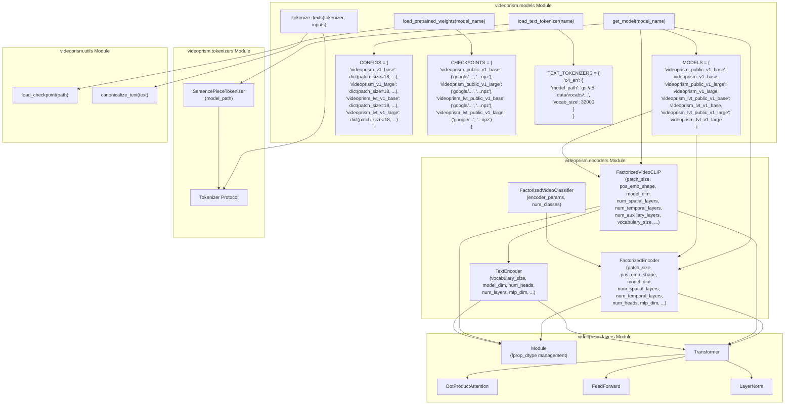

**Key Code Entities**:

- **`videoprism.models.get_model()`**: Primary function for instantiating models [videoprism/models.py:268-304]()
- **`videoprism.models.load_pretrained_weights()`**: Downloads and loads checkpoints from HuggingFace Hub [videoprism/models.py:306-337]()
- **`videoprism.models.MODELS`**: Registry mapping model names to builder functions [videoprism/models.py:224-233]()
- **`videoprism.models.CONFIGS`**: Dictionary of model hyperparameters [videoprism/models.py:82-161]()
- **`videoprism.models.CHECKPOINTS`**: Registry of HuggingFace checkpoint locations [videoprism/models.py:62-80]()
- **`videoprism.encoders.FactorizedEncoder`**: Video-only encoder architecture with factorized spatial-temporal processing
- **`videoprism.encoders.FactorizedVideoCLIP`**: Video-text encoder for cross-modal retrieval
- **`videoprism.layers.Transformer`**: Core transformer block used throughout encoder architectures
- **`videoprism.tokenizers.SentencePieceTokenizer`**: Text tokenization implementation [videoprism/models.py:339-353]()

Sources: [videoprism/models.py:224-408](), [videoprism/models.py:82-161](), [videoprism/models.py:62-80]()

## Data Processing Pipeline

VideoPrism processes two data modalities: video and text. The following table summarizes the preprocessing requirements and output formats:

| Modality | Input Format | Preprocessing | Output Format | Key Functions |
|----------|--------------|---------------|---------------|---------------|
| Video | Raw video frames | - Resize to 288×288<br/>- Normalize RGB to [0.0, 1.0]<br/>- Sample frames | `(batch_size, num_frames, 288, 288, 3)` → `(batch_size, num_tokens, feature_dim)` | `FactorizedEncoder.apply()` |
| Text | String list | - Canonicalize (lowercase, remove punctuation)<br/>- Tokenize with SentencePiece<br/>- Pad to max length | `(batch_size, max_length)` token IDs<br/>`(batch_size, max_length)` padding masks | `tokenize_texts()` [videoprism/models.py:355-408]()<br/>`canonicalize_text()` |

### Video Processing Flow

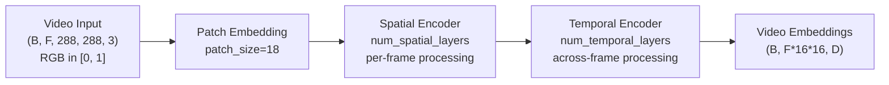

### Text Processing Flow


For video-text models, both embedding streams are L2-normalized and their similarity is computed using cosine distance.

Sources: [README.md:99-112](), [videoprism/models.py:355-408](), [videoprism/models.py:15-36]()

## Usage Pattern

The typical workflow for using VideoPrism follows this pattern:

```python
from videoprism import models as vp
import jax

# 1. Get model instance
model_name = 'videoprism_public_v1_base'
flax_model = vp.get_model(model_name)

# 2. Load pre-trained weights
loaded_state = vp.load_pretrained_weights(model_name)

# 3. Define forward pass
@jax.jit
def forward_fn(inputs):
    return flax_model.apply(loaded_state, inputs, train=False)

# 4. Process video
video_inputs = ...  # Shape: (batch_size, num_frames, 288, 288, 3)
outputs, _ = forward_fn(video_inputs)
```

For video-text models, additional text tokenization is required:

```python
# Video-text model
model_name = 'videoprism_lvt_public_v1_base'
flax_model = vp.get_model(model_name)
loaded_state = vp.load_pretrained_weights(model_name)
text_tokenizer = vp.load_text_tokenizer('c4_en')

# Tokenize text queries
text_queries = ['a person walking', 'a cat playing']
text_ids, text_paddings = vp.tokenize_texts(text_tokenizer, text_queries)

# Forward pass with both modalities
@jax.jit
def forward_fn(video, text_ids, text_paddings):
    return flax_model.apply(
        loaded_state, video, text_ids, text_paddings, train=False
    )

video_embeddings, text_embeddings, _ = forward_fn(
    video_inputs, text_ids, text_paddings
)
```

Sources: [README.md:49-86](), [videoprism/models.py:22-36]()

## Key Design Principles

**Factorized Architecture**: VideoPrism uses a factorized approach that separates spatial and temporal processing. Spatial encoders process each video frame independently, while temporal encoders model relationships across frames. This design improves efficiency and enables variable frame count support.

**Two-Phase Initialization**: Model architecture and pre-trained weights are loaded separately, allowing flexibility in combining different architectures with different checkpoints.

**Registry-Based Configuration**: The system uses three dictionaries (`MODELS`, `CONFIGS`, `CHECKPOINTS`) to manage model variants, reducing code duplication and enabling easy extension.

**HuggingFace Integration**: Pre-trained weights are hosted on HuggingFace Hub and automatically downloaded on first use, simplifying distribution and versioning.

**Position Embedding Interpolation**: Models support variable frame counts by interpolating temporal positional embeddings, enabling inference on videos with different lengths than training [README.md:99-106]().

**JAX/Flax Implementation**: The entire system is built on JAX for efficient automatic differentiation and Flax for neural network modules, enabling JIT compilation and efficient GPU/TPU execution.

Sources: [videoprism/models.py:1-408](), [README.md:1-193]()

---

# Page: Getting Started

# Getting Started

<details>
<summary>Relevant source files</summary>

The following files were used as context for generating this wiki page:

- [README.md](README.md)
- [requirements.txt](requirements.txt)
- [setup.py](setup.py)

</details>


This page provides an overview of the steps required to install and begin using VideoPrism models. It covers the basic installation process, introduces the core API functions, and guides you through your first video encoding or video-text retrieval task.

For detailed installation instructions including dependency management and troubleshooting, see [Installation](#2.1). For hands-on examples using the provided demo notebooks, see [Quick Start with Demo Notebooks](#2.2).

## Prerequisites

VideoPrism requires:

| Requirement | Minimum Version | Purpose |
|-------------|----------------|---------|
| Python | 3.9 | Runtime environment |
| JAX/Flax | (via requirements) | Neural network computation framework |
| TensorFlow | (via requirements) | Text tokenization operations |
| HuggingFace Hub | (via requirements) | Model checkpoint downloading |
| SentencePiece | (via requirements) | Text tokenization for video-text models |

**Sources:** [README.md:38-39](), [requirements.txt:1-8]()

## Installation Overview

The installation process involves cloning the repository and installing the package with pip:

```bash
git clone https://github.com/google-deepmind/videoprism.git
cd videoprism
pip install .
```

For development installations or testing setup, refer to [Installation](#2.1).

**Sources:** [README.md:36-44](), [setup.py:1-62]()

## Core API Overview

VideoPrism provides a centralized API through the `videoprism.models` module. The primary functions are:

| Function | Purpose | Returns |
|----------|---------|---------|
| `get_model(model_name)` | Instantiate a Flax model from configuration | Flax module instance |
| `load_pretrained_weights(model_name)` | Download and load checkpoint parameters | JAX Pytree of parameters |
| `load_text_tokenizer(tokenizer_name)` | Load SentencePiece tokenizer for text | Tokenizer instance |
| `tokenize_texts(tokenizer, texts)` | Convert text strings to token IDs | Tuple of (token_ids, paddings) |

**Diagram: Core API Functions and Data Flow**

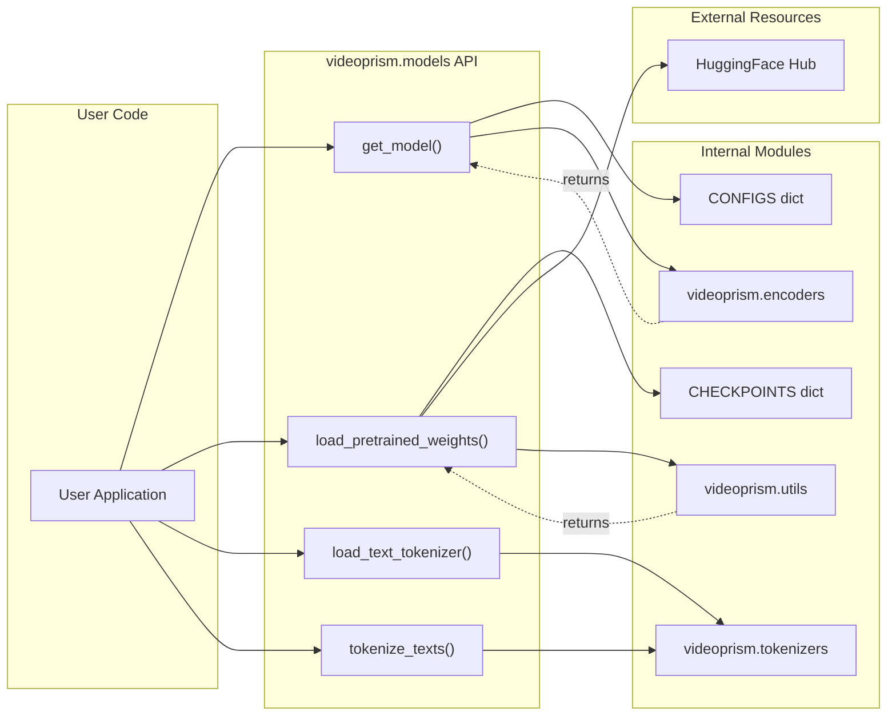

**Sources:** [README.md:49-86]()

## Basic Usage Patterns

### Video-Only Encoding

For video feature extraction tasks (action recognition, video classification, temporal localization):

```python
import jax
from videoprism import models as vp

# Step 1: Get model architecture
model_name = 'videoprism_public_v1_base'
flax_model = vp.get_model(model_name)

# Step 2: Load pretrained weights
loaded_state = vp.load_pretrained_weights(model_name)

# Step 3: Define forward pass
@jax.jit
def forward_fn(inputs):
    return flax_model.apply(loaded_state, inputs, train=False)

# Step 4: Process video
video_inputs = ...  # Shape: [batch_size, num_frames, 288, 288, 3]
outputs, _ = forward_fn(video_inputs)  # Shape: [batch_size, num_tokens, channels]
```

Expected input shape: `(batch_size, num_frames, 288, 288, 3)` with RGB values normalized to [0.0, 1.0].

Expected output shape: `(batch_size, num_frames * 16 * 16, feature_channels)` which can be reshaped to `(batch_size, num_frames, 16, 16, feature_channels)` for spatiotemporal representations.

**Sources:** [README.md:49-63]()

### Video-Text Encoding

For cross-modal tasks (video-text retrieval, zero-shot classification, video question answering):

```python
import jax
from videoprism import models as vp

# Step 1: Get model architecture
model_name = 'videoprism_lvt_public_v1_base'
flax_model = vp.get_model(model_name)

# Step 2: Load pretrained weights and tokenizer
loaded_state = vp.load_pretrained_weights(model_name)
text_tokenizer = vp.load_text_tokenizer('c4_en')

# Step 3: Define forward pass
@jax.jit
def forward_fn(inputs, text_token_ids, text_token_paddings, train=False):
    return flax_model.apply(
        loaded_state,
        inputs,
        text_token_ids,
        text_token_paddings,
        train=train,
    )

# Step 4: Process video and text
video_inputs = ...  # Shape: [batch_size, num_frames, 288, 288, 3]
text_queries = ...  # List of strings
text_ids, text_paddings = vp.tokenize_texts(text_tokenizer, text_queries)

video_embeddings, text_embeddings, _ = forward_fn(
    video_inputs, text_ids, text_paddings)  # Both: [batch_size, feature_channels]
```

Expected outputs: Global embeddings with shape `(batch_size, feature_channels)` for both modalities. Similarities are computed using cosine distances.

**Sources:** [README.md:65-86]()

## Model Selection Guide

**Diagram: Model Variant Decision Tree**

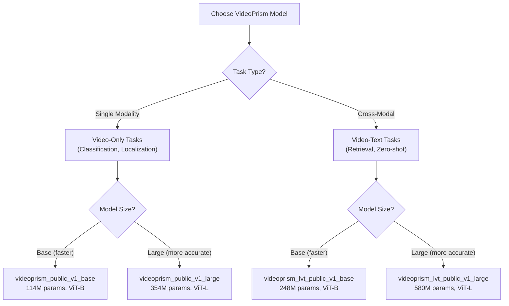

**Sources:** [README.md:88-112]()

## Available Model Configurations

| Model Name | Configuration Name | Type | Backbone | Parameters | File Size | Frames |
|------------|-------------------|------|----------|------------|-----------|---------|
| VideoPrism-B | `videoprism_public_v1_base` | Video encoder | ViT-B | 114M | 458MB | 16 |
| VideoPrism-L | `videoprism_public_v1_large` | Video encoder | ViT-L | 354M | 1.42GB | 8 |
| VideoPrism-LvT-B | `videoprism_lvt_public_v1_base` | Video-text | ViT-B | 248M | 991MB | 16 |
| VideoPrism-LvT-L | `videoprism_lvt_public_v1_large` | Video-text | ViT-L | 580M | 2.30GB | 8 |

All models support arbitrary frame counts through positional embedding interpolation. The "Frames" column indicates the frame count used during training.

For detailed model architecture information, see [Model Variants](#3).

**Sources:** [README.md:88-112]()

## Typical Initialization Sequence

**Diagram: Model Loading Workflow**

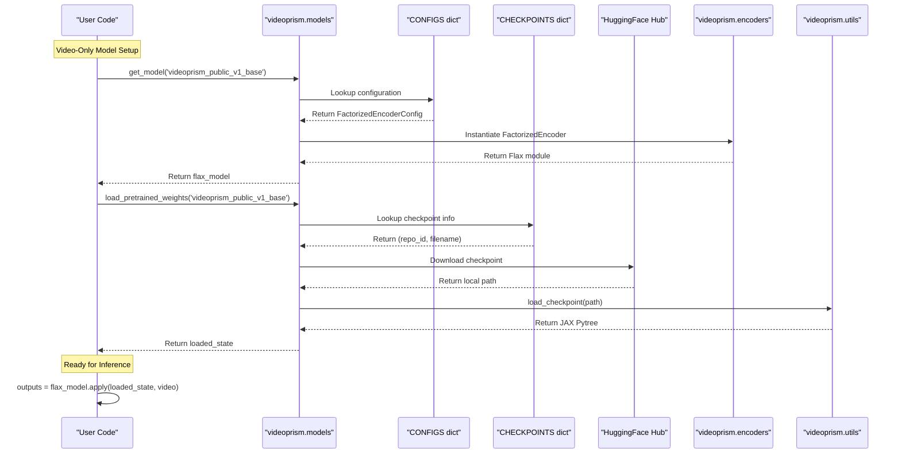

**Sources:** [README.md:49-86]()

## Demo Notebooks

VideoPrism provides two Colab notebooks demonstrating end-to-end usage:

| Notebook | Purpose | Models Demonstrated |
|----------|---------|---------------------|
| `videoprism_video_encoder_demo.ipynb` | Video feature extraction | VideoPrism-B, VideoPrism-L |
| `videoprism_video_text_demo.ipynb` | Video-text retrieval and zero-shot classification | VideoPrism-LvT-B, VideoPrism-LvT-L |

These notebooks include:
- Complete preprocessing pipelines for video data
- Model instantiation and checkpoint loading
- Inference examples with sample videos
- Visualization of results

To explore these notebooks in detail, see [Quick Start with Demo Notebooks](#2.2).

**Sources:** [README.md:5-6](), [README.md:27-30](), [README.md:46-47]()

## Next Steps

After completing the basic setup:

1. **For detailed installation:** See [Installation](#2.1) for dependency management, environment setup, and troubleshooting
2. **For interactive examples:** See [Quick Start with Demo Notebooks](#2.2) to run the provided Colab notebooks
3. **For model architecture details:** See [Model Variants](#3) for in-depth information about each model type
4. **For advanced usage:** See [Usage Guide](#5) for video preprocessing, custom checkpoint loading, and production deployment patterns
5. **For API reference:** See [API Reference](#6) for complete documentation of all public functions and classes

**Sources:** [README.md:1-192]()

---

# Page: Installation

# Installation

<details>
<summary>Relevant source files</summary>

The following files were used as context for generating this wiki page:

- [requirements.txt](requirements.txt)
- [setup.py](setup.py)

</details>


## Purpose and Scope

This document provides detailed instructions for installing VideoPrism and its dependencies on your system. It covers prerequisite requirements, multiple installation methods (basic and development), and dependency management. For guidance on using VideoPrism after installation, see [Quick Start with Demo Notebooks](#2.2). For detailed dependency information relevant to developers, see [Dependencies and Environment](#7.1).

---

## Prerequisites

VideoPrism requires Python 3.9 or later. The package is tested primarily on Linux and macOS systems. Windows users may need to use WSL (Windows Subsystem for Linux) for optimal compatibility with JAX/Flax.

### System Requirements

- **Python**: >= 3.9
- **pip**: Latest version recommended (upgrade with `pip install --upgrade pip`)
- **Git**: Required for cloning the repository (optional for pip-based installation)

---

## Installation Methods

### Basic Installation from PyPI

Once VideoPrism is published to PyPI, you can install it directly:

```bash
pip install videoprism
```

**Note**: As of version 1.0.0, the package may not yet be published to PyPI. Use repository-based installation methods below.

### Installation from Source Repository

Clone the repository and install:

```bash
git clone https://github.com/google-deepmind/videoprism.git
cd videoprism
pip install .
```

This installs VideoPrism and all core dependencies listed in [requirements.txt:1-8]().

**Sources**: [setup.py:43](), [setup.py:25-26]()

### Development Installation

For contributors or users who want to modify the code:

```bash
git clone https://github.com/google-deepmind/videoprism.git
cd videoprism
pip install -e .
```

The `-e` flag (editable mode) creates a symlink, allowing code changes to take effect immediately without reinstallation.

**Sources**: [setup.py:18-19]()

### Installation with Testing Dependencies

To run tests or develop new features:

```bash
pip install -e ".[testing]"
```

This installs additional testing packages defined in [setup.py:28-31]():
- `chex`: JAX testing utilities
- `pytest`: Test framework

**Sources**: [setup.py:28-31](), [setup.py:49-51]()

---

## Installation Flow Diagram

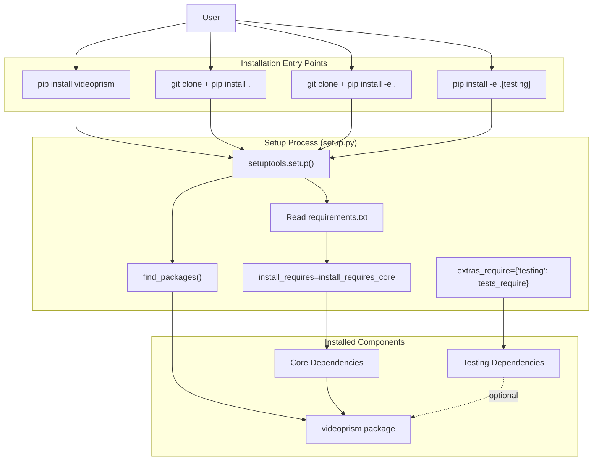

**Diagram: Installation Process Flow**

This diagram shows how different installation commands (`pip install`, `pip install -e .`, etc.) flow through the `setuptools.setup()` function in [setup.py:33-61](). The setup process reads [requirements.txt:1-8]() to populate `install_requires_core` via [setup.py:25-26](), uses `find_packages()` at [setup.py:45]() to discover the `videoprism` package, and conditionally installs testing dependencies from `tests_require` ([setup.py:28-31]()) when the `[testing]` extra is specified.

**Sources**: [setup.py:1-62](), [requirements.txt:1-8]()

---

## Core Dependencies

VideoPrism depends on the following packages, each serving a specific role in the system:

| Package | Version Constraint | Primary Purpose | Used By |
|---------|-------------------|-----------------|---------|
| `numpy` | >= 1.26 | Array operations and numerical computing | All modules |
| `absl-py` | (latest) | Command-line flag parsing and logging | Utilities |
| `einops` | (latest) | Tensor shape manipulation (rearrange, reduce) | Encoder layers |
| `einshape` | (latest) | Shape validation and type checking | Encoder layers |
| `flax` | (latest) | Neural network framework (JAX-based) | All model architectures |
| `huggingface-hub` | (latest) | Checkpoint download from HuggingFace Hub | Model loading |
| `sentencepiece` | (latest) | Text tokenization | Text encoder |
| `tensorflow-cpu` | (latest) | Data pipeline and preprocessing utilities | Demo notebooks |

**Sources**: [requirements.txt:1-8]()

### Dependency Architecture

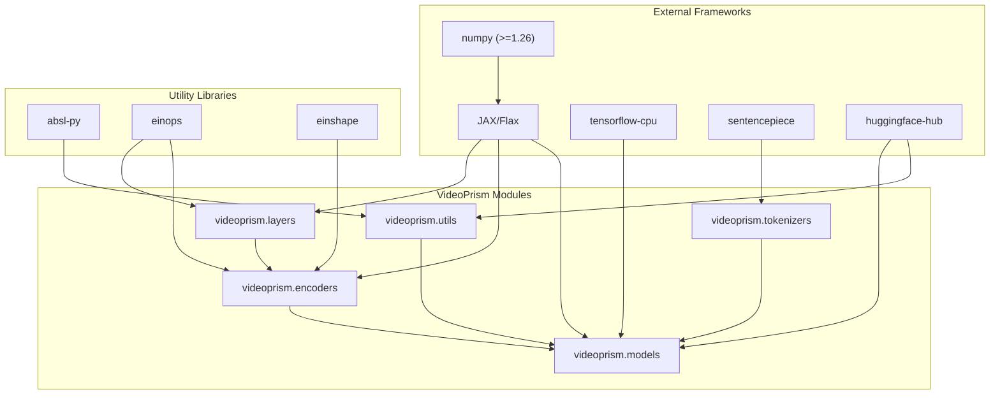

**Diagram: Dependency Hierarchy from requirements.txt**

This diagram maps how each dependency from [requirements.txt:1-8]() is consumed by VideoPrism modules. The core computational stack starts with `numpy` and flows through JAX/Flax to implement neural network layers. Shape manipulation libraries (`einops`, `einshape`) are used primarily in [videoprism/layers.py]() and [videoprism/encoders.py](). The `huggingface-hub` package is used by [videoprism/models.py]() for checkpoint downloading, while `sentencepiece` powers [videoprism/tokenizers.py]() for text processing. `tensorflow-cpu` is included primarily for data preprocessing in demo notebooks rather than core model functionality.

**Sources**: [requirements.txt:1-8](), [setup.py:25-26]()

---

## Package Configuration Details

The `setup.py` file at [setup.py:33-61]() defines the package metadata and installation behavior:

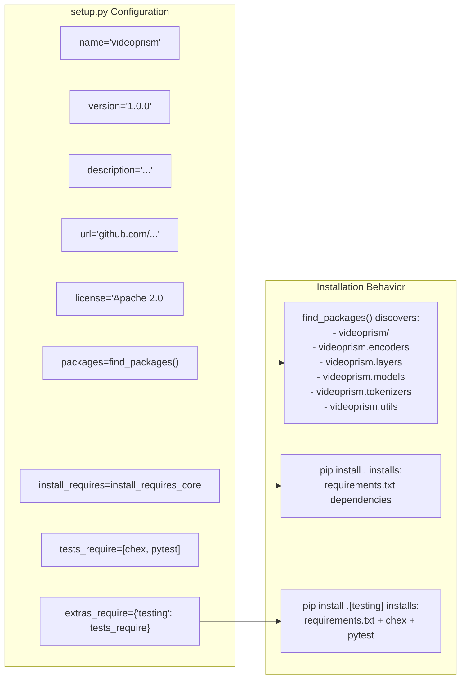

**Diagram: setup.py Configuration Structure**

This diagram shows how `setuptools.setup()` parameters control installation. The `name` parameter ([setup.py:34]()) defines the package name as `videoprism`. The `version` ([setup.py:35]()) is set to `1.0.0`. The `packages` parameter uses `find_packages()` ([setup.py:45]()) to automatically discover all Python packages in the repository. The `install_requires` parameter ([setup.py:47]()) is populated from `install_requires_core`, which reads [requirements.txt:1-8]() at [setup.py:25-26](). The `extras_require` parameter ([setup.py:49-51]()) defines the optional `testing` extra that includes `chex` and `pytest`.

**Sources**: [setup.py:33-61](), [setup.py:28-31]()

---

## Verification

After installation, verify that VideoPrism is correctly installed:

### Check Package Installation

```bash
python -c "import videoprism; print(videoprism.__file__)"
```

This should print the installation path of the VideoPrism package without errors.

### Check Core Modules

```bash
python -c "from videoprism import models, encoders, layers, tokenizers, utils"
```

All five core modules should import without errors.

### Check Model Registry

```bash
python -c "from videoprism.models import MODELS; print(list(MODELS.keys()))"
```

This should print the list of available model identifiers (e.g., `videoprism_public_v1_base`, `videoprism_lvt_public_v1_base`).

### Check JAX/Flax Backend

```bash
python -c "import jax; print(f'JAX version: {jax.__version__}'); print(f'Devices: {jax.devices()}')"
```

This verifies that JAX is installed and can detect available compute devices (CPU, GPU, or TPU).

**Sources**: [setup.py:45]()

---

## Troubleshooting Common Issues

### Issue: JAX Installation Fails or is Missing GPU Support

**Problem**: JAX requires platform-specific installation for GPU/TPU support.

**Solution**: Install JAX with appropriate backend support:

```bash
# For CPU only (default)
pip install jax[cpu]

# For CUDA 12 (NVIDIA GPUs)
pip install jax[cuda12]

# For CUDA 11 (older NVIDIA GPUs)
pip install jax[cuda11]

# For TPU (Google Cloud)
pip install jax[tpu]
```

See the [JAX installation guide](https://github.com/google/jax#installation) for detailed instructions.

### Issue: TensorFlow Conflicts with GPU Drivers

**Problem**: `tensorflow-cpu` may conflict if you have `tensorflow-gpu` installed.

**Solution**: The package explicitly requires `tensorflow-cpu` ([requirements.txt:8]()) to avoid GPU conflicts. If you have `tensorflow-gpu` installed, uninstall it first:

```bash
pip uninstall tensorflow-gpu
pip install tensorflow-cpu
```

### Issue: SentencePiece Compilation Errors

**Problem**: `sentencepiece` may fail to compile on some systems without C++ build tools.

**Solution**: Install build dependencies:

```bash
# Ubuntu/Debian
sudo apt-get install build-essential

# macOS
xcode-select --install

# Or install pre-built wheel
pip install sentencepiece --only-binary :all:
```

### Issue: Import Errors After Installation

**Problem**: Python cannot find the `videoprism` module after installation.

**Solution**: 
1. Verify installation: `pip list | grep videoprism`
2. Check Python path: `python -c "import sys; print(sys.path)"`
3. For development install, ensure you're in the correct directory
4. Try reinstalling: `pip install --force-reinstall -e .`

**Sources**: [requirements.txt:7-8]()

---

## Next Steps

After successful installation, proceed to:
- [Quick Start with Demo Notebooks](#2.2) for hands-on tutorials
- [Model Variants](#3) to understand available models
- [Usage Guide](#5) for detailed usage instructions

**Sources**: [setup.py:1-62](), [requirements.txt:1-8]()

---

# Page: Quick Start with Demo Notebooks

# Quick Start with Demo Notebooks

<details>
<summary>Relevant source files</summary>

The following files were used as context for generating this wiki page:

- [README.md](README.md)
- [videoprism/colabs/videoprism_video_encoder_demo.ipynb](videoprism/colabs/videoprism_video_encoder_demo.ipynb)
- [videoprism/colabs/videoprism_video_text_demo.ipynb](videoprism/colabs/videoprism_video_text_demo.ipynb)

</details>


This document provides a walkthrough of the two interactive demo notebooks included with VideoPrism, demonstrating basic usage patterns for video feature extraction and video-text retrieval. For detailed API documentation, see [API Reference](#6). For comprehensive usage patterns, see [Usage Guide](#5).

## Overview

VideoPrism provides two Jupyter notebooks that demonstrate core functionality:

| Notebook | Purpose | Model Type | Key Functions |
|----------|---------|------------|---------------|
| `videoprism_video_encoder_demo.ipynb` | Video feature extraction | Video-only encoder | `get_model()`, `load_pretrained_weights()` |
| `videoprism_video_text_demo.ipynb` | Video-text retrieval and zero-shot classification | Video-text encoder (VideoCLIP) | `get_model()`, `load_pretrained_weights()`, `load_text_tokenizer()`, `tokenize_texts()` |

Both notebooks are designed to run in Google Colab with or without TPU acceleration and can be executed locally with appropriate hardware.

**Sources:** [README.md:5-6](), [videoprism/colabs/videoprism_video_encoder_demo.ipynb:1-18](), [videoprism/colabs/videoprism_video_text_demo.ipynb:1-33]()

## Environment Setup Workflow

Both demo notebooks follow an identical environment setup pattern that clones the repository, installs dependencies, and configures JAX/TensorFlow device visibility.

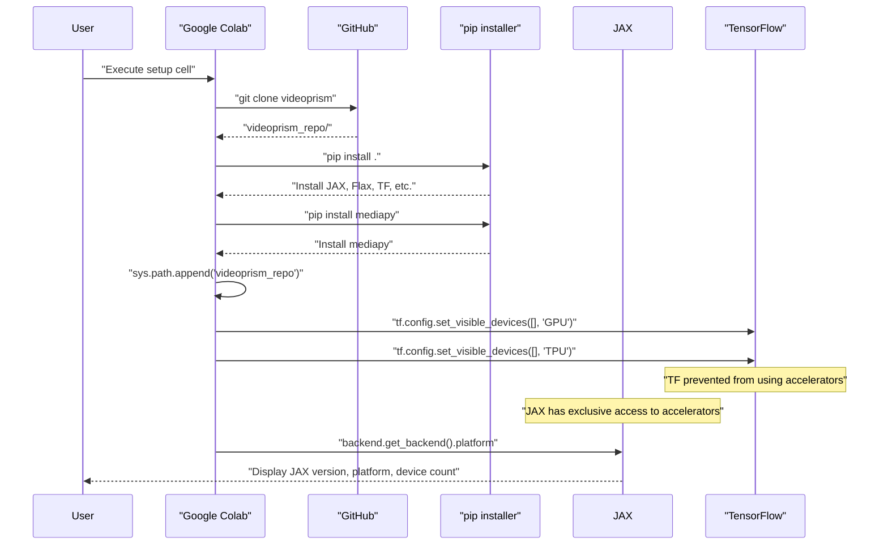

**Key Setup Steps:**

1. **Repository cloning**: [videoprism/colabs/videoprism_video_encoder_demo.ipynb:43-44]()
   ```python
   !git clone --quiet --branch=main --depth=1 \
      https://github.com/google-deepmind/videoprism.git videoprism_repo
   ```

2. **Package installation**: [videoprism/colabs/videoprism_video_encoder_demo.ipynb:45-46]()
   ```python
   os.chdir('./videoprism_repo')
   !pip install .
   ```

3. **Device configuration**: [videoprism/colabs/videoprism_video_encoder_demo.ipynb:60-62]()
   ```python
   tf.config.set_visible_devices([], "GPU")
   tf.config.set_visible_devices([], "TPU")
   ```
   This prevents TensorFlow from consuming GPU/TPU resources, leaving them available for JAX.

**Sources:** [videoprism/colabs/videoprism_video_encoder_demo.ipynb:30-69](), [videoprism/colabs/videoprism_video_text_demo.ipynb:44-83]()

## Video Preprocessing Utilities

Both notebooks define a `read_and_preprocess_video()` function that standardizes video inputs to the format expected by VideoPrism models.

### Video Preprocessing Pipeline

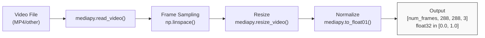

**Function Signature and Implementation:**

[videoprism/colabs/videoprism_video_encoder_demo.ipynb:84-108]()

```python
def read_and_preprocess_video(
    filename: str, target_num_frames: int, target_frame_size: tuple[int, int]
)
```

**Processing Steps:**

| Step | Function | Purpose |
|------|----------|---------|
| Read | `mediapy.read_video(filename)` | Load video frames as numpy array |
| Sample | `np.linspace()` with `frame_indices` | Select `target_num_frames` evenly spaced frames |
| Resize | `mediapy.resize_video(frames, shape=target_frame_size)` | Resize to 288×288 (assumes aspect ratio matches) |
| Normalize | `mediapy.to_float01(frames)` | Convert pixel values from [0, 255] to [0.0, 1.0] |

**Aspect Ratio Constraint:**

[videoprism/colabs/videoprism_video_encoder_demo.ipynb:100-102]()
```python
assert (
    original_height * target_width == original_width * target_height
), 'Currently does not support aspect ratio mismatch.'
```

The preprocessing requires input videos to have a square aspect ratio (or one that exactly matches the target).

**Sources:** [videoprism/colabs/videoprism_video_encoder_demo.ipynb:76-108](), [videoprism/colabs/videoprism_video_text_demo.ipynb:92-157]()

## Video Encoder Demo Walkthrough

The video encoder demo (`videoprism_video_encoder_demo.ipynb`) demonstrates spatiotemporal feature extraction using VideoPrism-B or VideoPrism-L models.

### Model Loading and Inference Flow

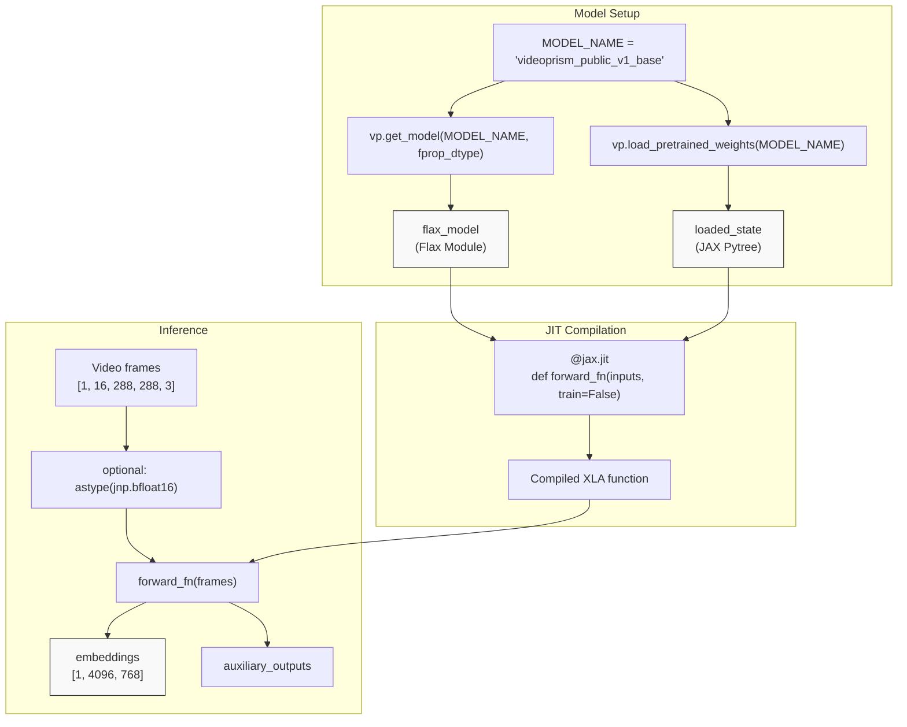

### Step-by-Step Implementation

**1. Model Selection and Configuration** [videoprism/colabs/videoprism_video_encoder_demo.ipynb:125-131]()

```python
MODEL_NAME = 'videoprism_public_v1_base'  # or 'videoprism_public_v1_large'
USE_BFLOAT16 = False
NUM_FRAMES = 16
FRAME_SIZE = 288

fprop_dtype = jnp.bfloat16 if USE_BFLOAT16 else None
```

| Parameter | VideoPrism-B | VideoPrism-L | Purpose |
|-----------|--------------|--------------|---------|
| `NUM_FRAMES` | 16 | 8 | Number of frames per video clip |
| `FRAME_SIZE` | 288 | 288 | Height and width in pixels |
| `fprop_dtype` | None or bfloat16 | None or bfloat16 | Computation precision |

**2. Model Instantiation** [videoprism/colabs/videoprism_video_encoder_demo.ipynb:131-132]()

```python
flax_model = vp.get_model(MODEL_NAME, fprop_dtype=fprop_dtype)
loaded_state = vp.load_pretrained_weights(MODEL_NAME)
```

- `get_model()` returns a Flax module with the model architecture
- `load_pretrained_weights()` downloads and loads pre-trained parameters from HuggingFace Hub

**3. Forward Function Definition** [videoprism/colabs/videoprism_video_encoder_demo.ipynb:135-137]()

```python
@jax.jit
def forward_fn(inputs, train=False):
  return flax_model.apply(loaded_state, inputs, train=train)
```

The `@jax.jit` decorator triggers XLA compilation for optimized execution.

**4. Video Processing and Inference** [videoprism/colabs/videoprism_video_encoder_demo.ipynb:161-174]()

```python
frames = read_and_preprocess_video(
    VIDEO_FILE_PATH,
    target_num_frames=NUM_FRAMES,
    target_frame_size=[FRAME_SIZE, FRAME_SIZE],
)
frames = jnp.asarray(frames[None, ...])  # Add batch dimension
if USE_BFLOAT16:
  frames = frames.astype(jnp.bfloat16)

embeddings, _ = forward_fn(frames)
```

**Output Shape Explanation:**

For VideoPrism-B with 16 frames:
- Input: `[1, 16, 288, 288, 3]` (batch, frames, height, width, channels)
- Output: `[1, 4096, 768]` (batch, tokens, features)
  - 4096 tokens = 16 frames × 16×16 spatial patches per frame
  - 768 feature channels (ViT-B embedding dimension)

The output can be reshaped to `[1, 16, 16, 16, 768]` for spatiotemporal interpretation.

**Sources:** [videoprism/colabs/videoprism_video_encoder_demo.ipynb:114-177](), [README.md:99-106]()

## Video-Text Encoder Demo Walkthrough

The video-text demo (`videoprism_video_text_demo.ipynb`) demonstrates cross-modal retrieval and zero-shot classification using VideoPrism-LvT models.

### Video-Text Model Architecture and Data Flow

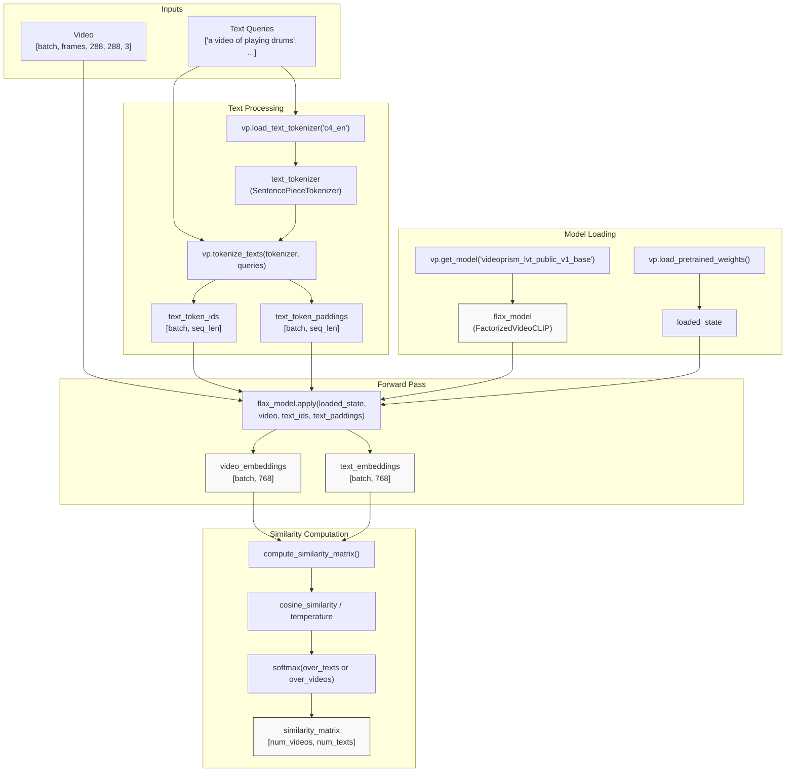

### Step-by-Step Implementation

**1. Model and Tokenizer Loading** [videoprism/colabs/videoprism_video_text_demo.ipynb:168-176]()

```python
MODEL_NAME = 'videoprism_lvt_public_v1_base'  # or '_large'
fprop_dtype = jnp.bfloat16 if USE_BFLOAT16 else None
flax_model = vp.get_model(MODEL_NAME, fprop_dtype=fprop_dtype)
loaded_state = vp.load_pretrained_weights(MODEL_NAME)
text_tokenizer = vp.load_text_tokenizer('c4_en')
```

The `'c4_en'` tokenizer is a SentencePiece model trained on C4 English corpus.

**2. Forward Function for Video-Text Models** [videoprism/colabs/videoprism_video_text_demo.ipynb:179-187]()

```python
@jax.jit
def forward_fn(inputs, text_token_ids, text_paddings, train=False):
  return flax_model.apply(
      loaded_state,
      inputs,
      text_token_ids,
      text_paddings,
      train=train,
  )
```

The forward function requires three inputs: video frames, text token IDs, and text padding masks.

**3. Text Query Preparation** [videoprism/colabs/videoprism_video_text_demo.ipynb:231-242]()

```python
TEXT_QUERY_CSV = 'playing drums,sitting,playing flute,playing at playground,concert'
PROMPT_TEMPLATE = 'a video of {}.'

text_queries = TEXT_QUERY_CSV.split(',')
text_queries = [PROMPT_TEMPLATE.format(t) for t in text_queries]
text_ids, text_paddings = vp.tokenize_texts(text_tokenizer, text_queries)
if USE_BFLOAT16:
  text_paddings = text_paddings.astype(jnp.bfloat16)
```

**Text Tokenization Details:**

| Function | Inputs | Outputs | Purpose |
|----------|--------|---------|---------|
| `vp.tokenize_texts()` | `tokenizer`, `List[str]` | `text_ids: [N, L]`, `text_paddings: [N, L]` | Convert text to token IDs and create padding masks |

Where `N` = number of text queries, `L` = maximum sequence length.

**4. Joint Video-Text Embedding Computation** [videoprism/colabs/videoprism_video_text_demo.ipynb:254-255]()

```python
video_embeddings, text_embeddings, _ = forward_fn(
    frames, text_ids, text_paddings)
```

Both embeddings have shape `[batch_size, 768]` for VideoPrism-LvT-B. They are L2-normalized internally and lie in a shared embedding space.

**5. Similarity Matrix Computation** [videoprism/colabs/videoprism_video_text_demo.ipynb:127-156]()

```python
def compute_similarity_matrix(
    video_embeddings,
    text_embeddings,
    temperature: float,
    apply_softmax: str | None = None,
) -> np.ndarray:
  """Computes cosine similarity matrix."""
  similarity_matrix = np.dot(video_embeddings, text_embeddings.T)
  
  if temperature is not None:
    similarity_matrix /= temperature
  
  if apply_softmax == 'over_videos':
    # For text-to-video retrieval
    similarity_matrix = softmax(similarity_matrix, axis=0)
  elif apply_softmax == 'over_texts':
    # For video-to-text retrieval / zero-shot classification
    similarity_matrix = softmax(similarity_matrix, axis=1)
```

**Similarity Matrix Usage:**

[videoprism/colabs/videoprism_video_text_demo.ipynb:257-263]()
```python
TEMPERATURE = 0.01
similarity_matrix = compute_similarity_matrix(
    video_embeddings,
    text_embeddings,
    temperature=TEMPERATURE,
    apply_softmax='over_texts',
)
```

- `temperature`: Scales logits before softmax (0.01 = sharper distribution)
- `apply_softmax='over_texts'`: Normalizes across text dimension for zero-shot classification
- `apply_softmax='over_videos'`: Normalizes across video dimension for text-to-video retrieval

**6. Retrieval Results** [videoprism/colabs/videoprism_video_text_demo.ipynb:274-285]()

```python
v2t_similarity_vector = similarity_matrix[0]
top_indices = np.argsort(v2t_similarity_vector)[::-1]

for k, j in enumerate(top_indices):
  print(
      'Top-%d retrieved text: %s [Similarity = %0.4f]'
      % (k + 1, text_queries[j], v2t_similarity_vector[j])
  )
```

This produces a ranked list of text queries by their similarity to the video.

**Sources:** [videoprism/colabs/videoprism_video_text_demo.ipynb:160-292](), [README.md:65-86](), [README.md:108-111]()

## Common Patterns and Best Practices

### Model Name Mapping

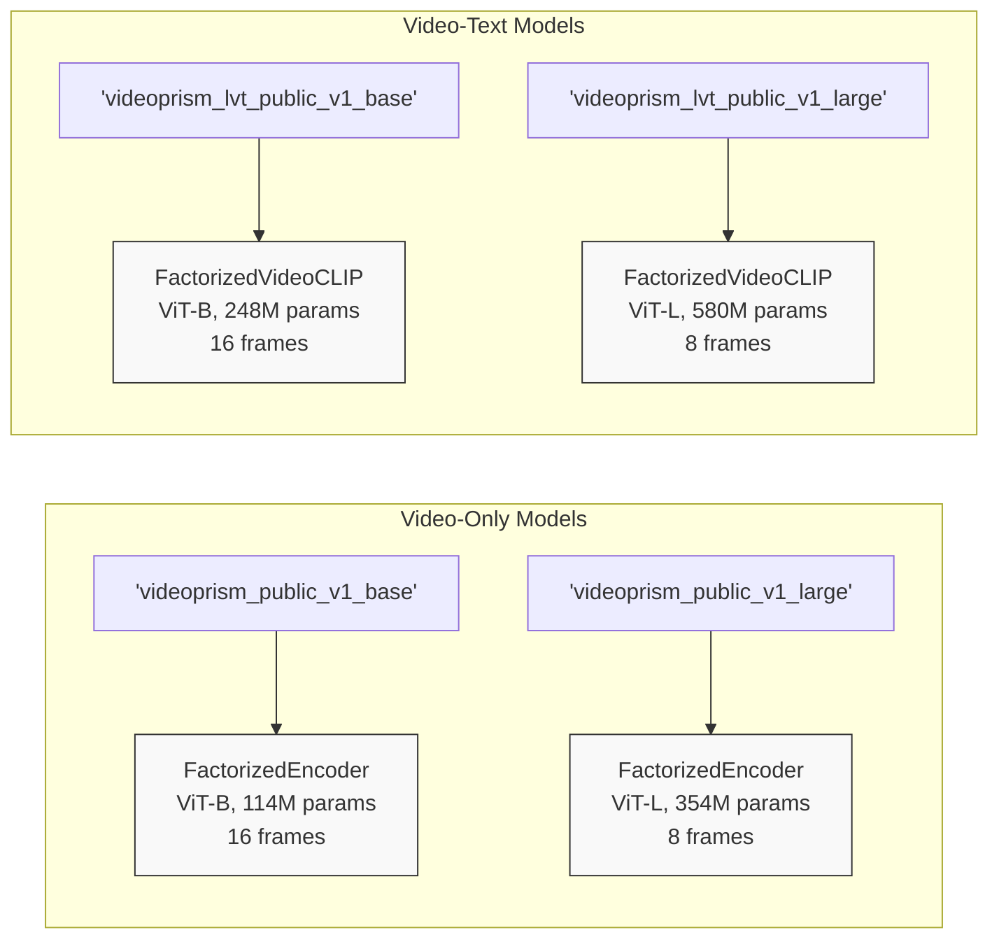

**Sources:** [README.md:90-98]()

### Input/Output Shape Reference

| Model Variant | Input Shape | Output Shape (Video) | Output Shape (Text) | Feature Dim |
|---------------|-------------|----------------------|---------------------|-------------|
| VideoPrism-B | `[B, 16, 288, 288, 3]` | `[B, 4096, 768]` | N/A | 768 |
| VideoPrism-L | `[B, 8, 288, 288, 3]` | `[B, 1024, 1024]` | N/A | 1024 |
| VideoPrism-LvT-B | `[B, 16, 288, 288, 3]` | `[B, 768]` (global) | `[B, 768]` (global) | 768 |
| VideoPrism-LvT-L | `[B, 8, 288, 288, 3]` | `[B, 1024]` (global) | `[B, 1024]` (global) | 1024 |

Where `B` = batch size. Video-only models output spatiotemporal tokens, while video-text models output global embeddings.

**Sources:** [README.md:99-111]()

### Optional bfloat16 Precision

Both notebooks support optional bfloat16 computation for faster inference and lower memory usage:

```python
USE_BFLOAT16 = False  # Set to True for bfloat16

fprop_dtype = jnp.bfloat16 if USE_BFLOAT16 else None
flax_model = vp.get_model(MODEL_NAME, fprop_dtype=fprop_dtype)

# Convert inputs to bfloat16
if USE_BFLOAT16:
  frames = frames.astype(jnp.bfloat16)
  text_paddings = text_paddings.astype(jnp.bfloat16)
```

[videoprism/colabs/videoprism_video_encoder_demo.ipynb:126-131](), [videoprism/colabs/videoprism_video_text_demo.ipynb:169-174]()

### JAX JIT Compilation

Both notebooks wrap the forward pass in `@jax.jit` for XLA compilation:

```python
@jax.jit
def forward_fn(inputs, ...):
  return flax_model.apply(loaded_state, inputs, ...)
```

- First call triggers compilation (slower)
- Subsequent calls use compiled function (faster)
- Compiled functions are cached based on input shapes and dtypes

**Sources:** [videoprism/colabs/videoprism_video_encoder_demo.ipynb:135-137](), [videoprism/colabs/videoprism_video_text_demo.ipynb:179-187]()

## Running the Notebooks

### Google Colab (Recommended)

Both notebooks are designed for Google Colab and can be opened directly:

- Video Encoder Demo: [Colab Link](https://colab.research.google.com/github/google-deepmind/videoprism/blob/main/videoprism/colabs/videoprism_video_encoder_demo.ipynb)
- Video-Text Demo: [Colab Link](https://colab.research.google.com/github/google-deepmind/videoprism/blob/main/videoprism/colabs/videoprism_video_text_demo.ipynb)

**Hardware Options:**
- CPU: Works but slow
- GPU: Recommended for faster inference
- TPU: Best performance (requires TPU runtime)

To enable TPU in Colab: Runtime → Change runtime type → Hardware accelerator → TPU

### Local Execution

To run locally:

1. Install VideoPrism: [Installation](#2.1)
2. Install additional dependencies:
   ```bash
   pip install mediapy jupyter
   ```
3. Launch Jupyter:
   ```bash
   jupyter notebook videoprism/colabs/
   ```

**Sources:** [README.md:5-6](), [README.md:36-48]()

## Next Steps

After completing the demo notebooks:

- For detailed model information, see [Model Variants](#3)
- For API documentation, see [API Reference](#6)
- For advanced usage patterns (custom checkpoints, variable frame counts), see [Usage Guide](#5)
- For understanding the internal architecture, see [Core Architecture](#4)

**Sources:** [README.md:1-190]()

---

# Page: Model Variants

# Model Variants

<details>
<summary>Relevant source files</summary>

The following files were used as context for generating this wiki page:

- [README.md](README.md)
- [videoprism/models.py](videoprism/models.py)

</details>


This page provides an overview of the VideoPrism model family, including the different variants available, their configurations, and how they are organized in the codebase. For detailed usage instructions of each variant type, see [Video-Only Models](#3.1) and [Video-Text Models (VideoCLIP)](#3.2).

VideoPrism offers four publicly released model variants with different architectures and capabilities. All variants are built on the factorized spatial-temporal architecture and share a common configuration system managed through the `videoprism.models` module.

## Model Registry Structure

The VideoPrism model system organizes variants through three core dictionaries defined in [videoprism/models.py:224-233]():

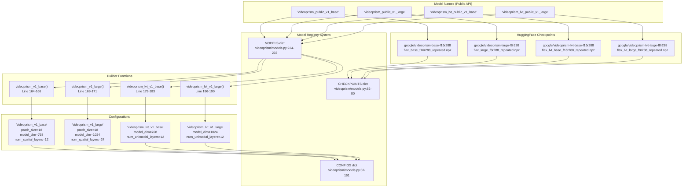

**Sources:** [videoprism/models.py:62-233]()

## Available Model Variants

VideoPrism provides four publicly released models across two architecture families:

| Model Name | Configuration Name | Architecture | Backbone | Parameters | File Size | Frame Count | Resolution |
|------------|-------------------|--------------|----------|------------|-----------|-------------|-----------|
| VideoPrism-B | `videoprism_public_v1_base` | FactorizedEncoder | ViT-B | 114M | 458MB | 16 | 288×288 |
| VideoPrism-L | `videoprism_public_v1_large` | FactorizedEncoder | ViT-L | 354M | 1.42GB | 8 | 288×288 |
| VideoPrism-LvT-B | `videoprism_lvt_public_v1_base` | FactorizedVideoCLIP | ViT-B | 248M | 991MB | 16 | 288×288 |
| VideoPrism-LvT-L | `videoprism_lvt_public_v1_large` | FactorizedVideoCLIP | ViT-L | 580M | 2.30GB | 8 | 288×288 |

**Sources:** [README.md:88-98](), [videoprism/models.py:62-80]()

### Model Family Hierarchy

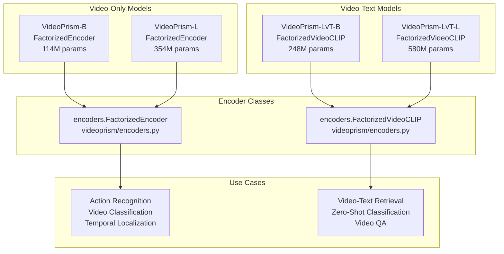

**Sources:** [videoprism/models.py:164-197](), [README.md:88-112]()

## Configuration Details

Each model variant has a corresponding configuration in the `CONFIGS` dictionary that specifies its architecture parameters:

### Video-Only Model Configurations

**Base Configuration** (`videoprism_v1_base`):
- `patch_size`: 18
- `pos_emb_shape`: (16, 16, 16) - temporal × height × width tokens
- `model_dim`: 768
- `num_spatial_layers`: 12
- `num_temporal_layers`: 4
- `num_heads`: 12
- `mlp_dim`: 3072
- `atten_logit_cap`: 50.0
- `scan`: True

**Large Configuration** (`videoprism_v1_large`):
- `patch_size`: 18
- `pos_emb_shape`: (8, 16, 16) - fewer temporal tokens
- `model_dim`: 1024
- `num_spatial_layers`: 24 - doubled depth
- `num_temporal_layers`: 4
- `num_heads`: 16
- `mlp_dim`: 4096
- `atten_logit_cap`: 50.0
- `scan`: True

**Sources:** [videoprism/models.py:83-104]()

### Video-Text Model Configurations

**LvT Base Configuration** (`videoprism_lvt_v1_base`):
- All base model parameters, plus:
- `num_auxiliary_layers`: 2
- `enable_causal_atten`: True
- `num_unimodal_layers`: 12
- `norm_policy`: 'pre'
- `vocabulary_size`: 32,000 (from TEXT_TOKENIZERS)

**LvT Large Configuration** (`videoprism_lvt_v1_large`):
- All large model parameters, plus:
- `num_auxiliary_layers`: 2
- `enable_causal_atten`: True
- `num_unimodal_layers`: 12
- `norm_policy`: 'pre'
- `vocabulary_size`: 32,000

**Sources:** [videoprism/models.py:116-145](), [videoprism/models.py:55-60]()

## Model Name Resolution

The system supports multiple ways to identify models:

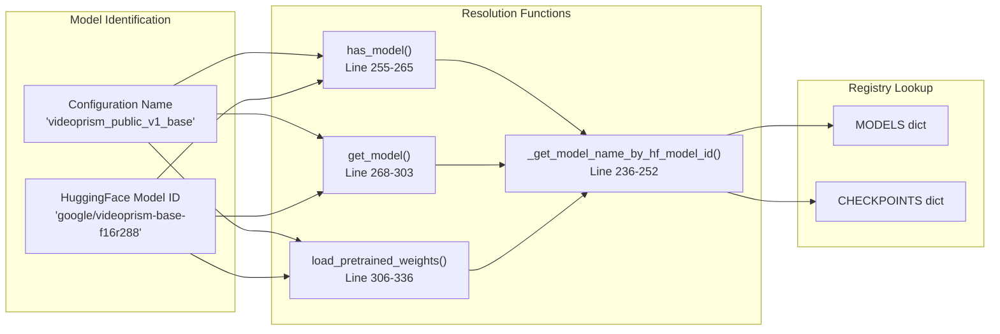

**Sources:** [videoprism/models.py:236-303]()

### Model Name Patterns

Model names follow these conventions:

| Pattern | Example | Description |
|---------|---------|-------------|
| Configuration name | `videoprism_public_v1_base` | Used in `get_model()` and `load_pretrained_weights()` |
| HuggingFace repo ID | `google/videoprism-base-f16r288` | Alternative identifier, auto-resolved to configuration name |
| Internal config key | `videoprism_v1_base` | Used in CONFIGS dict, not public-facing |

The system automatically converts HuggingFace model IDs to configuration names via [videoprism/models.py:236-252]().

**Sources:** [videoprism/models.py:236-303](), [README.md:88-98]()

## Checkpoint Loading

Checkpoints are stored on HuggingFace Hub and downloaded automatically:

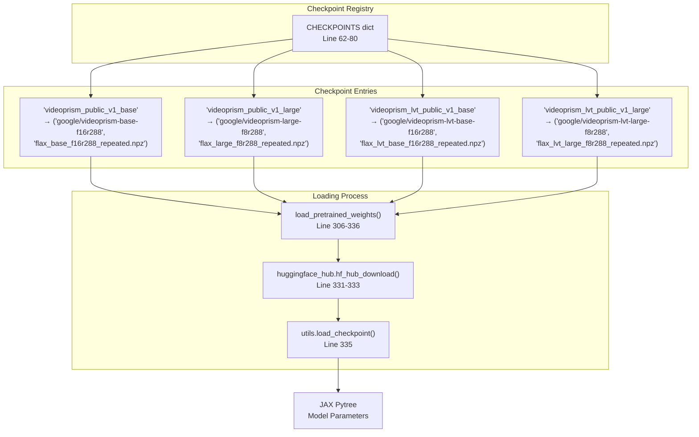

**Sources:** [videoprism/models.py:62-80](), [videoprism/models.py:306-336]()

## Additional Model Variants (Not Publicly Released)

The codebase also defines configurations for additional variants that are not publicly released:

### Giant Models

- `videoprism_v1_giant` [videoprism/models.py:105-115]()
  - 1408 model_dim
  - 40 spatial layers
  - 6144 MLP dim
  
- `videoprism_lvt_v1_giant` [videoprism/models.py:146-160]()
  - 1408 model_dim
  - 40 spatial layers
  - 16 unimodal layers
  - Uses 'primer_hybrid' norm policy

### Video Classifier Models

The `FactorizedVideoClassifier` variants add a classification head to the base encoders:

- `videoprism_vc_v1_base(num_classes)` [videoprism/models.py:200-205]()
- `videoprism_vc_v1_large(num_classes)` [videoprism/models.py:208-213]()
- `videoprism_vc_v1_giant(num_classes)` [videoprism/models.py:216-221]()

These are used for supervised fine-tuning on classification tasks but do not have public checkpoints.

**Sources:** [videoprism/models.py:105-221]()

## Common Features Across All Variants

All VideoPrism model variants share these characteristics:

| Feature | Description |
|---------|-------------|
| Input format | Videos with shape `(batch_size, num_frames, 288, 288, 3)` |
| Normalization | RGB values in [0.0, 1.0] |
| Patch size | 18×18 pixels |
| Position embedding interpolation | Supports variable frame counts |
| Framework | JAX/Flax |
| Attention logit capping | 50.0 to stabilize training |
| Scan optimization | Enabled for memory efficiency |

**Sources:** [videoprism/models.py:15-36](), [README.md:99-107]()

## Model Instantiation Pattern

The standard pattern for using any model variant:

```python
from videoprism import models as vp

# Step 1: Get model architecture
model = vp.get_model('videoprism_public_v1_base')

# Step 2: Load pretrained weights
params = vp.load_pretrained_weights('videoprism_public_v1_base')

# Step 3: Apply model with weights
outputs = model.apply(params, inputs, train=False)
```

The separation of architecture instantiation (`get_model`) and weight loading (`load_pretrained_weights`) allows flexibility in using custom initializations or different checkpoint versions.

**Sources:** [videoprism/models.py:22-36](), [README.md:49-64]()

---

# Page: Video-Only Models

# Video-Only Models

<details>
<summary>Relevant source files</summary>

The following files were used as context for generating this wiki page:

- [README.md](README.md)
- [videoprism/encoders.py](videoprism/encoders.py)
- [videoprism/models.py](videoprism/models.py)

</details>


## Purpose and Scope

This page documents the video-only encoder models in VideoPrism: **VideoPrism-B** (Base) and **VideoPrism-L** (Large). These models use the `FactorizedEncoder` architecture to extract spatiotemporal features from video clips without requiring text input. They are designed for video understanding tasks such as action recognition, video classification, and temporal localization.

For video-text models that support cross-modal retrieval and zero-shot classification, see [Video-Text Models (VideoCLIP)](#3.2). For practical usage examples, see [Video Feature Extraction](#5.1).

**Sources:** [README.md:88-111](), [videoprism/models.py:15-36]()

## Model Variants

VideoPrism provides two video-only encoder variants with different parameter counts and temporal resolutions:

| Model Name | Configuration Name | Backbone | Parameters | Default Frames | Spatial Resolution | Output Tokens | Checkpoint |
|------------|-------------------|----------|------------|----------------|-------------------|---------------|------------|
| **VideoPrism-B** | `videoprism_public_v1_base` | ViT-B | 114M | 16 | 288×288 | 4,096 (16×16×16) | [HuggingFace](https://huggingface.co/google/videoprism-base-f16r288) |
| **VideoPrism-L** | `videoprism_public_v1_large` | ViT-L | 354M | 8 | 288×288 | 2,048 (8×16×16) | [HuggingFace](https://huggingface.co/google/videoprism-large-f8r288) |

Both models support variable frame counts through position embedding interpolation. The output shape is `(batch_size, num_frames * 16 * 16, feature_channels)`, which can be reshaped to `(batch_size, num_frames, 16, 16, feature_channels)` for spatiotemporal representations.

**Sources:** [README.md:88-111](), [videoprism/models.py:62-80](), [videoprism/models.py:82-115]()

## Architecture Overview

Video-only models use the `FactorizedEncoder` architecture, which implements a factorized space-time encoding approach from the ViViT paper. This architecture separates spatial and temporal processing into two stages:

```mermaid
graph TB
    subgraph "Input Processing"
        INPUT["Video Input<br/>(B, T, 288, 288, 3)"]
        PATCH["_image_to_patch()<br/>Patch Extraction"]
        PROJ["FeedForward<br/>patch_projection"]
        INPUT --> PATCH
        PATCH --> PROJ
    end
    
    subgraph "Spatial Encoding Stage"
        SPATIALPOS["TrainablePositionalEmbedding<br/>spatial_pos_emb"]
        SPATIALVIT["VisionTransformer<br/>spatial_encoder<br/>(12 or 24 layers)"]
        SPATIALLN["LayerNorm<br/>spatial_ln"]
        
        PROJ --> SPATIALPOS
        SPATIALPOS --> SPATIALVIT
        SPATIALVIT --> SPATIALLN
    end
    
    subgraph "Temporal Encoding Stage"
        RESHAPE["einshape<br/>(bt)nd → (bn)td"]
        TEMPORALPOS["TrainablePositionalEmbedding<br/>temporal_pos_emb"]
        TEMPORALVIT["VisionTransformer<br/>temporal_encoder<br/>(4 layers)"]
        TEMPORALLN["LayerNorm<br/>temporal_ln"]
        
        SPATIALLN --> RESHAPE
        RESHAPE --> TEMPORALPOS
        TEMPORALPOS --> TEMPORALVIT
        TEMPORALVIT --> TEMPORALLN
    end
    
    subgraph "Output"
        FINAL["einshape<br/>(bn)td → b(tn)d"]
        OUTPUT["Embeddings<br/>(B, T*N, D)"]
        
        TEMPORALLN --> FINAL
        FINAL --> OUTPUT
    end
```

The factorized approach processes each frame independently in the spatial stage, then aggregates temporal information across frames. This design is more efficient than joint space-time attention and allows the model to handle variable frame counts.

**Sources:** [videoprism/encoders.py:391-581]()

## Model Instantiation and Loading

### Instantiation Flow

The following diagram shows how video-only models are instantiated and loaded:

```mermaid
sequenceDiagram
    participant User
    participant models["videoprism.models"]
    participant MODELS["MODELS dict"]
    participant builders["videoprism_v1_base()<br/>videoprism_v1_large()"]
    participant CONFIGS["CONFIGS dict"]
    participant FactorizedEncoder["encoders.FactorizedEncoder"]
    participant HF["HuggingFace Hub"]
    
    User->>models: get_model('videoprism_public_v1_base')
    models->>MODELS: Lookup model builder
    MODELS->>builders: Call videoprism_v1_base()
    builders->>CONFIGS: Retrieve 'videoprism_v1_base' config
    CONFIGS-->>builders: Config dict
    builders->>FactorizedEncoder: Create instance with config
    FactorizedEncoder-->>User: Flax model
    
    User->>models: load_pretrained_weights('videoprism_public_v1_base')
    models->>models: CHECKPOINTS dict lookup
    models->>HF: hf_hub_download(repo_id, filename)
    HF-->>models: Checkpoint path
    models->>models: utils.load_checkpoint(path)
    models-->>User: Loaded parameters (JAX pytree)
```

**Sources:** [videoprism/models.py:164-177](), [videoprism/models.py:224-234](), [videoprism/models.py:268-304](), [videoprism/models.py:306-337]()

### Code Example

```python
from videoprism import models as vp
import jax

# Get model architecture
model_name = 'videoprism_public_v1_base'
flax_model = vp.get_model(model_name)

# Load pretrained weights
loaded_state = vp.load_pretrained_weights(model_name)

# Define forward pass
@jax.jit
def forward_fn(inputs):
  return flax_model.apply(loaded_state, inputs, train=False)

# Process video
video_inputs = ...  # Shape: (batch_size, num_frames, 288, 288, 3)
embeddings, outputs = forward_fn(video_inputs)
# embeddings shape: (batch_size, num_frames * 256, feature_dim)
```

**Sources:** [README.md:49-64](), [videoprism/models.py:22-36]()

## Configuration Details

### VideoPrism-B Configuration

The Base model configuration (`videoprism_v1_base`) is defined in the `CONFIGS` dictionary:

| Parameter | Value | Description |
|-----------|-------|-------------|
| `patch_size` | 18 | Size of square patches extracted from frames |
| `pos_emb_shape` | (16, 16, 16) | Shape of positional embeddings (T, H, W) |
| `model_dim` | 768 | Feature dimension throughout the model |
| `num_spatial_layers` | 12 | Number of transformer layers in spatial encoder |
| `num_temporal_layers` | 4 | Number of transformer layers in temporal encoder |
| `num_heads` | 12 | Number of attention heads |
| `mlp_dim` | 3072 | Hidden dimension in feedforward networks |
| `atten_logit_cap` | 50.0 | Cap for attention logit values |
| `scan` | True | Enable `nn.scan` for memory efficiency |

**Sources:** [videoprism/models.py:82-93]()

### VideoPrism-L Configuration

The Large model configuration (`videoprism_v1_large`) differs in the following parameters:

| Parameter | Base Value | Large Value |
|-----------|------------|-------------|
| `pos_emb_shape` | (16, 16, 16) | **(8, 16, 16)** |
| `model_dim` | 768 | **1024** |
| `num_spatial_layers` | 12 | **24** |
| `num_heads` | 12 | **16** |
| `mlp_dim` | 3072 | **4096** |

The Large model uses 8 frames by default (vs. 16 for Base) but has deeper spatial encoding with 24 layers.

**Sources:** [videoprism/models.py:94-104]()

## FactorizedEncoder Architecture Details

### Spatial Encoding Process

The spatial encoder processes each frame independently:

```mermaid
graph LR
    subgraph "Per-Frame Processing (B*T frames)"
        FRAME["Frame<br/>(H, W, 3)"]
        PATCHES["Patches<br/>(N, P²*3)"]
        EMBED["Embedded Patches<br/>(N, D)"]
        SPATIALPOS["+ Spatial Position<br/>Embeddings"]
        SPATIALTFM["Spatial Transformer<br/>(12-24 layers)"]
        SPATIALOUT["Spatial Features<br/>(N, D)"]
        
        FRAME --> PATCHES
        PATCHES --> EMBED
        EMBED --> SPATIALPOS
        SPATIALPOS --> SPATIALTFM
        SPATIALTFM --> SPATIALOUT
    end
```

Key implementation details:
- Patch size of 18×18 pixels converts 288×288 frames into 16×16 patches (256 patches per frame)
- `patch_projection` is a `FeedForward` layer that projects flattened patches to `model_dim`
- `spatial_pos_emb` is a `TrainablePositionalEmbedding` with learned 2D positional encodings
- Position embeddings are interpolated using `_interpolate_emb_2d()` if input resolution differs from training
- The spatial encoder is a `VisionTransformer` with 12 (Base) or 24 (Large) transformer layers

**Sources:** [videoprism/encoders.py:437-531]()

### Temporal Encoding Process

After spatial encoding, features are reorganized to process temporal information:

```mermaid
graph TB
    SPATIALOUT["Spatial Features<br/>(B*T, N, D)"]
    RESHAPE["Reshape: einshape<br/>'(bt)nd → (bn)td'<br/>(B*N, T, D)"]
    TEMPORALPOS["+ Temporal Position<br/>Embeddings"]
    TEMPORALTFM["Temporal Transformer<br/>(4 layers)"]
    TEMPORALOUT["Temporal Features<br/>(B*N, T, D)"]
    FINALSHAPE["Reshape: einshape<br/>'(bn)td → b(tn)d'<br/>(B, T*N, D)"]
    OUTPUT["Output Embeddings<br/>(B, T*N, D)"]
    
    SPATIALOUT --> RESHAPE
    RESHAPE --> TEMPORALPOS
    TEMPORALPOS --> TEMPORALTFM
    TEMPORALTFM --> TEMPORALOUT
    FINALSHAPE --> OUTPUT
    TEMPORALOUT --> FINALSHAPE
```

Key implementation details:
- Features are reshaped so each spatial token position becomes a sequence of T temporal tokens
- `temporal_pos_emb` is a `TrainablePositionalEmbedding` with learned 1D temporal encodings
- Position embeddings are interpolated using `_interpolate_emb_1d()` if frame count differs from training
- The temporal encoder is a `VisionTransformer` with 4 transformer layers
- Final output is reshaped to `(batch_size, num_frames * num_patches, model_dim)`

**Sources:** [videoprism/encoders.py:533-580]()

## Input and Output Specifications

### Input Format

Video-only models expect input videos with the following specifications:

| Property | Specification |
|----------|--------------|
| **Shape** | `(batch_size, num_frames, height, width, 3)` |
| **Height/Width** | 288 pixels (must be equal) |
| **Channels** | 3 (RGB) |
| **Value Range** | [0.0, 1.0] (normalized) |
| **Data Type** | `float32` |

The `num_frames` dimension is flexible and supports variable-length videos through position embedding interpolation. However, models were trained with specific frame counts:
- VideoPrism-B: 16 frames
- VideoPrism-L: 8 frames

**Sources:** [README.md:99-106](), [videoprism/models.py:17-20]()

### Optional Frame Paddings

The encoder supports a `frame_paddings` parameter of shape `(batch_size, num_frames)` where `1` indicates a padding frame. This is propagated through both spatial and temporal encoders:

```mermaid
graph LR
    FRAMEPAD["frame_paddings<br/>(B, T)"]
    PATCHPAD["patches_paddings<br/>(B*T, N)"]
    SPATIALPAD["Spatial encoder<br/>paddings parameter"]
    TEMPPAD["temporal_paddings<br/>(B*N, T)"]
    TEMPORALPAD["Temporal encoder<br/>paddings parameter"]
    
    FRAMEPAD -->|"Reshape & repeat"| PATCHPAD
    PATCHPAD --> SPATIALPAD
    FRAMEPAD -->|"Reshape"| TEMPPAD
    TEMPPAD --> TEMPORALPAD
```

**Sources:** [videoprism/encoders.py:416-427](), [videoprism/encoders.py:441-447](), [videoprism/encoders.py:536-540]()

### Output Format

The `__call__` method returns a tuple `(embeddings, outputs)`:

**Primary Output - `embeddings`:**
- Shape: `(batch_size, num_frames * num_patches_per_frame, model_dim)`
- Type: `jax.Array`
- Can be reshaped to: `(batch_size, num_frames, 16, 16, model_dim)` for spatiotemporal structure
- For Base model: `model_dim = 768`
- For Large model: `model_dim = 1024`

**Auxiliary Output - `outputs` dictionary:**

The `return_intermediate` parameter controls which intermediate features are returned:

| Key | Shape | Condition | Description |
|-----|-------|-----------|-------------|
| `spatial_features` | `(B, T*N, D)` | `'spatial_features' in return_intermediate` | Features after spatial encoder, before temporal encoding |

Example usage:
```python
embeddings, outputs = flax_model.apply(
    loaded_state, 
    video_inputs, 
    train=False,
    return_intermediate=['spatial_features']
)
spatial_features = outputs['spatial_features']
```

**Sources:** [videoprism/encoders.py:417-433](), [videoprism/encoders.py:574-579]()

## Position Embedding Interpolation

Both models support processing videos with different numbers of frames than used during training through position embedding interpolation. This is handled automatically by the `FactorizedEncoder`:

### Spatial Position Interpolation

When input frame resolution differs from `pos_emb_shape[-2:]`:

```python
# videoprism/encoders.py:506-513
spatial_pos_emb_shape = self.pos_emb_shape[-2:]  # e.g., (16, 16)
num_row_patches = h // self.patch_size
num_col_patches = w // self.patch_size
if spatial_pos_emb_shape != (num_row_patches, num_col_patches):
  spatial_pos_emb = _interpolate_emb_2d(
      spatial_pos_emb,
      spatial_pos_emb_shape,
      (num_row_patches, num_col_patches),
  )
```

The `_interpolate_emb_2d()` function uses bilinear interpolation via `jax.image.resize()`.

**Sources:** [videoprism/encoders.py:506-514](), [videoprism/encoders.py:131-166]()

### Temporal Position Interpolation

When input frame count differs from `pos_emb_shape[0]`:

```python
# videoprism/encoders.py:543-552
temporal_seq_length = self.pos_emb_shape[0]  # e.g., 16 for Base, 8 for Large
temporal_pos_emb = TrainablePositionalEmbedding(...)(seq_length=temporal_seq_length)
if temporal_seq_length != t:
  temporal_pos_emb = _interpolate_emb_1d(temporal_pos_emb, t)
```

The `_interpolate_emb_1d()` function uses bilinear interpolation for 1D temporal positions.

**Sources:** [videoprism/encoders.py:543-553](), [videoprism/encoders.py:107-129]()

## Video Classifier Variant

The codebase also provides `FactorizedVideoClassifier`, which wraps `FactorizedEncoder` with a classification head:

```mermaid
graph TB
    INPUT["Video Input<br/>(B, T, H, W, 3)"]
    ENCODER["FactorizedEncoder<br/>(encoder params)"]
    FEATURES["Features<br/>(B, T*N, D)"]
    POOL["AttenTokenPoolingLayer<br/>atten_pooler"]
    GLOBAL["Global Embeddings<br/>(B, D)"]
    PROJ["FeedForward<br/>projection"]
    LOGITS["Logits<br/>(B, num_classes)"]
    
    INPUT --> ENCODER
    ENCODER --> FEATURES
    FEATURES --> POOL
    POOL --> GLOBAL
    GLOBAL --> PROJ
    PROJ --> LOGITS
```

The classifier uses attention-based pooling (`AttenTokenPoolingLayer`) to aggregate spatiotemporal features into a global video embedding before classification.

**Sources:** [videoprism/encoders.py:583-654](), [videoprism/models.py:200-222]()

## Model Registry

All video-only models are registered in the `MODELS` dictionary for easy access:

| Registry Key | Builder Function | Architecture |
|--------------|-----------------|--------------|
| `'videoprism_public_v1_base'` | `videoprism_v1_base()` | `FactorizedEncoder` |
| `'videoprism_public_v1_large'` | `videoprism_v1_large()` | `FactorizedEncoder` |

The builder functions instantiate `FactorizedEncoder` with the appropriate configuration from the `CONFIGS` dictionary.

**Sources:** [videoprism/models.py:224-234](), [videoprism/models.py:164-177]()

## Checkpoints

Pretrained weights are hosted on HuggingFace Hub and registered in the `CHECKPOINTS` dictionary:

| Model Name | Repository | Filename | File Size |
|------------|-----------|----------|-----------|
| `videoprism_public_v1_base` | `google/videoprism-base-f16r288` | `flax_base_f16r288_repeated.npz` | 458MB |
| `videoprism_public_v1_large` | `google/videoprism-large-f8r288` | `flax_large_f8r288_repeated.npz` | 1.42GB |

The `load_pretrained_weights()` function automatically downloads checkpoints from HuggingFace Hub using `huggingface_hub.hf_hub_download()` and loads them using `utils.load_checkpoint()`.

**Sources:** [videoprism/models.py:62-80](), [videoprism/models.py:306-337]()

## Performance Benchmarks

Video-only models achieve state-of-the-art results on VideoGLUE benchmarks with frozen backbones:

| Model | K400 | MiT | SSv2 | D48 | Charades | ActivityNet | AVA | AVA-K |
|-------|------|-----|------|-----|----------|-------------|-----|-------|
| **VideoPrism-B** | 82.9 | 39.7 | 62.2 | 64.3 | 43.5 | 36.5 | 28.3 | 30.8 |
| **VideoPrism-L** | 85.0 | 43.3 | 64.6 | 67.6 | 53.2 | 37.0 | 32.4 | 34.5 |

These results demonstrate the effectiveness of the factorized encoding approach for video understanding tasks including action recognition (K400), moment retrieval (MiT), temporal modeling (SSv2), and action localization (AVA).

**Sources:** [README.md:121-131]()

---

# Page: Video-Text Models (VideoCLIP)

# Video-Text Models (VideoCLIP)

<details>
<summary>Relevant source files</summary>

The following files were used as context for generating this wiki page:

- [README.md](README.md)
- [videoprism/encoders.py](videoprism/encoders.py)
- [videoprism/models.py](videoprism/models.py)

</details>


This page documents the VideoPrism video-text models (VideoPrism-LvT variants) that support cross-modal tasks involving both video and text inputs. These models use a dual-encoder architecture with separate encoders for each modality, enabling tasks such as video-text retrieval, zero-shot classification, and video question answering.

**Scope**: This page covers the `FactorizedVideoCLIP` architecture, text encoding with `TextEncoder`, model configurations, and usage patterns for cross-modal tasks. For video-only feature extraction, see [Video-Only Models](#3.1). For general model loading and management, see [Model Management System](#4.1).

---

## Model Variants

VideoPrism offers two video-text model variants, both available through the model registry:

| Model Name | Configuration Key | Backbone | Parameters | Features | HuggingFace Repo |
|------------|------------------|----------|------------|----------|------------------|
| VideoPrism-LvT-B | `videoprism_lvt_public_v1_base` | ViT-B | 248M | 768-dim embeddings | `google/videoprism-lvt-base-f16r288` |
| VideoPrism-LvT-L | `videoprism_lvt_public_v1_large` | ViT-L | 580M | 1024-dim embeddings | `google/videoprism-lvt-large-f8r288` |

Both models produce L2-normalized embeddings in a shared embedding space, enabling cosine similarity computation for cross-modal retrieval and classification tasks.

**Sources**: [README.md:92-97](), [videoprism/models.py:72-79](), [videoprism/models.py:116-145]()

---

## Architecture Overview

### Dual-Encoder Design

The `FactorizedVideoCLIP` architecture implements a dual-encoder approach where video and text are processed independently before projection into a shared embedding space.

```mermaid
graph TB
    subgraph Input["Input Layer"]
        VideoInput["Video Input<br/>[B, T, 288, 288, 3]"]
        TextInput["Text Input<br/>[B, L] token IDs"]
    end
    
    subgraph VideoPath["Video Processing Path"]
        FE["FactorizedEncoder<br/>(vision_encoder)"]
        AuxEnc["VisionTransformer<br/>(auxiliary_encoder)<br/>Optional"]
        VPool["AttenTokenPoolingLayer<br/>(contrastive_vision_pooler)"]
        VEmb["Video Embeddings<br/>[B, D]"]
    end
    
    subgraph TextPath["Text Processing Path"]
        TE["TextEncoder<br/>(text_encoder)"]
        TEmb["Text Embeddings<br/>[B, D]"]
    end
    
    subgraph Output["Output Layer"]
        Norm["L2 Normalization"]
        CosSim["Cosine Similarity<br/>for retrieval/classification"]
    end
    
    VideoInput --> FE
    FE --> AuxEnc
    AuxEnc --> VPool
    VPool --> VEmb
    VEmb --> Norm
    
    TextInput --> TE
    TE --> TEmb
    TEmb --> Norm
    
    Norm --> CosSim
    
    style FE fill:#f9f9f9
    style TE fill:#f9f9f9
    style Norm fill:#e8e8e8
```

**Sources**: [videoprism/encoders.py:762-910]()

### Component Hierarchy

```mermaid
graph TD
    FVCLIP["FactorizedVideoCLIP<br/>videoprism/encoders.py:762-910"]
    
    subgraph Vision["Vision Components"]
        FE["FactorizedEncoder<br/>(vision_encoder)<br/>lines 822-841"]
        AUX["VisionTransformer<br/>(auxiliary_encoder)<br/>lines 847-857"]
        VPOOL["AttenTokenPoolingLayer<br/>(contrastive_vision_pooler)<br/>lines 859-867"]
    end
    
    subgraph Text["Text Components"]
        TENC["TextEncoder<br/>(text_encoder)<br/>lines 889-903"]
        PEMB["PositionalEmbedding<br/>(pos_emb)<br/>lines 708-713"]
        TEMB["Embedding<br/>(token_emb)<br/>lines 714-721"]
        TRANSF["StackedTransformer<br/>(unimodal_transformer)<br/>lines 742-755"]
    end
    
    FVCLIP --> FE
    FVCLIP --> AUX
    FVCLIP --> VPOOL
    FVCLIP --> TENC
    
    TENC --> PEMB
    TENC --> TEMB
    TENC --> TRANSF
    
    FE -.reuses.-> SPATIAL["FactorizedEncoder<br/>from video-only models"]
```

**Sources**: [videoprism/encoders.py:762-910](), [videoprism/encoders.py:656-759]()

---

## FactorizedVideoCLIP Class

The `FactorizedVideoCLIP` class [videoprism/encoders.py:762-910]() is the main entry point for video-text models. It coordinates both modalities and handles optional processing.

### Key Attributes

| Parameter | Description | Base Value | Large Value |
|-----------|-------------|------------|-------------|
| `patch_size` | Spatial patch dimension | 18 | 18 |
| `pos_emb_shape` | Positional embedding shape (T, H, W) | (16, 16, 16) | (8, 16, 16) |
| `num_spatial_layers` | Spatial encoder transformer layers | 12 | 24 |
| `num_temporal_layers` | Temporal encoder transformer layers | 4 | 4 |
| `num_auxiliary_layers` | Additional video processing layers | 2 | 2 |
| `vocabulary_size` | Text vocabulary size | 32,000 | 32,000 |
| `num_unimodal_layers` | Text encoder transformer layers | 12 | 12 |
| `model_dim` | Embedding dimension | 768 | 1024 |
| `num_heads` | Attention heads | 12 | 16 |
| `mlp_dim` | FFN hidden dimension | 3072 | 4096 |

**Sources**: [videoprism/models.py:116-145]()

### Method: `__call__`

The forward pass supports flexible modality processing:

```python
def __call__(
    self,
    inputs: Array | None = None,              # Video: [B, T, H, W, 3]
    text_token_ids: Array | None = None,      # Text IDs: [B, L]
    text_paddings: Array | None = None,       # Text padding: [B, L]
    train: bool = False,
    normalize: bool = True,                    # L2 normalization
    return_intermediate: bool | Collection[str] = False,
    frame_paddings: Array | None = None,      # Video padding: [B, T]
) -> tuple[Array | None, Array | None, dict[str, Array]]
```

**Returns**:
- `video_embeddings`: Shape `[B, D]` or `None` if `inputs` is `None`
- `text_embeddings`: Shape `[B, D]` or `None` if `text_token_ids` is `None`
- `outputs`: Dictionary with optional intermediate features

**Sources**: [videoprism/encoders.py:783-810]()

### Processing Flow

```mermaid
sequenceDiagram
    participant Client
    participant FVCLIP as FactorizedVideoCLIP
    participant FE as FactorizedEncoder
    participant AUX as auxiliary_encoder
    participant VPOOL as contrastive_vision_pooler
    participant TENC as TextEncoder
    
    Client->>FVCLIP: __call__(inputs, text_token_ids, text_paddings)
    
    alt Video Processing (inputs not None)
        FVCLIP->>FE: encode video [B,T,H,W,3]
        FE-->>FVCLIP: spatiotemporal features [B,T*N,D]
        
        alt num_auxiliary_layers > 0
            FVCLIP->>AUX: additional processing
            AUX-->>FVCLIP: refined features [B,T*N,D]
        end
        
        FVCLIP->>VPOOL: pool to global embedding
        VPOOL-->>FVCLIP: video_embeddings [B,D]
        
        alt normalize == True
            FVCLIP->>FVCLIP: L2 normalize
        end
    end
    
    alt Text Processing (text_token_ids not None)
        FVCLIP->>TENC: encode text [B,L]
        TENC-->>FVCLIP: text features [B,L,D]
        
        FVCLIP->>FVCLIP: extract cls token [:,-1]
        
        alt normalize == True
            FVCLIP->>FVCLIP: L2 normalize
        end
    end
    
    FVCLIP-->>Client: (video_embeddings, text_embeddings, outputs)
```

**Sources**: [videoprism/encoders.py:783-910]()

---

## TextEncoder Component

The `TextEncoder` class [videoprism/encoders.py:656-759]() implements a CoCa-style text encoder with causal attention and learnable class tokens.

### Architecture Details

```mermaid
graph LR
    TokenIDs["Token IDs<br/>[B, L]"]
    
    subgraph Embeddings["Embedding Layer"]
        TOK["Embedding<br/>(token_emb)<br/>lookup from vocab"]
        POS["PositionalEmbedding<br/>(pos_emb)<br/>sinusoidal encoding"]
    end
    
    subgraph Processing["Transformer Processing"]
        CLS["Class Token<br/>(cls_emb)<br/>learnable [1,1,D]<br/>appended to sequence"]
        STACK["StackedTransformer<br/>(unimodal_transformer)<br/>with causal attention"]
        LN["LayerNorm<br/>(unimodal_ln)"]
    end
    
    Output["Text Features<br/>[B, L+1, D]"]
    ClsOutput["Class Token Output<br/>features[:, -1]"]
    
    TokenIDs --> TOK
    TokenIDs --> POS
    TOK --> SUM["+"]
    POS --> SUM
    SUM --> CLS
    CLS --> STACK
    STACK --> LN
    LN --> Output
    Output --> ClsOutput
```

**Key Features**:
1. **Token Embedding**: Vocabulary lookup with `scale_sqrt_depth=True` multiplies by `sqrt(model_dim)` [videoprism/encoders.py:714-721]()
2. **Positional Encoding**: Sinusoidal embeddings added to token embeddings [videoprism/encoders.py:708-713]()
3. **Class Tokens**: Learnable tokens appended after the text sequence [videoprism/encoders.py:724-735]()
4. **Causal Attention**: Prevents tokens from attending to future positions when `enable_causal_atten=True` [videoprism/encoders.py:682]()
5. **Output Selection**: Final class token `[:, -1]` used as text embedding [videoprism/encoders.py:906]()

**Sources**: [videoprism/encoders.py:656-759]()

---

## Model Loading and Usage

### Loading VideoCLIP Models

```python
from videoprism import models as vp

# Load model architecture
model_name = 'videoprism_lvt_public_v1_base'
flax_model = vp.get_model(model_name)

# Load pre-trained weights from HuggingFace
loaded_state = vp.load_pretrained_weights(model_name)

# Load text tokenizer
text_tokenizer = vp.load_text_tokenizer('c4_en')
```

**Sources**: [videoprism/models.py:179-197](), [videoprism/models.py:224-233](), [videoprism/models.py:339-352]()

### Model Instantiation Flow

```mermaid
graph TD
    GetModel["vp.get_model()<br/>models.py:268-303"]
    
    CheckName{"model_name in<br/>MODELS dict?"}
    
    Builder["Model Builder Function<br/>videoprism_lvt_v1_base()<br/>models.py:179-183"]
    
    Config["Load Config<br/>CONFIGS['videoprism_lvt_v1_base']<br/>models.py:116-130"]
    
    AddVocab["Add vocabulary_size<br/>from TEXT_TOKENIZERS<br/>models.py:182"]
    
    Instantiate["encoders.FactorizedVideoCLIP<br/>(**config)"]
    
    Model["Flax Model Instance"]
    
    GetModel --> CheckName
    CheckName -->|Yes| Builder
    CheckName -->|No| Error["ValueError"]
    Builder --> Config
    Config --> AddVocab
    AddVocab --> Instantiate
    Instantiate --> Model
```

**Sources**: [videoprism/models.py:179-183](), [videoprism/models.py:268-303]()

### Text Tokenization

The `tokenize_texts` function [videoprism/models.py:355-407]() prepares text for model input:

```python
text_queries = ["a person playing basketball", "a cat sleeping"]
text_ids, text_paddings = vp.tokenize_texts(
    text_tokenizer, 
    text_queries,
    max_length=64,
    canonicalize=True  # Lowercase, remove punctuation
)
# text_ids: [B, 64] int32 array
# text_paddings: [B, 64] float32 array (1.0 = padding)
```

**Processing Steps**:
1. **Canonicalization**: `utils.canonicalize_text()` lowercases and removes punctuation [videoprism/models.py:379]()
2. **Tokenization**: SentencePiece tokenizer converts to token IDs [videoprism/models.py:385]()
3. **BOS Token**: Beginning-of-sentence token added if `tokenizer.bos_token >= 0` [videoprism/models.py:382-383]()
4. **Padding**: Sequences padded or truncated to `max_length` [videoprism/models.py:387-402]()

**Sources**: [videoprism/models.py:355-407]()

---

## Complete Usage Example

### Video-Text Retrieval

```python
import jax
import jax.numpy as jnp
from videoprism import models as vp

# Setup
model_name = 'videoprism_lvt_public_v1_base'
flax_model = vp.get_model(model_name)
loaded_state = vp.load_pretrained_weights(model_name)
text_tokenizer = vp.load_text_tokenizer('c4_en')

@jax.jit
def forward_fn(inputs, text_token_ids, text_token_paddings, train=False):
    return flax_model.apply(
        loaded_state,
        inputs,
        text_token_ids,
        text_token_paddings,
        train=train,
        normalize=True  # L2 normalize for cosine similarity
    )

# Prepare inputs
video_inputs = ...  # Shape: [batch_size, num_frames, 288, 288, 3]
text_queries = ["playing basketball", "cooking dinner", "walking a dog"]
text_ids, text_paddings = vp.tokenize_texts(text_tokenizer, text_queries)

# Forward pass
video_embeddings, text_embeddings, _ = forward_fn(
    video_inputs, text_ids, text_paddings
)

# Compute similarity scores
similarity = jnp.matmul(video_embeddings, text_embeddings.T)
# Shape: [num_videos, num_texts]
```

**Sources**: [README.md:65-86]()

### Single-Modality Encoding

Either modality can be processed independently by passing `None`:

```python
# Video-only encoding
video_embeddings, _, _ = forward_fn(video_inputs, None, None)

# Text-only encoding (requires placeholder video input)
_, text_embeddings, _ = forward_fn(None, text_ids, text_paddings)
```

**Note**: Text encoding requires `text_paddings` to be non-None. The model checks this with an assertion [videoprism/encoders.py:888]().

**Sources**: [videoprism/encoders.py:820-909]()

---

## Configuration Details

### Base Model Configuration

The `videoprism_lvt_v1_base` configuration [videoprism/models.py:116-130]():

```python
{
    'patch_size': 18,
    'pos_emb_shape': (16, 16, 16),        # 16 frames, 16x16 spatial
    'num_spatial_layers': 12,              # ViT-B spatial encoder
    'num_temporal_layers': 4,              # Temporal processing
    'mlp_dim': 3072,                       # 4x model_dim
    'num_auxiliary_layers': 2,             # Additional video layers
    'enable_causal_atten': True,           # For text encoder
    'num_unimodal_layers': 12,             # Text encoder layers
    'norm_policy': 'pre',                  # Pre-normalization
    'model_dim': 768,                      # ViT-B dimension
    'num_heads': 12,                       # Multi-head attention
    'atten_logit_cap': 50.0,              # Attention logit capping
    'scan': True,                          # Memory optimization
    'vocabulary_size': 32000               # Added from TEXT_TOKENIZERS
}
```

**Sources**: [videoprism/models.py:116-130]()

### Large Model Configuration

The `videoprism_lvt_v1_large` configuration [videoprism/models.py:131-145]():

Key differences from base:
- `pos_emb_shape`: (8, 16, 16) - 8 frames instead of 16
- `num_spatial_layers`: 24 - Deeper spatial encoder (ViT-L)
- `model_dim`: 1024 - Larger dimension
- `num_heads`: 16 - More attention heads
- `mlp_dim`: 4096 - Larger FFN

**Sources**: [videoprism/models.py:131-145]()

### Checkpoint Registry

VideoCLIP checkpoints are stored on HuggingFace Hub [videoprism/models.py:72-79]():

```python
CHECKPOINTS = {
    'videoprism_lvt_public_v1_base': (
        'google/videoprism-lvt-base-f16r288',
        'flax_lvt_base_f16r288_repeated.npz',
    ),
    'videoprism_lvt_public_v1_large': (
        'google/videoprism-lvt-large-f8r288',
        'flax_lvt_large_f8r288_repeated.npz',
    ),
}
```

The `load_pretrained_weights` function automatically downloads from HuggingFace using `hf_hub_download` [videoprism/models.py:306-336]().

**Sources**: [videoprism/models.py:72-79](), [videoprism/models.py:306-336]()

---

## Intermediate Features

Setting `return_intermediate=True` or passing a collection of feature names returns additional outputs:

| Feature Key | Shape | Description | Source |
|------------|-------|-------------|---------|
| `spatial_features` | `[B, T*N, D]` | After spatial encoder, before temporal | From FactorizedEncoder |
| `spatiotemporal_features` | `[B, T*N, D]` | After temporal encoder | From FactorizedEncoder |
| `frame_embeddings` | `[B, T, D]` | Per-frame contrastive embeddings | Pooled from spatiotemporal |

**Example**:

```python
video_emb, text_emb, outputs = forward_fn(
    video_inputs, 
    text_ids, 
    text_paddings,
    return_intermediate=['frame_embeddings', 'spatial_features']
)
# outputs['frame_embeddings']: [B, T, D]
# outputs['spatial_features']: [B, T*N, D]
```

**Sources**: [videoprism/encoders.py:813-816](), [videoprism/encoders.py:842-885]()

---

## Attention Pooling

The `AttenTokenPoolingLayer` [videoprism/encoders.py:859-867]() aggregates spatiotemporal features into global embeddings:

```mermaid
graph LR
    Features["Spatiotemporal Features<br/>[B, T*N, D]"]
    
    subgraph Pooling["AttenTokenPoolingLayer"]
        Query["Learnable Query<br/>[1, 1, 4*D]"]
        CrossAtten["Cross-Attention<br/>Q attends to features"]
        Squeeze["Squeeze query dim"]
    end
    
    Global["Video Embedding<br/>[B, D]"]
    
    Features --> CrossAtten
    Query --> CrossAtten
    CrossAtten --> Squeeze
    Squeeze --> Global
```

**Configuration**:
- `hidden_dim`: 4 × `model_dim` (e.g., 3072 for base)
- `num_queries`: 1 (single global embedding)
- `num_heads`: Matches model (12 for base, 16 for large)

The pooler is reused for frame embeddings when `return_intermediate` includes `'frame_embeddings'` [videoprism/encoders.py:874-885]().

**Sources**: [videoprism/encoders.py:859-867]()

---

## Text Tokenizer

### SentencePiece Tokenizer

The C4 English tokenizer is used for all VideoCLIP models [videoprism/models.py:55-60]():

```python
TEXT_TOKENIZERS = {
    'c4_en': {
        'model_path': 'gs://t5-data/vocabs/cc_en.32000/sentencepiece.model',
        'vocab_size': 32_000,
    },
}
```

The `SentencePieceTokenizer` class [videoprism/tokenizers.py]() wraps the SentencePiece library and implements the `Tokenizer` protocol.

**Loading**:

```python
tokenizer = vp.load_text_tokenizer('c4_en')
# Downloads from GCS and creates SentencePieceTokenizer instance
```

**Sources**: [videoprism/models.py:55-60](), [videoprism/models.py:339-352]()

### Text Canonicalization

The `utils.canonicalize_text()` function normalizes text before tokenization [videoprism/models.py:379]():

1. Convert to lowercase
2. Remove punctuation
3. Strip whitespace

This ensures consistent encoding across different text formats. Canonicalization can be disabled by setting `canonicalize=False` in `tokenize_texts()`.

**Sources**: [videoprism/models.py:378-379](), [videoprism/utils.py]()

---

## Key Differences from Video-Only Models

| Aspect | Video-Only (FactorizedEncoder) | Video-Text (FactorizedVideoCLIP) |
|--------|--------------------------------|----------------------------------|
| Architecture | Single encoder | Dual encoder (video + text) |
| Output | Spatiotemporal features `[B, T*N, D]` | Global embeddings `[B, D]` per modality |
| Pooling | Optional, external | Built-in attention pooling |
| Normalization | Not applied | L2 normalization for contrastive learning |
| Text Support | None | Full text encoding with TextEncoder |
| Auxiliary Layers | None | Optional `num_auxiliary_layers` for video refinement |
| Use Cases | Feature extraction, classification | Retrieval, zero-shot classification |

**Sources**: [videoprism/encoders.py:391-580](), [videoprism/encoders.py:762-910]()

---

## Performance Benchmarks

From the README [README.md:132-152](), public VideoCLIP models achieve state-of-the-art results:

### Zero-Shot Retrieval (R@1)

| Dataset | VideoPrism-LvT-B | VideoPrism-LvT-L | Task |
|---------|------------------|------------------|------|
| MSRVTT-1K | 49.8 (v2t), 50.1 (t2v) | 50.6 (v2t), 50.1 (t2v) | Video-text retrieval |
| VATEX | 73.1 (v2t), 56.2 (t2v) | 75.0 (v2t), 57.2 (t2v) | Video-text retrieval |
| ActivityNet | 47.9 (v2t), 48.8 (t2v) | 49.1 (v2t), 51.3 (t2v) | Video-text retrieval |

### Zero-Shot Classification (Accuracy)

| Dataset | VideoPrism-LvT-B | VideoPrism-LvT-L | Task Type |
|---------|------------------|------------------|-----------|
| Kinetics-400 | 69.2 | 72.4 | Action recognition |
| SSv2 (Temporal) | 14.6 | 18.0 | Temporal reasoning |
| Charades | 26.9 | 32.4 | Activity recognition |

**Sources**: [README.md:132-152]()

---

# Page: Core Architecture

# Core Architecture

<details>
<summary>Relevant source files</summary>

The following files were used as context for generating this wiki page:

- [videoprism/encoders.py](videoprism/encoders.py)
- [videoprism/layers.py](videoprism/layers.py)
- [videoprism/models.py](videoprism/models.py)

</details>


This document provides a deep dive into the internal architecture and components of VideoPrism. It explains how the different modules are organized, how they interact, and the key abstractions that enable the system's flexibility and modularity.

For specific implementation details of individual components, see the child pages: [Model Management System](#4.1), [Encoder Architectures](#4.2), [Layer Components](#4.3), [Text Tokenization](#4.4), and [Utilities](#4.5). For practical usage guidance, see [Usage Guide](#5).

## Architectural Overview

VideoPrism follows a layered architecture where each layer builds upon lower-level abstractions. The system is organized into four primary layers, each with distinct responsibilities:

```mermaid
graph TB
    subgraph "Layer 1: Model Management"
        MODELS["videoprism.models<br/>Model Registry & API"]
        CONFIGS["CONFIGS dict<br/>Model configurations"]
        CHECKPOINTS["CHECKPOINTS dict<br/>Pre-trained weights"]
        API["get_model()<br/>load_pretrained_weights()<br/>tokenize_texts()"]
    end
    
    subgraph "Layer 2: Encoder Architectures"
        FE["FactorizedEncoder<br/>Video-only encoding"]
        FVCLIP["FactorizedVideoCLIP<br/>Video-text contrastive"]
        FVC["FactorizedVideoClassifier<br/>Video classification"]
        TE["TextEncoder<br/>CoCa-style text encoder"]
        VIT["VisionTransformer<br/>Base transformer model"]
    end
    
    subgraph "Layer 3: Building Blocks"
        TFM["Transformer<br/>Single transformer layer"]
        STFM["StackedTransformer<br/>Multi-layer stack"]
        ATTN["DotProductAttention<br/>Multi-head attention"]
        FFN["TransformerFeedForward<br/>Feed-forward network"]
        LN["LayerNorm<br/>Layer normalization"]
        POOL["AttenTokenPoolingLayer<br/>Attention-based pooling"]
    end
    
    subgraph "Layer 4: Support Modules"
        TOK["tokenizers.SentencePieceTokenizer<br/>Text tokenization"]
        UTILS["utils.load_checkpoint()<br/>utils.canonicalize_text()"]
    end
    
    MODELS --> CONFIGS
    MODELS --> CHECKPOINTS
    MODELS --> API
    
    API --> FE
    API --> FVCLIP
    API --> FVC
    API --> TOK
    
    FE --> VIT
    FVCLIP --> FE
    FVCLIP --> TE
    FVC --> FE
    TE --> STFM
    VIT --> STFM
    
    STFM --> TFM
    TFM --> ATTN
    TFM --> FFN
    FFN --> LN
    ATTN --> LN
    FE --> POOL
    FVCLIP --> POOL
    
    MODELS --> UTILS
    TOK --> UTILS
    
    classDef layer1 fill:#f9f9f9,stroke:#333,stroke-width:2px
    classDef layer2 fill:#f0f0f0,stroke:#333,stroke-width:2px
    classDef layer3 fill:#e8e8e8,stroke:#333,stroke-width:2px
    classDef layer4 fill:#e0e0e0,stroke:#333,stroke-width:2px
```

**Layer 1 (Model Management)** serves as the primary user interface, providing model instantiation and checkpoint loading through a registry-based system. **Layer 2 (Encoder Architectures)** implements the complete neural network models for video and text encoding. **Layer 3 (Building Blocks)** provides reusable transformer components that compose into larger architectures. **Layer 4 (Support Modules)** handles text processing and checkpoint I/O operations.

Sources: [videoprism/models.py:1-408](), [videoprism/encoders.py:1-911](), [videoprism/layers.py:1-1137]()

## Module Hierarchy and Dependencies

The following diagram shows the concrete module structure and import dependencies between files:

```mermaid
graph TD
    subgraph "videoprism package"
        MODELS_PY["models.py<br/>37.88 importance"]
        ENCODERS_PY["encoders.py<br/>18.50 importance"]
        LAYERS_PY["layers.py<br/>7.22 importance"]
        TOKENIZERS_PY["tokenizers.py<br/>1.12 importance"]
        UTILS_PY["utils.py<br/>3.02 importance"]
    end
    
    subgraph "External Dependencies"
        FLAX["flax.linen as nn"]
        JAX["jax / jax.numpy"]
        HF["huggingface_hub"]
        EINOPS["einops / einshape"]
        SP["sentencepiece"]
    end
    
    MODELS_PY -->|"import encoders"| ENCODERS_PY
    MODELS_PY -->|"import tokenizers"| TOKENIZERS_PY
    MODELS_PY -->|"import utils"| UTILS_PY
    MODELS_PY --> HF
    
    ENCODERS_PY -->|"import layers"| LAYERS_PY
    ENCODERS_PY --> EINOPS
    
    MODELS_PY --> FLAX
    MODELS_PY --> JAX
    ENCODERS_PY --> FLAX
    ENCODERS_PY --> JAX
    LAYERS_PY --> FLAX
    LAYERS_PY --> JAX
    TOKENIZERS_PY --> SP
```

The dependency graph follows a strict hierarchy: `models.py` depends on all other modules but is not imported by them. `encoders.py` depends only on `layers.py`. `layers.py` has no internal dependencies. This design enables modular testing and reuse.

Sources: [videoprism/models.py:39-49](), [videoprism/encoders.py:17-28](), [videoprism/layers.py:17-24]()

## Core Abstraction: Module Base Class

All VideoPrism neural network components inherit from `layers.Module`, which extends `flax.linen.nn.Module` with dtype management:

```mermaid
classDiagram
    class Module {
        +dtype: jnp.dtype
        +fprop_dtype: jnp.dtype
        +_cast_to_fprop_dtype(value) Any
    }
    
    class LayerNorm {
        +direct_scale: bool
        +epsilon: float
        +use_scale: bool
        +use_bias: bool
        +__call__(inputs) Array
    }
    
    class FeedForward {
        +output_dim: int
        +has_bias: bool
        +activation_fn: ActivationFunc
        +__call__(inputs) Array
    }
    
    class DotProductAttention {
        +hidden_dim: int
        +num_heads: int
        +dim_per_head: int
        +atten_dropout_prob: float
        +__call__(query, key, value, atten_mask, train) tuple
    }
    
    class Transformer {
        +hidden_dim: int
        +num_heads: int
        +norm_policy: str
        +__call__(inputs, paddings, atten_mask, train) Array
    }
    
    class VisionTransformer {
        +num_tfm_layers: int
        +mlp_dim: int
        +num_heads: int
        +scan: bool
        +__call__(inputs, paddings, train) Array
    }
    
    class FactorizedEncoder {
        +patch_size: int
        +pos_emb_shape: tuple
        +num_spatial_layers: int
        +num_temporal_layers: int
        +__call__(inputs, train, return_intermediate, frame_paddings) tuple
    }
    
    Module <|-- LayerNorm
    Module <|-- FeedForward
    Module <|-- DotProductAttention
    Module <|-- Transformer
    Module <|-- VisionTransformer
    Module <|-- FactorizedEncoder
    
    Transformer *-- DotProductAttention : uses
    Transformer *-- LayerNorm : uses
    Transformer *-- TransformerFeedForward : uses
    VisionTransformer *-- StackedTransformer : uses
    FactorizedEncoder *-- VisionTransformer : uses
```

The `Module` base class provides two key attributes: `dtype` (parameter storage precision, typically `jnp.float32`) and `fprop_dtype` (computation precision). The `_cast_to_fprop_dtype()` method ensures all activations are cast to the appropriate precision for forward propagation, enabling mixed-precision training.

Sources: [videoprism/layers.py:182-206]()

## Model Registry System

The model management layer uses three central dictionaries to organize model definitions, configurations, and pre-trained weights:

| Registry | Purpose | Example Keys | Value Type |
|----------|---------|--------------|------------|
| `MODELS` | Maps model names to builder functions | `'videoprism_public_v1_base'`<br/>`'videoprism_lvt_public_v1_large'` | `Callable[[], nn.Module]` |
| `CONFIGS` | Stores model hyperparameters | `'videoprism_v1_base'`<br/>`'videoprism_lvt_v1_base'` | `dict[str, Any]` |
| `CHECKPOINTS` | Maps models to HuggingFace locations | `'videoprism_public_v1_base'` | `tuple[str, str]` (repo_id, filename) |

The `MODELS` registry associates user-facing model names with factory functions:

```python
MODELS = {
    'videoprism_public_v1_base': videoprism_v1_base,
    'videoprism_public_v1_large': videoprism_v1_large,
    'videoprism_lvt_public_v1_base': functools.partial(
        videoprism_lvt_v1_base, text_tokenizer='c4_en'
    ),
    'videoprism_lvt_public_v1_large': functools.partial(
        videoprism_lvt_v1_large, text_tokenizer='c4_en'
    ),
}
```

Each factory function retrieves configuration from `CONFIGS` and instantiates the appropriate encoder class. The `CHECKPOINTS` registry maps model names to `(repo_id, filename)` tuples for downloading pre-trained weights from HuggingFace Hub.

Sources: [videoprism/models.py:55-233]()

## Video Encoding Pipeline

The video encoding pipeline transforms raw video frames into spatiotemporal feature representations through a factorized architecture:

```mermaid
flowchart LR
    subgraph "Input Processing"
        VIDEO["Video Tensor<br/>[B, T, H, W, 3]"]
        RESHAPE["Reshape<br/>[B*T, H, W, 3]"]
        PATCH["_image_to_patch()<br/>Patch Extraction"]
        PATCHES["Patches<br/>[B*T, N, P²*C]"]
    end
    
    subgraph "Spatial Encoding"
        PROJ["FeedForward<br/>patch_projection"]
        SPATIALPOS["TrainablePositionalEmbedding<br/>spatial_pos_emb"]
        SPATIALEMB["Spatial Embeddings<br/>[B*T, N, D]"]
        SPATIALVIT["VisionTransformer<br/>spatial_encoder<br/>12/24 layers"]
        SPATIALLN["LayerNorm<br/>spatial_ln"]
        SPATIALFEAT["Spatial Features<br/>[B*T, N, D]"]
    end
    
    subgraph "Temporal Encoding"
        RESHAPET["Reshape<br/>[B*N, T, D]"]
        TEMPORALPOS["TrainablePositionalEmbedding<br/>temporal_pos_emb"]
        TEMPORALEMB["Temporal Embeddings<br/>[B*N, T, D]"]
        TEMPORALVIT["VisionTransformer<br/>temporal_encoder<br/>4 layers"]
        TEMPORALLN["LayerNorm<br/>temporal_ln"]
        TEMPFEAT["Temporal Features<br/>[B*N, T, D]"]
    end
    
    subgraph "Output"
        FINAL["Final Embeddings<br/>[B, T*N, D]"]
    end
    
    VIDEO --> RESHAPE
    RESHAPE --> PATCH
    PATCH --> PATCHES
    PATCHES --> PROJ
    PROJ --> SPATIALPOS
    SPATIALPOS --> SPATIALEMB
    SPATIALEMB --> SPATIALVIT
    SPATIALVIT --> SPATIALLN
    SPATIALLN --> SPATIALFEAT
    SPATIALFEAT --> RESHAPET
    RESHAPET --> TEMPORALPOS
    TEMPORALPOS --> TEMPORALEMB
    TEMPORALEMB --> TEMPORALVIT
    TEMPORALVIT --> TEMPORALLN
    TEMPORALLN --> TEMPFEAT
    TEMPFEAT --> FINAL
```

**Patch Extraction**: Videos are reshaped to `[B*T, H, W, 3]` and converted to patches of size `patch_size × patch_size`. The `_image_to_patch()` function uses `einops.rearrange()` to extract non-overlapping patches, producing a sequence of shape `[B*T, N, P²*C]` where `N = (H/P) × (W/P)`.

**Spatial Encoding**: Each frame is processed independently. Patches are linearly projected to `model_dim` dimensions via `FeedForward` layer named `patch_projection`. Learnable 2D positional embeddings are added (with interpolation if input resolution differs from `pos_emb_shape`). The augmented patches pass through a `VisionTransformer` (spatial_encoder) with `num_spatial_layers` transformer blocks.

**Temporal Encoding**: Spatial features are reshaped to `[B*N, T, D]` so each spatial location across time forms a sequence. Learnable 1D temporal positional embeddings are added (with interpolation for variable frame counts). A second `VisionTransformer` (temporal_encoder) with `num_temporal_layers` processes temporal dependencies. The output is reshaped to `[B, T*N, D]`.

Sources: [videoprism/encoders.py:391-581](), [videoprism/encoders.py:70-105](), [videoprism/encoders.py:107-166]()

## Video-Text Contrastive Architecture

`FactorizedVideoCLIP` extends the video encoder with text processing capabilities for cross-modal tasks:

```mermaid
graph TB
    subgraph "Video Branch"
        VINPUT["Video Input<br/>[B, T, H, W, 3]"]
        FE["FactorizedEncoder<br/>vision_encoder"]
        VISFEAT["Vision Features<br/>[B, T*N, D]"]
        AUXENC["VisionTransformer<br/>auxiliary_encoder<br/>(optional)"]
        VPOOL["AttenTokenPoolingLayer<br/>contrastive_vision_pooler<br/>num_queries=1"]
        VEMB["Video Embeddings<br/>[B, D]"]
        VNORM["L2 Normalization<br/>_l2_normalize()"]
        VFINAL["Normalized Video<br/>[B, D]"]
    end
    
    subgraph "Text Branch"
        TINPUT["Text Token IDs<br/>[B, L]"]
        TPAD["Text Paddings<br/>[B, L]"]
        TENC["TextEncoder<br/>text_encoder<br/>CoCa-style"]
        TFEAT["Text Features<br/>[B, L+1, D]"]
        TCLS["Extract CLS Token<br/>features[:, -1]"]
        TEMB["Text Embeddings<br/>[B, D]"]
        TNORM["L2 Normalization<br/>_l2_normalize()"]
        TFINAL["Normalized Text<br/>[B, D]"]
    end
    
    subgraph "Similarity Computation"
        VFINAL --> SIM["Cosine Similarity<br/>dot product"]
        TFINAL --> SIM
        SIM --> SCORE["Similarity Scores<br/>[B, B]"]
    end
    
    VINPUT --> FE
    FE --> VISFEAT
    VISFEAT --> AUXENC
    AUXENC --> VPOOL
    VPOOL --> VEMB
    VEMB --> VNORM
    VNORM --> VFINAL
    
    TINPUT --> TENC
    TPAD --> TENC
    TENC --> TFEAT
    TFEAT --> TCLS
    TCLS --> TEMB
    TEMB --> TNORM
    TNORM --> TFINAL
```

**Video Branch Processing**: The video encoder produces spatiotemporal features `[B, T*N, D]`. An optional `auxiliary_encoder` (additional `VisionTransformer` with `num_auxiliary_layers` blocks) further processes these features. An `AttenTokenPoolingLayer` with a single learnable query performs attention-based pooling to produce global video embeddings `[B, D]`. L2 normalization yields the final contrastive representation.

**Text Branch Processing**: The `TextEncoder` uses a CoCa-style architecture with a causal transformer and an appended class token. Token IDs are embedded, positional encodings added, and the sequence (including class token) passes through `num_unimodal_layers` transformer layers. The final class token (last position) serves as the global text embedding, which is then L2-normalized.

**Contrastive Learning**: The normalized video and text embeddings lie in a shared embedding space. Cosine similarity (dot product of normalized vectors) enables video-text retrieval, zero-shot classification, and other cross-modal tasks.

Sources: [videoprism/encoders.py:762-911](), [videoprism/encoders.py:656-760](), [videoprism/encoders.py:50-68]()

## Transformer Implementation

The `Transformer` class implements a single transformer layer with the following structure:

```mermaid
graph TB
    INPUT["Input<br/>[B, T, D]"]
    PAD["Paddings<br/>[B, T]"]
    MASK["Attention Mask<br/>[1|B, 1, 1|T, T]"]
    
    subgraph "Self-Attention Block"
        PRENORM1{"norm_policy<br/>=='pre' or<br/>'primer_hybrid'"}
        LN1["LayerNorm<br/>layer_norm or<br/>pre_layer_norm"]
        ATTN["DotProductAttention<br/>self_attention"]
        POSTNORM1{"norm_policy<br/>=='post' or<br/>'primer_hybrid'"}
        POSTLN1["LayerNorm<br/>post_layer_norm"]
        DROP1["Dropout<br/>residual_dropout"]
        SKIP1["Residual<br/>Add"]
    end
    
    subgraph "Feed-Forward Block"
        FFN["TransformerFeedForward<br/>ff_layer"]
    end
    
    OUTPUT["Output<br/>[B, T, D]"]
    
    INPUT --> PRENORM1
    PRENORM1 -->|Yes| LN1
    PRENORM1 -->|No| ATTN
    LN1 --> ATTN
    PAD --> MASK
    MASK --> ATTN
    ATTN --> POSTNORM1
    POSTNORM1 -->|Yes| POSTLN1
    POSTNORM1 -->|No| DROP1
    POSTLN1 --> DROP1
    DROP1 --> SKIP1
    INPUT --> SKIP1
    SKIP1 --> FFN
    FFN --> OUTPUT
```

**Normalization Policy**: The `norm_policy` attribute controls when layer normalization is applied:
- `'pre'`: Before each transformation (pre-norm)
- `'post'`: After each transformation (post-norm)
- `'primer_hybrid'`: Before and after (Primer architecture)
- `'post_skip'`: After residual connection

**Self-Attention**: The `DotProductAttention` layer computes multi-head self-attention with query, key, and value all derived from the input. The attention mask combines padding masks and optional causal masks to prevent attention to invalid positions.

**Feed-Forward Network**: The `TransformerFeedForward` layer implements a two-layer MLP with configurable activation function, dropout, and normalization. It follows the same normalization policy as the attention block.

Sources: [videoprism/layers.py:749-873](), [videoprism/layers.py:316-431](), [videoprism/layers.py:530-747]()

## Attention Mechanism Details

The `DotProductAttention` implementation follows standard multi-head attention with several configurable features:

```mermaid
graph LR
    subgraph "Input Projection"
        Q["Query [B,T,D]"]
        K["Key [B,S,D]"]
        V["Value [B,S,D]"]
        QPROJ["AttentionProjection<br/>query"]
        KPROJ["AttentionProjection<br/>key"]
        VPROJ["AttentionProjection<br/>value"]
        QOUT["[B,T,N,H]"]
        KOUT["[B,S,N,H]"]
        VOUT["[B,S,N,H]"]
    end
    
    subgraph "Attention Computation"
        SCALE["Query Scaling<br/>PerDimScale or<br/>1/sqrt(dim)"]
        LOGITS["Attention Logits<br/>einsum('BTNH,BSNH->BNTS')"]
        CAP["Logit Capping<br/>tanh(logits/cap)*cap"]
        MASKAPP["Apply Mask<br/>_apply_mask_to_logits()"]
        SOFTMAX["Softmax<br/>(in fp32)"]
        DROPOUT["Dropout<br/>atten_dropout"]
        CONTEXT["Context Vector<br/>einsum('BNTS,BSNH->BTNH')"]
    end
    
    subgraph "Output Projection"
        OUTPROJ["AttentionProjection<br/>post<br/>is_output_projection=True"]
        OUTPUT["[B,T,D]"]
    end
    
    Q --> QPROJ
    K --> KPROJ
    V --> VPROJ
    QPROJ --> QOUT
    KPROJ --> KOUT
    VPROJ --> VOUT
    
    QOUT --> SCALE
    SCALE --> LOGITS
    KOUT --> LOGITS
    LOGITS --> CAP
    CAP --> MASKAPP
    MASKAPP --> SOFTMAX
    SOFTMAX --> DROPOUT
    DROPOUT --> CONTEXT
    VOUT --> CONTEXT
    
    CONTEXT --> OUTPROJ
    OUTPROJ --> OUTPUT
```

**Projection**: The `AttentionProjection` layer projects query, key, and value from dimension `D` to `[N, H]` shape (N heads, H dimensions per head) using einsum operations. Bias terms are optional via `use_bias`.

**Query Scaling**: Queries are scaled by either a learnable `PerDimScale` layer (when `internal_enable_per_dim_scale=True`) or by `1/sqrt(dim_per_head)` (when `False`). This prevents attention logits from growing too large.

**Logit Capping**: When `atten_logit_cap > 0`, attention logits are bounded by applying `tanh(logits / cap) * cap`. This stabilizes training for large models.

**Masking**: The `_apply_mask_to_logits()` function sets masked positions to large negative values (using `_get_large_negative_number()`). This ensures softmax assigns near-zero probability to invalid positions.

**Context Aggregation**: After softmax and dropout, the attention probabilities weight the value vectors to produce the context output, which is then projected back to the original dimension `D`.

Sources: [videoprism/layers.py:530-747](), [videoprism/layers.py:433-500](), [videoprism/layers.py:502-528](), [videoprism/layers.py:51-73]()

## Position Embedding Interpolation

VideoPrism supports variable input resolutions and frame counts through position embedding interpolation:

```mermaid
graph TB
    subgraph "Spatial Position Embeddings"
        SPCONFIG["Configured Shape<br/>pos_emb_shape[-2:]<br/>e.g., (16, 16)"]
        SPEMB["Learned Embeddings<br/>[1, 16*16, D]"]
        SPINPUT["Actual Input<br/>patches: (num_rows, num_cols)"]
        SPCHECK{"Shape<br/>matches?"}
        SPINTERP["_interpolate_emb_2d()<br/>Bilinear resize<br/>[1, num_rows*num_cols, D]"]
        SPOUT["Interpolated Spatial<br/>Position Embeddings"]
    end
    
    subgraph "Temporal Position Embeddings"
        TPCONFIG["Configured Length<br/>pos_emb_shape[0]<br/>e.g., 16"]
        TPEMB["Learned Embeddings<br/>[1, 16, D]"]
        TPINPUT["Actual Frames<br/>T frames"]
        TPCHECK{"Length<br/>matches?"}
        TPINTERP["_interpolate_emb_1d()<br/>Bilinear resize<br/>[1, T, D]"]
        TPOUT["Interpolated Temporal<br/>Position Embeddings"]
    end
    
    SPCONFIG --> SPEMB
    SPEMB --> SPCHECK
    SPINPUT --> SPCHECK
    SPCHECK -->|No| SPINTERP
    SPCHECK -->|Yes| SPOUT
    SPINTERP --> SPOUT
    
    TPCONFIG --> TPEMB
    TPEMB --> TPCHECK
    TPINPUT --> TPCHECK
    TPCHECK -->|No| TPINTERP
    TPCHECK -->|Yes| TPOUT
    TPINTERP --> TPOUT
```

**Spatial Interpolation**: The `TrainablePositionalEmbedding` layer learns 2D spatial position embeddings for the configured `pos_emb_shape[-2:]` (e.g., 16×16 patches). When the actual input has different spatial dimensions, `_interpolate_emb_2d()` uses `jax.image.resize()` with bilinear interpolation to match the target shape. The embedding is first reshaped from `[1, H*W, D]` to `[H, W, D]`, resized to `[H', W', D]`, then flattened back to `[1, H'*W', D]`.

**Temporal Interpolation**: Similarly, `TrainablePositionalEmbedding` learns 1D temporal position embeddings for `pos_emb_shape[0]` frames. For videos with different frame counts, `_interpolate_emb_1d()` resizes the embeddings from `[1, T, D]` to match the actual frame count using bilinear interpolation.

This design allows models trained on specific input sizes to generalize to arbitrary resolutions and video lengths at inference time without retraining.

Sources: [videoprism/encoders.py:107-129](), [videoprism/encoders.py:131-166](), [videoprism/encoders.py:496-514](), [videoprism/encoders.py:542-553]()

## Scanning and Rematerialization

For memory-efficient training of deep models, VideoPrism uses Flax's `nn.scan` and `nn.remat` features:

```mermaid
graph TB
    subgraph "Standard Stacking (scan=False)"
        INPUT1["Input"]
        L1["Transformer<br/>x_layers_0"]
        L2["Transformer<br/>x_layers_1"]
        LDOTS["..."]
        LN["Transformer<br/>x_layers_N-1"]
        OUTPUT1["Output"]
        
        INPUT1 --> L1
        L1 --> L2
        L2 --> LDOTS
        LDOTS --> LN
        LN --> OUTPUT1
    end
    
    subgraph "Scanned Stacking (scan=True)"
        INPUT2["Input"]
        REPEAT["Repeat<br/>block_fn=Transformer<br/>times=num_layers"]
        SCAN["nn.scan<br/>variable_axes={'params': 0}<br/>split_rngs={'params', 'dropout'}"]
        REMAT["nn.remat<br/>checkpoint_policy<br/>='nothing_saveable'"]
        OUTPUT2["Output"]
        
        INPUT2 --> REPEAT
        REPEAT --> SCAN
        SCAN --> REMAT
        REMAT --> OUTPUT2
    end
```

**Standard Stacking**: When `scan=False`, `StackedTransformer` creates `num_layers` separate `Transformer` instances, each with its own parameter tree. This is straightforward but memory-intensive for deep models.

**Scanned Stacking**: When `scan=True`, `StackedTransformer` uses the `Repeat` layer to apply a single `Transformer` definition multiple times via `nn.scan`. The `variable_axes={'params': 0}` argument tells Flax to stack parameters along axis 0, creating one parameter tensor per layer. The `split_rngs` argument ensures each layer uses different random number generators for dropout.

**Rematerialization**: `nn.remat` wraps the transformer forward pass to save memory during backward pass. Instead of storing all intermediate activations, it recomputes them during backpropagation. The `checkpoint_policy='nothing_saveable'` ensures maximum memory savings.

This pattern reduces peak memory usage significantly for models with many layers (e.g., ViT-L with 24 spatial layers).

Sources: [videoprism/layers.py:875-938](), [videoprism/layers.py:1031-1041](), [videoprism/encoders.py:517-527](), [videoprism/encoders.py:556-566]()

## Configuration System

Model configurations are stored as dictionaries in the `CONFIGS` registry with hyperparameters for each model variant:

| Configuration Key | Model Type | Key Parameters |
|-------------------|------------|----------------|
| `videoprism_v1_base` | Video encoder | `patch_size=18`, `model_dim=768`, `num_spatial_layers=12`, `num_temporal_layers=4`, `num_heads=12` |
| `videoprism_v1_large` | Video encoder | `patch_size=18`, `model_dim=1024`, `num_spatial_layers=24`, `num_temporal_layers=4`, `num_heads=16` |
| `videoprism_lvt_v1_base` | Video-text CLIP | Base video encoder + `num_auxiliary_layers=2`, `num_unimodal_layers=12`, `enable_causal_atten=True` |
| `videoprism_lvt_v1_large` | Video-text CLIP | Large video encoder + `num_auxiliary_layers=2`, `num_unimodal_layers=12`, `enable_causal_atten=True` |

**Positional Embedding Shapes**: The `pos_emb_shape` tuple specifies `(T, H, W)` dimensions for learnable position embeddings. Base models use `(16, 16, 16)` for 16 frames × 16×16 spatial patches. Large models use `(8, 16, 16)` for 8 frames due to their increased capacity.

**Attention Logit Capping**: All configurations set `atten_logit_cap=50.0` to stabilize attention during training.

**Normalization Policies**: Video encoders use `norm_policy='pre'` (pre-norm), while LvT models use `'pre'` for base and `'primer_hybrid'` for giant variants.

**Scanning**: All public models enable `scan=True` for memory-efficient training.

The configuration dictionaries are passed as keyword arguments to encoder constructors via the factory functions in `MODELS`.

Sources: [videoprism/models.py:82-161](), [videoprism/models.py:164-222]()

## Text Processing Pipeline

Text inputs undergo several preprocessing steps before encoding:

```mermaid
flowchart LR
    subgraph "Preprocessing"
        TEXT["Raw Text<br/>['A cat playing', ...]"]
        CANON["canonicalize_text()<br/>Lowercase<br/>Strip punctuation"]
        CLEAN["Canonicalized Text<br/>['a cat playing', ...]"]
    end
    
    subgraph "Tokenization"
        CLEAN --> TOK["SentencePieceTokenizer<br/>to_int()"]
        TOK --> IDS["Token IDs<br/>Variable length"]
        IDS --> PAD["Padding/Truncation<br/>max_length=64"]
        PAD --> BATCH["Batched IDs [B, L]<br/>Paddings [B, L]"]
    end
    
    subgraph "Encoding"
        BATCH --> EMB["Token Embedding<br/>+ Positional Encoding"]
        EMB --> TFM["Transformer Layers<br/>with Causal Masking"]
        TFM --> CLS["Extract CLS Token"]
        CLS --> OUT["Text Embeddings [B, D]"]
    end
```

**Canonicalization**: The `utils.canonicalize_text()` function normalizes text by converting to lowercase and removing or replacing punctuation. This standardization improves tokenization consistency and model robustness.

**Tokenization**: The `SentencePieceTokenizer` converts text strings to integer token IDs. The tokenizer uses a vocabulary of 32,000 tokens (for C4-English). The `tokenize_texts()` function in `models.py` handles batching, padding to `max_length=64`, and creating padding masks (1 = padding position).

**Text Encoder**: The `TextEncoder` uses `Embedding` layer for token embedding, `PositionalEmbedding` for position encoding, and a stack of causal transformer layers. A learnable class token is appended to the sequence, and its final representation serves as the global text embedding.

Sources: [videoprism/models.py:355-408](), [videoprism/encoders.py:656-760]()

## Checkpoint Format

Pre-trained weights are stored as nested dictionaries (JAX Pytrees) in `.npz` format:

```
checkpoint.npz:
├── params/
│   ├── encoder/
│   │   ├── patch_projection/
│   │   │   ├── linear/
│   │   │   │   ├── kernel: [P²*C, D]
│   │   │   │   └── bias: [D]
│   │   ├── spatial_pos_emb/
│   │   │   └── emb_var: [H*W, D]
│   │   ├── spatial_encoder/
│   │   │   └── transformers_stack/
│   │   │       └── x_layers/ (if scan=True)
│   │   │           ├── self_attention/
│   │   │           │   ├── query/w: [num_layers, D, N, H]
│   │   │           │   ├── key/w: [num_layers, D, N, H]
│   │   │           │   ├── value/w: [num_layers, D, N, H]
│   │   │           │   └── post/w: [num_layers, D, N, H]
│   │   │           └── ff_layer/
│   │   │               ├── ffn_layer1/linear/kernel: [num_layers, D, H']
│   │   │               └── ffn_layer2/linear/kernel: [num_layers, H', D]
│   │   ├── temporal_pos_emb/
│   │   │   └── emb_var: [T, D]
│   │   └── temporal_encoder/
│   │       └── ... (similar structure)
```

**Pytree Structure**: Flax models store parameters as nested dictionaries matching the module hierarchy. Each layer's parameters are accessible via path like `params['encoder']['spatial_encoder']['transformers_stack']`.

**Scanned Parameters**: When `scan=True`, layer parameters have an additional leading dimension of size `num_layers`. The `nn.scan` mechanism automatically handles indexing into this dimension during the forward pass.

**Loading**: The `utils.load_checkpoint()` function deserializes `.npz` files into Python dictionaries, which are then converted to JAX arrays via `jax.tree_util.tree_map(jnp.asarray, variables)`.

**HuggingFace Integration**: The `load_pretrained_weights()` function uses `huggingface_hub.hf_hub_download()` to fetch checkpoints from the HuggingFace Hub based on the `CHECKPOINTS` registry. This provides transparent access to pre-trained weights without manual downloads.

Sources: [videoprism/models.py:306-337](), [videoprism/models.py:62-80]()

## Summary

The VideoPrism architecture follows a strictly layered design:

1. **Model Management Layer** (`models.py`) provides the public API via registries (`MODELS`, `CONFIGS`, `CHECKPOINTS`) and functions (`get_model()`, `load_pretrained_weights()`, `tokenize_texts()`)

2. **Encoder Architectures Layer** (`encoders.py`) implements complete models: `FactorizedEncoder` for video-only tasks, `FactorizedVideoCLIP` for video-text tasks, `TextEncoder` for text, and `VisionTransformer` as the base transformer model

3. **Building Blocks Layer** (`layers.py`) provides reusable components: `Transformer` (single layer), `StackedTransformer` (multi-layer stack), `DotProductAttention` (multi-head attention), `TransformerFeedForward` (FFN), `LayerNorm`, and utility classes

4. **Support Modules** (`tokenizers.py`, `utils.py`) handle text tokenization and checkpoint I/O

Key architectural features include factorized spatial-temporal encoding, position embedding interpolation for variable inputs, attention-based pooling, and memory-efficient scanning with rematerialization. All components inherit from `layers.Module` for consistent dtype management across the stack.

For detailed implementation information, see the child pages on specific subsystems.

Sources: [videoprism/models.py:1-408](), [videoprism/encoders.py:1-911](), [videoprism/layers.py:1-1137]()

---

# Page: Model Management System

# Model Management System

<details>
<summary>Relevant source files</summary>

The following files were used as context for generating this wiki page:

- [videoprism/models.py](videoprism/models.py)
- [videoprism/utils.py](videoprism/utils.py)
- [videoprism/utils_test.py](videoprism/utils_test.py)

</details>


## Purpose and Scope

The Model Management System is the central hub of VideoPrism, serving as the primary API layer for model instantiation, checkpoint loading, and configuration management. This system coordinates access to all model architectures and pre-trained weights through a registry-based design pattern. It handles the entire lifecycle from model creation to loading pre-trained parameters from HuggingFace Hub.

This document covers the internal architecture of the model management layer, including the registry dictionaries, model building functions, checkpoint loading mechanisms, and tokenization utilities. For information about the actual neural network architectures being managed, see [Encoder Architectures](#4.2). For practical usage examples, see [Loading Custom Checkpoints](#5.3).

**Sources:** [videoprism/models.py:1-37]()

---

## System Architecture Overview

The Model Management System is implemented primarily in `videoprism/models.py` and consists of three core registry dictionaries and their associated accessor functions. The system follows a two-phase initialization pattern: first instantiating the model architecture, then separately loading pre-trained weights.

```mermaid
graph TB
    subgraph "Registry Layer"
        MODELS["MODELS dict<br/>{model_name: builder_fn}"]
        CONFIGS["CONFIGS dict<br/>{config_name: hyperparams}"]
        CHECKPOINTS["CHECKPOINTS dict<br/>{model_name: (repo_id, filename)}"]
        TEXT_TOKENIZERS["TEXT_TOKENIZERS dict<br/>{tokenizer_name: config}"]
    end
    
    subgraph "Public API Functions"
        get_model["get_model()"]
        load_pretrained_weights["load_pretrained_weights()"]
        load_text_tokenizer["load_text_tokenizer()"]
        tokenize_texts["tokenize_texts()"]
        has_model["has_model()"]
    end
    
    subgraph "Model Builder Functions"
        videoprism_v1_base["videoprism_v1_base()"]
        videoprism_v1_large["videoprism_v1_large()"]
        videoprism_lvt_v1_base["videoprism_lvt_v1_base()"]
        videoprism_lvt_v1_large["videoprism_lvt_v1_large()"]
        videoprism_vc_v1_base["videoprism_vc_v1_base()"]
    end
    
    subgraph "External Dependencies"
        encoders["videoprism.encoders<br/>FactorizedEncoder<br/>FactorizedVideoCLIP<br/>FactorizedVideoClassifier"]
        tokenizers["videoprism.tokenizers<br/>SentencePieceTokenizer"]
        utils["videoprism.utils<br/>load_checkpoint()<br/>canonicalize_text()"]
        hf["huggingface_hub<br/>hf_hub_download()"]
    end
    
    get_model --> MODELS
    get_model --> videoprism_v1_base
    load_pretrained_weights --> CHECKPOINTS
    load_pretrained_weights --> hf
    load_pretrained_weights --> utils
    load_text_tokenizer --> TEXT_TOKENIZERS
    tokenize_texts --> tokenizers
    tokenize_texts --> utils
    has_model --> MODELS
    
    MODELS --> videoprism_v1_base
    MODELS --> videoprism_v1_large
    MODELS --> videoprism_lvt_v1_base
    MODELS --> videoprism_lvt_v1_large
    
    videoprism_v1_base --> CONFIGS
    videoprism_v1_base --> encoders
    videoprism_lvt_v1_base --> CONFIGS
    videoprism_lvt_v1_base --> TEXT_TOKENIZERS
    videoprism_lvt_v1_base --> encoders
    videoprism_vc_v1_base --> CONFIGS
    videoprism_vc_v1_base --> encoders
```

**Sources:** [videoprism/models.py:39-233]()

---

## Model Registry (MODELS)

The `MODELS` dictionary maps public model names to builder functions that instantiate Flax model instances. This registry serves as the primary lookup table for model creation.

### Registry Structure

| Model Name | Builder Function | Model Type | Parameters |
|------------|------------------|------------|------------|
| `videoprism_public_v1_base` | `videoprism_v1_base` | FactorizedEncoder | 114M |
| `videoprism_public_v1_large` | `videoprism_v1_large` | FactorizedEncoder | 354M |
| `videoprism_lvt_public_v1_base` | `videoprism_lvt_v1_base` | FactorizedVideoCLIP | 248M |
| `videoprism_lvt_public_v1_large` | `videoprism_lvt_v1_large` | FactorizedVideoCLIP | 580M |

The registry uses `functools.partial` to pre-configure builder functions with default arguments:

```python
MODELS = {
    'videoprism_public_v1_base': videoprism_v1_base,
    'videoprism_public_v1_large': videoprism_v1_large,
    'videoprism_lvt_public_v1_base': functools.partial(
        videoprism_lvt_v1_base, text_tokenizer='c4_en'
    ),
    'videoprism_lvt_public_v1_large': functools.partial(
        videoprism_lvt_v1_large, text_tokenizer='c4_en'
    ),
}
```

### Builder Functions

Each builder function retrieves configuration from the `CONFIGS` dictionary and passes it to the appropriate encoder class:

- **Video-Only Models**: [videoprism/models.py:164-176]() - `videoprism_v1_base()`, `videoprism_v1_large()`, `videoprism_v1_giant()` create `FactorizedEncoder` instances
- **Video-Text Models**: [videoprism/models.py:179-197]() - `videoprism_lvt_v1_base()`, `videoprism_lvt_v1_large()`, `videoprism_lvt_v1_giant()` create `FactorizedVideoCLIP` instances with vocabulary size configuration
- **Classification Models**: [videoprism/models.py:200-221]() - `videoprism_vc_v1_base()`, `videoprism_vc_v1_large()`, `videoprism_vc_v1_giant()` create `FactorizedVideoClassifier` instances with custom number of classes

**Sources:** [videoprism/models.py:224-233](), [videoprism/models.py:164-221]()

---

## Configuration System (CONFIGS)

The `CONFIGS` dictionary stores hyperparameters for each model variant. Each configuration is a dictionary of architectural parameters that define the model structure.

### Configuration Schema

```mermaid
graph LR
    subgraph "Video-Only Configs"
        v1_base["videoprism_v1_base<br/>patch_size: 18<br/>pos_emb_shape: (16,16,16)<br/>model_dim: 768<br/>num_spatial_layers: 12<br/>num_temporal_layers: 4<br/>num_heads: 12<br/>mlp_dim: 3072"]
        v1_large["videoprism_v1_large<br/>patch_size: 18<br/>pos_emb_shape: (8,16,16)<br/>model_dim: 1024<br/>num_spatial_layers: 24<br/>num_temporal_layers: 4<br/>num_heads: 16<br/>mlp_dim: 4096"]
        v1_giant["videoprism_v1_giant<br/>patch_size: 18<br/>pos_emb_shape: (8,16,16)<br/>model_dim: 1408<br/>num_spatial_layers: 40<br/>num_temporal_layers: 4<br/>num_heads: 16<br/>mlp_dim: 6144"]
    end
    
    subgraph "Video-Text Configs"
        lvt_base["videoprism_lvt_v1_base<br/>+ num_auxiliary_layers: 2<br/>+ enable_causal_atten: True<br/>+ num_unimodal_layers: 12<br/>+ norm_policy: 'pre'<br/>+ vocabulary_size: added at runtime"]
        lvt_large["videoprism_lvt_v1_large<br/>+ num_auxiliary_layers: 2<br/>+ enable_causal_atten: True<br/>+ num_unimodal_layers: 12<br/>+ norm_policy: 'pre'"]
        lvt_giant["videoprism_lvt_v1_giant<br/>+ num_auxiliary_layers: 2<br/>+ enable_causal_atten: True<br/>+ num_unimodal_layers: 16<br/>+ norm_policy: 'primer_hybrid'"]
    end
```

### Common Parameters

All configurations share these base parameters:
- `patch_size`: Size of video patches (18x18 pixels)
- `pos_emb_shape`: Shape of positional embeddings (T, H, W)
- `model_dim`: Dimension of model embeddings
- `num_spatial_layers`: Number of spatial transformer layers
- `num_temporal_layers`: Number of temporal transformer layers
- `num_heads`: Number of attention heads
- `mlp_dim`: Dimension of feedforward network
- `atten_logit_cap`: Attention logit capping value (50.0)
- `scan`: Whether to use `nn.scan` for layer iteration (True)

### Video-Text-Specific Parameters

Video-text models (LvT variants) include additional parameters:
- `num_auxiliary_layers`: Number of auxiliary decoder layers
- `enable_causal_atten`: Enable causal attention masking
- `num_unimodal_layers`: Number of text encoder layers
- `norm_policy`: Normalization policy ('pre', 'primer_hybrid')
- `vocabulary_size`: Text vocabulary size (added at runtime)

**Sources:** [videoprism/models.py:82-161]()

---

## Checkpoint Registry (CHECKPOINTS)

The `CHECKPOINTS` dictionary maps model names to HuggingFace Hub locations where pre-trained weights are stored. Each entry is a tuple of `(repository_id, filename)`.

### Checkpoint Locations

| Model Name | Repository ID | Filename |
|------------|---------------|----------|
| `videoprism_public_v1_base` | `google/videoprism-base-f16r288` | `flax_base_f16r288_repeated.npz` |
| `videoprism_public_v1_large` | `google/videoprism-large-f8r288` | `flax_large_f8r288_repeated.npz` |
| `videoprism_lvt_public_v1_base` | `google/videoprism-lvt-base-f16r288` | `flax_lvt_base_f16r288_repeated.npz` |
| `videoprism_lvt_public_v1_large` | `google/videoprism-lvt-large-f8r288` | `flax_lvt_large_f8r288_repeated.npz` |

The checkpoint naming convention encodes frame count and resolution:
- `f16r288`: 16 frames at 288x288 resolution
- `f8r288`: 8 frames at 288x288 resolution
- `repeated`: Indicates position embeddings are repeated for variable frame counts

### HuggingFace Model ID Support

The system supports using HuggingFace model IDs directly (e.g., `google/videoprism-base-f16r288`) in addition to internal model names. The function `_get_model_name_by_hf_model_id()` [videoprism/models.py:236-252]() performs the reverse lookup from repository ID to model name.

**Sources:** [videoprism/models.py:62-80](), [videoprism/models.py:236-252]()

---

## Model Instantiation Flow

The model instantiation process is handled by the `get_model()` function, which follows a lookup-and-build pattern.

```mermaid
sequenceDiagram
    participant User
    participant get_model
    participant MODELS_dict as "MODELS dict"
    participant builder as "Builder Function<br/>(e.g., videoprism_v1_base)"
    participant CONFIGS_dict as "CONFIGS dict"
    participant encoders_module as "videoprism.encoders"
    
    User->>get_model: "get_model('videoprism_public_v1_base')"
    
    alt "HuggingFace Model ID"
        get_model->>get_model: "_get_model_name_by_hf_model_id()"
        Note over get_model: "Convert 'google/videoprism-base-f16r288'<br/>to 'videoprism_public_v1_base'"
    end
    
    get_model->>MODELS_dict: "Lookup model_name"
    MODELS_dict-->>get_model: "Return builder_fn"
    
    get_model->>builder: "Call builder_fn()"
    builder->>CONFIGS_dict: "Retrieve config dict"
    CONFIGS_dict-->>builder: "Return hyperparameters"
    
    builder->>encoders_module: "FactorizedEncoder(**config)"
    encoders_module-->>builder: "Return Flax model instance"
    
    builder-->>get_model: "Return model"
    
    opt "fprop_dtype specified"
        get_model->>get_model: "Set model.fprop_dtype"
    end
    
    get_model-->>User: "Return model"
```

### Function Signature and Logic

The `get_model()` function [videoprism/models.py:268-303]() accepts:
- `model_name`: String name or HuggingFace model ID
- `model_fn`: Optional custom builder function (bypasses registry)
- `models`: Optional custom MODELS dictionary
- `fprop_dtype`: Optional dtype for forward propagation

The function performs these steps:
1. Convert HuggingFace model ID to internal name if needed
2. Look up builder function in MODELS dictionary
3. Call builder function to instantiate model
4. Optionally set `fprop_dtype` on the model instance
5. Return the Flax model

### Model Validation

The `has_model()` function [videoprism/models.py:255-265]() checks if a model name exists in the registry, supporting both internal names and HuggingFace model IDs.

**Sources:** [videoprism/models.py:268-303](), [videoprism/models.py:255-265]()

---

## Checkpoint Loading Mechanism

The checkpoint loading system fetches pre-trained weights from HuggingFace Hub and deserializes them into JAX Pytrees that can be used with Flax models.

```mermaid
graph TB
    subgraph "Load Flow"
        load_pretrained_weights["load_pretrained_weights(model_name)"]
        lookup["Lookup in CHECKPOINTS dict"]
        hf_download["huggingface_hub.hf_hub_download()<br/>Downloads .npz file"]
        load_checkpoint["utils.load_checkpoint()<br/>Deserializes NPZ"]
        tree_map["jax.tree_util.tree_map()<br/>Convert to jnp.asarray"]
    end
    
    subgraph "Checkpoint File Structure"
        npz["NPZ Archive<br/>(flattened Pytree)"]
        keys["Flattened keys<br/>e.g., 'spatial/layers_0/attention/query/kernel'"]
        values["NumPy arrays<br/>(weights and biases)"]
    end
    
    subgraph "Utility Functions"
        npload["utils.npload()<br/>Loads NPZ via gfile or local"]
        recover_tree["utils.recover_tree()<br/>Reconstructs nested dict"]
        traverse_with_names["utils.traverse_with_names()<br/>Flattens Pytree"]
    end
    
    load_pretrained_weights --> lookup
    lookup --> hf_download
    hf_download --> load_checkpoint
    load_checkpoint --> npload
    npload --> npz
    npz --> keys
    npz --> values
    keys --> recover_tree
    values --> recover_tree
    recover_tree --> tree_map
    tree_map --> load_pretrained_weights
```

### Loading Function

The `load_pretrained_weights()` function [videoprism/models.py:306-336]() accepts:
- `model_name`: String name or HuggingFace model ID
- `checkpoint_path`: Optional local path (bypasses HuggingFace download)
- `checkpoints`: Optional custom CHECKPOINTS dictionary

The function performs these steps:
1. If no checkpoint path provided, look up in CHECKPOINTS dictionary
2. Download checkpoint from HuggingFace Hub using `hf_hub_download()`
3. Load checkpoint using `utils.load_checkpoint()` [videoprism/utils.py:124-136]()
4. Convert all arrays to JAX arrays using `jax.tree_util.tree_map()`
5. Return the parameters as a JAX Pytree

### Checkpoint Format

Checkpoints are stored as NumPy NPZ archives with flattened key-value pairs. The keys use forward slashes to indicate nested structure (e.g., `spatial/layers_0/attention/query/kernel`). The `utils.recover_tree()` function [videoprism/utils.py:82-103]() reconstructs the nested dictionary structure from these flat keys.

### File Loading Utilities

The system supports loading from both local paths and remote paths (e.g., Google Cloud Storage):
- `utils.npload()` [videoprism/utils.py:106-121]() handles local files directly and remote files via TensorFlow's `gfile` and `BytesIO`
- The function gracefully handles both single-array files (from `np.save`) and archive files (from `np.savez`)

**Sources:** [videoprism/models.py:306-336](), [videoprism/utils.py:124-136](), [videoprism/utils.py:82-121]()

---

## Text Tokenization System

The Model Management System includes utilities for loading text tokenizers and tokenizing text inputs for video-text models.

### Tokenizer Registry

The `TEXT_TOKENIZERS` dictionary [videoprism/models.py:55-60]() maps tokenizer names to configuration:

```python
TEXT_TOKENIZERS = {
    'c4_en': {
        'model_path': 'gs://t5-data/vocabs/cc_en.32000/sentencepiece.model',
        'vocab_size': 32_000,
    },
}
```

Currently, only the `c4_en` tokenizer (C4 English dataset, 32K vocabulary) is supported.

### Tokenizer Loading

The `load_text_tokenizer()` function [videoprism/models.py:339-352]() loads a SentencePiece tokenizer:
1. Validates tokenizer name exists in `TEXT_TOKENIZERS`
2. Retrieves model path from registry
3. Creates `tokenizers.SentencePieceTokenizer` instance
4. Returns the tokenizer

### Text Tokenization Flow

```mermaid
graph LR
    subgraph "Input"
        texts["List of strings<br/>['Hello, World!', 'Video clip']"]
    end
    
    subgraph "Preprocessing"
        canonicalize["utils.canonicalize_text()<br/>- Lowercase<br/>- Remove punctuation<br/>- Single whitespace<br/>- End with period"]
    end
    
    subgraph "Tokenization"
        tokenizer["SentencePieceTokenizer<br/>to_int(bos=True, eos=False)"]
        truncate["Truncate to max_length"]
        pad["Pad to max_length"]
    end
    
    subgraph "Output"
        token_ids["Token IDs array<br/>(batch_size, max_length)"]
        paddings["Padding mask array<br/>(batch_size, max_length)<br/>1 = padding, 0 = real token"]
    end
    
    texts --> canonicalize
    canonicalize --> tokenizer
    tokenizer --> truncate
    truncate --> pad
    pad --> token_ids
    pad --> paddings
```

### Text Tokenization Function

The `tokenize_texts()` function [videoprism/models.py:355-407]() processes a batch of texts:

**Parameters:**
- `tokenizer`: The tokenizer instance
- `inputs`: List of text strings
- `max_length`: Maximum sequence length (default: 64)
- `add_bos`: Whether to add beginning-of-sentence token (default: inferred from tokenizer)
- `canonicalize`: Whether to canonicalize text (default: True)

**Processing Steps:**
1. Canonicalize texts using `utils.canonicalize_text()` [videoprism/utils.py:139-168]()
2. Tokenize each text using `tokenizer.to_int()`
3. Truncate sequences exceeding `max_length`
4. Create padding masks (0 for real tokens, 1 for padding)
5. Pad sequences shorter than `max_length` with zeros
6. Return tuple of (token_ids, paddings) as NumPy arrays

**Canonicalization Rules:**
- Replace all punctuation with whitespace
- Convert to lowercase
- Leave only single whitespace between words
- End with a period

Example: `"Hello, World!"` → `"hello world."`

**Sources:** [videoprism/models.py:54-60](), [videoprism/models.py:339-407](), [videoprism/utils.py:139-168]()

---

## Integration with Other Components

The Model Management System serves as the integration point between user code and the internal architecture components.

```mermaid
graph TB
    subgraph "User Code"
        demo_nb["Demo Notebooks"]
        user_app["User Applications"]
    end
    
    subgraph "Model Management API"
        get_model_fn["get_model()"]
        load_weights_fn["load_pretrained_weights()"]
        tokenize_fn["tokenize_texts()"]
    end
    
    subgraph "Internal Registries"
        MODELS_reg["MODELS<br/>videoprism_public_v1_base<br/>videoprism_public_v1_large<br/>videoprism_lvt_public_v1_base<br/>videoprism_lvt_public_v1_large"]
        CONFIGS_reg["CONFIGS<br/>videoprism_v1_base<br/>videoprism_v1_large<br/>videoprism_lvt_v1_base<br/>videoprism_lvt_v1_large"]
        CHECKPOINTS_reg["CHECKPOINTS<br/>HuggingFace repo IDs<br/>and filenames"]
        TEXT_TOKENIZERS_reg["TEXT_TOKENIZERS<br/>c4_en config"]
    end
    
    subgraph "Lower Layers"
        encoders_layer["videoprism.encoders<br/>FactorizedEncoder<br/>FactorizedVideoCLIP<br/>TextEncoder"]
        tokenizers_layer["videoprism.tokenizers<br/>SentencePieceTokenizer"]
        utils_layer["videoprism.utils<br/>load_checkpoint()<br/>canonicalize_text()"]
    end
    
    subgraph "External Services"
        hf_hub["HuggingFace Hub<br/>Pre-trained checkpoints"]
    end
    
    demo_nb --> get_model_fn
    demo_nb --> load_weights_fn
    demo_nb --> tokenize_fn
    user_app --> get_model_fn
    user_app --> load_weights_fn
    
    get_model_fn --> MODELS_reg
    get_model_fn --> CONFIGS_reg
    load_weights_fn --> CHECKPOINTS_reg
    tokenize_fn --> TEXT_TOKENIZERS_reg
    
    MODELS_reg --> encoders_layer
    CONFIGS_reg --> encoders_layer
    CHECKPOINTS_reg --> hf_hub
    CHECKPOINTS_reg --> utils_layer
    TEXT_TOKENIZERS_reg --> tokenizers_layer
    
    tokenize_fn --> utils_layer
```

### Dependency Flow

The Model Management System depends on:
- **videoprism.encoders**: For instantiating model architectures (see [Encoder Architectures](#4.2))
- **videoprism.tokenizers**: For text tokenization (see [Text Tokenization](#4.4))
- **videoprism.utils**: For checkpoint loading and text preprocessing (see [Utilities](#4.5))
- **huggingface_hub**: For downloading pre-trained checkpoints from HuggingFace Hub
- **JAX/Flax**: For model definition and parameter handling

Components that depend on the Model Management System:
- Demo notebooks (see [Quick Start with Demo Notebooks](#2.2))
- User applications for video encoding and video-text retrieval
- Testing infrastructure (see [Testing](#7.2))

**Sources:** [videoprism/models.py:39-50]()

---

## Usage Patterns

The typical usage pattern involves two distinct phases: model instantiation and weight loading.

### Basic Video Encoding Example

```python
from videoprism import models as vp

# Phase 1: Instantiate model architecture
model_name = 'videoprism_public_v1_base'
flax_model = vp.get_model(model_name)

# Phase 2: Load pre-trained weights
loaded_state = vp.load_pretrained_weights(model_name)

# Phase 3: Use the model
@jax.jit
def forward_fn(inputs):
  return flax_model.apply(loaded_state, inputs, train=False)

# Video input shape: (batch_size, num_frames, height, width, channels)
# Expected: (batch_size, 16, 288, 288, 3) with values in [0.0, 1.0]
video_input = ...
embeddings = forward_fn(video_input)
# Output shape: (batch_size, 4096, 768)
# Can be reshaped to (batch_size, 16, 16, 16, 768) for spatiotemporal features
```

### Video-Text Model Example

```python
from videoprism import models as vp

# Load video-text model
model_name = 'videoprism_lvt_public_v1_base'
model = vp.get_model(model_name)
params = vp.load_pretrained_weights(model_name)

# Load tokenizer
tokenizer = vp.load_text_tokenizer('c4_en')

# Prepare text inputs
texts = ['A dog playing in the park', 'A cat sleeping on a couch']
text_ids, text_paddings = vp.tokenize_texts(tokenizer, texts, max_length=64)

# Forward pass
video_input = ...
outputs = model.apply(
    params,
    video_input,
    text_ids,
    text_paddings,
    train=False
)
```

### Custom Configuration Example

```python
# Use custom model registry
custom_models = {
    'my_custom_model': lambda: encoders.FactorizedEncoder(
        patch_size=18,
        model_dim=512,
        num_spatial_layers=8,
        num_temporal_layers=2,
        # ... other params
    )
}

model = vp.get_model('my_custom_model', models=custom_models)
```

**Sources:** [videoprism/models.py:22-36]()

---

## Error Handling and Validation

The Model Management System includes validation and error handling at key points:

### Model Name Validation

The `has_model()` function [videoprism/models.py:255-265]() checks model availability:
- Returns `True` if model exists in registry
- Supports both internal names and HuggingFace model IDs
- Performs reverse lookup for HuggingFace IDs using `_get_model_name_by_hf_model_id()`

### Missing Model Errors

`get_model()` raises `ValueError` if:
- Model name not found in MODELS dictionary [videoprism/models.py:295-296]()
- HuggingFace model ID cannot be mapped to internal name [videoprism/models.py:292-293]()

### Missing Checkpoint Errors

`load_pretrained_weights()` will raise `KeyError` if:
- Model name not found in CHECKPOINTS dictionary [videoprism/models.py:330]()

### Missing Tokenizer Errors

`load_text_tokenizer()` raises `ValueError` if:
- Tokenizer name not found in TEXT_TOKENIZERS dictionary [videoprism/models.py:349]()

**Sources:** [videoprism/models.py:255-265](), [videoprism/models.py:268-303](), [videoprism/models.py:306-336](), [videoprism/models.py:339-352]()

---

## Constants and Configuration Values

The Model Management System defines several important constants:

### Classification Constants

```python
K400_NUM_CLASSES: int = 400  # Kinetics-400 dataset classes
SSV2_NUM_CLASSES: int = 174  # Something-Something V2 dataset classes
```

These constants [videoprism/models.py:51-52]() are used when building classification models with `videoprism_vc_v1_*()` functions.

### Text Processing Constants

```python
TEXT_MAX_LEN: int = 64  # Default maximum text sequence length
```

This constant [videoprism/models.py:54]() defines the default maximum length for tokenized text sequences.

### Input Specifications

From the module docstring [videoprism/models.py:17-20]():
- **Video input shape**: `(batch_size, 16, 288, 288, 3)` for base model
- **Video normalization**: RGB values in range `[0.0, 1.0]`
- **Video output shape**: `(batch_size, 4096, 768)` which can be reshaped to `(batch_size, 16, 16, 16, 768)` for spatiotemporal representations

**Sources:** [videoprism/models.py:51-54](), [videoprism/models.py:17-20]()

---

# Page: Encoder Architectures

# Encoder Architectures

<details>
<summary>Relevant source files</summary>

The following files were used as context for generating this wiki page:

- [videoprism/encoders.py](videoprism/encoders.py)
- [videoprism/encoders_test.py](videoprism/encoders_test.py)

</details>


## Purpose and Scope

This page provides an overview of the neural network encoder architectures implemented in VideoPrism. These encoders transform raw video frames and text into dense embedding representations for downstream tasks. The page covers the architecture designs, common building blocks, and data flow patterns shared across the encoder implementations.

For detailed documentation of individual encoders, see:
- [FactorizedEncoder](#4.2.1) - Video-only encoder with factorized spatial-temporal processing
- [FactorizedVideoCLIP](#4.2.2) - Video-text contrastive learning model
- [TextEncoder](#4.2.3) - Text sequence encoder

For information on how to instantiate and use these encoders, see [Model Management System](#4.1). For the underlying transformer components, see [Layer Components](#4.3).

## Architecture Overview

VideoPrism implements four main encoder architectures, all defined in [videoprism/encoders.py](). These architectures share common design patterns but serve different purposes:

| Encoder Class | Purpose | Input | Output | Key Features |
|---------------|---------|-------|--------|--------------|
| `FactorizedEncoder` | Video feature extraction | Video frames `[B, T, H, W, 3]` | Spatiotemporal embeddings `[B, T*N, D]` | Factorized spatial-temporal processing, no classification head |
| `FactorizedVideoCLIP` | Video-text contrastive learning | Video frames + text tokens | Video embeddings `[B, D]`, text embeddings `[B, D]` | Contrastive embeddings, L2-normalized, attention pooling |
| `FactorizedVideoClassifier` | Video classification | Video frames `[B, T, H, W, 3]` | Class logits `[B, num_classes]` | Built on `FactorizedEncoder`, adds attention pooling + projection head |
| `TextEncoder` | Text sequence encoding | Token IDs `[B, L]` | Token features `[B, L, D]` | CoCa-style, optional causal attention, class tokens |

**Sources:** [videoprism/encoders.py:391-910]()

## Component Hierarchy

The following diagram shows how encoder classes are composed from building blocks:

```mermaid
graph TB
    subgraph "Encoder Architectures"
        FE["FactorizedEncoder<br/>(lines 391-581)"]
        FVCLIP["FactorizedVideoCLIP<br/>(lines 762-910)"]
        FVC["FactorizedVideoClassifier<br/>(lines 583-653)"]
        TE["TextEncoder<br/>(lines 656-759)"]
    end
    
    subgraph "Building Blocks"
        VIT["VisionTransformer<br/>(lines 310-388)"]
        EMB["Embedding<br/>(lines 168-224)"]
        POSEMB["PositionalEmbedding<br/>(lines 227-266)"]
        TRAINEMB["TrainablePositionalEmbedding<br/>(lines 269-307)"]
    end
    
    subgraph "Layer Components from layers module"
        STF["StackedTransformer"]
        ATTNPOOL["AttenTokenPoolingLayer"]
        FF["FeedForward"]
        LN["LayerNorm"]
    end
    
    FE --> VIT
    FE --> TRAINEMB
    FE --> FF
    FE --> LN
    
    FVCLIP --> FE
    FVCLIP --> TE
    FVCLIP --> ATTNPOOL
    
    FVC --> FE
    FVC --> ATTNPOOL
    FVC --> FF
    
    TE --> EMB
    TE --> POSEMB
    TE --> STF
    TE --> LN
    
    VIT --> STF
    VIT --> LN
```

**Sources:** [videoprism/encoders.py:168-910]()

## Common Building Blocks

### Embedding Layers

Three embedding layer implementations provide different strategies for converting discrete indices to continuous vectors:

**`Embedding`** [videoprism/encoders.py:168-224]() - Basic vocabulary embedding with two lookup styles:
- `lookup_style='index'`: Direct indexing (faster)
- `lookup_style='matmul'`: Matrix multiplication via one-hot encoding
- Optional `scale_sqrt_depth` multiplies embeddings by √D
- Optional `set_nan_for_oob_id` marks out-of-bounds indices

**`PositionalEmbedding`** [videoprism/encoders.py:227-266]() - Sinusoidal positional encoding:
- Generates position embeddings without learned parameters
- Uses geometric series of sine/cosine frequencies
- Configurable `min_timescale` and `max_timescale` (default 1 to 10,000)

**`TrainablePositionalEmbedding`** [videoprism/encoders.py:269-307]() - Learned positional embedding:
- Trainable parameters up to `max_seq_length`
- Used in `FactorizedEncoder` for spatial and temporal positions
- Supports dynamic sequence lengths via slicing

**Sources:** [videoprism/encoders.py:168-307]()

### VisionTransformer

The `VisionTransformer` class [videoprism/encoders.py:310-388]() is a lightweight wrapper around `StackedTransformer` from the layers module. It provides a standard Vision Transformer (ViT) implementation with:

- Configurable number of transformer layers (`num_tfm_layers`)
- Multi-head self-attention (`num_heads`)
- Feed-forward networks with configurable hidden dimension (`mlp_dim`)
- Dropout controls for attention, residual, and FFN layers
- Normalization policy options: `'pre'`, `'post'`, `'primer_hybrid'`, `'post_skip'`
- Optional `nn.scan` for memory-efficient training
- Optional attention logit capping via `atten_logit_cap`

The class accepts sequences of embeddings `[B, N, D]` with optional padding masks and applies transformer layers to produce output features of the same shape.

**Sources:** [videoprism/encoders.py:310-388]()

## Factorized Spatial-Temporal Processing

The core innovation in VideoPrism's video encoders is the **factorized approach** that separates spatial and temporal processing. This design is based on the ViViT paper and implemented in `FactorizedEncoder`.

### Architecture Pattern

```mermaid
graph LR
    subgraph "Input Processing"
        INPUT["Video Input<br/>[B, T, H, W, 3]"]
        RESHAPE["Reshape to<br/>[B*T, H, W, 3]"]
        PATCH["_image_to_patch()<br/>[B*T, N, P²*C]"]
        PROJ["FeedForward<br/>patch_projection<br/>[B*T, N, D]"]
    end
    
    subgraph "Spatial Processing"
        SPADD["Add spatial_pos_emb<br/>TrainablePositionalEmbedding"]
        SPENC["VisionTransformer<br/>spatial_encoder<br/>[B*T, N, D]"]
        SPLN["LayerNorm<br/>spatial_ln"]
    end
    
    subgraph "Temporal Processing"
        RESHAPE2["Reshape to<br/>[B*N, T, D]"]
        TEMPADD["Add temporal_pos_emb<br/>TrainablePositionalEmbedding"]
        TEMPENC["VisionTransformer<br/>temporal_encoder<br/>[B*N, T, D]"]
        TEMPLN["LayerNorm<br/>temporal_ln"]
        RESHAPE3["Reshape to<br/>[B, T*N, D]"]
    end
    
    INPUT --> RESHAPE
    RESHAPE --> PATCH
    PATCH --> PROJ
    PROJ --> SPADD
    SPADD --> SPENC
    SPENC --> SPLN
    SPLN --> RESHAPE2
    RESHAPE2 --> TEMPADD
    TEMPADD --> TEMPENC
    TEMPENC --> TEMPLN
    TEMPLN --> RESHAPE3
```

**Sources:** [videoprism/encoders.py:391-581]()

### Key Implementation Details

**Patch Extraction** [videoprism/encoders.py:439-447]()
- `_image_to_patch()` converts images to patches using `einops.rearrange`
- For patch size P, converts `[B*T, H, W, C]` → `[B*T, (H/P)*(W/P), P²*C]`
- Validates that height and width are multiples of patch size

**Position Embedding Interpolation** [videoprism/encoders.py:107-165]()
- `_interpolate_emb_2d()` for spatial positions: adapts to different image resolutions
- `_interpolate_emb_1d()` for temporal positions: adapts to different frame counts
- Uses bilinear interpolation via `jax.image.resize`
- Critical for handling variable input sizes at inference

**Factorized Processing Order**:
1. **Spatial Stage** [videoprism/encoders.py:517-531](): Process each frame independently across spatial patches
2. **Reshape** [videoprism/encoders.py:535-540](): Reorganize from `(B*T, N, D)` to `(B*N, T, D)`
3. **Temporal Stage** [videoprism/encoders.py:556-569](): Process each spatial location independently across time
4. **Reshape** [videoprism/encoders.py:570-572](): Flatten back to `(B, T*N, D)`

This factorization reduces computational complexity compared to joint space-time attention while maintaining modeling capacity.

**Sources:** [videoprism/encoders.py:70-581]()

## Encoder Architecture Details

### FactorizedEncoder

The `FactorizedEncoder` [videoprism/encoders.py:391-581]() is the core video encoding architecture used by both video-only and video-text models.

**Key Parameters:**
- `patch_size`: Spatial patch dimension (default 18)
- `pos_emb_shape`: Pretrained position embedding shape `(T, H, W)` for interpolation
- `model_dim`: Model hidden dimension (768 for Base, 1024 for Large)
- `num_spatial_layers`: Transformer layers in spatial encoder (default 12)
- `num_temporal_layers`: Transformer layers in temporal encoder (default 4)
- `num_heads`: Attention heads (12 for Base, 16 for Large)
- `mlp_dim`: Feed-forward hidden dimension (default 3072)

**Method Signatures:**
- `__call__(inputs, train, return_intermediate, frame_paddings)` - Main entry point for video tensors
- `encode_with_patches(patches, image_shape, train, return_intermediate, patches_paddings)` - Lower-level interface accepting pre-extracted patches

**Outputs:**
- Primary: Spatiotemporal embeddings `[B, T*N, D]`
- Optional (via `return_intermediate`): `spatial_features` before temporal encoding

For complete details, see [FactorizedEncoder](#4.2.1).

**Sources:** [videoprism/encoders.py:391-581]()

### FactorizedVideoCLIP

The `FactorizedVideoCLIP` [videoprism/encoders.py:762-910]() combines a factorized vision encoder with a text encoder for contrastive video-text learning.

**Architecture Components:**
1. **Vision Encoder**: `FactorizedEncoder` instance named `'vision_encoder'`
2. **Auxiliary Encoder** (optional): Additional `VisionTransformer` layers for refinement
3. **Vision Pooler**: `AttenTokenPoolingLayer` named `'contrastive_vision_pooler'` with single query
4. **Text Encoder**: `TextEncoder` instance named `'text_encoder'`

**Key Parameters:**
- Video parameters: `patch_size`, `pos_emb_shape`, `num_spatial_layers`, `num_temporal_layers`
- Text parameters: `vocabulary_size`, `num_unimodal_layers`, `enable_causal_atten`
- Shared: `model_dim`, `num_heads`, `mlp_dim`, `atten_logit_cap`
- `num_auxiliary_layers`: Additional transformer layers after factorized encoding (default 0)

**Method Signature:**
```
__call__(inputs, text_token_ids, text_paddings, train, normalize, return_intermediate, frame_paddings)
```

**Outputs:**
- `video_embeddings`: L2-normalized video embeddings `[B, D]` (if `inputs` provided)
- `text_embeddings`: L2-normalized text embeddings `[B, D]` (if `text_token_ids` provided)
- `outputs` dict: Optional intermediate features including `spatial_features`, `spatiotemporal_features`, `frame_embeddings`

The `normalize` parameter (default `True`) applies L2-normalization via `_l2_normalize()` [videoprism/encoders.py:50-67]() to both modalities for cosine similarity computation.

For complete details, see [FactorizedVideoCLIP](#4.2.2).

**Sources:** [videoprism/encoders.py:762-910]()

### FactorizedVideoClassifier

The `FactorizedVideoClassifier` [videoprism/encoders.py:583-653]() wraps `FactorizedEncoder` with classification layers for supervised video understanding tasks.

**Architecture Flow:**
1. `FactorizedEncoder` named `'encoder'` produces spatiotemporal features `[B, T*N, D]`
2. `AttenTokenPoolingLayer` named `'atten_pooler'` aggregates to single embedding `[B, D]`
3. `FeedForward` named `'projection'` projects to class logits `[B, num_classes]`

**Parameters:**
- `encoder_params`: Dict passed to `FactorizedEncoder` constructor
- `num_classes`: Number of output classes

**Outputs:**
- `logits`: Classification logits `[B, num_classes]`
- `outputs` dict: Optional intermediate features including `spatial_features`, `spatiotemporal_features`, `global_embeddings`

The attention pooling layer uses learnable queries to aggregate variable-length sequences, making it suitable for videos with different numbers of frames.

**Sources:** [videoprism/encoders.py:583-653]()

### TextEncoder

The `TextEncoder` [videoprism/encoders.py:656-759]() implements a CoCa-style transformer for processing text sequences.

**Key Features:**
- Token embedding with vocabulary lookup
- Sinusoidal positional embeddings (non-trainable)
- Optional learnable class tokens appended to sequence
- Configurable causal or bidirectional attention
- Transformer stack with configurable depth

**Parameters:**
- `vocabulary_size`: Token vocabulary size (default 128, actual models use ~32k)
- `num_class_tokens`: Learnable tokens appended to sequence (0 or 1)
- `enable_causal_atten`: Whether to use causal masking (default `True`)
- `model_dim`, `num_layers`, `mlp_dim`, `num_heads`: Architecture dimensions
- `enable_per_dim_scale`: Whether to scale attention by 1/√d per dimension

**Processing Flow:**
1. Token IDs → `Embedding` lookup (`'token_emb'`)
2. Add `PositionalEmbedding` (`'pos_emb'`)
3. Optionally concatenate class tokens (`'cls_emb'`)
4. Pass through `StackedTransformer` (`'unimodal_transformer'`)
5. Apply final `LayerNorm` (`'unimodal_ln'`)

**Output:** Token-level features `[B, L+num_class_tokens, D]`

In `FactorizedVideoCLIP`, the last token (class token at position `-1`) is extracted as the global text embedding for contrastive learning.

For complete details, see [TextEncoder](#4.2.3).

**Sources:** [videoprism/encoders.py:656-759]()

## Data Flow Examples

### Video-Only Encoding

The following diagram traces data shapes through `FactorizedEncoder`:

```mermaid
graph TB
    I1["Input Video<br/>[B=2, T=8, H=288, W=288, C=3]"]
    I2["Reshape<br/>[BT=16, 288, 288, 3]"]
    I3["Patch Extraction<br/>patch_size=16<br/>[16, N=324, 768]"]
    I4["Patch Projection<br/>FeedForward<br/>[16, 324, D=768]"]
    I5["Add Spatial PosEmb<br/>[16, 324, 768]"]
    I6["Spatial Encoder<br/>12 Transformer Layers<br/>[16, 324, 768]"]
    I7["Spatial LayerNorm<br/>[16, 324, 768]"]
    I8["Reshape for Temporal<br/>[BN=648, T=8, 768]"]
    I9["Add Temporal PosEmb<br/>[648, 8, 768]"]
    I10["Temporal Encoder<br/>4 Transformer Layers<br/>[648, 8, 768]"]
    I11["Temporal LayerNorm<br/>[648, 8, 768]"]
    I12["Reshape Output<br/>[B=2, TN=2592, D=768]"]
    
    I1 --> I2 --> I3 --> I4 --> I5 --> I6 --> I7 --> I8
    I8 --> I9 --> I10 --> I11 --> I12
```

**Sources:** [videoprism/encoders.py:434-572]()

### Video-Text Contrastive Encoding

The following shows dual-modality processing in `FactorizedVideoCLIP`:

```mermaid
graph TB
    subgraph "Video Path"
        V1["Video Input<br/>[B, T, H, W, 3]"]
        V2["FactorizedEncoder<br/>vision_encoder"]
        V3["VisionTransformer<br/>auxiliary_encoder<br/>(if num_auxiliary_layers > 0)"]
        V4["AttenTokenPoolingLayer<br/>contrastive_vision_pooler<br/>num_queries=1"]
        V5["Squeeze & L2-Normalize<br/>[B, D]"]
    end
    
    subgraph "Text Path"
        T1["Token IDs<br/>[B, L]"]
        T2["TextEncoder<br/>text_encoder<br/>num_class_tokens=1"]
        T3["Extract Last Token<br/>features[:, -1]"]
        T4["L2-Normalize<br/>[B, D]"]
    end
    
    V1 --> V2 --> V3 --> V4 --> V5
    T1 --> T2 --> T3 --> T4
    
    V5 --> SIM["Cosine Similarity<br/>dot(video, text.T)"]
    T4 --> SIM
```

**Sources:** [videoprism/encoders.py:820-908]()

## Helper Functions

The encoder module includes utility functions for common operations:

**`_contains(collection, key)`** [videoprism/encoders.py:36-47]()
- Checks if a collection contains a key, or returns boolean if `collection` is bool
- Used to parse `return_intermediate` parameter (bool or set of strings)

**`_l2_normalize(x, axis, epsilon)`** [videoprism/encoders.py:50-67]()
- L2-normalizes array along specified axis
- Always converts to float32 for stability
- Used for contrastive embeddings in `FactorizedVideoCLIP`

**`_image_to_patch(inputs, patch_size)`** [videoprism/encoders.py:70-104]()
- Converts image `[B, H, W, C]` to patches `[B, N, P²*C]`
- Uses `einops.rearrange` for efficient tensor reshaping
- Validates dimensions are multiples of patch size

**`_interpolate_emb_1d(emb, target_emb_length)`** [videoprism/encoders.py:107-128]()
- Interpolates 1D positional embedding to new length
- Uses `jax.image.resize` with bilinear interpolation
- Used for temporal position embeddings

**`_interpolate_emb_2d(emb, source_emb_shape, target_emb_shape)`** [videoprism/encoders.py:131-165]()
- Interpolates 2D positional embedding to new spatial shape
- Reshapes, resizes, and flattens back to sequence
- Used for spatial position embeddings

**Sources:** [videoprism/encoders.py:36-165]()

## Testing

Comprehensive tests in [videoprism/encoders_test.py]() validate encoder implementations:

| Test | Coverage | Key Validations |
|------|----------|-----------------|
| `test_embedding_layer` | `Embedding` class | Output shape, parameter count |
| `test_positional_embedding_layer` | `PositionalEmbedding` | Zero parameters, correct shape |
| `test_trainable_positional_embedding_layer` | `TrainablePositionalEmbedding` | Trainable parameters, matmul lookup |
| `test_vision_transformer` | `VisionTransformer` | Scan mode, train mode, parameter count |
| `test_factorized_encoder` | `FactorizedEncoder` | Spatial/temporal processing, intermediate outputs, frame padding |
| `test_factorized_video_classifier` | `FactorizedVideoClassifier` | Classification output, intermediate features |
| `test_text_encoder` | `TextEncoder` | Causal attention, class tokens, padding |
| `test_factorized_video_clip` | `FactorizedVideoCLIP` | Dual-modality encoding, normalization, selective intermediate returns |

Tests use `chex.variants` for JIT/non-JIT execution and parameterized testing for different configurations (scan, train mode, return_intermediate options).

**Sources:** [videoprism/encoders_test.py:26-375]()

---

# Page: FactorizedEncoder

# FactorizedEncoder

<details>
<summary>Relevant source files</summary>

The following files were used as context for generating this wiki page:

- [videoprism/encoders.py](videoprism/encoders.py)
- [videoprism/encoders_test.py](videoprism/encoders_test.py)

</details>


## Purpose and Scope

This page documents the `FactorizedEncoder` class, which implements the factorized space-time video encoder architecture from the ViViT paper. This encoder processes videos by separately encoding spatial (per-frame) and temporal (across-frame) dimensions using independent transformer stacks.

For information about:
- The video-text contrastive model that uses this encoder, see [FactorizedVideoCLIP](#4.2.2)
- The video classification model built on this encoder, see page [4.2](#4.2)
- General usage patterns for video feature extraction, see [Video Feature Extraction](#5.1)
- Model variants and configurations, see [Video-Only Models](#3.1)

**Sources:** [videoprism/encoders.py:391-398]()

## Overview

The `FactorizedEncoder` implements a factorized approach to video understanding where spatial and temporal processing are decoupled. Unlike standard video transformers that process spatiotemporal patches jointly, this architecture:

1. **Spatial encoding**: Processes each frame independently through a Vision Transformer to extract spatial features
2. **Temporal encoding**: Aggregates information across frames through a separate transformer that operates on the temporal dimension

This factorization reduces computational complexity while maintaining strong video understanding capabilities. The architecture is based on Model 2 from "ViViT: A Video Vision Transformer" (https://arxiv.org/abs/2103.15691).

**Sources:** [videoprism/encoders.py:391-398]()

## Architecture Diagram

```mermaid
graph TB
    subgraph Input["Input Processing"]
        VIDEO["Video Tensor<br/>[B, T, H, W, 3]"]
        RESHAPE1["Reshape<br/>[B*T, H, W, 3]"]
        PATCH["_image_to_patch()<br/>Extract patches"]
        PATCHES["Patches<br/>[B*T, N, P²*3]"]
        PROJ["FeedForward<br/>patch_projection"]
        PROJ_OUT["[B*T, N, D]"]
    end
    
    subgraph SpatialEncoding["Spatial Encoding (Per-Frame)"]
        SPATIAL_POS["TrainablePositionalEmbedding<br/>spatial_pos_emb<br/>[1, N, D]"]
        SPATIAL_ADD["Add Position Embedding"]
        SPATIAL_VIT["VisionTransformer<br/>spatial_encoder<br/>num_spatial_layers"]
        SPATIAL_LN["LayerNorm<br/>spatial_ln"]
        SPATIAL_OUT["Spatial Features<br/>[B*T, N, D]"]
    end
    
    subgraph TemporalEncoding["Temporal Encoding (Across Frames)"]
        RESHAPE2["Reshape<br/>[B*N, T, D]"]
        TEMPORAL_POS["TrainablePositionalEmbedding<br/>temporal_pos_emb<br/>[1, T, D]"]
        TEMPORAL_ADD["Add Position Embedding"]
        TEMPORAL_VIT["VisionTransformer<br/>temporal_encoder<br/>num_temporal_layers"]
        TEMPORAL_LN["LayerNorm<br/>temporal_ln"]
        TEMPORAL_OUT["[B*N, T, D]"]
    end
    
    subgraph Output["Output Processing"]
        RESHAPE3["Reshape<br/>[B, T*N, D]"]
        FINAL["Video Embeddings<br/>[B, T*N, D]"]
    end
    
    VIDEO --> RESHAPE1
    RESHAPE1 --> PATCH
    PATCH --> PATCHES
    PATCHES --> PROJ
    PROJ --> PROJ_OUT
    
    PROJ_OUT --> SPATIAL_ADD
    SPATIAL_POS --> SPATIAL_ADD
    SPATIAL_ADD --> SPATIAL_VIT
    SPATIAL_VIT --> SPATIAL_LN
    SPATIAL_LN --> SPATIAL_OUT
    
    SPATIAL_OUT --> RESHAPE2
    RESHAPE2 --> TEMPORAL_ADD
    TEMPORAL_POS --> TEMPORAL_ADD
    TEMPORAL_ADD --> TEMPORAL_VIT
    TEMPORAL_VIT --> TEMPORAL_LN
    TEMPORAL_LN --> TEMPORAL_OUT
    
    TEMPORAL_OUT --> RESHAPE3
    RESHAPE3 --> FINAL
```

**Sources:** [videoprism/encoders.py:411-580]()

## Class Definition and Parameters

The `FactorizedEncoder` class is defined in [videoprism/encoders.py:391-581]() and inherits from `layers.Module`.

### Configuration Parameters

| Parameter | Type | Default | Description |
|-----------|------|---------|-------------|
| `patch_size` | `int` | `18` | Dimension of square patches extracted from each frame |
| `pos_emb_shape` | `tuple[int, int, int]` | `(16, 16, 16)` | Shape of positional embeddings (T, H, W) used for interpolation |
| `model_dim` | `int` | `768` | Dimension of the model embeddings (D) |
| `num_spatial_layers` | `int` | `12` | Number of transformer layers in spatial encoder |
| `num_temporal_layers` | `int` | `4` | Number of transformer layers in temporal encoder |
| `num_heads` | `int` | `12` | Number of attention heads in both encoders |
| `mlp_dim` | `int` | `3072` | Hidden dimension of feedforward layers |
| `atten_logit_cap` | `float` | `0.0` | Attention logit capping value (disabled if 0.0) |
| `norm_policy` | `str` | `'pre'` | Normalization policy: 'pre', 'post', 'post_skip', or 'primer_hybrid' |
| `scan` | `bool` | `False` | Whether to use `nn.scan` for memory-efficient training |

**Sources:** [videoprism/encoders.py:391-409]()

## Input and Output Specifications

### Main Call Method: `__call__`

```python
def __call__(
    self,
    inputs: Array,
    train: bool = False,
    return_intermediate: bool | Collection[str] = False,
    frame_paddings: Array | None = None,
) -> tuple[Array, dict[str, Array]]
```

#### Arguments

| Argument | Type | Description |
|----------|------|-------------|
| `inputs` | `Array` | Video tensor of shape `[B, T, H, W, 3]` where H == W |
| `train` | `bool` | Whether model is in training mode (affects dropout) |
| `return_intermediate` | `bool \| Collection[str]` | If `True`, returns all intermediate features. If a collection, returns only specified features (e.g., `{'spatial_features'}`) |
| `frame_paddings` | `Array \| None` | Optional binary tensor `[B, T]` where 1 indicates padded frames |

#### Returns

| Return Value | Type | Description |
|--------------|------|-------------|
| `embeddings` | `Array` | Video embeddings of shape `[B, T*N, D]` where N is number of spatial patches per frame |
| `outputs` | `dict[str, Array]` | Dictionary containing intermediate features if requested |

#### Intermediate Outputs

When `return_intermediate` is `True` or contains `'spatial_features'`:
- `outputs['spatial_features']`: Shape `[B, T*N, D]` - features after spatial encoding but before temporal encoding

**Sources:** [videoprism/encoders.py:411-456]()

### Patch-Based Encoding: `encode_with_patches`

```python
@nn.compact
def encode_with_patches(
    self,
    patches: Array,
    image_shape: tuple[int, int, int],
    train: bool = False,
    return_intermediate: bool | Collection[str] = False,
    patches_paddings: Array | None = None,
) -> tuple[Array, dict[str, Array]]
```

This method allows direct encoding of pre-extracted patches, useful when patches are computed externally or cached.

#### Arguments

| Argument | Type | Description |
|----------|------|-------------|
| `patches` | `Array` | Pre-extracted patches `[B*T, N, P²*C]` where P is patch size |
| `image_shape` | `tuple[int, int, int]` | Original video shape (T, H, W) |
| `patches_paddings` | `Array \| None` | Optional padding mask `[B*T, N]` for patches |

**Sources:** [videoprism/encoders.py:458-580]()

## Processing Pipeline Detail

### Phase 1: Patch Extraction and Projection

```mermaid
graph LR
    A["Input Video<br/>[B, T, H, W, 3]"] --> B["Reshape to<br/>[B*T, H, W, 3]"]
    B --> C["_image_to_patch()<br/>Extract patches"]
    C --> D["Patches<br/>[B*T, N, P²*3]"]
    D --> E["FeedForward<br/>patch_projection"]
    E --> F["Projected<br/>[B*T, N, D]"]
```

The encoder begins by treating the video as a batch of independent frames. Each frame is divided into non-overlapping patches of size `patch_size × patch_size`. These patches are then linearly projected to the model dimension.

**Implementation:**
- Line 436: Reshape `[B, T, H, W, C]` to `[B*T, H, W, C]`
- Line 439: Call `_image_to_patch()` helper function
- Lines 488-494: Project patches using `FeedForward` layer named `'patch_projection'`

**Sources:** [videoprism/encoders.py:434-494]()

### Phase 2: Spatial Encoding

```mermaid
graph TB
    A["Projected Patches<br/>[B*T, N, D]"] --> B["TrainablePositionalEmbedding<br/>spatial_pos_emb"]
    B --> C["Interpolate if needed<br/>_interpolate_emb_2d"]
    C --> D["Add Position<br/>[B*T, N, D]"]
    D --> E["VisionTransformer<br/>spatial_encoder<br/>num_spatial_layers"]
    E --> F["LayerNorm<br/>spatial_ln"]
    F --> G["Spatial Features<br/>[B*T, N, D]"]
```

Spatial encoding processes each frame independently:

1. **Positional Embeddings**: Trainable 2D spatial position embeddings are added to patches. These embeddings are learned for a specific spatial grid size defined by `pos_emb_shape[-2:]`.

2. **Interpolation**: If the input frame size differs from the trained position embedding size, bilinear interpolation is applied via `_interpolate_emb_2d()` to match the current spatial resolution.

3. **Transformer Encoding**: A Vision Transformer with `num_spatial_layers` processes the patches, allowing each frame to develop spatial understanding through self-attention.

4. **Normalization**: LayerNorm is applied to stabilize features before temporal processing.

**Implementation:**
- Lines 496-514: Spatial position embedding creation and interpolation
- Lines 517-530: Spatial transformer and normalization

**Sources:** [videoprism/encoders.py:496-531]()

### Phase 3: Temporal Encoding

```mermaid
graph TB
    A["Spatial Features<br/>[B*T, N, D]"] --> B["Reshape<br/>[B*N, T, D]"]
    B --> C["TrainablePositionalEmbedding<br/>temporal_pos_emb"]
    C --> D["Interpolate if needed<br/>_interpolate_emb_1d"]
    D --> E["Add Position<br/>[B*N, T, D]"]
    E --> F["VisionTransformer<br/>temporal_encoder<br/>num_temporal_layers"]
    F --> G["LayerNorm<br/>temporal_ln"]
    G --> H["Reshape<br/>[B, T*N, D]"]
    H --> I["Output Embeddings<br/>[B, T*N, D]"]
```

Temporal encoding aggregates information across frames:

1. **Reshape**: The spatial features are reshaped from `[B*T, N, D]` to `[B*N, T, D]`, grouping all temporal instances of each spatial location together.

2. **Temporal Positional Embeddings**: Trainable 1D temporal position embeddings are added. These encode the temporal position of each frame.

3. **Interpolation**: If the number of input frames differs from `pos_emb_shape[0]`, embeddings are interpolated using `_interpolate_emb_1d()`.

4. **Transformer Encoding**: A Vision Transformer with `num_temporal_layers` processes the temporal sequence, enabling each spatial location to aggregate information across time.

5. **Final Reshape**: Output is reshaped to `[B, T*N, D]`, representing all spatiotemporal tokens in a flat sequence.

**Implementation:**
- Lines 534-553: Reshape and temporal position embedding
- Lines 556-572: Temporal transformer and final reshape

**Sources:** [videoprism/encoders.py:533-580]()

## Position Embedding Interpolation

A key feature of `FactorizedEncoder` is its ability to handle variable input sizes through position embedding interpolation.

### Spatial Interpolation

When the input spatial resolution differs from the trained position embedding shape:

```mermaid
graph LR
    A["Trained Embedding<br/>[1, H1*W1, D]"] --> B["_interpolate_emb_2d()"]
    C["Source Shape<br/>(H1, W1)"] --> B
    D["Target Shape<br/>(H2, W2)"] --> B
    B --> E["Interpolated<br/>[1, H2*W2, D]"]
```

The `_interpolate_emb_2d()` function:
1. Reshapes the flattened embedding to 2D: `[H1, W1, D]`
2. Applies bilinear interpolation to resize to `[H2, W2, D]`
3. Flattens back to `[1, H2*W2, D]`

**Implementation:** [videoprism/encoders.py:131-165]()

### Temporal Interpolation

When the number of input frames differs from the trained temporal embedding length:

```mermaid
graph LR
    A["Trained Embedding<br/>[1, T1, D]"] --> B["_interpolate_emb_1d()"]
    C["Target Length<br/>T2"] --> B
    B --> D["Interpolated<br/>[1, T2, D]"]
```

The `_interpolate_emb_1d()` function uses JAX's `jax.image.resize()` with bilinear interpolation.

**Implementation:**
- Temporal interpolation: [videoprism/encoders.py:107-128]()
- Usage in encoder: [videoprism/encoders.py:551-552]()

**Sources:** [videoprism/encoders.py:107-165](), [videoprism/encoders.py:508-513](), [videoprism/encoders.py:551-552]()

## Frame Padding Support

The encoder supports videos with variable numbers of valid frames through `frame_paddings` and `patches_paddings`:

### Padding Flow

```mermaid
graph TB
    A["frame_paddings<br/>[B, T]"] --> B["Reshape to<br/>[B*T]"]
    B --> C["Repeat for patches<br/>[B*T, N]"]
    C --> D["patches_paddings"]
    D --> E["Spatial Encoder<br/>as paddings arg"]
    
    D --> F["Reshape to<br/>[B*N, T]"]
    F --> G["temporal_paddings"]
    G --> H["Temporal Encoder<br/>as paddings arg"]
```

**Usage:**
- If `frame_paddings[b, t] = 1`, frame `t` in batch element `b` is a padding frame
- The padding mask is propagated through both spatial and temporal encoders
- Attention mechanisms use the padding to mask out invalid tokens

**Implementation:**
- Lines 441-447: Convert frame paddings to patch paddings
- Lines 536-540: Convert patch paddings to temporal paddings

**Sources:** [videoprism/encoders.py:441-447](), [videoprism/encoders.py:536-540]()

## Code Entity Mapping

```mermaid
graph TB
    subgraph "FactorizedEncoder Class"
        FE["FactorizedEncoder<br/>encoders.py:391"]
    end
    
    subgraph "Core Methods"
        CALL["__call__()<br/>encoders.py:411"]
        ENCODE["encode_with_patches()<br/>encoders.py:458"]
    end
    
    subgraph "Submodules (Flax)"
        PP["FeedForward<br/>patch_projection<br/>encoders.py:488"]
        SPE["TrainablePositionalEmbedding<br/>spatial_pos_emb<br/>encoders.py:499"]
        SE["VisionTransformer<br/>spatial_encoder<br/>encoders.py:517"]
        SLN["LayerNorm<br/>spatial_ln<br/>encoders.py:528"]
        TPE["TrainablePositionalEmbedding<br/>temporal_pos_emb<br/>encoders.py:544"]
        TE["VisionTransformer<br/>temporal_encoder<br/>encoders.py:556"]
        TLN["LayerNorm<br/>temporal_ln<br/>encoders.py:567"]
    end
    
    subgraph "Helper Functions"
        ITP["_image_to_patch()<br/>encoders.py:70"]
        I2D["_interpolate_emb_2d()<br/>encoders.py:131"]
        I1D["_interpolate_emb_1d()<br/>encoders.py:107"]
    end
    
    subgraph "Dependencies"
        VIT["VisionTransformer<br/>encoders.py:310"]
        TPE_CLS["TrainablePositionalEmbedding<br/>encoders.py:269"]
        LAYERS["videoprism.layers<br/>Transformer components"]
    end
    
    FE --> CALL
    FE --> ENCODE
    
    CALL --> ITP
    CALL --> ENCODE
    
    ENCODE --> PP
    ENCODE --> SPE
    ENCODE --> SE
    ENCODE --> SLN
    ENCODE --> TPE
    ENCODE --> TE
    ENCODE --> TLN
    
    SPE --> I2D
    TPE --> I1D
    
    SPE --> TPE_CLS
    SE --> VIT
    TE --> VIT
    VIT --> LAYERS
```

**Sources:** [videoprism/encoders.py:391-581](), [videoprism/encoders.py:310-389](), [videoprism/encoders.py:269-308]()

## Usage in Model Variants

The `FactorizedEncoder` serves as the backbone for several model architectures:

### In FactorizedVideoClassifier

```python
FactorizedVideoClassifier(
    encoder_params={
        'patch_size': 18,
        'pos_emb_shape': (16, 16, 16),
        'model_dim': 768,
        'num_spatial_layers': 12,
        'num_temporal_layers': 4,
        # ... other params
    },
    num_classes=400,
)
```

The classifier wraps the encoder and adds an attention-based pooling layer followed by a classification head.

**Implementation:** [videoprism/encoders.py:583-653]()

### In FactorizedVideoCLIP

```python
FactorizedVideoCLIP(
    patch_size=18,
    pos_emb_shape=(16, 16, 16),
    num_spatial_layers=12,
    num_temporal_layers=4,
    # ... other params
)
```

The VideoCLIP model instantiates a `FactorizedEncoder` as its `'vision_encoder'` submodule for processing video inputs.

**Implementation:** [videoprism/encoders.py:822-841]()

**Sources:** [videoprism/encoders.py:583-653](), [videoprism/encoders.py:762-910]()

## Testing

The encoder is thoroughly tested in [videoprism/encoders_test.py:123-182](). Key test scenarios include:

| Test Scenario | What It Validates |
|---------------|-------------------|
| Shape validation | Output shape is `[B, T*N, D]` as expected |
| Parameter counting | Correct number of parameters based on `scan` setting |
| Training mode | Encoder works in both train and eval modes |
| Scan mode | Memory-efficient `nn.scan` produces same outputs |
| Intermediate features | `return_intermediate` correctly returns spatial features |
| Frame padding | Padding masks are correctly propagated |
| Position interpolation | Encoder handles variable input sizes |

### Example Test Structure

```python
def test_factorized_encoder(self, scan, train, return_intermediate):
    inputs = jnp.asarray(np.random.normal(..., [B, T, H, W, 3]))
    enc = encoders.FactorizedEncoder(
        patch_size=4,
        model_dim=8,
        num_spatial_layers=2,
        num_temporal_layers=2,
        scan=scan,
    )
    (embeddings, outputs), params = enc.init_with_output(...)
    # Assertions on shapes and outputs
```

**Sources:** [videoprism/encoders_test.py:115-182]()

## Implementation Notes

### Memory Efficiency with Scan

When `scan=True`, the transformer layers use Flax's `nn.scan` to process layers sequentially with reduced memory footprint. This is particularly useful for:
- Large models with many layers
- Training with limited GPU memory
- Processing long videos with many frames

The scan mode significantly reduces parameter count in the parameter tree (e.g., 40 vs 72 parameters) by sharing layer implementations.

**Sources:** [videoprism/encoders.py:409](), [videoprism/encoders_test.py:170]()

### Dtype Management

The encoder inherits from `layers.Module`, which provides automatic dtype management:
- `dtype`: Storage dtype for parameters (default: `float32`)
- `fprop_dtype`: Computation dtype for forward pass (can be `bfloat16` for efficiency)

All submodules receive these dtype parameters for consistent precision throughout the network.

**Sources:** [videoprism/encoders.py:391]()

### Normalization Policy

The `norm_policy` parameter controls when layer normalization is applied:
- `'pre'`: Pre-norm (before transformer blocks) - default and recommended
- `'post'`: Post-norm (after transformer blocks)
- `'post_skip'`: After skip connection
- `'primer_hybrid'`: Both pre and post

Pre-norm is generally preferred for training stability in deep transformers.

**Sources:** [videoprism/encoders.py:408](), [videoprism/encoders.py:523](), [videoprism/encoders.py:562]()

## Related Components

- **VisionTransformer** [videoprism/encoders.py:310-389](): The underlying transformer used for both spatial and temporal encoding
- **TrainablePositionalEmbedding** [videoprism/encoders.py:269-308](): Learnable position embeddings used for spatial and temporal positions
- **StackedTransformer** [videoprism/layers](): The actual transformer implementation with attention and feedforward layers
- **_image_to_patch()** [videoprism/encoders.py:70-104](): Utility function for extracting patches from images

**Sources:** [videoprism/encoders.py:310-389](), [videoprism/encoders.py:269-308](), [videoprism/encoders.py:70-104]()

---

# Page: FactorizedVideoCLIP

# FactorizedVideoCLIP

<details>
<summary>Relevant source files</summary>

The following files were used as context for generating this wiki page:

- [videoprism/encoders.py](videoprism/encoders.py)
- [videoprism/encoders_test.py](videoprism/encoders_test.py)

</details>


## Purpose and Scope

This document describes the `FactorizedVideoCLIP` architecture, a video-text contrastive learning model that produces aligned embeddings for both video and text modalities. This architecture enables cross-modal retrieval, zero-shot classification, and other video-text tasks by learning a shared embedding space.

For information about the video-only encoder without text capabilities, see [FactorizedEncoder](#4.2.1). For details on the standalone text encoder, see [TextEncoder](#4.2.3). For practical usage examples with VideoCLIP models, see [Video-Text Retrieval](#5.2).

**Sources:** [videoprism/encoders.py:762-910]()

## Architecture Overview

`FactorizedVideoCLIP` combines separate video and text processing pathways that converge into a shared embedding space through contrastive learning. The architecture implements a dual-encoder design where video and text inputs are independently encoded, then projected and normalized for similarity computation.

```mermaid
graph TB
    subgraph "Input Layer"
        VI["Video Input<br/>[B, T, H, W, 3]"]
        TI["Text Token IDs<br/>[B, L]"]
        TP["Text Paddings<br/>[B, L]"]
        FP["Frame Paddings<br/>[B, T] (optional)"]
    end
    
    subgraph "Vision Path"
        FE["FactorizedEncoder<br/>name='vision_encoder'<br/>Spatial + Temporal processing"]
        AE["VisionTransformer<br/>name='auxiliary_encoder'<br/>(if num_auxiliary_layers > 0)"]
        VP["AttenTokenPoolingLayer<br/>name='contrastive_vision_pooler'<br/>hidden_dim=model_dim*4<br/>num_queries=1"]
        VN["_l2_normalize<br/>axis=-1"]
    end
    
    subgraph "Text Path"
        TE["TextEncoder<br/>name='text_encoder'<br/>num_class_tokens=1<br/>enable_causal_atten=True"]
        TN["_l2_normalize<br/>axis=-1"]
    end
    
    subgraph "Output Layer"
        VE["video_embeddings<br/>[B, D]"]
        TEM["text_embeddings<br/>[B, D]"]
        OUT["outputs dict<br/>spatial_features<br/>spatiotemporal_features<br/>frame_embeddings"]
    end
    
    VI --> FE
    FP --> FE
    FE --> |"vision_features<br/>[B, T*N, D]"| AE
    AE --> VP
    FE --> VP
    VP --> |"[B, 1, D]"| VN
    VN --> |"squeeze(-2)"| VE
    
    TI --> TE
    TP --> TE
    TE --> |"[:, -1]<br/>last token"| TN
    TN --> TEM
    
    FE -.-> |"if return_intermediate"| OUT
    VP -.-> |"frame_embeddings<br/>if return_intermediate"| OUT
```

**Sources:** [videoprism/encoders.py:762-910]()

## Core Components

### Vision Encoder Path

The vision pathway processes video inputs through a multi-stage pipeline:

| Stage | Component | Purpose | Output Shape |
|-------|-----------|---------|--------------|
| 1. Spatial-Temporal Encoding | `FactorizedEncoder` | Extracts spatiotemporal features via factorized attention | `[B, T*N, D]` |
| 2. Auxiliary Processing (optional) | `VisionTransformer` | Additional transformer layers if `num_auxiliary_layers > 0` | `[B, T*N, D]` |
| 3. Contrastive Pooling | `AttenTokenPoolingLayer` | Pools features to single global video embedding | `[B, 1, D]` |
| 4. Normalization | `_l2_normalize` | L2-normalizes for contrastive learning | `[B, D]` |

The `FactorizedEncoder` is instantiated with its own configuration parameters:

```python
FactorizedEncoder(
    name='vision_encoder',
    patch_size=self.patch_size,
    pos_emb_shape=self.pos_emb_shape,
    model_dim=self.model_dim,
    num_spatial_layers=self.num_spatial_layers,
    num_temporal_layers=self.num_temporal_layers,
    num_heads=self.num_heads,
    mlp_dim=self.mlp_dim,
    atten_logit_cap=self.atten_logit_cap,
    norm_policy='pre',
    scan=self.scan,
    dtype=self.dtype,
    fprop_dtype=self.fprop_dtype,
)
```

**Sources:** [videoprism/encoders.py:820-841]()

### Text Encoder Path

The text pathway processes tokenized text inputs through a CoCa-style transformer encoder:

| Stage | Component | Purpose | Output Shape |
|-------|-----------|---------|--------------|
| 1. Token Encoding | `TextEncoder` | Processes token sequences with causal attention and class token | `[B, L+1, D]` |
| 2. Class Token Extraction | Indexing `[:, -1]` | Extracts the appended class token as global text representation | `[B, D]` |
| 3. Normalization | `_l2_normalize` | L2-normalizes for contrastive learning | `[B, D]` |

The `TextEncoder` is configured with:

```python
TextEncoder(
    name='text_encoder',
    vocabulary_size=self.vocabulary_size,
    num_class_tokens=1,
    enable_causal_atten=self.enable_causal_atten,
    model_dim=self.model_dim,
    num_layers=self.num_unimodal_layers,
    num_heads=self.num_heads,
    mlp_dim=self.model_dim * 4,
    atten_logit_cap=self.atten_logit_cap,
    norm_policy=self.norm_policy,
    scan=self.scan,
    dtype=self.dtype,
    fprop_dtype=self.fprop_dtype,
)
```

**Note:** The text encoder uses `num_unimodal_layers` (not `num_layers` attribute) and `mlp_dim=self.model_dim * 4` (not `self.mlp_dim`), creating an independent configuration from the vision path.

**Sources:** [videoprism/encoders.py:887-903](), [videoprism/encoders.py:656-759]()

### Contrastive Vision Pooler

The `AttenTokenPoolingLayer` aggregates spatiotemporal features into a single global embedding using attention-based pooling:

```python
pooling_layer = layers.AttenTokenPoolingLayer(
    name='contrastive_vision_pooler',
    hidden_dim=self.model_dim * 4,
    num_heads=self.num_heads,
    num_queries=1,
    dtype=self.dtype,
    fprop_dtype=self.fprop_dtype,
)
```

Key characteristics:
- **hidden_dim**: Set to `model_dim * 4`, providing increased capacity for pooling
- **num_queries**: Always 1, producing a single global embedding
- **Output**: Shape `[B, 1, D]`, which is squeezed to `[B, D]` via `jnp.squeeze(video_embeddings, axis=-2)`

**Sources:** [videoprism/encoders.py:859-870]()

## Input and Output Specification

### Input Parameters

```mermaid
graph LR
    subgraph "Required (at least one)"
        I1["inputs<br/>Array | None<br/>[B, T, H, W, 3]"]
        I2["text_token_ids<br/>Array | None<br/>[B, L]"]
    end
    
    subgraph "Conditionally Required"
        I3["text_paddings<br/>Array | None<br/>[B, L]<br/>Required if text_token_ids is not None"]
    end
    
    subgraph "Optional"
        I4["frame_paddings<br/>Array | None<br/>[B, T]"]
        I5["train<br/>bool<br/>default: False"]
        I6["normalize<br/>bool<br/>default: True"]
        I7["return_intermediate<br/>bool | Collection[str]<br/>default: False"]
    end
    
    I1 -.-> C[__call__]
    I2 -.-> C
    I3 -.-> C
    I4 -.-> C
    I5 -.-> C
    I6 -.-> C
    I7 -.-> C
```

| Parameter | Type | Description |
|-----------|------|-------------|
| `inputs` | `Array \| None` | Video frames `[B, T, H, W, 3]` where H==W. Can be None if only processing text. |
| `text_token_ids` | `Array \| None` | Token IDs `[B, L]`. Can be None if only processing video. |
| `text_paddings` | `Array \| None` | Binary padding mask `[B, L]` where 1 indicates padding. Required when `text_token_ids` is provided. |
| `train` | `bool` | Training mode flag affecting dropout behavior. Default: `False`. |
| `normalize` | `bool` | Whether to L2-normalize output embeddings. Default: `True`. |
| `return_intermediate` | `bool \| Collection[str]` | If `True`, returns all intermediate features. If a collection, returns only specified features (`'spatial_features'`, `'spatiotemporal_features'`, `'frame_embeddings'`). Default: `False`. |
| `frame_paddings` | `Array \| None` | Binary mask `[B, T]` where 1 indicates padding frame. Default: `None`. |

**Sources:** [videoprism/encoders.py:784-793]()

### Output Specification

The `__call__` method returns a tuple of three elements:

```python
(video_embeddings, text_embeddings, outputs) = model(...)
```

| Return Value | Type | Shape | Description |
|--------------|------|-------|-------------|
| `video_embeddings` | `Array \| None` | `[B, D]` | Global video embedding. None if `inputs` is None. Normalized if `normalize=True`. |
| `text_embeddings` | `Array \| None` | `[B, D]` | Global text embedding. None if `text_token_ids` is None. Normalized if `normalize=True`. |
| `outputs` | `dict[str, Array]` | Variable | Dictionary of intermediate outputs based on `return_intermediate` parameter. |

#### Intermediate Outputs Dictionary

When `return_intermediate` is enabled, the `outputs` dictionary may contain:

| Key | Shape | Source | Description |
|-----|-------|--------|-------------|
| `'spatial_features'` | `[B, T*N, D]` | `FactorizedEncoder` | Per-patch features after spatial encoding, before temporal encoding. |
| `'spatiotemporal_features'` | `[B, T*N, D]` | `FactorizedEncoder` | Full spatiotemporal features after both spatial and temporal encoding. |
| `'frame_embeddings'` | `[B, T, D]` | Pooler + reshape | Per-frame global embeddings. Computed by pooling each frame's patches separately. |

**Sources:** [videoprism/encoders.py:793-817](), [videoprism/encoders.py:874-885]()

## Configuration Parameters

The `FactorizedVideoCLIP` class is configured through the following attributes:

```mermaid
graph TB
    subgraph "Vision Parameters"
        V1["patch_size: int = 18"]
        V2["pos_emb_shape: tuple = (16,16,16)"]
        V3["num_spatial_layers: int = 12"]
        V4["num_temporal_layers: int = 4"]
        V5["mlp_dim: int = 3072"]
        V6["num_auxiliary_layers: int = 0"]
    end
    
    subgraph "Text Parameters"
        T1["vocabulary_size: int = 128"]
        T2["enable_causal_atten: bool = True"]
        T3["num_unimodal_layers: int = 12"]
        T4["norm_policy: str = 'pre'"]
    end
    
    subgraph "Shared Parameters"
        S1["model_dim: int = 768"]
        S2["num_heads: int = 12"]
        S3["atten_logit_cap: float = 0.0"]
        S4["scan: bool = False"]
    end
```

### Vision-Specific Parameters

| Parameter | Type | Default | Description |
|-----------|------|---------|-------------|
| `patch_size` | `int` | 18 | Size of square patches for video tokenization. |
| `pos_emb_shape` | `tuple[int, int, int]` | (16, 16, 16) | Shape for positional embeddings (temporal, spatial_height, spatial_width). |
| `num_spatial_layers` | `int` | 12 | Number of transformer layers in spatial encoder. |
| `num_temporal_layers` | `int` | 4 | Number of transformer layers in temporal encoder. |
| `mlp_dim` | `int` | 3072 | Hidden dimension for MLP layers in vision transformers. |
| `num_auxiliary_layers` | `int` | 0 | Number of additional transformer layers after factorized encoder. Set to 0 to skip auxiliary processing. |

### Text-Specific Parameters

| Parameter | Type | Default | Description |
|-----------|------|---------|-------------|
| `vocabulary_size` | `int` | 128 | Size of the text vocabulary. |
| `enable_causal_atten` | `bool` | True | Whether to use causal (autoregressive) attention in text encoder. |
| `num_unimodal_layers` | `int` | 12 | Number of transformer layers in text encoder. |
| `norm_policy` | `str` | 'pre' | Normalization policy for text transformer ('pre', 'post', 'post_skip', 'primer_hybrid'). |

### Shared Parameters

| Parameter | Type | Default | Description |
|-----------|------|---------|-------------|
| `model_dim` | `int` | 768 | Model dimension (embedding size) shared across video and text. |
| `num_heads` | `int` | 12 | Number of attention heads for all transformer layers. |
| `atten_logit_cap` | `float` | 0.0 | Attention logit capping value. Disabled when 0.0. |
| `scan` | `bool` | False | Whether to use `nn.scan` for memory-efficient sequential processing. |

**Sources:** [videoprism/encoders.py:765-781]()

## Processing Flow

The following diagram illustrates the conditional execution flow based on which inputs are provided:

```mermaid
graph TD
    START["__call__ invoked"]
    
    CHECK_VIDEO{"inputs is not None?"}
    CHECK_TEXT{"text_token_ids is not None?"}
    
    VIDEO_PROC["Process Video Path"]
    TEXT_PROC["Process Text Path"]
    
    subgraph "Video Processing"
        V1["FactorizedEncoder<br/>Spatial + Temporal"]
        V2{"num_auxiliary_layers > 0?"}
        V3["VisionTransformer<br/>auxiliary_encoder"]
        V4["AttenTokenPoolingLayer"]
        V5["L2 Normalize"]
        
        V1 --> V2
        V2 -->|Yes| V3
        V2 -->|No| V4
        V3 --> V4
        V4 --> V5
    end
    
    subgraph "Text Processing"
        T1["TextEncoder"]
        T2["Extract last token [:, -1]"]
        T3["L2 Normalize"]
        
        T1 --> T2
        T2 --> T3
    end
    
    RETURN["Return (video_embeddings, text_embeddings, outputs)"]
    
    START --> CHECK_VIDEO
    CHECK_VIDEO -->|Yes| VIDEO_PROC
    CHECK_VIDEO -->|No| CHECK_TEXT
    VIDEO_PROC --> V1
    V5 -.-> CHECK_TEXT
    
    CHECK_TEXT -->|Yes| TEXT_PROC
    CHECK_TEXT -->|No| RETURN
    TEXT_PROC --> T1
    T3 --> RETURN
```

**Important Implementation Note:** At least one of `inputs` or `text_token_ids` must be provided. If both are None, the model will return `(None, None, {})`.

**Sources:** [videoprism/encoders.py:818-910]()

## Frame-Level Embeddings

When `return_intermediate` includes `'frame_embeddings'`, the model computes per-frame global embeddings by reshaping and pooling:

```python
# Shape transformations for frame embeddings
vision_features: [B, T*N, D]  # Spatiotemporal features
↓ einshape 'b(tn)d->(bt)nd'
frame_features: [B*T, N, D]  # Reshaped to process each frame
↓ pooling_layer
frame_embeddings: [B*T, 1, D]  # Pooled per frame
↓ squeeze(-2) + einshape '(bt)d->btd'
frame_embeddings: [B, T, D]  # Final per-frame embeddings
```

This enables frame-level retrieval and temporal localization tasks.

**Sources:** [videoprism/encoders.py:874-885]()

## Normalization

The `_l2_normalize` function is applied to both video and text embeddings when `normalize=True`:

```python
def _l2_normalize(x: Array, axis: int | Sequence[int] = -1, epsilon: float = 1e-12) -> Array:
    # Convert to float32 for all precisions
    x = x.astype(jnp.float32)
    norm = jnp.sqrt(jnp.sum(x * x, axis=axis, keepdims=True) + epsilon)
    return (x / norm).astype(x_dtype)
```

Key characteristics:
- **Precision handling**: Always computes norm in float32, then casts back to original dtype
- **Numerical stability**: Adds epsilon=1e-12 to prevent division by zero
- **Default axis**: Normalizes along the last dimension (-1)

This normalization ensures embeddings lie on the unit hypersphere, enabling cosine similarity computation via simple dot product.

**Sources:** [videoprism/encoders.py:50-67]()

## Usage Example

The following pattern demonstrates typical usage for video-text similarity computation:

```python
# Initialize model
model = FactorizedVideoCLIP(
    patch_size=18,
    pos_emb_shape=(16, 16, 16),
    model_dim=768,
    num_spatial_layers=12,
    num_temporal_layers=4,
    num_heads=12,
    mlp_dim=3072,
    vocabulary_size=32000,
    num_unimodal_layers=12,
)

# Prepare inputs
video_input = ...  # [B, T, H, W, 3]
text_token_ids = ...  # [B, L]
text_paddings = ...  # [B, L]

# Forward pass
video_emb, text_emb, _ = model(
    inputs=video_input,
    text_token_ids=text_token_ids,
    text_paddings=text_paddings,
    train=False,
    normalize=True,
)

# Compute similarity
similarity = jnp.matmul(video_emb, text_emb.T)  # [B, B]
```

For actual model instantiation from pretrained weights, see the [Model Management System](#4.1) documentation.

**Sources:** [videoprism/encoders.py:762-910]()

## Testing

The test suite for `FactorizedVideoCLIP` validates:

- **Shape correctness**: Output dimensions match expected shapes for various configurations
- **Parameter count**: Proper parameter initialization with and without `scan=True`
- **Intermediate outputs**: Correct handling of `return_intermediate` parameter with selective feature return
- **Normalization**: L2-normalized embeddings when `normalize=True`
- **Dual-modality processing**: Simultaneous video and text encoding

Example test configuration from [videoprism/encoders_test.py:309-325]():

```python
net = encoders.FactorizedVideoCLIP(
    patch_size=4,
    pos_emb_shape=(16, 16, 16),
    num_spatial_layers=2,
    num_temporal_layers=2,
    mlp_dim=4,
    num_auxiliary_layers=1,
    vocabulary_size=20,
    model_dim=8,
    num_heads=2,
    scan=True,
)
```

Expected parameter counts:
- With `scan=True`: 88 parameters
- Without `scan=False`: 136 parameters

**Sources:** [videoprism/encoders_test.py:276-372]()

## Relationship to Other Components

```mermaid
graph TB
    FVCLIP["FactorizedVideoCLIP<br/>videoprism.encoders"]
    
    subgraph "Direct Dependencies"
        FE["FactorizedEncoder<br/>Spatial-temporal video encoding"]
        TE["TextEncoder<br/>CoCa-style text encoding"]
        VIT["VisionTransformer<br/>Optional auxiliary layers"]
        POOL["AttenTokenPoolingLayer<br/>layers.AttenTokenPoolingLayer"]
        NORM["_l2_normalize<br/>Utility function"]
    end
    
    subgraph "Indirect Dependencies"
        TFM["StackedTransformer<br/>layers.StackedTransformer"]
        LN["LayerNorm<br/>layers.LayerNorm"]
        EMB["Embedding Layers<br/>Embedding, TrainablePositionalEmbedding"]
    end
    
    subgraph "Used By"
        MODELS["Model Registry<br/>videoprism.models<br/>MODELS['videoprism_lvt_*']"]
        DEMO["Demo Notebooks<br/>videoprism_video_text_demo.ipynb"]
    end
    
    FVCLIP --> FE
    FVCLIP --> TE
    FVCLIP --> VIT
    FVCLIP --> POOL
    FVCLIP --> NORM
    
    FE --> TFM
    FE --> EMB
    TE --> TFM
    TE --> EMB
    VIT --> TFM
    TFM --> LN
    
    MODELS --> FVCLIP
    DEMO --> MODELS
```

- **FactorizedEncoder**: Provides spatiotemporal video feature extraction (see [FactorizedEncoder](#4.2.1))
- **TextEncoder**: Handles text token processing (see [TextEncoder](#4.2.3))
- **Layer Components**: Builds on transformer primitives (see [Layer Components](#4.3))
- **Model Management**: Registered in model registry as `videoprism_lvt_public_v1_base` and `videoprism_lvt_public_v1_large` (see [Model Management System](#4.1))

**Sources:** [videoprism/encoders.py:762-910](), [videoprism/encoders.py:15-28]()

---

# Page: TextEncoder

# TextEncoder

<details>
<summary>Relevant source files</summary>

The following files were used as context for generating this wiki page:

- [videoprism/encoders.py](videoprism/encoders.py)
- [videoprism/encoders_test.py](videoprism/encoders_test.py)

</details>


## Purpose and Scope

The `TextEncoder` is a CoCa-style transformer-based text encoder that processes tokenized text sequences into embedding representations. It serves as the text modality encoder within the VideoPrism architecture, specifically as a component of the `FactorizedVideoCLIP` model for video-text contrastive learning tasks.

This document covers the architecture, configuration, and internal implementation of the text encoding component. For information about the complete video-text model that uses this encoder, see [FactorizedVideoCLIP](#4.2.2). For details about tokenization that precedes text encoding, see [Text Tokenization](#4.4).

**Sources:** [videoprism/encoders.py:656-759]()

---

## Architecture Overview

The `TextEncoder` implements a uni-modal transformer architecture with the following processing pipeline:

```mermaid
graph TB
    subgraph Input["Input Stage"]
        TID["Token IDs<br/>[B, N]"]
        PAD["Paddings<br/>[B, N]"]
    end
    
    subgraph Embedding["Embedding Stage"]
        TOKEMB["Token Embedding<br/>Embedding layer<br/>vocab_size → model_dim"]
        POSEMB["Positional Embedding<br/>PositionalEmbedding<br/>Sinusoidal encoding"]
        ADD1["Element-wise Addition"]
        
        TOKEMB --> ADD1
        POSEMB --> ADD1
    end
    
    subgraph Optional["Optional Class Tokens"]
        CLSEMB["Class Token Embeddings<br/>Learnable parameters<br/>[1, num_class_tokens, model_dim]"]
        CONCAT["Concatenate along sequence"]
        PADCONCAT["Concatenate zero paddings"]
    end
    
    subgraph Transformer["Transformer Stack"]
        STACK["StackedTransformer<br/>num_layers × Transformer blocks<br/>- Self-attention<br/>- FeedForward<br/>- LayerNorm"]
        LN["LayerNorm<br/>unimodal_ln"]
    end
    
    subgraph Output["Output Stage"]
        OUT["Text Features<br/>[B, N + num_class_tokens, D]"]
    end
    
    TID --> TOKEMB
    PAD --> PADCONCAT
    
    ADD1 --> CONCAT
    CLSEMB --> CONCAT
    CONCAT --> STACK
    PADCONCAT --> STACK
    
    STACK --> LN
    LN --> OUT
    
    ADD1 -.no class tokens.-> STACK
```

**Diagram: TextEncoder Data Flow Pipeline**

The encoder processes token IDs through embedding layers, adds positional information, optionally appends learnable class tokens, and processes the sequence through transformer layers to produce contextualized embeddings.

**Sources:** [videoprism/encoders.py:692-759]()

---

## Input and Output Specifications

### Input Format

The `TextEncoder.__call__` method accepts the following inputs:

| Parameter | Type | Shape | Description |
|-----------|------|-------|-------------|
| `inputs` | `Array` | `[B, N]` | Token ID sequences (integers from vocabulary) |
| `paddings` | `Array` | `[B, N]` | Binary padding mask (1 = padded position, 0 = valid token) |
| `train` | `bool` | scalar | Training mode flag (affects dropout behavior) |

Where:
- `B` = batch size
- `N` = sequence length
- Token IDs must be in range `[0, vocabulary_size)`

### Output Format

Returns a single `Array` with shape `[B, N + num_class_tokens, D]` containing contextualized token embeddings, where:
- `D` = `model_dim` (embedding dimension)
- If `num_class_tokens > 0`, the last `num_class_tokens` positions contain class token embeddings
- All sequence positions are processed by the transformer, preserving sequence order

**Sources:** [videoprism/encoders.py:693-705]()

---

## Core Components

### Token Embedding Layer

The `Embedding` component performs vocabulary lookup to convert token IDs to dense vectors:

```mermaid
graph LR
    IDS["Token IDs<br/>[B, N]"] --> EMB["Embedding<br/>name: token_emb<br/>num_classes: vocabulary_size<br/>input_dim: model_dim<br/>scale_sqrt_depth: True"]
    EMB --> VECS["Token Vectors<br/>[B, N, model_dim]<br/>scaled by √model_dim"]
```

**Diagram: Token Embedding Lookup**

The embedding matrix has shape `[vocabulary_size, model_dim]` and is initialized with normal distribution (stddev = `1/√model_dim`). The `scale_sqrt_depth=True` parameter applies an additional `√model_dim` scaling factor to the output embeddings, following standard transformer practices.

**Sources:** [videoprism/encoders.py:714-721](), [videoprism/encoders.py:168-224]()

### Positional Embedding

Sinusoidal positional encodings are generated dynamically based on sequence length:

```mermaid
graph TB
    SEQ["Sequence Length N"] --> POSEMB["PositionalEmbedding<br/>name: pos_emb<br/>embedding_dim: model_dim<br/>min_timescale: 1<br/>max_timescale: 10000"]
    POSEMB --> SINCOS["Sin/Cos Functions<br/>Geometric timescale interpolation"]
    SINCOS --> POSOUT["Position Embeddings<br/>[1, N, model_dim]<br/>Broadcasted to batch"]
```

**Diagram: Positional Embedding Generation**

The positional embeddings use sinusoidal functions with varying frequencies, allowing the model to learn relative positions. This is a non-learnable, deterministic encoding that generalizes to sequence lengths beyond those seen during training.

**Sources:** [videoprism/encoders.py:708-713](), [videoprism/encoders.py:227-266]()

### Class Token Injection

When `num_class_tokens > 0`, learnable class tokens are appended to the sequence:

```mermaid
graph TB
    FEAT["Token + Position Embeddings<br/>[B, N, model_dim]"] --> CONCAT["Concatenation"]
    CLSPARAM["Learnable Parameters<br/>name: cls_emb<br/>[1, num_class_tokens, model_dim]"] --> TILE["Tile to Batch Size<br/>[B, num_class_tokens, model_dim]"]
    TILE --> SCALE["Scale by √model_dim"]
    SCALE --> CONCAT
    CONCAT --> EXTENDED["Extended Sequence<br/>[B, N + num_class_tokens, model_dim]"]
    
    PAD["Input Paddings<br/>[B, N]"] --> PADCAT["Concatenate"]
    ZEROPAD["Zero Paddings<br/>[B, num_class_tokens]"] --> PADCAT
    PADCAT --> EXTPAD["Extended Paddings<br/>[B, N + num_class_tokens]"]
```

**Diagram: Class Token Concatenation**

Class tokens are initialized from a normal distribution with stddev `1/√model_dim`, scaled by `√model_dim`, and tiled across the batch dimension. They are appended at the end of the sequence and given zero paddings (marking them as valid tokens).

**Sources:** [videoprism/encoders.py:724-740]()

### Transformer Stack

The core processing is performed by a `StackedTransformer`:

```mermaid
graph TB
    INPUT["Input Features<br/>[B, N, model_dim]"] --> ST["StackedTransformer<br/>name: unimodal_transformer"]
    
    subgraph TransformerConfig["Configuration"]
        LAYERS["num_layers: num_layers"]
        HIDDEN["hidden_dim: mlp_dim"]
        HEADS["num_heads: num_heads"]
        CAP["atten_logit_cap: atten_logit_cap"]
        NORM["norm_policy: norm_policy"]
        PERDIM["enable_per_dim_scale: enable_per_dim_scale"]
        ACT["activation_fn: jax.nn.relu"]
        CAUSAL["enable_causal_atten: enable_causal_atten"]
        SCAN["scan: scan"]
    end
    
    ST --> OUTPUT["Transformer Output<br/>[B, N, model_dim]"]
    OUTPUT --> LN["LayerNorm<br/>name: unimodal_ln"]
    LN --> FINAL["Final Features<br/>[B, N, model_dim]"]
```

**Diagram: Transformer Stack Configuration**

Key configuration choices:
- **Activation function:** `jax.nn.relu` (differs from video encoder's GELU)
- **Causal attention:** Controlled by `enable_causal_atten` parameter (typically `True` for CoCa-style models)
- **Per-dimension scaling:** Optional per-dimension attention scaling via `enable_per_dim_scale`

**Sources:** [videoprism/encoders.py:742-758]()

---

## Configuration Parameters

The `TextEncoder` class attributes define the architecture:

| Parameter | Type | Default | Description |
|-----------|------|---------|-------------|
| `vocabulary_size` | `int` | `128` | Number of tokens in the vocabulary |
| `num_class_tokens` | `int` | `0` | Number of learnable class tokens to append |
| `enable_causal_atten` | `bool` | `True` | Enable causal (autoregressive) attention masking |
| `model_dim` | `int` | `768` | Model hidden dimension |
| `num_layers` | `int` | `12` | Number of transformer layers |
| `mlp_dim` | `int` | `3072` | Hidden dimension in feedforward networks |
| `num_heads` | `int` | `12` | Number of attention heads |
| `atten_logit_cap` | `float` | `0.0` | Cap attention logits with tanh (disabled if ≤ 0) |
| `norm_policy` | `str` | `'pre'` | Normalization policy ('pre', 'post', 'primer_hybrid', 'post_skip') |
| `enable_per_dim_scale` | `bool` | `False` | Enable per-dimension attention logit scaling |
| `scan` | `bool` | `False` | Use `nn.scan` for memory-efficient layer iteration |

**Configuration Guidelines:**
- For video-text models, set `num_class_tokens=1` to get a single global text embedding
- Enable `enable_causal_atten=True` for language modeling objectives
- Use `scan=True` for large models to reduce memory footprint during training

**Sources:** [videoprism/encoders.py:680-690]()

---

## Integration with FactorizedVideoCLIP

The `TextEncoder` is instantiated within `FactorizedVideoCLIP` for cross-modal contrastive learning:

```mermaid
graph TB
    subgraph VideoCLIPInputs["FactorizedVideoCLIP Inputs"]
        TOKIDS["text_token_ids<br/>[B, L]"]
        TOKPAD["text_paddings<br/>[B, L]"]
    end
    
    subgraph TextEncoderInstance["TextEncoder Instance"]
        TE["TextEncoder<br/>name: text_encoder<br/>vocabulary_size: vocabulary_size<br/>num_class_tokens: 1<br/>enable_causal_atten: enable_causal_atten<br/>model_dim: model_dim<br/>num_layers: num_unimodal_layers<br/>mlp_dim: model_dim × 4<br/>num_heads: num_heads"]
    end
    
    subgraph Processing["Text Processing"]
        TOKIDS --> TE
        TOKPAD --> TE
        TE --> TEXTFEAT["Text Features<br/>[B, L + 1, model_dim]"]
        TEXTFEAT --> EXTRACT["Extract Last Token<br/>text_features[:, -1]"]
        EXTRACT --> CLSEMB["Class Embedding<br/>[B, model_dim]"]
        CLSEMB --> L2["L2 Normalization<br/>_l2_normalize"]
        L2 --> TEXTEMB["text_embeddings<br/>[B, model_dim]"]
    end
    
    subgraph ContrastiveLearning["Contrastive Learning"]
        TEXTEMB --> SIMILARITY["Cosine Similarity<br/>with video_embeddings"]
    end
```

**Diagram: TextEncoder Integration in FactorizedVideoCLIP**

**Key Integration Details:**

1. **Configuration**: The `FactorizedVideoCLIP` passes shared parameters (`model_dim`, `num_heads`, `atten_logit_cap`) and text-specific parameters (`vocabulary_size`, `num_unimodal_layers`)

2. **Class Token Usage**: Always sets `num_class_tokens=1` to obtain a single global text representation

3. **MLP Dimension**: Uses `model_dim * 4` for the feedforward hidden dimension (4× expansion ratio)

4. **Output Extraction**: Takes the last token in the sequence (`text_features[:, -1]`), which corresponds to the appended class token

5. **Normalization**: Applies L2 normalization to text embeddings before computing contrastive loss with video embeddings

**Sources:** [videoprism/encoders.py:887-908]()

---

## Usage Patterns

### Standard Usage within VideoCLIP

The `TextEncoder` is typically not used directly but as a component of `FactorizedVideoCLIP`:

```python
# Example from FactorizedVideoCLIP.__call__
if text_token_ids is not None:
    assert text_paddings is not None, 'Text paddings are required.'
    text_features = TextEncoder(
        name='text_encoder',
        vocabulary_size=self.vocabulary_size,
        num_class_tokens=1,
        enable_causal_atten=self.enable_causal_atten,
        model_dim=self.model_dim,
        num_layers=self.num_unimodal_layers,
        num_heads=self.num_heads,
        mlp_dim=self.model_dim * 4,
        atten_logit_cap=self.atten_logit_cap,
        norm_policy=self.norm_policy,
        scan=self.scan,
        dtype=self.dtype,
        fprop_dtype=self.fprop_dtype,
    )(text_token_ids, text_paddings, train=train)
    
    # Take the last token (i.e., class token) as the text embedding.
    text_embeddings = text_features[:, -1]
    if normalize:
        text_embeddings = _l2_normalize(text_embeddings, axis=-1)
```

**Sources:** [videoprism/encoders.py:889-908]()

### Testing Instantiation

From the test suite, example instantiation patterns:

```python
# Example from encoders_test.py
enc = encoders.TextEncoder(
    name='enc',
    vocabulary_size=vocab_size,
    num_class_tokens=1,
    model_dim=dim,
    num_layers=2,
    mlp_dim=4,
    num_heads=2,
    atten_logit_cap=50.0,
    scan=scan,
)

outputs, params = enc.init_with_output(
    prng_key, inputs, paddings, train=train
)
```

**Key Testing Observations:**
- With `num_class_tokens=1` and `seq_len=10`, output shape is `[batch_size, 11, dim]`
- With `scan=True`, the model has 20 parameters in the flattened tree
- With `scan=False`, the model has 36 parameters (more explicit layer storage)

**Sources:** [videoprism/encoders_test.py:245-274]()

---

## Parameter Counts and Memory

### Layer Structure

The `TextEncoder` contains the following trainable parameters:

| Component | Parameters | Notes |
|-----------|------------|-------|
| Token Embedding | `vocabulary_size × model_dim` | Vocabulary lookup table |
| Class Token Embedding | `num_class_tokens × model_dim` | Only if `num_class_tokens > 0` |
| Transformer Layers | `num_layers × layer_params` | Attention + FFN weights per layer |
| Final LayerNorm | `2 × model_dim` | Scale and bias parameters |

Where each transformer layer contains:
- Self-attention: `4 × (model_dim × model_dim)` for Q, K, V, output projections
- Feedforward: `2 × (model_dim × mlp_dim)` for two linear layers
- LayerNorms: `2 × (2 × model_dim)` for attention and FFN normalization

### Memory Optimization

The `scan=True` option reduces memory by:
- Scanning over transformer layers instead of unrolling them
- Reducing intermediate activation storage
- Trading off compute (recomputation during backward pass) for memory

**Sources:** [videoprism/encoders_test.py:273]()

---

## Comparison with Vision Components

| Aspect | TextEncoder | FactorizedEncoder (Video) |
|--------|-------------|---------------------------|
| **Input Type** | Token IDs (discrete) | Image patches (continuous) |
| **Positional Encoding** | Sinusoidal (1D) | Trainable (2D spatial + 1D temporal) |
| **Attention Pattern** | Causal (optional) | Bidirectional |
| **Activation Function** | ReLU | GELU |
| **Architecture Style** | Uni-modal, single stack | Bi-modal, factorized spatial-temporal |
| **Output Pooling** | Last token (class token) | Attention pooling |

The architectural differences reflect the distinct characteristics of text (sequential, discrete) versus video (spatial-temporal, continuous) modalities.

**Sources:** [videoprism/encoders.py:656-759](), [videoprism/encoders.py:391-580]()

---

# Page: Layer Components

# Layer Components

<details>
<summary>Relevant source files</summary>

The following files were used as context for generating this wiki page:

- [videoprism/layers.py](videoprism/layers.py)
- [videoprism/layers_test.py](videoprism/layers_test.py)

</details>


This page documents the building block layers in VideoPrism, which are reusable Transformer components implemented in Flax. These layers form the foundation for the encoder architectures described in [Encoder Architectures](#4.2).

For information about the complete encoder models that use these layers, see [Encoder Architectures](#4.2). For the API reference, see [videoprism.layers](#6.3).

**Sources:** [videoprism/layers.py:1-1137]()

## Overview

The `videoprism.layers` module provides a collection of neural network primitives built on Flax/JAX. All components inherit from a base `Module` class that handles dtype management for mixed-precision training. The module includes:

- **Normalization**: `LayerNorm` with configurable scale/bias options
- **Feed-forward networks**: `FeedForward` and `TransformerFeedForward` with residual connections
- **Attention mechanisms**: `DotProductAttention` with multi-head support
- **Composite layers**: `Transformer` and `StackedTransformer` blocks
- **Pooling**: `AttenTokenPoolingLayer` for token aggregation
- **Utilities**: Masking functions and activation helpers

**Sources:** [videoprism/layers.py:15-32]()

## Component Hierarchy

```mermaid
graph TB
    subgraph "Base Infrastructure"
        Module["Module<br/>(Base class)"]
        Utils["Utility Functions<br/>compute_attention_masks_for_fprop<br/>_convert_paddings_to_mask<br/>_causal_mask"]
    end
    
    subgraph "Primitive Components"
        LayerNorm["LayerNorm"]
        FeedForward["FeedForward"]
        PerDimScale["PerDimScale"]
        AttentionProjection["AttentionProjection"]
    end
    
    subgraph "Attention Components"
        DotProductAttention["DotProductAttention"]
    end
    
    subgraph "Composite Components"
        TransformerFeedForward["TransformerFeedForward"]
        Transformer["Transformer"]
        StackedTransformer["StackedTransformer"]
        AttenTokenPoolingLayer["AttenTokenPoolingLayer"]
    end
    
    subgraph "Optimization Components"
        Repeat["Repeat<br/>(with nn.scan/remat)"]
    end
    
    Module --> LayerNorm
    Module --> FeedForward
    Module --> PerDimScale
    Module --> AttentionProjection
    Module --> DotProductAttention
    Module --> TransformerFeedForward
    Module --> Transformer
    Module --> StackedTransformer
    Module --> AttenTokenPoolingLayer
    Module --> Repeat
    
    LayerNorm --> TransformerFeedForward
    FeedForward --> TransformerFeedForward
    
    AttentionProjection --> DotProductAttention
    PerDimScale --> DotProductAttention
    
    DotProductAttention --> Transformer
    DotProductAttention --> AttenTokenPoolingLayer
    TransformerFeedForward --> Transformer
    LayerNorm --> Transformer
    
    Transformer --> StackedTransformer
    Repeat --> StackedTransformer
    
    Utils -.-> Transformer
    Utils -.-> StackedTransformer
```

**Sources:** [videoprism/layers.py:182-1137]()

## Base Module Class

### Module

The `Module` class serves as the base for all layer components, providing dtype management for mixed-precision training.

| Attribute | Type | Description |
|-----------|------|-------------|
| `dtype` | `jnp.dtype` | Default dtype for all variables (default: `float32`) |
| `fprop_dtype` | `jnp.dtype` | Activations dtype to use during forward propagation (default: `float32`) |

The `_cast_to_fprop_dtype` method automatically converts values to the desired computation dtype, enabling efficient mixed-precision training where parameters are stored in one dtype but computations happen in another.

**Sources:** [videoprism/layers.py:182-206]()

## Normalization Components

### LayerNorm

Implements layer normalization with configurable scaling and bias.

| Attribute | Type | Default | Description |
|-----------|------|---------|-------------|
| `direct_scale` | `bool` | `False` | Apply scale directly without +1.0; var initialized to 1.0 when True |
| `epsilon` | `float` | `1e-6` | Small value to prevent division by zero in rsqrt |
| `use_scale` | `bool` | `True` | Whether to use learned scaling parameter |
| `use_bias` | `bool` | `True` | Whether to use learned bias parameter |
| `reductions_in_fp32` | `bool` | `False` | Compute mean/variance in fp32 for stable training |

The layer computes: `(inputs - mean) / sqrt(variance + epsilon)`, then optionally applies learned scale and bias parameters.

**Sources:** [videoprism/layers.py:208-271](), [videoprism/layers_test.py:36-48]()

## Feed-Forward Components

### FeedForward

A single linear projection layer with optional activation function.

| Attribute | Type | Default | Description |
|-----------|------|---------|-------------|
| `output_dim` | `int` | `0` | Output dimension |
| `has_bias` | `bool` | `True` | Whether to include bias weights |
| `activation_fn` | `ActivationFunc` | `nn.relu` | Activation function to apply |
| `weight_init` | `Initializer` | `lecun_normal()` | Weight initialization function |
| `bias_init` | `Initializer` | `zeros_init()` | Bias initialization function |

**Sources:** [videoprism/layers.py:273-314](), [videoprism/layers_test.py:51-63]()

### TransformerFeedForward

A two-layer feed-forward network with residual connection, dropout, and flexible normalization policies.

| Attribute | Type | Default | Description |
|-----------|------|---------|-------------|
| `output_dim` | `int` | `0` | Output dimension (uses input_dim if 0) |
| `hidden_dim` | `int` | `0` | Hidden layer dimension |
| `has_bias` | `bool` | `True` | Whether to use bias in linear layers |
| `activation_fn` | `ActivationFunc` | `nn.relu` | Activation function |
| `residual_dropout_prob` | `float` | `0.0` | Dropout probability for residual connection |
| `relu_dropout_prob` | `float` | `0.0` | Dropout probability after activation |
| `add_skip_connection` | `bool` | `True` | Whether to add residual connection |
| `residual_weight` | `float` | `1.0` | Scaling factor for residual |
| `norm_policy` | `str` | `'pre'` | Normalization policy: `'pre'`, `'post'`, `'post_skip'`, `'primer_hybrid'` |

**Normalization Policies:**
- `'pre'`: LayerNorm before FFN
- `'post'`: LayerNorm after FFN, before residual
- `'post_skip'`: LayerNorm after residual connection
- `'primer_hybrid'`: LayerNorm both before and after FFN

**Sources:** [videoprism/layers.py:316-431](), [videoprism/layers_test.py:67-88]()

## Attention Components

### Attention Data Flow

```mermaid
graph LR
    subgraph "Input Processing"
        Q["Query [B,T,D]"]
        K["Key [B,S,D]"]
        V["Value [B,S,D]"]
    end
    
    subgraph "AttentionProjection"
        QProj["query projection<br/>[B,T,N,H]"]
        KProj["key projection<br/>[B,S,N,H]"]
        VProj["value projection<br/>[B,S,N,H]"]
    end
    
    subgraph "DotProductAttention Core"
        Scale["PerDimScale<br/>(optional)"]
        Logits["Compute Logits<br/>einsum('BTNH,BSNH->BNTS')"]
        Mask["Apply Mask<br/>(padding + causal)"]
        Softmax["Softmax"]
        Drop["Attention Dropout"]
        Context["Compute Context<br/>einsum('BNTS,BSNH->BTNH')"]
    end
    
    subgraph "Output Processing"
        PostProj["post projection<br/>AttentionProjection"]
        Out["Output [B,T,D]"]
    end
    
    Q --> QProj
    K --> KProj
    V --> VProj
    
    QProj --> Scale
    Scale --> Logits
    KProj --> Logits
    
    Logits --> Mask
    Mask --> Softmax
    Softmax --> Drop
    Drop --> Context
    VProj --> Context
    
    Context --> PostProj
    PostProj --> Out
```

**Sources:** [videoprism/layers.py:530-747]()

### AttentionProjection

Performs multi-head projection for queries, keys, values, or output.

| Attribute | Type | Description |
|-----------|------|-------------|
| `output_dim` | `int` | Input dimension (for output projection) |
| `num_heads` | `int` | Number of attention heads |
| `dim_per_head` | `int` | Dimension of each head |
| `is_output_projection` | `bool` | If True: `[...,N,H] -> [...,D]`, else: `[...,D] -> [...,N,H]` |
| `use_bias` | `bool` | Whether to include bias |

The projection uses einsum operations:
- Forward: `"...D,DNH->...NH"` (query/key/value)
- Backward: `"...NH,DNH->...D"` (output projection)

**Sources:** [videoprism/layers.py:433-500](), [videoprism/layers_test.py:91-122]()

### PerDimScale

Applies learned per-dimension scaling with softplus normalization.

The layer computes: `inputs * (r_softplus_0 / sqrt(dim)) * softplus(per_dim_scale)`, where `r_softplus_0 = 1.442695041` is the reciprocal of `softplus(0.0)`.

**Sources:** [videoprism/layers.py:502-528](), [videoprism/layers_test.py:125-137]()

### DotProductAttention

Multi-head dot-product attention mechanism.

| Attribute | Type | Default | Description |
|-----------|------|---------|-------------|
| `hidden_dim` | `int` | `0` | Number of hidden nodes |
| `num_heads` | `int` | `1` | Number of attention heads |
| `dim_per_head` | `int \| None` | `None` | Dimension per head (defaults to `hidden_dim // num_heads`) |
| `atten_dropout_prob` | `float` | `0.0` | Attention weight dropout probability |
| `use_bias` | `bool` | `True` | Whether to use bias in projections |
| `internal_enable_query_scale` | `bool` | `True` | Enable query vector scaling |
| `internal_enable_per_dim_scale` | `bool` | `True` | Enable per-dimension scaling |
| `scale_query_by_dim_per_head` | `bool` | `False` | Scale query by `dim_per_head` instead of `hidden_dim // num_heads` |
| `scale_logits_by_head_dims` | `bool` | `False` | Apply `1/sqrt(head_dim)` scaling to logits |
| `atten_logit_cap` | `float` | `0.0` | Cap logits with tanh (disabled if ≤ 0) |
| `use_qk_norm` | `bool` | `False` | Apply LayerNorm to queries and keys |

**Attention Computation:**
1. Project inputs to queries, keys, values: `[B,T,D] -> [B,T,N,H]`
2. Scale queries (if enabled)
3. Compute logits: `einsum('BTNH,BSNH->BNTS', query, key)`
4. Apply masking and logit capping
5. Apply softmax (always in fp32)
6. Apply attention dropout
7. Compute weighted values: `einsum('BNTS,BSNH->BTNH', probs, value)`
8. Project output: `[B,T,N,H] -> [B,T,D]`

**Sources:** [videoprism/layers.py:530-747](), [videoprism/layers_test.py:140-185]()

## Composite Components

### Transformer

A complete Transformer layer combining self-attention and feed-forward network.

| Attribute | Type | Default | Description |
|-----------|------|---------|-------------|
| `hidden_dim` | `int` | `0` | FFN hidden dimension |
| `num_heads` | `int` | `0` | Number of attention heads |
| `dim_per_head` | `int \| None` | `None` | Dimension per head |
| `atten_dropout_prob` | `float` | `0.0` | Attention dropout probability |
| `residual_dropout_prob` | `float` | `0.0` | Residual dropout probability |
| `relu_dropout_prob` | `float` | `0.0` | FFN activation dropout probability |
| `norm_policy` | `str` | `'pre'` | Normalization policy |
| `use_bias` | `bool` | `True` | Whether to use bias |
| `activation_fn` | `ActivationFunc` | `nn.relu` | Activation function |
| `internal_enable_per_dim_scale` | `bool` | `True` | Enable per-dim scaling in attention |
| `atten_logit_cap` | `float` | `0.0` | Attention logit capping value |

**Layer Structure:**
```
Input [B,T,H]
  ↓
[Optional: Pre-LayerNorm]
  ↓
DotProductAttention (self-attention)
  ↓
[Optional: Post-LayerNorm]
  ↓
Residual Dropout + Skip Connection
  ↓
[Optional: Post-Skip LayerNorm]
  ↓
TransformerFeedForward
  ↓
Output [B,T,H]
```

**Sources:** [videoprism/layers.py:749-873](), [videoprism/layers_test.py:188-215]()

### StackedTransformer

A stack of `Transformer` layers with optional scan-based optimization.

| Attribute | Type | Default | Description |
|-----------|------|---------|-------------|
| `num_layers` | `int` | `0` | Number of Transformer layers |
| `hidden_dim` | `int` | `0` | FFN hidden dimension |
| `num_heads` | `int` | `0` | Number of attention heads |
| `dim_per_head` | `int \| None` | `None` | Dimension per head |
| `dropout_prob` | `float` | `0.0` | Default dropout (overridden by specific dropouts) |
| `atten_dropout_prob` | `float \| None` | `None` | Attention dropout (uses `dropout_prob` if None) |
| `residual_dropout_prob` | `float \| None` | `None` | Residual dropout (uses `dropout_prob` if None) |
| `relu_dropout_prob` | `float \| None` | `None` | FFN dropout (uses `dropout_prob` if None) |
| `input_dropout_prob` | `float` | `0.0` | Dropout applied to input |
| `norm_policy` | `str` | `'pre'` | Normalization policy |
| `use_bias` | `bool` | `True` | Whether to use bias |
| `activation_fn` | `ActivationFunc` | `nn.relu` | Activation function |
| `internal_enable_per_dim_scale` | `bool` | `True` | Enable per-dim scaling |
| `atten_logit_cap` | `float` | `0.0` | Attention logit capping |
| `enable_causal_atten` | `bool` | `False` | Enable causal masking |
| `scan` | `bool` | `False` | Use `nn.scan` for memory efficiency |

**Scan Optimization:** When `scan=True`, the stack uses `nn.scan` with `nn.remat` to reduce memory usage during training by recomputing activations instead of storing them. This significantly reduces memory footprint for deep stacks at the cost of additional computation.

**Sources:** [videoprism/layers.py:940-1042](), [videoprism/layers_test.py:218-249]()

### Repeat

Generic layer repeater with gradient checkpointing support.

| Attribute | Type | Default | Description |
|-----------|------|---------|-------------|
| `block_fn` | `Callable` | - | Function/module to repeat |
| `times` | `int` | `0` | Number of repetitions |
| `checkpoint_policy` | `str` | `'nothing_saveable'` | JAX checkpoint policy for `nn.remat` |

The `Repeat` layer uses `nn.scan` to efficiently apply the same function multiple times with parameter sharing across the scan dimension. Combined with `nn.remat`, it enables memory-efficient training of deep networks.

**Sources:** [videoprism/layers.py:875-938]()

### AttenTokenPoolingLayer

Learnable attention-based pooling that aggregates a sequence of tokens into a fixed number of output tokens.

| Attribute | Type | Default | Description |
|-----------|------|---------|-------------|
| `query_dim` | `int \| None` | `None` | Query dimension (defaults to input_dim) |
| `hidden_dim` | `int` | `0` | Hidden dimension for attention (defaults to 4 * input_dim if 0) |
| `num_heads` | `int` | `1` | Number of attention heads |
| `num_queries` | `int` | `1` | Number of pooled output tokens |
| `add_layer_norm` | `bool` | `True` | Apply LayerNorm to pooled output |
| `dropout_prob` | `float` | `0.0` | Dropout probability on pooled tokens |
| `use_qk_norm` | `bool` | `False` | Apply QK normalization in attention |
| `use_bias` | `bool` | `True` | Whether to use bias |
| `internal_enable_per_dim_scale` | `bool` | `True` | Enable per-dim scaling |

The layer learns `num_queries` query vectors as parameters, which attend over the input token sequence to produce a fixed number of pooled representations.

**Input:** `[B, T, H]` tokens  
**Output:** `[B, num_queries, H]` pooled tokens

**Sources:** [videoprism/layers.py:1044-1137](), [videoprism/layers_test.py:251-283]()

## Masking Utilities

The module provides several utility functions for creating and managing attention masks:

| Function | Description |
|----------|-------------|
| `compute_attention_masks_for_fprop` | Combines padding and causal masks for self-attention |
| `_convert_paddings_to_mask` | Converts binary paddings `[B,T]` to attention mask `[B,1,1,T]` |
| `_causal_mask` | Creates causal (autoregressive) mask `[1,1,T,T]` |
| `_merge_masks` | Merges two masks by taking minimum (most restrictive) |
| `_apply_mask_to_logits` | Applies floating-point mask to logits efficiently |
| `_get_large_negative_number` | Returns large negative value for given dtype (used in masking) |

**Mask Encoding:** Masks are represented as floating-point tensors where:
- `0.0` indicates the position is **valid** (not masked)
- Large negative values (≈ `-0.7 * dtype_max`) indicate the position is **masked**

This encoding allows masks to be added directly to attention logits before softmax.

**Sources:** [videoprism/layers.py:39-180]()

## Usage Patterns

### Creating a Transformer Stack

```python
# Example: Creating a 12-layer Transformer encoder
encoder = layers.StackedTransformer(
    num_layers=12,
    hidden_dim=3072,  # FFN hidden dimension (typically 4x model dimension)
    num_heads=12,
    dropout_prob=0.1,
    norm_policy='pre',  # Pre-LayerNorm (like BERT/GPT)
    activation_fn=layers.gelu,
    scan=True,  # Enable memory-efficient scanning
    dtype=jnp.float32,
    fprop_dtype=jnp.bfloat16,  # Mixed precision: bfloat16 activations
)

# Forward pass
outputs = encoder(
    inputs=video_tokens,  # [batch, seq_len, dim]
    paddings=padding_mask,  # [batch, seq_len]
    train=True,
)
```

### Custom Attention Pooling

```python
# Example: Pool video tokens into 4 global features
pooler = layers.AttenTokenPoolingLayer(
    num_queries=4,  # Number of output tokens
    num_heads=8,
    hidden_dim=2048,
    add_layer_norm=True,
    dropout_prob=0.1,
)

# Pool temporal tokens
global_features = pooler(
    tokens=frame_features,  # [batch, num_frames, dim]
    paddings=frame_paddings,  # [batch, num_frames]
    train=True,
)  # Output: [batch, 4, dim]
```

**Sources:** [videoprism/layers.py:1-1137](), [videoprism/layers_test.py:1-287]()

## Testing

The layer components are thoroughly tested in `videoprism/layers_test.py` with tests covering:

- Shape validation for all components
- Parameter counting to verify architecture
- Forward pass correctness
- Both training and inference modes
- JIT compilation compatibility
- Mixed precision dtype handling
- Scan-based and non-scan implementations

**Test Coverage:**

| Component | Test Function | Key Assertions |
|-----------|---------------|----------------|
| `LayerNorm` | `test_layer_norm` | Shape preservation, 2 parameters (scale, bias) |
| `FeedForward` | `test_feedforward_layer` | Output dimension, 2 parameters |
| `TransformerFeedForward` | `test_transformer_feedforward` | Residual connection, 6 parameters |
| `AttentionProjection` | `test_mhd_projection` | Multi-head reshaping, 2 parameters |
| `PerDimScale` | `test_per_dim_scale` | Per-dimension scaling, 1 parameter |
| `DotProductAttention` | `test_mha` | Attention shape, probability shape, 8-9 parameters |
| `Transformer` | `test_transformer_layer` | Combined attention+FFN, 17 parameters |
| `StackedTransformer` | `test_stacked_transformer_layer` | Scan vs non-scan equivalence |
| `AttenTokenPoolingLayer` | `test_atten_token_pooling_layer` | Token pooling, 12 parameters |

**Sources:** [videoprism/layers_test.py:1-287]()

## Component Usage in Encoders

The layer components are used extensively throughout the encoder architectures:

```mermaid
graph TB
    subgraph "Encoder Architectures (encoders.py)"
        FE["FactorizedEncoder"]
        FVCLIP["FactorizedVideoCLIP"]
        TE["TextEncoder"]
    end
    
    subgraph "Layer Components (layers.py)"
        ST["StackedTransformer"]
        TF["Transformer"]
        ATPL["AttenTokenPoolingLayer"]
        LN["LayerNorm"]
        DPA["DotProductAttention"]
    end
    
    FE --> ST
    FE --> ATPL
    
    FVCLIP --> FE
    FVCLIP --> TE
    
    TE --> ST
    TE --> ATPL
    TE --> LN
    
    ST --> TF
    TF --> DPA
    TF --> LN
    
    ATPL --> DPA
    ATPL --> LN
```

**Key Usage Patterns:**
- **FactorizedEncoder** uses `StackedTransformer` for spatial/temporal encoding and `AttenTokenPoolingLayer` for global feature extraction
- **TextEncoder** uses `StackedTransformer` for text token processing and `AttenTokenPoolingLayer` for sequence pooling
- All encoders rely on the `LayerNorm` and `DotProductAttention` primitives

**Sources:** [videoprism/layers.py:1-1137](), Referenced in [Encoder Architectures](#4.2)

---

# Page: Text Tokenization

# Text Tokenization

<details>
<summary>Relevant source files</summary>

The following files were used as context for generating this wiki page:

- [videoprism/models.py](videoprism/models.py)
- [videoprism/tokenizers.py](videoprism/tokenizers.py)
- [videoprism/tokenizers_test.py](videoprism/tokenizers_test.py)

</details>


## Purpose and Scope

This document describes the text tokenization system used in VideoPrism for processing text inputs in video-text models (VideoCLIP). Text tokenization converts raw strings into sequences of integer token IDs that can be fed into the TextEncoder. For information about how these token IDs are processed by the model architecture, see [TextEncoder](#4.2.3). For the complete text preprocessing pipeline including canonicalization, see [Utilities](#4.5).

---

## Overview

The VideoPrism text tokenization system consists of three main layers:

1. **Protocol Definition**: The `Tokenizer` Protocol defines the interface all tokenizers must implement
2. **SentencePiece Implementation**: `SentencePieceTokenizer` wraps Google's SentencePiece library
3. **Model Integration**: Registry and helper functions in `videoprism.models` for loading and using tokenizers

```mermaid
graph TB
    subgraph "High-Level API (videoprism.models)"
        TEXT_TOKENIZERS["TEXT_TOKENIZERS dict<br/>line 55-60"]
        load_text_tokenizer["load_text_tokenizer()<br/>line 339-352"]
        tokenize_texts["tokenize_texts()<br/>line 355-407"]
    end
    
    subgraph "Tokenizer Implementation (videoprism.tokenizers)"
        Tokenizer["Tokenizer Protocol<br/>line 28-74"]
        SentencePieceTokenizer["SentencePieceTokenizer<br/>line 76-167"]
        to_int["to_int() method<br/>line 91-114"]
        to_int_tf_op["to_int_tf_op() method<br/>line 116-147"]
    end
    
    subgraph "External Dependencies"
        sentencepiece["sentencepiece.SentencePieceProcessor<br/>line 23-25"]
        gfile["tensorflow.io.gfile<br/>line 21"]
    end
    
    subgraph "User Workflow"
        UserCode["User Application"]
        RawText["Raw text strings"]
        TokenIDs["Token ID arrays<br/>+ padding masks"]
        TextEncoder["TextEncoder.apply()"]
    end
    
    TEXT_TOKENIZERS --> load_text_tokenizer
    load_text_tokenizer --> SentencePieceTokenizer
    SentencePieceTokenizer -.implements.-> Tokenizer
    tokenize_texts --> to_int
    
    SentencePieceTokenizer --> sentencepiece
    SentencePieceTokenizer --> gfile
    
    UserCode --> load_text_tokenizer
    UserCode --> tokenize_texts
    RawText --> tokenize_texts
    tokenize_texts --> TokenIDs
    TokenIDs --> TextEncoder
    
    to_int --> to_int_tf_op
```

**Sources:** [videoprism/models.py:55-60](), [videoprism/models.py:339-407](), [videoprism/tokenizers.py:28-167]()

---

## The Tokenizer Protocol

The `Tokenizer` Protocol defines the required interface for all tokenizer implementations in VideoPrism. This Protocol-based design allows for flexibility in tokenizer implementations while maintaining a consistent API.

### Protocol Methods and Properties

| Method/Property | Description | Return Type |
|----------------|-------------|-------------|
| `to_int(text, *, bos=False, eos=False)` | Tokenizes text into integer token IDs | `list[int]` or `list[list[int]]` |
| `to_int_tf_op(text, *, bos=False, eos=False)` | Same as `to_int()` but as TensorFlow ops | `tf.Tensor` or `tf.RaggedTensor` |
| `pad_token` | Returns padding token ID | `int` |
| `eos_token` | Returns end-of-sentence token ID | `int` |
| `bos_token` | Returns beginning-of-sentence token ID | `int` |
| `vocab_size` | Returns vocabulary size | `int` |

The Protocol is defined at [videoprism/tokenizers.py:28-74](). Key features:

- **Dual API**: Both Python (`to_int`) and TensorFlow (`to_int_tf_op`) methods for flexibility
- **Special Token Support**: Configurable BOS (beginning-of-sentence) and EOS (end-of-sentence) tokens
- **Batch Processing**: Methods accept both single strings and sequences of strings

```mermaid
classDiagram
    class Tokenizer {
        <<Protocol>>
        +to_int(text, bos, eos) list[int] | list[list[int]]
        +to_int_tf_op(text, bos, eos) tf.Tensor | tf.RaggedTensor
        +pad_token: int
        +eos_token: int
        +bos_token: int
        +vocab_size: int
    }
    
    class SentencePieceTokenizer {
        -_model: SentencePieceProcessor
        +__init__(model_path)
        +to_int(text, bos, eos)
        +to_int_tf_op(text, bos, eos)
        +pad_token: int
        +eos_token: int
        +bos_token: int
        +vocab_size: int
    }
    
    class SentencePieceProcessor {
        <<external>>
        +LoadFromSerializedProto(bytes)
        +EncodeAsIds(str) list[int]
        +pad_id() int
        +eos_id() int
        +bos_id() int
        +GetPieceSize() int
    }
    
    Tokenizer <|.. SentencePieceTokenizer : implements
    SentencePieceTokenizer --> SentencePieceProcessor : wraps
```

**Sources:** [videoprism/tokenizers.py:28-74]()

---

## SentencePieceTokenizer Implementation

The `SentencePieceTokenizer` class at [videoprism/tokenizers.py:76-167]() is the concrete implementation of the `Tokenizer` Protocol, wrapping Google's SentencePiece library.

### Initialization

The tokenizer loads a SentencePiece model from a file path:

```python
# From videoprism/tokenizers.py:79-89
def __init__(self, model_path):
    with gfile.GFile(model_path, "rb") as f:
        model_bytes = f.read()
    
    self._model = SentencePieceProcessor()
    self._model.LoadFromSerializedProto(model_bytes)
```

The tokenizer uses `tensorflow.io.gfile` for file access, which supports both local paths and Google Cloud Storage URLs (e.g., paths starting with `gs://`).

### Token Conversion: to_int()

The `to_int()` method at [videoprism/tokenizers.py:91-114]() converts text strings to token IDs:

```mermaid
graph LR
    Input["Input: str or Sequence[str]"]
    CheckType["Check if str or Sequence"]
    Single["_single() helper<br/>line 105-110"]
    Multiple["List comprehension<br/>line 114"]
    AddBOS["Prepend BOS token<br/>if bos=True"]
    Encode["SentencePieceProcessor.EncodeAsIds()"]
    AddEOS["Append EOS token<br/>if eos=True"]
    Output["Output: list[int] or list[list[int]]"]
    
    Input --> CheckType
    CheckType -->|single string| Single
    CheckType -->|sequence| Multiple
    Single --> AddBOS
    Multiple --> AddBOS
    AddBOS --> Encode
    Encode --> AddEOS
    AddEOS --> Output
```

**Example Token Processing:**
- Input: `"blah"`
- Without special tokens: `[80, 180, 60]`
- With `bos=True`: `[1, 80, 180, 60]`
- With `eos=True`: `[80, 180, 60, 2]`
- With both: `[1, 80, 180, 60, 2]`

**Sources:** [videoprism/tokenizers.py:91-114](), [videoprism/tokenizers_test.py:60-65]()

### TensorFlow Integration: to_int_tf_op()

The `to_int_tf_op()` method at [videoprism/tokenizers.py:116-147]() provides TensorFlow-compatible tokenization for use in data pipelines:

| Input Shape | Output Type | Implementation |
|------------|-------------|----------------|
| Scalar (rank-0) | `tf.Tensor` | `tf.py_function` wrapping `to_int()` |
| 1D tensor (batch) | `tf.RaggedTensor` | `tf.py_function` returning ragged tensor |

This dual-mode behavior allows the tokenizer to work seamlessly in both eager execution and TensorFlow graph mode.

**Sources:** [videoprism/tokenizers.py:116-147](), [videoprism/tokenizers_test.py:71-87]()

### Special Token Properties

The tokenizer exposes special token IDs through properties at [videoprism/tokenizers.py:149-167]():

- **pad_token** (line 150-152): Returns padding token ID via `self._model.pad_id()`
- **eos_token** (line 154-157): Returns end-of-sentence token ID via `self._model.eos_id()`
- **bos_token** (line 159-162): Returns beginning-of-sentence token ID via `self._model.bos_id()`
- **vocab_size** (line 164-167): Returns vocabulary size via `self._model.GetPieceSize()`

**Sources:** [videoprism/tokenizers.py:149-167]()

---

## Text Tokenizer Registry and Loading

The `videoprism.models` module manages available tokenizers through the `TEXT_TOKENIZERS` dictionary and provides the `load_text_tokenizer()` function.

### TEXT_TOKENIZERS Registry

The `TEXT_TOKENIZERS` dict at [videoprism/models.py:55-60]() defines available tokenizers:

```python
TEXT_TOKENIZERS = {
    'c4_en': {
        'model_path': 'gs://t5-data/vocabs/cc_en.32000/sentencepiece.model',
        'vocab_size': 32_000,
    },
}
```

**Current Tokenizers:**

| Name | Vocabulary Size | Model Path | Description |
|------|----------------|------------|-------------|
| `c4_en` | 32,000 | `gs://t5-data/vocabs/cc_en.32000/sentencepiece.model` | English SentencePiece model from C4 dataset |

This is the default tokenizer used by all public VideoPrism-LvT models.

**Sources:** [videoprism/models.py:55-60]()

### load_text_tokenizer() Function

The `load_text_tokenizer()` function at [videoprism/models.py:339-352]() instantiates a tokenizer by name:

```mermaid
graph TB
    Input["Input: name='c4_en'"]
    Lookup["Lookup in TEXT_TOKENIZERS dict<br/>line 348-349"]
    GetPath["Extract model_path<br/>line 351"]
    Create["SentencePieceTokenizer(model_path)<br/>line 352"]
    Return["Return: Tokenizer instance"]
    Error["Raise ValueError<br/>if name not found"]
    
    Input --> Lookup
    Lookup -->|found| GetPath
    Lookup -->|not found| Error
    GetPath --> Create
    Create --> Return
```

**Usage Example:**
```python
from videoprism import models as vp

tokenizer = vp.load_text_tokenizer('c4_en')
token_ids = tokenizer.to_int("A video of a cat", bos=True)
```

**Sources:** [videoprism/models.py:339-352]()

---

## Tokenizing Text with tokenize_texts()

The high-level `tokenize_texts()` function at [videoprism/models.py:355-407]() provides a complete tokenization pipeline with padding, masking, and optional text canonicalization.

### Function Signature

```python
def tokenize_texts(
    tokenizer: tokenizers.Tokenizer,
    inputs: Sequence[str],
    max_length: int = TEXT_MAX_LEN,  # Default: 64
    add_bos: bool | None = None,
    canonicalize: bool = True,
) -> tuple[np.ndarray, np.ndarray]:
```

### Processing Pipeline

```mermaid
graph TD
    Start["Input: Sequence[str]"]
    Canon["Canonicalize texts<br/>utils.canonicalize_text()<br/>line 378-379"]
    CheckBOS["Determine add_bos<br/>line 382-383"]
    Loop["For each text"]
    Tokenize["tokenizer.to_int()<br/>line 385"]
    CheckLen["Check length vs max_length"]
    Truncate["Truncate to max_length<br/>line 387-388"]
    Convert["Convert to np.int32<br/>line 390-391"]
    Pad["Pad to max_length<br/>line 393-402"]
    Collect["Collect batch_ids & batch_paddings"]
    Return["Return: (token_ids, paddings)<br/>np.ndarray shapes"]
    
    Start --> Canon
    Canon --> CheckBOS
    CheckBOS --> Loop
    Loop --> Tokenize
    Tokenize --> CheckLen
    CheckLen -->|too long| Truncate
    CheckLen -->|ok| Convert
    Truncate --> Convert
    Convert --> Pad
    Pad --> Collect
    Collect --> Return
```

**Sources:** [videoprism/models.py:355-407]()

### Return Values

The function returns a tuple of two numpy arrays:

| Array | Shape | dtype | Description |
|-------|-------|-------|-------------|
| `token_ids` | `(batch_size, max_length)` | `np.int32` | Padded token IDs, padding tokens are 0 |
| `paddings` | `(batch_size, max_length)` | `np.float32` | Padding mask where 1.0 indicates padding, 0.0 indicates valid token |

### Processing Steps

1. **Canonicalization** (line 378-379): If `canonicalize=True`, applies `utils.canonicalize_text()` to each input string (lowercase, punctuation removal)
2. **BOS Token Decision** (line 382-383): If `add_bos=None`, automatically adds BOS if `tokenizer.bos_token >= 0`
3. **Tokenization** (line 385): Converts text to token IDs using `tokenizer.to_int()`
4. **Length Handling**:
   - If sequence too long (line 387-388): Truncates to `max_length`
   - If sequence too short (line 393-402): Pads with zeros and sets padding mask to 1.0
5. **Array Construction** (line 404-407): Stacks individual sequences into batch arrays

### Text Canonicalization

When `canonicalize=True` (default), the function applies text preprocessing at [videoprism/models.py:378-379]():

```python
if canonicalize:
    inputs = [utils.canonicalize_text(text) for text in inputs]
```

The `utils.canonicalize_text()` function:
- Converts text to lowercase
- Removes punctuation and special characters
- Normalizes whitespace

For details on text canonicalization, see [Utilities](#4.5).

**Sources:** [videoprism/models.py:355-407]()

---

## Integration with VideoPrism Models

Text tokenization is integrated into the VideoPrism model loading workflow for video-text models.

### Model Configuration

VideoPrism-LvT models specify their vocabulary size in the config dictionaries at [videoprism/models.py:116-160]():

```python
# Example: videoprism_lvt_v1_base configuration
'videoprism_lvt_v1_base': dict(
    ...
    model_dim=768,
    vocabulary_size=32_000,  # Set by text tokenizer
    ...
)
```

### Model Builder Functions

The model builder functions at [videoprism/models.py:179-197]() automatically configure the vocabulary size:

```python
def videoprism_lvt_v1_base(text_tokenizer: str = 'c4_en'):
    config = CONFIGS['videoprism_lvt_v1_base']
    config['vocabulary_size'] = TEXT_TOKENIZERS[text_tokenizer]['vocab_size']
    return encoders.FactorizedVideoCLIP(**config)
```

This ensures the `TextEncoder` component has the correct vocabulary size for the embedding layer.

**Sources:** [videoprism/models.py:179-197]()

### Complete Usage Example

```mermaid
graph TB
    subgraph "User Code"
        LoadTok["tokenizer = load_text_tokenizer('c4_en')"]
        LoadModel["model = get_model('videoprism_lvt_public_v1_base')"]
        LoadWeights["params = load_pretrained_weights(...)"]
        PrepText["texts = ['a video of...']"]
        Tokenize["token_ids, paddings = tokenize_texts(tokenizer, texts)"]
        Forward["embeddings = model.apply(params, video, token_ids, paddings)"]
    end
    
    subgraph "videoprism.models"
        TEXT_TOKENIZERS_ref["TEXT_TOKENIZERS dict"]
        load_text_tokenizer_ref["load_text_tokenizer()"]
        tokenize_texts_ref["tokenize_texts()"]
        MODELS_ref["MODELS dict"]
    end
    
    subgraph "videoprism.tokenizers"
        SentencePieceTokenizer_ref["SentencePieceTokenizer"]
    end
    
    subgraph "videoprism.encoders"
        FactorizedVideoCLIP_ref["FactorizedVideoCLIP"]
        TextEncoder_ref["TextEncoder"]
    end
    
    LoadTok --> load_text_tokenizer_ref
    load_text_tokenizer_ref --> TEXT_TOKENIZERS_ref
    load_text_tokenizer_ref --> SentencePieceTokenizer_ref
    
    LoadModel --> MODELS_ref
    MODELS_ref --> FactorizedVideoCLIP_ref
    FactorizedVideoCLIP_ref --> TextEncoder_ref
    
    Tokenize --> tokenize_texts_ref
    Forward --> TextEncoder_ref
```

**Typical Workflow:**

1. Load tokenizer: `tokenizer = vp.load_text_tokenizer('c4_en')`
2. Load model: `model = vp.get_model('videoprism_lvt_public_v1_base')`
3. Load weights: `params = vp.load_pretrained_weights('videoprism_lvt_public_v1_base')`
4. Prepare text: `texts = ['a video of a cat playing']`
5. Tokenize: `token_ids, paddings = vp.tokenize_texts(tokenizer, texts, max_length=64)`
6. Forward pass: `embeddings = model.apply(params, video_input, token_ids, paddings, train=False)`

The `token_ids` and `paddings` arrays are passed to the `TextEncoder` component within `FactorizedVideoCLIP`, which processes them through token embeddings and transformer layers.

**Sources:** [videoprism/models.py:55-60](), [videoprism/models.py:179-197](), [videoprism/models.py:339-407]()

---

## Constants and Configuration

### TEXT_MAX_LEN

The default maximum text length is defined at [videoprism/models.py:54]():

```python
TEXT_MAX_LEN: int = 64
```

This constant determines the maximum sequence length for text inputs. Text sequences longer than this are truncated, and shorter sequences are padded to this length.

### Vocabulary Size

The vocabulary size for the C4 English tokenizer is 32,000 tokens, which includes:
- Regular vocabulary tokens
- Special tokens (BOS, EOS, PAD)
- Subword pieces

This vocabulary size must match the `vocabulary_size` parameter in the `TextEncoder` configuration for proper model initialization.

**Sources:** [videoprism/models.py:54-60]()

---

# Page: Utilities

# Utilities

<details>
<summary>Relevant source files</summary>

The following files were used as context for generating this wiki page:

- [videoprism/utils.py](videoprism/utils.py)
- [videoprism/utils_test.py](videoprism/utils_test.py)

</details>


## Purpose and Scope

The `videoprism.utils` module provides utility functions for three primary purposes: JAX Pytree manipulation, checkpoint loading, and text preprocessing. These utilities support the model management system ([4.1](#4.1)) by enabling deserialization of model parameters from `.npz` files and preparing text inputs for tokenization ([4.4](#4.4)).

This page documents the internal utility functions. For high-level model loading APIs, see [Model Management System](#4.1). For text tokenization workflows, see [Text Tokenization](#4.4).

**Sources:** [videoprism/utils.py:1-169]()

## Module Overview

The utilities module contains five core functions organized into three functional groups:

| Function Group | Functions | Purpose |
|----------------|-----------|---------|
| **Pytree Operations** | `traverse_with_names()`, `tree_flatten_with_names()`, `recover_tree()` | Navigate and transform nested dictionary structures with path-based naming |
| **Checkpoint Loading** | `npload()`, `load_checkpoint()` | Deserialize JAX Pytrees from `.npz` checkpoint files |
| **Text Processing** | `canonicalize_text()` | Normalize text strings for consistent tokenization |

These utilities operate at a lower level than the public APIs in `videoprism.models` and are primarily used internally by the framework.

**Sources:** [videoprism/utils.py:15-169]()

---

## JAX Pytree Operations

### Pytree Structure and Naming

VideoPrism stores model parameters as nested JAX Pytrees (dictionaries and sequences). The utilities module provides functions to traverse these structures while maintaining hierarchical path names using "/" as a separator.

```mermaid
graph TB
    subgraph "Pytree Structure Example"
        ROOT["{'video_encoder': {...}, 'text_encoder': {...}}"]
        VE["video_encoder/"]
        TE["text_encoder/"]
        
        VSPATIAL["video_encoder/spatial_encoder/"]
        VTEMPORAL["video_encoder/temporal_encoder/"]
        
        LAYER0["spatial_encoder/layers_0/"]
        LAYER1["spatial_encoder/layers_1/"]
        
        ATTN["layers_0/attention/"]
        FFN["layers_0/ffn/"]
        
        KERNEL["attention/kernel"]
        BIAS["attention/bias"]
        
        ROOT --> VE
        ROOT --> TE
        VE --> VSPATIAL
        VE --> VTEMPORAL
        VSPATIAL --> LAYER0
        VSPATIAL --> LAYER1
        LAYER0 --> ATTN
        LAYER0 --> FFN
        ATTN --> KERNEL
        ATTN --> BIAS
    end
    
    subgraph "Operations"
        TRAVERSE["traverse_with_names()"]
        FLATTEN["tree_flatten_with_names()"]
        RECOVER["recover_tree()"]
    end
    
    ROOT -.-> TRAVERSE
    TRAVERSE --> FLATTEN
    FLATTEN -.bidirectional.-> RECOVER
```

**Diagram: JAX Pytree operations maintain hierarchical path names during traversal and flattening**

**Sources:** [videoprism/utils.py:28-103]()

### traverse_with_names()

The `traverse_with_names()` function recursively traverses nested dictionaries and sequences, yielding tuples of `(path_name, value)` where path names use "/" as separators.

**Function signature:**
```python
def traverse_with_names(tree, with_inner_nodes=False)
```

**Parameters:**
- `tree`: JAX Pytree object (nested dicts/sequences)
- `with_inner_nodes`: Whether to emit non-leaf nodes (default: `False`)

**Behavior:**
- Sorts dictionary keys for deterministic traversal [videoprism/utils.py:44]()
- Handles `None` values gracefully [videoprism/utils.py:41-42]()
- Yields `(path, value)` tuples where path is hierarchical (e.g., `"encoder/layer_0/attention/kernel"`)
- Returns a generator that can be iterated

**Example traversal output:**
```
"video_encoder/spatial/layers_0/attention/kernel" → ndarray(...)
"video_encoder/spatial/layers_0/attention/bias" → ndarray(...)
"video_encoder/spatial/layers_0/ffn/kernel" → ndarray(...)
```

**Sources:** [videoprism/utils.py:28-58]()

### tree_flatten_with_names()

The `tree_flatten_with_names()` function flattens a Pytree into a list of `(name, value)` pairs while preserving the correspondence with JAX's `tree.flatten()` ordering.

**Function signature:**
```python
def tree_flatten_with_names(tree) -> list[tuple[str, Any]]
```

**Algorithm:**
1. Flatten tree using `jax.tree.flatten()` to get values and tree definition [videoprism/utils.py:69]()
2. Create a token tree by unflattening sequential tokens [videoprism/utils.py:71-72]()
3. Traverse the token tree to extract names and permutation [videoprism/utils.py:73]()
4. Apply inverse permutation to match JAX's ordering [videoprism/utils.py:74]()
5. Return list of `(name, value)` pairs [videoprism/utils.py:79]()

The function includes an assertion to verify that custom traversal visits the same number of leaves as JAX's built-in traversal [videoprism/utils.py:77]().

**Sources:** [videoprism/utils.py:60-80]()

### recover_tree()

The `recover_tree()` function reconstructs nested dictionary structures from flat lists of path names and values, performing the inverse operation of flattening.

**Function signature:**
```python
def recover_tree(keys, values) -> dict
```

**Algorithm:**
1. Initialize empty tree dictionary and sub-trees collection [videoprism/utils.py:92-93]()
2. For each key-value pair:
   - If key has no "/", add directly to tree [videoprism/utils.py:95-96]()
   - Otherwise, split on first "/" and add to appropriate sub-tree [videoprism/utils.py:98-99]()
3. Recursively recover sub-trees [videoprism/utils.py:100-102]()

This enables deserialization from flat `.npz` file formats back into structured parameter dictionaries.

**Sources:** [videoprism/utils.py:82-103]()

---

## Checkpoint Loading

### Checkpoint Loading Pipeline

The checkpoint loading system deserializes model parameters from `.npz` files, supporting both local and remote (Google Cloud Storage) paths via TensorFlow's `gfile` API.

```mermaid
graph LR
    subgraph "Input Sources"
        LOCAL["Local .npz file<br/>/path/to/checkpoint.npz"]
        REMOTE["Remote file<br/>gs://bucket/checkpoint.npz"]
        DICT["Pre-loaded dict"]
    end
    
    subgraph "npload() Function"
        CHECK["Check os.path.exists()"]
        DIRECT["np.load()<br/>direct file"]
        GFILE["gfile.GFile()<br/>+ BytesIO"]
        ARRAY["Return ndarray"]
        DICTOUT["Return dict"]
    end
    
    subgraph "load_checkpoint() Function"
        LOAD["Load if string path"]
        EXTRACT["Extract keys/values<br/>from dict"]
        RECOVER["recover_tree()<br/>reconstruct nested dict"]
        PYTREE["Return JAX Pytree"]
    end
    
    LOCAL --> CHECK
    REMOTE --> CHECK
    DICT --> LOAD
    
    CHECK -->|exists| DIRECT
    CHECK -->|not exists| GFILE
    
    DIRECT --> ARRAY
    DIRECT --> DICTOUT
    GFILE --> ARRAY
    GFILE --> DICTOUT
    
    ARRAY --> LOAD
    DICTOUT --> LOAD
    LOAD --> EXTRACT
    EXTRACT --> RECOVER
    RECOVER --> PYTREE
```

**Diagram: Checkpoint loading flow from file paths or dicts to JAX Pytrees**

**Sources:** [videoprism/utils.py:106-137]()

### npload()

The `npload()` function loads NumPy arrays from `.npz` files, handling both local and remote paths.

**Function signature:**
```python
def npload(fname) -> np.ndarray | dict
```

**Path handling:**
- **Local paths:** Uses `np.load()` directly if `os.path.exists(fname)` [videoprism/utils.py:109-110]()
- **Remote paths:** Uses TensorFlow's `gfile.GFile()` to read into memory, then wraps in `io.BytesIO` for NumPy [videoprism/utils.py:112-115]()
  - This approach is necessary because `np.load()` requires file seeks, which are not supported by all remote file systems

**Return value:**
- Single `.npy` files return `np.ndarray` [videoprism/utils.py:118-119]()
- `.npz` archives return `dict[str, np.ndarray]` [videoprism/utils.py:121]()

**Note:** The function explicitly disables pickle loading (`allow_pickle=False`) for security [videoprism/utils.py:110]().

**Sources:** [videoprism/utils.py:106-122]()

### load_checkpoint()

The `load_checkpoint()` function is the primary entry point for loading model parameters, converting flat `.npz` key-value pairs into nested Pytree structures.

**Function signature:**
```python
def load_checkpoint(npz) -> Pytree
```

**Parameters:**
- `npz`: Either a string path to `.npz` file or a pre-loaded dict

**Workflow:**
1. Load from file if string path provided [videoprism/utils.py:133-134]()
2. Extract all key-value pairs from dict [videoprism/utils.py:135]()
3. Call `recover_tree()` to reconstruct nested structure [videoprism/utils.py:136]()

**Usage in model system:**
This function is called by `videoprism.models.load_pretrained_weights()` after downloading checkpoints from HuggingFace Hub. The returned Pytree can be passed directly to `model.apply(params, ...)`.

**Sources:** [videoprism/utils.py:124-137]()

---

## Text Canonicalization

### Text Preprocessing Pipeline

The `canonicalize_text()` function standardizes text inputs to ensure consistent tokenization across different text formats. This is critical for the VideoCLIP models where text queries must match the preprocessing used during training.

```mermaid
graph TD
    INPUT["Input Text<br/>'Hello, World!'"]
    
    PUNCT["Replace Punctuation<br/>str.maketrans()<br/>punctuation → whitespace"]
    LOWER["Convert to Lowercase<br/>text.lower()"]
    SPLIT["Collapse Whitespace<br/>text.split() + join()"]
    PERIOD["Add Trailing Period<br/>text + '.'"]
    
    OUTPUT["Canonicalized Text<br/>'hello world.'"]
    
    INPUT --> PUNCT
    PUNCT --> LOWER
    LOWER --> SPLIT
    SPLIT --> PERIOD
    PERIOD --> OUTPUT
    
    subgraph "Examples"
        EX1["'Hello, World!' → 'hello world.'"]
        EX2["'Hello,World..' → 'hello world.'"]
        EX3["'  Hello   WORLD' → 'hello world.'"]
    end
```

**Diagram: Text canonicalization pipeline transforms raw text into standardized format**

**Sources:** [videoprism/utils.py:139-168](), [videoprism/utils_test.py:23-26]()

### canonicalize_text()

The `canonicalize_text()` function applies a four-step normalization process to text strings.

**Function signature:**
```python
def canonicalize_text(text: str) -> str
```

**Normalization steps:**

1. **Replace all punctuation with whitespace** [videoprism/utils.py:159-161]()
   - Uses `string.punctuation` constant (includes `!"#$%&'()*+,-./:;<=>?@[\]^_`{|}~`)
   - Applies `str.maketrans()` for efficient character replacement

2. **Convert to lowercase** [videoprism/utils.py:162-163]()
   - Ensures case-insensitive matching

3. **Collapse whitespace** [videoprism/utils.py:164-165]()
   - `text.split()` removes all whitespace and splits into words
   - `" ".join()` rejoins with single spaces

4. **Append period** [videoprism/utils.py:166-167]()
   - Ensures consistent sentence termination

**Examples:**

| Input | Output |
|-------|--------|
| `"Hello, World!"` | `"hello world."` |
| `"Hello,World.."` | `"hello world."` |
| `"  Hello   WORLD"` | `"hello world."` |

**Integration:**
This function is called by `videoprism.models.canonicalize_text()` which serves as the public API. The canonicalized text is then passed to the SentencePiece tokenizer.

**Sources:** [videoprism/utils.py:139-168](), [videoprism/utils_test.py:23-26]()

---

## Integration with Model Management System

The utilities module integrates with the broader VideoPrism architecture through the model management system and text processing pipeline.

```mermaid
graph TB
    subgraph "Public API (videoprism.models)"
        LOAD_WEIGHTS["load_pretrained_weights()<br/>Download from HuggingFace"]
        CANON_API["canonicalize_text()<br/>Public text preprocessing"]
    end
    
    subgraph "Utilities (videoprism.utils)"
        LOAD_CHECKPOINT["load_checkpoint()<br/>Deserialize .npz → Pytree"]
        NPLOAD["npload()<br/>Load numpy arrays"]
        RECOVER["recover_tree()<br/>Rebuild nested structure"]
        CANON_IMPL["canonicalize_text()<br/>Text normalization"]
    end
    
    subgraph "Core Operations"
        TRAVERSE["traverse_with_names()"]
        FLATTEN["tree_flatten_with_names()"]
    end
    
    subgraph "Lower-Level APIs"
        GFILE["tensorflow.io.gfile<br/>Remote file access"]
        NUMPY["numpy.load()<br/>Array deserialization"]
        JAX["jax.tree.flatten()<br/>Pytree operations"]
    end
    
    LOAD_WEIGHTS --> LOAD_CHECKPOINT
    LOAD_CHECKPOINT --> NPLOAD
    NPLOAD --> GFILE
    NPLOAD --> NUMPY
    LOAD_CHECKPOINT --> RECOVER
    RECOVER --> TRAVERSE
    
    CANON_API --> CANON_IMPL
    
    FLATTEN --> JAX
    
    style LOAD_WEIGHTS fill:#e1f5ff
    style CANON_API fill:#e1f5ff
```

**Diagram: Utilities module integration showing how public APIs depend on internal utility functions**

**Sources:** [videoprism/utils.py:1-169]()

### Checkpoint Loading Integration

The checkpoint loading flow through the system layers:

1. **User calls** `videoprism.models.load_pretrained_weights(model_id)` ([4.1](#4.1))
2. **Models module** downloads `.npz` from HuggingFace Hub via `hf_hub_download()`
3. **Models module** calls `utils.load_checkpoint(checkpoint_path)`
4. **Utils module** loads and deserializes the checkpoint, returning JAX Pytree
5. **User applies** parameters: `model.apply(params, inputs)`

This separation allows the model management system to focus on registry and download logic while delegating low-level deserialization to the utilities module.

**Sources:** [videoprism/utils.py:124-137]()

### Text Preprocessing Integration

The text canonicalization flow through the system layers:

1. **User provides** raw text strings (e.g., `"A person is riding a bicycle!"`)
2. **Models module** calls `videoprism.models.canonicalize_text()` wrapper
3. **Utils module** performs normalization returning `"a person is riding a bicycle."`
4. **Tokenizers module** ([4.4](#4.4)) encodes canonicalized text to token IDs
5. **Encoder module** processes tokens through TextEncoder ([4.2.3](#4.2.3))

This pipeline ensures that all text inputs receive consistent preprocessing regardless of entry point.

**Sources:** [videoprism/utils.py:139-168]()

---

## Usage Examples

### Loading a Checkpoint from Local Path

```python
from videoprism import utils

# Load checkpoint from local .npz file
params = utils.load_checkpoint("/path/to/checkpoint.npz")

# Access nested parameters
video_encoder_params = params['video_encoder']
attention_kernel = params['video_encoder']['layers_0']['attention']['kernel']
```

### Loading a Checkpoint from Remote Storage

```python
# Load from Google Cloud Storage
params = utils.load_checkpoint("gs://bucket/model_checkpoints/checkpoint.npz")

# The function automatically uses gfile for remote paths
```

### Working with Pytree Names

```python
# Flatten a parameter tree with names
named_params = utils.tree_flatten_with_names(params)

# Inspect parameter names and shapes
for name, value in named_params:
    print(f"{name}: {value.shape}")
# Output:
# video_encoder/layers_0/attention/kernel: (768, 768)
# video_encoder/layers_0/attention/bias: (768,)
# ...
```

### Canonicalizing Text

```python
# Prepare text for tokenization
raw_text = "A person is riding a bicycle!"
canonical = utils.canonicalize_text(raw_text)
# Result: "a person is riding a bicycle."

# Multiple texts
texts = ["Hello, World!", "Test-case: UPPER case"]
canonical_texts = [utils.canonicalize_text(t) for t in texts]
# Results: ["hello world.", "test case upper case."]
```

**Sources:** [videoprism/utils.py:1-169]()

---

## Testing

The utilities module includes comprehensive tests in [videoprism/utils_test.py](). The test suite validates:

### Text Canonicalization Tests

The `UtilsTest.test_canonicalize_text()` method verifies the canonicalization function with three test cases [videoprism/utils_test.py:23-26]():

| Input | Expected Output | Validates |
|-------|----------------|-----------|
| `"Hello, World!"` | `"hello world."` | Punctuation removal, lowercase, period |
| `"Hello,World.."` | `"hello world."` | Multiple punctuation, no space insertion |
| `"  Hello   WORLD"` | `"hello world."` | Whitespace collapse, uppercase handling |

These tests ensure that the canonicalization produces consistent output regardless of input formatting variations.

**Sources:** [videoprism/utils_test.py:21-30]()

---

## Summary

The `videoprism.utils` module provides foundational infrastructure for the VideoPrism framework:

- **Pytree operations** enable navigation and manipulation of nested parameter structures
- **Checkpoint loading** deserializes model weights from `.npz` files with support for local and remote storage
- **Text canonicalization** standardizes text inputs for consistent tokenization

These utilities are used internally by the model management system ([4.1](#4.1)) and text processing pipeline ([4.4](#4.4)), providing low-level operations that support high-level model loading and inference workflows.

**Sources:** [videoprism/utils.py:1-169](), [videoprism/utils_test.py:1-30]()

---

# Page: Usage Guide

# Usage Guide

<details>
<summary>Relevant source files</summary>

The following files were used as context for generating this wiki page:

- [README.md](README.md)
- [videoprism/colabs/videoprism_video_encoder_demo.ipynb](videoprism/colabs/videoprism_video_encoder_demo.ipynb)
- [videoprism/colabs/videoprism_video_text_demo.ipynb](videoprism/colabs/videoprism_video_text_demo.ipynb)
- [videoprism/models.py](videoprism/models.py)

</details>


## Purpose and Scope

This guide provides practical instructions for using VideoPrism models in various scenarios. It covers the complete workflow from model instantiation and checkpoint loading to inference for both video-only and video-text tasks.

For architectural details about the model implementations, see [Core Architecture](#4). For API reference documentation, see [API Reference](#6). For quick examples to get started, see [Quick Start with Demo Notebooks](#2.2).

---

## Basic Workflow Overview

The standard VideoPrism usage pattern follows a two-phase initialization followed by inference. Understanding this workflow is essential for all use cases.

```mermaid
graph LR
    subgraph "Phase 1: Model Instantiation"
        A["get_model()"] --> B["Flax Model Instance"]
    end
    
    subgraph "Phase 2: Weight Loading"
        C["load_pretrained_weights()"] --> D["JAX Pytree Parameters"]
    end
    
    subgraph "Phase 3: Inference"
        B --> E["model.apply()"]
        D --> E
        F["Input Data"] --> E
        E --> G["Output Embeddings"]
    end
    
    A -.uses.-> H["MODELS dict"]
    A -.uses.-> I["CONFIGS dict"]
    C -.uses.-> J["CHECKPOINTS dict"]
    C -.downloads from.-> K["HuggingFace Hub"]
```

**Workflow Diagram: Core VideoPrism Usage Pattern**

The separation between model instantiation and weight loading allows flexibility: you can create models with random initialization for training, or load different checkpoint versions into the same architecture.

**Sources:** [videoprism/models.py:268-304](), [videoprism/models.py:306-337](), [README.md:49-86]()

---

## Model Selection

VideoPrism provides four public model variants with different capabilities and sizes:

| Model Name | Configuration Key | Model Type | Parameters | Use Case |
|------------|------------------|------------|------------|----------|
| VideoPrism-B | `videoprism_public_v1_base` | Video-only | 114M | Video feature extraction, classification |
| VideoPrism-L | `videoprism_public_v1_large` | Video-only | 354M | Higher quality video features |
| VideoPrism-LvT-B | `videoprism_lvt_public_v1_base` | Video-text | 248M | Cross-modal retrieval, zero-shot classification |
| VideoPrism-LvT-L | `videoprism_lvt_public_v1_large` | Video-text | 580M | Higher quality cross-modal tasks |

The configuration keys are used with `get_model()` and `load_pretrained_weights()` functions. Video-only models use `FactorizedEncoder`, while video-text models use `FactorizedVideoCLIP` internally.

**Sources:** [videoprism/models.py:224-233](), [README.md:88-112]()

---

## Video Feature Extraction

### Overview

Video feature extraction uses video-only models (`videoprism_public_v1_base` or `videoprism_public_v1_large`) to encode videos into spatiotemporal embeddings. The output embeddings can be used for downstream tasks like classification, retrieval, or temporal localization.

```mermaid
graph TB
    subgraph "Input Processing"
        VID["Raw Video<br/>MP4/Frames"] --> PREP["Preprocessing"]
        PREP --> NORM["Normalized Array<br/>[B, T, H, W, 3]"]
    end
    
    subgraph "Model Loading"
        GM["get_model(model_name)"] --> MODEL["FactorizedEncoder<br/>Flax Module"]
        LPW["load_pretrained_weights(model_name)"] --> PARAMS["JAX Pytree<br/>Model Parameters"]
    end
    
    subgraph "Inference"
        NORM --> APPLY["model.apply(params, video, train=False)"]
        MODEL --> APPLY
        PARAMS --> APPLY
        APPLY --> EMB["Embeddings<br/>[B, num_tokens, feature_dim]"]
        APPLY --> AUX["Auxiliary Outputs<br/>(optional)"]
    end
    
    GM -.reads.-> MODELS_DICT["MODELS dict<br/>videoprism/models.py:224-233"]
    LPW -.reads.-> CKPT_DICT["CHECKPOINTS dict<br/>videoprism/models.py:62-80"]
```

**Workflow Diagram: Video Feature Extraction Pipeline**

### Input Requirements

Video inputs must satisfy these requirements:

| Requirement | Value | Notes |
|-------------|-------|-------|
| Shape | `[batch_size, num_frames, 288, 288, 3]` | Height and width must be 288 |
| Value range | `[0.0, 1.0]` | Normalized pixel values |
| Data type | `float32` or `bfloat16` | bfloat16 reduces memory usage |
| Aspect ratio | 1:1 | Videos must be center-cropped to square |

The `num_frames` dimension can vary at inference time through positional embedding interpolation (see [Working with Variable Frame Counts](#5.4)). Training uses 16 frames for Base models and 8 frames for Large models.

### Implementation Pattern

The typical implementation follows this pattern as shown in [videoprism/models.py:22-36]():

1. **Model instantiation:** Call `get_model(model_name)` to create the Flax module
2. **Weight loading:** Call `load_pretrained_weights(model_name)` to load pre-trained parameters
3. **JIT compilation:** Wrap inference in `@jax.jit` decorator for performance
4. **Forward pass:** Call `flax_model.apply(loaded_state, inputs, train=False)`

The `train=False` argument disables dropout and other training-specific behaviors. The function returns a tuple: `(embeddings, auxiliary_outputs)` where embeddings have shape `[batch_size, num_tokens, feature_dim]`.

### Output Format

The output embeddings have shape `[batch_size, num_frames * 16 * 16, feature_channels]` which represents a spatiotemporal grid. This can be reshaped to `[batch_size, num_frames, 16, 16, feature_channels]` for explicit spatial-temporal structure:

- **Spatial dimensions:** 16×16 grid per frame (from 288/18 patch size = 16)
- **Temporal dimension:** `num_frames` timesteps
- **Feature channels:** 768 for Base, 1024 for Large

The embeddings capture hierarchical spatiotemporal features processed by the `FactorizedEncoder` architecture's separate spatial and temporal transformer layers.

### Complete Example Reference

A complete working example is provided in [videoprism/colabs/videoprism_video_encoder_demo.ipynb:119-174](). The demo shows:

1. Video loading and preprocessing: [videoprism/colabs/videoprism_video_encoder_demo.ipynb:84-108]()
2. Model setup with optional bfloat16: [videoprism/colabs/videoprism_video_encoder_demo.ipynb:119-140]()
3. Feature extraction on example video: [videoprism/colabs/videoprism_video_encoder_demo.ipynb:159-174]()

**Sources:** [videoprism/models.py:15-36](), [videoprism/colabs/videoprism_video_encoder_demo.ipynb:119-174](), [README.md:53-63](), [README.md:99-106]()

---

## Video-Text Retrieval

### Overview

Video-text retrieval uses video-text models (`videoprism_lvt_public_v1_base` or `videoprism_lvt_public_v1_large`) to encode videos and text into a shared embedding space. The models use `FactorizedVideoCLIP` architecture which produces globally-pooled embeddings for both modalities that can be compared using cosine similarity.

```mermaid
graph TB
    subgraph "Video Path"
        VIN["Video Input<br/>[B, T, H, W, 3]"] --> VENC["Video Encoder<br/>FactorizedEncoder"]
        VENC --> VPOOL["Global Pooling"] --> VPROJ["Projection"] --> VNORM["L2 Normalization"]
        VNORM --> VEMB["Video Embeddings<br/>[B, D]"]
    end
    
    subgraph "Text Path"
        TIN["Text Strings"] --> CANON["canonicalize_text()<br/>utils.py"]
        CANON --> TOK["tokenize_texts()<br/>models.py:355-407"]
        TOK --> TIDS["Token IDs<br/>[B, max_len]"]
        TOK --> TPAD["Paddings<br/>[B, max_len]"]
        TIDS --> TENC["TextEncoder<br/>Transformer"]
        TPAD --> TENC
        TENC --> TPROJ["Projection"] --> TNORM["L2 Normalization"]
        TNORM --> TEMB["Text Embeddings<br/>[B, D]"]
    end
    
    subgraph "Similarity Computation"
        VEMB --> SIM["Cosine Similarity<br/>dot(v, t.T)"]
        TEMB --> SIM
        SIM --> SCORE["Similarity Matrix<br/>[num_videos, num_texts]"]
    end
    
    subgraph "Model Loading"
        GM["get_model(model_name)"] --> FVC["FactorizedVideoCLIP"]
        LPW["load_pretrained_weights(model_name)"] --> PARAMS["Parameters"]
        LTOK["load_text_tokenizer('c4_en')"] --> TOKENIZER["SentencePieceTokenizer"]
    end
    
    FVC -.contains.-> VENC
    FVC -.contains.-> TENC
    TOKENIZER -.used by.-> TOK
```

**Architecture Diagram: Video-Text Contrastive Learning Pipeline**

### Text Processing Pipeline

Text inputs must be tokenized before being passed to the model. The pipeline consists of three stages:

1. **Text canonicalization** (optional): The `canonicalize_text()` function in [videoprism/utils.py]() normalizes text by:
   - Converting to lowercase
   - Removing punctuation and special characters
   - Standardizing whitespace

2. **Tokenization**: The `tokenize_texts()` function in [videoprism/models.py:355-407]() converts strings to integer token IDs:
   - Loads SentencePiece tokenizer via `load_text_tokenizer('c4_en')`
   - Applies canonicalization if `canonicalize=True` (default)
   - Adds beginning-of-sentence token if `add_bos` is True
   - Pads/truncates sequences to `max_length` (default 64)
   - Returns tuple of `(token_ids, paddings)` arrays

3. **Encoding**: The `TextEncoder` processes token sequences through transformer layers

### Required Function Signature

The video-text models require this specific call signature for `apply()`:

```
model.apply(params, video_inputs, text_token_ids, text_token_paddings, train=False)
```

Returns a tuple: `(video_embeddings, text_embeddings, auxiliary_outputs)`

- `video_embeddings`: Shape `[batch_size, feature_dim]` - globally pooled video features
- `text_embeddings`: Shape `[batch_size, feature_dim]` - globally pooled text features  
- `auxiliary_outputs`: Dictionary with additional model outputs

Both embedding types are L2-normalized and can be directly compared via dot product for cosine similarity.

### Similarity Computation

To compute similarities between N videos and M texts:

1. Encode videos to get embeddings of shape `[N, D]`
2. Encode texts to get embeddings of shape `[M, D]`
3. Compute similarity matrix: `similarity = video_embeddings @ text_embeddings.T`
4. Result has shape `[N, M]` where `similarity[i, j]` is the cosine similarity between video i and text j

The demo notebook provides a complete implementation in [videoprism/colabs/videoprism_video_text_demo.ipynb:127-156]().

### Inference Optimization

Either modality can be skipped during inference by passing `None`:

- **Video-only inference:** Pass `None` for `text_token_ids` and `text_token_paddings`
- **Text-only inference:** Pass `None` for `video_inputs`

This allows efficient batch processing when encoding large video or text datasets separately.

### Complete Example Reference

A complete working example is provided in [videoprism/colabs/videoprism_video_text_demo.ipynb:161-291](). The demo shows:

1. Text tokenization: [videoprism/colabs/videoprism_video_text_demo.ipynb:230-242]()
2. Joint encoding: [videoprism/colabs/videoprism_video_text_demo.ipynb:253-263]()
3. Similarity computation and ranking: [videoprism/colabs/videoprism_video_text_demo.ipynb:127-156](), [videoprism/colabs/videoprism_video_text_demo.ipynb:274-285]()

**Sources:** [videoprism/models.py:179-197](), [videoprism/models.py:339-407](), [videoprism/colabs/videoprism_video_text_demo.ipynb:161-291](), [README.md:65-86]()

---

## Loading Custom Checkpoints

### Loading Mechanisms

VideoPrism supports multiple checkpoint loading mechanisms through the `load_pretrained_weights()` function defined in [videoprism/models.py:306-337]().

```mermaid
graph TB
    subgraph "Loading Strategies"
        USER["User Call:<br/>load_pretrained_weights()"]
        
        USER --> CHOICE{Input Type?}
        
        CHOICE -->|"model_name string"| LOOKUP["Lookup in CHECKPOINTS dict"]
        CHOICE -->|"checkpoint_path"| DIRECT["Direct Path Loading"]
        CHOICE -->|"HF model_id"| HFID["HuggingFace ID Conversion"]
        
        LOOKUP --> TUPLE["Extract (repo_id, filename)"]
        TUPLE --> DOWNLOAD["hf_hub_download()"]
        
        HFID --> CONVERT["_get_model_name_by_hf_model_id()"]
        CONVERT --> LOOKUP
        
        DOWNLOAD --> PATH["Local Checkpoint Path"]
        DIRECT --> PATH
        
        PATH --> LOAD["utils.load_checkpoint()"]
        LOAD --> TREE["JAX Pytree Deserialization"]
        TREE --> MAP["jax.tree_util.tree_map(jnp.asarray, ...)"]
        MAP --> PARAMS["Model Parameters"]
    end
    
    subgraph "CHECKPOINTS Dictionary"
        CKPT_DICT["CHECKPOINTS = {<br/>'videoprism_public_v1_base': ('google/videoprism-base-f16r288', 'flax_base_f16r288_repeated.npz'),<br/>...}"]
    end
    
    LOOKUP -.reads.-> CKPT_DICT
```

**Checkpoint Loading Flow Diagram**

### Supported Input Formats

The `load_pretrained_weights()` function accepts three input formats:

| Input Type | Example | Description |
|------------|---------|-------------|
| Model name | `'videoprism_public_v1_base'` | Looks up in `CHECKPOINTS` dict and downloads from HuggingFace |
| HuggingFace ID | `'google/videoprism-base-f16r288'` | Converts to model name then proceeds as above |
| Local path | `'/path/to/checkpoint.npz'` | Loads directly from filesystem |

The implementation handles all three cases in [videoprism/models.py:322-337]().

### HuggingFace Hub Integration

The default checkpoints are hosted on HuggingFace Hub. The `CHECKPOINTS` dictionary in [videoprism/models.py:62-80]() maps model names to `(repo_id, filename)` tuples:

- **Repository ID:** The HuggingFace repository containing the checkpoint
- **Filename:** The specific checkpoint file within the repository

The `huggingface_hub.hf_hub_download()` function automatically downloads and caches checkpoints locally. Subsequent loads reuse the cached file.

### Custom Checkpoint Loading

To load a custom checkpoint from a local path:

```python
# Option 1: Specify checkpoint_path directly
params = vp.load_pretrained_weights(
    model_name=None, 
    checkpoint_path='/path/to/custom_checkpoint.npz'
)

# Option 2: Use custom checkpoints dictionary
custom_checkpoints = {
    'my_model': '/path/to/checkpoint.npz'
}
params = vp.load_pretrained_weights(
    model_name='my_model',
    checkpoints=custom_checkpoints
)
```

The checkpoint file must be in the format produced by `utils.load_checkpoint()`, which expects NumPy `.npz` files containing JAX Pytree structures.

### Checkpoint Format

Checkpoints are stored as NumPy `.npz` files containing a nested dictionary structure representing the Flax model parameters. The structure follows the Flax parameter tree hierarchy:

- Top-level keys correspond to model components (e.g., `'spatial_encoder'`, `'temporal_encoder'`)
- Nested dictionaries contain layer parameters
- Leaf nodes are NumPy arrays with parameter values

The `load_checkpoint()` function in [videoprism/utils.py]() handles deserialization and returns a JAX Pytree that matches the model's parameter structure.

**Sources:** [videoprism/models.py:306-337](), [videoprism/models.py:62-80](), [videoprism/models.py:236-253]()

---

## Working with Variable Frame Counts

### Position Embedding Interpolation

VideoPrism models support variable frame counts through temporal position embedding interpolation. Models are trained with fixed frame counts (16 for Base, 8 for Large) but can process videos with different lengths at inference time.

```mermaid
graph TB
    subgraph "Training Configuration"
        TRAIN["Training Setup<br/>Base: 16 frames<br/>Large: 8 frames"]
        TRAIN --> FIXED["Fixed Position Embeddings<br/>pos_emb_shape defined in CONFIGS"]
    end
    
    subgraph "Inference with Different Frame Counts"
        INPUT["Input Video<br/>Arbitrary num_frames"] --> CHECK{num_frames ==<br/>training frames?}
        
        CHECK -->|Yes| DIRECT["Use Original<br/>Position Embeddings"]
        CHECK -->|No| INTERP["Interpolate Temporal<br/>Position Embeddings"]
        
        INTERP --> TINTERP["Temporal Interpolation<br/>Resize along temporal axis"]
        TINTERP --> ADJUSTED["Adjusted Embeddings<br/>Match input shape"]
        
        DIRECT --> ENCODER["FactorizedEncoder"]
        ADJUSTED --> ENCODER
        
        ENCODER --> OUTPUT["Output Embeddings<br/>[B, num_frames*16*16, D]"]
    end
    
    subgraph "Configuration"
        CONFIGS["CONFIGS dict<br/>pos_emb_shape parameter"]
        CONFIGS -.defines.-> FIXED
    end
```

**Position Embedding Interpolation Diagram**

### Configuration Parameters

The `pos_emb_shape` parameter in the `CONFIGS` dictionary [videoprism/models.py:82-161]() defines the trained position embedding dimensions:

| Model | pos_emb_shape | Training Frames | Spatial Grid |
|-------|---------------|-----------------|--------------|
| Base | `(16, 16, 16)` | 16 | 16×16 per frame |
| Large | `(8, 16, 16)` | 8 | 16×16 per frame |
| Giant | `(8, 16, 16)` | 8 | 16×16 per frame |

The shape represents `(temporal_positions, height_positions, width_positions)`. The spatial dimensions (16×16) remain constant because they're determined by the patch size (18) and input resolution (288).

### How Interpolation Works

When processing a video with N frames different from the training frame count:

1. **Spatial embeddings:** No interpolation needed - always 16×16 grid from 288×288 input
2. **Temporal embeddings:** Interpolated from trained length to N frames using bilinear/trilinear interpolation
3. **Combined:** Spatiotemporal position embeddings are added to patch embeddings

The interpolation is handled automatically by the `FactorizedEncoder` implementation in the encoders module. No user action is required.

### Practical Guidelines

**Recommended frame counts:**
- For Base models: Use 8-32 frames for best results
- For Large models: Use 4-16 frames for best results
- Extreme deviations from training length may degrade performance

**Memory considerations:**
- Output token count scales linearly with frame count: `num_tokens = num_frames × 16 × 16`
- Base: 16 frames → 4096 tokens, Large: 8 frames → 2048 tokens
- Processing 32 frames doubles memory usage and compute time

**Input shape flexibility:**
```python
# All valid inputs for same model:
video_8frames = jnp.zeros([1, 8, 288, 288, 3])    # 2048 tokens
video_16frames = jnp.zeros([1, 16, 288, 288, 3])  # 4096 tokens
video_32frames = jnp.zeros([1, 32, 288, 288, 3])  # 8192 tokens

# All work with same model and weights
embeddings_8, _ = model.apply(params, video_8frames, train=False)
embeddings_16, _ = model.apply(params, video_16frames, train=False)
embeddings_32, _ = model.apply(params, video_32frames, train=False)
```

### Video-Text Model Considerations

For video-text models (`FactorizedVideoCLIP`), the variable frame count capability applies only to the video encoder component. The text encoder has a fixed maximum sequence length of 64 tokens defined by `TEXT_MAX_LEN` in [videoprism/models.py:54]().

When processing multiple videos with different frame counts in a batch, pad all videos to the same length for efficient computation.

**Sources:** [videoprism/models.py:82-161](), [README.md:99-106]()

---

## Performance Optimization

### Data Type Selection

VideoPrism supports both `float32` and `bfloat16` data types for inference:

| Data Type | Precision | Memory Usage | Speed | Use Case |
|-----------|-----------|--------------|-------|----------|
| `float32` | Full | 4 bytes/value | Baseline | Highest accuracy requirements |
| `bfloat16` | Reduced | 2 bytes/value | ~2× faster | Production inference with acceptable accuracy |

To use bfloat16, set the `fprop_dtype` parameter when calling `get_model()`:

```python
model = vp.get_model(model_name, fprop_dtype=jnp.bfloat16)
```

This is demonstrated in both demo notebooks at [videoprism/colabs/videoprism_video_encoder_demo.ipynb:130-131]() and [videoprism/colabs/videoprism_video_text_demo.ipynb:173-174]().

### JIT Compilation

All model forward passes should be wrapped with `@jax.jit` decorator for optimal performance:

```python
@jax.jit
def forward_fn(inputs):
    return flax_model.apply(loaded_state, inputs, train=False)
```

The JIT compiler traces the computation graph once and generates optimized machine code. The first call has compilation overhead, but subsequent calls execute much faster.

### Batch Processing

Process multiple videos in a batch by stacking them along the batch dimension:

```python
# Single video: [1, num_frames, 288, 288, 3]
# Batch of videos: [batch_size, num_frames, 288, 288, 3]

batch_videos = jnp.stack([video1, video2, video3], axis=0)
batch_embeddings, _ = forward_fn(batch_videos)
```

Larger batch sizes improve GPU/TPU utilization but require more memory.

**Sources:** [videoprism/colabs/videoprism_video_encoder_demo.ipynb:126-137](), [videoprism/colabs/videoprism_video_text_demo.ipynb:169-187](), [videoprism/models.py:301-303]()

---

# Page: Video Feature Extraction

# Video Feature Extraction

<details>
<summary>Relevant source files</summary>

The following files were used as context for generating this wiki page:

- [videoprism/colabs/videoprism_video_encoder_demo.ipynb](videoprism/colabs/videoprism_video_encoder_demo.ipynb)
- [videoprism/colabs/videoprism_video_text_demo.ipynb](videoprism/colabs/videoprism_video_text_demo.ipynb)
- [videoprism/models.py](videoprism/models.py)

</details>


## Purpose and Scope

This page documents how to extract spatiotemporal feature embeddings from videos using VideoPrism video-only encoder models (`FactorizedEncoder`). These embeddings capture rich semantic and temporal information suitable for downstream tasks like action recognition, video classification, and temporal localization.

For video-text cross-modal tasks (retrieval, zero-shot classification), see [Video-Text Retrieval](#5.2). For information on loading custom model checkpoints, see [Loading Custom Checkpoints](#5.3).

## Overview

Video feature extraction in VideoPrism follows a standard encoder-only pattern: preprocess video frames, pass them through the `FactorizedEncoder`, and obtain dense spatiotemporal embeddings. The base workflow involves three main steps:

```mermaid
graph LR
    A["Raw Video<br/>(MP4/frames)"] --> B["Preprocessing<br/>read_and_preprocess_video()"]
    B --> C["Model Inference<br/>flax_model.apply()"]
    C --> D["Embeddings<br/>(B, 4096, D)"]
    
    B --> E["Shape: (T, H, W, 3)<br/>Normalized [0,1]"]
    E --> C
    C --> F["Reshaped:<br/>(B, T', H', W', D)"]
```

Sources: [videoprism/colabs/videoprism_video_encoder_demo.ipynb:84-108]()

## Input Requirements

### Video Format and Shape

VideoPrism video encoders expect inputs with specific dimensions and value ranges:

| Property | Base Model (v1_base) | Large Model (v1_large) |
|----------|---------------------|------------------------|
| Input Shape | `(batch, 16, 288, 288, 3)` | `(batch, 8, 288, 288, 3)` |
| Frame Count | 16 | 8 |
| Spatial Resolution | 288×288 | 288×288 |
| Pixel Value Range | [0.0, 1.0] | [0.0, 1.0] |
| Color Format | RGB | RGB |
| Data Type | float32 or bfloat16 | float32 or bfloat16 |

Sources: [videoprism/models.py:17-20](), [videoprism/models.py:83-104]()

### Preprocessing Pipeline

Video preprocessing involves three critical steps:

```mermaid
graph TD
    A["Input Video<br/>Any frame count/size"] --> B["Temporal Sampling<br/>np.linspace()"]
    B --> C["Spatial Resizing<br/>mediapy.resize_video()"]
    C --> D["Normalization<br/>mediapy.to_float01()"]
    D --> E["Output: (T, 288, 288, 3)<br/>Values in [0.0, 1.0]"]
    
    B --> B1["Extract target_num_frames<br/>evenly distributed"]
    C --> C1["Resize to 288×288<br/>Must preserve aspect ratio"]
    D --> D1["Convert uint8 [0,255]<br/>to float [0.0,1.0]"]
```

**Aspect Ratio Constraint**: The current implementation requires that input videos match the target aspect ratio. Resizing does not perform center cropping or padding.

Sources: [videoprism/colabs/videoprism_video_encoder_demo.ipynb:84-108]()

### Preprocessing Implementation

```python
# Reference implementation from demo notebook
def read_and_preprocess_video(
    filename: str, 
    target_num_frames: int, 
    target_frame_size: tuple[int, int]
):
  # 1. Read video frames
  frames = mediapy.read_video(filename)
  
  # 2. Temporal sampling: select target_num_frames evenly
  frame_indices = np.linspace(
      0, len(frames), num=target_num_frames, endpoint=False, dtype=np.int32
  )
  frames = np.asarray([frames[i] for i in frame_indices])
  
  # 3. Spatial resizing (aspect ratio must match)
  frames = mediapy.resize_video(frames, shape=target_frame_size)
  
  # 4. Normalize to [0.0, 1.0]
  frames = mediapy.to_float01(frames)
  
  return frames
```

Sources: [videoprism/colabs/videoprism_video_encoder_demo.ipynb:84-108]()

## Model Loading and Initialization

### Model Architecture Selection

VideoPrism provides two video-only encoder variants accessible through the `MODELS` registry:

```mermaid
graph TB
    subgraph "MODELS Registry"
        R["videoprism.models.MODELS<br/>dict[str, Callable]"]
    end
    
    subgraph "Available Models"
        M1["'videoprism_public_v1_base'<br/>→ videoprism_v1_base()"]
        M2["'videoprism_public_v1_large'<br/>→ videoprism_v1_large()"]
    end
    
    subgraph "Architecture"
        E["encoders.FactorizedEncoder"]
    end
    
    subgraph "Configuration"
        C1["CONFIGS['videoprism_v1_base']<br/>768 dim, 12+4 layers"]
        C2["CONFIGS['videoprism_v1_large']<br/>1024 dim, 24+4 layers"]
    end
    
    R --> M1
    R --> M2
    M1 --> E
    M2 --> E
    M1 --> C1
    M2 --> C2
```

| Model Name | Parameters | Config | Embedding Dim | Spatial Layers | Temporal Layers |
|------------|-----------|---------|---------------|----------------|-----------------|
| `videoprism_public_v1_base` | 114M | [videoprism_v1_base](videoprism/models.py:83-93) | 768 | 12 | 4 |
| `videoprism_public_v1_large` | 354M | [videoprism_v1_large](videoprism/models.py:94-104) | 1024 | 24 | 4 |

Sources: [videoprism/models.py:224-233](), [videoprism/models.py:83-104](), [videoprism/models.py:164-176]()

### Loading Model and Weights

The two-phase initialization pattern separates model instantiation from weight loading:

```mermaid
sequenceDiagram
    participant User
    participant get_model as "vp.get_model()"
    participant MODELS as "MODELS dict"
    participant CONFIGS as "CONFIGS dict"
    participant Encoder as "FactorizedEncoder"
    
    User->>get_model: get_model('videoprism_public_v1_base')
    get_model->>MODELS: Look up model function
    MODELS-->>get_model: videoprism_v1_base()
    get_model->>CONFIGS: Retrieve config dict
    get_model->>Encoder: FactorizedEncoder(**config)
    Encoder-->>get_model: Flax model instance
    get_model-->>User: Return flax_model
    
    Note over User: Model has architecture<br/>but no trained weights
    
    User->>load_weights as "vp.load_pretrained_weights()": load_pretrained_weights('videoprism_public_v1_base')
    load_weights->>CHECKPOINTS as "CHECKPOINTS dict": Look up HF coordinates
    CHECKPOINTS-->>load_weights: (repo_id, filename)
    load_weights->>HF as "HuggingFace Hub": hf_hub_download()
    HF-->>load_weights: checkpoint_path
    load_weights->>utils as "utils.load_checkpoint()": Load from path
    utils-->>load_weights: JAX PyTree of parameters
    load_weights-->>User: Return loaded_state
```

**Code Pattern**:

```python
from videoprism import models as vp
import jax

# Phase 1: Instantiate model architecture
model_name = 'videoprism_public_v1_base'
flax_model = vp.get_model(model_name)

# Phase 2: Load pre-trained weights from HuggingFace
loaded_state = vp.load_pretrained_weights(model_name)

# Phase 3: Create JIT-compiled forward function
@jax.jit
def forward_fn(inputs, train=False):
    return flax_model.apply(loaded_state, inputs, train=train)
```

Sources: [videoprism/models.py:268-303](), [videoprism/models.py:306-336](), [videoprism/colabs/videoprism_video_encoder_demo.ipynb:119-137]()

### Optional: BFloat16 Precision

For faster inference on TPU/GPU hardware, you can specify `bfloat16` computation:

```python
import jax.numpy as jnp

fprop_dtype = jnp.bfloat16
flax_model = vp.get_model(model_name, fprop_dtype=fprop_dtype)

# Convert input frames to bfloat16
frames = frames.astype(jnp.bfloat16)
```

Sources: [videoprism/colabs/videoprism_video_encoder_demo.ipynb:126-131](), [videoprism/models.py:301-302]()

## Performing Feature Extraction

### Forward Pass

The `FactorizedEncoder.apply()` method takes preprocessed video frames and returns spatiotemporal embeddings:

```mermaid
graph LR
    A["Input Frames<br/>(B, T, H, W, 3)"] --> B["Patch Embedding<br/>Conv patch_size=18"]
    B --> C["Positional<br/>Embedding"]
    C --> D["Spatial Encoder<br/>num_spatial_layers"]
    D --> E["Temporal Encoder<br/>num_temporal_layers"]
    E --> F["Output Embeddings<br/>(B, N, D)"]
    E --> G["Auxiliary Output<br/>(optional)"]
    
    D --> D1["Per-frame<br/>processing"]
    E --> E1["Cross-frame<br/>attention"]
```

**API Signature**:

```python
embeddings, auxiliary = flax_model.apply(
    variables,      # loaded_state (JAX PyTree)
    inputs,         # video frames (B, T, H, W, 3)
    train=False     # inference mode
)
```

**Input**: 
- `variables`: Pre-trained weights from `load_pretrained_weights()`
- `inputs`: Preprocessed video tensor with shape `(batch, frames, height, width, 3)`
- `train`: Boolean, set to `False` for inference

**Output**:
- `embeddings`: Dense spatiotemporal features with shape `(batch, num_tokens, embedding_dim)`
- `auxiliary`: Additional model outputs (typically unused in feature extraction)

Sources: [videoprism/models.py:30-32](), [videoprism/colabs/videoprism_video_encoder_demo.ipynb:135-137](), [videoprism/colabs/videoprism_video_encoder_demo.ipynb:173]()

### Example: Single Video Encoding

```python
# Preprocess video
frames = read_and_preprocess_video(
    'path/to/video.mp4',
    target_num_frames=16,
    target_frame_size=[288, 288]
)

# Add batch dimension and convert to JAX array
frames = jnp.asarray(frames[None, ...])  # Shape: (1, 16, 288, 288, 3)

# Extract features
embeddings, _ = forward_fn(frames)  # Shape: (1, 4096, 768)
```

Sources: [videoprism/colabs/videoprism_video_encoder_demo.ipynb:161-174]()

## Understanding Output Embeddings

### Embedding Structure

The output embeddings have a specific structure that encodes spatiotemporal information:

```mermaid
graph TD
    A["Output Embeddings<br/>(B, 4096, D)"] --> B["Flattened<br/>Representation"]
    B --> C["Reshape to<br/>(B, T', H', W', D)"]
    
    C --> C1["T' = 16<br/>temporal tokens"]
    C --> C2["H' = 16<br/>spatial height"]
    C --> C3["W' = 16<br/>spatial width"]
    C --> C4["D = 768 or 1024<br/>embedding dimension"]
    
    B --> D["Token Count<br/>4096 = 16×16×16"]
```

| Model | Output Shape (Flattened) | Output Shape (Spatial) | Positional Embedding Shape |
|-------|-------------------------|------------------------|----------------------------|
| Base | `(batch, 4096, 768)` | `(batch, 16, 16, 16, 768)` | `(16, 16, 16)` |
| Large | `(batch, 4096, 1024)` | `(batch, 8, 16, 16, 1024)` | `(8, 16, 16)` |

**Key Properties**:
- Each position in the output corresponds to a spatiotemporal patch in the input
- The embeddings can be reshaped to 4D `(time, height, width, embedding_dim)` for spatial analysis
- The flat representation is suitable for global pooling or direct use in downstream classifiers

Sources: [videoprism/models.py:17-20](), [videoprism/models.py:83-93](), [videoprism/models.py:94-104]()

### Token Layout

The 4096 tokens in the base model represent a factorized spatiotemporal grid:

```mermaid
graph LR
    subgraph "Input Video"
        I["(16, 288, 288, 3)<br/>16 frames @ 288×288"]
    end
    
    subgraph "Patch Extraction"
        P["Patch size: 18×18<br/>Stride: 18"]
    end
    
    subgraph "Output Grid"
        O["(16, 16, 16)<br/>T × H × W tokens"]
    end
    
    I --> P
    P --> O
    
    O --> T["16 temporal positions"]
    O --> H["16×16 spatial patches<br/>per frame"]
```

**Computation**:
- Spatial patches per frame: `288 / 18 = 16` (both H and W dimensions)
- Temporal frames: `16` (configurable via `pos_emb_shape`)
- Total tokens: `16 × 16 × 16 = 4096`

Sources: [videoprism/models.py:83-93]()

## Complete Workflow Example

### End-to-End Code

```python
import jax
import jax.numpy as jnp
import mediapy
import numpy as np
from videoprism import models as vp

# Configuration
MODEL_NAME = 'videoprism_public_v1_base'
NUM_FRAMES = 16
FRAME_SIZE = 288

# 1. Load model and weights
flax_model = vp.get_model(MODEL_NAME)
loaded_state = vp.load_pretrained_weights(MODEL_NAME)

@jax.jit
def forward_fn(inputs):
    return flax_model.apply(loaded_state, inputs, train=False)

# 2. Preprocess video
def read_and_preprocess_video(filename, target_num_frames, target_frame_size):
    frames = mediapy.read_video(filename)
    
    # Temporal sampling
    frame_indices = np.linspace(
        0, len(frames), num=target_num_frames, endpoint=False, dtype=np.int32
    )
    frames = np.asarray([frames[i] for i in frame_indices])
    
    # Spatial resizing
    frames = mediapy.resize_video(frames, shape=target_frame_size)
    
    # Normalize to [0.0, 1.0]
    frames = mediapy.to_float01(frames)
    
    return frames

# 3. Extract features
frames = read_and_preprocess_video(
    'video.mp4',
    target_num_frames=NUM_FRAMES,
    target_frame_size=[FRAME_SIZE, FRAME_SIZE]
)
frames = jnp.asarray(frames[None, ...])  # Add batch dimension

embeddings, _ = forward_fn(frames)
print(f'Output shape: {embeddings.shape}')  # (1, 4096, 768)

# 4. Optional: Reshape to spatiotemporal grid
spatial_embeddings = embeddings.reshape(1, 16, 16, 16, 768)
```

Sources: [videoprism/colabs/videoprism_video_encoder_demo.ipynb:119-174]()

### Processing Multiple Videos

For batch processing, concatenate videos along the batch dimension:

```python
# Load multiple videos
video_files = ['video1.mp4', 'video2.mp4', 'video3.mp4']
batch_frames = []

for video_file in video_files:
    frames = read_and_preprocess_video(
        video_file, 
        target_num_frames=NUM_FRAMES,
        target_frame_size=[FRAME_SIZE, FRAME_SIZE]
    )
    batch_frames.append(frames)

# Stack into batch: (batch_size, 16, 288, 288, 3)
batch_frames = jnp.stack(batch_frames)

# Extract features for entire batch
batch_embeddings, _ = forward_fn(batch_frames)
print(f'Batch output shape: {batch_embeddings.shape}')  # (3, 4096, 768)
```

## Performance Considerations

### Memory Requirements

| Model | Parameter Count | Peak Memory (fp32) | Peak Memory (bf16) |
|-------|----------------|-------------------|-------------------|
| Base | 114M | ~2.5 GB | ~1.5 GB |
| Large | 354M | ~7 GB | ~4 GB |

**Note**: Memory usage includes model parameters and activations during forward pass. Batch processing increases memory proportionally.

### Inference Speed Optimization

```mermaid
graph TD
    A["Optimization Strategies"] --> B["JIT Compilation<br/>@jax.jit"]
    A --> C["BFloat16 Precision<br/>fprop_dtype=jnp.bfloat16"]
    A --> D["Batch Processing<br/>Multiple videos"]
    A --> E["Hardware Selection<br/>TPU > GPU > CPU"]
    
    B --> B1["First call: slow (tracing)<br/>Subsequent: fast"]
    C --> C1["2x memory reduction<br/>Faster on TPU/GPU"]
    D --> D1["Amortize overhead<br/>Better utilization"]
```

**Recommended Practices**:
1. Always use `@jax.jit` for the forward function (automatic compilation)
2. Enable bfloat16 on TPU/GPU hardware for 2x speedup
3. Process videos in batches when possible
4. Reuse the compiled forward function across multiple calls

Sources: [videoprism/colabs/videoprism_video_encoder_demo.ipynb:135-137](), [videoprism/colabs/videoprism_video_encoder_demo.ipynb:126-131]()

### Checkpoint Source

All pre-trained checkpoints are hosted on HuggingFace Hub and downloaded automatically:

```mermaid
graph LR
    A["CHECKPOINTS dict<br/>in models.py"] --> B["HuggingFace Hub"]
    B --> C1["google/videoprism-base-f16r288<br/>flax_base_f16r288_repeated.npz"]
    B --> C2["google/videoprism-large-f8r288<br/>flax_large_f8r288_repeated.npz"]
    
    C1 --> D["Local Cache<br/>~/.cache/huggingface/hub"]
    C2 --> D
```

Checkpoints are cached locally after first download, making subsequent loads instant.

Sources: [videoprism/models.py:62-80](), [videoprism/models.py:330-333]()

---

# Page: Video-Text Retrieval

# Video-Text Retrieval

<details>
<summary>Relevant source files</summary>

The following files were used as context for generating this wiki page:

- [videoprism/colabs/videoprism_video_encoder_demo.ipynb](videoprism/colabs/videoprism_video_encoder_demo.ipynb)
- [videoprism/colabs/videoprism_video_text_demo.ipynb](videoprism/colabs/videoprism_video_text_demo.ipynb)
- [videoprism/models.py](videoprism/models.py)

</details>


## Purpose and Scope

This page provides a practical guide for using VideoPrism's cross-modal video-text models to perform retrieval tasks and zero-shot classification. It covers how to encode videos and text into a shared embedding space, compute similarities, and interpret results for various applications.

For video-only feature extraction without text capabilities, see [Video Feature Extraction](#5.1). For details on the underlying FactorizedVideoCLIP architecture, see [FactorizedVideoCLIP](#4.2.2).

## Model Selection

Video-text retrieval requires the VideoPrism-LvT (Language-vision-Text) models, which implement the `FactorizedVideoCLIP` architecture. Two variants are available:

| Model Name | Architecture | Parameters | Video Encoder | Text Encoder | Input Frames |
|------------|--------------|------------|---------------|--------------|--------------|
| `videoprism_lvt_public_v1_base` | FactorizedVideoCLIP | 248M | ViT-B (114M) | Transformer (134M) | 16 |
| `videoprism_lvt_public_v1_large` | FactorizedVideoCLIP | 580M | ViT-L (354M) | Transformer (226M) | 8 |

These models are trained with contrastive learning to align video and text embeddings in a shared space, enabling cross-modal retrieval and zero-shot classification.

**Sources:** [videoprism/models.py:179-197](), [videoprism/models.py:72-79](), [videoprism/models.py:116-145]()

## System Architecture

```mermaid
graph TB
    subgraph "Input Processing"
        VID["Video File<br/>(MP4, frames)"]
        TXT["Text Queries<br/>(List[str])"]
        
        VID --> VPRE["Video Preprocessing<br/>• Sample frames<br/>• Resize to 288×288<br/>• Normalize [0,1]"]
        TXT --> TCAN["Text Canonicalization<br/>utils.canonicalize_text()"]
        TCAN --> TTOK["Text Tokenization<br/>tokenize_texts()"]
    end
    
    subgraph "Model Loading"
        VPRE --> MODEL["FactorizedVideoCLIP<br/>get_model(model_name)"]
        TTOK --> MODEL
        
        CKPT["load_pretrained_weights()"] --> PARAMS["Model Parameters<br/>(JAX Pytree)"]
        TOK["load_text_tokenizer('c4_en')"] --> TOKENIZER["SentencePieceTokenizer"]
        
        TOKENIZER --> TTOK
    end
    
    subgraph "Forward Pass"
        MODEL --> APPLY["model.apply()<br/>(inputs, text_ids, text_paddings)"]
        PARAMS --> APPLY
        
        APPLY --> VEMB["video_embeddings<br/>(batch, dim)"]
        APPLY --> TEMB["text_embeddings<br/>(batch, dim)"]
    end
    
    subgraph "Similarity Computation"
        VEMB --> SIM["Cosine Similarity<br/>np.dot(v_emb, t_emb.T)"]
        TEMB --> SIM
        
        SIM --> TEMP["Temperature Scaling<br/>sim / temperature"]
        TEMP --> SOFT["Optional Softmax<br/>• over_texts<br/>• over_videos"]
    end
    
    subgraph "Results"
        SOFT --> V2T["Video-to-Text<br/>Retrieval"]
        SOFT --> T2V["Text-to-Video<br/>Retrieval"]
        SOFT --> ZS["Zero-Shot<br/>Classification"]
    end
```

**Sources:** [videoprism/colabs/videoprism_video_text_demo.ipynb:160-193](), [videoprism/models.py:306-337](), [videoprism/models.py:355-407]()

## Data Flow and API Usage

```mermaid
sequenceDiagram
    participant User
    participant models as videoprism.models
    participant tokenizer as SentencePieceTokenizer
    participant flax_model as FactorizedVideoCLIP
    participant utils as videoprism.utils
    
    User->>models: get_model('videoprism_lvt_public_v1_base')
    models-->>User: flax_model instance
    
    User->>models: load_pretrained_weights('videoprism_lvt_public_v1_base')
    models->>utils: load_checkpoint(checkpoint_path)
    utils-->>models: parameters (JAX Pytree)
    models-->>User: loaded_state
    
    User->>models: load_text_tokenizer('c4_en')
    models-->>User: SentencePieceTokenizer
    
    Note over User: Preprocess video to (16, 288, 288, 3)
    
    User->>models: tokenize_texts(tokenizer, texts)
    models->>utils: canonicalize_text() for each text
    models->>tokenizer: to_int(texts, bos=True, eos=False)
    models-->>User: (token_ids, paddings)
    
    User->>flax_model: apply(loaded_state, frames, token_ids, paddings)
    flax_model-->>User: (video_emb, text_emb, logits)
    
    Note over User: Compute cosine similarity<br/>np.dot(video_emb, text_emb.T)
```

**Sources:** [videoprism/colabs/videoprism_video_text_demo.ipynb:160-193](), [videoprism/models.py:268-303](), [videoprism/models.py:339-352](), [videoprism/models.py:355-407]()

## Prerequisites

### Video Format Requirements

Videos must be preprocessed to match the model's expected input shape:

| Parameter | Value | Notes |
|-----------|-------|-------|
| Number of frames | 16 (base) or 8 (large) | Uniform temporal sampling |
| Frame resolution | 288 × 288 pixels | Square aspect ratio required |
| Pixel value range | [0.0, 1.0] | Float32 or bfloat16 |
| Color format | RGB | 3 channels |
| Batch shape | `(batch, frames, height, width, 3)` | |

### Text Format Requirements

Text queries are processed through tokenization:

| Parameter | Default | Notes |
|-----------|---------|-------|
| Maximum length | 64 tokens | Defined in `TEXT_MAX_LEN` |
| Tokenizer | SentencePiece (c4_en) | 32,000 vocab size |
| Canonicalization | Enabled | Lowercase, punctuation removal |
| Special tokens | BOS added, EOS omitted | |
| Padding | Zeros with mask | 1.0 indicates padding |

**Sources:** [videoprism/models.py:51-60](), [videoprism/colabs/videoprism_video_text_demo.ipynb:100-124]()

## Step-by-Step Workflow

### 1. Model and Tokenizer Loading

```python
from videoprism import models as vp
import jax.numpy as jnp

# Select model variant
MODEL_NAME = 'videoprism_lvt_public_v1_base'

# Load model architecture and weights
flax_model = vp.get_model(MODEL_NAME)
loaded_state = vp.load_pretrained_weights(MODEL_NAME)

# Load text tokenizer
text_tokenizer = vp.load_text_tokenizer('c4_en')

# Define forward function
@jax.jit
def forward_fn(video_inputs, text_token_ids, text_paddings, train=False):
    return flax_model.apply(
        loaded_state,
        video_inputs,
        text_token_ids,
        text_paddings,
        train=train,
    )
```

The `get_model()` function instantiates the `FactorizedVideoCLIP` architecture from the `CONFIGS` dictionary [videoprism/models.py:179-183](), while `load_pretrained_weights()` downloads checkpoints from HuggingFace Hub [videoprism/models.py:330-333]().

**Sources:** [videoprism/models.py:268-303](), [videoprism/models.py:306-337](), [videoprism/models.py:339-352](), [videoprism/colabs/videoprism_video_text_demo.ipynb:160-193]()

### 2. Video Preprocessing

Videos must be read, temporally sampled, resized, and normalized:

```python
import mediapy
import numpy as np

def read_and_preprocess_video(
    filename: str, 
    target_num_frames: int, 
    target_frame_size: tuple[int, int]
):
    # Read video frames
    frames = mediapy.read_video(filename)
    
    # Uniform temporal sampling
    frame_indices = np.linspace(
        0, len(frames), 
        num=target_num_frames, 
        endpoint=False, 
        dtype=np.int32
    )
    frames = np.array([frames[i] for i in frame_indices])
    
    # Resize to target resolution
    frames = mediapy.resize_video(frames, shape=target_frame_size)
    
    # Normalize to [0.0, 1.0]
    frames = mediapy.to_float01(frames)
    
    return frames

# Preprocess and add batch dimension
frames = read_and_preprocess_video(
    VIDEO_FILE_PATH,
    target_num_frames=16,
    target_frame_size=[288, 288],
)
frames = jnp.asarray(frames[None, ...])  # Shape: (1, 16, 288, 288, 3)
```

**Sources:** [videoprism/colabs/videoprism_video_text_demo.ipynb:100-124](), [videoprism/colabs/videoprism_video_text_demo.ipynb:208-219]()

### 3. Text Tokenization

Text queries are canonicalized, tokenized, and padded to a fixed length:

```python
# Define text queries
text_queries = [
    'a video of playing drums.',
    'a video of sitting.',
    'a video of playing flute.',
    'a video of playing at playground.',
    'a video of concert.',
]

# Tokenize texts
text_ids, text_paddings = vp.tokenize_texts(
    text_tokenizer, 
    text_queries,
    max_length=64,
    add_bos=True,
    canonicalize=True,
)
# text_ids shape: (5, 64) - token IDs
# text_paddings shape: (5, 64) - 1.0 for padding positions, 0.0 otherwise
```

The `tokenize_texts()` function applies text canonicalization via `utils.canonicalize_text()` [videoprism/models.py:379](), then uses the SentencePiece tokenizer to convert strings to integer IDs [videoprism/models.py:385](), padding or truncating to `max_length` [videoprism/models.py:387-402]().

**Sources:** [videoprism/models.py:355-407](), [videoprism/colabs/videoprism_video_text_demo.ipynb:229-242]()

### 4. Computing Embeddings

The forward pass generates L2-normalized embeddings for both modalities:

```python
# Forward pass through model
video_embeddings, text_embeddings, _ = forward_fn(
    frames, 
    text_ids, 
    text_paddings
)

# video_embeddings shape: (1, 768) for base model
# text_embeddings shape: (5, 768) for base model
# Both are L2-normalized unit vectors
```

The `FactorizedVideoCLIP.apply()` method returns three outputs: video embeddings, text embeddings, and auxiliary logits. The embeddings are already L2-normalized within the model architecture.

**Sources:** [videoprism/colabs/videoprism_video_text_demo.ipynb:254-255](), [videoprism/encoders.py:FactorizedVideoCLIP]()

### 5. Similarity Computation

Cosine similarity is computed as the dot product of normalized embeddings:

```python
def compute_similarity_matrix(
    video_embeddings,
    text_embeddings,
    temperature: float,
    apply_softmax: str | None = None,
) -> np.ndarray:
    """Computes cosine similarity matrix between videos and texts."""
    emb_dim = video_embeddings[0].shape[-1]
    
    # Reshape to 2D arrays
    video_embeddings = np.array(video_embeddings).reshape(-1, emb_dim)
    text_embeddings = np.array(text_embeddings).reshape(-1, emb_dim)
    
    # Compute cosine similarity (dot product of normalized vectors)
    similarity_matrix = np.dot(video_embeddings, text_embeddings.T)
    
    # Apply temperature scaling
    if temperature is not None:
        similarity_matrix /= temperature
    
    # Apply softmax (optional)
    if apply_softmax == 'over_videos':
        similarity_matrix = np.exp(similarity_matrix)
        similarity_matrix = similarity_matrix / np.sum(
            similarity_matrix, axis=0, keepdims=True
        )
    elif apply_softmax == 'over_texts':
        similarity_matrix = np.exp(similarity_matrix)
        similarity_matrix = similarity_matrix / np.sum(
            similarity_matrix, axis=1, keepdims=True
        )
    
    return similarity_matrix

# Compute similarity matrix
similarity_matrix = compute_similarity_matrix(
    video_embeddings,
    text_embeddings,
    temperature=0.01,
    apply_softmax='over_texts',
)
# Shape: (num_videos, num_texts)
# Values are probabilities when softmax is applied
```

**Sources:** [videoprism/colabs/videoprism_video_text_demo.ipynb:127-156](), [videoprism/colabs/videoprism_video_text_demo.ipynb:254-263]()

## Use Cases

### Video-to-Text Retrieval

Rank text descriptions by their relevance to a query video:

```python
# Compute similarities with softmax over texts
similarity_matrix = compute_similarity_matrix(
    video_embeddings,
    text_embeddings,
    temperature=0.01,
    apply_softmax='over_texts',
)

# Get similarities for first video
v2t_similarity_vector = similarity_matrix[0]

# Rank texts by similarity
top_indices = np.argsort(v2t_similarity_vector)[::-1]

print(f'Query video: {VIDEO_FILE_PATH}')
for k, j in enumerate(top_indices):
    print(
        f'Top-{k+1} retrieved text: {text_queries[j]} '
        f'[Similarity = {v2t_similarity_vector[j]:.4f}]'
    )
```

**Output interpretation:**
- Similarity values are probabilities (sum to 1.0 when `apply_softmax='over_texts'`)
- Higher values indicate stronger video-text alignment
- Top-ranked text is the most relevant description

**Sources:** [videoprism/colabs/videoprism_video_text_demo.ipynb:274-285]()

### Text-to-Video Retrieval

Rank videos by their relevance to a text query:

```python
# Compute similarities with softmax over videos
similarity_matrix = compute_similarity_matrix(
    video_embeddings,
    text_embeddings,
    temperature=0.01,
    apply_softmax='over_videos',
)

# Get similarities for first text query
t2v_similarity_vector = similarity_matrix[:, 0]

# Rank videos by similarity
top_indices = np.argsort(t2v_similarity_vector)[::-1]

print(f'Query text: {text_queries[0]}')
for k, j in enumerate(top_indices):
    print(
        f'Top-{k+1} retrieved video: {video_files[j]} '
        f'[Similarity = {t2v_similarity_vector[j]:.4f}]'
    )
```

**Sources:** [videoprism/colabs/videoprism_video_text_demo.ipynb:127-156]()

### Zero-Shot Video Classification

Classify videos by comparing against candidate class descriptions:

```python
# Define class labels as text prompts
class_labels = [
    'playing drums',
    'sitting',
    'playing flute',
    'playing at playground',
    'concert',
]

# Create text prompts with template
PROMPT_TEMPLATE = 'a video of {}.'
text_queries = [PROMPT_TEMPLATE.format(label) for label in class_labels]

# Tokenize and encode
text_ids, text_paddings = vp.tokenize_texts(text_tokenizer, text_queries)
video_embeddings, text_embeddings, _ = forward_fn(
    frames, text_ids, text_paddings
)

# Compute similarities with softmax over texts (class probabilities)
similarity_matrix = compute_similarity_matrix(
    video_embeddings,
    text_embeddings,
    temperature=0.01,
    apply_softmax='over_texts',
)

# Get predicted class
class_probs = similarity_matrix[0]  # Shape: (num_classes,)
predicted_class_idx = np.argmax(class_probs)
predicted_class = class_labels[predicted_class_idx]

print(f'Predicted class: {predicted_class}')
print(f'Confidence: {class_probs[predicted_class_idx]:.4f}')
print('\nAll class probabilities:')
for i, (label, prob) in enumerate(zip(class_labels, class_probs)):
    print(f'  {label}: {prob:.4f}')
```

**Key considerations:**
- Use consistent prompt templates for all classes
- Apply softmax over texts to get valid probability distributions
- Temperature parameter controls confidence calibration (lower = more confident)
- Works without any task-specific training

**Sources:** [videoprism/colabs/videoprism_video_text_demo.ipynb:229-242](), [videoprism/colabs/videoprism_video_text_demo.ipynb:196-204]()

## Temperature Scaling

The temperature parameter controls the sharpness of the similarity distribution:

```mermaid
graph LR
    SIM["Raw Similarity<br/>cosine(video, text)"] --> TEMP["Temperature Scaling<br/>similarity / T"]
    
    TEMP --> LOW["Low T (e.g., 0.01)<br/>• Sharp distribution<br/>• High confidence<br/>• Larger differences"]
    TEMP --> HIGH["High T (e.g., 1.0)<br/>• Smooth distribution<br/>• Lower confidence<br/>• Smaller differences"]
    
    LOW --> USE1["Use for:<br/>• Zero-shot classification<br/>• Top-k retrieval<br/>• Clear distinctions"]
    HIGH --> USE2["Use for:<br/>• Soft ranking<br/>• Multiple relevant items<br/>• Uncertainty quantification"]
```

**Typical values:**
- Classification: `temperature=0.01` to `0.05`
- Retrieval: `temperature=0.01` to `0.1`
- Raw similarities: `temperature=None` (no scaling)

**Sources:** [videoprism/colabs/videoprism_video_text_demo.ipynb:257](), [videoprism/colabs/videoprism_video_text_demo.ipynb:142-143]()

## Complete Example

Here is a full end-to-end example combining all components:

```python
import jax
import jax.numpy as jnp
import numpy as np
import mediapy
from videoprism import models as vp

# 1. Load model and tokenizer
MODEL_NAME = 'videoprism_lvt_public_v1_base'
flax_model = vp.get_model(MODEL_NAME)
loaded_state = vp.load_pretrained_weights(MODEL_NAME)
text_tokenizer = vp.load_text_tokenizer('c4_en')

@jax.jit
def forward_fn(inputs, text_token_ids, text_paddings):
    return flax_model.apply(
        loaded_state, inputs, text_token_ids, text_paddings, train=False
    )

# 2. Preprocess video
def preprocess_video(filename, num_frames=16, frame_size=288):
    frames = mediapy.read_video(filename)
    indices = np.linspace(0, len(frames), num=num_frames, endpoint=False, dtype=np.int32)
    frames = np.array([frames[i] for i in indices])
    frames = mediapy.resize_video(frames, shape=[frame_size, frame_size])
    frames = mediapy.to_float01(frames)
    return jnp.asarray(frames[None, ...])

video = preprocess_video('path/to/video.mp4')

# 3. Prepare text queries
text_queries = [
    'a video of playing drums.',
    'a video of sitting.',
    'a video of playing flute.',
]
text_ids, text_paddings = vp.tokenize_texts(text_tokenizer, text_queries)

# 4. Compute embeddings
video_emb, text_emb, _ = forward_fn(video, text_ids, text_paddings)

# 5. Compute similarities
video_emb = np.array(video_emb).reshape(-1, video_emb.shape[-1])
text_emb = np.array(text_emb).reshape(-1, text_emb.shape[-1])
similarity = np.dot(video_emb, text_emb.T) / 0.01  # temperature=0.01

# Apply softmax for classification
probs = np.exp(similarity) / np.sum(np.exp(similarity), axis=1, keepdims=True)

# 6. Get results
predicted_idx = np.argmax(probs[0])
print(f'Predicted: {text_queries[predicted_idx]} (prob={probs[0, predicted_idx]:.4f})')
```

**Sources:** [videoprism/colabs/videoprism_video_text_demo.ipynb:160-291]()

## Performance Considerations

### Batch Processing

Process multiple videos or texts in batches for efficiency:

```python
# Batch multiple videos
videos = jnp.stack([preprocess_video(f) for f in video_files])  # (N, 16, 288, 288, 3)

# Batch texts (already done in tokenize_texts)
text_ids, text_paddings = vp.tokenize_texts(tokenizer, text_list)  # (M, 64)

# Single forward pass
video_emb, text_emb, _ = forward_fn(videos, text_ids, text_paddings)
# video_emb: (N, 768), text_emb: (M, 768)

# Compute all-pairs similarity
similarity_matrix = np.dot(video_emb, text_emb.T)  # (N, M)
```

### Mixed Precision

Use bfloat16 for faster inference on supported hardware:

```python
# Load model with bfloat16 precision
flax_model = vp.get_model(MODEL_NAME, fprop_dtype=jnp.bfloat16)

# Cast inputs
frames = frames.astype(jnp.bfloat16)
text_paddings = text_paddings.astype(jnp.bfloat16)

# Embeddings will be computed in bfloat16
video_emb, text_emb, _ = forward_fn(frames, text_ids, text_paddings)
```

**Sources:** [videoprism/colabs/videoprism_video_text_demo.ipynb:169-173](), [videoprism/colabs/videoprism_video_text_demo.ipynb:218-219]()

## Troubleshooting

### Common Issues

| Issue | Cause | Solution |
|-------|-------|----------|
| Shape mismatch error | Wrong number of frames | Use 16 frames for base, 8 for large |
| Low similarity scores | Not normalized | Embeddings are already L2-normalized |
| Memory error | Batch too large | Process videos/texts in smaller batches |
| Aspect ratio error | Non-square video | Crop or pad video to square before resize |
| Poor results | Missing canonicalization | Set `canonicalize=True` in `tokenize_texts()` |

### Debugging Tips

```python
# Check input shapes
print(f'Video shape: {frames.shape}')  # Expected: (batch, 16, 288, 288, 3)
print(f'Text IDs shape: {text_ids.shape}')  # Expected: (batch, 64)
print(f'Text paddings shape: {text_paddings.shape}')  # Expected: (batch, 64)

# Verify embeddings are normalized
video_norm = np.linalg.norm(video_emb, axis=-1)
text_norm = np.linalg.norm(text_emb, axis=-1)
print(f'Video embedding norms: {video_norm}')  # Should be ~1.0
print(f'Text embedding norms: {text_norm}')  # Should be ~1.0

# Check similarity range
print(f'Similarity range: [{similarity_matrix.min():.4f}, {similarity_matrix.max():.4f}]')
# Should be in [-1.0, 1.0] for cosine similarity
```

**Sources:** [videoprism/colabs/videoprism_video_text_demo.ipynb:127-156](), [videoprism/models.py:355-407]()

---

# Page: Loading Custom Checkpoints

# Loading Custom Checkpoints

<details>
<summary>Relevant source files</summary>

The following files were used as context for generating this wiki page:

- [videoprism/models.py](videoprism/models.py)
- [videoprism/utils.py](videoprism/utils.py)
- [videoprism/utils_test.py](videoprism/utils_test.py)

</details>


This page covers how to load model checkpoints in VideoPrism, including loading from HuggingFace Hub, local file paths, and custom checkpoint registries. For information about model instantiation and configuration, see [Model Management System](#4.1). For API details, see [videoprism.models API Reference](#6.1).

## Overview

VideoPrism separates model architecture instantiation from weight loading. After creating a model with `get_model()`, you load pre-trained weights with `load_pretrained_weights()`. This function supports three checkpoint sources:

1. **Default Registry** - Pre-configured HuggingFace Hub checkpoints via model name
2. **Direct Path** - Local or remote file paths to `.npz` checkpoint files  
3. **Custom Registry** - User-provided checkpoint mappings

All checkpoints are stored as NumPy `.npz` files containing flattened JAX Pytree structures that are reconstructed during loading.

## Default Checkpoint Loading

The `CHECKPOINTS` dictionary in [videoprism/models.py:62-80]() maps model names to HuggingFace Hub locations. Each entry is a tuple of `(repository_id, filename)`.

```python
from videoprism import models as vp

# Load model architecture
model = vp.get_model('videoprism_public_v1_base')

# Load pre-trained weights from HuggingFace Hub
params = vp.load_pretrained_weights('videoprism_public_v1_base')

# Use model
outputs = model.apply(params, video_inputs, train=False)
```

**Available Models in CHECKPOINTS:**

| Model Name | HuggingFace Repository | Checkpoint File |
|------------|------------------------|-----------------|
| `videoprism_public_v1_base` | `google/videoprism-base-f16r288` | `flax_base_f16r288_repeated.npz` |
| `videoprism_public_v1_large` | `google/videoprism-large-f8r288` | `flax_large_f8r288_repeated.npz` |
| `videoprism_lvt_public_v1_base` | `google/videoprism-lvt-base-f16r288` | `flax_lvt_base_f16r288_repeated.npz` |
| `videoprism_lvt_public_v1_large` | `google/videoprism-lvt-large-f8r288` | `flax_lvt_large_f8r288_repeated.npz` |

The function automatically downloads checkpoints from HuggingFace Hub using `huggingface_hub.hf_hub_download()` [videoprism/models.py:331-333]() and caches them locally for subsequent use.

**Sources:** [videoprism/models.py:62-80](), [videoprism/models.py:306-336]()

## Checkpoint Loading Flow

```mermaid
sequenceDiagram
    participant User
    participant load_pretrained_weights as "load_pretrained_weights()"
    participant CHECKPOINTS as "CHECKPOINTS dict"
    participant HF as "HuggingFace Hub"
    participant hf_hub_download as "hf_hub_download()"
    participant load_checkpoint as "utils.load_checkpoint()"
    participant npload as "utils.npload()"
    participant recover_tree as "utils.recover_tree()"
    
    User->>load_pretrained_weights: "load_pretrained_weights('videoprism_public_v1_base')"
    
    alt checkpoint_path is None
        load_pretrained_weights->>CHECKPOINTS: "Lookup model_name"
        CHECKPOINTS-->>load_pretrained_weights: "(repo_id, filename)"
        load_pretrained_weights->>hf_hub_download: "hf_hub_download(repo_id, filename)"
        hf_hub_download->>HF: "Download checkpoint"
        HF-->>hf_hub_download: "Cached file path"
        hf_hub_download-->>load_pretrained_weights: "checkpoint_path"
    else checkpoint_path provided
        Note over load_pretrained_weights: "Use provided path directly"
    end
    
    load_pretrained_weights->>load_checkpoint: "utils.load_checkpoint(checkpoint_path)"
    load_checkpoint->>npload: "npload(npz_path)"
    npload-->>load_checkpoint: "dict of arrays"
    load_checkpoint->>recover_tree: "recover_tree(keys, values)"
    recover_tree-->>load_checkpoint: "Pytree structure"
    load_checkpoint-->>load_pretrained_weights: "variables (nested dict)"
    
    load_pretrained_weights->>load_pretrained_weights: "jax.tree_util.tree_map(jnp.asarray, variables)"
    load_pretrained_weights-->>User: "JAX Pytree parameters"
```

**Sources:** [videoprism/models.py:306-336](), [videoprism/utils.py:124-136]()

## Loading from Local or Remote Paths

You can bypass the `CHECKPOINTS` registry by providing a direct `checkpoint_path`. This supports both local file paths and remote paths accessible via TensorFlow's `gfile`.

```python
from videoprism import models as vp

# Load from local path
params = vp.load_pretrained_weights(
    model_name=None,
    checkpoint_path='/path/to/my_checkpoint.npz'
)

# Load from Google Cloud Storage
params = vp.load_pretrained_weights(
    model_name=None,
    checkpoint_path='gs://my-bucket/checkpoints/model.npz'
)
```

The `checkpoint_path` parameter takes precedence over `model_name`. If both are provided, `checkpoint_path` is used [videoprism/models.py:324]().

**Path Resolution Logic:**
- If `checkpoint_path` is `None`, look up `model_name` in `CHECKPOINTS` dictionary
- If file exists locally, load with `np.load()` [videoprism/utils.py:109-110]()
- Otherwise, read via `gfile.GFile()` for remote paths [videoprism/utils.py:113-115]()

**Sources:** [videoprism/models.py:306-336](), [videoprism/utils.py:106-121]()

## Loading with HuggingFace Model IDs

The `load_pretrained_weights()` function also accepts HuggingFace repository IDs directly (format: `google/videoprism-*`). This is converted to the corresponding model name internally.

```python
from videoprism import models as vp

# These are equivalent:
params1 = vp.load_pretrained_weights('videoprism_public_v1_base')
params2 = vp.load_pretrained_weights('google/videoprism-base-f16r288')
```

The function `_get_model_name_by_hf_model_id()` [videoprism/models.py:236-252]() performs the lookup:
- Iterates through `CHECKPOINTS` entries
- Matches the repository ID (first element of tuple)
- Returns the corresponding model name
- Returns `None` if not found

**Sources:** [videoprism/models.py:236-252](), [videoprism/models.py:326-328]()

## Custom Checkpoint Registries

For advanced use cases, you can provide a custom `checkpoints` mapping to override the default `CHECKPOINTS` registry. This is useful for:
- Testing with experimental checkpoints
- Loading fine-tuned model variants
- Organizing multiple checkpoint versions

```python
from videoprism import models as vp

custom_checkpoints = {
    'my_finetuned_model': ('my-org/my-model-repo', 'checkpoint.npz'),
    'local_model': '/path/to/local_checkpoint.npz'
}

# Load with custom registry
params = vp.load_pretrained_weights(
    model_name='my_finetuned_model',
    checkpoints=custom_checkpoints
)
```

The `checkpoints` parameter accepts two formats:
- **HuggingFace tuple:** `(repo_id, filename)` - Downloads from HuggingFace Hub
- **Direct path:** String path to checkpoint file

**Sources:** [videoprism/models.py:306-336]()

## Checkpoint File Format

VideoPrism checkpoints are stored as NumPy `.npz` archives containing flattened JAX Pytree structures. Each parameter's key represents its hierarchical path using `/` as a separator.

### File Structure

```mermaid
graph TD
    NPZ["checkpoint.npz<br/>(NumPy Archive)"]
    
    NPZ --> K1["Key: 'params/encoder/spatial_encoder/layers_0/...'"]
    NPZ --> K2["Key: 'params/encoder/temporal_encoder/...'"]
    NPZ --> K3["Key: 'params/text_encoder/...'"]
    NPZ --> KN["...more keys..."]
    
    K1 --> V1["Value: np.ndarray"]
    K2 --> V2["Value: np.ndarray"]
    K3 --> V3["Value: np.ndarray"]
    KN --> VN["Value: np.ndarray"]
    
    subgraph "Loading Process"
        RT["recover_tree()"]
        V1 --> RT
        V2 --> RT
        V3 --> RT
        VN --> RT
        RT --> PT["Nested Dict<br/>(JAX Pytree)"]
    end
    
    PT --> CONV["tree_map(jnp.asarray, ...)"]
    CONV --> FINAL["JAX DeviceArray Pytree"]
```

### Pytree Recovery

The `recover_tree()` function [videoprism/utils.py:82-103]() reconstructs the nested dictionary structure from flattened keys:

1. **Parse keys** - Split on `/` to identify hierarchy
2. **Build nested structure** - Recursively create nested dictionaries
3. **Assign leaf values** - Place NumPy arrays at leaf nodes

Example transformation:
```python
# Flattened format in .npz
{
    'params/encoder/layer_0/kernel': array(...),
    'params/encoder/layer_0/bias': array(...),
    'params/encoder/layer_1/kernel': array(...)
}

# Recovered Pytree structure
{
    'params': {
        'encoder': {
            'layer_0': {'kernel': array(...), 'bias': array(...)},
            'layer_1': {'kernel': array(...)}
        }
    }
}
```

**Sources:** [videoprism/utils.py:82-136]()

## Checkpoint Loading Implementation

```mermaid
graph TB
    subgraph "load_checkpoint() - utils.py:124-136"
        LC_START["Input: npz (path or dict)"]
        LC_CHECK{"Is npz a string?"}
        LC_LOAD["npload(npz)"]
        LC_ITEMS["Extract items()"]
        LC_UNZIP["Unzip to (keys, values)"]
        LC_RECOVER["recover_tree(keys, values)"]
        LC_RETURN["Return: Pytree"]
        
        LC_START --> LC_CHECK
        LC_CHECK -->|"Yes"| LC_LOAD
        LC_CHECK -->|"No (already dict)"| LC_ITEMS
        LC_LOAD --> LC_ITEMS
        LC_ITEMS --> LC_UNZIP
        LC_UNZIP --> LC_RECOVER
        LC_RECOVER --> LC_RETURN
    end
    
    subgraph "npload() - utils.py:106-121"
        NP_CHECK{"os.path.exists(fname)?"}
        NP_LOCAL["np.load(fname)"]
        NP_REMOTE["gfile.GFile(fname)"]
        NP_BYTES["BytesIO(data)"]
        NP_TYPE{"Is ndarray?"}
        NP_SINGLE["Return: ndarray"]
        NP_DICT["Return: dict"]
        
        NP_CHECK -->|"Yes"| NP_LOCAL
        NP_CHECK -->|"No"| NP_REMOTE
        NP_REMOTE --> NP_BYTES
        NP_BYTES --> NP_TYPE
        NP_LOCAL --> NP_TYPE
        NP_TYPE -->|"Yes"| NP_SINGLE
        NP_TYPE -->|"No (zip)"| NP_DICT
    end
    
    subgraph "recover_tree() - utils.py:82-103"
        RT_INIT["tree = {}<br/>sub_trees = defaultdict(list)"]
        RT_ITER["For each (key, value)"]
        RT_SPLIT{"Contains '/'?"}
        RT_DIRECT["tree[key] = value"]
        RT_SUB["Split key<br/>Add to sub_trees"]
        RT_RECURSE["Recursively call recover_tree()<br/>for each subtree"]
        RT_MERGE["Merge subtrees into tree"]
        RT_RETURN2["Return: tree"]
        
        RT_INIT --> RT_ITER
        RT_ITER --> RT_SPLIT
        RT_SPLIT -->|"No"| RT_DIRECT
        RT_SPLIT -->|"Yes"| RT_SUB
        RT_DIRECT --> RT_RECURSE
        RT_SUB --> RT_RECURSE
        RT_RECURSE --> RT_MERGE
        RT_MERGE --> RT_RETURN2
    end
```

**Key Functions:**

| Function | Location | Purpose |
|----------|----------|---------|
| `load_checkpoint()` | [videoprism/utils.py:124-136]() | Main entry point for loading `.npz` checkpoints |
| `npload()` | [videoprism/utils.py:106-121]() | Handles file I/O for local and remote paths |
| `recover_tree()` | [videoprism/utils.py:82-103]() | Reconstructs nested Pytree from flat key-value pairs |
| `traverse_with_names()` | [videoprism/utils.py:28-57]() | Helper for traversing Pytrees with path names |
| `tree_flatten_with_names()` | [videoprism/utils.py:60-79]() | Flattens Pytree with hierarchical names |

**Sources:** [videoprism/utils.py:28-136]()

## Error Handling

The checkpoint loading system includes several validation checks:

**Model Name Validation:**
- `load_pretrained_weights()` checks if `model_name` exists in `checkpoints` mapping
- Raises `KeyError` if model name not found and no `checkpoint_path` provided [videoprism/models.py:330]()

**File Path Validation:**
- `npload()` uses `os.path.exists()` to check local paths [videoprism/utils.py:109]()
- Falls back to `gfile` for remote paths
- `np.load()` uses `allow_pickle=False` for security [videoprism/utils.py:110, 115]()

**HuggingFace Download:**
- `hf_hub_download()` raises exceptions if repository or file not found
- Exceptions propagate to caller with informative error messages

**Sources:** [videoprism/models.py:306-336](), [videoprism/utils.py:106-121]()

## JAX Array Conversion

After loading, the nested dictionary is converted to JAX arrays using `jax.tree_util.tree_map()` [videoprism/models.py:336]():

```python
variables = utils.load_checkpoint(checkpoint_path)
return jax.tree_util.tree_map(jnp.asarray, variables)
```

This transformation:
1. **Preserves structure** - Maintains the nested Pytree shape
2. **Converts arrays** - Changes NumPy arrays to JAX `DeviceArray`
3. **Enables JIT compilation** - Prepares parameters for `jax.jit` decorated functions
4. **Device placement** - Arrays are placed on default JAX device (CPU/GPU/TPU)

**Sources:** [videoprism/models.py:336]()

## Complete Loading Example

```python
from videoprism import models as vp
import jax

# Option 1: Load from default registry
model_name = 'videoprism_public_v1_base'
model = vp.get_model(model_name)
params = vp.load_pretrained_weights(model_name)

# Option 2: Load from local path
params = vp.load_pretrained_weights(
    model_name=None,
    checkpoint_path='./my_checkpoint.npz'
)

# Option 3: Load with custom registry
custom_checkpoints = {
    'my_model': ('my-hub/repo', 'checkpoint.npz')
}
params = vp.load_pretrained_weights(
    model_name='my_model',
    checkpoints=custom_checkpoints
)

# Use the loaded parameters
@jax.jit
def encode_video(video):
    return model.apply(params, video, train=False)

video_features = encode_video(video_inputs)
```

**Sources:** [videoprism/models.py:22-36](), [videoprism/models.py:306-336]()

---

# Page: Working with Variable Frame Counts

# Working with Variable Frame Counts

<details>
<summary>Relevant source files</summary>

The following files were used as context for generating this wiki page:

- [README.md](README.md)
- [videoprism/encoders.py](videoprism/encoders.py)

</details>


## Purpose and Scope

This page explains how VideoPrism models handle videos with varying numbers of frames through position embedding interpolation. VideoPrism models are trained with specific frame counts (16 frames for VideoPrism-B, 8 frames for VideoPrism-L) but can process videos with arbitrary frame counts at inference time. This flexibility is achieved through automatic interpolation of positional embeddings to match the input video's temporal length.

For general video feature extraction workflows, see [Video Feature Extraction](#5.1). For information about model architectures, see [FactorizedEncoder](#4.2.1).

---

## Position Embedding Interpolation Overview

VideoPrism uses **trainable positional embeddings** to encode spatial and temporal information in video sequences. When a video with a different number of frames is provided at inference time, the model automatically interpolates the learned positional embeddings to match the new sequence length.

### Interpolation Architecture

```mermaid
graph TB
    subgraph Input["Input Processing"]
        VIDEO["Video Input<br/>[B, T, H, W, 3]"]
        PATCHES["Image Patches<br/>[B*T, N, D]"]
    end
    
    subgraph SpatialPath["Spatial Encoding Path"]
        SPATIAL_EMB["Spatial Pos Emb<br/>TrainablePositionalEmbedding<br/>Default: 16×16"]
        SPATIAL_INTERP{"Spatial size<br/>matches?"}
        SPATIAL_RESIZE["_interpolate_emb_2d<br/>Bilinear interpolation"]
        SPATIAL_ADD["Add to patches"]
        SPATIAL_ENC["VisionTransformer<br/>spatial_encoder"]
    end
    
    subgraph TemporalPath["Temporal Encoding Path"]
        TEMPORAL_EMB["Temporal Pos Emb<br/>TrainablePositionalEmbedding<br/>Default: 16 or 8 frames"]
        TEMPORAL_INTERP{"Frame count<br/>matches?"}
        TEMPORAL_RESIZE["_interpolate_emb_1d<br/>Bilinear interpolation"]
        TEMPORAL_ADD["Add to features"]
        TEMPORAL_ENC["VisionTransformer<br/>temporal_encoder"]
    end
    
    VIDEO --> PATCHES
    PATCHES --> SPATIAL_EMB
    SPATIAL_EMB --> SPATIAL_INTERP
    SPATIAL_INTERP -->|No| SPATIAL_RESIZE
    SPATIAL_INTERP -->|Yes| SPATIAL_ADD
    SPATIAL_RESIZE --> SPATIAL_ADD
    SPATIAL_ADD --> SPATIAL_ENC
    
    SPATIAL_ENC --> TEMPORAL_EMB
    TEMPORAL_EMB --> TEMPORAL_INTERP
    TEMPORAL_INTERP -->|No| TEMPORAL_RESIZE
    TEMPORAL_INTERP -->|Yes| TEMPORAL_ADD
    TEMPORAL_RESIZE --> TEMPORAL_ADD
    TEMPORAL_ADD --> TEMPORAL_ENC
    
    TEMPORAL_ENC --> OUTPUT["Output Embeddings<br/>[B, T*N, D]"]
```

**Sources:** [videoprism/encoders.py:391-580](), [videoprism/encoders.py:107-166]()

---

## Temporal Position Embedding Interpolation

The temporal position embedding interpolation enables the model to process videos with different numbers of frames than the training configuration.

### Code Implementation Flow

```mermaid
sequenceDiagram
    participant Input as "Video Input<br/>[B, T, H, W, 3]"
    participant FE as "FactorizedEncoder"
    participant TPE as "TrainablePositionalEmbedding<br/>(temporal_pos_emb)"
    participant Interp as "_interpolate_emb_1d"
    participant TE as "VisionTransformer<br/>(temporal_encoder)"
    
    Input->>FE: frames with T=num_frames
    Note over FE: Extract patches, apply spatial encoding
    
    FE->>TPE: request embedding for<br/>temporal_seq_length (default)
    TPE-->>FE: return emb [1, default_len, D]
    
    FE->>FE: Check if temporal_seq_length != T
    
    alt Frame count differs
        FE->>Interp: interpolate(emb, target_length=T)
        Note over Interp: jax.image.resize<br/>method='bilinear'
        Interp-->>FE: interpolated emb [1, T, D]
    end
    
    FE->>FE: features += temporal_pos_emb
    FE->>TE: process features with interpolated positions
    TE-->>FE: encoded features [B, T*N, D]
```

**Sources:** [videoprism/encoders.py:543-553](), [videoprism/encoders.py:107-128]()

### Implementation Details

The temporal interpolation occurs in `FactorizedEncoder.encode_with_patches`:

**Key Code Locations:**

| Component | File Location | Purpose |
|-----------|---------------|---------|
| `TrainablePositionalEmbedding` | [videoprism/encoders.py:269-308]() | Learns temporal position embeddings |
| `_interpolate_emb_1d` | [videoprism/encoders.py:107-128]() | Performs 1D bilinear interpolation |
| Temporal interpolation logic | [videoprism/encoders.py:543-553]() | Conditionally interpolates based on frame count |
| `pos_emb_shape[0]` | [videoprism/encoders.py:401]() | Stores default temporal sequence length |

**Interpolation Process:**

1. **Retrieve learned embeddings:** The model loads temporal positional embeddings trained at the default sequence length (stored in `pos_emb_shape[0]`)
2. **Check frame count:** Compares input frame count `t` against `temporal_seq_length`
3. **Interpolate if needed:** If counts differ, calls `_interpolate_emb_1d(temporal_pos_emb, t)`
4. **Apply to features:** Adds interpolated embeddings to feature tensor before temporal encoding

**Sources:** [videoprism/encoders.py:543-553]()

---

## Spatial Position Embedding Interpolation

While less commonly modified, spatial position embeddings are also interpolated when input resolution differs from the training configuration.

### Spatial Interpolation Implementation

```mermaid
graph LR
    subgraph Config["Model Configuration"]
        PES["pos_emb_shape<br/>(T, H_patches, W_patches)<br/>e.g., (16, 16, 16)"]
    end
    
    subgraph Runtime["Runtime Input"]
        INPUT["Input Video<br/>Height=H, Width=W"]
        CALC["Calculate patches:<br/>num_row = H/patch_size<br/>num_col = W/patch_size"]
    end
    
    subgraph Interpolation["Spatial Interpolation"]
        LOAD["TrainablePositionalEmbedding<br/>Load spatial_pos_emb<br/>[1, H_patches*W_patches, D]"]
        CHECK{"(num_row, num_col)<br/>== (H_patches, W_patches)?"}
        RESHAPE["Reshape to 2D:<br/>[H_patches, W_patches, D]"]
        RESIZE["_interpolate_emb_2d<br/>jax.image.resize<br/>method='bilinear'"]
        FLATTEN["Flatten:<br/>[1, num_row*num_col, D]"]
    end
    
    PES --> LOAD
    INPUT --> CALC
    CALC --> CHECK
    LOAD --> CHECK
    CHECK -->|No| RESHAPE
    RESHAPE --> RESIZE
    RESIZE --> FLATTEN
    CHECK -->|Yes| OUTPUT["spatial_pos_emb<br/>[1, N, D]"]
    FLATTEN --> OUTPUT
```

**Sources:** [videoprism/encoders.py:497-514](), [videoprism/encoders.py:131-166]()

---

## Default Training Configurations

Each VideoPrism model variant is trained with specific frame counts and spatial resolutions that define the default position embedding shapes.

### Model Configuration Table

| Model | Configuration Name | Default Frames | Spatial Resolution | `pos_emb_shape` | Patch Size |
|-------|-------------------|----------------|-------------------|-----------------|------------|
| VideoPrism-B | `videoprism_public_v1_base` | 16 | 288×288 | (16, 16, 16) | 18 |
| VideoPrism-L | `videoprism_public_v1_large` | 8 | 288×288 | (8, 16, 16) | 18 |
| VideoPrism-LvT-B | `videoprism_lvt_public_v1_base` | 16 | 288×288 | (16, 16, 16) | 18 |
| VideoPrism-LvT-L | `videoprism_lvt_public_v1_large` | 8 | 288×288 | (8, 16, 16) | 18 |

**Note:** The `pos_emb_shape` tuple represents `(temporal_length, spatial_height, spatial_width)` in terms of patch counts.

**Sources:** [README.md:99-106]()

### Calculating Spatial Patches

For an input video with shape `[B, T, 288, 288, 3]` and `patch_size=18`:
- Number of row patches: `288 / 18 = 16`
- Number of column patches: `288 / 18 = 16`
- Total patches per frame: `16 × 16 = 256`
- Total patches for T frames: `T × 256`

**Sources:** [videoprism/encoders.py:506-513]()

---

## Practical Usage Examples

### Using Different Frame Counts

The models automatically handle frame count variations without requiring any special configuration:

```python
import jax
from videoprism import models as vp

# Load model
model_name = 'videoprism_public_v1_base'  # Trained with 16 frames
flax_model = vp.get_model(model_name)
loaded_state = vp.load_pretrained_weights(model_name)

@jax.jit
def forward_fn(inputs):
    return flax_model.apply(loaded_state, inputs, train=False)

# Example 1: Use with 8 frames (fewer than training)
video_8_frames = ...  # Shape: [batch_size, 8, 288, 288, 3]
outputs_8, _ = forward_fn(video_8_frames)
# Output shape: [batch_size, 8*256, feature_channels]

# Example 2: Use with 32 frames (more than training)
video_32_frames = ...  # Shape: [batch_size, 32, 288, 288, 3]
outputs_32, _ = forward_fn(video_32_frames)
# Output shape: [batch_size, 32*256, feature_channels]

# Example 3: Use with exactly training frame count
video_16_frames = ...  # Shape: [batch_size, 16, 288, 288, 3]
outputs_16, _ = forward_fn(video_16_frames)
# Output shape: [batch_size, 16*256, feature_channels]
# No interpolation occurs - uses learned embeddings directly
```

**Sources:** [README.md:49-63](), [README.md:99-106]()

### Understanding Output Shapes

The output embedding shape scales with the number of input frames:

```mermaid
graph TD
    subgraph InputFrames["Input Video Configurations"]
        IN8["8 frames<br/>[B, 8, 288, 288, 3]"]
        IN16["16 frames (default)<br/>[B, 16, 288, 288, 3]"]
        IN32["32 frames<br/>[B, 32, 288, 288, 3]"]
    end
    
    subgraph Processing["FactorizedEncoder Processing"]
        PATCH["Patch Extraction<br/>16×16=256 patches/frame"]
        TEMP_INTERP["Temporal pos emb<br/>interpolated to T"]
        ENCODE["Spatial + Temporal<br/>Encoding"]
    end
    
    subgraph OutputShapes["Output Embedding Shapes"]
        OUT8["[B, 8×256, D]<br/>[B, 2048, D]"]
        OUT16["[B, 16×256, D]<br/>[B, 4096, D]"]
        OUT32["[B, 32×256, D]<br/>[B, 8192, D]"]
    end
    
    IN8 --> PATCH
    IN16 --> PATCH
    IN32 --> PATCH
    PATCH --> TEMP_INTERP
    TEMP_INTERP --> ENCODE
    ENCODE --> OUT8
    ENCODE --> OUT16
    ENCODE --> OUT32
```

**Sources:** [README.md:99-106](), [videoprism/encoders.py:570-572]()

---

## Interpolation Method Details

### Bilinear Interpolation via JAX

Both temporal and spatial interpolations use JAX's built-in `jax.image.resize` function with bilinear interpolation:

**Temporal Interpolation (_interpolate_emb_1d):**

```python
# From videoprism/encoders.py:107-128
def _interpolate_emb_1d(emb: Array, target_emb_length: int) -> Array:
    """Interpolates a 1D positional embedding to a new shape.
    
    Args:
      emb: jax.Array, (1, N, D), flattened 1D positional embedding.
      target_emb_length: length of the target embedding.
    
    Returns:
      Flattened, interpolated embedding of shape (1, target_emb_length, D)
    """
    # emb shape: (1, N, D) -> squeeze -> (N, D)
    # Resize using bilinear interpolation
    target_emb = jax.image.resize(
        emb, (target_emb_length, emb_dim), method='bilinear'
    )
    # Reshape back to (1, target_emb_length, D)
    return target_emb
```

**Spatial Interpolation (_interpolate_emb_2d):**

```python
# From videoprism/encoders.py:131-166
def _interpolate_emb_2d(
    emb: Array,
    source_emb_shape: tuple[int, int],
    target_emb_shape: tuple[int, int],
) -> Array:
    """Interpolates a 2D positional embedding to a new shape.
    
    Args:
      emb: A jax.Array of shape (1, H1×W1, D) for flattened 2D positional
        embedding.
      source_emb_shape: Tuple, (H1, W1), height and width of the source embedding.
      target_emb_shape: Tuple, (H2, W2), height and width of the target embedding.
    
    Returns:
      Flattened, interpolated embedding of shape (1, H2×W2, D)
    """
    # Reshape (1, H1*W1, D) -> (H1, W1, D)
    # Resize using bilinear interpolation
    target_emb = jax.image.resize(
        emb,
        (target_emb_shape[0], target_emb_shape[1], emb_dim),
        method='bilinear',
    )
    # Flatten back to (1, H2*W2, D)
    return target_emb
```

**Sources:** [videoprism/encoders.py:107-166]()

---

## Performance Considerations

### Computational Complexity

The computational cost scales approximately linearly with the number of frames:

| Aspect | Scaling Behavior |
|--------|-----------------|
| **Temporal attention complexity** | O(T²) per spatial token, where T is frame count |
| **Total token count** | T × 256 tokens (for 288×288 input) |
| **Memory usage** | Linear in T × N × D (frames × patches × dimensions) |
| **Interpolation overhead** | Negligible compared to transformer processing |

### Recommended Frame Counts

```mermaid
graph LR
    subgraph Recommendations["Frame Count Recommendations"]
        LOW["Short Videos<br/>4-8 frames<br/>Quick actions"]
        MED["Medium Videos<br/>8-16 frames<br/>Standard clips"]
        HIGH["Long Videos<br/>16-32 frames<br/>Complex activities"]
        VHIGH["Very Long Videos<br/>32+ frames<br/>Extended sequences"]
    end
    
    subgraph Considerations["Trade-offs"]
        COMP["Computation Cost<br/>↑ with frames"]
        ACC["Temporal Resolution<br/>↑ with frames"]
        MEM["Memory Usage<br/>↑ with frames"]
    end
    
    LOW -.-> COMP
    MED -.-> COMP
    HIGH -.-> COMP
    VHIGH -.-> COMP
    
    LOW -.-> ACC
    MED -.-> ACC
    HIGH -.-> ACC
    VHIGH -.-> ACC
```

**Guidelines:**
- **Near training frame count:** Using frame counts close to the training configuration (16 for Base, 8 for Large) minimizes interpolation artifacts
- **Power-of-2 frame counts:** Frame counts like 8, 16, 32 often provide good balance between temporal resolution and computational efficiency
- **Very long videos:** For videos longer than 64 frames, consider temporal sampling or processing in overlapping windows
- **Very short videos:** Frame counts below 4 may lose temporal context; consider frame duplication if needed

**Sources:** [README.md:99-106]()

---

## Integration with Model Architecture

### Position Embedding Flow in FactorizedEncoder

```mermaid
graph TB
    subgraph Initialization["Model Initialization"]
        CONFIG["Model Config<br/>pos_emb_shape=(T_train, H, W)"]
        CREATE_SPATIAL["Create TrainablePositionalEmbedding<br/>name='spatial_pos_emb'<br/>max_seq_length=H*W"]
        CREATE_TEMPORAL["Create TrainablePositionalEmbedding<br/>name='temporal_pos_emb'<br/>max_seq_length=T_train"]
    end
    
    subgraph Runtime["Runtime (Forward Pass)"]
        INPUT_VIDEO["Input: [B, T_input, H_input, W_input, 3]"]
        CALC_PATCHES["Calculate patch counts:<br/>H_p = H_input/patch_size<br/>W_p = W_input/patch_size"]
        
        SPATIAL_CHECK{"H_p*W_p<br/>== H*W?"}
        SPATIAL_USE["Use learned<br/>spatial embeddings"]
        SPATIAL_INTERP_CALL["Call _interpolate_emb_2d<br/>(spatial_pos_emb,<br/>(H, W), (H_p, W_p))"]
        
        SPATIAL_ENC["Apply spatial_encoder<br/>VisionTransformer"]
        
        TEMPORAL_CHECK{"T_input<br/>== T_train?"}
        TEMPORAL_USE["Use learned<br/>temporal embeddings"]
        TEMPORAL_INTERP_CALL["Call _interpolate_emb_1d<br/>(temporal_pos_emb,<br/>T_input)"]
        
        TEMPORAL_ENC["Apply temporal_encoder<br/>VisionTransformer"]
        OUTPUT["Output: [B, T_input*N, D]"]
    end
    
    CONFIG --> CREATE_SPATIAL
    CONFIG --> CREATE_TEMPORAL
    
    INPUT_VIDEO --> CALC_PATCHES
    CALC_PATCHES --> SPATIAL_CHECK
    SPATIAL_CHECK -->|Yes| SPATIAL_USE
    SPATIAL_CHECK -->|No| SPATIAL_INTERP_CALL
    SPATIAL_USE --> SPATIAL_ENC
    SPATIAL_INTERP_CALL --> SPATIAL_ENC
    
    SPATIAL_ENC --> TEMPORAL_CHECK
    TEMPORAL_CHECK -->|Yes| TEMPORAL_USE
    TEMPORAL_CHECK -->|No| TEMPORAL_INTERP_CALL
    TEMPORAL_USE --> TEMPORAL_ENC
    TEMPORAL_INTERP_CALL --> TEMPORAL_ENC
    
    TEMPORAL_ENC --> OUTPUT
```

**Sources:** [videoprism/encoders.py:391-580]()

---

## Common Use Cases

### Video Classification with Variable Lengths

```python
# Videos of different lengths in the same batch
# Note: Typically you'd use frame_paddings to handle this properly

import jax.numpy as jnp

# Shorter video: pad to consistent shape or process separately
video_short = ...  # [1, 8, 288, 288, 3]
outputs_short, _ = forward_fn(video_short)  # [1, 2048, D]

# Longer video
video_long = ...  # [1, 24, 288, 288, 3]
outputs_long, _ = forward_fn(video_long)  # [1, 6144, D]

# Pool outputs to fixed size for classification
pooled_short = jnp.mean(outputs_short, axis=1)  # [1, D]
pooled_long = jnp.mean(outputs_long, axis=1)   # [1, D]
```

### Temporal Action Localization

```python
# Process long video with many frames for temporal localization
long_video = ...  # [1, 64, 288, 288, 3]
embeddings, _ = forward_fn(long_video)  # [1, 64*256, D]

# Reshape to [1, 64, 256, D] for per-frame analysis
batch_size = 1
num_frames = 64
patches_per_frame = 256
embeddings_per_frame = embeddings.reshape(
    batch_size, num_frames, patches_per_frame, -1
)

# Pool spatial dimension to get per-frame features
frame_features = jnp.mean(embeddings_per_frame, axis=2)  # [1, 64, D]
# Now apply temporal action localization on frame_features
```

**Sources:** [README.md:99-106]()

---

## Limitations and Constraints

### Input Requirements

| Constraint | Value | Notes |
|------------|-------|-------|
| **Spatial Resolution** | 288×288 | Fixed, must be pre-processed to this size |
| **Patch Size** | 18 | Fixed by model architecture |
| **Minimum Frames** | 1 | Theoretically supported but may lose temporal context |
| **Maximum Frames** | No hard limit | Memory and computation grow linearly with frame count |
| **RGB Normalization** | [0.0, 1.0] | Input values must be normalized to this range |

### Interpolation Quality

- **Nearest to training configuration:** Best quality when frame count is close to the training frame count (16 for Base, 8 for Large)
- **Significant deviation:** Large differences (e.g., 100+ frames on a model trained with 16) may introduce interpolation artifacts
- **Bilinear method:** Uses bilinear interpolation which provides smooth transitions but may blur high-frequency positional patterns

**Sources:** [README.md:99-106](), [videoprism/encoders.py:107-166]()

---

## Summary

VideoPrism's variable frame count support provides flexibility for processing videos of different lengths through automatic position embedding interpolation:

1. **Automatic interpolation:** No user configuration required; the model detects frame count mismatches and interpolates automatically
2. **Bilinear method:** Uses JAX's `jax.image.resize` with bilinear interpolation for smooth embedding adaptation
3. **Both dimensions:** Supports interpolation for both temporal (frame count) and spatial (resolution) dimensions
4. **Training configurations:** VideoPrism-B trained with 16 frames, VideoPrism-L with 8 frames
5. **Linear scaling:** Output shape and computational cost scale linearly with frame count

**Key Code Components:**
- `_interpolate_emb_1d` - [videoprism/encoders.py:107-128]()
- `_interpolate_emb_2d` - [videoprism/encoders.py:131-166]()
- Temporal interpolation logic - [videoprism/encoders.py:543-553]()
- Spatial interpolation logic - [videoprism/encoders.py:497-514]()

---

# Page: API Reference

# API Reference

<details>
<summary>Relevant source files</summary>

The following files were used as context for generating this wiki page:

- [videoprism/encoders.py](videoprism/encoders.py)
- [videoprism/models.py](videoprism/models.py)

</details>


This document provides a comprehensive reference for the VideoPrism public API. It covers all modules, classes, and functions available for loading models, extracting features, and processing video and text inputs.

For practical usage examples, see [Usage Guide](#5). For architectural details about how these components work internally, see [Core Architecture](#4).

## Overview

The VideoPrism API is organized into five main modules:

| Module | Purpose | Key Functions/Classes |
|--------|---------|----------------------|
| `videoprism.models` | Model registry, loading, and tokenization | `get_model()`, `load_pretrained_weights()`, `tokenize_texts()` |
| `videoprism.encoders` | Neural network architectures | `FactorizedEncoder`, `FactorizedVideoCLIP`, `TextEncoder` |
| `videoprism.layers` | Transformer building blocks | `Transformer`, `DotProductAttention`, `LayerNorm` |
| `videoprism.tokenizers` | Text tokenization utilities | `SentencePieceTokenizer`, `Tokenizer` protocol |
| `videoprism.utils` | Helper functions | `load_checkpoint()`, `canonicalize_text()` |

Detailed API documentation for each module is available on the following pages:
- [videoprism.models](#6.1)
- [videoprism.encoders](#6.2)
- [videoprism.layers](#6.3)
- [videoprism.tokenizers](#6.4)
- [videoprism.utils](#6.5)

## Module Dependency Structure

```mermaid
graph TD
    subgraph "Public API Layer"
        MODELS["videoprism.models"]
    end
    
    subgraph "Architecture Layer"
        ENCODERS["videoprism.encoders"]
    end
    
    subgraph "Component Layer"
        LAYERS["videoprism.layers"]
        TOKENIZERS["videoprism.tokenizers"]
    end
    
    subgraph "Utility Layer"
        UTILS["videoprism.utils"]
    end
    
    subgraph "External Dependencies"
        JAX["JAX/Flax"]
        HF["HuggingFace Hub"]
        SP["SentencePiece"]
    end
    
    MODELS --> ENCODERS
    MODELS --> TOKENIZERS
    MODELS --> UTILS
    MODELS --> HF
    
    ENCODERS --> LAYERS
    
    TOKENIZERS --> SP
    
    LAYERS --> JAX
    ENCODERS --> JAX
    UTILS --> JAX
    
    style MODELS fill:#f9f9f9
    style ENCODERS fill:#f0f0f0
    style LAYERS fill:#e8e8e8
    style TOKENIZERS fill:#e8e8e8
```

**Sources:** [videoprism/models.py:1-408](), [videoprism/encoders.py:1-911]()

## Core API Pattern

The VideoPrism API follows a two-phase initialization pattern:

```mermaid
sequenceDiagram
    participant User
    participant models
    participant encoders
    participant HF as "HuggingFace Hub"
    participant utils
    
    User->>models: get_model(model_name)
    models->>encoders: Instantiate architecture
    encoders-->>models: Return Flax model
    models-->>User: Return model
    
    User->>models: load_pretrained_weights(model_name)
    models->>HF: Download checkpoint
    HF-->>models: Return checkpoint path
    models->>utils: load_checkpoint(path)
    utils-->>models: Return JAX pytree
    models-->>User: Return parameters
    
    User->>models: model.apply(params, inputs)
    models-->>User: Return outputs
```

**Sources:** [videoprism/models.py:268-337]()

## Quick Reference: Common Usage Patterns

### Pattern 1: Load and Use a Video Encoder

```python
from videoprism import models as vp

# Phase 1: Get model architecture
model = vp.get_model('videoprism_public_v1_base')

# Phase 2: Load pretrained weights
params = vp.load_pretrained_weights('videoprism_public_v1_base')

# Phase 3: Apply model
outputs, _ = model.apply(params, video_inputs, train=False)
```

### Pattern 2: Load and Use a Video-Text Model

```python
from videoprism import models as vp

# Get model and weights
model = vp.get_model('videoprism_lvt_public_v1_base')
params = vp.load_pretrained_weights('videoprism_lvt_public_v1_base')

# Load tokenizer for text processing
tokenizer = vp.load_text_tokenizer('c4_en')
token_ids, paddings = vp.tokenize_texts(tokenizer, text_list)

# Apply model to both modalities
video_emb, text_emb, _ = model.apply(
    params, video_inputs, token_ids, paddings, train=False
)
```

### Pattern 3: Use Custom Checkpoint Path

```python
from videoprism import models as vp

model = vp.get_model('videoprism_public_v1_base')
params = vp.load_pretrained_weights(
    model_name=None,
    checkpoint_path='/path/to/checkpoint.npz'
)
```

**Sources:** [videoprism/models.py:15-36](), [videoprism/models.py:268-337]()

## Model Registry System

The `models` module maintains three core registries that map model names to their configurations, architectures, and checkpoints:

```mermaid
graph LR
    subgraph "MODELS Registry"
        M1["'videoprism_public_v1_base'"]
        M2["'videoprism_public_v1_large'"]
        M3["'videoprism_lvt_public_v1_base'"]
        M4["'videoprism_lvt_public_v1_large'"]
    end
    
    subgraph "CONFIGS Registry"
        C1["videoprism_v1_base config"]
        C2["videoprism_v1_large config"]
        C3["videoprism_lvt_v1_base config"]
        C4["videoprism_lvt_v1_large config"]
    end
    
    subgraph "CHECKPOINTS Registry"
        CP1["HF: google/videoprism-base-f16r288"]
        CP2["HF: google/videoprism-large-f8r288"]
        CP3["HF: google/videoprism-lvt-base-f16r288"]
        CP4["HF: google/videoprism-lvt-large-f8r288"]
    end
    
    M1 --> C1
    M2 --> C2
    M3 --> C3
    M4 --> C4
    
    M1 -.checkpoint.-> CP1
    M2 -.checkpoint.-> CP2
    M3 -.checkpoint.-> CP3
    M4 -.checkpoint.-> CP4
```

**Sources:** [videoprism/models.py:62-233]()

## Encoder Architecture Hierarchy

```mermaid
graph TD
    subgraph "Base Components"
        MODULE["layers.Module<br/>Base class with dtype management"]
        EMBED["Embedding<br/>Token lookup"]
        POSEMB["PositionalEmbedding<br/>Sinusoidal encoding"]
        TRAINEMB["TrainablePositionalEmbedding<br/>Learned encoding"]
    end
    
    subgraph "Composite Components"
        VIT["VisionTransformer<br/>Stacked transformer layers"]
    end
    
    subgraph "Video Encoders"
        FE["FactorizedEncoder<br/>Spatial-temporal factorization"]
        FVC["FactorizedVideoClassifier<br/>Encoder + classification head"]
    end
    
    subgraph "Text Encoders"
        TE["TextEncoder<br/>CoCa-style text encoding"]
    end
    
    subgraph "Multimodal Models"
        FVCLIP["FactorizedVideoCLIP<br/>Contrastive video-text model"]
    end
    
    MODULE --> EMBED
    MODULE --> POSEMB
    MODULE --> TRAINEMB
    MODULE --> VIT
    
    VIT --> FE
    VIT --> TE
    
    FE --> FVC
    FE --> FVCLIP
    TE --> FVCLIP
```

**Sources:** [videoprism/encoders.py:168-911]()

## Input/Output Specifications

### Video-Only Models (FactorizedEncoder)

| Input | Shape | Type | Description |
|-------|-------|------|-------------|
| `inputs` | `(B, T, H, W, 3)` | `jax.Array` | Video frames, normalized to [0, 1] |
| `train` | scalar | `bool` | Training mode flag |
| `frame_paddings` | `(B, T)` | `jax.Array` | Optional padding mask (1 = padding) |

| Output | Shape | Type | Description |
|--------|-------|------|-------------|
| `embeddings` | `(B, T*N, D)` | `jax.Array` | Spatiotemporal features |
| `outputs` | dict | `dict[str, Array]` | Optional intermediate features |

**Sources:** [videoprism/encoders.py:411-456]()

### Video-Text Models (FactorizedVideoCLIP)

| Input | Shape | Type | Description |
|-------|-------|------|-------------|
| `inputs` | `(B, T, H, W, 3)` | `jax.Array` | Video frames (optional) |
| `text_token_ids` | `(B, L)` | `jax.Array` | Text token IDs (optional) |
| `text_paddings` | `(B, L)` | `jax.Array` | Text padding mask (required if text provided) |
| `train` | scalar | `bool` | Training mode flag |
| `normalize` | scalar | `bool` | Whether to L2-normalize embeddings |

| Output | Shape | Type | Description |
|--------|-------|------|-------------|
| `video_embeddings` | `(B, D)` | `jax.Array` | Global video embedding (if video provided) |
| `text_embeddings` | `(B, D)` | `jax.Array` | Global text embedding (if text provided) |
| `outputs` | dict | `dict[str, Array]` | Optional intermediate features |

**Sources:** [videoprism/encoders.py:783-910]()

## Text Processing Pipeline

```mermaid
graph LR
    INPUT["Raw Text Strings"]
    CANON["canonicalize_text()<br/>Lowercase + cleanup"]
    TOK["Tokenizer.to_int()<br/>SentencePiece"]
    PAD["Padding & Truncation<br/>max_length=64"]
    OUTPUT["Token IDs + Paddings"]
    
    INPUT --> CANON
    CANON --> TOK
    TOK --> PAD
    PAD --> OUTPUT
    
    style CANON fill:#f9f9f9
    style TOK fill:#f9f9f9
    style PAD fill:#f9f9f9
```

**Sources:** [videoprism/models.py:355-407]()

## Model Configuration Parameters

### FactorizedEncoder Configuration

| Parameter | Type | Description | Default |
|-----------|------|-------------|---------|
| `patch_size` | `int` | Dimension of square video patches | 18 |
| `pos_emb_shape` | `tuple[int, int, int]` | Positional embedding shape (T, H, W) | (16, 16, 16) |
| `model_dim` | `int` | Model hidden dimension | 768 |
| `num_spatial_layers` | `int` | Number of spatial transformer layers | 12 |
| `num_temporal_layers` | `int` | Number of temporal transformer layers | 4 |
| `num_heads` | `int` | Number of attention heads | 12 |
| `mlp_dim` | `int` | MLP hidden dimension | 3072 |
| `atten_logit_cap` | `float` | Attention logit capping value | 50.0 |
| `scan` | `bool` | Use nn.scan for memory efficiency | True |

**Sources:** [videoprism/encoders.py:391-409](), [videoprism/models.py:82-161]()

### FactorizedVideoCLIP Configuration

All FactorizedEncoder parameters plus:

| Parameter | Type | Description | Default |
|-----------|------|-------------|---------|
| `vocabulary_size` | `int` | Size of text vocabulary | 32000 |
| `num_unimodal_layers` | `int` | Number of text encoder layers | 12 |
| `num_auxiliary_layers` | `int` | Additional vision encoder layers | 2 |
| `enable_causal_atten` | `bool` | Enable causal masking in text encoder | True |
| `norm_policy` | `str` | Normalization policy ('pre', 'post', etc.) | 'pre' |

**Sources:** [videoprism/encoders.py:762-781](), [videoprism/models.py:116-160]()

## Checkpoint Loading Process

```mermaid
graph TD
    START["load_pretrained_weights(model_name)"]
    CHECK{"checkpoint_path<br/>provided?"}
    LOOKUP["Lookup in CHECKPOINTS registry"]
    DOWNLOAD["huggingface_hub.hf_hub_download()"]
    LOAD["utils.load_checkpoint()"]
    CONVERT["jax.tree_util.tree_map(jnp.asarray)"]
    END["Return JAX pytree"]
    
    START --> CHECK
    CHECK -->|No| LOOKUP
    CHECK -->|Yes| LOAD
    LOOKUP --> DOWNLOAD
    DOWNLOAD --> LOAD
    LOAD --> CONVERT
    CONVERT --> END
```

**Sources:** [videoprism/models.py:306-336]()

## Return Value Structure

### Basic Encoder Output

When `return_intermediate=False` (default):
```python
embeddings, outputs = model.apply(params, inputs, train=False)
# embeddings: (B, T*N, D)
# outputs: {} (empty dict)
```

### With Intermediate Features

When `return_intermediate=True` or `return_intermediate={'spatial_features'}`:
```python
embeddings, outputs = model.apply(
    params, inputs, train=False, return_intermediate=True
)
# embeddings: (B, T*N, D)
# outputs: {
#   'spatial_features': (B, T*N, D)  # From spatial encoder
# }
```

**Sources:** [videoprism/encoders.py:411-456](), [videoprism/encoders.py:574-579]()

## Available Model Variants

### Video-Only Models

| Model Name | Architecture | Parameters | Config |
|------------|-------------|------------|--------|
| `videoprism_public_v1_base` | FactorizedEncoder | 114M | ViT-B, 16 frames, 12 spatial + 4 temporal layers |
| `videoprism_public_v1_large` | FactorizedEncoder | 354M | ViT-L, 8 frames, 24 spatial + 4 temporal layers |

### Video-Text Models

| Model Name | Architecture | Parameters | Config |
|------------|-------------|------------|--------|
| `videoprism_lvt_public_v1_base` | FactorizedVideoCLIP | 248M | ViT-B + text encoder, 16 frames |
| `videoprism_lvt_public_v1_large` | FactorizedVideoCLIP | 580M | ViT-L + text encoder, 8 frames |

**Sources:** [videoprism/models.py:62-80](), [videoprism/models.py:224-233]()

## Function Signatures Summary

### Core Model Functions

```python
def has_model(
    model_name: str,
    models: Mapping[str, Callable[[], nn.Module]] | None = None,
) -> bool

def get_model(
    model_name: str | None,
    model_fn: Callable[[], nn.Module] | None = None,
    models: Mapping[str, Callable[[], nn.Module]] | None = None,
    fprop_dtype: jax.typing.DTypeLike | None = None,
) -> nn.Module

def load_pretrained_weights(
    model_name: str | None,
    checkpoint_path: str | None = None,
    checkpoints: Mapping[str, str | tuple[str, str]] | None = None,
) -> jax.Array

def load_text_tokenizer(name: str) -> tokenizers.Tokenizer

def tokenize_texts(
    tokenizer: tokenizers.Tokenizer,
    inputs: Sequence[str],
    max_length: int = 64,
    add_bos: bool | None = None,
    canonicalize: bool = True,
) -> tuple[np.ndarray, np.ndarray]
```

**Sources:** [videoprism/models.py:255-407]()

## JAX/Flax Integration

VideoPrism models are implemented as Flax `nn.Module` subclasses. The standard pattern for using them with JAX is:

```mermaid
graph LR
    MODEL["Flax nn.Module<br/>Stateless function"]
    PARAMS["Parameters<br/>JAX pytree"]
    INPUTS["Input Arrays<br/>JAX arrays"]
    APPLY["model.apply()"]
    OUTPUTS["Output Arrays<br/>JAX arrays"]
    
    MODEL --> APPLY
    PARAMS --> APPLY
    INPUTS --> APPLY
    APPLY --> OUTPUTS
    
    JIT["jax.jit()<br/>Compilation"]
    APPLY -.can be wrapped in.-> JIT
```

**Sources:** [videoprism/models.py:22-36](), [videoprism/encoders.py:24-31]()

## Constants and Defaults

| Constant | Value | Purpose |
|----------|-------|---------|
| `TEXT_MAX_LEN` | 64 | Default maximum text sequence length |
| `K400_NUM_CLASSES` | 400 | Kinetics-400 dataset class count |
| `SSV2_NUM_CLASSES` | 174 | Something-Something-v2 dataset class count |

### Text Tokenizer Registry

| Name | Vocab Size | Model Path |
|------|-----------|------------|
| `c4_en` | 32,000 | `gs://t5-data/vocabs/cc_en.32000/sentencepiece.model` |

**Sources:** [videoprism/models.py:51-60]()

## Error Handling

Common errors and their causes:

| Error | Cause | Solution |
|-------|-------|----------|
| `ValueError: Model X not found` | Invalid model name | Use one of the registered model names |
| `ValueError: Text tokenizer X not found` | Invalid tokenizer name | Use 'c4_en' or register custom tokenizer |
| `AssertionError: Text paddings are required` | Missing text_paddings argument | Provide paddings when using text_token_ids |
| `ValueError: Image height/width not multiple of patch_size` | Invalid input resolution | Resize to multiple of 18 (default patch_size) |

**Sources:** [videoprism/models.py:268-352](), [videoprism/encoders.py:80-90](), [videoprism/encoders.py:887-888]()

---

For detailed documentation of each module's classes, methods, and parameters, refer to the following pages:

- **[videoprism.models API](#6.1)** - Complete reference for model loading and management
- **[videoprism.encoders API](#6.2)** - Encoder architecture specifications
- **[videoprism.layers API](#6.3)** - Transformer layer components
- **[videoprism.tokenizers API](#6.4)** - Text tokenization interfaces
- **[videoprism.utils API](#6.5)** - Utility function reference

---

# Page: videoprism.models

# videoprism.models

<details>
<summary>Relevant source files</summary>

The following files were used as context for generating this wiki page:

- [videoprism/models.py](videoprism/models.py)
- [videoprism/models_test.py](videoprism/models_test.py)

</details>


## Purpose and Scope

This page documents the API reference for the `videoprism.models` module, which provides the primary interface for instantiating VideoPrism models and loading pre-trained weights. This module serves as the central registry and factory for all model variants, managing configurations, checkpoints, and model builders.

**Related pages:**
- For architectural details of the encoder implementations, see [videoprism.encoders](#6.2)
- For practical usage examples, see [Video Feature Extraction](#5.1) and [Video-Text Retrieval](#5.2)
- For configuration details, see [Model Configurations](#8.1) and [Checkpoint Registry](#8.2)

**Sources:** [videoprism/models.py:1-37]()

---

## Module Overview

The `videoprism.models` module acts as the coordination layer between users and the underlying encoder architectures. It manages three core registries (`MODELS`, `CONFIGS`, `CHECKPOINTS`) and provides functions to instantiate models and load pre-trained weights from HuggingFace Hub.

### Architecture of the Models Module

```mermaid
graph TB
    subgraph "Public API Functions"
        get_model["get_model()<br/>Model Instantiation"]
        load_weights["load_pretrained_weights()<br/>Checkpoint Loading"]
        has_model["has_model()<br/>Model Availability Check"]
        load_tok["load_text_tokenizer()<br/>Tokenizer Loading"]
        tokenize["tokenize_texts()<br/>Text Tokenization"]
    end
    
    subgraph "Model Registry System"
        MODELS["MODELS dict<br/>Maps names to builder functions"]
        CONFIGS["CONFIGS dict<br/>Model hyperparameters"]
        CHECKPOINTS["CHECKPOINTS dict<br/>HuggingFace repo mappings"]
        TEXT_TOK["TEXT_TOKENIZERS dict<br/>Tokenizer paths"]
    end
    
    subgraph "Builder Functions"
        vp_base["videoprism_v1_base()"]
        vp_large["videoprism_v1_large()"]
        lvt_base["videoprism_lvt_v1_base()"]
        lvt_large["videoprism_lvt_v1_large()"]
        vc_base["videoprism_vc_v1_base()"]
    end
    
    subgraph "External Dependencies"
        HF["HuggingFace Hub<br/>huggingface_hub"]
        encoders["videoprism.encoders<br/>FactorizedEncoder<br/>FactorizedVideoCLIP<br/>FactorizedVideoClassifier"]
        tokenizers["videoprism.tokenizers<br/>SentencePieceTokenizer"]
        utils["videoprism.utils<br/>load_checkpoint()<br/>canonicalize_text()"]
    end
    
    get_model --> MODELS
    get_model --> vp_base
    get_model --> lvt_base
    
    MODELS --> vp_base
    MODELS --> vp_large
    MODELS --> lvt_base
    MODELS --> lvt_large
    
    vp_base --> CONFIGS
    lvt_base --> CONFIGS
    
    vp_base --> encoders
    lvt_base --> encoders
    vc_base --> encoders
    
    load_weights --> CHECKPOINTS
    load_weights --> HF
    load_weights --> utils
    
    load_tok --> TEXT_TOK
    load_tok --> tokenizers
    
    tokenize --> tokenizers
    tokenize --> utils
    
    has_model --> MODELS
```

**Sources:** [videoprism/models.py:38-408]()

---

## Model Registry System

The module uses three primary dictionaries to manage model variants, configurations, and checkpoints.

### MODELS Dictionary

Maps model names to builder functions. This is the primary registry for publicly available models.

**Structure:** `dict[str, Callable[[], nn.Module]]`

| Model Name | Builder Function | Architecture |
|------------|------------------|--------------|
| `videoprism_public_v1_base` | `videoprism_v1_base` | FactorizedEncoder |
| `videoprism_public_v1_large` | `videoprism_v1_large` | FactorizedEncoder |
| `videoprism_lvt_public_v1_base` | `videoprism_lvt_v1_base` | FactorizedVideoCLIP |
| `videoprism_lvt_public_v1_large` | `videoprism_lvt_v1_large` | FactorizedVideoCLIP |

**Sources:** [videoprism/models.py:224-233]()

### CONFIGS Dictionary

Stores hyperparameter configurations for all model variants (including non-public giant variants).

**Structure:** `dict[str, dict[str, Any]]`

**Key Parameters:**
- `patch_size`: Spatial patch size (default: 18)
- `pos_emb_shape`: Positional embedding shape (T, H, W)
- `model_dim`: Hidden dimension size
- `num_spatial_layers`: Number of spatial transformer layers
- `num_temporal_layers`: Number of temporal transformer layers
- `num_heads`: Number of attention heads
- `mlp_dim`: Feed-forward network dimension
- `atten_logit_cap`: Attention logit capping value
- `scan`: Whether to use JAX scan for layer loops

**Video-Text Specific Parameters:**
- `vocabulary_size`: Text tokenizer vocabulary size
- `num_auxiliary_layers`: Number of auxiliary text layers
- `enable_causal_atten`: Enable causal attention for text
- `num_unimodal_layers`: Number of text-only transformer layers
- `norm_policy`: Normalization policy ('pre', 'primer_hybrid')

**Sources:** [videoprism/models.py:82-161]()

### CHECKPOINTS Dictionary

Maps model names to HuggingFace Hub repository IDs and checkpoint filenames.

**Structure:** `dict[str, tuple[str, str]]`

| Model Name | HuggingFace Repo | Filename |
|------------|------------------|----------|
| `videoprism_public_v1_base` | `google/videoprism-base-f16r288` | `flax_base_f16r288_repeated.npz` |
| `videoprism_public_v1_large` | `google/videoprism-large-f8r288` | `flax_large_f8r288_repeated.npz` |
| `videoprism_lvt_public_v1_base` | `google/videoprism-lvt-base-f16r288` | `flax_lvt_base_f16r288_repeated.npz` |
| `videoprism_lvt_public_v1_large` | `google/videoprism-lvt-large-f8r288` | `flax_lvt_large_f8r288_repeated.npz` |

**Sources:** [videoprism/models.py:62-80]()

### TEXT_TOKENIZERS Dictionary

Defines available text tokenizers with their paths and vocabulary sizes.

**Structure:** `dict[str, dict[str, str | int]]`

Currently contains:
- `c4_en`: C4 English tokenizer (32,000 vocab size, SentencePiece model)

**Sources:** [videoprism/models.py:54-60]()

---

## Public API Functions

### get_model()

Instantiates a Flax model by name or custom builder function.

**Signature:**
```python
def get_model(
    model_name: str | None,
    model_fn: Callable[[], nn.Module] | None = None,
    models: Mapping[str, Callable[[], nn.Module]] | None = None,
    fprop_dtype: jax.typing.DTypeLike | None = None,
) -> nn.Module
```

**Parameters:**
- `model_name`: Model identifier (e.g., `'videoprism_public_v1_base'`) or HuggingFace model ID (e.g., `'google/videoprism-base-f16r288'`)
- `model_fn`: Optional custom model builder function (overrides `model_name`)
- `models`: Custom model registry (defaults to `MODELS`)
- `fprop_dtype`: Optional dtype for forward propagation

**Returns:** Instantiated Flax `nn.Module`

**Raises:** `ValueError` if model name not found

**Example:**
```python
model = models.get_model('videoprism_public_v1_base')
# Or using HuggingFace ID:
model = models.get_model('google/videoprism-base-f16r288')
```

**Sources:** [videoprism/models.py:268-303]()

### load_pretrained_weights()

Downloads and loads pre-trained model weights from HuggingFace Hub or local path.

**Signature:**
```python
def load_pretrained_weights(
    model_name: str | None,
    checkpoint_path: str | None = None,
    checkpoints: Mapping[str, str | tuple[str, str]] | None = None,
) -> PyTree
```

**Parameters:**
- `model_name`: Model identifier or HuggingFace model ID
- `checkpoint_path`: Optional local checkpoint path (overrides `model_name`)
- `checkpoints`: Custom checkpoint registry (defaults to `CHECKPOINTS`)

**Returns:** JAX PyTree containing model parameters

**Example:**
```python
params = models.load_pretrained_weights('videoprism_public_v1_base')
# Or from local path:
params = models.load_pretrained_weights(None, checkpoint_path='/path/to/checkpoint.npz')
```

**Sources:** [videoprism/models.py:306-336]()

### Model Instantiation and Loading Flow

```mermaid
sequenceDiagram
    participant User
    participant get_model
    participant MODELS
    participant builder["Builder Function<br/>(e.g., videoprism_v1_base)"]
    participant CONFIGS
    participant encoders["videoprism.encoders"]
    
    participant load_weights["load_pretrained_weights()"]
    participant CHECKPOINTS
    participant HF["HuggingFace Hub"]
    participant utils["utils.load_checkpoint()"]
    
    User->>get_model: get_model('videoprism_public_v1_base')
    get_model->>MODELS: Lookup model name
    MODELS-->>get_model: Return builder function
    get_model->>builder: Call builder()
    builder->>CONFIGS: Retrieve config dict
    CONFIGS-->>builder: Return hyperparameters
    builder->>encoders: FactorizedEncoder(**config)
    encoders-->>builder: Return model instance
    builder-->>get_model: Return model
    get_model-->>User: Return Flax model
    
    User->>load_weights: load_pretrained_weights('videoprism_public_v1_base')
    load_weights->>CHECKPOINTS: Lookup checkpoint info
    CHECKPOINTS-->>load_weights: (repo_id, filename)
    load_weights->>HF: hf_hub_download(repo_id, filename)
    HF-->>load_weights: Local checkpoint path
    load_weights->>utils: load_checkpoint(path)
    utils-->>load_weights: Parameters PyTree
    load_weights-->>User: Return parameters
```

**Sources:** [videoprism/models.py:268-336]()

### has_model()

Checks if a model is available in the registry.

**Signature:**
```python
def has_model(
    model_name: str,
    models: Mapping[str, Callable[[], nn.Module]] | None = None,
) -> bool
```

**Parameters:**
- `model_name`: Model identifier or HuggingFace model ID
- `models`: Custom model registry (defaults to `MODELS`)

**Returns:** `True` if model exists, `False` otherwise

**Example:**
```python
if models.has_model('videoprism_public_v1_base'):
    model = models.get_model('videoprism_public_v1_base')
```

**Sources:** [videoprism/models.py:255-265]()

### load_text_tokenizer()

Loads a SentencePiece tokenizer by name.

**Signature:**
```python
def load_text_tokenizer(name: str) -> tokenizers.Tokenizer
```

**Parameters:**
- `name`: Tokenizer name from `TEXT_TOKENIZERS` (currently only `'c4_en'`)

**Returns:** `SentencePieceTokenizer` instance

**Raises:** `ValueError` if tokenizer name not found

**Example:**
```python
tokenizer = models.load_text_tokenizer('c4_en')
```

**Sources:** [videoprism/models.py:339-352]()

### tokenize_texts()

Tokenizes a batch of text strings with padding.

**Signature:**
```python
def tokenize_texts(
    tokenizer: tokenizers.Tokenizer,
    inputs: Sequence[str],
    max_length: int = TEXT_MAX_LEN,
    add_bos: bool | None = None,
    canonicalize: bool = True,
) -> tuple[np.ndarray, np.ndarray]
```

**Parameters:**
- `tokenizer`: Tokenizer instance (from `load_text_tokenizer()`)
- `inputs`: List of text strings
- `max_length`: Maximum sequence length (default: 64)
- `add_bos`: Add beginning-of-sentence token (auto-detected if `None`)
- `canonicalize`: Apply text canonicalization (lowercase, punctuation removal)

**Returns:** Tuple of `(token_ids, paddings)`:
- `token_ids`: `np.ndarray` of shape `(batch_size, max_length)`, dtype `int32`
- `paddings`: `np.ndarray` of shape `(batch_size, max_length)`, dtype `float32` (1.0 indicates padding)

**Example:**
```python
tokenizer = models.load_text_tokenizer('c4_en')
token_ids, paddings = models.tokenize_texts(
    tokenizer,
    ['a dog playing', 'a cat sleeping'],
    max_length=64,
)
```

**Sources:** [videoprism/models.py:355-407]()

---

## Builder Functions

Builder functions instantiate specific model architectures with pre-defined configurations.

### Video-Only Model Builders

These functions create `FactorizedEncoder` instances for video-only tasks.

#### videoprism_v1_base()

**Signature:** `def videoprism_v1_base() -> encoders.FactorizedEncoder`

**Configuration:**
- 114M parameters
- 768 model dimension
- 12 spatial layers + 4 temporal layers
- ViT-B backbone
- 16×16×16 position embedding shape
- Input: (16, 288, 288) frames

**Sources:** [videoprism/models.py:164-166]()

#### videoprism_v1_large()

**Signature:** `def videoprism_v1_large() -> encoders.FactorizedEncoder`

**Configuration:**
- 354M parameters
- 1024 model dimension
- 24 spatial layers + 4 temporal layers
- ViT-L backbone
- 8×16×16 position embedding shape
- Input: (8, 288, 288) frames

**Sources:** [videoprism/models.py:169-171]()

#### videoprism_v1_giant()

**Signature:** `def videoprism_v1_giant() -> encoders.FactorizedEncoder`

**Configuration:**
- 1408 model dimension
- 40 spatial layers + 4 temporal layers
- 8×16×16 position embedding shape
- Not publicly available in `MODELS` registry

**Sources:** [videoprism/models.py:174-176]()

### Video-Text Model Builders

These functions create `FactorizedVideoCLIP` instances for cross-modal tasks.

#### videoprism_lvt_v1_base()

**Signature:** `def videoprism_lvt_v1_base(text_tokenizer: str = 'c4_en') -> encoders.FactorizedVideoCLIP`

**Configuration:**
- 248M parameters (114M video + 134M text)
- 768 model dimension
- 12 spatial + 4 temporal video layers
- 12 unimodal text layers + 2 auxiliary layers
- Causal attention enabled
- Pre-normalization policy

**Sources:** [videoprism/models.py:179-183]()

#### videoprism_lvt_v1_large()

**Signature:** `def videoprism_lvt_v1_large(text_tokenizer: str = 'c4_en') -> encoders.FactorizedVideoCLIP`

**Configuration:**
- 580M parameters (354M video + 226M text)
- 1024 model dimension
- 24 spatial + 4 temporal video layers
- 12 unimodal text layers + 2 auxiliary layers

**Sources:** [videoprism/models.py:186-190]()

#### videoprism_lvt_v1_giant()

**Signature:** `def videoprism_lvt_v1_giant(text_tokenizer: str = 'c4_en') -> encoders.FactorizedVideoCLIP`

**Configuration:**
- 1408 model dimension
- 40 spatial + 4 temporal video layers
- 16 unimodal text layers + 2 auxiliary layers
- Primer hybrid normalization policy
- Not publicly available in `MODELS` registry

**Sources:** [videoprism/models.py:193-197]()

### Classification Model Builders

These functions create `FactorizedVideoClassifier` instances with classification heads.

#### videoprism_vc_v1_base()

**Signature:** `def videoprism_vc_v1_base(num_classes: int) -> encoders.FactorizedVideoClassifier`

Wraps `videoprism_v1_base` with a classification head.

**Sources:** [videoprism/models.py:200-205]()

#### videoprism_vc_v1_large()

**Signature:** `def videoprism_vc_v1_large(num_classes: int) -> encoders.FactorizedVideoClassifier`

Wraps `videoprism_v1_large` with a classification head.

**Sources:** [videoprism/models.py:208-213]()

#### videoprism_vc_v1_giant()

**Signature:** `def videoprism_vc_v1_giant(num_classes: int) -> encoders.FactorizedVideoClassifier`

Wraps `videoprism_v1_giant` with a classification head.

**Sources:** [videoprism/models.py:216-221]()

### Builder Function Mapping

```mermaid
graph LR
    subgraph "MODELS Registry"
        pub_base["'videoprism_public_v1_base'"]
        pub_large["'videoprism_public_v1_large'"]
        lvt_base["'videoprism_lvt_public_v1_base'"]
        lvt_large["'videoprism_lvt_public_v1_large'"]
    end
    
    subgraph "Builder Functions"
        vp_base["videoprism_v1_base()"]
        vp_large["videoprism_v1_large()"]
        lvt_base_fn["videoprism_lvt_v1_base()"]
        lvt_large_fn["videoprism_lvt_v1_large()"]
    end
    
    subgraph "CONFIGS"
        cfg_base["'videoprism_v1_base'<br/>768 dim, 12+4 layers"]
        cfg_large["'videoprism_v1_large'<br/>1024 dim, 24+4 layers"]
        cfg_lvt_base["'videoprism_lvt_v1_base'<br/>768 dim, 12+4+12+2 layers"]
        cfg_lvt_large["'videoprism_lvt_v1_large'<br/>1024 dim, 24+4+12+2 layers"]
    end
    
    subgraph "Encoder Architectures"
        FE["FactorizedEncoder"]
        FVCLIP["FactorizedVideoCLIP"]
    end
    
    pub_base --> vp_base
    pub_large --> vp_large
    lvt_base --> lvt_base_fn
    lvt_large --> lvt_large_fn
    
    vp_base --> cfg_base
    vp_large --> cfg_large
    lvt_base_fn --> cfg_lvt_base
    lvt_large_fn --> cfg_lvt_large
    
    cfg_base --> FE
    cfg_large --> FE
    cfg_lvt_base --> FVCLIP
    cfg_lvt_large --> FVCLIP
```

**Sources:** [videoprism/models.py:82-233]()

---

## Module Constants

### K400_NUM_CLASSES

Number of classes in Kinetics-400 dataset: `400`

**Sources:** [videoprism/models.py:51]()

### SSV2_NUM_CLASSES

Number of classes in Something-Something-v2 dataset: `174`

**Sources:** [videoprism/models.py:52]()

### TEXT_MAX_LEN

Default maximum text sequence length: `64`

**Sources:** [videoprism/models.py:54]()

---

## Internal Helper Functions

### _get_model_name_by_hf_model_id()

Converts a HuggingFace model ID to internal model name.

**Signature:**
```python
def _get_model_name_by_hf_model_id(model_id: str) -> str | None
```

**Example:**
- Input: `'google/videoprism-base-f16r288'`
- Output: `'videoprism_public_v1_base'`

This function is used internally by `get_model()` and `has_model()` to support HuggingFace model IDs.

**Sources:** [videoprism/models.py:236-252]()

---

## Usage Patterns

### Complete Model Instantiation and Inference

```python
from videoprism import models as vp
import jax

# 1. Instantiate model architecture
model_name = 'videoprism_public_v1_base'
flax_model = vp.get_model(model_name)

# 2. Load pre-trained weights
params = vp.load_pretrained_weights(model_name)

# 3. Define forward function
@jax.jit
def forward_fn(inputs):
    return flax_model.apply(params, inputs, train=False)

# 4. Run inference
video_inputs = jnp.asarray(...)  # shape: (batch, 16, 288, 288, 3)
embeddings, _ = forward_fn(video_inputs)
# embeddings shape: (batch, 4096, 768)
```

**Sources:** [videoprism/models.py:22-36]()

### Video-Text Model Usage

```python
from videoprism import models as vp

# Instantiate video-text model
model = vp.get_model('videoprism_lvt_public_v1_base')
params = vp.load_pretrained_weights('videoprism_lvt_public_v1_base')

# Load tokenizer and tokenize text
tokenizer = vp.load_text_tokenizer('c4_en')
texts = ['a dog playing', 'a cat sleeping']
token_ids, paddings = vp.tokenize_texts(tokenizer, texts)

# Run inference
@jax.jit
def forward_fn(video_inputs, text_token_ids, text_paddings):
    return model.apply(
        params,
        video_inputs,
        text_token_ids,
        text_paddings,
        train=False,
    )

video_embeddings, text_embeddings, _ = forward_fn(
    video_inputs, token_ids, paddings
)
# Both embeddings shape: (batch, 768) for base model
```

**Sources:** [videoprism/models_test.py:55-91]()

### Model Availability Check

```python
from videoprism import models

# Check if model exists before loading
if models.has_model('videoprism_public_v1_base'):
    model = models.get_model('videoprism_public_v1_base')
else:
    print('Model not available')

# Also works with HuggingFace IDs
if models.has_model('google/videoprism-base-f16r288'):
    model = models.get_model('google/videoprism-base-f16r288')
```

**Sources:** [videoprism/models.py:255-265](), [videoprism/models_test.py:28-34]()

### Custom Model Configuration

```python
from videoprism import models

# Use custom model registry
custom_models = {
    'my_custom_model': lambda: models.videoprism_v1_base(),
}

model = models.get_model('my_custom_model', models=custom_models)

# Or use custom builder function directly
def my_builder():
    return models.videoprism_v1_large()

model = models.get_model(None, model_fn=my_builder)
```

**Sources:** [videoprism/models.py:268-303]()

---

## Module Dependencies

```mermaid
graph TB
    models["videoprism.models"]
    
    subgraph "Internal Dependencies"
        encoders["videoprism.encoders<br/>FactorizedEncoder<br/>FactorizedVideoCLIP<br/>FactorizedVideoClassifier"]
        tokenizers["videoprism.tokenizers<br/>SentencePieceTokenizer<br/>Tokenizer protocol"]
        utils["videoprism.utils<br/>load_checkpoint()<br/>canonicalize_text()"]
    end
    
    subgraph "External Dependencies"
        flax["flax.linen<br/>nn.Module base class"]
        jax_lib["jax<br/>jax.tree_util<br/>jax.random<br/>jax.numpy"]
        hf["huggingface_hub<br/>hf_hub_download()"]
        numpy["numpy<br/>Array operations"]
    end
    
    models --> encoders
    models --> tokenizers
    models --> utils
    models --> flax
    models --> jax_lib
    models --> hf
    models --> numpy
```

**Sources:** [videoprism/models.py:39-49]()

---

## Testing

The module is tested in [videoprism/models_test.py](), which verifies:

1. **Model availability checks** - Tests `has_model()` for various model names
2. **Video-only model instantiation** - Tests `videoprism_v1_base()` with different frame counts
3. **Video-text model instantiation** - Tests `videoprism_lvt_v1_base()` with text inputs
4. **Text tokenization** - Tests `tokenize_texts()` with padding and truncation

**Key Test Cases:**
- Variable frame counts (8, 16 frames) with position embedding interpolation
- Output shape validation for video embeddings: `(batch, num_frames * 256, 768)`
- Output shape validation for video-text embeddings: `(batch, 768)` for both modalities
- Tokenization with padding masks and sequence length constraints

**Sources:** [videoprism/models_test.py:1-121]()

---

# Page: videoprism.encoders

# videoprism.encoders

<details>
<summary>Relevant source files</summary>

The following files were used as context for generating this wiki page:

- [videoprism/encoders.py](videoprism/encoders.py)
- [videoprism/encoders_test.py](videoprism/encoders_test.py)

</details>


## Purpose and Scope

This page provides API reference documentation for the `videoprism.encoders` module, which implements the core neural network architectures for video and text encoding. This module contains the primary encoder classes including `FactorizedEncoder`, `FactorizedVideoCLIP`, `FactorizedVideoClassifier`, and `TextEncoder`, as well as supporting embedding and transformer components.

For information on how to load and use these encoders in practice, see [Usage Guide](#5). For the model management layer that instantiates these encoders, see [videoprism.models](#6.1). For the underlying transformer building blocks, see [videoprism.layers](#6.3).

**Sources:** [videoprism/encoders.py:1-15]()

---

## Module Overview

The `videoprism.encoders` module defines the complete encoder architectures used in VideoPrism. The class hierarchy follows a compositional pattern where high-level encoders are built from lower-level components.

```mermaid
graph TB
    subgraph "High-Level Encoders"
        FE["FactorizedEncoder<br/>(video-only)"]
        FVC["FactorizedVideoClassifier<br/>(classification)"]
        FVCLIP["FactorizedVideoCLIP<br/>(video-text)"]
        TE["TextEncoder<br/>(text-only)"]
    end
    
    subgraph "Mid-Level Components"
        VIT["VisionTransformer<br/>(stacked transformer)"]
        TPE["TrainablePositionalEmbedding<br/>(learned pos emb)"]
        PE["PositionalEmbedding<br/>(sinusoidal pos emb)"]
        EMB["Embedding<br/>(token embedding)"]
    end
    
    subgraph "Helper Functions"
        I2P["_image_to_patch<br/>(patchify)"]
        L2N["_l2_normalize<br/>(normalize)"]
        INTERP1D["_interpolate_emb_1d<br/>(temporal interpolation)"]
        INTERP2D["_interpolate_emb_2d<br/>(spatial interpolation)"]
    end
    
    subgraph "External: videoprism.layers"
        STACK["StackedTransformer"]
        LN["LayerNorm"]
        FF["FeedForward"]
        ATTEN["AttenTokenPoolingLayer"]
    end
    
    FE --> VIT
    FE --> TPE
    FE --> I2P
    FE --> INTERP1D
    FE --> INTERP2D
    
    FVC --> FE
    FVC --> ATTEN
    
    FVCLIP --> FE
    FVCLIP --> TE
    FVCLIP --> L2N
    FVCLIP --> ATTEN
    
    TE --> PE
    TE --> EMB
    
    VIT --> STACK
    
    FE --> LN
    FE --> FF
    TE --> STACK
    TE --> LN
```

**Key Architecture Classes:**

| Class | Purpose | Input Shape | Output Shape |
|-------|---------|-------------|--------------|
| `FactorizedEncoder` | Factorized video encoder with separate spatial/temporal processing | `[B, T, H, W, 3]` | `[B, T*N, D]` |
| `FactorizedVideoClassifier` | Video classification with `FactorizedEncoder` backbone | `[B, T, H, W, 3]` | `[B, num_classes]` |
| `FactorizedVideoCLIP` | Video-text contrastive learning model | `[B, T, H, W, 3]` + `[B, L]` | `[B, D]` + `[B, D]` |
| `TextEncoder` | CoCa-style text encoder with causal attention | `[B, L]` | `[B, L, D]` |
| `VisionTransformer` | Standard ViT with stacked transformers | `[B, N, D]` | `[B, N, D]` |

**Sources:** [videoprism/encoders.py:17-34](), [videoprism/encoders.py:391-911]()

---

## Helper Functions

### `_contains(collection, key)`

Checks if a collection contains a key, handling both collections and boolean values.

**Parameters:**
- `collection: Collection[str] | bool` - A collection of strings or a boolean value
- `key: str` - The key to check

**Returns:**
- `bool` - True if collection contains the key or collection is True

**Sources:** [videoprism/encoders.py:36-48]()

---

### `_l2_normalize(x, axis=-1, epsilon=1e-12)`

L2-normalizes a JAX array along specified dimensions. Always converts to float32 internally for numerical stability before converting back to the original dtype.

**Parameters:**
- `x: Array` - Input array
- `axis: int | Sequence[int]` - Axis or axes to normalize (default: -1)
- `epsilon: float` - Small constant for numerical stability (default: 1e-12)

**Returns:**
- `Array` - Normalized array with same shape and dtype as input

**Sources:** [videoprism/encoders.py:50-68]()

---

### `_image_to_patch(inputs, patch_size)`

Converts an image tensor into patches by rearranging spatial dimensions.

**Parameters:**
- `inputs: Array` - Input tensor of shape `[B, H, W, C]`
- `patch_size: int` - Dimension of square patch

**Returns:**
- `Array` - Patches of shape `[B, (H*W)/P^2, P^2*C]`

**Raises:**
- `ValueError` - If input is not 4D or if image dimensions are not divisible by patch_size

**Sources:** [videoprism/encoders.py:70-104]()

---

### `_interpolate_emb_1d(emb, target_emb_length)`

Interpolates a 1D positional embedding to a new sequence length using bilinear interpolation.

**Parameters:**
- `emb: Array` - Flattened 1D positional embedding of shape `(1, N, D)`
- `target_emb_length: int` - Target sequence length

**Returns:**
- `Array` - Interpolated embedding of shape `(1, target_emb_length, D)`

**Raises:**
- `ValueError` - If embedding shape is not `(1, N, D)`

**Sources:** [videoprism/encoders.py:107-128]()

---

### `_interpolate_emb_2d(emb, source_emb_shape, target_emb_shape)`

Interpolates a 2D positional embedding to a new spatial shape using bilinear interpolation.

**Parameters:**
- `emb: Array` - Flattened 2D positional embedding of shape `(1, H1*W1, D)`
- `source_emb_shape: tuple[int, int]` - Source shape `(H1, W1)`
- `target_emb_shape: tuple[int, int]` - Target shape `(H2, W2)`

**Returns:**
- `Array` - Interpolated embedding of shape `(1, H2*W2, D)`

**Raises:**
- `ValueError` - If embedding shape doesn't match source_emb_shape

**Sources:** [videoprism/encoders.py:131-165]()

---

## Embedding Layers

### `Embedding`

A simple embedding layer that performs embedding lookups from token IDs. Extends `layers.Module`.

**Attributes:**

| Attribute | Type | Default | Description |
|-----------|------|---------|-------------|
| `num_classes` | `int` | 0 | Number of tokens in vocabulary |
| `input_dim` | `int` | 0 | Embedding dimension (called `input_dim` for compatibility) |
| `lookup_style` | `str` | `"index"` | Lookup style: `"index"` or `"matmul"` |
| `scale_sqrt_depth` | `bool` | False | Whether to scale embeddings by sqrt(embedding_dim) |
| `set_nan_for_oob_id` | `bool` | False | Set NaN for out-of-bounds IDs |

**Methods:**

#### `__call__(ids: Array) -> Array`

Performs embedding lookup.

**Parameters:**
- `ids: Array` - Token indices of any shape `[...]`

**Returns:**
- `Array` - Embeddings of shape `[..., input_dim]`

**Sources:** [videoprism/encoders.py:168-224](), [videoprism/encoders_test.py:28-47]()

---

### `PositionalEmbedding`

Generates sinusoidal positional embeddings for 1D sequences (non-trainable). Extends `layers.Module`.

**Attributes:**

| Attribute | Type | Default | Description |
|-----------|------|---------|-------------|
| `embedding_dim` | `int` | 0 | Dimension of embedding |
| `min_timescale` | `int` | 1 | Start of geometric index |
| `max_timescale` | `int` | 10000 | End of geometric index |

**Methods:**

#### `__call__(seq_length: int) -> Array`

Generates positional embeddings.

**Parameters:**
- `seq_length: int` - Sequence length

**Returns:**
- `Array` - Positional embeddings of shape `[1, seq_length, embedding_dim]`

**Sources:** [videoprism/encoders.py:227-266](), [videoprism/encoders_test.py:49-66]()

---

### `TrainablePositionalEmbedding`

Generates trainable positional embeddings for 1D sequences. Extends `layers.Module`.

**Attributes:**

| Attribute | Type | Default | Description |
|-----------|------|---------|-------------|
| `embedding_dim` | `int` | 0 | Dimension of embedding |
| `max_seq_length` | `int` | 10240 | Maximum sequence length |
| `lookup_style` | `str` | `"matmul"` | Lookup style (currently only `"matmul"` supported) |

**Methods:**

#### `__call__(seq_length: int) -> Array`

Generates trainable positional embeddings.

**Parameters:**
- `seq_length: int` - Sequence length (must be ≤ max_seq_length)

**Returns:**
- `Array` - Positional embeddings of shape `[1, seq_length, embedding_dim]`

**Sources:** [videoprism/encoders.py:269-307](), [videoprism/encoders_test.py:68-85]()

---

## VisionTransformer

A minimalistic Vision Transformer implementation using stacked transformer layers. Extends `layers.Module`.

**Attributes:**

| Attribute | Type | Default | Description |
|-----------|------|---------|-------------|
| `num_tfm_layers` | `int` | 12 | Number of transformer layers |
| `mlp_dim` | `int` | 3072 | Hidden dimension of FFN |
| `num_heads` | `int` | 12 | Number of attention heads |
| `xformer_has_bias` | `bool` | True | Whether to use bias in transformers |
| `xformer_dropout_prob` | `float` | 0.0 | General dropout probability |
| `xformer_atten_dropout_prob` | `float \| None` | None | Attention dropout probability |
| `xformer_residual_dropout_prob` | `float \| None` | None | Residual dropout probability |
| `xformer_relu_dropout_prob` | `float \| None` | None | FFN dropout probability |
| `atten_logit_cap` | `float` | 0.0 | Cap attention logits with tanh (0 = disabled) |
| `norm_policy` | `str` | `"pre"` | Normalization policy: `"pre"`, `"post"`, `"primer_hybrid"`, `"post_skip"` |
| `scan` | `bool` | False | Whether to use `nn.remat` and `nn.scan` for efficiency |

**Methods:**

#### `__call__(inputs: Array, paddings: Array | None = None, train: bool = False) -> Array`

Applies the ViT model to input sequences.

**Parameters:**
- `inputs: Array` - Input tensor of shape `[B, N, D]` (sequences of embeddings or patches)
- `paddings: Array | None` - Optional padding mask of shape `[B, N]` (1 = padding)
- `train: bool` - Whether model is in training mode

**Returns:**
- `Array` - Output tensor of shape `[B, N, D]`

**Implementation Details:**
- Uses `layers.StackedTransformer` internally
- Applies GELU activation
- Supports causal attention (disabled by default)

**Sources:** [videoprism/encoders.py:310-388](), [videoprism/encoders_test.py:87-113]()

---

## FactorizedEncoder

Factorized encoder implementing Model-2 from the ViViT paper. Applies separate spatial and temporal transformer processing for video data. Extends `layers.Module`.

**Reference:** [ViViT: A Video Vision Transformer](https://arxiv.org/abs/2103.15691)

```mermaid
graph LR
    subgraph "Input Processing"
        INPUT["Video Input<br/>[B, T, H, W, 3]"]
        RESHAPE["Reshape<br/>[B*T, H, W, 3]"]
        PATCH["_image_to_patch<br/>[B*T, N, P²×C]"]
        PROJ["patch_projection<br/>FeedForward<br/>[B*T, N, D]"]
    end
    
    subgraph "Spatial Processing"
        SPOS["spatial_pos_emb<br/>TrainablePositionalEmbedding<br/>+ _interpolate_emb_2d"]
        SENC["spatial_encoder<br/>VisionTransformer<br/>[B*T, N, D]"]
        SLN["spatial_ln<br/>LayerNorm"]
    end
    
    subgraph "Temporal Processing"
        TRESHAPE["Reshape<br/>[B*N, T, D]"]
        TPOS["temporal_pos_emb<br/>TrainablePositionalEmbedding<br/>+ _interpolate_emb_1d"]
        TENC["temporal_encoder<br/>VisionTransformer<br/>[B*N, T, D]"]
        TLN["temporal_ln<br/>LayerNorm"]
        FINAL["Reshape<br/>[B, T*N, D]"]
    end
    
    INPUT --> RESHAPE
    RESHAPE --> PATCH
    PATCH --> PROJ
    PROJ --> SPOS
    SPOS --> SENC
    SENC --> SLN
    SLN --> TRESHAPE
    TRESHAPE --> TPOS
    TPOS --> TENC
    TENC --> TLN
    TLN --> FINAL
```

**Attributes:**

| Attribute | Type | Default | Description |
|-----------|------|---------|-------------|
| `patch_size` | `int` | 18 | Size of square spatial patches |
| `pos_emb_shape` | `tuple[int, int, int]` | (16, 16, 16) | Shape for positional embeddings (T, H, W) |
| `model_dim` | `int` | 768 | Model dimension |
| `num_spatial_layers` | `int` | 12 | Number of spatial transformer layers |
| `num_temporal_layers` | `int` | 4 | Number of temporal transformer layers |
| `num_heads` | `int` | 12 | Number of attention heads |
| `mlp_dim` | `int` | 3072 | Hidden dimension of FFN |
| `atten_logit_cap` | `float` | 0.0 | Attention logit cap |
| `norm_policy` | `str` | `"pre"` | Normalization policy |
| `scan` | `bool` | False | Whether to use `nn.scan` |

**Methods:**

#### `__call__(inputs: Array, train: bool = False, return_intermediate: bool | Collection[str] = False, frame_paddings: Array | None = None) -> tuple[Array, dict[str, Array]]`

Computes video embeddings with factorized spatial-temporal encoding.

**Parameters:**
- `inputs: Array` - Input video tensor of shape `[B, T, H, W, 3]` where H == W
- `train: bool` - Whether model is in training mode
- `return_intermediate: bool | Collection[str]` - Whether to return intermediate features. Can be:
  - `False`: No intermediate outputs
  - `True`: All intermediate outputs
  - `Collection[str]`: Specific features (e.g., `{'spatial_features'}`)
- `frame_paddings: Array | None` - Binary mask of shape `[B, T]` (1 = padding frame)

**Returns:**
- `embeddings: Array` - Video embeddings of shape `[B, T*N, D]`
- `outputs: dict[str, Array]` - Dictionary containing:
  - `'spatial_features'`: Shape `[B, T*N, D]` (if requested)

#### `encode_with_patches(patches: Array, image_shape: tuple[int, int, int], train: bool = False, return_intermediate: bool | Collection[str] = False, patches_paddings: Array | None = None) -> tuple[Array, dict[str, Array]]`

Computes predictions from pre-extracted patches (advanced usage).

**Parameters:**
- `patches: Array` - Input patches of shape `[B*T, (H*W)/P^2, P^2*C]`
- `image_shape: tuple[int, int, int]` - Original image shape (T, H, W)
- `train: bool` - Whether model is in training mode
- `return_intermediate: bool | Collection[str]` - Whether to return intermediate features
- `patches_paddings: Array | None` - Binary mask of shape `[B*T, (H*W)/P^2]`

**Returns:**
- `embeddings: Array` - Video embeddings of shape `[B, T*N, D]`
- `outputs: dict[str, Array]` - Dictionary with intermediate features if requested

**Architecture Flow:**
1. **Patchification**: Convert video frames to patches using `_image_to_patch`
2. **Projection**: Project patches to model dimension
3. **Spatial Encoding**: Add spatial positional embeddings (with interpolation if needed), apply spatial transformer
4. **Reshape**: Convert from `[B*T, N, D]` to `[B*N, T, D]` to process temporal dimension
5. **Temporal Encoding**: Add temporal positional embeddings (with interpolation if needed), apply temporal transformer
6. **Output**: Reshape to `[B, T*N, D]`

**Sources:** [videoprism/encoders.py:391-580](), [videoprism/encoders_test.py:115-181]()

---

## FactorizedVideoClassifier

Video classifier using `FactorizedEncoder` as backbone with attention pooling and projection head. Extends `layers.Module`.

**Attributes:**

| Attribute | Type | Default | Description |
|-----------|------|---------|-------------|
| `encoder_params` | `dict[str, Any]` | `{}` | Parameters to pass to `FactorizedEncoder` |
| `num_classes` | `int` | 0 | Number of output classes |

**Methods:**

#### `__call__(inputs: Array, train: bool = False, return_intermediate: bool | Collection[str] = False, frame_paddings: Array | None = None) -> tuple[Array, dict[str, Array]]`

Applies video classifier to inputs.

**Parameters:**
- `inputs: Array` - Input tensor of shape `[B, T, H, W, 3]`
- `train: bool` - Whether model is in training mode
- `return_intermediate: bool | Collection[str]` - Whether to return intermediate features
- `frame_paddings: Array | None` - Binary mask of shape `[B, T]` (1 = padding frame)

**Returns:**
- `logits: Array` - Classification logits of shape `[B, num_classes]`
- `outputs: dict[str, Array]` - Dictionary containing (if requested):
  - `'spatial_features'`: Shape `[B, T*N, D]`
  - `'spatiotemporal_features'`: Shape `[B, T*N, D]`
  - `'global_embeddings'`: Shape `[B, D]`

**Architecture Components:**
1. `encoder`: `FactorizedEncoder` for spatiotemporal feature extraction
2. `atten_pooler`: `AttenTokenPoolingLayer` for global pooling (1 query)
3. `projection`: `FeedForward` layer for classification head

**Sources:** [videoprism/encoders.py:583-653](), [videoprism/encoders_test.py:183-237]()

---

## TextEncoder

CoCa-style text encoder with causal attention and optional class tokens. Extends `layers.Module`.

**Reference:** [CoCa: Contrastive Captioners](https://arxiv.org/abs/2205.01917)

**Attributes:**

| Attribute | Type | Default | Description |
|-----------|------|---------|-------------|
| `vocabulary_size` | `int` | 128 | Vocabulary size |
| `num_class_tokens` | `int` | 0 | Number of class tokens to append |
| `enable_causal_atten` | `bool` | True | Whether to enable causal attention |
| `model_dim` | `int` | 768 | Model dimension |
| `num_layers` | `int` | 12 | Number of transformer layers |
| `mlp_dim` | `int` | 3072 | Hidden dimension of FFN |
| `num_heads` | `int` | 12 | Number of attention heads |
| `atten_logit_cap` | `float` | 0.0 | Attention logit cap |
| `norm_policy` | `str` | `"pre"` | Normalization policy |
| `enable_per_dim_scale` | `bool` | False | Enable per-dimension attention scaling |
| `scan` | `bool` | False | Whether to use `nn.scan` |

**Methods:**

#### `__call__(inputs: Array, paddings: Array, train: bool = False) -> Array`

Applies text encoder to token IDs.

**Parameters:**
- `inputs: Array` - Token IDs of shape `[B, N]`
- `paddings: Array` - Padding mask of shape `[B, N]` (1 = padding)
- `train: bool` - Whether model is in training mode

**Returns:**
- `Array` - Text features of shape `[B, N, D]` or `[B, N+num_class_tokens, D]` if class tokens are used

**Architecture Flow:**
1. **Token Embedding**: Lookup embeddings for token IDs using `Embedding` with `scale_sqrt_depth=True`
2. **Positional Encoding**: Add sinusoidal positional embeddings using `PositionalEmbedding`
3. **Class Tokens**: Optionally append trainable class tokens
4. **Transformer**: Apply `StackedTransformer` with causal attention (if enabled) and ReLU activation
5. **Normalization**: Apply final LayerNorm

**Sources:** [videoprism/encoders.py:656-759](), [videoprism/encoders_test.py:239-274]()

---

## FactorizedVideoCLIP

Video-text contrastive learning model combining factorized video encoder and text encoder. Extends `layers.Module`.

```mermaid
graph TB
    subgraph "Video Branch"
        VINPUT["Video Input<br/>[B, T, H, W, 3]"]
        VENC["vision_encoder<br/>FactorizedEncoder"]
        VAUX["auxiliary_encoder<br/>VisionTransformer<br/>(optional)"]
        VPOOL["contrastive_vision_pooler<br/>AttenTokenPoolingLayer<br/>[B, 1, D]"]
        VSQUEEZE["Squeeze<br/>[B, D]"]
        VL2["_l2_normalize<br/>(if normalize=True)"]
        VOUT["Video Embeddings<br/>[B, D]"]
    end
    
    subgraph "Text Branch"
        TINPUT["Text Token IDs<br/>[B, L]"]
        TPAD["Text Paddings<br/>[B, L]"]
        TENC["text_encoder<br/>TextEncoder"]
        TCLASS["Take Last Token<br/>(class token)"]
        TL2["_l2_normalize<br/>(if normalize=True)"]
        TOUT["Text Embeddings<br/>[B, D]"]
    end
    
    subgraph "Contrastive Learning"
        VOUT --> SIM["Cosine Similarity<br/>(downstream)"]
        TOUT --> SIM
    end
    
    VINPUT --> VENC
    VENC --> VAUX
    VAUX --> VPOOL
    VPOOL --> VSQUEEZE
    VSQUEEZE --> VL2
    VL2 --> VOUT
    
    TINPUT --> TENC
    TPAD --> TENC
    TENC --> TCLASS
    TCLASS --> TL2
    TL2 --> TOUT
```

**Attributes:**

| Attribute | Type | Default | Description |
|-----------|------|---------|-------------|
| **Vision Parameters** |||
| `patch_size` | `int` | 18 | Size of spatial patches |
| `pos_emb_shape` | `tuple[int, int, int]` | (16, 16, 16) | Positional embedding shape |
| `num_spatial_layers` | `int` | 12 | Number of spatial layers |
| `num_temporal_layers` | `int` | 4 | Number of temporal layers |
| `mlp_dim` | `int` | 3072 | FFN hidden dimension |
| `num_auxiliary_layers` | `int` | 0 | Number of auxiliary transformer layers |
| **Text Parameters** |||
| `vocabulary_size` | `int` | 128 | Text vocabulary size |
| `enable_causal_atten` | `bool` | True | Enable causal attention in text encoder |
| `num_unimodal_layers` | `int` | 12 | Number of text transformer layers |
| `norm_policy` | `str` | `"pre"` | Normalization policy |
| **Shared Parameters** |||
| `model_dim` | `int` | 768 | Model dimension |
| `num_heads` | `int` | 12 | Number of attention heads |
| `atten_logit_cap` | `float` | 0.0 | Attention logit cap |
| `scan` | `bool` | False | Whether to use `nn.scan` |

**Methods:**

#### `__call__(inputs: Array | None = None, text_token_ids: Array | None = None, text_paddings: Array | None = None, train: bool = False, normalize: bool = True, return_intermediate: bool | Collection[str] = False, frame_paddings: Array | None = None) -> tuple[Array | None, Array | None, dict[str, Array]]`

Computes video and/or text embeddings for contrastive learning.

**Parameters:**
- `inputs: Array | None` - Video frames of shape `[B, T, H, W, 3]` (None to skip video encoding)
- `text_token_ids: Array | None` - Text token IDs of shape `[B, L]` (None to skip text encoding)
- `text_paddings: Array | None` - Text padding mask of shape `[B, L]` (required if text_token_ids provided)
- `train: bool` - Whether model is in training mode
- `normalize: bool` - Whether to L2-normalize output embeddings
- `return_intermediate: bool | Collection[str]` - Whether to return intermediate features
- `frame_paddings: Array | None` - Video frame padding mask of shape `[B, T]`

**Returns:**
- `video_embeddings: Array | None` - Video embeddings of shape `[B, D]` (None if inputs is None)
- `text_embeddings: Array | None` - Text embeddings of shape `[B, D]` (None if text_token_ids is None)
- `outputs: dict[str, Array]` - Dictionary containing (if requested):
  - `'spatial_features'`: Shape `[B, T*N, D]`
  - `'spatiotemporal_features'`: Shape `[B, T*N, D]`
  - `'frame_embeddings'`: Shape `[B, T, D]`

**Architecture Details:**

**Video Branch:**
1. `vision_encoder`: `FactorizedEncoder` extracts spatiotemporal features
2. `auxiliary_encoder`: Optional additional transformer layers (if `num_auxiliary_layers > 0`)
3. `contrastive_vision_pooler`: Attention pooling with hidden_dim=`model_dim * 4` to produce single global embedding
4. L2 normalization (if `normalize=True`)

**Text Branch:**
1. `text_encoder`: `TextEncoder` with 1 class token appended
2. Extract last token (class token) as global text representation
3. L2 normalization (if `normalize=True`)

**Usage Pattern:**
```python
# Encode both modalities
video_emb, text_emb, _ = model(
    inputs=video_frames,
    text_token_ids=token_ids,
    text_paddings=paddings
)
similarity = jnp.einsum('bd,bd->b', video_emb, text_emb)

# Encode only video
video_emb, _, _ = model(inputs=video_frames)

# Encode only text
_, text_emb, _ = model(text_token_ids=token_ids, text_paddings=paddings)
```

**Sources:** [videoprism/encoders.py:762-910](), [videoprism/encoders_test.py:276-371]()

---

## Data Flow Summary

The following diagram shows how data flows through the encoder architectures:

```mermaid
graph TB
    subgraph "Input Layer"
        VIDEO["Video Frames<br/>[B, T, H, W, 3]"]
        TEXT["Text Token IDs<br/>[B, L]"]
    end
    
    subgraph "FactorizedEncoder Pipeline"
        PATCH["Patchify<br/>_image_to_patch"]
        PPROJ["Patch Projection<br/>FeedForward → [D]"]
        SPOSEMB["Spatial Pos Emb<br/>TrainablePositionalEmbedding<br/>+ interpolation"]
        SENC["Spatial Encoder<br/>VisionTransformer<br/>[B*T, N, D]"]
        RESHAPE["Reshape<br/>[B*N, T, D]"]
        TPOSEMB["Temporal Pos Emb<br/>TrainablePositionalEmbedding<br/>+ interpolation"]
        TENC["Temporal Encoder<br/>VisionTransformer<br/>[B*N, T, D]"]
        VFEAT["Spatiotemporal Features<br/>[B, T*N, D]"]
    end
    
    subgraph "TextEncoder Pipeline"
        TEMB["Token Embedding<br/>Embedding"]
        TPOS["Positional Encoding<br/>PositionalEmbedding"]
        TCLS["Append Class Tokens<br/>(optional)"]
        TTFM["Text Transformer<br/>StackedTransformer<br/>causal attention"]
        TFEAT["Text Features<br/>[B, L+cls, D]"]
    end
    
    subgraph "Pooling & Output"
        VPOOL["Video Pooling<br/>AttenTokenPoolingLayer"]
        TSELECT["Select Class Token<br/>[:, -1]"]
        VNORM["L2 Normalize<br/>_l2_normalize"]
        TNORM["L2 Normalize<br/>_l2_normalize"]
        VEMB["Video Embedding<br/>[B, D]"]
        TEMB2["Text Embedding<br/>[B, D]"]
    end
    
    VIDEO --> PATCH
    PATCH --> PPROJ
    PPROJ --> SPOSEMB
    SPOSEMB --> SENC
    SENC --> RESHAPE
    RESHAPE --> TPOSEMB
    TPOSEMB --> TENC
    TENC --> VFEAT
    VFEAT --> VPOOL
    VPOOL --> VNORM
    VNORM --> VEMB
    
    TEXT --> TEMB
    TEMB --> TPOS
    TPOS --> TCLS
    TCLS --> TTFM
    TTFM --> TFEAT
    TFEAT --> TSELECT
    TSELECT --> TNORM
    TNORM --> TEMB2
```

**Key Design Principles:**

1. **Factorization**: Video encoding separates spatial (per-frame) and temporal (across-frame) processing for efficiency
2. **Interpolation**: Positional embeddings are interpolated to handle variable frame counts and resolutions
3. **Pooling**: Attention-based pooling produces fixed-size embeddings from variable-length sequences
4. **Normalization**: L2 normalization enables cosine similarity for contrastive learning
5. **Modularity**: Components can be used independently (video-only, text-only, or jointly)

**Sources:** [videoprism/encoders.py:391-910](), [videoprism/encoders_test.py:115-371]()

---

# Page: videoprism.layers

# videoprism.layers

<details>
<summary>Relevant source files</summary>

The following files were used as context for generating this wiki page:

- [videoprism/layers.py](videoprism/layers.py)
- [videoprism/layers_test.py](videoprism/layers_test.py)

</details>


## Overview

This module provides the foundational building blocks for constructing Transformer-based neural network architectures in VideoPrism. It implements reusable components including layer normalization, feedforward networks, multi-headed attention mechanisms, and complete transformer layers. These components are assembled by higher-level encoder architectures to create the video and text processing models.

For complete encoder architectures that use these layers, see [videoprism.encoders](#6.2). For the model management interface, see [videoprism.models](#6.1).

**Sources:** [videoprism/layers.py:1-1137]()

---

## Module Hierarchy

The following diagram shows the class hierarchy and composition relationships between layer components:

```mermaid
graph TB
    subgraph "Base Classes"
        Module["Module<br/>(Base class with dtype management)"]
    end
    
    subgraph "Normalization"
        LayerNorm["LayerNorm<br/>(Layer normalization)"]
    end
    
    subgraph "Feedforward Layers"
        FeedForward["FeedForward<br/>(Basic FFN with activation)"]
        TransformerFeedForward["TransformerFeedForward<br/>(FFN + residual + dropout)"]
    end
    
    subgraph "Attention Components"
        AttentionProjection["AttentionProjection<br/>(Multi-head projection)"]
        PerDimScale["PerDimScale<br/>(Per-dimension scaling)"]
        DotProductAttention["DotProductAttention<br/>(Multi-headed attention)"]
    end
    
    subgraph "Transformer Blocks"
        Transformer["Transformer<br/>(Single transformer layer)"]
        StackedTransformer["StackedTransformer<br/>(Stack of N layers)"]
        Repeat["Repeat<br/>(Generic repeat with scan/remat)"]
    end
    
    subgraph "Pooling"
        AttenTokenPoolingLayer["AttenTokenPoolingLayer<br/>(Attentional pooling)"]
    end
    
    Module --> LayerNorm
    Module --> FeedForward
    Module --> TransformerFeedForward
    Module --> AttentionProjection
    Module --> PerDimScale
    Module --> DotProductAttention
    Module --> Transformer
    Module --> StackedTransformer
    Module --> AttenTokenPoolingLayer
    
    TransformerFeedForward --> FeedForward
    TransformerFeedForward --> LayerNorm
    
    DotProductAttention --> AttentionProjection
    DotProductAttention --> PerDimScale
    DotProductAttention --> LayerNorm
    
    Transformer --> DotProductAttention
    Transformer --> TransformerFeedForward
    Transformer --> LayerNorm
    
    StackedTransformer --> Transformer
    StackedTransformer --> Repeat
    
    AttenTokenPoolingLayer --> DotProductAttention
    AttenTokenPoolingLayer --> LayerNorm
```

**Sources:** [videoprism/layers.py:182-1137]()

---

## Base Classes

### Module

The base class for all layer components, providing dtype management functionality.

**Location:** [videoprism/layers.py:182-206]()

**Attributes:**

| Attribute | Type | Default | Description |
|-----------|------|---------|-------------|
| `dtype` | `jnp.dtype` | `jnp.float32` | Default dtype for all variables (parameters) |
| `fprop_dtype` | `jnp.dtype` | `jnp.float32` | Dtype for activations during forward propagation |

**Key Methods:**

- `_cast_to_fprop_dtype(value)`: Casts values to the desired `fprop_dtype` using `jax.tree_util.tree_map`

**Usage Pattern:**
All layer classes inherit from `Module` and use `_cast_to_fprop_dtype()` to ensure consistent dtype handling for mixed-precision training.

**Sources:** [videoprism/layers.py:182-206]()

---

## Normalization Layers

### LayerNorm

Layer normalization implementation with optional scaling and bias.

**Location:** [videoprism/layers.py:208-271]()

**Attributes:**

| Attribute | Type | Default | Description |
|-----------|------|---------|-------------|
| `direct_scale` | `bool` | `False` | Whether to apply scale directly without +1.0 offset |
| `epsilon` | `float` | `1e-6` | Small value to guard rsqrt operation |
| `use_scale` | `bool` | `True` | Whether to use learned scaling parameter |
| `use_bias` | `bool` | `True` | Whether to use learned bias parameter |
| `reductions_in_fp32` | `bool` | `False` | Whether to compute mean/variance in fp32 for stability |

**Signature:**
```python
def __call__(self, inputs: Array) -> Array
```

**Input/Output:**
- **Input:** `[..., dim]` - Input tensor of any rank
- **Output:** `[..., dim]` - Normalized tensor of same shape

**Implementation Details:**
1. Computes mean and variance over last dimension: `mean = jnp.mean(inputs, axis=[-1])`
2. Normalizes: `(inputs - mean) * rsqrt(var + epsilon)`
3. Optionally applies learned scale and bias parameters

**Sources:** [videoprism/layers.py:208-271](), [videoprism/layers_test.py:36-48]()

---

## Feedforward Layers

### FeedForward

Basic feedforward layer with configurable activation function.

**Location:** [videoprism/layers.py:273-314]()

**Attributes:**

| Attribute | Type | Default | Description |
|-----------|------|---------|-------------|
| `output_dim` | `int` | `0` | Output dimension |
| `has_bias` | `bool` | `True` | Whether to include bias |
| `activation_fn` | `ActivationFunc` | `nn.relu` | Activation function |
| `weight_init` | `Initializer` | `lecun_normal()` | Weight initialization |
| `bias_init` | `Initializer` | `zeros_init()` | Bias initialization |

**Signature:**
```python
def __call__(self, inputs: Array) -> Array
```

**Implementation:**
Uses `nn.Dense` for linear projection followed by activation function.

**Sources:** [videoprism/layers.py:273-314](), [videoprism/layers_test.py:51-63]()

---

### TransformerFeedForward

Complete feedforward block with residual connection, dropout, and normalization.

**Location:** [videoprism/layers.py:316-431]()

**Attributes:**

| Attribute | Type | Default | Description |
|-----------|------|---------|-------------|
| `output_dim` | `int` | `0` | Output dimension (0 = same as input) |
| `hidden_dim` | `int` | `0` | Hidden dimension for FFN |
| `has_bias` | `bool` | `True` | Whether to use bias |
| `activation_fn` | `ActivationFunc` | `nn.relu` | Activation function |
| `residual_dropout_prob` | `float` | `0.0` | Dropout on residual connection |
| `relu_dropout_prob` | `float` | `0.0` | Dropout after activation |
| `add_skip_connection` | `bool` | `True` | Whether to add residual |
| `residual_weight` | `float` | `1.0` | Weight for residual: `output = fn(x) * weight + x` |
| `norm_policy` | `str` | `"pre"` | Normalization placement: `"pre"`, `"post"`, `"post_skip"`, `"primer_hybrid"` |

**Signature:**
```python
def __call__(self, inputs: Array, paddings: Array | None, train: bool) -> Array
```

**Computation Flow:**

```mermaid
graph LR
    Input["inputs<br/>[B, T, D]"] --> PreNorm{"norm_policy<br/>= 'pre'?"}
    PreNorm -->|Yes| LN1["LayerNorm"]
    PreNorm -->|No| FFN1
    LN1 --> FFN1["FFN Layer 1<br/>(hidden_dim)"]
    FFN1 --> Pad1["Apply paddings"]
    Pad1 --> Drop1["RELU Dropout"]
    Drop1 --> FFN2["FFN Layer 2<br/>(output_dim)"]
    FFN2 --> Pad2["Apply paddings"]
    Pad2 --> PostNorm{"norm_policy<br/>= 'post'?"}
    PostNorm -->|Yes| LN2["LayerNorm"]
    PostNorm -->|No| Drop2
    LN2 --> Drop2["Residual Dropout"]
    Drop2 --> Skip["Skip Connection<br/>+ input"]
    Skip --> PostSkipNorm{"norm_policy<br/>= 'post_skip'?"}
    PostSkipNorm -->|Yes| LN3["LayerNorm"]
    PostSkipNorm -->|No| Output
    LN3 --> Output["output<br/>[B, T, D]"]
```

**Sources:** [videoprism/layers.py:316-431](), [videoprism/layers_test.py:67-88]()

---

## Attention Layers

### AttentionProjection

Projects input tensors for multi-headed attention (query, key, value projections and output projection).

**Location:** [videoprism/layers.py:433-500]()

**Attributes:**

| Attribute | Type | Default | Description |
|-----------|------|---------|-------------|
| `output_dim` | `int` | `0` | Input dimension (for output projection) |
| `num_heads` | `int` | `0` | Number of attention heads |
| `dim_per_head` | `int` | `0` | Dimension per head |
| `is_output_projection` | `bool` | `False` | Direction: `False` for Q/K/V, `True` for output |
| `use_bias` | `bool` | `True` | Whether to use bias |

**Einsum Equations:**
- **Q/K/V projection:** `"{batch}D,DNH->{batch}NH"` - Projects `[..., D]` → `[..., N, H]`
- **Output projection:** `"{batch}NH,DNH->{batch}D"` - Projects `[..., N, H]` → `[..., D]`

Where `D` = input/output dimension, `N` = num_heads, `H` = dim_per_head

**Sources:** [videoprism/layers.py:433-500](), [videoprism/layers_test.py:91-122]()

---

### PerDimScale

Learnable per-dimension scaling with softplus activation.

**Location:** [videoprism/layers.py:502-528]()

**Computation:**
```
scale = (r_softplus_0 / sqrt(dim)) * softplus(per_dim_scale)
output = inputs * scale
```

Where `r_softplus_0 = 1.442695041 = 1.0/softplus(0.0)`

**Usage:** Used internally by `DotProductAttention` to scale query vectors when `internal_enable_per_dim_scale=True`.

**Sources:** [videoprism/layers.py:502-528](), [videoprism/layers_test.py:125-137]()

---

### DotProductAttention

Multi-headed dot-product attention mechanism.

**Location:** [videoprism/layers.py:530-747]()

**Key Attributes:**

| Attribute | Type | Default | Description |
|-----------|------|---------|-------------|
| `hidden_dim` | `int` | `0` | Hidden dimension |
| `num_heads` | `int` | `1` | Number of attention heads |
| `dim_per_head` | `int \| None` | `None` | Dimension per head (default: `hidden_dim // num_heads`) |
| `atten_dropout_prob` | `float` | `0.0` | Dropout on attention weights |
| `use_bias` | `bool` | `True` | Whether to use bias in projections |
| `internal_enable_query_scale` | `bool` | `True` | Enable query scaling |
| `internal_enable_per_dim_scale` | `bool` | `True` | Enable per-dimension scaling |
| `scale_logits_by_head_dims` | `bool` | `False` | Scale logits by `1/sqrt(head_dim)` |
| `atten_logit_cap` | `float` | `0.0` | Cap logits with tanh (if > 0) |
| `use_qk_norm` | `bool` | `False` | Apply LayerNorm to Q and K |

**Signature:**
```python
def __call__(
    self,
    query_vec: Array,  # [B, T, D]
    key_vec: Array,    # [B, S, D]
    value_vec: Array,  # [B, S, D]
    atten_mask: Array, # [1|B, 1, 1|T, S]
    train: bool,
) -> tuple[Array, Array]  # ([B, T, D], [B, N, T, S])
```

**Attention Computation Flow:**

```mermaid
graph TB
    Q["query_vec<br/>[B, T, D]"] --> QProj["Query Projection<br/>AttentionProjection"]
    K["key_vec<br/>[B, S, D]"] --> KProj["Key Projection<br/>AttentionProjection"]
    V["value_vec<br/>[B, S, D]"] --> VProj["Value Projection<br/>AttentionProjection"]
    
    QProj --> QNorm{"use_qk_norm?"}
    KProj --> KNorm{"use_qk_norm?"}
    
    QNorm -->|Yes| QLN["LayerNorm(Q)"]
    QNorm -->|No| QScale
    QLN --> QScale
    
    KNorm -->|Yes| KLN["LayerNorm(K)"]
    KNorm -->|No| Logits
    KLN --> Logits
    
    QScale["Scale Query<br/>(PerDimScale or sqrt(dim))"] --> Logits["Compute Logits<br/>einsum('BTNH,BSNH->BNTS')"]
    
    Logits --> LogitScale{"scale_logits<br/>_by_head_dims?"}
    LogitScale -->|Yes| ScaleOp["/ sqrt(head_dim)"]
    LogitScale -->|No| Cap
    ScaleOp --> Cap
    
    Cap["Cap Logits<br/>(if atten_logit_cap > 0)"] --> Mask["Apply Mask<br/>atten_mask"]
    Mask --> Softmax["Softmax<br/>(in fp32)"]
    Softmax --> Dropout["Attention Dropout"]
    
    VProj --> Context
    Dropout --> Context["Compute Context<br/>einsum('BNTS,BSNH->BTNH')"]
    
    Context --> PostProj["Output Projection<br/>AttentionProjection"]
    PostProj --> Output["encoded<br/>[B, T, D]"]
    
    Softmax --> Probs["atten_probs<br/>[B, N, T, S]"]
```

**Sources:** [videoprism/layers.py:530-747](), [videoprism/layers_test.py:140-185]()

---

## Transformer Blocks

### Transformer

Single transformer layer combining multi-headed attention and feedforward network.

**Location:** [videoprism/layers.py:749-873]()

**Key Attributes:**

| Attribute | Type | Default | Description |
|-----------|------|---------|-------------|
| `hidden_dim` | `int` | `0` | Hidden dimension for FFN |
| `num_heads` | `int` | `0` | Number of attention heads |
| `dim_per_head` | `int \| None` | `None` | Dimension per head |
| `atten_dropout_prob` | `float` | `0.0` | Attention dropout |
| `residual_dropout_prob` | `float` | `0.0` | Residual dropout |
| `relu_dropout_prob` | `float` | `0.0` | FFN dropout |
| `norm_policy` | `str` | `"pre"` | Normalization policy |
| `use_bias` | `bool` | `True` | Whether to use bias |
| `activation_fn` | `ActivationFunc` | `nn.relu` | Activation function |
| `internal_enable_per_dim_scale` | `bool` | `True` | Enable per-dim scaling |
| `atten_logit_cap` | `float` | `0.0` | Attention logit cap |

**Signature:**
```python
def __call__(
    self,
    inputs: Array,      # [B, T, H]
    paddings: Array,    # [B, T]
    atten_mask: Array,  # [1|B, 1, 1|T, T]
    train: bool,
) -> Array             # [B, T, D]
```

**Layer Structure:**

```mermaid
graph TB
    Input["inputs<br/>[B, T, H]"] --> PreNorm1{"norm_policy<br/>= 'pre'?"}
    PreNorm1 -->|Yes| LN1["LayerNorm"]
    PreNorm1 -->|No| SelfAttn
    LN1 --> SelfAttn["DotProductAttention<br/>(self-attention)"]
    
    SelfAttn --> PostNorm1{"norm_policy<br/>= 'post'?"}
    PostNorm1 -->|Yes| LN2["LayerNorm"]
    PostNorm1 -->|No| Drop1
    LN2 --> Drop1
    
    Drop1["Residual Dropout"] --> Skip1["+ inputs"]
    Skip1 --> PostSkip1{"norm_policy<br/>= 'post_skip'?"}
    PostSkip1 -->|Yes| LN3["LayerNorm"]
    PostSkip1 -->|No| FFN
    LN3 --> FFN
    
    FFN["TransformerFeedForward<br/>(with own residual)"] --> Output["output<br/>[B, T, D]"]
```

**Sources:** [videoprism/layers.py:749-873](), [videoprism/layers_test.py:188-215]()

---

### StackedTransformer

Stack of N transformer layers with optional scan optimization.

**Location:** [videoprism/layers.py:940-1042]()

**Key Attributes:**

| Attribute | Type | Default | Description |
|-----------|------|---------|-------------|
| `num_layers` | `int` | `0` | Number of transformer layers |
| `hidden_dim` | `int` | `0` | Hidden dimension for FFN |
| `num_heads` | `int` | `0` | Number of attention heads |
| `dim_per_head` | `int \| None` | `None` | Dimension per head |
| `dropout_prob` | `float` | `0.0` | Default dropout probability |
| `atten_dropout_prob` | `float \| None` | `None` | Attention dropout (falls back to `dropout_prob`) |
| `residual_dropout_prob` | `float \| None` | `None` | Residual dropout (falls back to `dropout_prob`) |
| `relu_dropout_prob` | `float \| None` | `None` | FFN dropout (falls back to `dropout_prob`) |
| `input_dropout_prob` | `float` | `0.0` | Dropout on input before layers |
| `norm_policy` | `str` | `"pre"` | Normalization policy |
| `use_bias` | `bool` | `True` | Whether to use bias |
| `activation_fn` | `ActivationFunc` | `nn.relu` | Activation function |
| `internal_enable_per_dim_scale` | `bool` | `True` | Enable per-dim scaling |
| `atten_logit_cap` | `float` | `0.0` | Attention logit cap |
| `enable_causal_atten` | `bool` | `False` | Enable causal masking |
| `scan` | `bool` | `False` | Use `nn.scan` for memory efficiency |

**Signature:**
```python
def __call__(
    self,
    inputs: Array,    # [B, T, H]
    paddings: Array,  # [B, T]
    train: bool,
) -> Array           # [B, T, D]
```

**Implementation Modes:**

1. **Regular mode (`scan=False`):** Creates `num_layers` independent transformer modules
2. **Scan mode (`scan=True`):** Uses `Repeat` with `nn.scan` for memory-efficient layer stacking

**Attention Mask Computation:**
Automatically computes attention masks from paddings and causal requirements using `compute_attention_masks_for_fprop()`.

**Sources:** [videoprism/layers.py:940-1042](), [videoprism/layers_test.py:218-249]()

---

### Repeat

Generic layer repetition with gradient checkpointing and scan optimization.

**Location:** [videoprism/layers.py:875-938]()

**Attributes:**

| Attribute | Type | Default | Description |
|-----------|------|---------|-------------|
| `block_fn` | `Callable` | - | Block function to repeat |
| `times` | `int` | `0` | Number of times to repeat |
| `checkpoint_policy` | `str` | `"nothing_saveable"` | Checkpoint policy for `nn.remat` |

**Key Methods:**

- `__call__(inputs, *args, **kwargs)`: Forwards inputs through repeated block layers
- `call_with_custom_method(inputs, *args, main_fn, **kwargs)`: Allows custom layer creation

**Implementation:**
Uses `nn.scan` with `nn.remat` for memory-efficient layer stacking:
```python
scan_fn = nn.scan(
    rematted_body_fn,
    variable_axes={'params': 0},
    split_rngs={'params': True, 'dropout': True},
    length=self.times,
)
```

**Sources:** [videoprism/layers.py:875-938]()

---

## Pooling Layers

### AttenTokenPoolingLayer

Attentional pooling layer that produces fixed-size representations from variable-length sequences.

**Location:** [videoprism/layers.py:1044-1137]()

**Key Attributes:**

| Attribute | Type | Default | Description |
|-----------|------|---------|-------------|
| `query_dim` | `int \| None` | `None` | Query dimension (default: same as input) |
| `hidden_dim` | `int` | `0` | Hidden dimension (default: 4 * input_dim) |
| `num_heads` | `int` | `1` | Number of attention heads |
| `num_queries` | `int` | `1` | Number of learnable query vectors |
| `add_layer_norm` | `bool` | `True` | Apply LayerNorm to output |
| `dropout_prob` | `float` | `0.0` | Dropout probability |
| `use_qk_norm` | `bool` | `False` | Use QK normalization |
| `use_bias` | `bool` | `True` | Whether to use bias |
| `internal_enable_per_dim_scale` | `bool` | `True` | Enable per-dim scaling |

**Signature:**
```python
def __call__(
    self,
    tokens: Array,           # [B, T, H]
    paddings: Array | None,  # [B, T]
    train: bool,
) -> Array                   # [B, N, D]
```

**Pooling Mechanism:**

```mermaid
graph TB
    Tokens["tokens<br/>[B, T, H]"] --> Attend
    
    Query["Learnable Query<br/>[num_queries, query_dim]<br/>Tiled to [B, num_queries, query_dim]"] --> Attend
    
    Paddings["paddings<br/>[B, T]"] --> Mask["Convert to<br/>Attention Mask"]
    Mask --> Attend
    
    Attend["DotProductAttention<br/>(cross-attention)"] --> LN{"add_layer_norm?"}
    
    LN -->|Yes| LayerNorm["LayerNorm"]
    LN -->|No| Drop
    LayerNorm --> Drop
    
    Drop["Dropout"] --> Output["output<br/>[B, num_queries, D]"]
```

**Use Cases:**
- Reducing sequence length from `T` tokens to `num_queries` tokens
- Creating global representations (e.g., `num_queries=1` for single vector)
- Used in encoder architectures for dimensionality reduction

**Sources:** [videoprism/layers.py:1044-1137](), [videoprism/layers_test.py:252-283]()

---

## Utility Functions

### Masking and Padding Functions

**compute_attention_masks_for_fprop**

Computes attention masks from input paddings and optional causal masking.

**Location:** [videoprism/layers.py:155-180]()

**Signature:**
```python
def compute_attention_masks_for_fprop(
    inputs: Array,           # [B, T, H]
    paddings: Array,         # [B, T]
    causal_attention: bool = False,
) -> Array                   # [1|B, 1, 1|T, T]
```

**Implementation:**
1. Converts paddings to mask: `[B, T]` → `[B, 1, 1, T]` with large negative values
2. If causal, creates lower-triangular mask: `[1, 1, T, T]`
3. Merges masks by taking minimum (more restrictive)

---

**Helper Functions:**

| Function | Location | Description |
|----------|----------|-------------|
| `identity(x)` | [videoprism/layers.py:34-36]() | Identity activation function |
| `_get_large_negative_number(dtype)` | [videoprism/layers.py:39-48]() | Returns large negative value for masking |
| `_apply_mask_to_logits(logits, mask)` | [videoprism/layers.py:51-73]() | Applies floating-point mask to logits |
| `_convert_paddings_to_mask(paddings, dtype)` | [videoprism/layers.py:75-90]() | Converts binary paddings to attention mask |
| `_causal_mask(input_t)` | [videoprism/layers.py:92-109]() | Computes causal (lower-triangular) mask |
| `_merge_masks(a, b)` | [videoprism/layers.py:111-153]() | Merges two masks by taking minimum |

**Sources:** [videoprism/layers.py:34-180]()

---

## Common Configuration Patterns

### Normalization Policies

The `norm_policy` attribute controls where layer normalization is applied:

| Policy | Description | LayerNorm Placement |
|--------|-------------|---------------------|
| `"pre"` | Pre-normalization (default) | Before transformation |
| `"post"` | Post-normalization | After transformation |
| `"post_skip"` | Post-skip normalization | After skip connection |
| `"primer_hybrid"` | Hybrid approach | Before AND after transformation |

### Dtype Management

All layers inherit from `Module` which provides:
- `dtype`: Parameter storage dtype (typically `jnp.float32`)
- `fprop_dtype`: Activation computation dtype (e.g., `jnp.bfloat16` for mixed precision)

Parameters are stored in `dtype` but cast to `fprop_dtype` during computation using `_cast_to_fprop_dtype()`.

### Dropout Configuration

Transformer layers support multiple dropout types:
- `atten_dropout_prob`: Dropout on attention weights
- `residual_dropout_prob`: Dropout on residual connections
- `relu_dropout_prob`: Dropout after FFN activation
- `input_dropout_prob`: Dropout on input (StackedTransformer only)

All dropouts are disabled when `train=False`.

**Sources:** [videoprism/layers.py:182-206](), [videoprism/layers.py:344](), [videoprism/layers.py:780](), [videoprism/layers.py:980]()

---

## Usage Examples

### Creating a Simple Transformer Stack

```python
# Create a stack of 12 transformer layers
stacked_tfm = layers.StackedTransformer(
    num_layers=12,
    hidden_dim=3072,        # FFN hidden dimension
    num_heads=12,
    dropout_prob=0.1,
    norm_policy='pre',
    activation_fn=layers.gelu,
    scan=True,              # Use scan for memory efficiency
)

# Forward pass
outputs = stacked_tfm(
    inputs=video_tokens,    # [B, T, 768]
    paddings=padding_mask,  # [B, T]
    train=True,
)
# outputs shape: [B, T, 768]
```

### Using Attention Pooling

```python
# Pool sequence to single vector
pooler = layers.AttenTokenPoolingLayer(
    num_queries=1,          # Single output token
    num_heads=8,
    hidden_dim=768,
    dropout_prob=0.1,
)

# Forward pass
pooled = pooler(
    tokens=encoder_output,  # [B, T, 768]
    paddings=padding_mask,  # [B, T]
    train=True,
)
# pooled shape: [B, 1, 768]
```

**Sources:** [videoprism/layers_test.py:222-249](), [videoprism/layers_test.py:256-283]()

---

## Testing

Comprehensive tests for all layer components are located in [videoprism/layers_test.py:1-288](). Tests cover:

- Shape validation for all layers
- Parameter count verification
- Forward pass functionality with JIT compilation
- Different configuration combinations (dropout, normalization policies, etc.)
- Scan vs. non-scan modes for `StackedTransformer`

**Test Coverage Summary:**

| Component | Test Method | Lines |
|-----------|-------------|-------|
| LayerNorm | `test_layer_norm` | [36-48]() |
| FeedForward | `test_feedforward_layer` | [51-63]() |
| TransformerFeedForward | `test_transformer_feedforward` | [67-88]() |
| AttentionProjection | `test_mhd_projection` | [91-122]() |
| PerDimScale | `test_per_dim_scale` | [125-137]() |
| DotProductAttention | `test_mha` | [140-185]() |
| Transformer | `test_transformer_layer` | [188-215]() |
| StackedTransformer | `test_stacked_transformer_layer` | [218-249]() |
| AttenTokenPoolingLayer | `test_atten_token_pooling_layer` | [252-283]() |

**Sources:** [videoprism/layers_test.py:1-288]()

---

# Page: videoprism.tokenizers

# videoprism.tokenizers

<details>
<summary>Relevant source files</summary>

The following files were used as context for generating this wiki page:

- [videoprism/tokenizers.py](videoprism/tokenizers.py)
- [videoprism/tokenizers_test.py](videoprism/tokenizers_test.py)

</details>


## Purpose and Scope

This page documents the `videoprism.tokenizers` module, which provides text tokenization interfaces and implementations for processing text inputs in VideoPrism models. The module defines a `Tokenizer` protocol and provides a `SentencePieceTokenizer` implementation that wraps SentencePiece models for converting text strings into integer token sequences.

This module is used internally by the text encoding components of VideoCLIP models. For information about the complete text processing pipeline including text canonicalization, see [videoprism.utils](#6.5). For the text encoder architecture that consumes these tokens, see [TextEncoder](#4.2.3).

**Sources:** [videoprism/tokenizers.py:1-168]()

---

## Architecture Overview

The tokenizers module uses a protocol-based design pattern to define tokenization contracts while providing concrete implementations for specific tokenization algorithms.

### Component Hierarchy

```mermaid
graph TB
    subgraph "Protocol Layer"
        Protocol["Tokenizer Protocol<br/>videoprism/tokenizers.py:28-74"]
    end
    
    subgraph "Implementation Layer"
        SPTokenizer["SentencePieceTokenizer<br/>videoprism/tokenizers.py:76-168"]
    end
    
    subgraph "External Dependencies"
        SP["sentencepiece.SentencePieceProcessor"]
        TF["tensorflow (tf.py_function, tf.RaggedTensor)"]
        GFile["tf.io.gfile"]
    end
    
    subgraph "Model Layer"
        Models["videoprism.models<br/>get_tokenizer()"]
        TextEncoder["TextEncoder<br/>consumes tokens"]
    end
    
    Protocol -.implements.-> SPTokenizer
    SP --> SPTokenizer
    TF --> SPTokenizer
    GFile --> SPTokenizer
    
    Models --> SPTokenizer
    SPTokenizer --> TextEncoder
    
    style Protocol fill:#f9f9f9
    style SPTokenizer fill:#f9f9f9
```

**Sources:** [videoprism/tokenizers.py:1-168]()

---

## Tokenizer Protocol

The `Tokenizer` protocol defines the interface that all tokenizer implementations must satisfy. It uses Python's `typing.Protocol` to enable structural subtyping.

### Protocol Definition

```mermaid
classDiagram
    class Tokenizer {
        <<Protocol>>
        +to_int(text, bos, eos) list~int~ | list~list~int~~
        +to_int_tf_op(text, bos, eos) tf.Tensor | tf.RaggedTensor
        +pad_token: int
        +eos_token: int
        +bos_token: int
        +vocab_size: int
    }
    
    class SentencePieceTokenizer {
        -_model: SentencePieceProcessor
        +__init__(model_path)
        +to_int(text, bos, eos)
        +to_int_tf_op(text, bos, eos)
        +pad_token: int
        +eos_token: int
        +bos_token: int
        +vocab_size: int
    }
    
    Tokenizer <|.. SentencePieceTokenizer : implements
```

### Protocol Methods

| Method | Return Type | Purpose |
|--------|-------------|---------|
| `to_int()` | `list[int]` or `list[list[int]]` | Tokenizes text into integer tokens (Python implementation) |
| `to_int_tf_op()` | `tf.Tensor` or `tf.RaggedTensor` | Tokenizes text as TensorFlow ops for data pipelines |

### Protocol Properties

| Property | Type | Purpose |
|----------|------|---------|
| `pad_token` | `int` | Token ID for padding sequences |
| `eos_token` | `int` | Token ID for end-of-sentence marker |
| `bos_token` | `int` | Token ID for beginning-of-sentence marker |
| `vocab_size` | `int` | Total number of tokens in vocabulary |

**Sources:** [videoprism/tokenizers.py:28-74]()

---

## SentencePieceTokenizer Implementation

The `SentencePieceTokenizer` class provides a concrete implementation of the `Tokenizer` protocol by wrapping a SentencePiece model.

### Class Initialization

The tokenizer is initialized from a SentencePiece model file:

```python
# Initialization signature
def __init__(self, model_path: str)
```

The constructor loads the SentencePiece model from the specified path using `tf.io.gfile` for file I/O, enabling support for various file systems (local, GCS, etc.).

**Implementation Details:**
- Opens model file using `gfile.GFile` [videoprism/tokenizers.py:85-86]()
- Loads serialized model bytes into `SentencePieceProcessor` [videoprism/tokenizers.py:88-89]()
- Stores processor in `self._model` for subsequent tokenization calls

**Sources:** [videoprism/tokenizers.py:79-89]()

---

## API Reference

### to_int()

Tokenizes text strings into integer token sequences.

**Signature:**
```python
def to_int(
    self, 
    text: str | Sequence[str], 
    *, 
    bos: bool = False, 
    eos: bool = False
) -> list[int] | list[list[int]]
```

**Parameters:**

| Parameter | Type | Default | Description |
|-----------|------|---------|-------------|
| `text` | `str` or `Sequence[str]` | Required | Single string or sequence of strings to tokenize |
| `bos` | `bool` | `False` | Whether to prepend beginning-of-sentence token |
| `eos` | `bool` | `False` | Whether to append end-of-sentence token |

**Returns:**
- If `text` is a string: returns `list[int]` (single token sequence)
- If `text` is a sequence: returns `list[list[int]]` (list of token sequences)

**Behavior:**
1. For single string input, tokenizes directly [videoprism/tokenizers.py:105-110]()
2. For sequence input, tokenizes each string individually [videoprism/tokenizers.py:112-114]()
3. Special tokens are added if requested: `[bos] + tokens + [eos]` [videoprism/tokenizers.py:106-110]()

**Sources:** [videoprism/tokenizers.py:91-114]()

---

### to_int_tf_op()

Provides TensorFlow operation version of tokenization for use in `tf.data` pipelines.

**Signature:**
```python
def to_int_tf_op(
    self,
    text: str | Sequence[str],
    *,
    bos: bool = False,
    eos: bool = False
) -> tf.Tensor | tf.RaggedTensor
```

**Parameters:** Same as `to_int()`

**Returns:**
- For scalar string tensor: returns `tf.Tensor` with shape `[num_tokens]`
- For 1D string tensor: returns `tf.RaggedTensor` with shape `[batch_size, None]`

**Implementation Strategy:**

```mermaid
graph LR
    Input["Input: tf.Tensor"]
    Check{"ndim == 0?"}
    Scalar["Scalar Path<br/>tf.py_function<br/>single string"]
    Batch["Batch Path<br/>tf.py_function<br/>RaggedTensorSpec"]
    Output1["tf.Tensor<br/>[num_tokens]"]
    Output2["tf.RaggedTensor<br/>[batch, None]"]
    
    Input --> Check
    Check -->|Yes| Scalar
    Check -->|No| Batch
    Scalar --> Output1
    Batch --> Output2
```

**TensorFlow Integration Details:**
- Uses `tf.py_function` to wrap Python tokenization logic [videoprism/tokenizers.py:137-147]()
- For scalar strings: wraps single string tokenization [videoprism/tokenizers.py:132-137]()
- For batched strings: returns `tf.RaggedTensor` to handle variable-length sequences [videoprism/tokenizers.py:140-147]()
- Decodes bytes to strings before tokenization [videoprism/tokenizers.py:134, 142]()

**Sources:** [videoprism/tokenizers.py:116-147]()

---

### Special Token Properties

The tokenizer provides read-only properties for special token IDs:

#### pad_token

```python
@property
def pad_token(self) -> int
```

Returns the token ID used for padding sequences to uniform length. Delegates to `self._model.pad_id()`.

**Sources:** [videoprism/tokenizers.py:149-152]()

#### eos_token

```python
@property
def eos_token(self) -> int
```

Returns the token ID for end-of-sentence marker. Delegates to `self._model.eos_id()`.

**Sources:** [videoprism/tokenizers.py:154-157]()

#### bos_token

```python
@property
def bos_token(self) -> int
```

Returns the token ID for beginning-of-sentence marker. Delegates to `self._model.bos_id()`.

**Sources:** [videoprism/tokenizers.py:159-162]()

#### vocab_size

```python
@property
def vocab_size(self) -> int
```

Returns the total vocabulary size. Delegates to `self._model.GetPieceSize()`.

**Sources:** [videoprism/tokenizers.py:164-167]()

---

## Usage Patterns

### Basic Tokenization

```mermaid
graph LR
    Text["Text String<br/>'hello world'"]
    Tokenizer["SentencePieceTokenizer"]
    Tokens["Token IDs<br/>[234, 567]"]
    
    Text --> Tokenizer
    Tokenizer --> Tokens
```

The most basic usage involves creating a tokenizer and calling `to_int()`:

```python
# Example from test
tokenizer = SentencePieceTokenizer(model_path)
tokens = tokenizer.to_int("blah")  # Returns [80, 180, 60]
```

**Sources:** [videoprism/tokenizers_test.py:52-60]()

### Batch Tokenization

For processing multiple strings efficiently:

```python
# Batch processing
texts = ["blah", "blah blah"]
tokens = tokenizer.to_int(texts)
# Returns [[80, 180, 60], [80, 180, 60, 80, 180, 60]]
```

**Sources:** [videoprism/tokenizers_test.py:66-69]()

### Special Token Handling

Control beginning/end-of-sentence tokens with `bos` and `eos` parameters:

| Call | Result |
|------|--------|
| `to_int("blah")` | `[80, 180, 60]` |
| `to_int("blah", bos=True)` | `[1, 80, 180, 60]` |
| `to_int("blah", eos=True)` | `[80, 180, 60, 2]` |
| `to_int("blah", bos=True, eos=True)` | `[1, 80, 180, 60, 2]` |

**Sources:** [videoprism/tokenizers_test.py:60-65]()

---

## TensorFlow Data Pipeline Integration

The `to_int_tf_op()` method enables seamless integration with `tf.data.Dataset` pipelines for efficient batch processing.

### Data Pipeline Flow

```mermaid
graph TB
    DS["tf.data.Dataset<br/>string tensors"]
    Map["ds.map(tokenizer.to_int_tf_op)"]
    PyFunc["tf.py_function<br/>wraps Python tokenization"]
    Ragged["tf.RaggedTensor<br/>variable-length sequences"]
    Batch["Batched tokens<br/>ready for model"]
    
    DS --> Map
    Map --> PyFunc
    PyFunc --> Ragged
    Ragged --> Batch
```

### Example Pipeline Usage

From the test suite, a typical data pipeline pattern:

```python
def gen():
    yield tf.convert_to_tensor(["blah"])
    yield tf.convert_to_tensor(["blah", "blah blah"])

ds = tf.data.Dataset.from_generator(gen, tf.string, tf.TensorShape([None]))
ds = ds.map(model.to_int_tf_op)
```

**Results:**
- First batch: `[[80, 180, 60]]` (one string)
- Second batch: `[[80, 180, 60], [80, 180, 60, 80, 180, 60]]` (two strings of different lengths)

The use of `tf.RaggedTensor` allows efficient representation of variable-length sequences without padding during the pipeline stage.

**Sources:** [videoprism/tokenizers_test.py:71-87]()

---

## Testing Infrastructure

The tokenizers module includes comprehensive tests in `tokenizers_test.py`.

### Test Coverage

```mermaid
graph TB
    subgraph "Test Classes"
        Main["TokenizersTest"]
        Wrapper["PyToTfWrapper<br/>helper class"]
    end
    
    subgraph "Test Scenarios"
        T1["test_sentencepiece_tokenizer<br/>Python implementation"]
        T2["test_sentencepiece_tokenizer<br/>TF implementation"]
        T3["test_sentencepiece_tokenizer_tf_data<br/>Data pipeline"]
    end
    
    subgraph "Validations"
        V1["Vocab size"]
        V2["Special tokens"]
        V3["Single string"]
        V4["Batch strings"]
        V5["BOS/EOS tokens"]
        V6["tf.data integration"]
    end
    
    Main --> T1
    Main --> T2
    Main --> T3
    Wrapper --> T2
    
    T1 --> V1
    T1 --> V2
    T1 --> V3
    T1 --> V4
    T1 --> V5
    T2 --> V1
    T2 --> V2
    T2 --> V3
    T2 --> V4
    T2 --> V5
    T3 --> V6
```

### PyToTfWrapper Test Helper

The test suite includes a helper class that enables testing the TensorFlow implementation through the Python interface:

| Class | Purpose |
|-------|---------|
| `PyToTfWrapper` | Wraps `to_int_tf_op()` to expose it as `to_int()` for unified testing |

This allows parameterized tests to run the same test logic against both implementations.

**Sources:** [videoprism/tokenizers_test.py:23-37]()

### Test Assets

| Asset | Path | Purpose |
|-------|------|---------|
| Test SentencePiece Model | `assets/testdata/test_spm.model` | 1000-token vocabulary for testing |

**Sources:** [videoprism/tokenizers_test.py:41-46]()

---

## Protocol-Based Design Benefits

The tokenizers module uses Python's Protocol system to achieve several design goals:

### Extensibility

```mermaid
graph TB
    Protocol["Tokenizer Protocol<br/>defines interface"]
    Current["SentencePieceTokenizer<br/>current implementation"]
    Future1["Future: HuggingFaceTokenizer<br/>potential extension"]
    Future2["Future: CustomTokenizer<br/>potential extension"]
    
    Protocol -.-> Current
    Protocol -.-> Future1
    Protocol -.-> Future2
    
    Models["videoprism.models<br/>depends on Protocol only"]
    
    Models --> Protocol
```

By programming against the `Tokenizer` protocol rather than concrete implementations, the system remains open to new tokenization strategies without modifying existing code.

### Type Safety

The protocol provides static type checking through mypy and similar tools, ensuring that any tokenizer implementation provides all required methods and properties.

**Sources:** [videoprism/tokenizers.py:28-74]()

---

## Integration with VideoPrism Models

### Model Tokenization Flow

```mermaid
graph LR
    User["User provides:<br/>text strings"]
    Models["videoprism.models<br/>get_tokenizer()"]
    SPT["SentencePieceTokenizer<br/>from checkpoint"]
    Canon["utils.canonicalize_text()<br/>preprocessing"]
    Tokens["Token IDs"]
    TextEnc["TextEncoder<br/>embedding layer"]
    
    User --> Models
    Models --> SPT
    User --> Canon
    Canon --> SPT
    SPT --> Tokens
    Tokens --> TextEnc
```

### Typical Usage in VideoCLIP

When using VideoCLIP models, the tokenizer is obtained via the models module:

1. Model module loads the tokenizer associated with a checkpoint
2. User text is canonicalized (lowercased, punctuation removed)
3. Canonicalized text is tokenized to integer IDs
4. Token IDs are fed to the TextEncoder

**Sources:** [videoprism/tokenizers.py:1-168]()

---

## Summary

The `videoprism.tokenizers` module provides:

- **Protocol-based design** enabling extensibility and type safety
- **SentencePiece integration** for subword tokenization
- **Dual interfaces**: Python (`to_int`) and TensorFlow (`to_int_tf_op`)
- **Special token management**: BOS, EOS, and padding tokens
- **TensorFlow pipeline compatibility** via `tf.RaggedTensor`
- **Comprehensive testing** covering both Python and TensorFlow implementations

This module serves as the text preprocessing foundation for VideoPrism's cross-modal capabilities, converting raw text into token sequences that can be processed by the TextEncoder architecture.

**Sources:** [videoprism/tokenizers.py:1-168](), [videoprism/tokenizers_test.py:1-92]()

---

# Page: videoprism.utils

# videoprism.utils

<details>
<summary>Relevant source files</summary>

The following files were used as context for generating this wiki page:

- [videoprism/utils.py](videoprism/utils.py)
- [videoprism/utils_test.py](videoprism/utils_test.py)

</details>


## Purpose and Scope

This page documents the `videoprism.utils` module, which provides utility functions for checkpoint loading, JAX Pytree manipulation, and text preprocessing. These utilities support the core VideoPrism functionality by handling serialization/deserialization of model parameters and text normalization for video-text models.

For information about how these utilities are used in the model loading workflow, see [Model Management System](#4.1). For the complete models API that uses these utilities, see [videoprism.models](#6.1).

**Sources:** [videoprism/utils.py:1-169]()

## Module Overview

The `videoprism.utils` module contains two primary categories of functionality:

1. **Checkpoint Loading and Pytree Operations**: Functions for loading NumPy checkpoint files and manipulating JAX Pytree structures
2. **Text Processing**: Text canonicalization for consistent text preprocessing

| Category | Functions | Purpose |
|----------|-----------|---------|
| Checkpoint Loading | `npload`, `load_checkpoint` | Load model parameters from `.npz` files |
| Pytree Traversal | `traverse_with_names`, `tree_flatten_with_names` | Extract named paths from nested structures |
| Pytree Reconstruction | `recover_tree` | Reconstruct nested dicts from flat key-value pairs |
| Text Processing | `canonicalize_text` | Normalize text for consistent encoding |

**Sources:** [videoprism/utils.py:1-169]()

---

## Checkpoint Loading Pipeline

The following diagram shows how checkpoint loading functions work together to deserialize model parameters from storage into JAX Pytrees:

```mermaid
graph TB
    subgraph "Storage Layer"
        LOCAL["Local File<br/>.npz checkpoint"]
        REMOTE["Remote File<br/>GCS/Cloud Storage"]
    end
    
    subgraph "Loading Functions"
        NPLOAD["npload(fname)<br/>Returns: np.ndarray or dict"]
        GFILE["gfile.GFile()<br/>TensorFlow file API"]
        BYTESIO["io.BytesIO()<br/>In-memory buffer"]
        NPLOAD_LIB["np.load()<br/>NumPy loader"]
    end
    
    subgraph "Reconstruction"
        LOADCKPT["load_checkpoint(npz)<br/>Returns: JAX Pytree"]
        RECOVER["recover_tree(keys, values)<br/>Returns: nested dict"]
    end
    
    subgraph "Output"
        PYTREE["JAX Pytree<br/>Model Parameters"]
    end
    
    LOCAL -->|"os.path.exists()"| NPLOAD_LIB
    REMOTE -->|"remote path"| GFILE
    GFILE --> BYTESIO
    BYTESIO --> NPLOAD_LIB
    NPLOAD_LIB --> NPLOAD
    
    NPLOAD -->|"dict of arrays"| LOADCKPT
    LOADCKPT -->|"keys, values"| RECOVER
    RECOVER -->|"nested structure"| PYTREE
    
    PYTREE -.used by.-> MODELS["videoprism.models<br/>load_pretrained_weights()"]
```

**Sources:** [videoprism/utils.py:106-136]()

---

## Pytree Transformation Flow

This diagram illustrates the bidirectional transformation between flat and nested pytree representations:

```mermaid
graph LR
    subgraph "Nested Structure"
        NESTED["Nested Dict/Tree<br/>{<br/>  'layer1': {<br/>    'weight': array(...),<br/>    'bias': array(...)<br/>  },<br/>  'layer2': {...}<br/>}"]
    end
    
    subgraph "Flattening Operations"
        TRAVERSE["traverse_with_names()<br/>Generator yielding<br/>(name, value) pairs"]
        FLATTEN["tree_flatten_with_names()<br/>Returns:<br/>[(name, value), ...]"]
    end
    
    subgraph "Flat Representation"
        FLAT["Flat Key-Value Pairs<br/>[<br/>  ('layer1/weight', array),<br/>  ('layer1/bias', array),<br/>  ('layer2/weight', array)<br/>]"]
    end
    
    subgraph "Reconstruction Operation"
        RECOVER["recover_tree(keys, values)<br/>Recursively builds<br/>nested dict"]
    end
    
    NESTED -->|"extract paths"| TRAVERSE
    TRAVERSE --> FLATTEN
    FLATTEN -->|"produces"| FLAT
    
    FLAT -->|"split keys by '/'"| RECOVER
    RECOVER -->|"rebuild structure"| NESTED
```

**Sources:** [videoprism/utils.py:28-103]()

---

## Function Reference

### Checkpoint Loading Functions

#### `npload(fname: str) -> np.ndarray | dict`

Loads NumPy arrays from local or remote file paths with automatic handling of both single-array files (`.npy`) and multi-array archives (`.npz`).

**Parameters:**
- `fname`: Path to the checkpoint file (local or remote)

**Returns:**
- `np.ndarray` if loading a single-array file
- `dict` if loading a `.npz` archive

**Implementation Details:**
- Checks `os.path.exists()` for local files for direct loading
- Uses `gfile.GFile` for remote paths (GCS, cloud storage)
- Routes remote data through `io.BytesIO` to satisfy `np.load`'s seek requirement
- Sets `allow_pickle=False` for security

**Sources:** [videoprism/utils.py:106-121]()

---

#### `load_checkpoint(npz: str | dict) -> dict`

Loads a JAX Pytree from an `.npz` checkpoint file by reconstructing the nested dictionary structure from flat key-value pairs.

**Parameters:**
- `npz`: Either a file path to `.npz` checkpoint or an already-loaded dict-like object

**Returns:**
- JAX Pytree (nested dict) representing model parameters

**Usage Pattern:**
```python
# Load from file path
params = load_checkpoint('path/to/checkpoint.npz')

# Load from already-loaded dict
npz_data = npload('path/to/checkpoint.npz')
params = load_checkpoint(npz_data)
```

**Process Flow:**
1. Calls `npload()` if `npz` is a string path
2. Extracts keys and values from the flat dict
3. Calls `recover_tree()` to reconstruct nested structure

**Sources:** [videoprism/utils.py:124-136]()

---

### Pytree Manipulation Functions

#### `traverse_with_names(tree, with_inner_nodes=False) -> Generator[tuple[str, Any], None, None]`

Traverses nested dicts/sequences and yields `(leaf_name, leaf_val)` pairs with path-like names using `/` as separator.

**Parameters:**
- `tree`: JAX Pytree object (nested dicts, sequences, or leaf values)
- `with_inner_nodes`: If `True`, also yields intermediate nodes (default: `False`)

**Yields:**
- Tuples of `(leaf_name, leaf_value)` where names are hierarchical paths like `"layer1/weight"`

**Behavior:**
- Returns early if `tree is None`
- Sorts dict keys for deterministic traversal
- Uses numeric indices for sequences
- Strips trailing `/` from paths

**Sources:** [videoprism/utils.py:28-57]()

---

#### `tree_flatten_with_names(tree) -> list[tuple[str, Any]]`

Flattens a JAX Pytree and associates each leaf value with its hierarchical name.

**Parameters:**
- `tree`: JAX Pytree object

**Returns:**
- List of `(name, value)` tuples where names represent paths in the tree

**Implementation Strategy:**
1. Uses `jax.tree.flatten()` to get canonical flattening
2. Creates a token tree with same structure
3. Uses `traverse_with_names()` to generate names
4. Applies inverse permutation to align names with JAX's flattening order
5. Validates that custom traversal matches JAX's leaf count

**Sources:** [videoprism/utils.py:60-79]()

---

#### `recover_tree(keys: Sequence[str], values: Sequence[Any]) -> dict`

Reconstructs a nested tree structure from flat key-value pairs where keys use `/` as path separator.

**Parameters:**
- `keys`: List of hierarchical keys (e.g., `["layer1/weight", "layer1/bias"]`)
- `values`: List of corresponding leaf values

**Returns:**
- Nested dict representing the tree structure

**Algorithm:**
1. Iterates through key-value pairs
2. For keys without `/`, directly assigns to output dict
3. For keys with `/`, splits at first occurrence and groups by prefix
4. Recursively calls itself on grouped subtrees
5. Builds nested structure bottom-up

**Example:**
```python
keys = ["a/b", "a/c", "d"]
values = [1, 2, 3]
result = recover_tree(keys, values)
# Returns: {'a': {'b': 1, 'c': 2}, 'd': 3}
```

**Sources:** [videoprism/utils.py:82-103]()

---

### Text Processing Functions

#### `canonicalize_text(text: str) -> str`

Canonicalizes text by applying consistent normalization rules for text encoding.

**Parameters:**
- `text`: Input text string

**Returns:**
- Canonicalized text string

**Canonicalization Rules:**

| Rule | Description | Example |
|------|-------------|---------|
| Punctuation Replacement | Replace all punctuation with whitespace | `"Hello, World!"` → `"Hello  World "` |
| Lowercase Conversion | Convert all characters to lowercase | `"Hello World"` → `"hello world"` |
| Whitespace Normalization | Collapse multiple spaces to single space | `"hello  world"` → `"hello world"` |
| Period Addition | Append period at end | `"hello world"` → `"hello world."` |

**Example Transformations:**
```python
canonicalize_text("Hello, World!")  # Returns: "hello world."
canonicalize_text("Hello,World..")  # Returns: "hello world."
canonicalize_text("  Hello   WORLD")  # Returns: "hello world."
```

**Implementation Details:**
- Uses `str.maketrans()` to replace all `string.punctuation` characters
- Uses `str.split()` and `str.join()` for whitespace normalization
- Always appends a period, regardless of original punctuation

**Sources:** [videoprism/utils.py:139-168](), [videoprism/utils_test.py:23-26]()

---

## Usage in VideoPrism

The following table shows how different parts of the VideoPrism codebase use these utilities:

| Caller | Function Used | Purpose |
|--------|---------------|---------|
| `videoprism.models.load_pretrained_weights()` | `load_checkpoint()` | Load model parameters from HuggingFace Hub |
| `videoprism.models._canonicalize_texts()` | `canonicalize_text()` | Normalize text before tokenization |
| `videoprism.models._canonicalize_texts()` | `canonicalize_text()` | Preprocess queries for video-text retrieval |

**Sources:** [videoprism/utils.py:1-169]()

---

## Integration with Model Loading

This diagram shows how `videoprism.utils` integrates with the broader model loading workflow:

```mermaid
sequenceDiagram
    participant User
    participant models as "videoprism.models<br/>load_pretrained_weights()"
    participant hf as "HuggingFace Hub<br/>hf_hub_download()"
    participant utils as "videoprism.utils<br/>load_checkpoint()"
    participant npload as "utils.npload()"
    participant recover as "utils.recover_tree()"
    
    User->>models: "load_pretrained_weights('model_name')"
    models->>hf: "Download checkpoint"
    hf-->>models: "Return local path"
    models->>utils: "load_checkpoint(path)"
    utils->>npload: "Load .npz file"
    npload-->>utils: "Return dict of arrays"
    utils->>recover: "Reconstruct tree structure"
    recover-->>utils: "Return nested dict"
    utils-->>models: "Return JAX Pytree"
    models-->>User: "Return parameters"
```

**Sources:** [videoprism/utils.py:124-136]()

---

## Dependencies

The `videoprism.utils` module depends on the following external libraries:

| Library | Usage | Import Path |
|---------|-------|-------------|
| JAX | Pytree operations | `import jax` |
| NumPy | Array loading and manipulation | `import numpy as np` |
| TensorFlow | Remote file access via `gfile` | `from tensorflow.io import gfile` |
| Python stdlib | Collections, IO, OS operations | `import collections, io, os, string` |

**Sources:** [videoprism/utils.py:17-25]()

---

## Testing

The module includes unit tests in `videoprism/utils_test.py` that verify:

- Text canonicalization with various inputs
- Expected transformations for punctuation, case, and whitespace

**Test Coverage:**

| Test | Function Tested | Assertions |
|------|-----------------|------------|
| `test_canonicalize_text` | `canonicalize_text()` | Verifies 3 example transformations |

**Sources:** [videoprism/utils_test.py:21-30]()

---

# Page: Development

# Development

<details>
<summary>Relevant source files</summary>

The following files were used as context for generating this wiki page:

- [CONTRIBUTING.md](CONTRIBUTING.md)
- [requirements.txt](requirements.txt)

</details>


This page provides an overview of the development infrastructure for VideoPrism, including dependency management, testing, and contribution workflows. It is intended for developers who want to contribute to the codebase, extend functionality, or understand the project's technical foundation.

For detailed API documentation, see [API Reference](#6). For usage examples and practical guides, see [Usage Guide](#5).

## Development Environment Overview

VideoPrism is built on a stack of scientific Python libraries and follows standard practices for JAX/Flax-based machine learning projects. The codebase is structured to facilitate modular development, with clear separation between model architectures, layer components, utilities, and the model management system.

### Dependency Stack

The project's dependencies fall into several categories:

```mermaid
graph TB
    subgraph "Core ML Framework"
        JAX["JAX<br/>(implicit via Flax)"]
        FLAX["flax<br/>Neural network library"]
        EINOPS["einops<br/>Tensor operations"]
        EINSHAPE["einshape<br/>Shape transformations"]
    end
    
    subgraph "Data Processing"
        TF["tensorflow-cpu<br/>Data pipelines"]
        NP["numpy>=1.26<br/>Array operations"]
    end
    
    subgraph "Text Processing"
        SP["sentencepiece<br/>Tokenization"]
    end
    
    subgraph "Model Distribution"
        HF["huggingface-hub<br/>Checkpoint hosting"]
    end
    
    subgraph "Utilities"
        ABSL["absl-py<br/>Logging and flags"]
    end
    
    subgraph "VideoPrism Modules"
        LAYERS["videoprism.layers"]
        ENCODERS["videoprism.encoders"]
        MODELS["videoprism.models"]
        TOKENIZERS["videoprism.tokenizers"]
        UTILS["videoprism.utils"]
    end
    
    JAX --> FLAX
    FLAX --> LAYERS
    FLAX --> ENCODERS
    EINOPS --> LAYERS
    EINSHAPE --> LAYERS
    
    NP --> UTILS
    TF --> TOKENIZERS
    SP --> TOKENIZERS
    HF --> MODELS
    ABSL --> MODELS
    
    LAYERS --> ENCODERS
    ENCODERS --> MODELS
    TOKENIZERS --> MODELS
    UTILS --> MODELS
    
    style MODELS stroke-width:3px
```

**Dependency Architecture**: Core dependencies (JAX/Flax, einops) support the layer and encoder implementations. TensorFlow is used exclusively for data processing in demos and tokenizers. SentencePiece provides text tokenization. HuggingFace Hub enables checkpoint distribution. NumPy and absl-py provide utility functions.

Sources: [requirements.txt:1-8]()

### Key Dependency Roles

| Dependency | Version Requirement | Primary Usage | Module(s) |
|------------|-------------------|---------------|-----------|
| `numpy` | >=1.26 | Array operations, checkpoint loading | `videoprism.utils` |
| `absl-py` | (unspecified) | Logging and command-line flags | All modules |
| `einops` | (unspecified) | Tensor rearrangement operations | `videoprism.layers`, `videoprism.encoders` |
| `einshape` | (unspecified) | Shape checking and transformation | `videoprism.layers` |
| `flax` | (unspecified) | Neural network module system | `videoprism.layers`, `videoprism.encoders` |
| `huggingface-hub` | (unspecified) | Downloading pre-trained checkpoints | `videoprism.models` |
| `sentencepiece` | (unspecified) | SentencePiece tokenization | `videoprism.tokenizers` |
| `tensorflow-cpu` | (unspecified) | TensorFlow operations for tokenization | `videoprism.tokenizers` |

Sources: [requirements.txt:1-8]()

## Development Workflow

```mermaid
graph LR
    subgraph "Setup Phase"
        CLONE["Clone Repository<br/>git clone"]
        INSTALL["Install Dependencies<br/>pip install -r requirements.txt"]
    end
    
    subgraph "Development Phase"
        CODE["Modify Code<br/>videoprism/*.py"]
        TEST["Run Tests<br/>pytest"]
        LINT["Code Quality<br/>(implicit)"]
    end
    
    subgraph "Contribution Phase"
        CLA["Sign CLA<br/>cla.developers.google.com"]
        PR["Submit PR<br/>GitHub"]
        REVIEW["Code Review<br/>Project maintainers"]
    end
    
    CLONE --> INSTALL
    INSTALL --> CODE
    CODE --> TEST
    TEST --> LINT
    LINT --> CODE
    
    LINT --> CLA
    CLA --> PR
    PR --> REVIEW
    REVIEW --> CODE
```

**Development Lifecycle**: Contributors clone the repository, install dependencies, make code changes, run tests, and submit pull requests after signing the CLA. The review process may require additional iterations.

Sources: [CONTRIBUTING.md:1-25]()

## Testing Infrastructure Overview

VideoPrism includes a comprehensive testing suite covering all major components. The test files mirror the module structure and test at multiple levels of abstraction.

### Test File Organization

```mermaid
graph TB
    subgraph "Test Files"
        ET["encoders_test.py<br/>Tests: FactorizedEncoder,<br/>FactorizedVideoCLIP,<br/>TextEncoder"]
        MT["models_test.py<br/>Tests: Model loading,<br/>checkpoint management,<br/>tokenization"]
        LT["layers_test.py<br/>Tests: Transformer,<br/>Attention, LayerNorm,<br/>FeedForward"]
        UT["utils_test.py<br/>Tests: load_checkpoint,<br/>canonicalize_text"]
        TT["tokenizers_test.py<br/>Tests: SentencePieceTokenizer,<br/>TensorFlow ops"]
    end
    
    subgraph "Test Assets"
        SPM["test_spm.model<br/>SentencePiece model"]
        VID["water_bottle_drumming.mp4<br/>Test video"]
    end
    
    subgraph "Tested Modules"
        ENC["videoprism.encoders"]
        MOD["videoprism.models"]
        LAY["videoprism.layers"]
        UTL["videoprism.utils"]
        TOK["videoprism.tokenizers"]
    end
    
    ET -.validates.-> ENC
    MT -.validates.-> MOD
    LT -.validates.-> LAY
    UT -.validates.-> UTL
    TT -.validates.-> TOK
    
    TT -.uses.-> SPM
    MT -.uses.-> SPM
    ET -.uses.-> SPM
```

**Test Structure**: Each major module has a corresponding test file. Test assets include a SentencePiece model for tokenization testing and a video file for integration tests.

For detailed information on running tests and test patterns, see [Testing](#7.2).

Sources: Based on high-level diagram "Diagram 6: Testing and Quality Assurance Structure"

### Test Coverage Matrix

| Test File | Target Module | Test Categories | Key Validations |
|-----------|--------------|-----------------|-----------------|
| `encoders_test.py` | `videoprism.encoders` | Shape validation, parameter counting, functional tests | Output dimensions, forward pass correctness |
| `models_test.py` | `videoprism.models` | Integration tests, checkpoint loading | Model instantiation, weight loading, end-to-end flows |
| `layers_test.py` | `videoprism.layers` | Unit tests, shape validation | Transformer components, attention mechanisms |
| `utils_test.py` | `videoprism.utils` | Utility function tests | Checkpoint deserialization, text preprocessing |
| `tokenizers_test.py` | `videoprism.tokenizers` | Tokenization tests | SentencePiece protocol, TensorFlow ops |

Sources: Based on high-level diagram "Diagram 6: Testing and Quality Assurance Structure"

## Code Organization for Developers

Understanding the module hierarchy is essential for development work. The codebase follows a layered architecture where higher-level modules depend on lower-level ones.

```mermaid
graph BT
    subgraph "External Dependencies"
        EXT["JAX/Flax<br/>TensorFlow<br/>SentencePiece<br/>HuggingFace Hub"]
    end
    
    subgraph "Foundation Layer"
        UTILS["videoprism/utils.py<br/>load_checkpoint()<br/>canonicalize_text()"]
        TOK["videoprism/tokenizers.py<br/>SentencePieceTokenizer<br/>Tokenizer protocol"]
    end
    
    subgraph "Component Layer"
        LAYERS["videoprism/layers.py<br/>Module base class<br/>LayerNorm<br/>Transformer<br/>DotProductAttention<br/>FeedForward"]
    end
    
    subgraph "Architecture Layer"
        ENCODERS["videoprism/encoders.py<br/>FactorizedEncoder<br/>FactorizedVideoCLIP<br/>FactorizedVideoClassifier<br/>TextEncoder"]
    end
    
    subgraph "API Layer"
        MODELS["videoprism/models.py<br/>MODELS dict<br/>CONFIGS dict<br/>CHECKPOINTS dict<br/>get_model()<br/>load_pretrained_weights()<br/>get_tokenizer()"]
    end
    
    EXT --> UTILS
    EXT --> TOK
    EXT --> LAYERS
    
    UTILS --> MODELS
    TOK --> MODELS
    LAYERS --> ENCODERS
    ENCODERS --> MODELS
    
    style MODELS stroke-width:3px
```

**Module Hierarchy**: Development typically involves working at specific layers. Low-level changes (e.g., new attention mechanisms) affect `layers.py`. Architectural changes affect `encoders.py`. API changes affect `models.py`. Each layer depends only on layers below it.

Sources: Based on high-level diagram "Diagram 4: Dependency and Component Hierarchy"

### Common Development Scenarios

```mermaid
graph TD
    subgraph "Scenario 1: Add New Layer Component"
        S1A["Define in layers.py<br/>Inherit from Module"]
        S1B["Write tests in<br/>layers_test.py"]
        S1C["Use in encoder<br/>architectures"]
    end
    
    subgraph "Scenario 2: Add New Encoder"
        S2A["Define in encoders.py<br/>Compose layer components"]
        S2B["Add config to<br/>CONFIGS dict in models.py"]
        S2C["Write tests in<br/>encoders_test.py"]
        S2D["Register in MODELS dict"]
    end
    
    subgraph "Scenario 3: Add Checkpoint"
        S3A["Upload to<br/>HuggingFace Hub"]
        S3B["Add entry to<br/>CHECKPOINTS dict"]
        S3C["Test loading in<br/>models_test.py"]
    end
    
    subgraph "Scenario 4: Modify Tokenization"
        S4A["Update tokenizers.py"]
        S4B["Test in<br/>tokenizers_test.py"]
        S4C["Verify integration<br/>in models_test.py"]
    end
    
    S1A --> S1B
    S1B --> S1C
    
    S2A --> S2B
    S2B --> S2C
    S2C --> S2D
    
    S3A --> S3B
    S3B --> S3C
    
    S4A --> S4B
    S4B --> S4C
```

**Development Patterns**: Different modification types follow specific patterns. Layer components are added bottom-up (define, test, integrate). New models require configuration registration. Checkpoints need HuggingFace distribution. Tokenization changes require cross-module validation.

Sources: Based on system architecture understanding

## Code Style and Conventions

While not explicitly documented in the provided files, the codebase follows several conventions observable from the architecture:

### Module Organization

- **Single responsibility**: Each module handles one aspect (layers, encoders, models, utilities, tokenizers)
- **Flax patterns**: All neural network components inherit from `flax.linen.Module` via the custom `Module` base class in `layers.py`
- **Type hints**: Used throughout for clarity and IDE support
- **Dataclasses**: Configuration objects use Python dataclasses

### Naming Conventions

| Code Entity | Convention | Example |
|-------------|-----------|---------|
| Classes | PascalCase | `FactorizedEncoder`, `TextEncoder` |
| Functions | snake_case | `get_model()`, `load_checkpoint()` |
| Constants/Configs | UPPER_SNAKE_CASE | `MODELS`, `CONFIGS`, `CHECKPOINTS` |
| Private functions | Leading underscore | (if any) |
| Module attributes | snake_case | `num_layers`, `hidden_size` |

Sources: Inferred from system architecture diagrams and common Python conventions

## Contribution Process

Contributors must follow Google's standard open-source contribution process:

### Contributor License Agreement (CLA)

```mermaid
graph LR
    START["First-time<br/>Contributor"]
    CHECK["Check CLA Status<br/>cla.developers.google.com"]
    SIGN["Sign CLA<br/>(one-time)"]
    REUSE["CLA Already<br/>on File"]
    CONTRIBUTE["Submit<br/>Contribution"]
    
    START --> CHECK
    CHECK -->|"No CLA"| SIGN
    CHECK -->|"Has CLA"| REUSE
    SIGN --> CONTRIBUTE
    REUSE --> CONTRIBUTE
```

**CLA Requirement**: All contributors must sign a Contributor License Agreement before their code can be accepted. This is typically a one-time process that applies across multiple Google open-source projects.

Sources: [CONTRIBUTING.md:3-13]()

### Pull Request Workflow

1. **Fork and Clone**: Fork the repository and clone to local machine
2. **Create Branch**: Create a feature branch for changes
3. **Make Changes**: Implement modifications following code conventions
4. **Test Locally**: Run test suite to verify changes
5. **Commit**: Write clear commit messages
6. **Push**: Push branch to forked repository
7. **Open PR**: Create pull request against main repository
8. **Review**: Respond to reviewer feedback
9. **Merge**: Maintainers merge after approval

All submissions require code review, including submissions by project members. GitHub pull requests are used for all reviews.

Sources: [CONTRIBUTING.md:15-20]()

### Community Guidelines

The project follows [Google's Open Source Community Guidelines](https://opensource.google/conduct/), which establish expectations for respectful and constructive collaboration.

Sources: [CONTRIBUTING.md:22-25]()

## Development Resources

For more detailed information on specific development topics:

- **Dependencies and Environment**: See [Dependencies and Environment](#7.1) for detailed dependency roles and setup instructions
- **Testing**: See [Testing](#7.2) for comprehensive testing guide, test execution, and test patterns
- **Contributing**: See [Contributing](#7.3) for detailed contribution guidelines and best practices

For understanding the codebase architecture:
- **Model Management**: See [Model Management System](#4.1)
- **Encoder Architectures**: See [Encoder Architectures](#4.2)
- **Layer Components**: See [Layer Components](#4.3)

For API documentation:
- **Models API**: See [videoprism.models](#6.1)
- **Encoders API**: See [videoprism.encoders](#6.2)
- **Layers API**: See [videoprism.layers](#6.3)

Sources: Table of contents structure

---

# Page: Dependencies and Environment

# Dependencies and Environment

<details>
<summary>Relevant source files</summary>

The following files were used as context for generating this wiki page:

- [requirements.txt](requirements.txt)
- [setup.py](setup.py)

</details>


## Purpose and Scope

This page provides a comprehensive overview of VideoPrism's dependencies and how they are used throughout the codebase. It covers the core runtime dependencies required for model inference, development dependencies for testing and contribution, and the roles each dependency plays in the system architecture.

For information about installing these dependencies, see [Installation](#2.1). For information about running tests with these dependencies, see [Testing](#7.2).

---

## Core Runtime Dependencies

VideoPrism's runtime dependencies are specified in [requirements.txt:1-8]() and managed via [setup.py:24-26](). The system relies on a carefully selected set of libraries that serve distinct purposes in the architecture.

### Overview Table

| Dependency | Version Constraint | Primary Role | Used By |
|------------|-------------------|--------------|---------|
| `numpy` | `>=1.26` | Array operations, numerical computing | All modules |
| `flax` | (latest) | Neural network framework (Flax/JAX) | `encoders`, `layers`, `models` |
| `jax` | (implicit via flax) | Automatic differentiation, XLA compilation | `encoders`, `layers`, `models` |
| `tensorflow-cpu` | (latest) | Data pipeline, preprocessing | `tokenizers`, demos |
| `sentencepiece` | (latest) | Text tokenization | `tokenizers`, `models` |
| `huggingface-hub` | (latest) | Pre-trained checkpoint distribution | `models` |
| `einops` | (latest) | Tensor shape manipulation | `encoders`, `layers` |
| `einshape` | (latest) | Type-checked tensor operations | `encoders` |
| `absl-py` | (latest) | Logging, flags, testing utilities | All modules |

**Sources:** [requirements.txt:1-8](), [setup.py:24-26]()

---

## Dependency Architecture

The following diagram maps each dependency to the specific VideoPrism modules and components that utilize it:

```mermaid
graph TD
    subgraph "Core Dependencies"
        JAX["jax (implicit)<br/>Automatic Differentiation<br/>XLA Compilation"]
        FLAX["flax<br/>Neural Network Framework<br/>Module System"]
        TF["tensorflow-cpu<br/>Data Pipeline<br/>TF ops"]
        SP["sentencepiece<br/>Text Tokenization<br/>SentencePiece models"]
        HF["huggingface-hub<br/>Model Distribution<br/>hf_hub_download()"]
        NP["numpy>=1.26<br/>Array Operations<br/>ndarray"]
        EINOPS["einops<br/>rearrange(), repeat()<br/>Shape manipulation"]
        EINSHAPE["einshape<br/>Type-checked einops<br/>jax_einshape()"]
        ABSL["absl-py<br/>logging, flags<br/>app, testing"]
    end
    
    subgraph "VideoPrism Modules"
        LAYERS["videoprism.layers<br/>- Module base class<br/>- Transformer<br/>- DotProductAttention<br/>- LayerNorm"]
        ENCODERS["videoprism.encoders<br/>- FactorizedEncoder<br/>- FactorizedVideoCLIP<br/>- TextEncoder"]
        MODELS["videoprism.models<br/>- get_model()<br/>- load_pretrained_weights()<br/>- Model registry"]
        TOKENIZERS["videoprism.tokenizers<br/>- SentencePieceTokenizer<br/>- TF tokenization ops"]
        UTILS["videoprism.utils<br/>- load_checkpoint()<br/>- canonicalize_text()"]
        TESTS["Test Files<br/>- *_test.py<br/>- Unit tests"]
    end
    
    FLAX --> LAYERS
    FLAX --> ENCODERS
    FLAX --> MODELS
    
    JAX --> LAYERS
    JAX --> ENCODERS
    JAX --> MODELS
    JAX --> UTILS
    
    TF --> TOKENIZERS
    
    SP --> TOKENIZERS
    SP --> MODELS
    
    HF --> MODELS
    
    NP --> UTILS
    NP --> LAYERS
    NP --> ENCODERS
    
    EINOPS --> ENCODERS
    EINOPS --> LAYERS
    
    EINSHAPE --> ENCODERS
    
    ABSL --> TESTS
    ABSL --> LAYERS
    ABSL --> ENCODERS
```

**Dependency Hierarchy: Core Dependencies to Module Usage**

**Sources:** [requirements.txt:1-8]()

---

## JAX and Flax: Neural Network Framework

**Role:** JAX provides the foundation for all neural network computations in VideoPrism, while Flax provides the module system for building neural networks.

### Key Capabilities Used

| Capability | Usage in VideoPrism | Code Location |
|------------|---------------------|---------------|
| `flax.linen.Module` | Base class for all neural network components | `videoprism.layers.Module` |
| `jax.numpy` | Array operations in forward passes | All encoder and layer implementations |
| `jax.tree_util` | Parameter tree operations, pytree manipulation | `videoprism.utils.load_checkpoint` |
| `flax.struct.dataclass` | Configuration objects | Model config definitions |
| XLA compilation | Optimized execution on TPU/GPU | Implicit in all computations |
| Automatic differentiation | Training support (external to this codebase) | Not directly used in inference code |

### Dependency Flow for Neural Network Operations

```mermaid
graph LR
    subgraph "JAX/Flax Stack"
        JAXNP["jax.numpy<br/>Array operations"]
        JAXTREE["jax.tree_util<br/>Pytree operations"]
        FLAXNN["flax.linen<br/>Neural network modules"]
        FLAXSTRUCT["flax.struct<br/>Dataclasses"]
    end
    
    subgraph "Layer Components"
        MODULE["Module<br/>Base class with dtype"]
        LAYERNORM["LayerNorm<br/>Normalization"]
        ATTENTION["DotProductAttention<br/>Self/cross attention"]
        FFN["FeedForward<br/>MLP blocks"]
        TFM["Transformer<br/>Complete block"]
    end
    
    subgraph "Encoder Components"
        FE["FactorizedEncoder<br/>Video encoding"]
        FVCLIP["FactorizedVideoCLIP<br/>Video-text"]
        TE["TextEncoder<br/>Text encoding"]
    end
    
    subgraph "Model Management"
        GETMODEL["get_model()<br/>Instantiation"]
        LOADWEIGHTS["load_pretrained_weights()<br/>Parameter loading"]
    end
    
    FLAXNN --> MODULE
    MODULE --> LAYERNORM
    MODULE --> ATTENTION
    MODULE --> FFN
    MODULE --> TFM
    
    TFM --> FE
    TFM --> FVCLIP
    TFM --> TE
    
    JAXNP --> LAYERNORM
    JAXNP --> ATTENTION
    JAXNP --> FFN
    
    JAXTREE --> LOADWEIGHTS
    FLAXSTRUCT --> GETMODEL
    
    FE --> GETMODEL
    FVCLIP --> GETMODEL
    TE --> GETMODEL
```

**JAX/Flax Integration: From Framework to Models**

**Sources:** [requirements.txt:5]()

---

## TensorFlow: Data Pipeline Support

**Role:** TensorFlow is used exclusively for data preprocessing operations in the tokenization pipeline, not for model definition or training.

### Usage Pattern

```mermaid
graph LR
    INPUT["Text Strings<br/>Raw input"]
    CANON["canonicalize_text()<br/>utils module"]
    TOKENIZER["SentencePieceTokenizer<br/>tokenizers module"]
    TFOPS["TF String Operations<br/>tf.strings.*"]
    OUTPUT["Token IDs<br/>Padding masks"]
    
    INPUT --> CANON
    CANON --> TOKENIZER
    TOKENIZER --> TFOPS
    TFOPS --> OUTPUT
    
    TFOPS -.uses.-> TFSTRING["tensorflow.strings.split<br/>tensorflow.strings.join<br/>tensorflow ops"]
```

**TensorFlow Usage: Limited to Text Processing Pipeline**

### Why tensorflow-cpu?

VideoPrism specifies `tensorflow-cpu` rather than the full TensorFlow package to:
1. Reduce installation size and complexity
2. Avoid GPU library conflicts (JAX handles GPU/TPU operations)
3. Provide only the necessary string manipulation utilities

**Sources:** [requirements.txt:8]()

---

## SentencePiece: Text Tokenization

**Role:** SentencePiece provides subword tokenization for text inputs, enabling the model to handle diverse vocabulary while maintaining a fixed token space.

### Integration Points

The `sentencepiece` library is wrapped by `videoprism.tokenizers.SentencePieceTokenizer`:

```mermaid
graph TD
    SPMODEL["SentencePiece Model File<br/>.model file<br/>From HuggingFace"]
    
    SPTOK["SentencePieceTokenizer<br/>tokenizers module<br/>VideoTextTokenizer protocol"]
    
    SPLIB["sentencepiece.SentencePieceProcessor<br/>C++ tokenization library"]
    
    METHODS["Tokenization Methods<br/>- string_to_ids()<br/>- ids_to_string()<br/>- vocab_size property"]
    
    USAGE["Model Usage<br/>- get_tokenizer()<br/>- models.tokenize()"]
    
    SPMODEL --> SPTOK
    SPLIB --> SPTOK
    SPTOK --> METHODS
    METHODS --> USAGE
```

**SentencePiece Integration: From Model File to Tokenization**

### Model Loading

VideoPrism models use SentencePiece models hosted on HuggingFace Hub. The tokenizer is loaded via `videoprism.models.get_tokenizer()`, which downloads the `.model` file and instantiates a `SentencePieceProcessor`.

**Sources:** [requirements.txt:7]()

---

## HuggingFace Hub: Model Distribution

**Role:** The `huggingface-hub` library provides the infrastructure for downloading pre-trained model checkpoints and tokenizer files from HuggingFace's model repository.

### Checkpoint Loading Flow

```mermaid
sequenceDiagram
    participant USER as "User Code"
    participant MODELS as "models.load_pretrained_weights()"
    participant REGISTRY as "CHECKPOINTS dict"
    participant HF as "huggingface_hub.hf_hub_download()"
    participant CACHE as "Local Cache<br/>~/.cache/huggingface"
    participant UTILS as "utils.load_checkpoint()"
    
    USER->>MODELS: "load_pretrained_weights('videoprism_public_v1_base')"
    MODELS->>REGISTRY: "Lookup checkpoint metadata"
    REGISTRY-->>MODELS: "repo_id, filename"
    MODELS->>HF: "hf_hub_download(repo_id, filename)"
    HF->>CACHE: "Check cache / download"
    CACHE-->>HF: "Local file path"
    HF-->>MODELS: "checkpoint_path"
    MODELS->>UTILS: "load_checkpoint(checkpoint_path)"
    UTILS-->>MODELS: "JAX pytree (parameters)"
    MODELS-->>USER: "Model parameters"
```

**HuggingFace Hub Integration: Checkpoint Download and Loading**

### Repository Structure

All VideoPrism models are hosted in the repository: `google-deepmind/videoprism`

| Model Variant | Filename | Purpose |
|---------------|----------|---------|
| Video-only models | `videoprism_*.npz` | Factorized video encoders |
| Video-text models | `videoprism_lvt_*.npz` | VideoCLIP models |
| Tokenizers | `*.model` | SentencePiece models |

**Sources:** [requirements.txt:6]()

---

## NumPy: Numerical Operations

**Role:** NumPy provides fundamental array operations and is used for checkpoint loading, data preprocessing, and as the base array type for JAX operations.

### Primary Usage Areas

1. **Checkpoint Loading:** Deserialization of `.npz` checkpoint files in `videoprism.utils.load_checkpoint`
2. **Array Operations:** Preprocessing and reshaping operations before JAX conversion
3. **Type Conversion:** Converting between JAX arrays and NumPy arrays when needed

**Note:** While JAX provides `jax.numpy` which mirrors NumPy's API, the standard `numpy` library is still required for certain I/O operations and interoperability with non-JAX code.

**Sources:** [requirements.txt:1]()

---

## Shape Manipulation: einops and einshape

### einops

**Role:** The `einops` library provides intuitive tensor reshape operations using Einstein notation-style syntax.

**Usage Examples in VideoPrism:**
- Rearranging video tensors from `(batch, time, height, width, channels)` to patch sequences
- Reshaping attention outputs
- Broadcasting operations across spatial and temporal dimensions

### einshape

**Role:** `einshape` extends `einops` with type checking for JAX arrays, providing compile-time shape validation.

**Benefits:**
- Catches shape mismatches early in development
- Self-documenting code through explicit shape annotations
- Integration with JAX's shape inference

**Sources:** [requirements.txt:3-4]()

---

## Utility Library: absl-py

**Role:** Google's `absl-py` provides standardized Python utilities for logging, command-line flags, and testing.

### Usage in VideoPrism

| Module | Usage |
|--------|-------|
| `absl.logging` | Structured logging throughout the codebase |
| `absl.testing` | Base classes for unit tests in `*_test.py` files |
| `absl.app` | Application entry points (if used in examples) |

**Sources:** [requirements.txt:2]()

---

## Development Dependencies

Development dependencies are specified in [setup.py:28-31]() and are installed via the `[testing]` extra:

```bash
pip install -e .[testing]
```

### Testing Dependencies

| Dependency | Purpose | Used In |
|------------|---------|---------|
| `chex` | Testing utilities for JAX/Flax code, shape assertions | All `*_test.py` files |
| `pytest` | Test runner and framework | Test execution |

### Development Dependency Graph

```mermaid
graph TD
    subgraph "Development Environment"
        CHEX["chex<br/>JAX testing utilities<br/>Shape assertions"]
        PYTEST["pytest<br/>Test framework<br/>Test discovery"]
    end
    
    subgraph "Test Files"
        ENCODERSTEST["encoders_test.py<br/>Architecture tests"]
        MODELSTEST["models_test.py<br/>Integration tests"]
        LAYERSTEST["layers_test.py<br/>Component tests"]
        UTILSTEST["utils_test.py<br/>Utility tests"]
        TOKENSTEST["tokenizers_test.py<br/>Tokenization tests"]
    end
    
    CHEX --> ENCODERSTEST
    CHEX --> MODELSTEST
    CHEX --> LAYERSTEST
    CHEX --> UTILSTEST
    CHEX --> TOKENSTEST
    
    PYTEST --> ENCODERSTEST
    PYTEST --> MODELSTEST
    PYTEST --> LAYERSTEST
    PYTEST --> UTILSTEST
    PYTEST --> TOKENSTEST
```

**Development Dependencies: Testing Infrastructure**

**Sources:** [setup.py:28-31]()

---

## Installation Configuration

### setup.py Structure

The package is configured via [setup.py:33-61]() with the following key specifications:

```mermaid
graph TD
    SETUP["setuptools.setup()"]
    
    CORE["Core Metadata<br/>name='videoprism'<br/>version='1.0.0'<br/>author='VideoPrism Authors'"]
    
    INSTALL["install_requires<br/>From requirements.txt"]
    
    EXTRAS["extras_require<br/>testing: chex, pytest"]
    
    PACKAGES["packages<br/>find_packages()<br/>Auto-discover modules"]
    
    CLASSIFIERS["classifiers<br/>Development Status<br/>License<br/>Python version"]
    
    SETUP --> CORE
    SETUP --> INSTALL
    SETUP --> EXTRAS
    SETUP --> PACKAGES
    SETUP --> CLASSIFIERS
```

**setup.py Configuration: Package Definition**

### Installation Modes

| Mode | Command | Use Case |
|------|---------|----------|
| Standard | `pip install videoprism` | Production use |
| Development | `pip install -e .` | Local development without testing |
| Development + Testing | `pip install -e .[testing]` | Full development environment |

**Sources:** [setup.py:33-61]()

---

## Environment Requirements

### Python Version

VideoPrism requires Python 3.8 or later, as implied by the `numpy>=1.26` requirement which dropped support for older Python versions.

### Hardware Considerations

| Hardware | Supported via JAX | Notes |
|----------|------------------|-------|
| CPU | ✓ | Full functionality, slower inference |
| GPU (NVIDIA) | ✓ | Requires `jax[cuda]` installation |
| TPU | ✓ | Requires `jax[tpu]` installation |
| Apple Silicon | ✓ | Supported via JAX Metal plugin |

**Note:** The codebase itself is hardware-agnostic. Hardware acceleration is configured through JAX installation rather than VideoPrism dependencies.

### Memory Requirements

Typical memory requirements for inference (approximate):

| Model Variant | Parameters | Minimum RAM |
|--------------|-----------|-------------|
| VideoPrism-B | 114M | 4GB |
| VideoPrism-L | 354M | 8GB |
| VideoPrism-LvT-B | 248M | 6GB |
| VideoPrism-LvT-L | 580M | 12GB |

---

## Dependency Update Policy

### Version Pinning Philosophy

VideoPrism uses **minimum version constraints** rather than exact pinning:
- Only `numpy>=1.26` has a version constraint
- Other dependencies use latest versions
- This provides flexibility while ensuring NumPy compatibility

### Compatibility Considerations

| Dependency | Breaking Change Risk | Mitigation |
|------------|---------------------|------------|
| JAX/Flax | Medium (API changes) | Test suite catches issues |
| TensorFlow | Low (using stable APIs) | Only using string ops |
| SentencePiece | Low (stable API) | Model format unchanged |
| HuggingFace Hub | Low (stable API) | Simple download function |

**Sources:** [requirements.txt:1-8]()

---

## Complete Dependency Hierarchy

The following diagram shows the full dependency tree from external packages to VideoPrism modules:

```mermaid
graph TB
    subgraph "External Dependencies Layer"
        JAX["JAX<br/>Core computation"]
        FLAX["Flax<br/>NN framework"]
        TF["TensorFlow CPU<br/>Data ops"]
        SP["SentencePiece<br/>Tokenization"]
        HF["HuggingFace Hub<br/>Distribution"]
        NP["NumPy<br/>Arrays"]
        EINOPS["einops/einshape<br/>Shape ops"]
        ABSL["absl-py<br/>Utilities"]
    end
    
    subgraph "Utility Layer"
        UTILS_MOD["videoprism.utils<br/>- load_checkpoint()<br/>- canonicalize_text()"]
    end
    
    subgraph "Tokenization Layer"
        TOK_MOD["videoprism.tokenizers<br/>- SentencePieceTokenizer<br/>- VideoTextTokenizer protocol"]
    end
    
    subgraph "Layer Components"
        LAYERS_MOD["videoprism.layers<br/>- Module<br/>- Transformer<br/>- Attention<br/>- LayerNorm"]
    end
    
    subgraph "Architecture Layer"
        ENC_MOD["videoprism.encoders<br/>- FactorizedEncoder<br/>- FactorizedVideoCLIP<br/>- TextEncoder"]
    end
    
    subgraph "Model Management"
        MODELS_MOD["videoprism.models<br/>- get_model()<br/>- load_pretrained_weights()<br/>- get_tokenizer()"]
    end
    
    subgraph "User Layer"
        DEMOS["Demo Notebooks<br/>Applications"]
    end
    
    JAX --> LAYERS_MOD
    JAX --> ENC_MOD
    JAX --> MODELS_MOD
    JAX --> UTILS_MOD
    
    FLAX --> LAYERS_MOD
    FLAX --> ENC_MOD
    FLAX --> MODELS_MOD
    
    TF --> TOK_MOD
    SP --> TOK_MOD
    HF --> MODELS_MOD
    NP --> UTILS_MOD
    EINOPS --> LAYERS_MOD
    EINOPS --> ENC_MOD
    ABSL --> LAYERS_MOD
    ABSL --> ENC_MOD
    
    UTILS_MOD --> MODELS_MOD
    TOK_MOD --> MODELS_MOD
    LAYERS_MOD --> ENC_MOD
    ENC_MOD --> MODELS_MOD
    MODELS_MOD --> DEMOS
```

**Complete Dependency Hierarchy: External Dependencies to User Layer**

**Sources:** [requirements.txt:1-8](), [setup.py:24-31]()

---

## Summary

VideoPrism's dependency architecture is designed for modularity and clarity:

1. **JAX/Flax** provides the neural network foundation with automatic differentiation and module system
2. **TensorFlow** handles data preprocessing (specifically string operations for tokenization)
3. **SentencePiece** manages text tokenization with subword models
4. **HuggingFace Hub** distributes pre-trained checkpoints
5. **NumPy, einops, einshape** support array operations and shape manipulation
6. **absl-py** provides standardized utilities
7. **chex, pytest** enable comprehensive testing

This careful selection of dependencies balances functionality, performance, and maintainability while minimizing external complexity. For installation instructions, see [Installation](#2.1). For testing with these dependencies, see [Testing](#7.2).

---

# Page: Testing

# Testing

<details>
<summary>Relevant source files</summary>

The following files were used as context for generating this wiki page:

- [videoprism/encoders_test.py](videoprism/encoders_test.py)
- [videoprism/layers_test.py](videoprism/layers_test.py)
- [videoprism/models_test.py](videoprism/models_test.py)

</details>


This document provides a comprehensive overview of the testing infrastructure for VideoPrism, including test organization, coverage, patterns, and execution procedures. The test suite validates model architectures, layer components, and integration points to ensure correctness and reliability.

For information about the development environment and dependencies, see [Dependencies and Environment](#7.1). For contributing guidelines, see [Contributing](#7.3).

---

## Test Infrastructure Overview

The VideoPrism test suite uses Python's `absltest` framework with JAX-specific testing utilities from `chex` and `parameterized` for comprehensive validation. The tests are organized into three primary test modules that correspond to the architectural layers of the system.

### Test Framework Stack

| Framework | Purpose | Usage in VideoPrism |
|-----------|---------|---------------------|
| `absltest` | Base testing framework | Main test runner, inherited by all test classes |
| `chex` | JAX testing utilities | JIT variant testing, shape assertions |
| `parameterized` | Test parameterization | Testing multiple configurations with same test logic |
| `jax.random.PRNGKey` | Deterministic randomness | Reproducible initialization with fixed seeds |

**Sources:** [videoprism/encoders_test.py:17-23](), [videoprism/models_test.py:17-23](), [videoprism/layers_test.py:17-23]()

### Test Assets

The test suite includes shared test assets for consistent validation:

- **test_spm.model**: SentencePiece tokenizer model for text processing tests, located at `assets/testdata/test_spm.model`
- **water_bottle_drumming.mp4**: Sample video file for end-to-end integration tests (referenced but not shown in provided files)

**Sources:** [videoprism/models_test.py:95-98]()

---

## Test Organization and Coverage

```mermaid
graph TB
    subgraph "Test Files"
        ET["encoders_test.py<br/>(13.69 importance)<br/>372 lines"]
        MT["models_test.py<br/>(8.56 importance)<br/>121 lines"]
        LT["layers_test.py<br/>(2.51 importance)<br/>288 lines"]
    end
    
    subgraph "Production Code Under Test"
        ENC["videoprism.encoders<br/>- FactorizedEncoder<br/>- FactorizedVideoCLIP<br/>- TextEncoder<br/>- VisionTransformer<br/>- Embedding layers"]
        
        MOD["videoprism.models<br/>- videoprism_v1_base()<br/>- videoprism_lvt_v1_base()<br/>- has_model()<br/>- tokenize_texts()"]
        
        LAY["videoprism.layers<br/>- Transformer<br/>- DotProductAttention<br/>- LayerNorm<br/>- FeedForward<br/>- StackedTransformer"]
    end
    
    subgraph "Test Dependencies"
        CHEX["chex<br/>- @chex.variants<br/>- JIT testing"]
        PARAM["parameterized<br/>- @parameterized<br/>- Test variants"]
        JAX["jax<br/>- random.PRNGKey<br/>- tree_util"]
    end
    
    ET -.validates.-> ENC
    MT -.validates.-> MOD
    LT -.validates.-> LAY
    
    ET --> CHEX
    ET --> PARAM
    ET --> JAX
    MT --> PARAM
    MT --> JAX
    LT --> CHEX
    LT --> PARAM
    LT --> JAX
    
    MOD --> ENC
    ENC --> LAY
```

**Diagram: Test File Organization and Dependencies**

This diagram shows how test files map to production code modules and their testing dependencies.

**Sources:** [videoprism/encoders_test.py:1-375](), [videoprism/models_test.py:1-121](), [videoprism/layers_test.py:1-288]()

---

## Test Coverage by Component

### encoders_test.py - Encoder Architecture Tests

The `EncodersTest` class validates all encoder architectures and embedding components. This is the highest-importance test file (13.69) covering the core neural network implementations.

```mermaid
graph LR
    subgraph "EncodersTest Class"
        TEST_EMB["test_embedding_layer<br/>Lines 29-47"]
        TEST_POS["test_positional_embedding_layer<br/>Lines 50-66"]
        TEST_TPOS["test_trainable_positional_embedding_layer<br/>Lines 69-85"]
        TEST_VIT["test_vision_transformer<br/>Lines 92-113"]
        TEST_FENC["test_factorized_encoder<br/>Lines 123-181"]
        TEST_FCLF["test_factorized_video_classifier<br/>Lines 188-237"]
        TEST_TXT["test_text_encoder<br/>Lines 245-274"]
        TEST_CLIP["test_factorized_video_clip<br/>Lines 288-371"]
    end
    
    subgraph "Validates"
        EMB["encoders.Embedding"]
        POS["encoders.PositionalEmbedding"]
        TPOS["encoders.TrainablePositionalEmbedding"]
        VIT["encoders.VisionTransformer"]
        FENC["encoders.FactorizedEncoder"]
        FCLF["encoders.FactorizedVideoClassifier"]
        TXT["encoders.TextEncoder"]
        CLIP["encoders.FactorizedVideoCLIP"]
    end
    
    TEST_EMB --> EMB
    TEST_POS --> POS
    TEST_TPOS --> TPOS
    TEST_VIT --> VIT
    TEST_FENC --> FENC
    TEST_FCLF --> FCLF
    TEST_TXT --> TXT
    TEST_CLIP --> CLIP
```

**Diagram: Encoder Test Coverage Mapping**

**Key Test Methods:**

| Test Method | Lines | Validates | Test Variants |
|-------------|-------|-----------|---------------|
| `test_embedding_layer` | 29-47 | `Embedding` class initialization and output shapes | JIT/non-JIT |
| `test_positional_embedding_layer` | 50-66 | `PositionalEmbedding` sinusoidal encoding | JIT/non-JIT |
| `test_trainable_positional_embedding_layer` | 69-85 | `TrainablePositionalEmbedding` with matmul lookup | JIT/non-JIT |
| `test_vision_transformer` | 92-113 | `VisionTransformer` forward pass | scan×train (4 variants) |
| `test_factorized_encoder` | 123-181 | `FactorizedEncoder` spatial-temporal processing | 5 variants including frame paddings |
| `test_factorized_video_classifier` | 188-237 | `FactorizedVideoClassifier` end-to-end | train×return_intermediate |
| `test_text_encoder` | 245-274 | `TextEncoder` with token embeddings | scan×train (3 variants) |
| `test_factorized_video_clip` | 288-371 | `FactorizedVideoCLIP` video-text joint encoding | 4 variants including selective intermediate |

**Sources:** [videoprism/encoders_test.py:26-375]()

#### Detailed Test Patterns in encoders_test.py

**Shape Validation Pattern:**
```python
# Example from test_factorized_encoder (lines 168-174)
embeddings.shape == (batch_size, num_frames * (image_size // patch_size) ** 2, dim)
```

**Parameter Count Validation:**
```python
# Lines 170, 224, 273, 340 - validates expected parameter counts
self.assertLen(jax.tree_util.tree_flatten(params)[0], expected_count)
```

**JIT Compilation Testing:**
```python
# Using chex.variants decorator (lines 28, 49, 87, etc.)
@chex.variants(with_jit=True, without_jit=True)
```

**Sources:** [videoprism/encoders_test.py:28-375]()

---

### models_test.py - Model Integration Tests

The `ModelsTest` class validates the high-level model API and integration between components.

```mermaid
graph TB
    subgraph "ModelsTest Class Methods"
        HAS["test_has_model<br/>Lines 33-34<br/>Params: 3 model names"]
        VP["test_videoprism<br/>Lines 37-53<br/>Params: 8, 16 frames"]
        LVT["test_videoprism_lvt<br/>Lines 55-91"]
        TOK["test_tokenize_texts<br/>Lines 93-116"]
    end
    
    subgraph "API Functions Validated"
        HAS_FUNC["models.has_model()"]
        VP_BASE["models.videoprism_v1_base()"]
        LVT_BASE["models.videoprism_lvt_v1_base()"]
        TOK_FUNC["models.tokenize_texts()"]
    end
    
    subgraph "Test Scenarios"
        INIT["Model Initialization<br/>with PRNGKey"]
        FWD["Forward Pass<br/>with JIT"]
        SHAPE["Output Shape<br/>Validation"]
        TOKEN["Tokenization<br/>Correctness"]
    end
    
    HAS --> HAS_FUNC
    VP --> VP_BASE
    LVT --> LVT_BASE
    TOK --> TOK_FUNC
    
    VP --> INIT
    VP --> FWD
    VP --> SHAPE
    LVT --> INIT
    LVT --> FWD
    LVT --> SHAPE
    TOK --> TOKEN
```

**Diagram: Model Integration Test Flow**

**Test Specifications:**

| Test | Input Configuration | Expected Output | Validation |
|------|---------------------|-----------------|------------|
| `test_has_model` | Model names: base, large, giant | Boolean existence flags | Returns True for base/large, False for giant |
| `test_videoprism` | Videos: 1×{8,16}×288×288×3 | Embeddings: 1×{2048,4096}×768 | Shape matches num_frames × 256 patches |
| `test_videoprism_lvt` | Video: 1×16×288×288×3<br/>Text: 1×256 tokens | Video emb: 1×768<br/>Text emb: 1×768 | Joint embeddings in shared space |
| `test_tokenize_texts` | 3 text strings, max_length=6 | Token IDs and padding masks | Correct SentencePiece encoding |

**Sources:** [videoprism/models_test.py:26-121]()

---

### layers_test.py - Layer Component Tests

The `LayersTest` class validates individual building blocks used throughout the architecture.

```mermaid
graph TB
    subgraph "LayersTest Methods"
        ID["test_identity<br/>Lines 28-32"]
        LN["test_layer_norm<br/>Lines 36-48"]
        FF["test_feedforward_layer<br/>Lines 51-63"]
        TFF["test_transformer_feedforward<br/>Lines 67-88"]
        PROJ["test_mhd_projection<br/>Lines 96-122"]
        SCALE["test_per_dim_scale<br/>Lines 125-137"]
        MHA["test_mha<br/>Lines 145-185"]
        TFM["test_transformer_layer<br/>Lines 189-215"]
        STACK["test_stacked_transformer_layer<br/>Lines 222-249"]
        POOL["test_atten_token_pooling_layer<br/>Lines 256-283"]
    end
    
    subgraph "Layer Classes"
        ID_L["layers.identity"]
        LN_L["layers.LayerNorm"]
        FF_L["layers.FeedForward"]
        TFF_L["layers.TransformerFeedForward"]
        PROJ_L["layers.AttentionProjection"]
        SCALE_L["layers.PerDimScale"]
        MHA_L["layers.DotProductAttention"]
        TFM_L["layers.Transformer"]
        STACK_L["layers.StackedTransformer"]
        POOL_L["layers.AttenTokenPoolingLayer"]
    end
    
    ID --> ID_L
    LN --> LN_L
    FF --> FF_L
    TFF --> TFF_L
    PROJ --> PROJ_L
    SCALE --> SCALE_L
    MHA --> MHA_L
    TFM --> TFM_L
    STACK --> STACK_L
    POOL --> POOL_L
```

**Diagram: Layer Component Test Coverage**

**Test Parameterization Examples:**

| Test | Parameters | Variants | Purpose |
|------|------------|----------|---------|
| `test_layer_norm` | `direct_scale`: True/False | 2 | Validate both scaling modes |
| `test_mhd_projection` | Input/output dims, heads, projection type | 3 configs | Multi-head projection shapes |
| `test_mha` | `enable_query_scale`, `enable_per_dim_scale`, `train` | 8 (2³) | Attention mechanism configurations |
| `test_transformer_layer` | `train`: True/False | 2 | Training vs inference mode |
| `test_stacked_transformer_layer` | `scan`, `train` | 4 (2²) | Scan optimization and training modes |
| `test_atten_token_pooling_layer` | `num_queries`: 1/4, `train` | 4 | Single vs multi-query pooling |

**Sources:** [videoprism/layers_test.py:26-288]()

---

## Common Test Patterns

### 1. Initialization and Shape Validation Pattern

All tests follow a consistent pattern for module initialization and output shape validation:

```python
# Pattern used throughout test suite
prng_key = jax.random.PRNGKey(seed=123)
module = ModuleClass(name='test_module', **config_params)

@self.variant  # or @jax.jit
def var_fn():
    return module.init_with_output(prng_key, inputs, **kwargs)

outputs, params = var_fn()
self.assertEqual(outputs.shape, expected_shape)
```

This pattern appears in:
- [videoprism/encoders_test.py:32-46]() - Embedding layer test
- [videoprism/layers_test.py:39-48]() - LayerNorm test
- [videoprism/models_test.py:44-53]() - VideoPrism model test

**Sources:** [videoprism/encoders_test.py:29-375](), [videoprism/layers_test.py:28-288](), [videoprism/models_test.py:37-91]()

### 2. Parameter Count Validation

Tests validate the expected number of trainable parameters to catch architecture changes:

```python
# Example from encoders_test.py
self.assertLen(jax.tree_util.tree_flatten(params)[0], expected_param_count)
```

**Parameter Count Assertions:**

| Test | Line | Expected Count (Scan) | Expected Count (No Scan) |
|------|------|----------------------|--------------------------|
| `test_vision_transformer` | 112 | 16 | 32 |
| `test_factorized_encoder` | 170 | 40 | 72 |
| `test_factorized_video_classifier` | 224 | 54 | N/A |
| `test_text_encoder` | 273 | 20 | 36 |
| `test_factorized_video_clip` | 340 | 88 | 136 |
| `test_stacked_transformer_layer` | 248 | 17 | 68 |

**Sources:** [videoprism/encoders_test.py:112-340](), [videoprism/layers_test.py:248]()

### 3. JIT Compilation Testing with chex.variants

The `@chex.variants` decorator enables testing both JIT-compiled and eager execution modes:

```python
@chex.variants(with_jit=True, without_jit=True)
def test_method(self):
    @self.variant
    def var_fn():
        return module.init_with_output(...)
```

This pattern ensures:
- Models work correctly under JIT compilation
- No shape/type mismatches occur during tracing
- Performance optimizations don't break functionality

**Sources:** [videoprism/encoders_test.py:28](), [videoprism/layers_test.py:34]()

### 4. Parameterized Test Variants

Using `@parameterized.named_parameters` or `@parameterized.product` for testing multiple configurations:

```python
@parameterized.named_parameters(
    ('train', False, True, False),
    ('scan', True, False, False),
    ('scan_and_train', True, True, False),
)
def test_factorized_encoder(self, scan: bool, train: bool, return_intermediate: bool):
    # Test with different configurations
```

**Sources:** [videoprism/encoders_test.py:116-122](), [videoprism/layers_test.py:140-143]()

### 5. Padding and Masking Tests

Tests validate proper handling of variable-length sequences and masked inputs:

```python
# Frame padding test (encoders_test.py:138-142)
np_frame_paddings = np.zeros((batch_size, num_frames), dtype='float32')
np_frame_paddings[:, num_frames // 2:] = 1  # Pad second half
frame_paddings = jnp.asarray(np_frame_paddings)

# Text padding test (encoders_test.py:251-253)
np_paddings = np.zeros([batch_size, seq_len], dtype='float32')
np_paddings[:, seq_len // 2:] = 1
```

**Sources:** [videoprism/encoders_test.py:138-253](), [videoprism/layers_test.py:73-74]()

---

## Running Tests

### Executing Individual Test Files

Run specific test modules using Python's unittest discovery:

```bash
# Run all encoder tests
python -m videoprism.encoders_test

# Run all model tests
python -m videoprism.models_test

# Run all layer tests
python -m videoprism.layers_test
```

### Running Specific Test Cases

Execute individual test methods:

```bash
# Run specific test class
python -m videoprism.encoders_test EncodersTest

# Run specific test method
python -m videoprism.encoders_test EncodersTest.test_factorized_encoder
```

### Running All Tests

Execute the entire test suite:

```bash
# From repository root
python -m pytest videoprism/

# Or using absltest
python -m unittest discover -s videoprism -p '*_test.py'
```

**Sources:** [videoprism/encoders_test.py:374-375](), [videoprism/models_test.py:119-120](), [videoprism/layers_test.py:286-287]()

---

## Test Execution Flow

```mermaid
sequenceDiagram
    participant Test as "Test Method"
    participant PRNGKey as "jax.random.PRNGKey"
    participant Module as "Flax Module"
    participant Init as "module.init_with_output()"
    participant Validate as "Assertions"
    
    Test->>PRNGKey: Create with seed=123
    Note over PRNGKey: Deterministic initialization
    
    Test->>Module: Instantiate with config
    Note over Module: Create Flax module instance
    
    Test->>Init: Call with inputs + PRNGKey
    Init->>Module: Initialize parameters
    Init->>Module: Execute forward pass
    Init-->>Test: Return (outputs, params)
    
    Test->>Validate: assertEqual(output.shape, expected)
    Test->>Validate: assertLen(params, expected_count)
    Test->>Validate: Additional assertions
    
    Note over Validate: All assertions pass
```

**Diagram: Typical Test Execution Sequence**

This sequence diagram shows the standard flow for initializing and testing a Flax module with deterministic random seeds and shape validation.

**Sources:** [videoprism/encoders_test.py:33-46](), [videoprism/models_test.py:43-53]()

---

## Test Coverage Summary

### Coverage by Architecture Layer

| Layer | Test File | Lines of Test Code | Number of Test Methods | Parameter Count Checks |
|-------|-----------|-------------------|----------------------|----------------------|
| Encoders | encoders_test.py | 372 | 8 | Yes (6 methods) |
| Models | models_test.py | 121 | 4 | No (integration focus) |
| Layers | layers_test.py | 288 | 10 | Yes (8 methods) |

### Test Variant Coverage

```mermaid
graph LR
    subgraph "Test Variants"
        JIT["JIT Compilation<br/>with_jit / without_jit"]
        TRAIN["Training Mode<br/>train=True/False"]
        SCAN["Scan Optimization<br/>scan=True/False"]
        INTER["Intermediate Outputs<br/>return_intermediate"]
        PAD["Padding Handling<br/>frame_paddings / text_paddings"]
    end
    
    subgraph "Coverage Areas"
        JIT -.tested in.-> EJIT["11 encoder tests<br/>10 layer tests"]
        TRAIN -.tested in.-> ETRAIN["6 encoder tests<br/>8 layer tests<br/>2 model tests"]
        SCAN -.tested in.-> ESCAN["4 encoder tests<br/>2 layer tests"]
        INTER -.tested in.-> EINTER["3 encoder tests"]
        PAD -.tested in.-> EPAD["2 encoder tests<br/>4 layer tests"]
    end
```

**Diagram: Test Variant Coverage Across Codebase**

**Sources:** [videoprism/encoders_test.py:1-375](), [videoprism/models_test.py:1-121](), [videoprism/layers_test.py:1-288]()

---

## Integration Test Scenarios

### End-to-End Model Tests

The model tests in `models_test.py` provide integration testing by:

1. **Model Instantiation**: Creating models via public API functions
2. **Parameter Initialization**: Using `model.init()` with random keys
3. **JIT Compilation**: Wrapping forward pass in `@jax.jit`
4. **Shape Validation**: Verifying output dimensions match expected

Example integration test flow:

```python
# From test_videoprism (lines 37-53)
mdl = models.videoprism_v1_base()
mdl_params = mdl.init(prng_key, inputs, train=False)

@jax.jit
def forward_fn(mdl_inputs):
    return mdl.apply(mdl_params, mdl_inputs, train=False)

embeddings, _ = forward_fn(inputs)
```

**Sources:** [videoprism/models_test.py:37-91]()

### Tokenization Integration

The `test_tokenize_texts` method validates the complete tokenization pipeline including:
- SentencePiece model loading from assets
- Text tokenization with padding
- Truncation to max_length
- Padding mask generation

**Expected Behavior:**
```python
# Input: ['blah', 'blah blah', 'blah blah blah']
# Output IDs: [[80, 180, 60, 0, 0, 0],
#             [80, 180, 60, 80, 180, 60],
#             [80, 180, 60, 80, 180, 60]]
# Paddings:   [[0, 0, 0, 1, 1, 1],
#             [0, 0, 0, 0, 0, 0],
#             [0, 0, 0, 0, 0, 0]]
```

**Sources:** [videoprism/models_test.py:93-116]()

---

## Test Assertions Reference

### Common Assertion Patterns

| Assertion Type | Code Pattern | Purpose | Example Location |
|----------------|--------------|---------|------------------|
| Shape equality | `self.assertEqual(tensor.shape, expected_shape)` | Validate output dimensions | [encoders_test.py:47]() |
| Parameter count | `self.assertLen(tree_flatten(params)[0], count)` | Verify architecture | [encoders_test.py:112]() |
| Tree structure | `self.assertEmpty(outputs)` | Check empty dictionaries | [encoders_test.py:181]() |
| Array equality | `np.testing.assert_array_equal(a, b)` | Exact value matching | [models_test.py:106-115]() |
| Boolean checks | `self.assertEqual(has_model(name), exists)` | API functionality | [models_test.py:34]() |
| Set equality | `self.assertEqual(set(outputs.keys()), expected_keys)` | Dictionary keys | [encoders_test.py:348-356]() |

**Sources:** [videoprism/encoders_test.py:46-356](), [videoprism/models_test.py:34-115](), [videoprism/layers_test.py:31-283]()

---

## Test Dependencies and Fixtures

### Required Imports

All test files require the following imports:

```python
from absl.testing import absltest
from absl.testing import parameterized
import chex
import jax
from jax import numpy as jnp
import numpy as np
```

**Sources:** [videoprism/encoders_test.py:17-23](), [videoprism/models_test.py:17-23](), [videoprism/layers_test.py:17-23]()

### Test Fixtures

```mermaid
graph TB
    subgraph "Test Assets"
        SPM["test_spm.model<br/>SentencePiece vocab model<br/>assets/testdata/"]
    end
    
    subgraph "Test Classes"
        ET["EncodersTest<br/>parameterized.TestCase"]
        MT["ModelsTest<br/>parameterized.TestCase"]
        LT["LayersTest<br/>parameterized.TestCase"]
    end
    
    subgraph "Common Setup"
        PRNG["PRNGKey(seed=123)<br/>Deterministic initialization"]
        NPY["numpy random inputs<br/>Controlled test data"]
        JNP["jnp.asarray()<br/>JAX array conversion"]
    end
    
    SPM --> MT
    
    PRNG --> ET
    PRNG --> MT
    PRNG --> LT
    
    NPY --> JNP
    JNP --> ET
    JNP --> MT
    JNP --> LT
```

**Diagram: Test Fixture Dependencies**

**Sources:** [videoprism/models_test.py:94-98](), [videoprism/encoders_test.py:33](), [videoprism/layers_test.py:39]()

---

## Best Practices Demonstrated

The test suite demonstrates several best practices for testing JAX/Flax models:

1. **Deterministic Initialization**: All tests use fixed random seeds (`seed=123`) for reproducibility
2. **JIT Testing**: Tests verify both JIT-compiled and eager execution modes
3. **Parameter Validation**: Architecture changes are caught by parameter count assertions
4. **Shape Validation**: Output dimensions are always validated against expected shapes
5. **Variant Coverage**: Parameterized tests cover multiple configurations (scan, train, etc.)
6. **Integration Testing**: Model-level tests validate end-to-end workflows
7. **Clear Naming**: Test methods use descriptive names indicating what they validate
8. **Isolation**: Each test creates its own module instances and parameters

**Sources:** [videoprism/encoders_test.py:1-375](), [videoprism/models_test.py:1-121](), [videoprism/layers_test.py:1-288]()

---

# Page: Contributing

# Contributing

<details>
<summary>Relevant source files</summary>

The following files were used as context for generating this wiki page:

- [CONTRIBUTING.md](CONTRIBUTING.md)

</details>


## Purpose and Scope

This document provides guidelines for contributing code to the VideoPrism project. It covers the Contributor License Agreement (CLA) requirements, code review process, development setup, testing expectations, and community standards. For information about the testing infrastructure and how to run tests, see [Testing](#7.2). For details on dependencies and environment configuration, see [Dependencies and Environment](#7.1).

---

## Contribution Workflow

The following diagram illustrates the complete process for contributing changes to the VideoPrism codebase:

```mermaid
flowchart TD
    START["Contributor starts work"]
    FORK["Fork repository<br/>github.com/google-deepmind/videoprism"]
    CLONE["Clone forked repository locally"]
    CLA["Sign Contributor License Agreement<br/>cla.developers.google.com"]
    BRANCH["Create feature branch"]
    DEV["Make changes to code"]
    TEST["Run test suite<br/>pytest"]
    COMMIT["Commit changes"]
    PUSH["Push to forked repository"]
    PR["Create Pull Request<br/>on GitHub"]
    REVIEW["Code review by maintainers"]
    FEEDBACK{"Changes<br/>requested?"}
    UPDATE["Address review feedback"]
    APPROVE["PR approved"]
    MERGE["Changes merged to main"]
    
    START --> FORK
    FORK --> CLONE
    CLONE --> CLA
    CLA --> BRANCH
    BRANCH --> DEV
    DEV --> TEST
    TEST --> COMMIT
    COMMIT --> PUSH
    PUSH --> PR
    PR --> REVIEW
    REVIEW --> FEEDBACK
    FEEDBACK -->|Yes| UPDATE
    UPDATE --> TEST
    FEEDBACK -->|No| APPROVE
    APPROVE --> MERGE
```

**Sources:** [CONTRIBUTING.md:1-25]()

---

## Prerequisites

Before contributing to VideoPrism, ensure you have:

| Requirement | Description |
|------------|-------------|
| **GitHub Account** | Required for forking repository and creating pull requests |
| **CLA Signature** | Must sign Google's Contributor License Agreement |
| **Development Environment** | Python 3.9+, JAX, Flax, and other dependencies installed |
| **Testing Framework** | pytest and associated test utilities |
| **Git** | Version control system for managing code changes |

**Sources:** [CONTRIBUTING.md:1-25]()

---

## Contributor License Agreement (CLA)

All contributions to VideoPrism require a signed Contributor License Agreement. This is a one-time requirement per contributor.

### Key Points

- **Copyright Retention**: You or your employer retain copyright to your contributions
- **Permission Grant**: The CLA grants Google permission to use and redistribute your contributions as part of the project
- **One-Time Process**: If you've previously signed a CLA for another Google project, you typically don't need to sign again
- **URL**: <https://cla.developers.google.com/>

### Verification

Before your pull request can be merged, automated systems will verify your CLA status. If you haven't signed the CLA, you'll receive instructions in the pull request comments.

**Sources:** [CONTRIBUTING.md:3-13]()

---

## Development Setup

The following diagram shows the relationship between the development environment, code modules, and testing infrastructure:

```mermaid
graph TB
    subgraph DEV["Development Environment"]
        PYTHON["Python 3.9+"]
        GIT["Git version control"]
        EDITOR["Code editor/IDE"]
    end
    
    subgraph DEPS["Dependencies (see 7.1)"]
        JAX["JAX/Flax<br/>Neural network framework"]
        TF["TensorFlow<br/>Data processing"]
        PYTEST["pytest<br/>Testing framework"]
        SP["SentencePiece<br/>Tokenization"]
        HF["huggingface_hub<br/>Model downloads"]
    end
    
    subgraph CODE["Code Modules"]
        MODELS["videoprism/models.py"]
        ENCODERS["videoprism/encoders.py"]
        LAYERS["videoprism/layers.py"]
        TOKENIZERS["videoprism/tokenizers.py"]
        UTILS["videoprism/utils.py"]
    end
    
    subgraph TESTS["Test Suite"]
        MODELS_TEST["videoprism/models_test.py"]
        ENCODERS_TEST["videoprism/encoders_test.py"]
        LAYERS_TEST["videoprism/layers_test.py"]
        TOKENIZERS_TEST["videoprism/tokenizers_test.py"]
        UTILS_TEST["videoprism/utils_test.py"]
    end
    
    PYTHON --> DEPS
    GIT --> CODE
    EDITOR --> CODE
    
    DEPS --> CODE
    
    MODELS --> MODELS_TEST
    ENCODERS --> ENCODERS_TEST
    LAYERS --> LAYERS_TEST
    TOKENIZERS --> TOKENIZERS_TEST
    UTILS --> UTILS_TEST
    
    CODE --> TESTS
    PYTEST --> TESTS
```

**Sources:** [CONTRIBUTING.md:1-25]()

---

## Code Review Process

All submissions to VideoPrism undergo code review through GitHub pull requests. This applies to both external contributors and project maintainers.

### Pull Request Guidelines

1. **Clear Description**: Provide a detailed description of changes, including motivation and implementation approach
2. **Scope**: Keep changes focused and atomic - separate unrelated changes into different PRs
3. **Tests**: Include or update tests to cover modified functionality
4. **Documentation**: Update relevant documentation if public APIs change
5. **Commit Messages**: Write clear, descriptive commit messages

### Review Workflow

```mermaid
sequenceDiagram
    participant C as Contributor
    participant GH as GitHub
    participant R as Reviewer
    participant CI as CI/Tests
    
    C->>GH: Create Pull Request
    GH->>CI: Trigger automated tests
    CI->>GH: Report test results
    GH->>R: Notify reviewer
    R->>GH: Review code
    
    alt Tests failing or changes needed
        R->>C: Request changes
        C->>GH: Push updates
        GH->>CI: Re-run tests
        CI->>GH: Report results
    end
    
    R->>GH: Approve PR
    R->>GH: Merge to main branch
```

### What Reviewers Check

| Aspect | Description |
|--------|-------------|
| **Correctness** | Code logic is sound and achieves stated goals |
| **Tests** | Adequate test coverage for new/modified functionality |
| **Style** | Code follows project conventions and is readable |
| **Documentation** | Public interfaces are documented; changes explained |
| **Dependencies** | New dependencies are justified and properly declared |
| **Performance** | Changes don't introduce unnecessary performance regressions |

**Sources:** [CONTRIBUTING.md:15-20]()

---

## Testing Requirements

Before submitting a pull request, contributors should run the test suite to ensure changes don't break existing functionality. For detailed information on the testing infrastructure, see [Testing](#7.2).

### Running Tests

The VideoPrism test suite uses `pytest`. To run all tests:

```bash
pytest videoprism/
```

To run tests for a specific module:

```bash
pytest videoprism/encoders_test.py
pytest videoprism/models_test.py
```

### Test Coverage Expectations

The following table shows which test files validate which code modules:

| Code Module | Test File | Key Test Areas |
|-------------|-----------|----------------|
| `videoprism/models.py` | `videoprism/models_test.py` | Model loading, weight loading, tokenization |
| `videoprism/encoders.py` | `videoprism/encoders_test.py` | Architecture forward passes, shape validation |
| `videoprism/layers.py` | `videoprism/layers_test.py` | Layer components, parameter counts |
| `videoprism/tokenizers.py` | `videoprism/tokenizers_test.py` | Tokenization, padding, masking |
| `videoprism/utils.py` | `videoprism/utils_test.py` | Checkpoint loading, text canonicalization |

### Test Patterns

Contributors should follow existing test patterns when adding new tests:

- **Shape Validation**: Verify output tensor shapes match expected dimensions
- **Parameter Counting**: Ensure model parameter counts are correct
- **Functional Tests**: Validate forward pass executes without errors
- **Integration Tests**: Test end-to-end workflows

**Sources:** [CONTRIBUTING.md:1-25]()

---

## Code Modification Areas

The following diagram maps common contribution types to the code files they typically involve:

```mermaid
graph LR
    subgraph CONTRIB["Contribution Types"]
        NEW_MODEL["Add new model variant"]
        FIX_BUG["Bug fix"]
        NEW_FEAT["New feature"]
        PERF["Performance improvement"]
        DOC["Documentation"]
    end
    
    subgraph FILES["Files Typically Modified"]
        MODELS_PY["videoprism/models.py<br/>MODELS, CONFIGS, CHECKPOINTS dicts"]
        ENCODERS_PY["videoprism/encoders.py<br/>Architecture classes"]
        LAYERS_PY["videoprism/layers.py<br/>Building blocks"]
        UTILS_PY["videoprism/utils.py<br/>Helper functions"]
        README["README.md"]
        DEMO["Demo notebooks"]
    end
    
    subgraph TEST_FILES["Test Files to Update"]
        MODELS_TEST["videoprism/models_test.py"]
        ENCODERS_TEST["videoprism/encoders_test.py"]
        LAYERS_TEST["videoprism/layers_test.py"]
    end
    
    NEW_MODEL --> MODELS_PY
    NEW_MODEL --> ENCODERS_PY
    NEW_MODEL --> MODELS_TEST
    NEW_MODEL --> ENCODERS_TEST
    NEW_MODEL --> README
    
    FIX_BUG --> MODELS_PY
    FIX_BUG --> ENCODERS_PY
    FIX_BUG --> LAYERS_PY
    FIX_BUG --> MODELS_TEST
    
    NEW_FEAT --> ENCODERS_PY
    NEW_FEAT --> LAYERS_PY
    NEW_FEAT --> ENCODERS_TEST
    
    PERF --> LAYERS_PY
    PERF --> ENCODERS_PY
    
    DOC --> README
    DOC --> DEMO
```

**Sources:** [CONTRIBUTING.md:1-25]()

---

## Community Guidelines

VideoPrism follows [Google's Open Source Community Guidelines](https://opensource.google/conduct/). All contributors and maintainers are expected to adhere to these standards.

### Core Principles

- **Be respectful**: Treat all community members with respect, regardless of experience level or background
- **Be welcoming**: Foster an inclusive environment for contributors of all skill levels
- **Be considerate**: Understand that people have different perspectives and experiences
- **Be collaborative**: Work together to resolve conflicts and improve the project
- **Focus on the project**: Keep discussions focused on the technical aspects of VideoPrism

### Unacceptable Behavior

- Harassment, discrimination, or intimidation of any kind
- Trolling, insulting, or derogatory comments
- Personal attacks or political arguments
- Publishing private information without permission
- Any conduct that would be inappropriate in a professional setting

### Reporting Issues

If you experience or witness unacceptable behavior, report it to the project maintainers through GitHub's reporting mechanisms.

**Sources:** [CONTRIBUTING.md:22-25]()

---

## Submitting Your First Contribution

For first-time contributors, consider starting with:

1. **Documentation improvements**: Fix typos, clarify explanations, or add examples
2. **Test coverage**: Add tests for existing functionality
3. **Bug fixes**: Address issues labeled as "good first issue" or "help wanted"
4. **Example code**: Contribute usage examples or demo notebooks

### Checklist Before Submitting

- [ ] CLA signed at <https://cla.developers.google.com/>
- [ ] Code follows existing style and conventions
- [ ] Tests added/updated and passing locally (`pytest videoprism/`)
- [ ] Documentation updated if public APIs changed
- [ ] Commit messages are clear and descriptive
- [ ] Pull request description explains changes thoroughly

**Sources:** [CONTRIBUTING.md:1-25]()

---

## Additional Resources

- **GitHub Help**: <https://help.github.com/articles/about-pull-requests/>
- **CLA Portal**: <https://cla.developers.google.com/>
- **Community Guidelines**: <https://opensource.google/conduct/>
- **Testing Documentation**: See [Testing](#7.2)
- **Dependencies**: See [Dependencies and Environment](#7.1)

**Sources:** [CONTRIBUTING.md:18-20](), [CONTRIBUTING.md:22-25]()

---

# Page: Appendix

# Appendix

<details>
<summary>Relevant source files</summary>

The following files were used as context for generating this wiki page:

- [LICENSE](LICENSE)
- [README.md](README.md)

</details>


This appendix provides supplementary reference material for the VideoPrism codebase, including complete model configuration specifications, checkpoint registry details, and licensing information. This section is intended as a quick-reference guide for developers and users who need detailed technical specifications or legal information.

For model architecture details and usage patterns, see [Core Architecture](#4). For practical usage examples, see [Usage Guide](#5). For API documentation, see [API Reference](#6).

---

## Overview of Reference Material

The appendix is organized into three main sections:

1. **Model Configurations** ([8.1](#8.1)): Complete specifications of all model variants including architectural parameters, layer counts, embedding dimensions, and backbone configurations
2. **Checkpoint Registry** ([8.2](#8.2)): Registry mapping model names to HuggingFace Hub locations and checkpoint metadata
3. **License Information** ([8.3](#8.3)): Apache 2.0 license text and usage terms

---

## Model Registry System Structure

The VideoPrism model management system uses three core dictionaries that work together to enable model instantiation and weight loading:

```mermaid
graph TB
    subgraph "Model Registry System"
        MODELS["MODELS dict<br/>videoprism/models.py"]
        CONFIGS["CONFIGS dict<br/>videoprism/models.py"]
        CHECKPOINTS["CHECKPOINTS dict<br/>videoprism/models.py"]
    end
    
    subgraph "Model Names (Keys)"
        VPB["'videoprism_public_v1_base'"]
        VPL["'videoprism_public_v1_large'"]
        LVTB["'videoprism_lvt_public_v1_base'"]
        LVTL["'videoprism_lvt_public_v1_large'"]
    end
    
    subgraph "Architecture Classes"
        FE["FactorizedEncoder<br/>videoprism/encoders.py"]
        FVCLIP["FactorizedVideoCLIP<br/>videoprism/encoders.py"]
    end
    
    subgraph "HuggingFace Hub"
        HFB["google/videoprism-base-f16r288"]
        HFL["google/videoprism-large-f8r288"]
        HFLTB["google/videoprism-lvt-base-f16r288"]
        HFLTL["google/videoprism-lvt-large-f8r288"]
    end
    
    VPB --> MODELS
    VPL --> MODELS
    LVTB --> MODELS
    LVTL --> MODELS
    
    VPB --> CONFIGS
    VPL --> CONFIGS
    LVTB --> CONFIGS
    LVTL --> CONFIGS
    
    VPB --> CHECKPOINTS
    VPL --> CHECKPOINTS
    LVTB --> CHECKPOINTS
    LVTL --> CHECKPOINTS
    
    MODELS --> FE
    MODELS --> FVCLIP
    
    CONFIGS --> FE
    CONFIGS --> FVCLIP
    
    CHECKPOINTS --> HFB
    CHECKPOINTS --> HFL
    CHECKPOINTS --> HFLTB
    CHECKPOINTS --> HFLTL
```

**Sources:** [README.md:88-97](), [videoprism/models.py]()

The model registry follows a three-tier lookup pattern:

1. **MODELS dict**: Maps model name strings to architecture class constructors (`FactorizedEncoder` or `FactorizedVideoCLIP`)
2. **CONFIGS dict**: Maps model name strings to configuration dictionaries containing architectural hyperparameters
3. **CHECKPOINTS dict**: Maps model name strings to tuples of `(repo_id, filename)` for HuggingFace Hub downloads

---

## Model Configuration Parameters

Each model configuration in the `CONFIGS` dict contains the following parameter categories:

```mermaid
graph LR
    subgraph "Config Dictionary Structure"
        CONFIG["Model Config Dict"]
        
        SPATIAL["Spatial Parameters"]
        TEMP["Temporal Parameters"]
        TEXT["Text Parameters"]
        SHARED["Shared Parameters"]
    end
    
    CONFIG --> SPATIAL
    CONFIG --> TEMP
    CONFIG --> TEXT
    CONFIG --> SHARED
    
    SPATIAL --> SP1["patch_size"]
    SPATIAL --> SP2["spatial_num_layers"]
    SPATIAL --> SP3["spatial_num_heads"]
    SPATIAL --> SP4["spatial_mlp_dim"]
    
    TEMP --> TP1["temporal_num_layers"]
    TEMP --> TP2["temporal_num_heads"]
    TEMP --> TP3["temporal_mlp_dim"]
    TEMP --> TP4["temporal_encoding_type"]
    
    TEXT --> TX1["text_num_layers"]
    TEXT --> TX2["text_num_heads"]
    TEXT --> TX3["text_mlp_dim"]
    TEXT --> TX4["text_vocab_size"]
    
    SHARED --> SH1["hidden_size"]
    SHARED --> SH2["dtype"]
    SHARED --> SH3["dropout_rate"]
```

**Sources:** [videoprism/models.py](), [videoprism/encoders.py]()

### Video-Only Model Configurations

The video encoder models (`videoprism_public_v1_base` and `videoprism_public_v1_large`) use `FactorizedEncoder` with these key parameters:

| Parameter | Base (ViT-B) | Large (ViT-L) | Description |
|-----------|--------------|---------------|-------------|
| Total Parameters | 114M | 354M | Total trainable parameters |
| `hidden_size` | 768 | 1024 | Embedding dimension |
| `patch_size` | 16 | 16 | Spatial patch size (pixels) |
| `spatial_num_layers` | 12 | 24 | Number of spatial transformer layers |
| `spatial_num_heads` | 12 | 16 | Attention heads in spatial encoder |
| `temporal_num_layers` | 4 | 4 | Number of temporal transformer layers |
| `temporal_num_heads` | 12 | 16 | Attention heads in temporal encoder |
| Input Shape | (B, 16, 288, 288, 3) | (B, 8, 288, 288, 3) | Default frame count differs |
| Output Shape | (B, 16×16×F, C) | (B, 16×16×F, C) | Spatiotemporal features |

**Sources:** [README.md:99-106]()

### Video-Text Model Configurations

The video-text models (`videoprism_lvt_public_v1_base` and `videoprism_lvt_public_v1_large`) use `FactorizedVideoCLIP` with additional text encoder parameters:

| Parameter | LvT-Base | LvT-Large | Description |
|-----------|----------|-----------|-------------|
| Total Parameters | 248M | 580M | Video + text encoder parameters |
| Video `hidden_size` | 768 | 1024 | Video embedding dimension |
| Text `hidden_size` | 768 | 1024 | Text embedding dimension |
| `text_num_layers` | 12 | 24 | Transformer layers in text encoder |
| `text_num_heads` | 12 | 16 | Attention heads in text encoder |
| `text_vocab_size` | 32128 | 32128 | SentencePiece vocabulary size |
| Output Shape (Video) | (B, C) | (B, C) | Global video embedding |
| Output Shape (Text) | (B, C) | (B, C) | Global text embedding |

**Sources:** [README.md:108-111]()

---

## Checkpoint File Structure

Each model checkpoint is stored on HuggingFace Hub and contains serialized JAX parameters:

```mermaid
graph TB
    subgraph "HuggingFace Hub Repository"
        REPO["Repository: google/videoprism-*"]
        
        CKPT["Checkpoint File<br/>videoprism_*.checkpoint"]
        META["Model Card<br/>README.md"]
        CONFIG_FILE["Config JSON<br/>config.json"]
    end
    
    subgraph "Checkpoint Contents"
        PARAMS["JAX Pytree<br/>Nested dict of arrays"]
        
        SPATIAL_W["spatial_encoder/<br/>layer weights"]
        TEMP_W["temporal_encoder/<br/>layer weights"]
        TEXT_W["text_encoder/<br/>layer weights"]
        EMBED_W["embedding/<br/>positional embeddings"]
        PROJ_W["projection/<br/>final layers"]
    end
    
    REPO --> CKPT
    REPO --> META
    REPO --> CONFIG_FILE
    
    CKPT --> PARAMS
    
    PARAMS --> SPATIAL_W
    PARAMS --> TEMP_W
    PARAMS --> TEXT_W
    PARAMS --> EMBED_W
    PARAMS --> PROJ_W
```

**Sources:** [README.md:88-97](), [videoprism/utils.py]()

### Checkpoint Loading Flow

The checkpoint loading process uses the `load_checkpoint` utility function:

```mermaid
sequenceDiagram
    participant User
    participant models as "videoprism.models"
    participant HF as "huggingface_hub"
    participant utils as "videoprism.utils"
    participant File as "Checkpoint File"
    
    User->>models: "load_pretrained_weights('videoprism_public_v1_base')"
    models->>models: "Lookup in CHECKPOINTS dict"
    models->>models: "Extract (repo_id, filename)"
    
    models->>HF: "hf_hub_download(repo_id, filename)"
    HF->>File: "Download to cache"
    File-->>HF: "Return local path"
    HF-->>models: "Return path string"
    
    models->>utils: "load_checkpoint(path)"
    utils->>File: "Open file"
    utils->>utils: "Deserialize JAX Pytree"
    utils-->>models: "Return parameters dict"
    
    models-->>User: "Return loaded_state"
```

**Sources:** [videoprism/models.py](), [videoprism/utils.py]()

---

## Model Naming Convention

The model naming scheme follows this pattern:

| Component | Purpose | Example Values |
|-----------|---------|----------------|
| Base prefix | Product name | `videoprism` |
| Model type | Architecture variant | `lvt` (Locked video-text), omitted for video-only |
| Access level | Release designation | `public` |
| Version | Release version | `v1` |
| Size | Model scale | `base`, `large` |

Full model names:
- `videoprism_public_v1_base`: Video-only, base size
- `videoprism_public_v1_large`: Video-only, large size
- `videoprism_lvt_public_v1_base`: Video-text (LvT), base size
- `videoprism_lvt_public_v1_large`: Video-text (LvT), large size

**Sources:** [README.md:88-97]()

---

## HuggingFace Repository Structure

Each model variant has a dedicated HuggingFace repository:

| Model Name | HuggingFace Repository | File Size | Checkpoint Filename |
|------------|------------------------|-----------|---------------------|
| `videoprism_public_v1_base` | `google/videoprism-base-f16r288` | 458MB | `videoprism_base.checkpoint` |
| `videoprism_public_v1_large` | `google/videoprism-large-f8r288` | 1.42GB | `videoprism_large.checkpoint` |
| `videoprism_lvt_public_v1_base` | `google/videoprism-lvt-base-f16r288` | 991MB | `videoprism_lvt_base.checkpoint` |
| `videoprism_lvt_public_v1_large` | `google/videoprism-lvt-large-f8r288` | 2.30GB | `videoprism_lvt_large.checkpoint` |

The repository naming convention includes frame count (`f16` or `f8`) and resolution (`r288`) information:
- `f16`: 16 frames (base models)
- `f8`: 8 frames (large models)
- `r288`: 288×288 spatial resolution

**Sources:** [README.md:88-97]()

---

## Input/Output Specifications

### Video Encoder Models

**Input Requirements:**
- Shape: `(batch_size, num_frames, 288, 288, 3)`
- RGB values normalized to `[0.0, 1.0]`
- Frame count can vary through positional embedding interpolation
- Default frame counts: 16 for Base, 8 for Large

**Output Format:**
- Shape: `(batch_size, num_frames * 16 * 16, feature_channels)`
- Can be reshaped to: `(batch_size, num_frames, 16, 16, feature_channels)`
- Feature channels: 768 for Base, 1024 for Large
- Spatiotemporal feature representation

**Sources:** [README.md:99-106]()

### Video-Text Models

**Video Input:**
- Same as video encoder models
- Can pass `None` to skip video encoding

**Text Input:**
- Token IDs: `(batch_size, max_tokens)`
- Padding masks: `(batch_size, max_tokens)`
- Tokenized using SentencePiece `c4_en` model
- Vocabulary size: 32,128 tokens

**Output Format:**
- Video embeddings: `(batch_size, feature_channels)`
- Text embeddings: `(batch_size, feature_channels)`
- L2-normalized for cosine similarity computation
- Feature channels: 768 for Base, 1024 for Large

**Sources:** [README.md:108-111]()

---

## Text Tokenization Details

The text tokenization system uses SentencePiece with the following specifications:

```mermaid
graph LR
    subgraph "Text Processing Pipeline"
        RAW["Raw Text String"]
        CANON["canonicalize_text()<br/>videoprism.utils"]
        TOKENIZE["tokenize_texts()<br/>videoprism.models"]
        SP["SentencePieceTokenizer<br/>videoprism.tokenizers"]
        OUTPUT["Token IDs + Padding"]
    end
    
    RAW --> CANON
    CANON --> TOKENIZE
    TOKENIZE --> SP
    SP --> OUTPUT
    
    CANON --> C1["Lowercase"]
    CANON --> C2["Remove punctuation"]
    CANON --> C3["Strip whitespace"]
    
    SP --> S1["c4_en model"]
    SP --> S2["32,128 vocab"]
    SP --> S3["BOS/EOS tokens"]
```

**Sources:** [README.md:110](), [videoprism/tokenizers.py](), [videoprism/utils.py]()

### Tokenizer Configuration

| Property | Value | Description |
|----------|-------|-------------|
| Model | `c4_en` | SentencePiece model trained on C4 dataset |
| Vocabulary Size | 32,128 | Total number of tokens |
| Special Tokens | BOS, EOS, PAD | Begin/end of sequence, padding |
| Max Sequence Length | Configurable | Depends on model input |
| Encoding | UTF-8 | Character encoding |

**Sources:** [videoprism/tokenizers.py]()

---

## Performance Benchmarks

The following tables summarize the performance of public release models compared to paper models and prior state-of-the-art:

### VideoGLUE Benchmarks (Video-Only Tasks)

| Model | K400 | MiT | SSv2 | D48 | Charades | ActivityNet | AVA | AVA-K |
|-------|------|-----|------|-----|----------|-------------|-----|-------|
| VideoPrism-B (public) | 82.9 | 39.7 | 62.2 | 64.3 | 43.5 | 36.5 | 28.3 | 30.8 |
| VideoPrism-L (public) | 85.0 | 43.3 | 64.6 | 67.6 | 53.2 | 37.0 | 32.4 | 34.5 |
| VideoPrism-B (paper) | 84.2 | 40.8 | 63.6 | 67.4 | 40.4 | 36.6 | 30.6 | 31.8 |
| VideoPrism-g (paper) | 87.2 | 45.5 | 68.5 | 71.3 | 62.3 | 37.8 | 36.2 | 37.3 |

Note: Public models use different pre-training image-text data than paper models due to data policy.

**Sources:** [README.md:113-130]()

### Zero-Shot Video-Text Retrieval

| Model | MSRVTT (v2t) | MSRVTT (t2v) | VATEX (v2t) | VATEX (t2v) | ActivityNet (v2t) | ActivityNet (t2v) |
|-------|--------------|--------------|-------------|-------------|-------------------|-------------------|
| VideoPrism-LvT-B (public) | 49.8 | 50.1 | 73.1 | 56.2 | 47.9 | 48.8 |
| VideoPrism-LvT-L (public) | 50.6 | 50.1 | 75.0 | 57.2 | 49.1 | 51.3 |
| VideoPrism-LvT-B (paper) | 50.2 | 51.4 | 76.2 | 57.7 | 47.9 | 49.6 |
| VideoPrism-LvT-g (paper) | 51.7 | 52.7 | 77.1 | 62.5 | 50.3 | 52.7 |

**Sources:** [README.md:132-141]()

### Zero-Shot Video Classification

| Model | K400 | SSv2 (Temporal) | SSv2 (Events) | NExT-QA | Charades | Charades (STA) |
|-------|------|-----------------|---------------|---------|----------|----------------|
| VideoPrism-LvT-B (public) | 69.2 | 14.6 | 11.3 | 31.1 | 26.9 | 48.6 |
| VideoPrism-LvT-L (public) | 72.4 | 18.0 | 12.4 | 32.1 | 32.4 | 50.2 |
| VideoPrism-LvT-B (paper) | 71.3 | 16.1 | 11.9 | 31.3 | 29.2 | 50.0 |
| VideoPrism-LvT-g (paper) | 74.6 | 18.6 | 15.7 | 32.7 | 32.4 | 50.4 |

**Sources:** [README.md:143-152]()

---

## Citation Information

When using VideoPrism in research, cite the following papers:

### VideoPrism Paper

```bibtex
@inproceedings{zhao2024videoprism,
  title = {{VideoPrism}: A Foundational Visual Encoder for Video Understanding},
  author = {Long Zhao and Nitesh B. Gundavarapu and Liangzhe Yuan and Hao Zhou and Shen Yan and Jennifer J. Sun and Luke Friedman and Rui Qian and Tobias Weyand and Yue Zhao and Rachel Hornung and Florian Schroff and Ming-Hsuan Yang and David A. Ross and Huisheng Wang and Hartwig Adam and Mikhail Sirotenko and Ting Liu and Boqing Gong},
  booktitle = {International Conference on Machine Learning (ICML)},
  year = {2024}
}
```

### VideoGLUE Paper

```bibtex
@article{yuan2024videoglue,
  title = {{VideoGLUE}: Video General Understanding Evaluation of Foundation Models},
  author = {Liangzhe Yuan and Nitesh Bharadwaj Gundavarapu and Long Zhao and Hao Zhou and Yin Cui and Lu Jiang and Xuan Yang and Menglin Jia and Tobias Weyand and Luke Friedman and Mikhail Sirotenko and Huisheng Wang and Florian Schroff and Hartwig Adam and Ming-Hsuan Yang and Ting Liu and Boqing Gong},
  journal = {Transactions on Machine Learning Research (TMLR)},
  year = {2024}
}
```

**Sources:** [README.md:154-173]()

---

## License Summary

The VideoPrism codebase uses dual licensing:

### Software License

**License:** Apache License, Version 2.0  
**Applies to:** All source code files (`.py`, `.ipynb`, etc.)  
**Full text:** See section [8.3](#8.3) or [LICENSE file](LICENSE)  
**Key permissions:**
- Commercial use allowed
- Modification allowed
- Distribution allowed
- Patent use granted
- Private use allowed

**Key conditions:**
- License and copyright notice must be included
- State changes must be documented
- Same license applies to derivative works
- No trademark use without permission

**Sources:** [README.md:175-189](), [LICENSE:1-202]()

### Documentation License

**License:** Creative Commons Attribution 4.0 International (CC-BY)  
**Applies to:** Non-software materials (documentation, images, etc.)  
**URL:** https://creativecommons.org/licenses/by/4.0/legalcode  
**Key permissions:**
- Share and adapt the material
- Commercial use allowed
- Must give appropriate credit

**Sources:** [README.md:175-189]()

### Copyright Notice

```
Copyright 2025 Google LLC

Licensed under the Apache License, Version 2.0 (the "License");
you may not use this file except in compliance with the License.
```

All software and materials are provided "AS IS" WITHOUT WARRANTIES OR CONDITIONS OF ANY KIND, either express or implied.

**Sources:** [README.md:177-189]()

---

## Disclaimer

This is not an official Google product. The codebase is provided as research software for educational and research purposes.

**Sources:** [README.md:191-193]()

---

## External Resources

The following external resources are referenced throughout the codebase:

| Resource | Purpose | URL |
|----------|---------|-----|
| arXiv Paper | Research publication | https://arxiv.org/abs/2402.13217 |
| Google Research Blog | Product announcement | https://research.google/blog/videoprism-* |
| HuggingFace Collection | Model weights | https://huggingface.co/collections/google/videoprism-* |
| Video Encoder Colab | Demo notebook | https://colab.research.google.com/.../videoprism_video_encoder_demo.ipynb |
| Video-Text Colab | Demo notebook | https://colab.research.google.com/.../videoprism_video_text_demo.ipynb |
| JAX Documentation | Framework docs | https://github.com/jax-ml/jax |
| Flax Documentation | Framework docs | https://github.com/google/flax |
| SentencePiece | Tokenization library | https://github.com/google/sentencepiece |

**Sources:** [README.md:1-9]()

---

# Page: Model Configurations

# Model Configurations

<details>
<summary>Relevant source files</summary>

The following files were used as context for generating this wiki page:

- [videoprism/models.py](videoprism/models.py)

</details>


This page provides a complete reference for all model configurations available in VideoPrism. The configurations are stored in the `CONFIGS` dictionary and define the architectural parameters for different model variants. For information about loading and using these models, see [Model Management System](#4.1). For details about the encoder architectures that use these configurations, see [Encoder Architectures](#4.2).

## Overview

VideoPrism stores all architectural configurations in the `CONFIGS` dictionary located at [videoprism/models.py:82-161](). This dictionary maps configuration names to parameter dictionaries that specify the architecture details for each model variant. These configurations are used by model builder functions to instantiate the appropriate encoder architectures.

```mermaid
graph TB
    subgraph "Configuration Dictionary"
        CONFIGS["CONFIGS<br/>[models.py:82-161]"]
    end
    
    subgraph "Video-Only Configurations"
        V1B["videoprism_v1_base<br/>ViT-B architecture"]
        V1L["videoprism_v1_large<br/>ViT-L architecture"]
        V1G["videoprism_v1_giant<br/>ViT-G architecture"]
    end
    
    subgraph "Video-Text Configurations"
        LVT1B["videoprism_lvt_v1_base<br/>VideoCLIP-B architecture"]
        LVT1L["videoprism_lvt_v1_large<br/>VideoCLIP-L architecture"]
        LVT1G["videoprism_lvt_v1_giant<br/>VideoCLIP-G architecture"]
    end
    
    subgraph "Model Builder Functions"
        BF1["videoprism_v1_base()<br/>[models.py:164-166]"]
        BF2["videoprism_v1_large()<br/>[models.py:169-171]"]
        BF3["videoprism_v1_giant()<br/>[models.py:174-176]"]
        BF4["videoprism_lvt_v1_base()<br/>[models.py:179-183]"]
        BF5["videoprism_lvt_v1_large()<br/>[models.py:186-190]"]
        BF6["videoprism_lvt_v1_giant()<br/>[models.py:193-197]"]
    end
    
    subgraph "Encoder Classes"
        FE["FactorizedEncoder<br/>encoders.py"]
        FVCLIP["FactorizedVideoCLIP<br/>encoders.py"]
    end
    
    CONFIGS --> V1B
    CONFIGS --> V1L
    CONFIGS --> V1G
    CONFIGS --> LVT1B
    CONFIGS --> LVT1L
    CONFIGS --> LVT1G
    
    V1B --> BF1
    V1L --> BF2
    V1G --> BF3
    LVT1B --> BF4
    LVT1L --> BF5
    LVT1G --> BF6
    
    BF1 --> FE
    BF2 --> FE
    BF3 --> FE
    BF4 --> FVCLIP
    BF5 --> FVCLIP
    BF6 --> FVCLIP
```

**Configuration Flow from Dictionary to Encoder Instances**

Sources: [videoprism/models.py:82-197]()

## Configuration Parameters

Each configuration dictionary contains parameters that define the transformer architecture. The parameters differ between video-only models (`FactorizedEncoder`) and video-text models (`FactorizedVideoCLIP`).

### Common Parameters

These parameters appear in all configurations:

| Parameter | Type | Description |
|-----------|------|-------------|
| `patch_size` | int | Size of the spatial patches extracted from video frames (in pixels) |
| `pos_emb_shape` | tuple[int, int, int] | Shape of the positional embedding grid as (temporal, height, width) |
| `model_dim` | int | Hidden dimension size throughout the transformer |
| `num_spatial_layers` | int | Number of transformer layers for spatial processing (per-frame) |
| `num_temporal_layers` | int | Number of transformer layers for temporal processing (across frames) |
| `num_heads` | int | Number of attention heads in multi-head attention |
| `mlp_dim` | int | Hidden dimension of the feedforward/MLP layers |
| `atten_logit_cap` | float | Maximum absolute value for attention logits (prevents overflow) |
| `scan` | bool | Whether to use JAX scan for memory-efficient layer execution |

### Video-Text Specific Parameters

These parameters are only present in `videoprism_lvt_*` configurations:

| Parameter | Type | Description |
|-----------|------|-------------|
| `num_auxiliary_layers` | int | Number of auxiliary decoder layers for text encoding |
| `enable_causal_atten` | bool | Whether to use causal attention masking in text encoder |
| `num_unimodal_layers` | int | Number of unimodal transformer layers in text encoder |
| `norm_policy` | str | Normalization policy: `'pre'`, `'post'`, or `'primer_hybrid'` |
| `vocabulary_size` | int | Size of the text vocabulary (added dynamically by builder functions) |

Sources: [videoprism/models.py:82-161](), [videoprism/encoders.py]()

## Video-Only Model Configurations

These configurations are used with `FactorizedEncoder` for video-only feature extraction tasks.

### Configuration Comparison Table

| Parameter | Base (ViT-B) | Large (ViT-L) | Giant (ViT-G) |
|-----------|--------------|---------------|---------------|
| **Config Key** | `videoprism_v1_base` | `videoprism_v1_large` | `videoprism_v1_giant` |
| **Patch Size** | 18 | 18 | 18 |
| **Pos Emb Shape** | (16, 16, 16) | (8, 16, 16) | (8, 16, 16) |
| **Model Dim** | 768 | 1024 | 1408 |
| **Spatial Layers** | 12 | 24 | 40 |
| **Temporal Layers** | 4 | 4 | 4 |
| **Attention Heads** | 12 | 16 | 16 |
| **MLP Dim** | 3072 | 4096 | 6144 |
| **Atten Logit Cap** | 50.0 | 50.0 | 50.0 |
| **Scan** | True | True | True |

### videoprism_v1_base

The base model configuration corresponds to a ViT-B (Vision Transformer Base) backbone with approximately 114M parameters.

```python
# Configuration at models.py:83-93
{
    'patch_size': 18,
    'pos_emb_shape': (16, 16, 16),
    'model_dim': 768,
    'num_spatial_layers': 12,
    'num_temporal_layers': 4,
    'num_heads': 12,
    'mlp_dim': 3072,
    'atten_logit_cap': 50.0,
    'scan': True,
}
```

**Key Characteristics:**
- Processes 16 frames with spatial resolution of 16×16 patches
- 12 spatial transformer layers for per-frame processing
- 4 temporal transformer layers for cross-frame processing
- Model dimension of 768 (standard ViT-B size)

### videoprism_v1_large

The large model configuration corresponds to a ViT-L (Vision Transformer Large) backbone with approximately 354M parameters.

```python
# Configuration at models.py:94-104
{
    'patch_size': 18,
    'pos_emb_shape': (8, 16, 16),
    'model_dim': 1024,
    'num_spatial_layers': 24,
    'num_temporal_layers': 4,
    'num_heads': 16,
    'mlp_dim': 4096,
    'atten_logit_cap': 50.0,
    'scan': True,
}
```

**Key Characteristics:**
- Processes 8 frames (fewer frames but deeper processing)
- 24 spatial transformer layers (2× the base model)
- Model dimension of 1024 (ViT-L size)
- Increased MLP dimension (4096 vs 3072)

### videoprism_v1_giant

The giant model configuration corresponds to a ViT-G (Vision Transformer Giant) backbone - the largest video-only variant.

```python
# Configuration at models.py:105-115
{
    'patch_size': 18,
    'pos_emb_shape': (8, 16, 16),
    'model_dim': 1408,
    'num_spatial_layers': 40,
    'num_temporal_layers': 4,
    'num_heads': 16,
    'mlp_dim': 6144,
    'atten_logit_cap': 50.0,
    'scan': True,
}
```

**Key Characteristics:**
- Processes 8 frames with deep spatial processing
- 40 spatial transformer layers (largest spatial processing)
- Model dimension of 1408 (ViT-G size)
- MLP dimension of 6144 (largest feedforward network)

Sources: [videoprism/models.py:83-115]()

## Video-Text Model Configurations (LvT)

These configurations are used with `FactorizedVideoCLIP` for video-text contrastive learning and cross-modal retrieval tasks. All LvT configurations include additional parameters for text encoding.

### Configuration Comparison Table

| Parameter | Base (LvT-B) | Large (LvT-L) | Giant (LvT-G) |
|-----------|--------------|---------------|---------------|
| **Config Key** | `videoprism_lvt_v1_base` | `videoprism_lvt_v1_large` | `videoprism_lvt_v1_giant` |
| **Patch Size** | 18 | 18 | 18 |
| **Pos Emb Shape** | (16, 16, 16) | (8, 16, 16) | (8, 16, 16) |
| **Model Dim** | 768 | 1024 | 1408 |
| **Spatial Layers** | 12 | 24 | 40 |
| **Temporal Layers** | 4 | 4 | 4 |
| **Attention Heads** | 12 | 16 | 16 |
| **MLP Dim** | 3072 | 4096 | 6144 |
| **Auxiliary Layers** | 2 | 2 | 2 |
| **Causal Attention** | True | True | True |
| **Unimodal Layers** | 12 | 12 | 16 |
| **Norm Policy** | pre | pre | primer_hybrid |
| **Atten Logit Cap** | 50.0 | 50.0 | 50.0 |
| **Scan** | True | True | True |

### videoprism_lvt_v1_base

The LvT base model configuration adds text encoding capabilities to the base video encoder, totaling approximately 248M parameters.

```python
# Configuration at models.py:116-130
{
    'patch_size': 18,
    'pos_emb_shape': (16, 16, 16),
    'num_spatial_layers': 12,
    'num_temporal_layers': 4,
    'mlp_dim': 3072,
    'num_auxiliary_layers': 2,
    'enable_causal_atten': True,
    'num_unimodal_layers': 12,
    'norm_policy': 'pre',
    'model_dim': 768,
    'num_heads': 12,
    'atten_logit_cap': 50.0,
    'scan': True,
}
```

**Key Characteristics:**
- Same video encoder as `videoprism_v1_base`
- Adds 2 auxiliary layers for cross-modal interaction
- 12 unimodal layers for text-only processing
- Uses pre-normalization policy
- Causal attention enabled for autoregressive text encoding

### videoprism_lvt_v1_large

The LvT large model configuration adds text encoding capabilities to the large video encoder, totaling approximately 580M parameters.

```python
# Configuration at models.py:131-145
{
    'patch_size': 18,
    'pos_emb_shape': (8, 16, 16),
    'num_spatial_layers': 24,
    'num_temporal_layers': 4,
    'mlp_dim': 4096,
    'num_auxiliary_layers': 2,
    'enable_causal_atten': True,
    'num_unimodal_layers': 12,
    'norm_policy': 'pre',
    'model_dim': 1024,
    'num_heads': 16,
    'atten_logit_cap': 50.0,
    'scan': True,
}
```

**Key Characteristics:**
- Same video encoder as `videoprism_v1_large`
- Larger model dimension (1024) affects text encoder size
- 2 auxiliary layers for cross-modal interaction
- 12 unimodal text layers

### videoprism_lvt_v1_giant

The LvT giant model configuration is the largest video-text model variant.

```python
# Configuration at models.py:146-160
{
    'patch_size': 18,
    'pos_emb_shape': (8, 16, 16),
    'num_spatial_layers': 40,
    'num_temporal_layers': 4,
    'mlp_dim': 6144,
    'num_auxiliary_layers': 2,
    'enable_causal_atten': True,
    'num_unimodal_layers': 16,
    'norm_policy': 'primer_hybrid',
    'model_dim': 1408,
    'num_heads': 16,
    'atten_logit_cap': 50.0,
    'scan': True,
}
```

**Key Characteristics:**
- Same video encoder as `videoprism_v1_giant`
- 16 unimodal text layers (more than base/large)
- Uses `primer_hybrid` normalization policy (different from base/large)
- Largest overall model with highest capacity

Sources: [videoprism/models.py:116-160]()

## Configuration Usage Flow

```mermaid
graph TB
    subgraph "User Code"
        USER["User calls get_model()"]
    end
    
    subgraph "Model Registry [models.py:224-233]"
        MODELS_DICT["MODELS dictionary"]
        PUB_BASE["'videoprism_public_v1_base'<br/>→ videoprism_v1_base()"]
        PUB_LARGE["'videoprism_public_v1_large'<br/>→ videoprism_v1_large()"]
        PUB_LVT_BASE["'videoprism_lvt_public_v1_base'<br/>→ videoprism_lvt_v1_base()"]
        PUB_LVT_LARGE["'videoprism_lvt_public_v1_large'<br/>→ videoprism_lvt_v1_large()"]
    end
    
    subgraph "Builder Functions [models.py:164-197]"
        BUILD_BASE["videoprism_v1_base()"]
        BUILD_LARGE["videoprism_v1_large()"]
        BUILD_LVT_BASE["videoprism_lvt_v1_base()"]
        BUILD_LVT_LARGE["videoprism_lvt_v1_large()"]
    end
    
    subgraph "CONFIGS Dictionary [models.py:82-161]"
        CFG_BASE["CONFIGS['videoprism_v1_base']"]
        CFG_LARGE["CONFIGS['videoprism_v1_large']"]
        CFG_LVT_BASE["CONFIGS['videoprism_lvt_v1_base']"]
        CFG_LVT_LARGE["CONFIGS['videoprism_lvt_v1_large']"]
    end
    
    subgraph "Encoder Instantiation"
        FE_INST["FactorizedEncoder(**config)"]
        FVCLIP_INST["FactorizedVideoCLIP(**config)"]
    end
    
    USER --> MODELS_DICT
    MODELS_DICT --> PUB_BASE
    MODELS_DICT --> PUB_LARGE
    MODELS_DICT --> PUB_LVT_BASE
    MODELS_DICT --> PUB_LVT_LARGE
    
    PUB_BASE --> BUILD_BASE
    PUB_LARGE --> BUILD_LARGE
    PUB_LVT_BASE --> BUILD_LVT_BASE
    PUB_LVT_LARGE --> BUILD_LVT_LARGE
    
    BUILD_BASE --> CFG_BASE
    BUILD_LARGE --> CFG_LARGE
    BUILD_LVT_BASE --> CFG_LVT_BASE
    BUILD_LVT_LARGE --> CFG_LVT_LARGE
    
    CFG_BASE --> FE_INST
    CFG_LARGE --> FE_INST
    CFG_LVT_BASE --> FVCLIP_INST
    CFG_LVT_LARGE --> FVCLIP_INST
```

**Configuration to Model Instance Flow**

The flow from configuration to instantiated model follows this pattern:

1. User calls `get_model(model_name)` at [models.py:268-303]()
2. Function looks up builder function in `MODELS` dictionary at [models.py:224-233]()
3. Builder function retrieves configuration from `CONFIGS` at [models.py:82-161]()
4. Builder unpacks configuration and instantiates encoder class
5. Encoder class (`FactorizedEncoder` or `FactorizedVideoCLIP`) receives configuration parameters

Sources: [videoprism/models.py:82-303]()

## Dynamic Configuration Modification

The LvT model builders dynamically add the `vocabulary_size` parameter to configurations based on the selected text tokenizer:

```mermaid
graph LR
    subgraph "Builder Function Call"
        CALL["videoprism_lvt_v1_base()<br/>[models.py:179-183]"]
    end
    
    subgraph "Configuration Loading"
        LOAD["config = CONFIGS['videoprism_lvt_v1_base']"]
    end
    
    subgraph "TEXT_TOKENIZERS [models.py:55-60]"
        TOK_DICT["TEXT_TOKENIZERS['c4_en']"]
        VOCAB["vocab_size: 32000"]
    end
    
    subgraph "Dynamic Update"
        UPDATE["config['vocabulary_size'] = 32000"]
    end
    
    subgraph "Encoder Instantiation"
        INST["FactorizedVideoCLIP(**config)"]
    end
    
    CALL --> LOAD
    LOAD --> TOK_DICT
    TOK_DICT --> VOCAB
    VOCAB --> UPDATE
    UPDATE --> INST
```

**Dynamic Vocabulary Size Addition for LvT Models**

The `vocabulary_size` parameter is not stored in the base `CONFIGS` dictionary for LvT models. Instead, it is added dynamically by the builder functions at [models.py:182](), [models.py:189](), and [models.py:196]() based on the `TEXT_TOKENIZERS` dictionary at [models.py:55-60]().

Sources: [videoprism/models.py:55-60](), [videoprism/models.py:179-197]()

## Configuration Constants

Additional constants related to model configurations are defined at the top of the models module:

| Constant | Value | Description |
|----------|-------|-------------|
| `K400_NUM_CLASSES` | 400 | Number of classes for Kinetics-400 classification tasks |
| `SSV2_NUM_CLASSES` | 174 | Number of classes for Something-Something v2 tasks |
| `TEXT_MAX_LEN` | 64 | Maximum length for tokenized text sequences |

These constants are used by the `FactorizedVideoClassifier` models and text tokenization functions but are not part of the core encoder configurations.

Sources: [videoprism/models.py:51-54]()

## Public vs Internal Configuration Names

The public model names differ from internal configuration keys:

| Public Name | Internal Config Key | Notes |
|-------------|---------------------|-------|
| `videoprism_public_v1_base` | `videoprism_v1_base` | Public ViT-B model |
| `videoprism_public_v1_large` | `videoprism_v1_large` | Public ViT-L model |
| `videoprism_lvt_public_v1_base` | `videoprism_lvt_v1_base` | Public LvT-B model |
| `videoprism_lvt_public_v1_large` | `videoprism_lvt_v1_large` | Public LvT-L model |
| N/A | `videoprism_v1_giant` | Internal only (no public checkpoint) |
| N/A | `videoprism_lvt_v1_giant` | Internal only (no public checkpoint) |

The giant configurations exist in `CONFIGS` but do not have corresponding entries in the public `MODELS` or `CHECKPOINTS` dictionaries at [models.py:224-233]() and [models.py:62-80]().

Sources: [videoprism/models.py:62-80](), [videoprism/models.py:82-161](), [videoprism/models.py:224-233]()

---

# Page: Checkpoint Registry

# Checkpoint Registry

<details>
<summary>Relevant source files</summary>

The following files were used as context for generating this wiki page:

- [videoprism/models.py](videoprism/models.py)

</details>


## Purpose and Scope

This page provides a complete reference of the VideoPrism checkpoint registry, which maps model names to pre-trained weights stored on HuggingFace Hub. The `CHECKPOINTS` dictionary in [videoprism/models.py:62-80]() serves as the central registry for all publicly available VideoPrism model checkpoints.

For information about model architectures and configuration parameters, see [Model Configurations](#8.1). For practical guidance on loading checkpoints, see [Loading Custom Checkpoints](#5.3).

---

## Registry Structure

The checkpoint registry is implemented as the `CHECKPOINTS` dictionary, which maps model names to tuples containing HuggingFace repository information:

```python
CHECKPOINTS = {
    'model_name': ('repository_id', 'checkpoint_filename.npz'),
    ...
}
```

Each entry contains:
- **Model Name** (key): Internal identifier used throughout the VideoPrism codebase
- **Repository ID** (tuple[0]): HuggingFace Hub repository in the format `organization/repository-name`
- **Checkpoint Filename** (tuple[1]): NPZ file containing the serialized Flax model parameters

**Sources:** [videoprism/models.py:62-80]()

---

## Available Checkpoints

The following table lists all publicly available VideoPrism checkpoints:

| Model Name | HuggingFace Repository | Checkpoint Filename | Model Type | Architecture |
|------------|------------------------|---------------------|------------|--------------|
| `videoprism_public_v1_base` | `google/videoprism-base-f16r288` | `flax_base_f16r288_repeated.npz` | Video-Only | FactorizedEncoder (Base) |
| `videoprism_public_v1_large` | `google/videoprism-large-f8r288` | `flax_large_f8r288_repeated.npz` | Video-Only | FactorizedEncoder (Large) |
| `videoprism_lvt_public_v1_base` | `google/videoprism-lvt-base-f16r288` | `flax_lvt_base_f16r288_repeated.npz` | Video-Text | FactorizedVideoCLIP (Base) |
| `videoprism_lvt_public_v1_large` | `google/videoprism-lvt-large-f8r288` | `flax_lvt_large_f8r288_repeated.npz` | Video-Text | FactorizedVideoCLIP (Large) |

**Sources:** [videoprism/models.py:62-80]()

---

## Checkpoint Naming Conventions

### Repository Naming Pattern

HuggingFace repository IDs follow the pattern:
```
google/videoprism[-lvt]-{size}-f{frames}r{resolution}
```

Components:
- `google/`: Organization namespace
- `videoprism`: Base model family
- `-lvt`: Optional suffix for "Long Video Text" (video-text models)
- `{size}`: Model size (`base` or `large`)
- `f{frames}`: Number of frames (e.g., `f16` = 16 frames, `f8` = 8 frames)
- `r{resolution}`: Input resolution (e.g., `r288` = 288x288 pixels)

### Checkpoint Filename Pattern

Checkpoint files follow the pattern:
```
flax[_lvt]_{size}_f{frames}r{resolution}_repeated.npz
```

The `_repeated` suffix indicates the checkpoint uses repeated positional embeddings for variable frame count support.

**Sources:** [videoprism/models.py:64-79]()

---

## Checkpoint Registry Architecture

```mermaid
graph TB
    subgraph "Registry Layer"
        CKPT["CHECKPOINTS<br/>Dictionary"]
        MODEL_KEYS["Model Names<br/>- videoprism_public_v1_base<br/>- videoprism_public_v1_large<br/>- videoprism_lvt_public_v1_base<br/>- videoprism_lvt_public_v1_large"]
    end
    
    subgraph "HuggingFace Resources"
        HF_BASE["google/videoprism-base-f16r288"]
        HF_LARGE["google/videoprism-large-f8r288"]
        HF_LVT_BASE["google/videoprism-lvt-base-f16r288"]
        HF_LVT_LARGE["google/videoprism-lvt-large-f8r288"]
    end
    
    subgraph "Checkpoint Files"
        NPZ_BASE["flax_base_f16r288_repeated.npz"]
        NPZ_LARGE["flax_large_f8r288_repeated.npz"]
        NPZ_LVT_BASE["flax_lvt_base_f16r288_repeated.npz"]
        NPZ_LVT_LARGE["flax_lvt_large_f8r288_repeated.npz"]
    end
    
    CKPT --> MODEL_KEYS
    MODEL_KEYS -->|"videoprism_public_v1_base"| HF_BASE
    MODEL_KEYS -->|"videoprism_public_v1_large"| HF_LARGE
    MODEL_KEYS -->|"videoprism_lvt_public_v1_base"| HF_LVT_BASE
    MODEL_KEYS -->|"videoprism_lvt_public_v1_large"| HF_LVT_LARGE
    
    HF_BASE --> NPZ_BASE
    HF_LARGE --> NPZ_LARGE
    HF_LVT_BASE --> NPZ_LVT_BASE
    HF_LVT_LARGE --> NPZ_LVT_LARGE
```

**Diagram: Checkpoint Registry Structure** - Maps internal model names to HuggingFace repositories and checkpoint files.

**Sources:** [videoprism/models.py:62-80]()

---

## Checkpoint Resolution and Loading Flow

```mermaid
sequenceDiagram
    participant User
    participant load_pretrained_weights
    participant CHECKPOINTS
    participant _get_model_name_by_hf_model_id
    participant hf_hub_download
    participant utils_load_checkpoint
    
    User->>load_pretrained_weights: "load_pretrained_weights('videoprism_public_v1_base')"
    
    alt Model name provided
        load_pretrained_weights->>CHECKPOINTS: "Lookup 'videoprism_public_v1_base'"
        CHECKPOINTS-->>load_pretrained_weights: "('google/videoprism-base-f16r288',<br/>'flax_base_f16r288_repeated.npz')"
    else HuggingFace ID provided
        load_pretrained_weights->>_get_model_name_by_hf_model_id: "_get_model_name_by_hf_model_id('google/videoprism-base-f16r288')"
        _get_model_name_by_hf_model_id->>CHECKPOINTS: "Search for repo_id match"
        CHECKPOINTS-->>_get_model_name_by_hf_model_id: "'videoprism_public_v1_base'"
        _get_model_name_by_hf_model_id-->>load_pretrained_weights: "Model name resolved"
        load_pretrained_weights->>CHECKPOINTS: "Get checkpoint info"
        CHECKPOINTS-->>load_pretrained_weights: "Tuple data"
    end
    
    load_pretrained_weights->>hf_hub_download: "hf_hub_download(repo_id, filename)"
    hf_hub_download-->>load_pretrained_weights: "Local path to downloaded file"
    
    load_pretrained_weights->>utils_load_checkpoint: "utils.load_checkpoint(path)"
    utils_load_checkpoint-->>load_pretrained_weights: "JAX Pytree parameters"
    
    load_pretrained_weights->>load_pretrained_weights: "tree_map(jnp.asarray, variables)"
    load_pretrained_weights-->>User: "Flax model parameters"
```

**Diagram: Checkpoint Loading Flow** - Shows how model names or HuggingFace IDs are resolved to checkpoint files and loaded into memory.

**Sources:** [videoprism/models.py:306-336](), [videoprism/models.py:236-252]()

---

## Checkpoint Model Specifications

### Video-Only Models (FactorizedEncoder)

#### videoprism_public_v1_base
- **Parameters:** 114M
- **Input Shape:** (16, 288, 288, 3) - 16 frames, 288x288 resolution
- **Output Shape:** (batch_size, 4096, 768) - Can be reshaped to (batch_size, 16, 16, 16, 768)
- **Model Dimension:** 768
- **Spatial Layers:** 12
- **Temporal Layers:** 4
- **Configuration:** [videoprism/models.py:83-93]()

#### videoprism_public_v1_large
- **Parameters:** 354M
- **Input Shape:** (8, 288, 288, 3) - 8 frames, 288x288 resolution
- **Output Shape:** (batch_size, 2048, 1024) - Can be reshaped to (batch_size, 8, 16, 16, 1024)
- **Model Dimension:** 1024
- **Spatial Layers:** 24
- **Temporal Layers:** 4
- **Configuration:** [videoprism/models.py:94-104]()

### Video-Text Models (FactorizedVideoCLIP)

#### videoprism_lvt_public_v1_base
- **Parameters:** 248M (video + text encoder)
- **Video Input Shape:** (16, 288, 288, 3)
- **Text Vocabulary:** 32,000 tokens (C4 English SentencePiece)
- **Model Dimension:** 768
- **Spatial Layers:** 12
- **Temporal Layers:** 4
- **Text Layers:** 12 unimodal + 2 auxiliary
- **Configuration:** [videoprism/models.py:116-130]()

#### videoprism_lvt_public_v1_large
- **Parameters:** 580M (video + text encoder)
- **Video Input Shape:** (8, 288, 288, 3)
- **Text Vocabulary:** 32,000 tokens (C4 English SentencePiece)
- **Model Dimension:** 1024
- **Spatial Layers:** 24
- **Temporal Layers:** 4
- **Text Layers:** 12 unimodal + 2 auxiliary
- **Configuration:** [videoprism/models.py:131-145]()

**Sources:** [videoprism/models.py:82-161]()

---

## Relationship Between Registry Dictionaries

```mermaid
graph LR
    subgraph "MODELS Dictionary"
        M1["'videoprism_public_v1_base'"]
        M2["'videoprism_public_v1_large'"]
        M3["'videoprism_lvt_public_v1_base'"]
        M4["'videoprism_lvt_public_v1_large'"]
        
        MF1["videoprism_v1_base()"]
        MF2["videoprism_v1_large()"]
        MF3["videoprism_lvt_v1_base()"]
        MF4["videoprism_lvt_v1_large()"]
    end
    
    subgraph "CONFIGS Dictionary"
        C1["'videoprism_v1_base'"]
        C2["'videoprism_v1_large'"]
        C3["'videoprism_lvt_v1_base'"]
        C4["'videoprism_lvt_v1_large'"]
    end
    
    subgraph "CHECKPOINTS Dictionary"
        CK1["'videoprism_public_v1_base'"]
        CK2["'videoprism_public_v1_large'"]
        CK3["'videoprism_lvt_public_v1_base'"]
        CK4["'videoprism_lvt_public_v1_large'"]
        
        HF1["HuggingFace:<br/>google/videoprism-base-f16r288"]
        HF2["HuggingFace:<br/>google/videoprism-large-f8r288"]
        HF3["HuggingFace:<br/>google/videoprism-lvt-base-f16r288"]
        HF4["HuggingFace:<br/>google/videoprism-lvt-large-f8r288"]
    end
    
    M1 --> MF1
    M2 --> MF2
    M3 --> MF3
    M4 --> MF4
    
    MF1 --> C1
    MF2 --> C2
    MF3 --> C3
    MF4 --> C4
    
    CK1 --> HF1
    CK2 --> HF2
    CK3 --> HF3
    CK4 --> HF4
    
    M1 -.same key.-> CK1
    M2 -.same key.-> CK2
    M3 -.same key.-> CK3
    M4 -.same key.-> CK4
```

**Diagram: Registry Dictionary Relationships** - Shows how `MODELS`, `CONFIGS`, and `CHECKPOINTS` dictionaries share common keys but serve different purposes (architecture creation, configuration parameters, and pre-trained weights respectively).

**Sources:** [videoprism/models.py:62-80](), [videoprism/models.py:82-161](), [videoprism/models.py:224-233]()

---

## Helper Functions

### _get_model_name_by_hf_model_id

The function [videoprism/models.py:236-252]() converts HuggingFace repository IDs to internal model names:

```python
def _get_model_name_by_hf_model_id(model_id: str) -> str | None
```

**Mapping:**
- `'google/videoprism-base-f16r288'` → `'videoprism_public_v1_base'`
- `'google/videoprism-large-f8r288'` → `'videoprism_public_v1_large'`
- `'google/videoprism-lvt-base-f16r288'` → `'videoprism_lvt_public_v1_base'`
- `'google/videoprism-lvt-large-f8r288'` → `'videoprism_lvt_public_v1_large'`

This allows users to specify either the internal model name or the HuggingFace repository ID when calling `load_pretrained_weights()` or `get_model()`.

### has_model

The function [videoprism/models.py:255-265]() checks if a model exists in the registry:

```python
def has_model(
    model_name: str,
    models: Mapping[str, Callable[[], nn.Module]] | None = None,
) -> bool
```

Accepts both internal model names and HuggingFace repository IDs.

**Sources:** [videoprism/models.py:236-265]()

---

## Usage Examples

### Loading by Model Name

```python
# Use internal model name
params = load_pretrained_weights('videoprism_public_v1_base')
```

### Loading by HuggingFace ID

```python
# Use HuggingFace repository ID
params = load_pretrained_weights('google/videoprism-base-f16r288')
```

### Loading from Custom Path

```python
# Load from local file (bypasses registry)
params = load_pretrained_weights(
    model_name=None,
    checkpoint_path='/path/to/checkpoint.npz'
)
```

### Using Custom Checkpoint Registry

```python
# Define custom registry
custom_checkpoints = {
    'my_model': ('my-org/my-repo', 'checkpoint.npz')
}

# Load using custom registry
params = load_pretrained_weights(
    'my_model',
    checkpoints=custom_checkpoints
)
```

**Sources:** [videoprism/models.py:306-336]()

---

## Checkpoint File Format

All checkpoint files use the NPZ (NumPy compressed archive) format containing serialized Flax model parameters. The files are structured as JAX Pytrees with the following hierarchy:

```
params/
├── spatial_encoder/
│   ├── patch_embed/
│   ├── encoder/
│   └── ...
├── temporal_encoder/
│   ├── encoder/
│   └── ...
└── (additional components depending on model type)
```

The `load_checkpoint()` utility function [videoprism/utils.py]() deserializes these files into JAX arrays that can be used with Flax's `model.apply()` method.

**Sources:** [videoprism/models.py:335-336]()

---

## HuggingFace Hub Integration

VideoPrism uses the `huggingface_hub` library for checkpoint distribution. The `load_pretrained_weights()` function calls `hf_hub_download()` [videoprism/models.py:331-333]() which:

1. Downloads the checkpoint from HuggingFace Hub if not cached
2. Stores it in the local HuggingFace cache directory (typically `~/.cache/huggingface/hub/`)
3. Returns the local file path for loading

Subsequent calls with the same checkpoint retrieve it from the local cache, avoiding redundant downloads.

**Sources:** [videoprism/models.py:331-333]()

---

## Summary

The checkpoint registry provides a centralized mapping between user-friendly model names and the actual pre-trained weights hosted on HuggingFace Hub. Key characteristics:

| Aspect | Details |
|--------|---------|
| **Registry Location** | `CHECKPOINTS` dictionary in [videoprism/models.py:62-80]() |
| **Total Checkpoints** | 4 public models (2 video-only, 2 video-text) |
| **File Format** | NPZ (serialized Flax parameters) |
| **Hosting** | HuggingFace Hub under `google/` organization |
| **ID Support** | Both internal names and HuggingFace repo IDs |
| **Loading Function** | `load_pretrained_weights()` in [videoprism/models.py:306-336]() |

**Sources:** [videoprism/models.py:62-80](), [videoprism/models.py:306-336]()

---

# Page: License

# License

<details>
<summary>Relevant source files</summary>

The following files were used as context for generating this wiki page:

- [LICENSE](LICENSE)

</details>


This page documents the licensing terms for the VideoPrism codebase. It provides a summary of the Apache License 2.0 under which this software is distributed and explains key terms for users and contributors.

For information about contributing code to the project, including Contributor License Agreement (CLA) requirements, see [Contributing](#7.3).

---

## Overview

The VideoPrism codebase is licensed under the **Apache License, Version 2.0** (January 2004). This is a permissive open-source license that allows users to freely use, modify, and distribute the software for both commercial and non-commercial purposes, subject to certain conditions.

The complete license text is available in [LICENSE:1-202]().

**Key characteristics of the Apache 2.0 License:**
- Permissive usage and distribution rights
- Patent grant protection
- Requirement to preserve copyright and attribution notices
- No warranty or liability for contributors
- Compatible with many other open-source licenses

Sources: [LICENSE:1-202]()

---

## License Scope

The Apache 2.0 license applies to all source code, documentation, and configuration files in the VideoPrism repository, including:

```mermaid
graph TB
    LICENSE["Apache License 2.0<br/>[LICENSE file]"]
    
    subgraph "Licensed Components"
        SOURCE["Source Code<br/>videoprism/*.py"]
        TESTS["Test Files<br/>videoprism/*_test.py"]
        CONFIGS["Configuration Files<br/>setup.py, pyproject.toml"]
        DOCS["Documentation<br/>README.md, notebooks/*.ipynb"]
        ASSETS["Test Assets<br/>videoprism/test_data/*"]
    end
    
    LICENSE --> SOURCE
    LICENSE --> TESTS
    LICENSE --> CONFIGS
    LICENSE --> DOCS
    LICENSE --> ASSETS
    
    subgraph "Not Covered"
        CHECKPOINTS["Pre-trained Model Weights<br/>Downloaded from HuggingFace Hub"]
        EXTERNAL["Third-party Dependencies<br/>JAX, Flax, TensorFlow, etc."]
    end
    
    LICENSE -.does not cover.-> CHECKPOINTS
    LICENSE -.does not cover.-> EXTERNAL
    
    NOTE["Note: Pre-trained weights may have<br/>separate license terms on HuggingFace Hub"]
    CHECKPOINTS --> NOTE
```

**Important Note:** While the source code is licensed under Apache 2.0, pre-trained model weights distributed through HuggingFace Hub may be subject to additional or different license terms. Users should review the license information provided with each model checkpoint.

Sources: [LICENSE:1-202]()

---

## Grant of Rights

The Apache 2.0 license grants the following permissions to users:

### Copyright License

Under [LICENSE:67-72](), contributors grant users:
- **Reproduce**: Make copies of the work
- **Prepare Derivative Works**: Modify and create derivative versions
- **Publicly Display and Perform**: Showcase the work publicly
- **Sublicense**: Grant these same rights to others
- **Distribute**: Share the work in Source or Object form

These rights are **perpetual**, **worldwide**, **non-exclusive**, **no-charge**, **royalty-free**, and **irrevocable** (except for patent termination conditions).

### Patent License

Under [LICENSE:74-88](), contributors also grant patent licenses for any patent claims necessarily infringed by their contributions. This protection terminates if you initiate patent litigation claiming the work infringes your patents.

Sources: [LICENSE:67-88]()

---

## Redistribution Requirements

When redistributing VideoPrism code or derivative works, you must comply with the conditions specified in [LICENSE:90-130]():

| Requirement | Description | Reference |
|-------------|-------------|-----------|
| **Include License** | Provide a copy of the Apache 2.0 License with any distribution | [LICENSE:95-96]() |
| **Mark Modifications** | Clearly indicate any files you have changed | [LICENSE:98-99]() |
| **Preserve Notices** | Retain all copyright, patent, trademark, and attribution notices | [LICENSE:101-105]() |
| **Include NOTICE File** | If present, include NOTICE file attributions in distributions | [LICENSE:107-122]() |

```mermaid
flowchart LR
    ORIGINAL["Original VideoPrism Code"]
    MODIFY["Your Modifications"]
    DISTRIBUTE["Distribution Package"]
    
    ORIGINAL --> MODIFY
    MODIFY --> DISTRIBUTE
    
    subgraph "Required Inclusions"
        LICENSE_COPY["Copy of LICENSE file"]
        NOTICES["Copyright/attribution notices"]
        CHANGE_LOG["File modification notices"]
        NOTICE_FILE["NOTICE file (if present)"]
    end
    
    LICENSE_COPY --> DISTRIBUTE
    NOTICES --> DISTRIBUTE
    CHANGE_LOG --> DISTRIBUTE
    NOTICE_FILE --> DISTRIBUTE
    
    DISTRIBUTE --> USERS["End Users"]
```

You may add your own copyright statements and additional license terms for your modifications, provided they comply with the original Apache 2.0 terms [LICENSE:124-129]().

Sources: [LICENSE:90-130]()

---

## Trademarks

The Apache 2.0 license does **not** grant permission to use trade names, trademarks, service marks, or product names of the Licensor [LICENSE:139-142](). The "VideoPrism" name and related trademarks remain property of Google DeepMind.

You may only use these names as required for reasonable and customary use in describing the origin of the work and reproducing the content of attribution notices.

Sources: [LICENSE:139-142]()

---

## Warranty and Liability Disclaimers

### No Warranty

The software is provided on an **"AS IS" BASIS**, without warranties or conditions of any kind [LICENSE:144-152]():

- No warranty of MERCHANTABILITY
- No warranty of FITNESS FOR A PARTICULAR PURPOSE
- No warranty of TITLE
- No warranty of NON-INFRINGEMENT

Users are solely responsible for determining the appropriateness of using or redistributing the work and assume all risks.

### Limitation of Liability

Contributors are not liable for any damages arising from use of the software [LICENSE:154-164](), including:
- Direct or indirect damages
- Special, incidental, or consequential damages
- Loss of goodwill or work stoppage
- Computer failure or malfunction
- Commercial damages or losses

This limitation applies regardless of legal theory (tort, contract, etc.) unless required by applicable law or agreed to in writing.

Sources: [LICENSE:144-164]()

---

## Contribution Terms

When you submit contributions to the VideoPrism project, your contributions are subject to the Apache 2.0 license terms [LICENSE:131-137]():

```mermaid
flowchart TD
    CONTRIBUTOR["Contributor"]
    CONTRIBUTION["Code Contribution<br/>(Pull Request)"]
    PROJECT["VideoPrism Repository"]
    
    CONTRIBUTOR -->|"Submits"| CONTRIBUTION
    CONTRIBUTION -->|"Licensed under Apache 2.0"| PROJECT
    
    subgraph "Automatic License Terms"
        APACHE["Apache License 2.0"]
        NO_ADDITIONAL["No additional terms<br/>unless explicitly stated"]
    end
    
    CONTRIBUTION --> APACHE
    CONTRIBUTION --> NO_ADDITIONAL
    
    CLA["Contributor License Agreement<br/>(CLA) may be required<br/>See Contributing page"]
    PROJECT --> CLA
```

**Important:** Unless you explicitly state otherwise, any contribution you submit for inclusion is automatically under the Apache 2.0 License terms, without additional terms or conditions. Some projects may also require a Contributor License Agreement (CLA) - see [Contributing](#7.3) for details.

Sources: [LICENSE:131-137]()

---

## Full License Text

The complete Apache License 2.0 text, including all terms and conditions, definitions, and legal provisions, is available in the [LICENSE:1-202]() file at the root of the repository.

For the official Apache License 2.0 documentation, visit:
- http://www.apache.org/licenses/LICENSE-2.0

**Structure of the license document:**

| Section | Content | Lines |
|---------|---------|-------|
| Definitions | Legal definitions of key terms (License, Licensor, Work, Contribution, etc.) | [LICENSE:8-66]() |
| Copyright License | Grant of copyright permissions | [LICENSE:67-72]() |
| Patent License | Grant of patent permissions and termination conditions | [LICENSE:74-88]() |
| Redistribution | Conditions for distributing the work | [LICENSE:90-130]() |
| Contributions | Terms for submitted contributions | [LICENSE:131-137]() |
| Trademarks | Restrictions on trademark usage | [LICENSE:139-142]() |
| Warranty Disclaimer | No warranty provisions | [LICENSE:144-152]() |
| Liability Limitation | No liability provisions | [LICENSE:154-164]() |
| Additional Liability | Optional warranty/support terms | [LICENSE:166-175]() |
| Appendix | How to apply the license | [LICENSE:179-202]() |

Sources: [LICENSE:1-202]()

---

## Summary

The Apache 2.0 license enables broad usage of VideoPrism for research, commercial applications, and derivative works, while:
- Protecting contributors from liability
- Requiring attribution and notice preservation
- Granting explicit patent rights
- Allowing modification and redistribution

Users and contributors should review the full license text in [LICENSE:1-202]() to understand all terms and conditions. For contribution-specific requirements, refer to [Contributing](#7.3).

Sources: [LICENSE:1-202]()