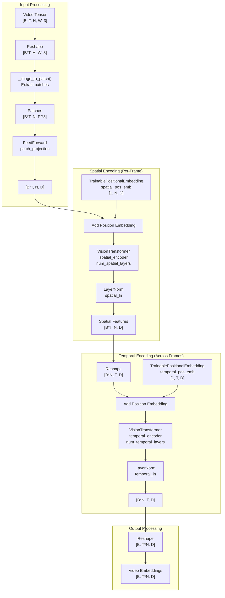
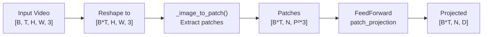
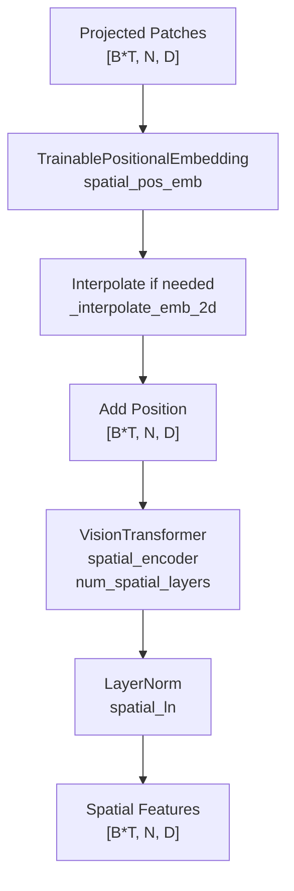
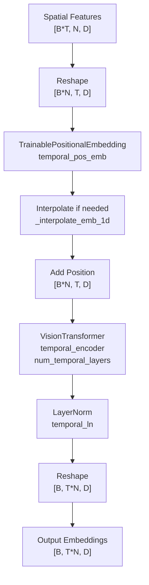
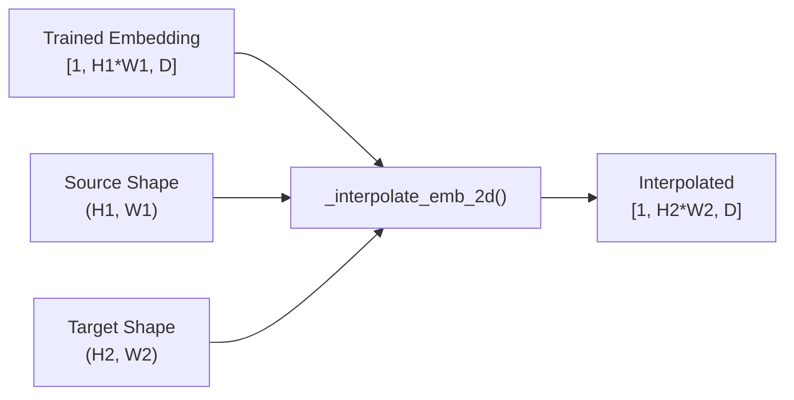
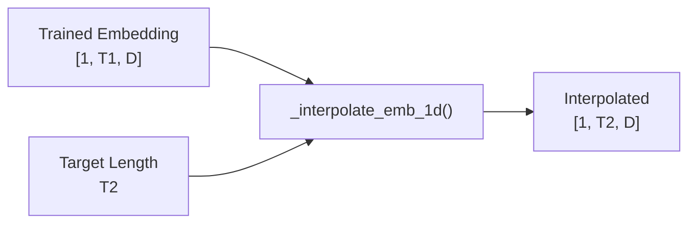
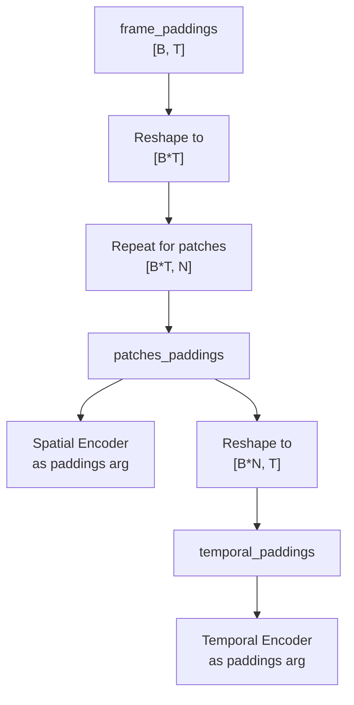
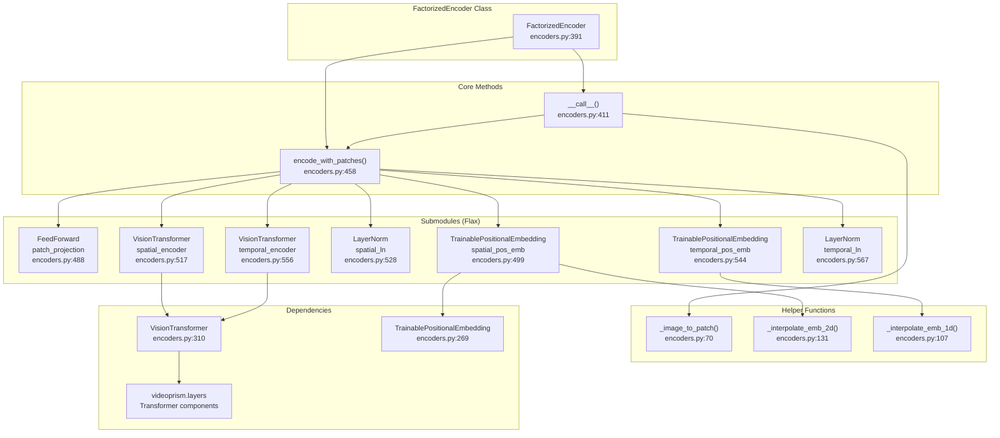

<!-- source: DeepWiki mcp.deepwiki.com · repo google-deepmind/videoprism · extra page FactorizedEncoder · fetched 2026-10-26 -->

# FactorizedEncoder

<details>
<summary>Relevant source files</summary>

The following files were used as context for generating this wiki page:

- [videoprism/encoders.py](videoprism/encoders.py)
- [videoprism/encoders_test.py](videoprism/encoders_test.py)

</details>


## Purpose and Scope

This page documents the `FactorizedEncoder` class, which implements the factorized space-time video encoder architecture from the ViViT paper. This encoder processes videos by separately encoding spatial (per-frame) and temporal (across-frame) dimensions using independent transformer stacks.

For information about:
- The video-text contrastive model that uses this encoder, see [FactorizedVideoCLIP](#4.2.2)
- The video classification model built on this encoder, see page [4.2](#4.2)
- General usage patterns for video feature extraction, see [Video Feature Extraction](#5.1)
- Model variants and configurations, see [Video-Only Models](#3.1)

**Sources:** [videoprism/encoders.py:391-398]()

## Overview

The `FactorizedEncoder` implements a factorized approach to video understanding where spatial and temporal processing are decoupled. Unlike standard video transformers that process spatiotemporal patches jointly, this architecture:

1. **Spatial encoding**: Processes each frame independently through a Vision Transformer to extract spatial features
2. **Temporal encoding**: Aggregates information across frames through a separate transformer that operates on the temporal dimension

This factorization reduces computational complexity while maintaining strong video understanding capabilities. The architecture is based on Model 2 from "ViViT: A Video Vision Transformer" (https://arxiv.org/abs/2103.15691).

**Sources:** [videoprism/encoders.py:391-398]()

## Architecture Diagram



**Sources:** [videoprism/encoders.py:411-580]()

## Class Definition and Parameters

The `FactorizedEncoder` class is defined in [videoprism/encoders.py:391-581]() and inherits from `layers.Module`.

### Configuration Parameters

| Parameter | Type | Default | Description |
|-----------|------|---------|-------------|
| `patch_size` | `int` | `18` | Dimension of square patches extracted from each frame |
| `pos_emb_shape` | `tuple[int, int, int]` | `(16, 16, 16)` | Shape of positional embeddings (T, H, W) used for interpolation |
| `model_dim` | `int` | `768` | Dimension of the model embeddings (D) |
| `num_spatial_layers` | `int` | `12` | Number of transformer layers in spatial encoder |
| `num_temporal_layers` | `int` | `4` | Number of transformer layers in temporal encoder |
| `num_heads` | `int` | `12` | Number of attention heads in both encoders |
| `mlp_dim` | `int` | `3072` | Hidden dimension of feedforward layers |
| `atten_logit_cap` | `float` | `0.0` | Attention logit capping value (disabled if 0.0) |
| `norm_policy` | `str` | `'pre'` | Normalization policy: 'pre', 'post', 'post_skip', or 'primer_hybrid' |
| `scan` | `bool` | `False` | Whether to use `nn.scan` for memory-efficient training |

**Sources:** [videoprism/encoders.py:391-409]()

## Input and Output Specifications

### Main Call Method: `__call__`

```python
def __call__(
    self,
    inputs: Array,
    train: bool = False,
    return_intermediate: bool | Collection[str] = False,
    frame_paddings: Array | None = None,
) -> tuple[Array, dict[str, Array]]
```

#### Arguments

| Argument | Type | Description |
|----------|------|-------------|
| `inputs` | `Array` | Video tensor of shape `[B, T, H, W, 3]` where H == W |
| `train` | `bool` | Whether model is in training mode (affects dropout) |
| `return_intermediate` | `bool \| Collection[str]` | If `True`, returns all intermediate features. If a collection, returns only specified features (e.g., `{'spatial_features'}`) |
| `frame_paddings` | `Array \| None` | Optional binary tensor `[B, T]` where 1 indicates padded frames |

#### Returns

| Return Value | Type | Description |
|--------------|------|-------------|
| `embeddings` | `Array` | Video embeddings of shape `[B, T*N, D]` where N is number of spatial patches per frame |
| `outputs` | `dict[str, Array]` | Dictionary containing intermediate features if requested |

#### Intermediate Outputs

When `return_intermediate` is `True` or contains `'spatial_features'`:
- `outputs['spatial_features']`: Shape `[B, T*N, D]` - features after spatial encoding but before temporal encoding

**Sources:** [videoprism/encoders.py:411-456]()

### Patch-Based Encoding: `encode_with_patches`

```python
@nn.compact
def encode_with_patches(
    self,
    patches: Array,
    image_shape: tuple[int, int, int],
    train: bool = False,
    return_intermediate: bool | Collection[str] = False,
    patches_paddings: Array | None = None,
) -> tuple[Array, dict[str, Array]]
```

This method allows direct encoding of pre-extracted patches, useful when patches are computed externally or cached.

#### Arguments

| Argument | Type | Description |
|----------|------|-------------|
| `patches` | `Array` | Pre-extracted patches `[B*T, N, P²*C]` where P is patch size |
| `image_shape` | `tuple[int, int, int]` | Original video shape (T, H, W) |
| `patches_paddings` | `Array \| None` | Optional padding mask `[B*T, N]` for patches |

**Sources:** [videoprism/encoders.py:458-580]()

## Processing Pipeline Detail

### Phase 1: Patch Extraction and Projection



The encoder begins by treating the video as a batch of independent frames. Each frame is divided into non-overlapping patches of size `patch_size × patch_size`. These patches are then linearly projected to the model dimension.

**Implementation:**
- Line 436: Reshape `[B, T, H, W, C]` to `[B*T, H, W, C]`
- Line 439: Call `_image_to_patch()` helper function
- Lines 488-494: Project patches using `FeedForward` layer named `'patch_projection'`

**Sources:** [videoprism/encoders.py:434-494]()

### Phase 2: Spatial Encoding



Spatial encoding processes each frame independently:

1. **Positional Embeddings**: Trainable 2D spatial position embeddings are added to patches. These embeddings are learned for a specific spatial grid size defined by `pos_emb_shape[-2:]`.

2. **Interpolation**: If the input frame size differs from the trained position embedding size, bilinear interpolation is applied via `_interpolate_emb_2d()` to match the current spatial resolution.

3. **Transformer Encoding**: A Vision Transformer with `num_spatial_layers` processes the patches, allowing each frame to develop spatial understanding through self-attention.

4. **Normalization**: LayerNorm is applied to stabilize features before temporal processing.

**Implementation:**
- Lines 496-514: Spatial position embedding creation and interpolation
- Lines 517-530: Spatial transformer and normalization

**Sources:** [videoprism/encoders.py:496-531]()

### Phase 3: Temporal Encoding



Temporal encoding aggregates information across frames:

1. **Reshape**: The spatial features are reshaped from `[B*T, N, D]` to `[B*N, T, D]`, grouping all temporal instances of each spatial location together.

2. **Temporal Positional Embeddings**: Trainable 1D temporal position embeddings are added. These encode the temporal position of each frame.

3. **Interpolation**: If the number of input frames differs from `pos_emb_shape[0]`, embeddings are interpolated using `_interpolate_emb_1d()`.

4. **Transformer Encoding**: A Vision Transformer with `num_temporal_layers` processes the temporal sequence, enabling each spatial location to aggregate information across time.

5. **Final Reshape**: Output is reshaped to `[B, T*N, D]`, representing all spatiotemporal tokens in a flat sequence.

**Implementation:**
- Lines 534-553: Reshape and temporal position embedding
- Lines 556-572: Temporal transformer and final reshape

**Sources:** [videoprism/encoders.py:533-580]()

## Position Embedding Interpolation

A key feature of `FactorizedEncoder` is its ability to handle variable input sizes through position embedding interpolation.

### Spatial Interpolation

When the input spatial resolution differs from the trained position embedding shape:



The `_interpolate_emb_2d()` function:
1. Reshapes the flattened embedding to 2D: `[H1, W1, D]`
2. Applies bilinear interpolation to resize to `[H2, W2, D]`
3. Flattens back to `[1, H2*W2, D]`

**Implementation:** [videoprism/encoders.py:131-165]()

### Temporal Interpolation

When the number of input frames differs from the trained temporal embedding length:



The `_interpolate_emb_1d()` function uses JAX's `jax.image.resize()` with bilinear interpolation.

**Implementation:**
- Temporal interpolation: [videoprism/encoders.py:107-128]()
- Usage in encoder: [videoprism/encoders.py:551-552]()

**Sources:** [videoprism/encoders.py:107-165](), [videoprism/encoders.py:508-513](), [videoprism/encoders.py:551-552]()

## Frame Padding Support

The encoder supports videos with variable numbers of valid frames through `frame_paddings` and `patches_paddings`:

### Padding Flow



**Usage:**
- If `frame_paddings[b, t] = 1`, frame `t` in batch element `b` is a padding frame
- The padding mask is propagated through both spatial and temporal encoders
- Attention mechanisms use the padding to mask out invalid tokens

**Implementation:**
- Lines 441-447: Convert frame paddings to patch paddings
- Lines 536-540: Convert patch paddings to temporal paddings

**Sources:** [videoprism/encoders.py:441-447](), [videoprism/encoders.py:536-540]()

## Code Entity Mapping



**Sources:** [videoprism/encoders.py:391-581](), [videoprism/encoders.py:310-389](), [videoprism/encoders.py:269-308]()

## Usage in Model Variants

The `FactorizedEncoder` serves as the backbone for several model architectures:

### In FactorizedVideoClassifier

```python
FactorizedVideoClassifier(
    encoder_params={
        'patch_size': 18,
        'pos_emb_shape': (16, 16, 16),
        'model_dim': 768,
        'num_spatial_layers': 12,
        'num_temporal_layers': 4,
        # ... other params
    },
    num_classes=400,
)
```

The classifier wraps the encoder and adds an attention-based pooling layer followed by a classification head.

**Implementation:** [videoprism/encoders.py:583-653]()

### In FactorizedVideoCLIP

```python
FactorizedVideoCLIP(
    patch_size=18,
    pos_emb_shape=(16, 16, 16),
    num_spatial_layers=12,
    num_temporal_layers=4,
    # ... other params
)
```

The VideoCLIP model instantiates a `FactorizedEncoder` as its `'vision_encoder'` submodule for processing video inputs.

**Implementation:** [videoprism/encoders.py:822-841]()

**Sources:** [videoprism/encoders.py:583-653](), [videoprism/encoders.py:762-910]()

## Testing

The encoder is thoroughly tested in [videoprism/encoders_test.py:123-182](). Key test scenarios include:

| Test Scenario | What It Validates |
|---------------|-------------------|
| Shape validation | Output shape is `[B, T*N, D]` as expected |
| Parameter counting | Correct number of parameters based on `scan` setting |
| Training mode | Encoder works in both train and eval modes |
| Scan mode | Memory-efficient `nn.scan` produces same outputs |
| Intermediate features | `return_intermediate` correctly returns spatial features |
| Frame padding | Padding masks are correctly propagated |
| Position interpolation | Encoder handles variable input sizes |

### Example Test Structure

```python
def test_factorized_encoder(self, scan, train, return_intermediate):
    inputs = jnp.asarray(np.random.normal(..., [B, T, H, W, 3]))
    enc = encoders.FactorizedEncoder(
        patch_size=4,
        model_dim=8,
        num_spatial_layers=2,
        num_temporal_layers=2,
        scan=scan,
    )
    (embeddings, outputs), params = enc.init_with_output(...)
    # Assertions on shapes and outputs
```

**Sources:** [videoprism/encoders_test.py:115-182]()

## Implementation Notes

### Memory Efficiency with Scan

When `scan=True`, the transformer layers use Flax's `nn.scan` to process layers sequentially with reduced memory footprint. This is particularly useful for:
- Large models with many layers
- Training with limited GPU memory
- Processing long videos with many frames

The scan mode significantly reduces parameter count in the parameter tree (e.g., 40 vs 72 parameters) by sharing layer implementations.

**Sources:** [videoprism/encoders.py:409](), [videoprism/encoders_test.py:170]()

### Dtype Management

The encoder inherits from `layers.Module`, which provides automatic dtype management:
- `dtype`: Storage dtype for parameters (default: `float32`)
- `fprop_dtype`: Computation dtype for forward pass (can be `bfloat16` for efficiency)

All submodules receive these dtype parameters for consistent precision throughout the network.

**Sources:** [videoprism/encoders.py:391]()

### Normalization Policy

The `norm_policy` parameter controls when layer normalization is applied:
- `'pre'`: Pre-norm (before transformer blocks) - default and recommended
- `'post'`: Post-norm (after transformer blocks)
- `'post_skip'`: After skip connection
- `'primer_hybrid'`: Both pre and post

Pre-norm is generally preferred for training stability in deep transformers.

**Sources:** [videoprism/encoders.py:408](), [videoprism/encoders.py:523](), [videoprism/encoders.py:562]()

## Related Components

- **VisionTransformer** [videoprism/encoders.py:310-389](): The underlying transformer used for both spatial and temporal encoding
- **TrainablePositionalEmbedding** [videoprism/encoders.py:269-308](): Learnable position embeddings used for spatial and temporal positions
- **StackedTransformer** [videoprism/layers](): The actual transformer implementation with attention and feedforward layers
- **_image_to_patch()** [videoprism/encoders.py:70-104](): Utility function for extracting patches from images

**Sources:** [videoprism/encoders.py:310-389](), [videoprism/encoders.py:269-308](), [videoprism/encoders.py:70-104]()

---

