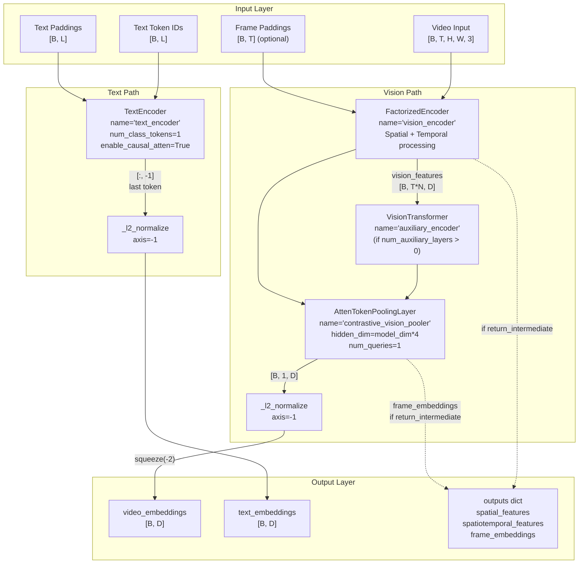
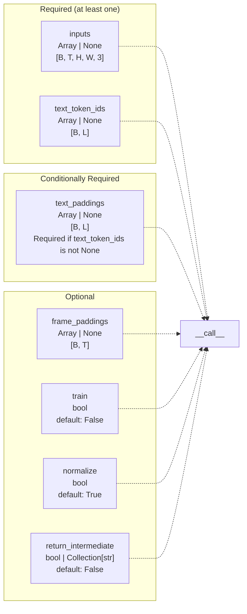
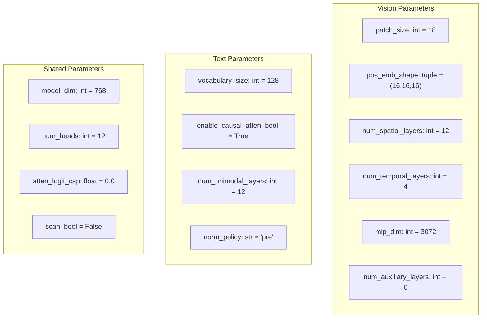
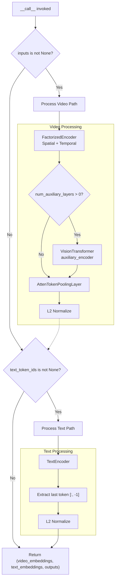
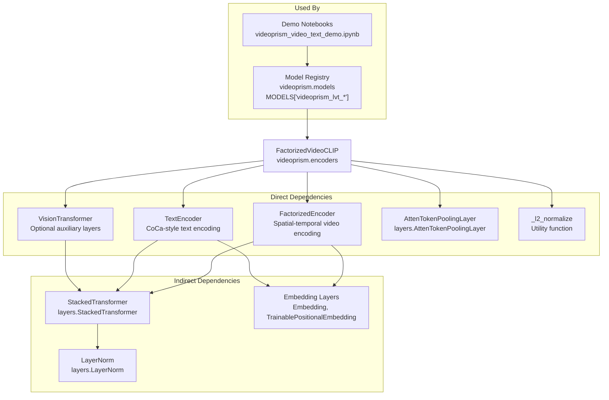

<!-- source: DeepWiki mcp.deepwiki.com · repo google-deepmind/videoprism · extra page FactorizedVideoCLIP · fetched 2026-10-26 -->

# FactorizedVideoCLIP

<details>
<summary>Relevant source files</summary>

The following files were used as context for generating this wiki page:

- [videoprism/encoders.py](videoprism/encoders.py)
- [videoprism/encoders_test.py](videoprism/encoders_test.py)

</details>


## Purpose and Scope

This document describes the `FactorizedVideoCLIP` architecture, a video-text contrastive learning model that produces aligned embeddings for both video and text modalities. This architecture enables cross-modal retrieval, zero-shot classification, and other video-text tasks by learning a shared embedding space.

For information about the video-only encoder without text capabilities, see [FactorizedEncoder](#4.2.1). For details on the standalone text encoder, see [TextEncoder](#4.2.3). For practical usage examples with VideoCLIP models, see [Video-Text Retrieval](#5.2).

**Sources:** [videoprism/encoders.py:762-910]()

## Architecture Overview

`FactorizedVideoCLIP` combines separate video and text processing pathways that converge into a shared embedding space through contrastive learning. The architecture implements a dual-encoder design where video and text inputs are independently encoded, then projected and normalized for similarity computation.



**Sources:** [videoprism/encoders.py:762-910]()

## Core Components

### Vision Encoder Path

The vision pathway processes video inputs through a multi-stage pipeline:

| Stage | Component | Purpose | Output Shape |
|-------|-----------|---------|--------------|
| 1. Spatial-Temporal Encoding | `FactorizedEncoder` | Extracts spatiotemporal features via factorized attention | `[B, T*N, D]` |
| 2. Auxiliary Processing (optional) | `VisionTransformer` | Additional transformer layers if `num_auxiliary_layers > 0` | `[B, T*N, D]` |
| 3. Contrastive Pooling | `AttenTokenPoolingLayer` | Pools features to single global video embedding | `[B, 1, D]` |
| 4. Normalization | `_l2_normalize` | L2-normalizes for contrastive learning | `[B, D]` |

The `FactorizedEncoder` is instantiated with its own configuration parameters:

```python
FactorizedEncoder(
    name='vision_encoder',
    patch_size=self.patch_size,
    pos_emb_shape=self.pos_emb_shape,
    model_dim=self.model_dim,
    num_spatial_layers=self.num_spatial_layers,
    num_temporal_layers=self.num_temporal_layers,
    num_heads=self.num_heads,
    mlp_dim=self.mlp_dim,
    atten_logit_cap=self.atten_logit_cap,
    norm_policy='pre',
    scan=self.scan,
    dtype=self.dtype,
    fprop_dtype=self.fprop_dtype,
)
```

**Sources:** [videoprism/encoders.py:820-841]()

### Text Encoder Path

The text pathway processes tokenized text inputs through a CoCa-style transformer encoder:

| Stage | Component | Purpose | Output Shape |
|-------|-----------|---------|--------------|
| 1. Token Encoding | `TextEncoder` | Processes token sequences with causal attention and class token | `[B, L+1, D]` |
| 2. Class Token Extraction | Indexing `[:, -1]` | Extracts the appended class token as global text representation | `[B, D]` |
| 3. Normalization | `_l2_normalize` | L2-normalizes for contrastive learning | `[B, D]` |

The `TextEncoder` is configured with:

```python
TextEncoder(
    name='text_encoder',
    vocabulary_size=self.vocabulary_size,
    num_class_tokens=1,
    enable_causal_atten=self.enable_causal_atten,
    model_dim=self.model_dim,
    num_layers=self.num_unimodal_layers,
    num_heads=self.num_heads,
    mlp_dim=self.model_dim * 4,
    atten_logit_cap=self.atten_logit_cap,
    norm_policy=self.norm_policy,
    scan=self.scan,
    dtype=self.dtype,
    fprop_dtype=self.fprop_dtype,
)
```

**Note:** The text encoder uses `num_unimodal_layers` (not `num_layers` attribute) and `mlp_dim=self.model_dim * 4` (not `self.mlp_dim`), creating an independent configuration from the vision path.

**Sources:** [videoprism/encoders.py:887-903](), [videoprism/encoders.py:656-759]()

### Contrastive Vision Pooler

The `AttenTokenPoolingLayer` aggregates spatiotemporal features into a single global embedding using attention-based pooling:

```python
pooling_layer = layers.AttenTokenPoolingLayer(
    name='contrastive_vision_pooler',
    hidden_dim=self.model_dim * 4,
    num_heads=self.num_heads,
    num_queries=1,
    dtype=self.dtype,
    fprop_dtype=self.fprop_dtype,
)
```

Key characteristics:
- **hidden_dim**: Set to `model_dim * 4`, providing increased capacity for pooling
- **num_queries**: Always 1, producing a single global embedding
- **Output**: Shape `[B, 1, D]`, which is squeezed to `[B, D]` via `jnp.squeeze(video_embeddings, axis=-2)`

**Sources:** [videoprism/encoders.py:859-870]()

## Input and Output Specification

### Input Parameters



| Parameter | Type | Description |
|-----------|------|-------------|
| `inputs` | `Array \| None` | Video frames `[B, T, H, W, 3]` where H==W. Can be None if only processing text. |
| `text_token_ids` | `Array \| None` | Token IDs `[B, L]`. Can be None if only processing video. |
| `text_paddings` | `Array \| None` | Binary padding mask `[B, L]` where 1 indicates padding. Required when `text_token_ids` is provided. |
| `train` | `bool` | Training mode flag affecting dropout behavior. Default: `False`. |
| `normalize` | `bool` | Whether to L2-normalize output embeddings. Default: `True`. |
| `return_intermediate` | `bool \| Collection[str]` | If `True`, returns all intermediate features. If a collection, returns only specified features (`'spatial_features'`, `'spatiotemporal_features'`, `'frame_embeddings'`). Default: `False`. |
| `frame_paddings` | `Array \| None` | Binary mask `[B, T]` where 1 indicates padding frame. Default: `None`. |

**Sources:** [videoprism/encoders.py:784-793]()

### Output Specification

The `__call__` method returns a tuple of three elements:

```python
(video_embeddings, text_embeddings, outputs) = model(...)
```

| Return Value | Type | Shape | Description |
|--------------|------|-------|-------------|
| `video_embeddings` | `Array \| None` | `[B, D]` | Global video embedding. None if `inputs` is None. Normalized if `normalize=True`. |
| `text_embeddings` | `Array \| None` | `[B, D]` | Global text embedding. None if `text_token_ids` is None. Normalized if `normalize=True`. |
| `outputs` | `dict[str, Array]` | Variable | Dictionary of intermediate outputs based on `return_intermediate` parameter. |

#### Intermediate Outputs Dictionary

When `return_intermediate` is enabled, the `outputs` dictionary may contain:

| Key | Shape | Source | Description |
|-----|-------|--------|-------------|
| `'spatial_features'` | `[B, T*N, D]` | `FactorizedEncoder` | Per-patch features after spatial encoding, before temporal encoding. |
| `'spatiotemporal_features'` | `[B, T*N, D]` | `FactorizedEncoder` | Full spatiotemporal features after both spatial and temporal encoding. |
| `'frame_embeddings'` | `[B, T, D]` | Pooler + reshape | Per-frame global embeddings. Computed by pooling each frame's patches separately. |

**Sources:** [videoprism/encoders.py:793-817](), [videoprism/encoders.py:874-885]()

## Configuration Parameters

The `FactorizedVideoCLIP` class is configured through the following attributes:



### Vision-Specific Parameters

| Parameter | Type | Default | Description |
|-----------|------|---------|-------------|
| `patch_size` | `int` | 18 | Size of square patches for video tokenization. |
| `pos_emb_shape` | `tuple[int, int, int]` | (16, 16, 16) | Shape for positional embeddings (temporal, spatial_height, spatial_width). |
| `num_spatial_layers` | `int` | 12 | Number of transformer layers in spatial encoder. |
| `num_temporal_layers` | `int` | 4 | Number of transformer layers in temporal encoder. |
| `mlp_dim` | `int` | 3072 | Hidden dimension for MLP layers in vision transformers. |
| `num_auxiliary_layers` | `int` | 0 | Number of additional transformer layers after factorized encoder. Set to 0 to skip auxiliary processing. |

### Text-Specific Parameters

| Parameter | Type | Default | Description |
|-----------|------|---------|-------------|
| `vocabulary_size` | `int` | 128 | Size of the text vocabulary. |
| `enable_causal_atten` | `bool` | True | Whether to use causal (autoregressive) attention in text encoder. |
| `num_unimodal_layers` | `int` | 12 | Number of transformer layers in text encoder. |
| `norm_policy` | `str` | 'pre' | Normalization policy for text transformer ('pre', 'post', 'post_skip', 'primer_hybrid'). |

### Shared Parameters

| Parameter | Type | Default | Description |
|-----------|------|---------|-------------|
| `model_dim` | `int` | 768 | Model dimension (embedding size) shared across video and text. |
| `num_heads` | `int` | 12 | Number of attention heads for all transformer layers. |
| `atten_logit_cap` | `float` | 0.0 | Attention logit capping value. Disabled when 0.0. |
| `scan` | `bool` | False | Whether to use `nn.scan` for memory-efficient sequential processing. |

**Sources:** [videoprism/encoders.py:765-781]()

## Processing Flow

The following diagram illustrates the conditional execution flow based on which inputs are provided:



**Important Implementation Note:** At least one of `inputs` or `text_token_ids` must be provided. If both are None, the model will return `(None, None, {})`.

**Sources:** [videoprism/encoders.py:818-910]()

## Frame-Level Embeddings

When `return_intermediate` includes `'frame_embeddings'`, the model computes per-frame global embeddings by reshaping and pooling:

```python
# Shape transformations for frame embeddings
vision_features: [B, T*N, D]  # Spatiotemporal features
↓ einshape 'b(tn)d->(bt)nd'
frame_features: [B*T, N, D]  # Reshaped to process each frame
↓ pooling_layer
frame_embeddings: [B*T, 1, D]  # Pooled per frame
↓ squeeze(-2) + einshape '(bt)d->btd'
frame_embeddings: [B, T, D]  # Final per-frame embeddings
```

This enables frame-level retrieval and temporal localization tasks.

**Sources:** [videoprism/encoders.py:874-885]()

## Normalization

The `_l2_normalize` function is applied to both video and text embeddings when `normalize=True`:

```python
def _l2_normalize(x: Array, axis: int | Sequence[int] = -1, epsilon: float = 1e-12) -> Array:
    # Convert to float32 for all precisions
    x = x.astype(jnp.float32)
    norm = jnp.sqrt(jnp.sum(x * x, axis=axis, keepdims=True) + epsilon)
    return (x / norm).astype(x_dtype)
```

Key characteristics:
- **Precision handling**: Always computes norm in float32, then casts back to original dtype
- **Numerical stability**: Adds epsilon=1e-12 to prevent division by zero
- **Default axis**: Normalizes along the last dimension (-1)

This normalization ensures embeddings lie on the unit hypersphere, enabling cosine similarity computation via simple dot product.

**Sources:** [videoprism/encoders.py:50-67]()

## Usage Example

The following pattern demonstrates typical usage for video-text similarity computation:

```python
# Initialize model
model = FactorizedVideoCLIP(
    patch_size=18,
    pos_emb_shape=(16, 16, 16),
    model_dim=768,
    num_spatial_layers=12,
    num_temporal_layers=4,
    num_heads=12,
    mlp_dim=3072,
    vocabulary_size=32000,
    num_unimodal_layers=12,
)

# Prepare inputs
video_input = ...  # [B, T, H, W, 3]
text_token_ids = ...  # [B, L]
text_paddings = ...  # [B, L]

# Forward pass
video_emb, text_emb, _ = model(
    inputs=video_input,
    text_token_ids=text_token_ids,
    text_paddings=text_paddings,
    train=False,
    normalize=True,
)

# Compute similarity
similarity = jnp.matmul(video_emb, text_emb.T)  # [B, B]
```

For actual model instantiation from pretrained weights, see the [Model Management System](#4.1) documentation.

**Sources:** [videoprism/encoders.py:762-910]()

## Testing

The test suite for `FactorizedVideoCLIP` validates:

- **Shape correctness**: Output dimensions match expected shapes for various configurations
- **Parameter count**: Proper parameter initialization with and without `scan=True`
- **Intermediate outputs**: Correct handling of `return_intermediate` parameter with selective feature return
- **Normalization**: L2-normalized embeddings when `normalize=True`
- **Dual-modality processing**: Simultaneous video and text encoding

Example test configuration from [videoprism/encoders_test.py:309-325]():

```python
net = encoders.FactorizedVideoCLIP(
    patch_size=4,
    pos_emb_shape=(16, 16, 16),
    num_spatial_layers=2,
    num_temporal_layers=2,
    mlp_dim=4,
    num_auxiliary_layers=1,
    vocabulary_size=20,
    model_dim=8,
    num_heads=2,
    scan=True,
)
```

Expected parameter counts:
- With `scan=True`: 88 parameters
- Without `scan=False`: 136 parameters

**Sources:** [videoprism/encoders_test.py:276-372]()

## Relationship to Other Components



- **FactorizedEncoder**: Provides spatiotemporal video feature extraction (see [FactorizedEncoder](#4.2.1))
- **TextEncoder**: Handles text token processing (see [TextEncoder](#4.2.3))
- **Layer Components**: Builds on transformer primitives (see [Layer Components](#4.3))
- **Model Management**: Registered in model registry as `videoprism_lvt_public_v1_base` and `videoprism_lvt_public_v1_large` (see [Model Management System](#4.1))

**Sources:** [videoprism/encoders.py:762-910](), [videoprism/encoders.py:15-28]()

---

