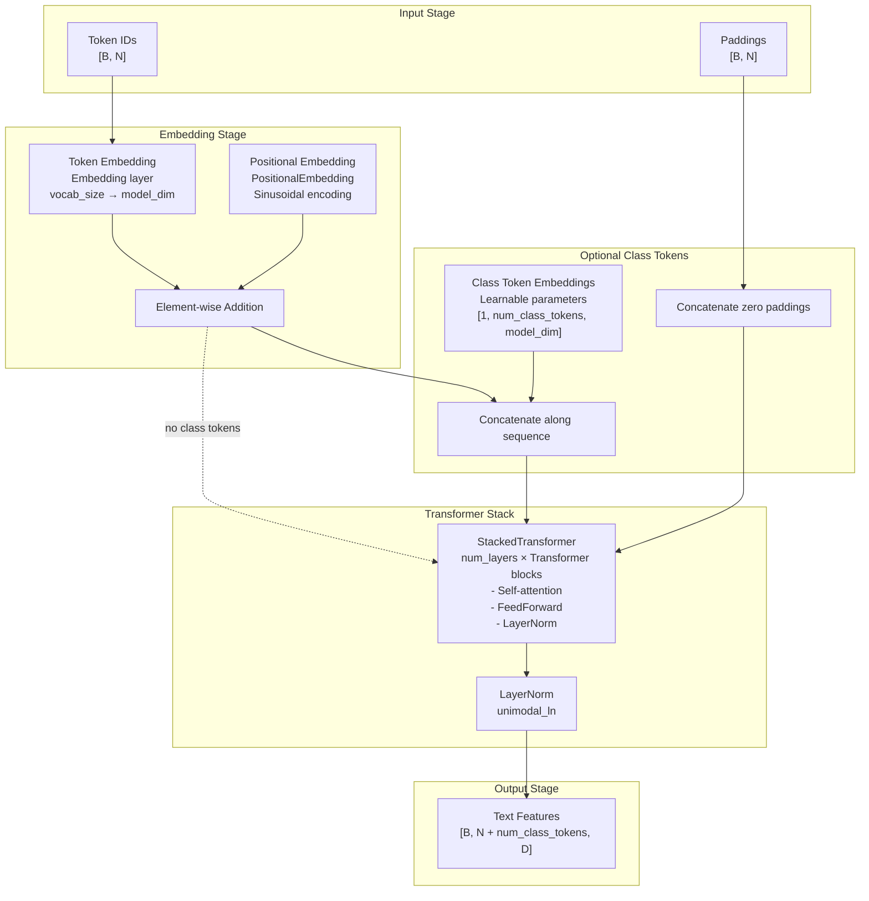
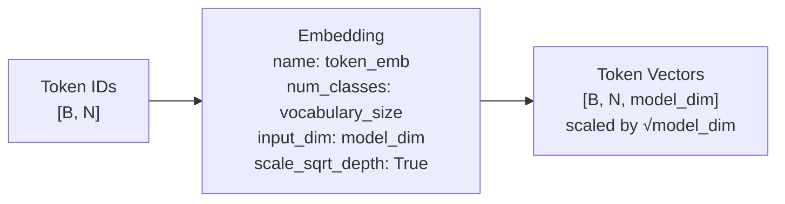
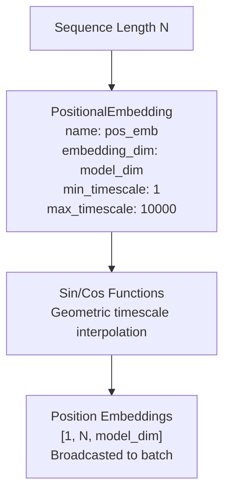
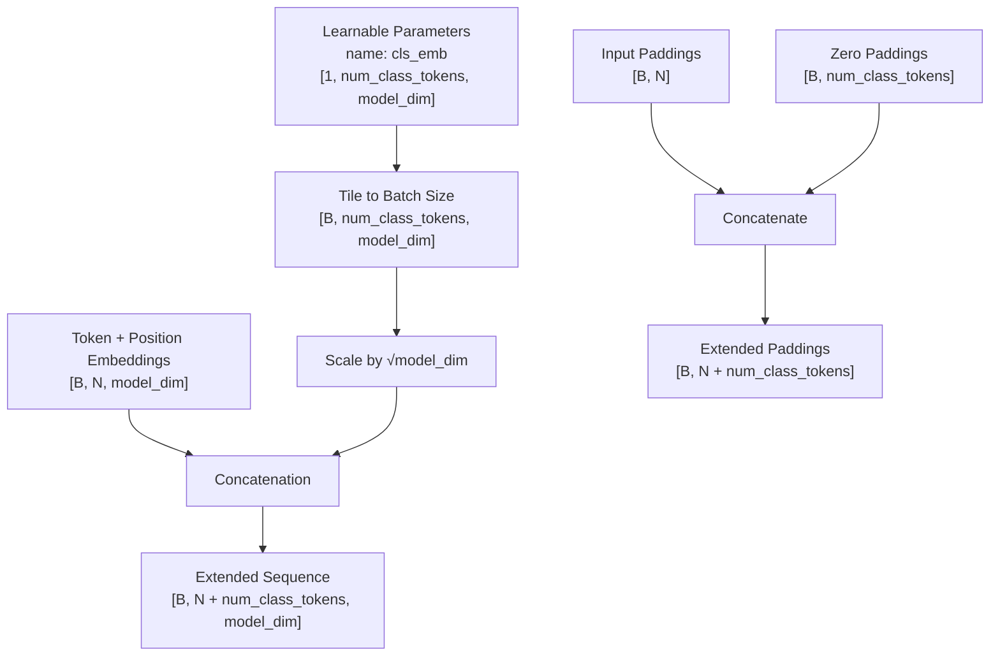
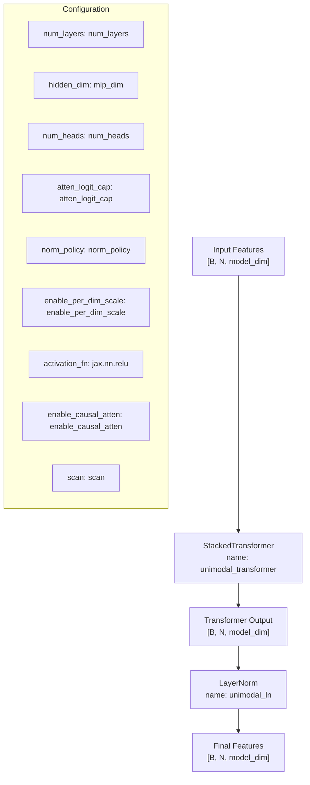
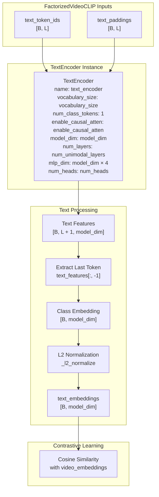

<!-- source: DeepWiki mcp.deepwiki.com · repo google-deepmind/videoprism · extra page TextEncoder · fetched 2026-10-26 -->

# TextEncoder

<details>
<summary>Relevant source files</summary>

The following files were used as context for generating this wiki page:

- [videoprism/encoders.py](videoprism/encoders.py)
- [videoprism/encoders_test.py](videoprism/encoders_test.py)

</details>


## Purpose and Scope

The `TextEncoder` is a CoCa-style transformer-based text encoder that processes tokenized text sequences into embedding representations. It serves as the text modality encoder within the VideoPrism architecture, specifically as a component of the `FactorizedVideoCLIP` model for video-text contrastive learning tasks.

This document covers the architecture, configuration, and internal implementation of the text encoding component. For information about the complete video-text model that uses this encoder, see [FactorizedVideoCLIP](#4.2.2). For details about tokenization that precedes text encoding, see [Text Tokenization](#4.4).

**Sources:** [videoprism/encoders.py:656-759]()

---

## Architecture Overview

The `TextEncoder` implements a uni-modal transformer architecture with the following processing pipeline:



**Diagram: TextEncoder Data Flow Pipeline**

The encoder processes token IDs through embedding layers, adds positional information, optionally appends learnable class tokens, and processes the sequence through transformer layers to produce contextualized embeddings.

**Sources:** [videoprism/encoders.py:692-759]()

---

## Input and Output Specifications

### Input Format

The `TextEncoder.__call__` method accepts the following inputs:

| Parameter | Type | Shape | Description |
|-----------|------|-------|-------------|
| `inputs` | `Array` | `[B, N]` | Token ID sequences (integers from vocabulary) |
| `paddings` | `Array` | `[B, N]` | Binary padding mask (1 = padded position, 0 = valid token) |
| `train` | `bool` | scalar | Training mode flag (affects dropout behavior) |

Where:
- `B` = batch size
- `N` = sequence length
- Token IDs must be in range `[0, vocabulary_size)`

### Output Format

Returns a single `Array` with shape `[B, N + num_class_tokens, D]` containing contextualized token embeddings, where:
- `D` = `model_dim` (embedding dimension)
- If `num_class_tokens > 0`, the last `num_class_tokens` positions contain class token embeddings
- All sequence positions are processed by the transformer, preserving sequence order

**Sources:** [videoprism/encoders.py:693-705]()

---

## Core Components

### Token Embedding Layer

The `Embedding` component performs vocabulary lookup to convert token IDs to dense vectors:



**Diagram: Token Embedding Lookup**

The embedding matrix has shape `[vocabulary_size, model_dim]` and is initialized with normal distribution (stddev = `1/√model_dim`). The `scale_sqrt_depth=True` parameter applies an additional `√model_dim` scaling factor to the output embeddings, following standard transformer practices.

**Sources:** [videoprism/encoders.py:714-721](), [videoprism/encoders.py:168-224]()

### Positional Embedding

Sinusoidal positional encodings are generated dynamically based on sequence length:



**Diagram: Positional Embedding Generation**

The positional embeddings use sinusoidal functions with varying frequencies, allowing the model to learn relative positions. This is a non-learnable, deterministic encoding that generalizes to sequence lengths beyond those seen during training.

**Sources:** [videoprism/encoders.py:708-713](), [videoprism/encoders.py:227-266]()

### Class Token Injection

When `num_class_tokens > 0`, learnable class tokens are appended to the sequence:



**Diagram: Class Token Concatenation**

Class tokens are initialized from a normal distribution with stddev `1/√model_dim`, scaled by `√model_dim`, and tiled across the batch dimension. They are appended at the end of the sequence and given zero paddings (marking them as valid tokens).

**Sources:** [videoprism/encoders.py:724-740]()

### Transformer Stack

The core processing is performed by a `StackedTransformer`:



**Diagram: Transformer Stack Configuration**

Key configuration choices:
- **Activation function:** `jax.nn.relu` (differs from video encoder's GELU)
- **Causal attention:** Controlled by `enable_causal_atten` parameter (typically `True` for CoCa-style models)
- **Per-dimension scaling:** Optional per-dimension attention scaling via `enable_per_dim_scale`

**Sources:** [videoprism/encoders.py:742-758]()

---

## Configuration Parameters

The `TextEncoder` class attributes define the architecture:

| Parameter | Type | Default | Description |
|-----------|------|---------|-------------|
| `vocabulary_size` | `int` | `128` | Number of tokens in the vocabulary |
| `num_class_tokens` | `int` | `0` | Number of learnable class tokens to append |
| `enable_causal_atten` | `bool` | `True` | Enable causal (autoregressive) attention masking |
| `model_dim` | `int` | `768` | Model hidden dimension |
| `num_layers` | `int` | `12` | Number of transformer layers |
| `mlp_dim` | `int` | `3072` | Hidden dimension in feedforward networks |
| `num_heads` | `int` | `12` | Number of attention heads |
| `atten_logit_cap` | `float` | `0.0` | Cap attention logits with tanh (disabled if ≤ 0) |
| `norm_policy` | `str` | `'pre'` | Normalization policy ('pre', 'post', 'primer_hybrid', 'post_skip') |
| `enable_per_dim_scale` | `bool` | `False` | Enable per-dimension attention logit scaling |
| `scan` | `bool` | `False` | Use `nn.scan` for memory-efficient layer iteration |

**Configuration Guidelines:**
- For video-text models, set `num_class_tokens=1` to get a single global text embedding
- Enable `enable_causal_atten=True` for language modeling objectives
- Use `scan=True` for large models to reduce memory footprint during training

**Sources:** [videoprism/encoders.py:680-690]()

---

## Integration with FactorizedVideoCLIP

The `TextEncoder` is instantiated within `FactorizedVideoCLIP` for cross-modal contrastive learning:



**Diagram: TextEncoder Integration in FactorizedVideoCLIP**

**Key Integration Details:**

1. **Configuration**: The `FactorizedVideoCLIP` passes shared parameters (`model_dim`, `num_heads`, `atten_logit_cap`) and text-specific parameters (`vocabulary_size`, `num_unimodal_layers`)

2. **Class Token Usage**: Always sets `num_class_tokens=1` to obtain a single global text representation

3. **MLP Dimension**: Uses `model_dim * 4` for the feedforward hidden dimension (4× expansion ratio)

4. **Output Extraction**: Takes the last token in the sequence (`text_features[:, -1]`), which corresponds to the appended class token

5. **Normalization**: Applies L2 normalization to text embeddings before computing contrastive loss with video embeddings

**Sources:** [videoprism/encoders.py:887-908]()

---

## Usage Patterns

### Standard Usage within VideoCLIP

The `TextEncoder` is typically not used directly but as a component of `FactorizedVideoCLIP`:

```python
# Example from FactorizedVideoCLIP.__call__
if text_token_ids is not None:
    assert text_paddings is not None, 'Text paddings are required.'
    text_features = TextEncoder(
        name='text_encoder',
        vocabulary_size=self.vocabulary_size,
        num_class_tokens=1,
        enable_causal_atten=self.enable_causal_atten,
        model_dim=self.model_dim,
        num_layers=self.num_unimodal_layers,
        num_heads=self.num_heads,
        mlp_dim=self.model_dim * 4,
        atten_logit_cap=self.atten_logit_cap,
        norm_policy=self.norm_policy,
        scan=self.scan,
        dtype=self.dtype,
        fprop_dtype=self.fprop_dtype,
    )(text_token_ids, text_paddings, train=train)
    
    # Take the last token (i.e., class token) as the text embedding.
    text_embeddings = text_features[:, -1]
    if normalize:
        text_embeddings = _l2_normalize(text_embeddings, axis=-1)
```

**Sources:** [videoprism/encoders.py:889-908]()

### Testing Instantiation

From the test suite, example instantiation patterns:

```python
# Example from encoders_test.py
enc = encoders.TextEncoder(
    name='enc',
    vocabulary_size=vocab_size,
    num_class_tokens=1,
    model_dim=dim,
    num_layers=2,
    mlp_dim=4,
    num_heads=2,
    atten_logit_cap=50.0,
    scan=scan,
)

outputs, params = enc.init_with_output(
    prng_key, inputs, paddings, train=train
)
```

**Key Testing Observations:**
- With `num_class_tokens=1` and `seq_len=10`, output shape is `[batch_size, 11, dim]`
- With `scan=True`, the model has 20 parameters in the flattened tree
- With `scan=False`, the model has 36 parameters (more explicit layer storage)

**Sources:** [videoprism/encoders_test.py:245-274]()

---

## Parameter Counts and Memory

### Layer Structure

The `TextEncoder` contains the following trainable parameters:

| Component | Parameters | Notes |
|-----------|------------|-------|
| Token Embedding | `vocabulary_size × model_dim` | Vocabulary lookup table |
| Class Token Embedding | `num_class_tokens × model_dim` | Only if `num_class_tokens > 0` |
| Transformer Layers | `num_layers × layer_params` | Attention + FFN weights per layer |
| Final LayerNorm | `2 × model_dim` | Scale and bias parameters |

Where each transformer layer contains:
- Self-attention: `4 × (model_dim × model_dim)` for Q, K, V, output projections
- Feedforward: `2 × (model_dim × mlp_dim)` for two linear layers
- LayerNorms: `2 × (2 × model_dim)` for attention and FFN normalization

### Memory Optimization

The `scan=True` option reduces memory by:
- Scanning over transformer layers instead of unrolling them
- Reducing intermediate activation storage
- Trading off compute (recomputation during backward pass) for memory

**Sources:** [videoprism/encoders_test.py:273]()

---

## Comparison with Vision Components

| Aspect | TextEncoder | FactorizedEncoder (Video) |
|--------|-------------|---------------------------|
| **Input Type** | Token IDs (discrete) | Image patches (continuous) |
| **Positional Encoding** | Sinusoidal (1D) | Trainable (2D spatial + 1D temporal) |
| **Attention Pattern** | Causal (optional) | Bidirectional |
| **Activation Function** | ReLU | GELU |
| **Architecture Style** | Uni-modal, single stack | Bi-modal, factorized spatial-temporal |
| **Output Pooling** | Last token (class token) | Attention pooling |

The architectural differences reflect the distinct characteristics of text (sequential, discrete) versus video (spatial-temporal, continuous) modalities.

**Sources:** [videoprism/encoders.py:656-759](), [videoprism/encoders.py:391-580]()

---

