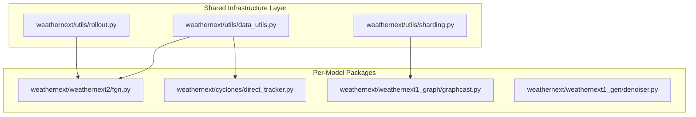
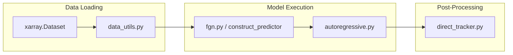

<!-- source: DeepWiki mcp.deepwiki.com · repo google-deepmind/weathernext · page 1 Overview · fetched 2026-10-26 -->

# Overview

Relevant source files

The following files were used as context for generating this wiki page:

- [CONTRIBUTING.md](CONTRIBUTING.md)
- [LICENSE](LICENSE)
- [README.md](README.md)
- [setup.py](setup.py)
- [weathernext/__init__.py](weathernext/__init__.py)

WeatherNext is the primary code repository for Google DeepMind and Google Research's advanced atmospheric and weather forecasting models [README.md:5-7](). The repository contains the implementation for **WeatherNext 2 (FGN)**, **WeatherNext Cyclones**, and legacy modeling architectures including **GraphCast** and **GenCast** [README.md:1-12](). Built on top of **JAX**, **Haiku**, **Jraph**, and **dinosaur-dycore**, the codebase provides a modular, high-performance framework for global medium-range weather prediction, ensemble generation, and tropical cyclone tracking [README.md:5-7](), [setup.py:32-54]().

The overall architecture philosophy relies on a shared utility infrastructure (`weathernext/utils`) that provides data loading, normalization, rollout wrappers, loss functions, and sharding primitives, combined with isolated model-specific packages (`weathernext2`, `cyclones`, `weathernext1_graph`, `weathernext1_gen`).

Diagram: Architecture Philosophy: Shared Utilities and Per-Model Packages

**Sources:** [README.md:35-46](), [setup.py:28]()

## Getting Started: Installation and Dependencies

Getting up and running with WeatherNext involves installing the package from source using `setup.py`, satisfying core deep learning dependencies such as JAX, Haiku, Jraph, Fiddle, and `gdm-xarray-jax`, and downloading pretrained model weights from Google Cloud Storage [README.md:110-141](), [setup.py:32-54](). Python 3.10 or 3.11 is required [setup.py:60-61]().

For detailed instructions on environment setup, package versions, and weight acquisition, see [Getting Started: Installation and Dependencies](#1.1).

**Sources:** [README.md:110-141](), [setup.py:32-61]()

## Pretrained Models and Checkpoints

The repository supports various pretrained checkpoint families designed for specific resolutions and training cutoffs [README.md:47-89](). This includes **WeatherNext2_<2025** (0.25° resolution fine-tuned on ECMWF HRES initial conditions) [README.md:57-61](), **WeatherNextCyclones_<2025/_<2024/_<2023** for operational tropical cyclone tracking [README.md:63-78](), and lightweight **WeatherNextCyclones_Mini** variants (1° resolution) suitable for local testing or single accelerator setups [README.md:79-88]().

For a complete catalog of released checkpoints, Google Cloud Storage (GCS) paths, and associated hardware requirements, see [Pretrained Models and Checkpoints](#1.2).

**Sources:** [README.md:47-89]()

## Running the Demo Notebooks

To help users explore model capabilities quickly, the repository includes interactive Jupyter notebooks located under `docs/` [README.md:96-103](). These demonstrate loading model weights from GCS, initializing model wrappers, executing autoregressive rollouts, visualizing meteorological fields, and running the direct cyclone tracker [README.md:113-122]().

Diagram: Model and Data Pipeline Flow

**Sources:** [README.md:96-122](), [setup.py:32-54]()

For a comprehensive walkthrough of `wn2_demo.ipynb`, the cyclone gridding/tracking demo, `graphcast_demo.ipynb`, and `gencast_mini_demo.ipynb`, see [Running the Demo Notebooks](#1.3).

**Sources:** [README.md:96-122]()

---

